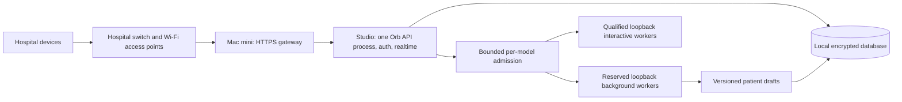

# Orb: 200 concurrent requests and 30-minute patient drafts

21 October 2026. Engineering implementation and capacity decision, not a
clinical validation or a hardware purchase guarantee.

The [retrieval/serving follow-up](perf/capacity-optimisation-2026-10-21/README.md)
records the newer scoped query/indexes, bounded retrieval executor, verified
trust-context reuse, coalesced residency probes and controlled serving tests.
Its full installed-retrieval test completed 200 fake-model requests in 26.82s,
still missing the class deadlines. Three real 27B answers completed in
21.45/24.48/26.01s; the final real 200-attempt qualification stopped at the
unchanged memory-compression guard without a completed-cohort result.
The original measurements below remain historical evidence; they do not
qualify the later source or full clinical retrieval automatically.

The hardware decision is confirmed: **Apple hardware only**. See the
[current hardware comparison and Apple qualification budgets](engineering/apple-only-hardware-sizing-2026-10-21.md)
for verified prices, the unavailable 512 GB option, staged cluster testing and
the remaining multi-Mac transport work.

## Decision

The application now has bounded HTTP admission, task-owned local inference
worker leases, a persistent patient-summary scheduler and a patient-card view
of saved drafts. **200 cached summary reads were demonstrated. 200 fresh AI
answers within 3/5/15 seconds were not.** Increasing a queue limit or buying
more RAM cannot turn the latter into an established result.

## Serving topology

The mini forwards logins; credential validation remains in Orb on the Studio.
The mini does not supply Wi-Fi access-point infrastructure, add GPU memory to
the Studio, or become an automatic current-data failover server. Never put a
SQLite WAL database on a network share. The proxy example verifies the Studio
TLS certificate, preserves SSE/WebSockets, and overwrites incoming forwarding
headers. Only the actual mini address should be trusted by the Studio.

One API process owns the request counters and inference reservations. Starting
several uvicorn processes would multiply those limits; that is not the supported
scaling profile. The current worker pool supports **distinct loopback daemons
on one host**. Multiple physical inference servers require a separately secured
hospital-local transport and coordinated admission. That transport is not
implemented by this change.

### Admission and overload

* The default HTTP limit is 200 active API requests, held until the complete
  response stream closes. Request 201 gets 503/Retry-After; liveness probes and
  static assets remain available. No waiting HTTP queue grows without bound.
* Inference pools require explicit model names, distinct loopback ports,
  measured capacity and a qualification reference. Active plus waiting model
  requests are capped at 200. Background capacity cannot consume an explicitly
  reserved interactive slot. Cancellation releases only the request's own lease.
* A worker circuit opens after transport/daemon failures and admits a single
  recovery probe. Per-request provider objects are never mutated to switch hosts.
* Sage waits at most `ORB_SAGE_QUEUE_WAIT_SECONDS` (default 2) for admission,
  then emits `SAGE_CAPACITY_REJECTED`. A busy stream is a failed answer; it has
  no successful terminal marker. This bounds waiting; it does not satisfy the
  answer latency targets. Actual inference and retrieval still need capacity.
* ASR, image preprocessing and in-process scoring have additional resource
  requirements. The text-worker pool does not qualify their mixed GPU usage.
  Pooled Scribe supports the queued Ollama path; unsupported in-process MLX
  drafting fails explicitly rather than escaping admission.

## Patient-summary behaviour

Enable the reviewed profile in
[`config/hospital/capacity.env.example`](../config/hospital/capacity.env.example).
It adds to an existing secured site configuration; it is not a complete
production configuration. Existing installations do not start census-wide
inference just by upgrading.

The service prepares current-admission drafts in the existing database, with
one scheduler lease, bounded durable jobs and atomic publication. It staggers
initial census work, coalesces repeated chart reads and schedules refreshes
before the 30-minute source-age boundary. Reads never wait for generation.

Hard clinical edits invalidate prose. Routine appended observations retain an
explicitly dated, `outdated` draft, so continuous monitors cannot starve every
generation. Critical-risk inserts and observation corrections invalidate it.
Discharge, readmission, patient/site permissions, prompt/model revision and
source-age checks prevent reusing the wrong snapshot. The UI hides expired
drafts between polls and clears the prior patient's data on a patient switch.

Drafts are selected-record summaries requiring clinician review, not complete
history or signed notes. Source coverage and omitted counts are explicit;
oversized active records fail rather than being silently truncated. See the
[summary contract](guide/42-patient-summary-snapshots.md) for source tables,
canonical lab handling, freshness and configuration.

At 100 occupied beds the periodic workload alone is **200 summaries/hour**,
one every 18 seconds on average. If a real summary takes `S` seconds, its
optimistic sustained demand is `200 × S / 3600` busy worker-equivalents. For
30-second summaries that is 1.67 fully occupied equivalents before interactive
chat, transcription, imaging, retries and headroom. Do not configure one worker
and promise every patient a fresh draft when actual generation is slower than
the refresh budget. Overdue/unavailable drafts stay visibly unavailable.

## Measurements and their limits

The test host was Apple M2 Max, 64 GiB, 12 CPU cores. Tests used temporary source
copies, 100 synthetic admitted patients, actual Orb authentication, scopes,
migrations and routes. The fixture database was plaintext SQLite; production
SQLCipher, the mini/network path, live integrations, clinical correctness and
simultaneous ASR/imaging/scoring are **not qualified** by these runs.

The current real-model probe used an owned loopback Ollama 0.40.4 process with
resident MedGemma 27B weights, one parallel engine slot and cloud disabled. A
200-request burst with a hard 20-second deadline produced **0 successful full
answers / 200 attempts**: 199 explicit capacity rejections and one timeout.
All 200 HTTP responses had status 200; failed SSE streams are not successful
answers. This is a bounded overload/failure probe on the M2, not an Ultra
benchmark. The two-second admission bound worked. The earlier 200-timeout run
is retained as historical evidence before that policy. The report README
records the exact source versions, including the later summary-reservation
change in a branch disabled during the real-model burst.

The saved-summary test used the real scheduler/capture/publish/read service
with a synthetic generator. All 100 synthetic admissions were populated before
the 200-read burst: **200/200 passed**, p95 **0.808 seconds**, max **0.869 seconds**
in the current-source run. Earlier runs are retained separately.
This proves the cached read path, not real-model production of 200 summaries/hour.

Fast-stub fresh-AI tests still missed the general/patient targets even with
200 fictional worker slots. Reported retrieval time includes history, DB queue
wait, scope/classification, chart assembly and instrumentation. Optimising that
path needs profiling and measured budgets; do not omit access checks/audits or
share unversioned clinical context between users to manufacture a pass.

All raw results and source fingerprints are in
[`docs/perf/capacity-2026-10-21`](perf/capacity-2026-10-21/).
Use the [evidence index](perf/capacity-2026-10-21/README.md) to distinguish
the current code from earlier measurements.
The [runner guide](engineering/capacity-load-test.md) distinguishes actual model,
actual-app/stub-model and transport-only evidence. Earlier overlapping diagnostic
probes are marked contaminated and are not acceptance evidence.

## Hardware to obtain

**First qualification platform:** borrow, rent or obtain a demonstration of an
M5 Ultra Studio with **36 CPU/80 GPU cores, 256 GB unified memory and 2 TB SSD**.
Use an existing suitable Mac as the gateway during testing, or qualify a
**Mac mini with 32 GB RAM, 1 TB SSD and 10 Gb Ethernet**. This is a test
platform, not a proven 200-fresh-answer configuration. The complete RAM budget
must include KV caches, workspaces, other models and operating-system headroom,
beyond the roughly 17 GB primary model file. Require single-query deadline
tests before expanding to four or eight independent replicas; adding replicas
cannot fix a single-query latency failure.

There is **no measured justification for 512 GB RAM or 16 TB internal SSD** in
the present text-summary pilot. Larger storage is a retention/imaging-volume
decision and does not make model decode faster. Include wired switching,
hospital access points, UPS protection and a separately tested encrypted backup
and restore target. The active gateway mini is not itself redundant storage.

Apple's specifications, rechecked on 21 October 2026, list M5 Ultra up to
36 CPU/80 GPU cores and 512 GB memory;
the current mini page lists M6 and M5 Pro variants. Those specifications are
verified hardware facts, not Orb throughput measurements:
[Studio specifications](https://www.apple.com/in/mac-studio/specs/),
[mini specifications](https://www.apple.com/in/mac-mini/specs/).
The configurator says the 512 GB option is coming in late October and does not
currently expose a selectable price. Do not present the 256 GB price as the
fully maxed-out configuration.

**For 200 simultaneous fresh AI answers at the strict targets:** there is no
defensible exact machine count yet. Require a supplier or rented test system
to pass the actual workload before raising a purchase order. Under the confirmed
Apple-only constraint, qualify a Mac cluster with reserved retrieval,
background and multimodal capacity. Compatible tensor parallelism is a separate
test if a single replica misses per-query deadlines. Four/eight Studios are
evaluation stages, not measured sufficient or minimum fleet sizes. Additional
Macs also require the transport work described above. GPU servers remain cost
comparisons only under this constraint.

For perspective, even short illustrative completions impose optimistic
decode-only bounds of 8,533 output tokens/s for 200 × 128 tokens in 3 seconds,
10,240 for 200 × 256 in 5 seconds, and 6,827 for 200 × 512 in 15 seconds.
These are arithmetic demand examples, **not measured throughput or Orb output
limits**; existing patient answers permit up to 2,048 tokens. Add prefill,
retrieval, network, queueing and multimodal work. Engine parallelism also needs
context/KV memory, as documented in the
[Ollama FAQ](https://docs.ollama.com/faq).

The purchase gate is a representative, encrypted, mixed-workload run on the
actual target hardware: every request in the denominator, first readable and
full completion reported separately, plus summary coverage/overdue age,
memory/thermal pressure, sustained traffic and failure/restore tests.
