# Orb: The Plain-English Manual

**Who this is for.** A hospital administrator deciding whether to run a pilot. A nurse manager
deciding whether her ward can work this way. An investor deciding whether the thing is real.
Nobody here needs to be a programmer, so there is no code in this document and no jargon that
is not explained in the sentence where it first appears.

**What it covers.** Every screen a person can reach, what it is for, the situation on a ward
that made it necessary, how someone actually uses it, and, kept deliberately, because they
are the most useful lines here, **what each thing does not do yet**.

---

## Two answers, up front

Somebody always asks these two questions in the first ten minutes. A straight answer builds
more trust than a dodge, so here they are before anything else.

### 1. Orb runs on one machine inside the hospital. There is no cloud.

Orb is a computer that sits in the hospital's own building. Everything, the patient records,
the medication safety checks, the AI, runs on that machine. Nothing is sent anywhere else.
There is no vendor server holding a copy of your patients.

Two consequences follow, and they are the whole trade:

- **It keeps working when the internet does not.** A ward that loses its broadband link, or
  its link to the rest of the hospital, still has the full patient record in front of it. A
  cloud system structurally cannot offer this, if its servers are unreachable, the ward has
  nothing.
- **Nobody can dial in to help you.** Orb ships with no remote support channel, by design.
  That means the hospital's own IT person is the whole support tier, and it is why Orb carries
  a status page written in sentences rather than error codes (see *When the machine itself has
  a problem*).

### 2. Sage takes about six to eight seconds on a question about a specific patient.

Sage is Orb's clinical AI assistant. Ask it a general medical question, "what are the
diagnostic thresholds for diabetic ketoacidosis?", and the answer starts appearing in about a
second. Ask it about a named patient on the ward, "what is Ananya Kapoor's latest early
warning score and why?", and it takes roughly six to eight seconds.

The reason is that before answering a patient question, Sage reads that patient's whole chart:
the vitals, the medications, the allergies, the notes, the problems, the recent events. It is
not guessing from a summary. That reading takes time.

This is a direct consequence of running the AI on the hospital's own hardware with no cloud, 
which is also the reason no patient information ever leaves the building. A cloud AI would be
faster and would require shipping the chart to somebody else's computer. Orb makes the
opposite trade on purpose.

---

## How to read this document

Every feature below is described the same way:

- **What it is**, one sentence.
- **The problem it solves**, a real situation on a real ward.
- **How you use it**, the steps.
- **Not yet**, what it genuinely does not do today.

Take the **Not yet** lines seriously. They are not disclaimers bolted on at the end; they are
the reason the rest of the document can be believed. A product with no stated limits is a
product nobody has looked at closely.

---

# Signing in

**What it is.** One sign-in screen that behaves four different ways depending on who is in
front of it.

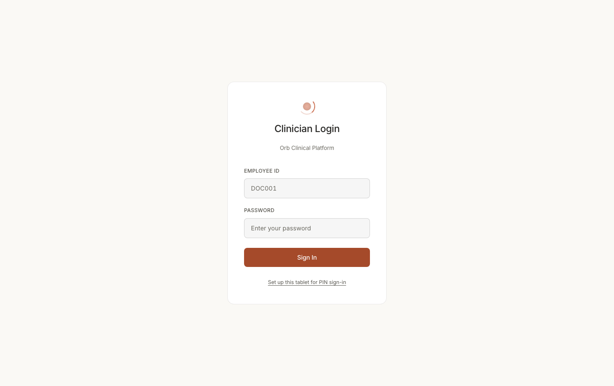

**The problem it solves.** Typing a full password before every patient interaction is what
makes staff share a login. And a shared login destroys the record: every entry says "NUR001"
when three different nurses touched the chart. Attribution is the entire point of an audit
trail, so signing in *as yourself* has to be the path of least resistance on a trolley tablet.

**How you use it.**

- **Staff on a personal device**, name and password, as normal. If your account requires a
  second factor, a six-digit code from an authenticator app on your phone is asked for next.
  You can set that up yourself from the same screen.
- **Staff on a shared ward tablet**, an administrator registers the tablet once. After that,
  the tablet shows a number pad, and each nurse signs in with her own four-to-eight-digit PIN.
  The session that results names **the person**; the tablet is recorded as context, never as
  the actor. Sessions are short and the screen signs itself out after a couple of minutes of
  no touching, because a trolley gets walked away from.
- **Patients**, a separate door into a separate, much smaller app (see *For patients and
  their families*).

Two different PINs exist and they are deliberately not the same secret. The **tablet PIN**
unlocks the ward tablet. The **signing PIN** countersigns a medication order. If unlocking the
tablet used the same digits, anybody who watched a nurse unlock a screen thirty times a shift
could also countersign a drug order in her name.

**Not yet.**

- There is **no screen for registering a ward tablet**. The registration exists and works, but
  today it has to be done by an operator rather than clicked through by an administrator.
- Repeated wrong PINs are throttled per tablet as well as per account (so an attacker cannot
  try five guesses each against forty staff without tripping anything), but there is no
  administrator alert when that throttle fires.

---

# For Doctors

## Patients: the ward board

**What it is.** The list of every patient you are responsible for, sorted so the sickest is at
the top.

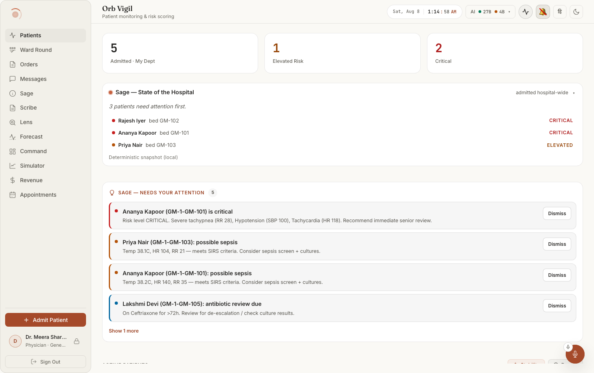

**The problem it solves.** At the start of a shift a doctor needs to know, in one glance,
which of thirty patients is deteriorating. Paper handover sheets are hours old by the time
they are read. A list sorted by bed number tells you nothing clinical.

**How you use it.** Open the tab. Four tiles across the top give the counts, how many
patients, how many critical, how many admitted in your department, bed occupancy. Below that
is the list. Each row carries the patient's name, bed, diagnosis, a coloured dot and a risk
percentage. A patient who has crossed into emergency territory turns the whole row solid red
and jumps to the top. A small "3 NEW" badge means three things have happened on that chart
since you last marked it reviewed. Click a row to open the chart.

The score behind the dot is **NEWS2**, the National Early Warning Score 2, the standard
British scoring system that turns six vital signs into a single number between 0 and 20. Orb
computes it in exactly one place, so the number on this board, the badge on the nurse's task,
the figure in the handover document and the gauge on the chart can never disagree with each
other.

**Not yet.**

- The board shows **no age, no sex, no hospital number and no ward**, only name, bed,
  diagnosis and risk. Those values are all held and are all on the chart; they are simply not
  on this list.
- There is **no trend arrow**. You cannot see from this screen whether a patient at 40% was at
  20% an hour ago or at 60%. The only movement signal is a row jumping to the top when it turns
  critical.
- There is **no search or filter box** on the board, and no alert bell or escalation count on a
  row.
- Sorting is by risk or by bed. There is no "sort by my patients" or "sort by what changed".

## One patient's chart

**What it is.** Everything known about one patient on a single scrolling page, with a sticky
header that never leaves the screen.

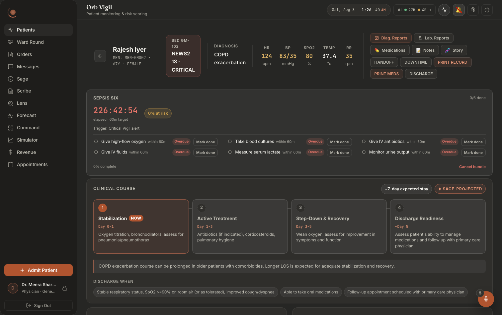

**The problem it solves.** The information a doctor needs at a bedside is spread across a
vitals machine, a drug chart, a lab printout, a nursing note and a colleague's memory. Orb puts
it in one place and, crucially, shows its working, the risk score comes with the reason for
the risk score.

**How you use it.** The header carries name, hospital number, age, sex, bed, diagnosis and
comorbidities, and, if a colleague has the same chart open right now, a quiet line saying
"Priya Nair also viewing", so two people do not unknowingly work the same patient.

Below that:

- **Five vital signs**, heart rate, blood pressure, oxygen saturation, temperature,
  respiratory rate, each a large number with a small trend line you can hover. These move on
  screen as new readings arrive; you do not reload the page.
- **The risk gauge**, and beside it a table headed *"Why NEWS2 7?"* that breaks the score down
  parameter by parameter: respiratory rate 35 scores 3, oxygen 80% scores 3, and so on. This is
  the single most important design decision on the chart. A score you cannot interrogate is a
  score clinicians learn to ignore.
- **An AI assessment** of the patient, clearly labelled as AI-written, with a panel you can open
  to see exactly what facts it was given.
- **The Sepsis Six care bundle** with a running clock, when the patient qualifies, the six
  interventions that should happen within an hour of suspected sepsis, each tickable, with the
  time remaining shown.
- **A clinical course timeline**, what has happened to this patient, in order.
- **Lab trends**, as tiles with sparklines. Note the **ESTIMATED** badge on some of them: where
  Orb does not have a real laboratory feed, it says so on the tile rather than presenting a
  number as measured.

Buttons across the header open the rest: diagnostic reports, lab reports, medications, notes,
the patient's story, the handover sheet, the downtime printout, a printable record, a printable
drug chart, and discharge.

**Not yet.**

- **There is no allergy band on the chart header.** Allergies are held, they are checked at the
  moment a drug is given, and they appear inside the drug-safety warning, but the patient
  identification banner does not display them. On a screen that exists to identify the patient,
  that is a real gap and it is named here rather than hidden.
- **There is no graph of the risk score over time.** The historical scores are stored; nothing
  draws them.
- **You cannot type a free-text note directly into the chart.** Notes reach the chart from the
  ward round's dictation and from Scribe. The direct "add note" path exists underneath but has
  no button on this screen today.
- The individual-patient forecast is fetched every time you open a chart and displayed nowhere.

## Ward Round

**What it is.** A queue Orb drives, bed by bed, giving you one screen and about ninety seconds
per patient.

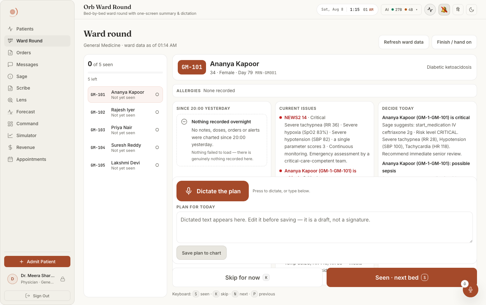

**The problem it solves.** A doctor on a round is standing up, holding a tablet in one hand,
with a patient and a nurse waiting. She cannot type. She cannot scroll. She cannot hunt through
tabs. And she will be interrupted, a bleep, a crash call, and come back twenty minutes later
needing to know exactly where she was.

**How you use it.** Start the round. Orb builds the queue in **walk order**, the physical
order of the beds down the corridor, so "GM-9" comes before "GM-10" rather than after it, which
is what a plain alphabetical sort would do.

For each patient you get one screen, three columns, no scrolling:

1. **Since 20:00 yesterday**, what actually changed overnight.
2. **Current issues**, what is wrong right now, worst first. Importantly, *missing data counts
   as an issue*: "no observations recorded in 9 hours" appears here rather than being silently
   treated as a clean bill of health.
3. **Decide today**, the decisions waiting on you.

Then you dictate the plan. The record button is the largest target on the screen. Your speech
arrives in an **editable box**, because dictation is a draft, never a signature, you read it,
fix it, and save it to the chart.

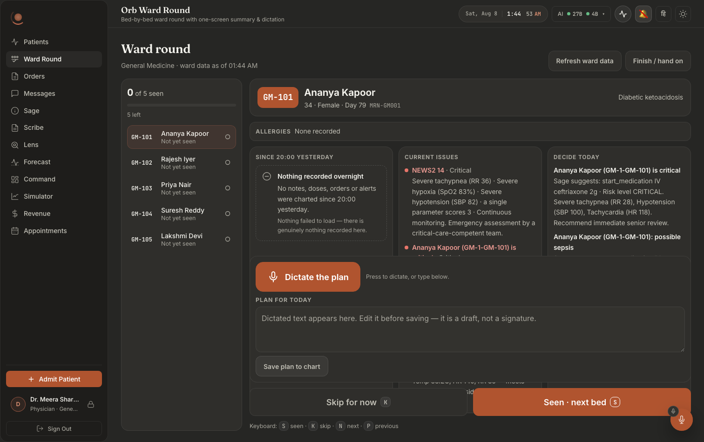

Mark the patient **seen** and Orb walks you to the next bed; mark them **skipped** and they stay
owed to you at the end. If the round is interrupted, closing and reopening picks up at the same
bed.

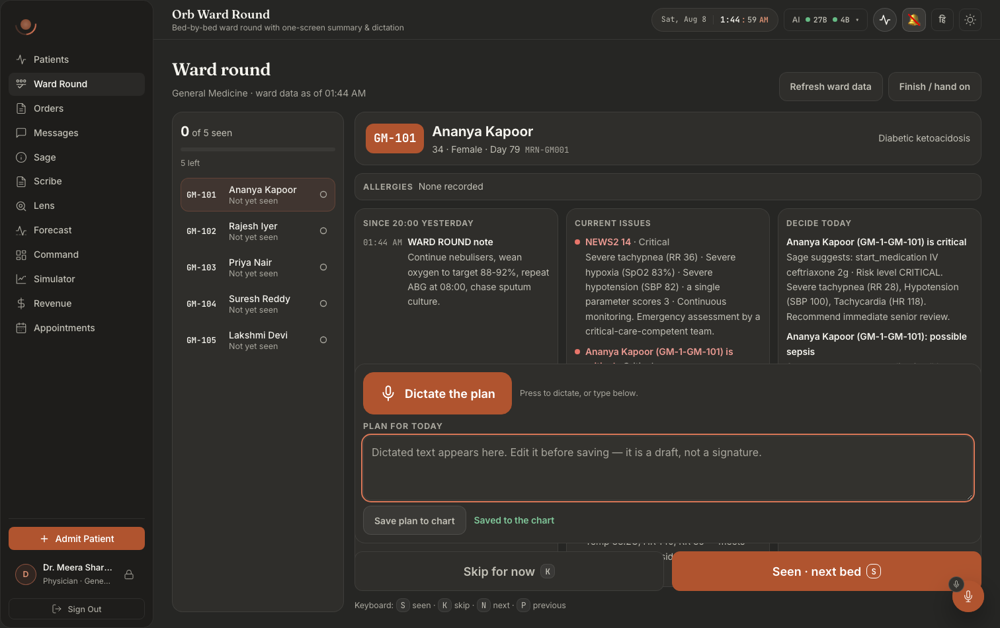

**Not yet.**

- **The round refuses to save a plan when the tablet is offline.** It does not queue it. This
  is deliberate and worth understanding: a ward round ends with the tablet going back on the
  trolley and being signed out for the next clinician, and a sign-out destroys anything queued.
  A note that silently evaporated before the wi-fi came back would be worse than a refusal you
  can see and act on.
- Dictation is transcribed by the on-site speech engine. Accented English and code-switched
  Hindi-English still produce errors you have to correct in the box.
- The round does not place orders. You dictate a plan; you place the orders separately.

## Orders

**What it is.** Where a doctor writes up drugs, fluids, labs, imaging and observations.

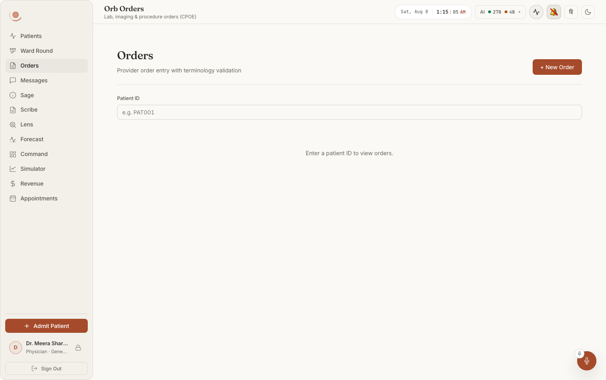

**The problem it solves.** Handwritten orders are misread, and a verbal order at 3am has no
record at all. An electronic order also makes it possible to check the order *before* it
reaches the patient rather than after.

**How you use it.** Pick a patient, choose an order type, fill the form. For coded orders, a
lab test, a diagnosis, Orb validates the code as you type and shows a tick or a cross. Placed
orders appear as cards with a status chip: draft, active, in progress, completed. Moving an
order forward is one button, and only the legal next step is offered. Orders can be printed.

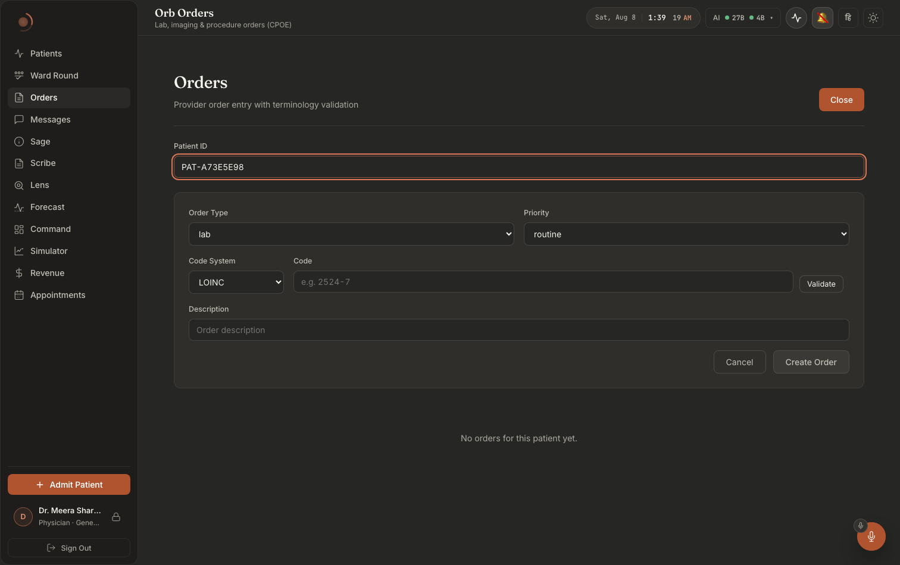

If an order trips a safety gate, a severe allergy, an implausible dose, a modal stops it
before it is written and states the reason in a sentence. See *The safety checks that can stop
you*.

**Not yet.**

- **Interaction checking between drugs is thin.** Orb ships a small starter table of drug-drug
  interactions rather than a licensed commercial database. See *What needs a paid data licence*.
- There is no order history search, no "reorder this", and no favourites list.
- Orders do not currently flow out to any external pharmacy or laboratory system; they live in
  Orb and are worked from Orb.

## Order sets: applying a protocol in one action

**What it is.** A named list of orders, Sepsis Six, first-hour management of diabetic
ketoacidosis, acute coronary syndrome, acute severe asthma, routine post-operative care, that
you apply in one action instead of typing eight things at 3am.

**The problem it solves.** Exactly that: typing eight things at 3am with a deteriorating patient
in front of you.

**How you use it.** Pick the protocol, pick the patient, and Orb shows you a preview: every
order the set would place, each with a chip reading **Cleared** or **STOPPED**. You can exclude
items and adjust doses before applying. Apply, and Orb creates each item as an individual,
separately cancellable order, not a black box that "charted eight things".

The rule that matters: **a set is a convenience, never a bypass.** Every order it produces goes
through exactly the same safety gates a hand-typed order does, at the moment it is written. And
if any single item is stopped by a gate, **nothing at all is written** and you get a plain
callout saying so. A half-applied protocol is worse than none.

**Not yet.**

- **Protocols are configured by an engineer editing a file, not by an administrator through a
  screen.** This is intentional, clinical protocol should be reviewed, versioned and deployed,
  not edited through a web form during a night shift, but it does mean a hospital cannot add
  its own protocol without help.
- Five protocols ship. There is no library beyond that.

## Sage: the clinical AI assistant

**What it is.** An AI you can ask clinical questions, running entirely on the hospital's own
machine.

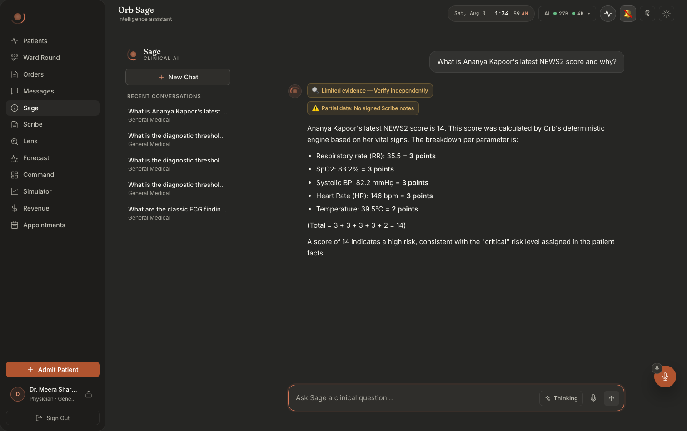

**The problem it solves.** A junior doctor at 2am needs the diagnostic threshold for something,
or needs to know why a particular patient's score is 14, and the alternatives are a textbook, a
web search on a personal phone, or waking a registrar.

**How you use it.** Type a question. Two kinds of answer come back:

- **General clinical questions** stream back in about a second.
- **Questions about a named patient** take six to eight seconds, because Sage reads that
  patient's chart first. Notice in the picture above that it does not merely assert the score, 
  it shows the arithmetic, parameter by parameter, and says the score came from Orb's own
  deterministic calculation rather than from the AI.

Above every answer sit honesty banners. In the picture there are two: *"Limited evidence, 
verify independently"* and *"Partial data: no signed Scribe notes"*. Sage says what it did not
have. Under every answer is a **Show details** panel with the sources it used and the evidence
trail.

There is a **Thinking / Fast** toggle in the composer. Thinking uses the large, careful model.
Fast uses a small, quick one.

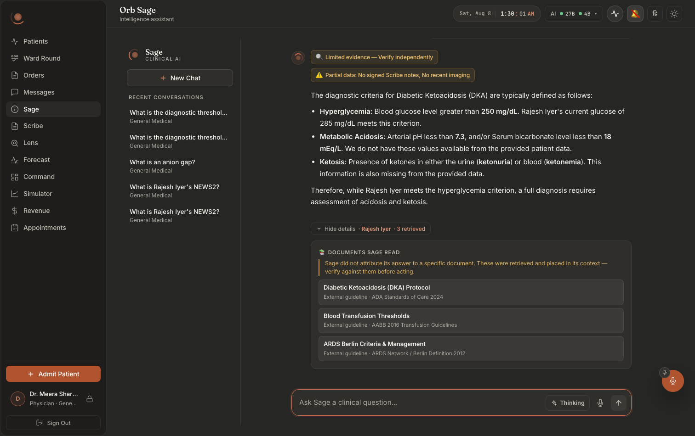

**And underneath the toggle there is a floor you cannot switch off.** Even with Fast selected,
three kinds of question are routed back to the careful model: anything about a specific patient,
anything about a medication or a dose, and anything about a score Orb computes itself. This is
not caution for its own sake. The small model was measured on this exact hardware and on Orb's
own prompts getting precisely those questions dangerously wrong, and, counter-intuitively, it
failed hardest on the *simplest* questions, like single-fact drug recall, which is exactly the
kind a tired doctor fires off without thinking. The banner always tells you which brain
answered, so a silent substitution in either direction cannot happen.

Sage can also propose a chart action, a medication, for instance, as a card you must approve
before it goes anywhere. Approving sends it to the pharmacist's verification queue, not
straight to the patient.

**Not yet.**

- **Sage does not write to the chart on its own.** Every action it proposes needs a human
  approval, and medications additionally need a pharmacist.
- **It cannot see across departments.** Ask about a patient in a ward you do not cover and Orb
  answers as if that patient does not exist, deliberately, so the answer cannot confirm the
  existence of a record you should not know about.
- The six-to-eight seconds is not going to become one second while the AI stays in the building.
  That is the trade.
- Voice input exists but competes for the microphone with dictation elsewhere in the app; if
  Scribe is recording, Sage's microphone is unavailable and says so.

## Scribe: ambient documentation

**What it is.** Dictation that turns speech into a structured clinical note.

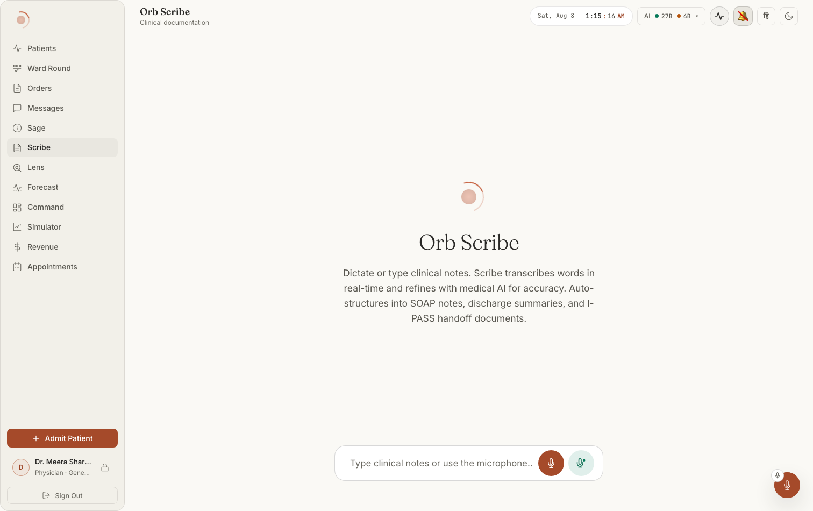

**The problem it solves.** Doctors spend a large share of the working day typing notes, and the
notes get written hours after the consultation, from memory.

**How you use it.** Press record and speak. The transcript builds live on screen with a timer, a
sound-level bar and an indicator saying whether it is listening, processing or hearing speech.
You can pick English, Hindi, or auto-detect. When you stop, a second, more accurate pass runs
over the audio and refines the text.

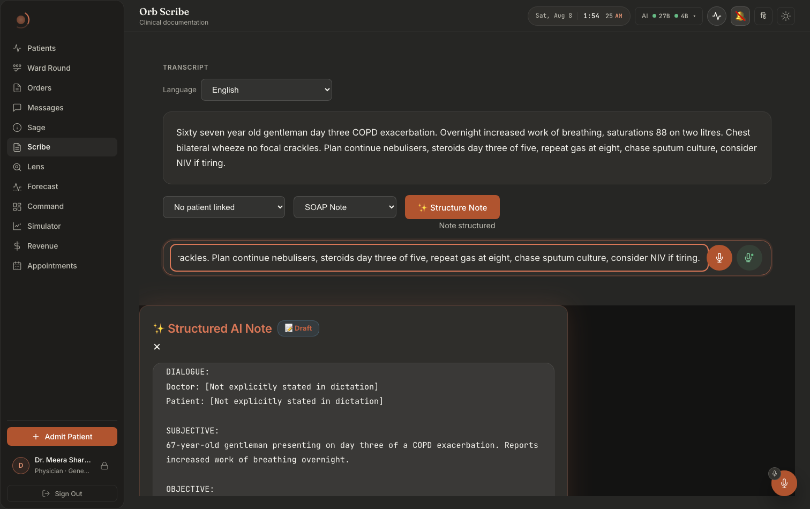

Then choose a format, SOAP note, discharge summary, or handover document, optionally link a
patient, and press **Structure Note**. (A SOAP note is the standard four-part clinical write-up:
what the patient says, what you observed, what you think it is, and what you plan to do.) The AI
reshapes the transcript into that format. You read it, edit it, and **sign** it. Only a signed
note becomes part of the record.

**Not yet.**

- **The live, on-screen transcription is English-only.** The language selector governs the more
  accurate second pass, not the words appearing as you speak.
- Speech recognition accuracy on Indian-accented English and on mixed Hindi-English speech is
  the single biggest source of correction work. Drug names are the worst case, which is why Orb
  runs a drug-name correction pass over the transcript.
- A note is not a bill and is not a discharge; it is a document.

## Lens: imaging reference

**What it is.** Upload a medical image, X-ray, ECG, CT, MRI, clinical photo, and get an AI
reference read that a clinician reviews before it goes anywhere.

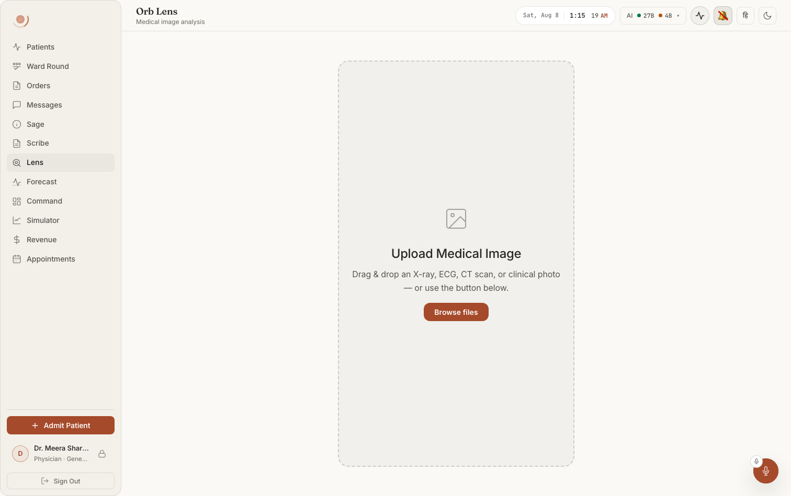

**The problem it solves.** A district hospital at night may have no radiologist. A second
opinion that is available immediately, clearly labelled as not a diagnosis, is better than
nothing at all, provided it can never masquerade as a report.

**How you use it.** Drag an image in. Choose its type and add clinical context. Press analyse.
The findings arrive under a card headed **AI Reference Read** with a pill reading **DRAFT ·
CLINICIAN REVIEW REQUIRED** and a paragraph stating in plain words that this is decision-support
reference for a clinician and not a diagnosis.

The findings arrive **in an editable box**, and this is the point: what gets filed is what you
leave in the box, not what the model produced. Then you search for the patient, tick a checkbox
accepting clinical responsibility, and press **Confirm & File to Record**. The message that
appears in the patient's channel is worded differently depending on whether a clinician reviewed
it, "Clinician-reviewed AI imaging reference" versus "AI imaging reference (investigational, 
not a diagnostic read)".

**Not yet.**

- **There is no image library or gallery.** It is a one-image-at-a-time workflow: upload,
  analyse, review, file. Past reads appear on the patient's record, not here.
- No connection to any imaging system. Images are uploaded by hand.
- Uploaded files are size-capped and type-checked, and are encrypted where they are stored, 
  but see *Backups* for an important caveat about what the nightly backup does and does not
  include.

## Messages

**What it is.** Clinical messaging organised around patients and departments rather than around
people.

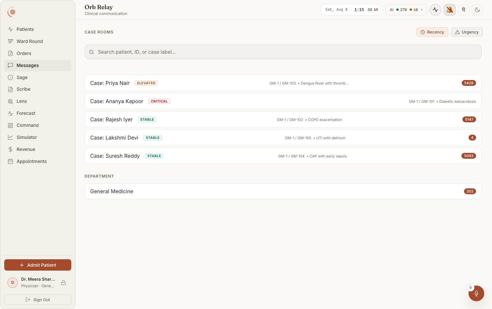

**The problem it solves.** Clinical coordination in most Indian hospitals happens on WhatsApp,
which means patient information sits on personal phones, outside the hospital's control,
permanently. And an urgent message about a deteriorating patient scrolls away exactly like a
message about lunch.

**How you use it.** The list has two parts. At the top, an **Action Required** rail of alerts, 
deterioration alerts, surgical assignments, each with **Confirm** and **Escalate** buttons, so
an alert is not merely seen but answered by a named person. Below that, the rooms: one per
patient case, plus department channels. Each row carries the patient's risk chip and an unread
count.

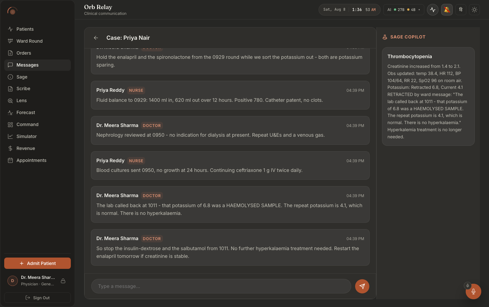

Inside a room, messages arrive live. Alerts render as structured cards rather than as text.
Alongside runs a **Sage sidebar** reading the conversation and surfacing risk flags and
suggested actions.

One feature worth calling out: if you start typing about a patient in the wrong room, an amber
strip appears warning you that this message does not fit this room.

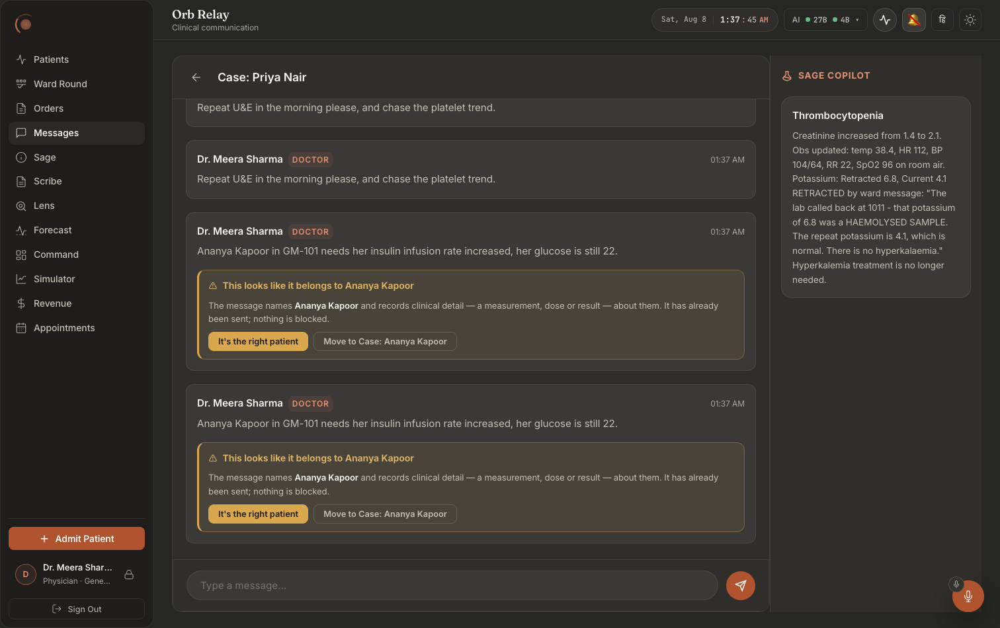

**Not yet.**

- **You cannot send a message while offline.** It is refused, in words, rather than queued, 
  same reasoning as everywhere else in Orb.
- No attachments, no voice notes, no reactions, no threading within a room.
- Search covers messages, not attachments or patient records.

## Surgical Suite

**What it is.** Theatre scheduling in three layers, a week strip, a day agenda, and one case in
detail.

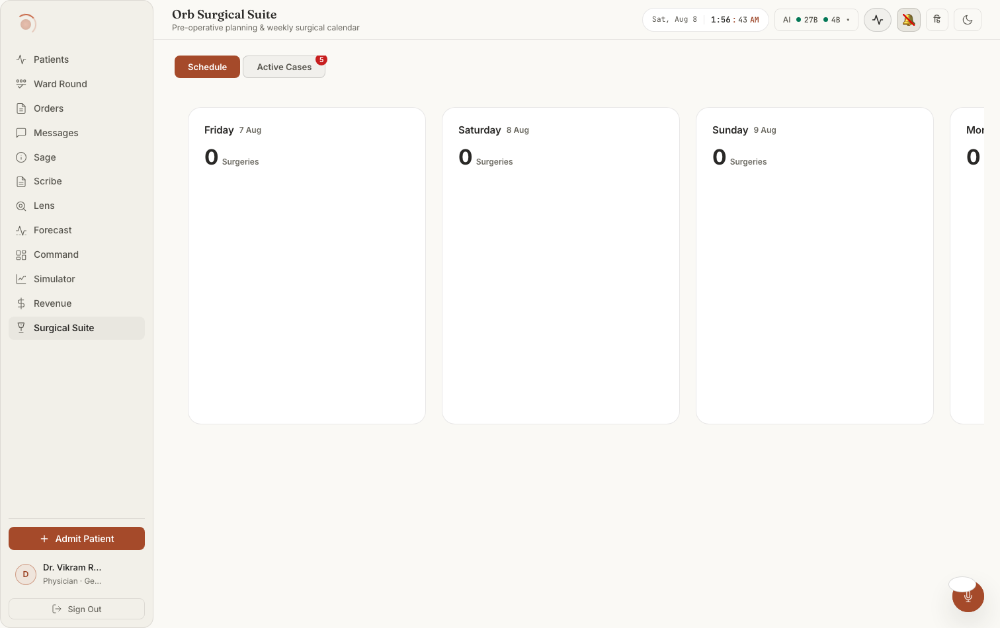

**The problem it solves.** Theatre lists, team assignments and pre-operative preparation are
usually coordinated by phone and whiteboard, and an emergency case rearranges all three at once.

**How you use it.** The week strip shows each day's case load. Click into a day for the agenda;
click a case for the detail, patient, comorbidities, procedure, team, and a streamed AI risk
assessment. **Active Cases** is a separate view showing everything currently in flight, with
emergency cases outlined in red and in-progress cases in green.

**Prep for Surgery** sends a structured alert to the assigned team and into the patient's case
room. It refuses to send twice within four hours.

Team members confirm or decline their assignment **from the message they receive**, not from
this screen; their answer comes back here as a coloured chip.

**Not yet.**

- **The WHO Surgical Safety Checklist is not on screen.** The groundwork exists; nothing renders
  it. For a surgical pilot this is the first thing to build.
- **The bed number is always blank on the case detail**, a genuine small bug, named here rather
  than glossed.
- If sending the prep alert fails, the button simply returns to its resting state; nothing tells
  you it failed. And a duplicate press within four hours still reports "Alert Sent".
- There is no theatre utilisation reporting.

## Appointments

**What it is.** A day-column board of outpatient appointments.

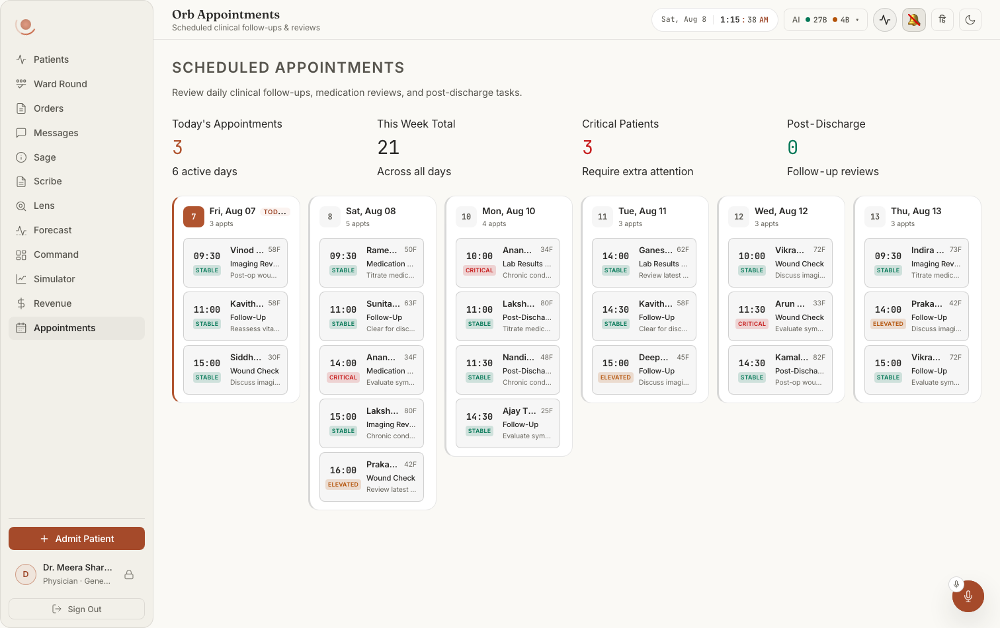

**How you use it.** Columns by day, today marked with a chip, each appointment showing time,
patient and type. Patients book their own follow-ups through the patient portal, and those
bookings appear here.

**Not yet.** No drag-to-reschedule, no clinic templates, no capacity rules per clinic, no
reminders sent to patients.

---

# For Nurses

## My Shift: the board that is shaped like the job

**What it is.** The nurse's home screen: not a list of patients, but a list of *what is due*.

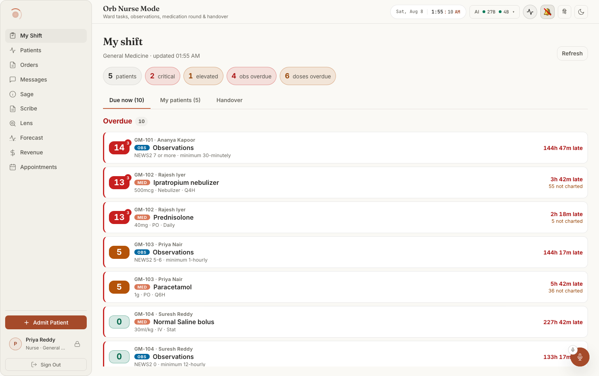

**The problem it solves.** A ward nurse's day is a queue of timed obligations, observations
every four hours on this patient, every twelve on that one, a drug round at 08:00, a handover at
20:00. A patient-shaped screen makes her reconstruct that queue in her head, every time, for
every patient. So Orb builds the queue instead.

**How you use it.** Five count pills across the top tell you the shape of the shift. Three tabs
below: **Due now**, **My patients**, **Handover**.

**Due now** is the default and it is the working screen. Each row is one task with a chip reading
**OBS** or **MED**, the patient, the bed, the early warning score, and how late it is, "40m
late", "3h 30m late". Tap a row to do the task.

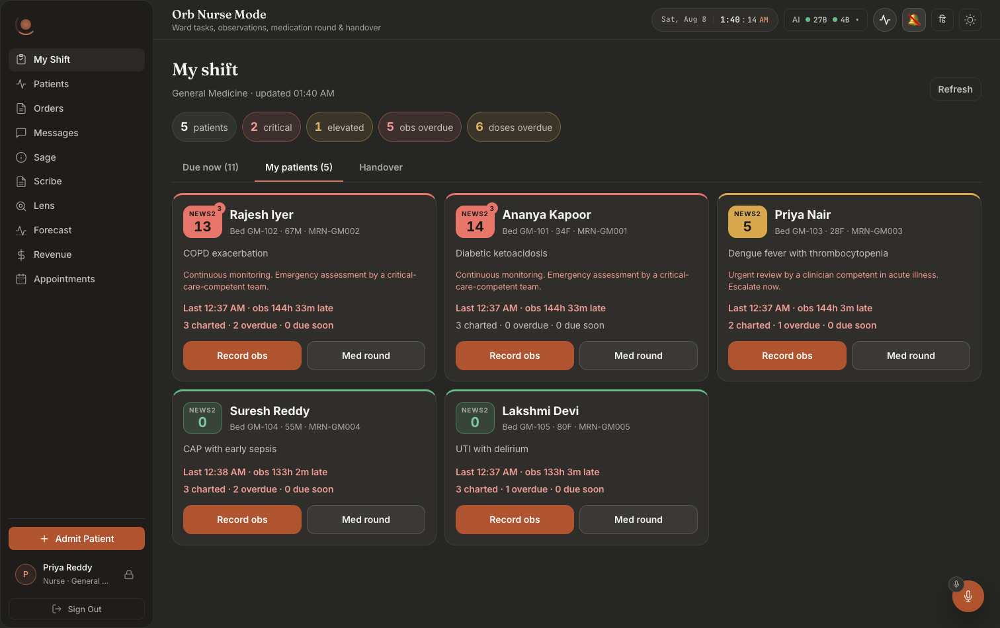

**My patients** is the same information arranged as cards, one per patient, for when you want the
patient view rather than the task view.

The observation interval is not arbitrary, it follows the Royal College of Physicians'
escalation guidance, so a patient scoring higher is observed more often, automatically.

**Not yet.**

- **The count pills do not include a blocked-medications count**, even though Orb computes one.
- Allergy information is attached to every medication task internally and **is not shown on this
  board**. A nurse still meets the block, but only at the moment she tries to give the dose,
  not before she walks to the bedside.
- No way to reassign a task to another nurse, and no way to add an ad-hoc task.

## Recording observations

**What it is.** A bedside sheet for entering a set of vital signs, which scores itself as you
type.

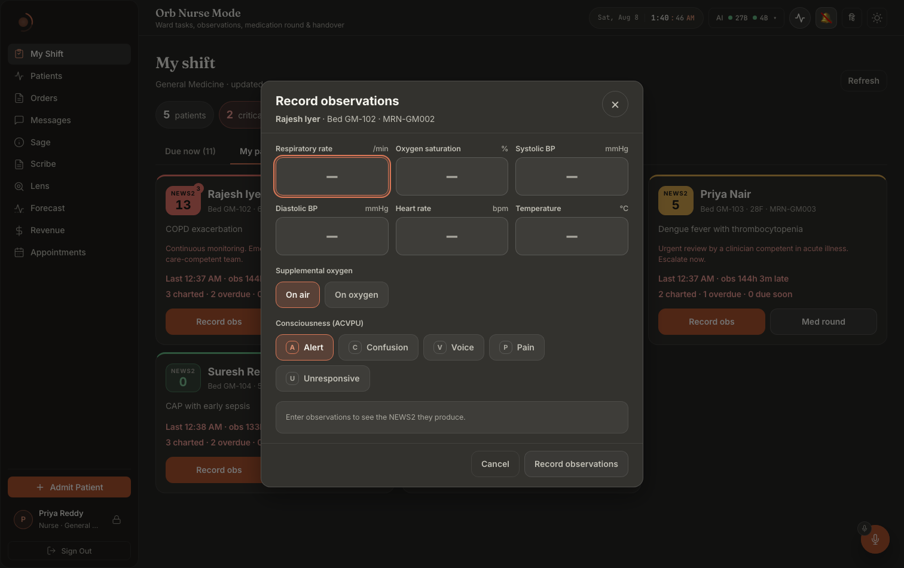

**The problem it solves.** Vitals recorded on paper are scored by hand, in a hurry, sometimes
wrong, and are typed into a computer hours later, by which time the deterioration they showed
has either declared itself or not.

**How you use it.** Six fields: respiratory rate, oxygen saturation, blood pressure, heart rate,
temperature, and level of consciousness. Two chips for supplemental oxygen. Five chips for
consciousness (alert, confused, voice, pain, unresponsive).

As you type each value, a small **+3** or **+1** chip appears next to that field showing what it
contributes, and a live score block updates at the bottom.

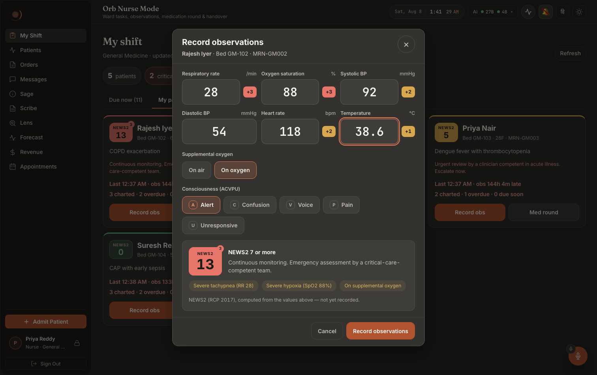

Save, and the score is recorded, the patient's risk updates everywhere in Orb at once, and, if
the score crosses a threshold, an alert is raised into the patient's channel.

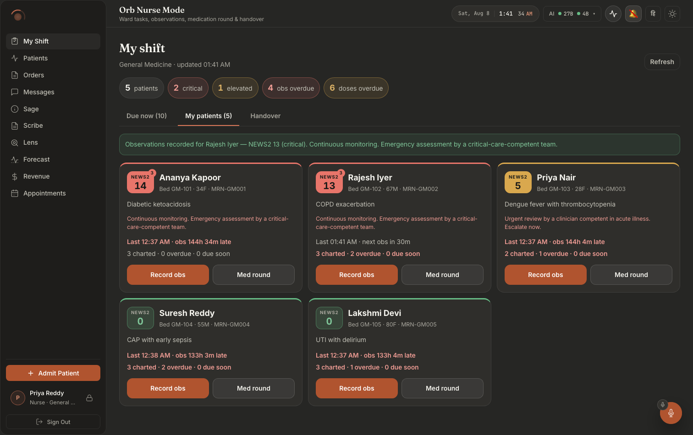

**Not yet.**

- No pain score, no fluid balance, no blood glucose, no weight, six vitals and consciousness,
  no more.
- Nothing connects to the monitor at the bedside; every number is typed. See *What needs
  hardware Orb does not have yet*.
- You cannot correct a saved observation set from this sheet; a mistake needs a new set.

## The medication round

**What it is.** A per-patient drug round sheet, grouped by what is overdue, what is due, and what
is a continuous infusion.

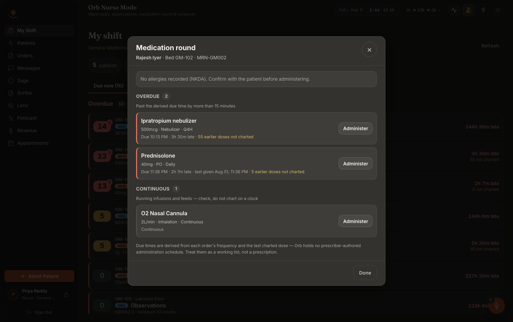

**The problem it solves.** A paper drug chart tells you what is prescribed. It does not tell you
what is late. On a busy ward with twenty patients, "which doses are overdue right now" is a
question nobody can answer without walking the whole ward.

**How you use it.** Open the round for a patient. At the top, an allergy strip, either the
recorded allergies or "No allergies recorded (NKDA). Confirm with the patient before
administering.", NKDA is the standard ward shorthand for *no known drug allergies*, and the
sentence deliberately treats it as an unconfirmed claim rather than a clearance. Below that,
three groups:

- **Overdue**, past the due time by more than fifteen minutes.
- **Due**, coming up.
- **Continuous**, running infusions and feeds, with the explicit instruction *"check, do not
  chart on a clock"*.

Each row shows the drug, dose, route, frequency, when it was due, how late it is, and, usefully
how many earlier doses were never charted.

**Read the footnote on this sheet, because it is the most honest line in the product:** *"Due
times are derived from each order's frequency and the last charted dose, Orb holds no
prescriber-authored administration schedule. Treat them as a working list, not a prescription."*
Orb is computing when a dose is probably due from "four-hourly" plus "last given at 22:13". It is
not reading a schedule a doctor set. That is a meaningful difference and the screen says so.

**Not yet.**

- **There is no prescriber-authored administration schedule.** Times are inferred, as above.
- Rows that came from AI extraction are **greyed out and cannot be given at all** until a
  pharmacist verifies them, which is correct, but means a ward can be blocked on pharmacy
  availability.
- There is no "give all" or batch action, by design.

## Giving a dose: the five rights, and what stops you

**What it is.** A confirmation step before every dose that restates the five rights and requires
you to type the drug name.

**The problem it solves.** Wrong-drug and wrong-patient administration is among the most
common serious medication errors, and the standard countermeasure, scanning a barcode on the
wristband and a barcode on the drug, needs scanners the pilot ward does not have.

**How you use it.** Tap Administer. A modal lists the five rights: right patient, right drug,
right dose, right route, right time. Below them is a field labelled *"Confirm drug name"* with
the hint *"Barcode-style check: type the drug name exactly as charted."* Type it. When it
matches, the border turns green and the **Given** button becomes usable. Case does not matter;
spelling does.

You can also record **Not given** with a reason from a list plus a free-text detail.

**What can stop you, and what that looks like.** Press Given and, if a safety gate fires, the
request comes back refused and a red strip appears at the top of the modal with a sentence
explaining why. Five things can do this: a **severe** allergy match, a dose outside any plausible
adult range, a wrong route, a discharged patient, or an inactive order.

**And here is the part to be precise about, because it decides whether a ward can work:**

- **There is no override button in the nurse's screen.** Pressing Given again produces the same
  refusal, indefinitely. The two ways forward are recording **Not given** with a reason, or an
  out-of-band fix, a pharmacist verifies the order, a doctor removes an incorrect allergy label.
  An override path with a mandatory written clinical reason exists underneath and is fully built,
  including validation that rejects reflex answers like "ok" or "per doctor", but it has no
  button on the nurse's screen today. **This is the single most important limitation in this
  document for a ward considering a pilot.**
- **Warnings that are not blocks are invisible to the nurse.** A mild or moderate allergy match,
  a high-but-plausible dose, and a suspected duplicate dose are all computed, all written
  permanently onto the administration record, and all audited, and the nurse sees a green
  "Given" chip and nothing else. A nurse giving a second paracetamol forty-seven minutes after
  the first is not warned on screen, although the concern is recorded.
- **A previously justified override is applied silently.** If an earlier dose of the same order
  against the same allergy picture was already justified in writing, the next dose goes through
  with no strip and no indication that an interlock fired. It re-arms by itself if anything
  changes, a new allergy, an escalated severity, an edited reaction.

## Handover

**What it is.** A structured end-of-shift handover in the I-PASS format, drafted by Orb and
edited by the nurse.

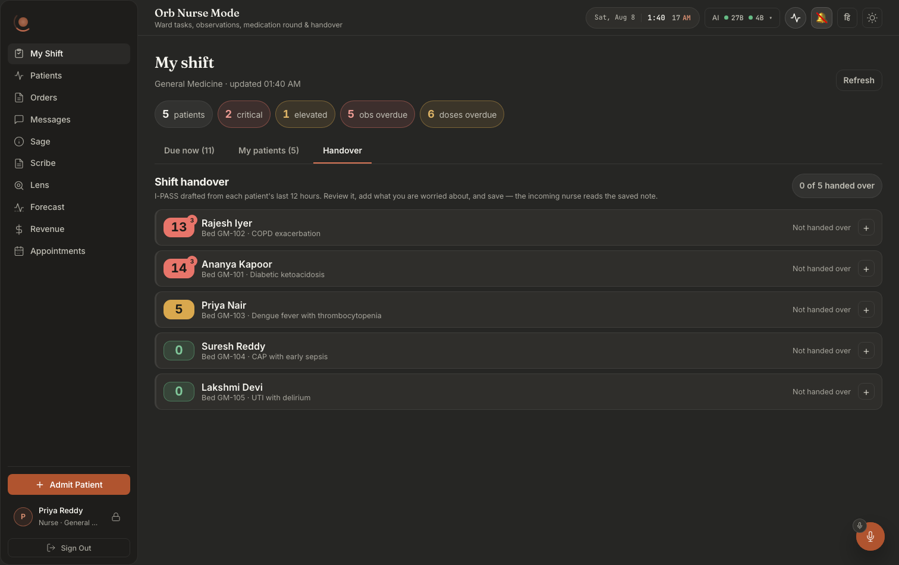

**The problem it solves.** Handover is where patients get dropped. A verbal handover at the end
of a twelve-hour shift, from a tired nurse to a nurse who has not met these patients, is one of
the highest-risk five minutes in a hospital.

**How you use it.** I-PASS is five parts: **I**llness severity, **P**atient summary, **A**ction
list, **S**ituation awareness and contingency planning, **S**ynthesis by the receiver. Orb drafts
the first four from the record, the score, the diagnosis, what is outstanding, what to watch
for, and you edit them, adding your own words, which are kept separately from Orb's draft so it
is always clear which is which.

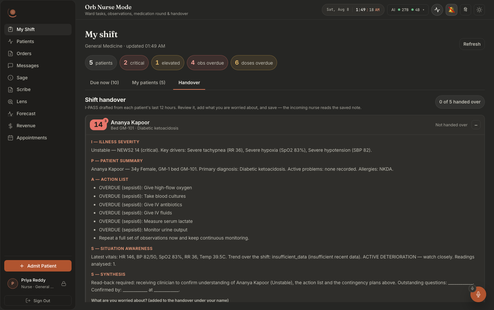

The fifth part, synthesis by the receiver, is left for the nurse taking over to read back.

There is also a full-page per-patient version you can open directly and print.

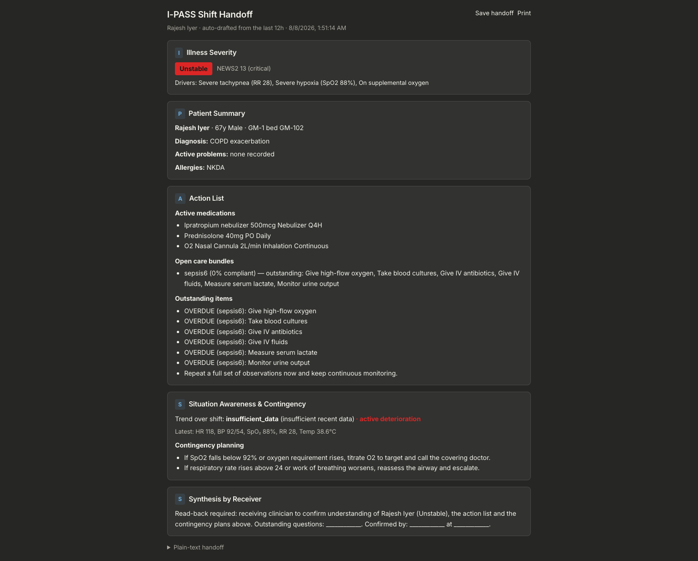

**Not yet.**

- **There is no receiving-nurse sign-off.** Orb produces and stores the document; it does not
  record that a named person accepted it. The synthesis step is a printed prompt, not a captured
  acknowledgement.
- The structured "patient summary" and "action list" fields appear on the full-page sheet but not
  in the handover tab.
- No shift-to-shift comparison ("what changed since the last handover").

## When the wi-fi drops

**What it is.** Reads keep working. Writes are refused.

**The problem it solves.** A ward tablet loses wi-fi in a corridor, a lift lobby, a side room
with thick walls. The nurse still needs the drug chart.

**How you use it.** Nothing. It is automatic. The shift board, the drug chart and the patient
chart are mirrored onto the device and served back when the network goes, **always with a banner
saying how old the copy is**, "Offline, not live · 4 minutes old". If the network is fine but
Orb itself is unreachable, the banner says something different, "Can't reach Orb", because
those are two different problems.

Writes are **refused**, in words, on the spot. Not queued, not deferred, and the refusal message
is forbidden from containing the words "queue" or "will sync", that is enforced by a test.

**The reasoning is worth reading, because "we'll send it when you're back" sounds friendlier and
is more dangerous.** If two nurses could chart offline on the same patient, then when the wi-fi
returns something has to decide which record is true. Taking the later one silently destroys a
charted dose. Keeping both produces a double administration in the record. Asking a human asks
them hours later about a decision neither can now reconstruct. Read-only sidesteps all of it:
nothing is written offline, so nothing ever has to be reconciled.

Three protections around the cached copy: it is stamped with the nurse who cached it and a read
by anyone else **wipes the device**; anything older than one shift is dropped; and it is cleared
on sign-out, on user switch, and on the next start-up after a crash, because a shared tablet
that keeps the previous nurse's patients hands one clinician another clinician's records.

---

# For Pharmacists

## Pharmacy Operations

**What it is.** The pharmacist's home screen, the work queue, the fulfilment pipeline, a
per-patient medication board, and the formulary with stock.

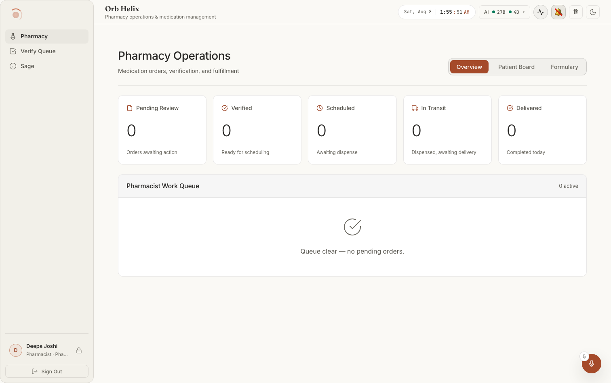

**The problem it solves.** In most hospitals the pharmacist finds out about an order when a
piece of paper arrives, and finds out about a stock-out when they go to the shelf.

**How you use it.** Tiles across the top count orders by state: pending review, verified,
scheduled, in transit, delivered, rejected. Below, the **Pharmacist Work Queue**, everything
awaiting review, with patient, medication, prescriber, time and status. Click any row for the
review modal: full order details, a substitute chooser, a notes box, and the legal next actions
for that state (begin review → verify / reject / suggest substitute → schedule → dispense →
deliver).

The **Patient Board** view groups orders by patient with a stock indicator. The **Formulary**
view lists every medication with available stock, active lot numbers and a stock status pill.

One detail that matters more than it looks: when the queue fails to load, the screen says
**"Pharmacy queue did not load"** with a Retry button, and explicitly says this is a connection
failure and not an empty queue. A silently empty pharmacist queue is indistinguishable from
"nothing to verify", and that is a patient-safety problem rather than a UI problem.

**Not yet.**

- **The two stock thresholds disagree.** The patient board calls a drug "low" below 100 units;
  the formulary calls it "low" below 30. The same drug can read "Low (45)" on one tab and "In
  Stock" on the other.
- Stock is matched by medication **name**, so naming inconsistencies split or merge lots.
- Dispensing and delivery are simulated steps, not connected to any physical dispensing
  equipment.
- Two patients with identical names merge into one row on the patient board.

## The Verification Queue

**What it is.** A separate queue holding every medication that an AI extracted or proposed,
which cannot become an active order until a pharmacist verifies it.

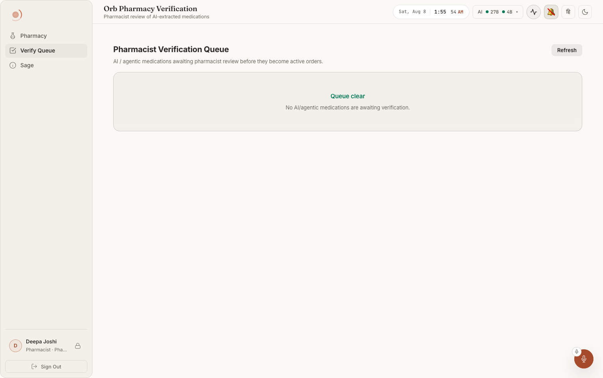

**The problem it solves.** Orb's AI can read a discharge letter and extract "amoxicillin 500mg
three times daily". That extraction is useful and must never become a live order on its own.

**How you use it.** Each row shows the patient, the drug, and **editable** dose, route and
frequency fields, not text. Anything the AI marked as needing review arrives blank, so the
pharmacist types a real value instead of editing a placeholder. A source badge says whether it
came from extraction or from an AI agent.

**The safety column is the most carefully built thing on this screen**, because it refuses to
lie by omission. It has three distinct outcomes:

- A red **"Screening unavailable"** pill, the check could not run.
- An amber **"Not screened"** pill, this drug is outside the interaction knowledge Orb has.
- The actual list of alerts, coloured by severity.

**A green "no alerts" is never shown for a coverage gap.** If Orb does not know about the drug,
it says it does not know. That distinction is the difference between a safety system and a
liability.

Verify or reject. If re-screening at the moment of verification finds a severe alert, the row
expands into a red block requiring a written reason before it will proceed.

**Not yet.**

- The interaction knowledge behind the amber "Not screened" pill is a starter set, not a
  licensed database. Expect that pill often. See below.
- Rejecting asks for a reason through a plain browser prompt rather than a designed dialog.

## Sage for pharmacists

Pharmacists get Sage, with the same safety floor: any question about a drug or a dose is
answered by the careful model regardless of the speed toggle.

**Not yet.** A pharmacist sees only three screens, pharmacy operations, the verification queue,
and Sage. There is no pharmacy reporting, no purchasing, no expiry management and no controlled-
drugs register.

---

# For Administrators

The administrator's area has fourteen sections. They are grouped here by what an administrator
is actually trying to do.

## Is the system healthy, and is it being used?

**Overview** gives the stat cards: users, patients, active alerts, ingestion events, audit
volume.

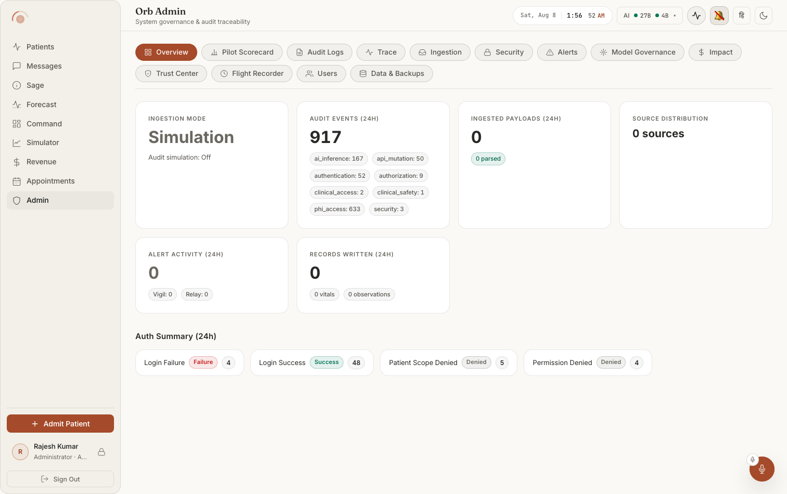

## Is the AI safe enough to switch on?: the Pilot Scorecard

**What it is.** The instrument that decides whether Orb's AI is allowed to be shown to
clinicians at all.

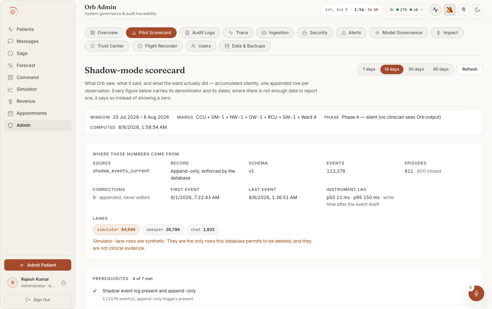

**The problem it solves.** Every AI vendor claims accuracy. No hospital can check the claim.
Orb's answer is to run in **shadow mode** first: for the opening phase of a pilot, Orb watches,
scores and records, and **no clinician sees any AI output at all**. What accumulates is a
record of what Orb saw, what it would have said, and what the ward actually did.

**How you read it.** The header states the window, the wards, and the phase in plain words, 
in the picture, *"Phase A, silent (no clinician sees Orb output)"*. Then a block headed **Where
these numbers come from**: the number of events, how many episodes closed, how many corrections
were made ("0 · appended, never edited"), the first and last event, and the lag between something
happening and Orb recording it.

Three things about this screen are worth an investor's attention:

1. **Every figure carries its denominator and its dates.** Where there is not enough data to
   report a number, it says so instead of showing a zero.
2. **The event log is append-only, enforced by the database itself**, not by a policy anybody
   agreed to.
3. **Synthetic rows are labelled and segregated.** The simulator lane is marked in red as *"the
   only rows this database permits to be deleted, and they are not clinical evidence"*.

A prerequisites checklist below shows how many of the seven conditions for a trustworthy figure
are met, in the picture, four of seven.

**Not yet.**

- **The headline metric is not settled.** The instrument works; what single number the pilot
  should be judged on is a decision for the clinical champion, not for the software.
- Shadow mode proves what Orb *would have* said. It cannot prove what would have happened if a
  clinician had acted on it.

## Who has access?: Users and Roster Import

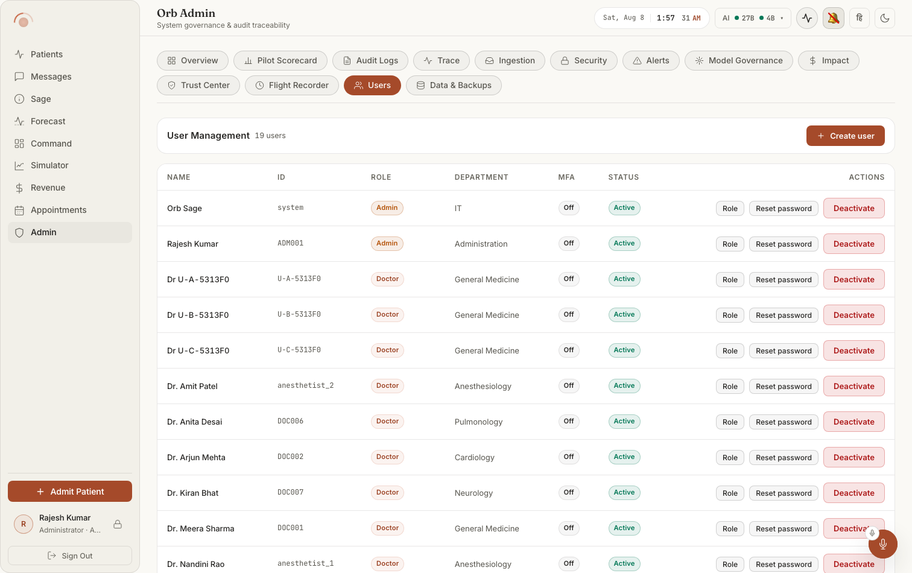

**Users** lists every account with role, status and a chip showing whether two-factor
authentication is enrolled. **Roster Import** is a three-step wizard, upload a staff list as a
spreadsheet export, confirm which column means what, see a dry run of exactly what would change,
then apply. Re-running the same file changes nothing, so a partial import can be safely retried.

**Not yet.** No self-service password reset for staff, no bulk deactivation, and no scheduled
re-import from an HR system.

## Can I prove what happened?: Audit Logs, Trace, Flight Recorder

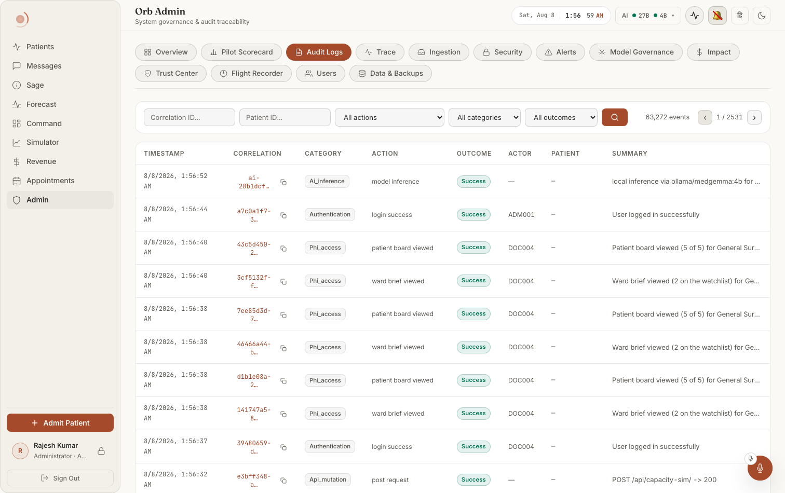

**Audit Logs** is a filterable, paginated table of every state-changing action and every access
to patient information.

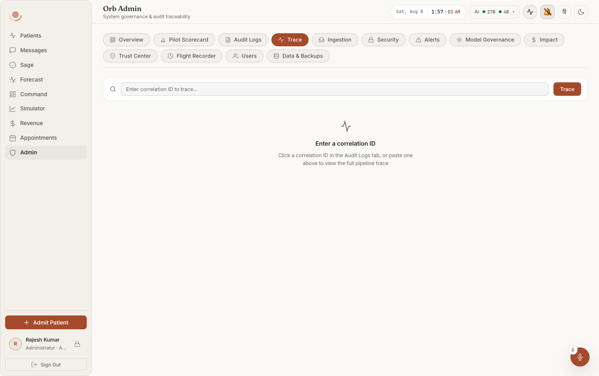

**Trace** takes a single identifier and draws every event that shares it as a vertical pipeline, 
so a reading arriving from a device, the score it produced, the alert it raised and the message
it posted can be seen as one chain rather than four unrelated rows.

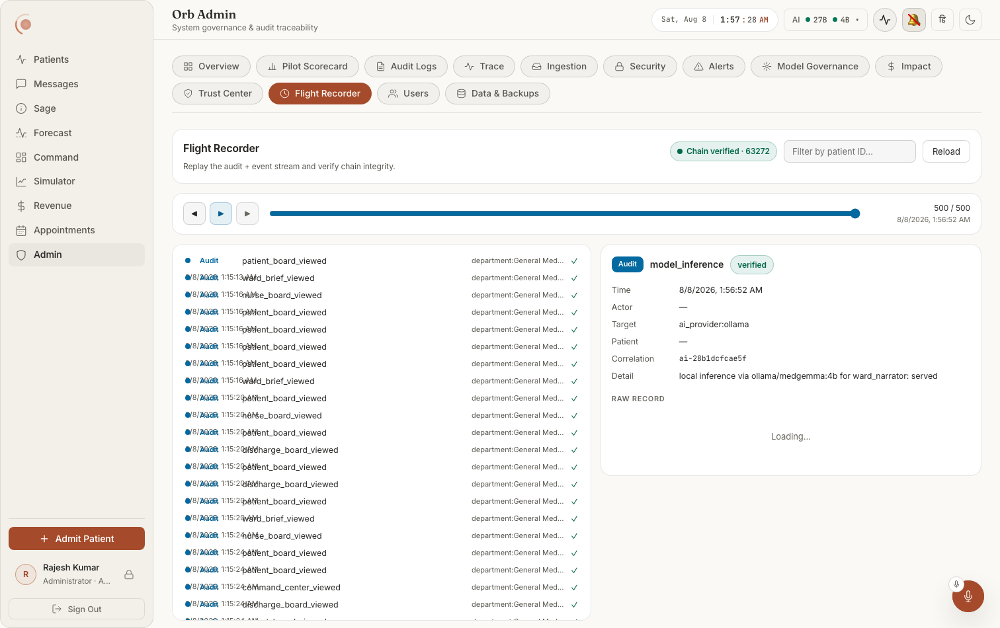

**Flight Recorder** replays the whole stream on a scrubber, with play and step controls, while
continuously re-verifying that the record has not been tampered with. See *The audit trail* for
what "tamper-evident" actually means here.

## Is it secure and compliant?: Security and Trust Center

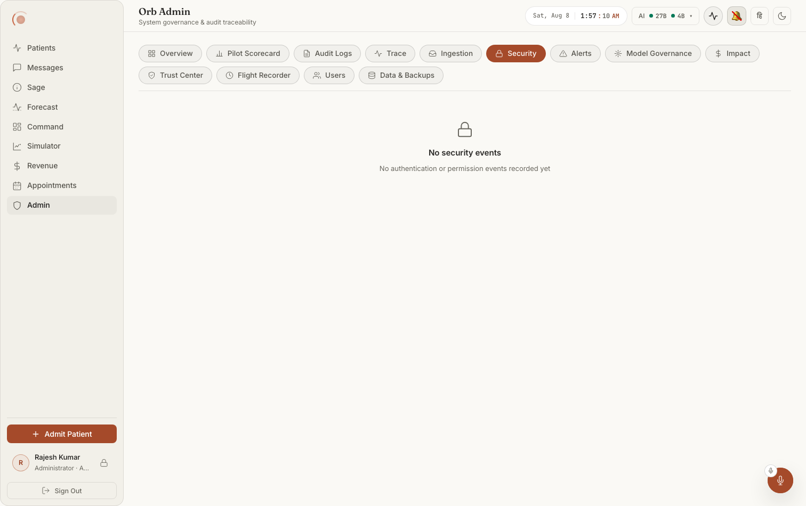
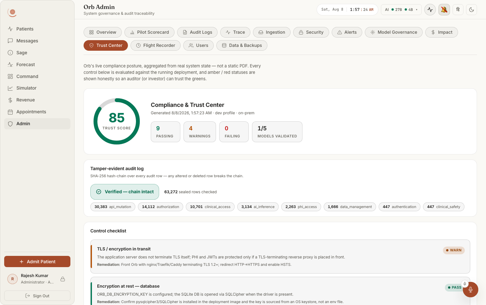

**Trust Center** is the CIO-facing page: a trust score ring; a badge reading **"Verified, chain
intact"**, **"Broken, tampering detected"** or **"Unknown"** for the audit chain; a control
checklist where each control carries its evidence and its remediation; and a two-factor adoption
breakdown per role showing enrolled-over-total, with a "required" tag on the roles where it is
mandated.

**Not yet.** The Trust Center reports; it does not enforce. Turning a red control green is work
done elsewhere.

## Where is data coming from?: Ingestion and Alerts

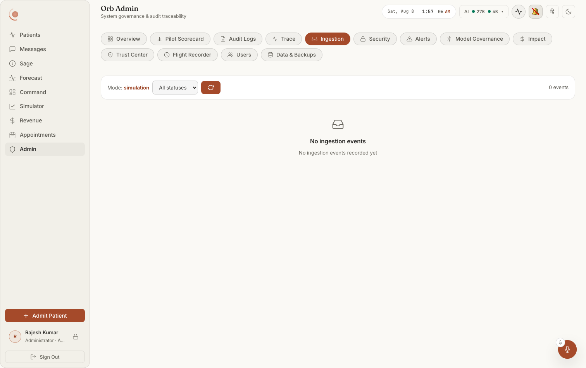

**Ingestion** is the monitor for external data arriving from devices, laboratories or another
system: time, source, status, how many vitals and observations it produced, and any error.

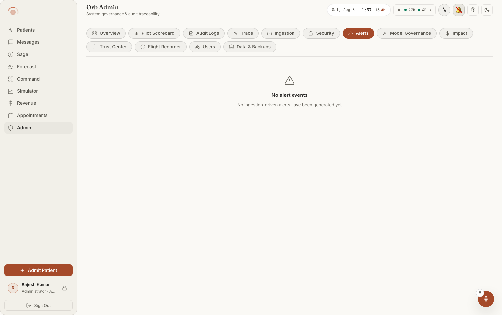

**Alerts** lists alerts raised, their type, the patient, the outcome and the risk level.

**Not yet.** The Alerts tab paginates over the most recent 200 records only; on a busy appliance
older alerts silently fall off the end, and the count shown is the filtered length rather than a
true total.

## What AI is running?: Model Governance

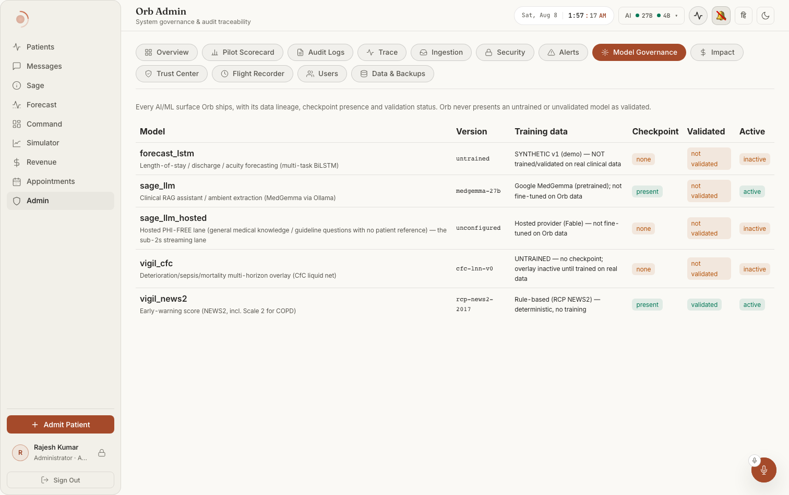

A register of every model in use: which model, which version, what it was trained on, whether a
checkpoint exists, whether it has been validated, and whether it is active. The point is that
when someone asks "what is the AI in this building", the answer is a table rather than a
conversation.

## Is it worth the money?: Impact

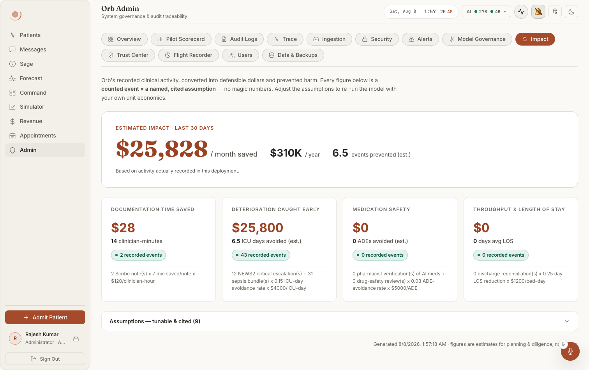

An estimate of value: a monthly saving figure, an annual figure, and an events-prevented figure,
each broken into cards showing the money, the underlying count, the number of recorded events
backing it, and the assumption sentence. Every assumption is an editable, cited number, change
it and the whole model re-runs.

Crucially, **when there is not enough activity, the dashboard degrades to zero and says so**
rather than inventing numbers.

**Not yet.** These are modelled estimates with stated assumptions, not measured outcomes. A
pilot's job is to replace them with measurements.

## Is the data safe?: Data & Backups

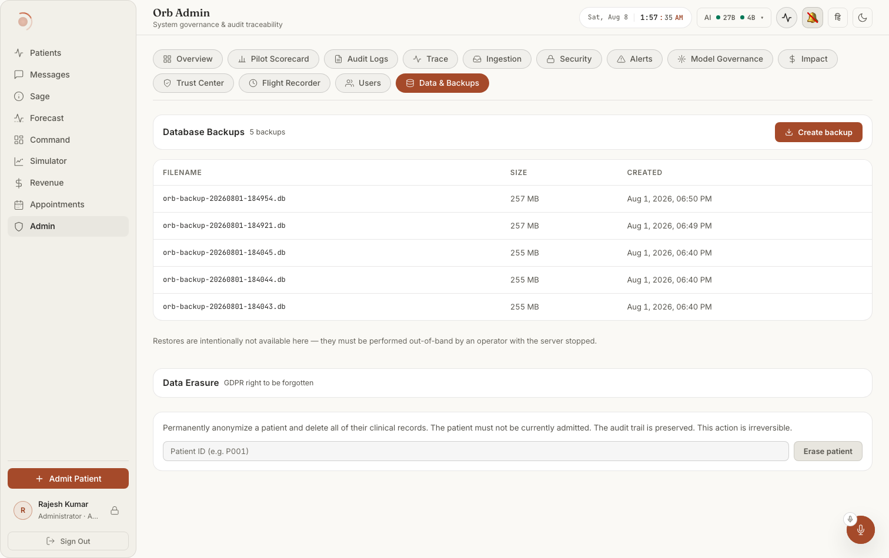

Lists the backups with size and creation time, and lets an administrator create one on demand.
It also holds patient erasure, with a confirmation dialog.

Note the standing sentence on this screen: **"Restores are intentionally not available here, 
they must be performed out-of-band by an operator with the server stopped."** A restore is not a
button. It is a procedure, done deliberately, by someone who knows what they are replacing.

## Operational planning: Forecast, Command Center, Simulator, Revenue

These four are visible to doctors and nurses as well, but they are administrator tools in
practice.

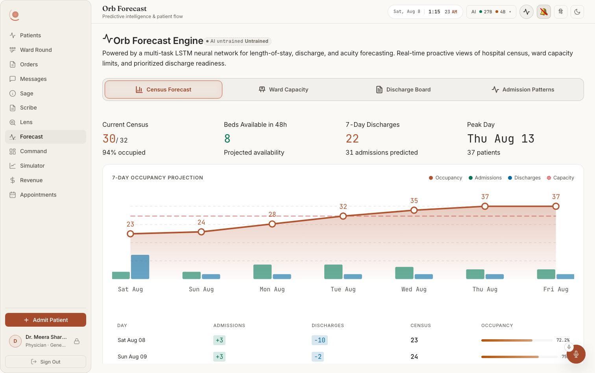

**Forecast** predicts patient flow: current census, beds available in 48 hours, expected
discharges over seven days, the peak day, a seven-day occupancy chart, per-ward capacity cards,
a discharge-readiness board and admission patterns by day of week.

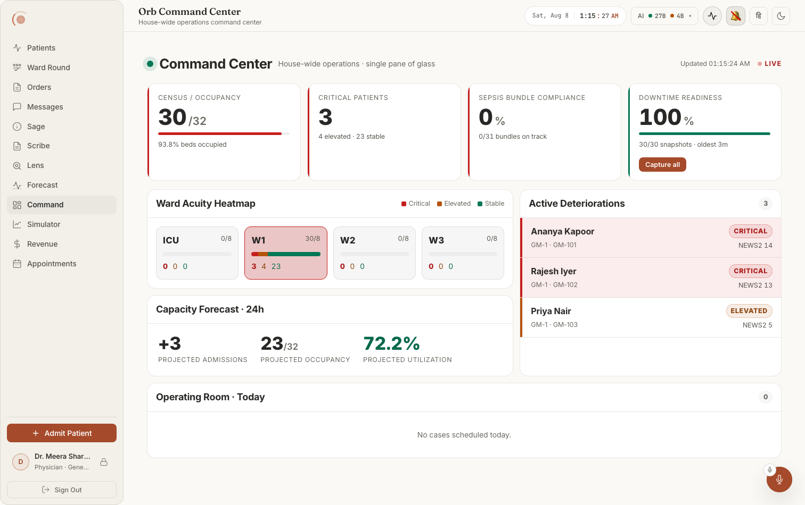

**Command Center** is the live hospital-wide picture, occupancy, deteriorating patients, an
acuity heatmap.

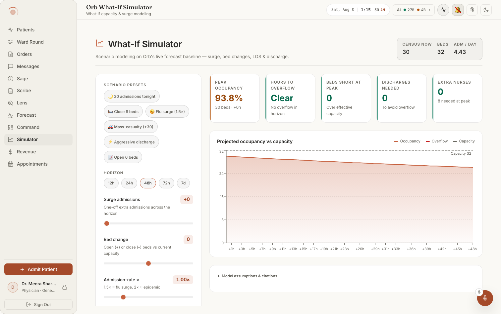

**Simulator** answers the what-if. Drag sliders, twenty extra admissions tonight, eight beds
closed, average length of stay up by half a day, and watch occupancy against capacity, hours
until overflow, discharges needed and the nurse-staffing gap redraw live. The arithmetic is
deliberately simple and completely deterministic: no randomness, nothing you cannot teach a bed
manager in five minutes. And it takes its starting numbers directly from Forecast, so it can
never contradict the figures already on screen.

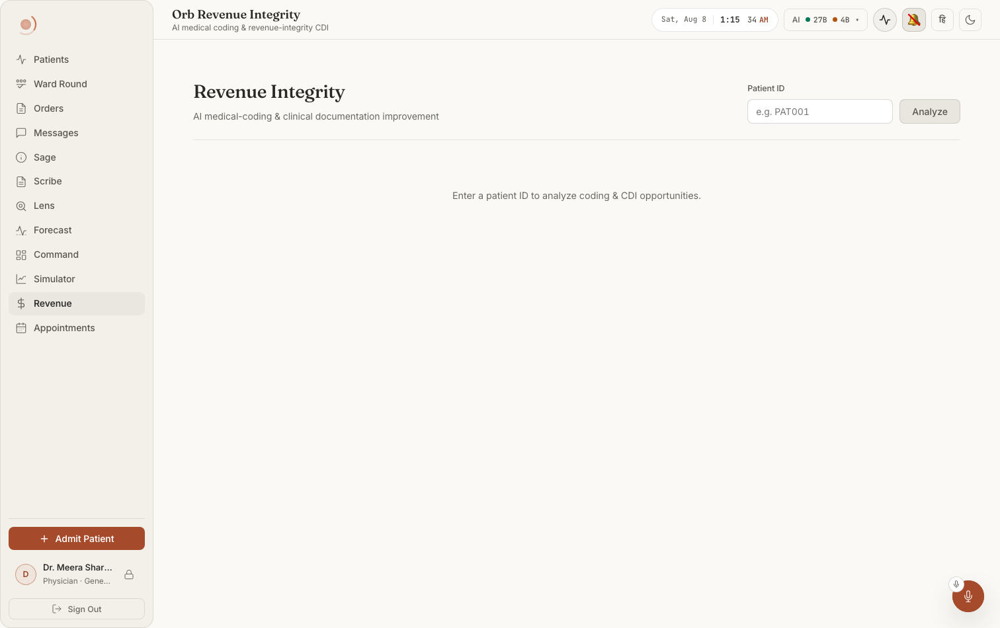

**Revenue** suggests clinical codes from the record and flags documentation gaps with an estimated
rupee impact, a condition treated but never coded, or coded so vaguely that it under-reimburses.

**Not yet, and an investor should read this one carefully.**

- **The coding engine matches words literally.** "No evidence of sepsis" and "rule out MI" still
  match and still suggest the code. This is deliberate, it is deterministic and inspectable, 
  and it is exactly what the human review step exists to correct, but it means the suggestions
  are a worklist and not an answer.
- **The rupee figures on the flags overlap and must not be added up.** One condition can raise
  two flags. The screen never totals them; anything downstream that did would overstate the
  opportunity.
- Only the most recent 25 documents and 25 dictated notes are scanned, so on a long admission a
  condition mentioned only in an old note is missed.
- **Nothing here connects to a billing system or a payer.** It suggests; a human codes; a
  separate system bills.
- The forecast caches for an hour, so a five-minute refresh often shows the same numbers.

## Site configuration

Ward names, department names, the escalation ladder and two operational thresholds live in a
single configuration file the hospital owns. It is validated hard: **a bad value stops the
server from starting and names the file and the line**. Loading nothing and carrying on would be
far worse, the ward would open the protocol list, find it empty, and either assume Orb has no
protocols or assume theirs had been deliberately removed.

**Not yet.** This is a file an operator edits, not a settings screen.

---

# For Patients and Their Families

**What it is.** Bridge, a small, separate, deliberately plain app a patient signs into on their
own phone.

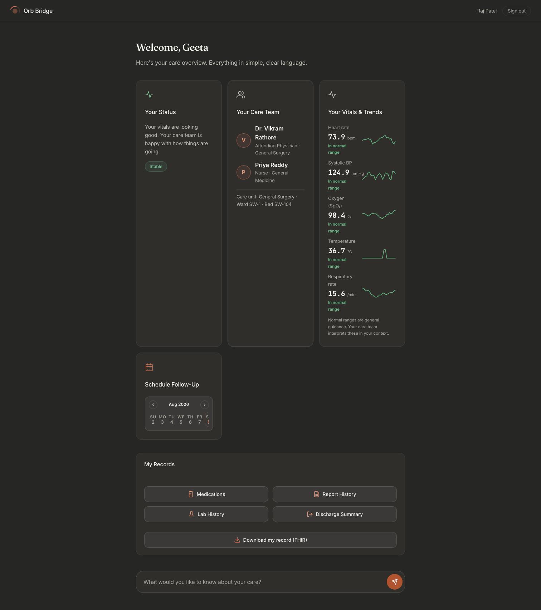

**The problem it solves.** A patient's family standing in a corridor has no idea what is
happening, and asks the nearest nurse, repeatedly.

**How you use it.** Four cards:

- **Your Status**, a plain-language sentence, never a raw score. Stable, elevated or critical
  in words, with no colour, and no level at all until one has actually loaded.
- **Your Care Team**, the attending doctor, a ward nurse, the care unit.
- **Your Vitals & Trends**, each vital as charted (the number the ward sees), when it was
  measured, and a small trend line. No colours and no "normal" or "high" verdict: a closing
  line says the care team reviews every reading and to tell the nurse if they feel worse.
- **Schedule Follow-Up**, a week calendar, six time slots, five departments, an optional note.
  Sundays and past dates are unbookable. Booking twice for the same slot returns the existing
  booking rather than an error.

Below that, **My Records**, medications, report history, lab and imaging history, discharge
summary, and a **Download my record** button that produces a standards-based file the patient
owns.

At the bottom is an **Ask** bar. **Every question a patient types is first run through a
deterministic screen for emergencies and self-harm.** If it trips, the question is *never* sent
to the AI at all; a fixed safe message appears and an emergency event is raised inside the
hospital.

**Not yet.**

- No messaging to the care team, no bill, no prescriptions, no visitor information.
- The status card fails silently: if the request fails it keeps showing "Your care team is
  monitoring you" rather than saying it could not load.
- Only English.

---

# Behind the Scenes

## The safety checks that can stop you

Orb has a small number of gates that refuse an action outright. They are worth listing in one
place because they are what a clinical governance committee will ask about.

| The gate | What it does | Where you meet it |
|---|---|---|
| **Allergy interlock** | Blocks a dose when the drug matches a **severe** recorded allergy. Mild and moderate matches are recorded but do not block. | Giving a dose; writing an order |
| **Dose guard** | Blocks a dose that reaches no plausible adult indication. Also runs against the protocol library **at start-up**, so a lethal instruction sitting in a protocol file stops the server rather than waiting for a patient. | Giving a dose; writing an order; applying a protocol |
| **Route check** | Blocks a drug given by a route it cannot be given by. | Giving a dose |
| **Verification gate** | An AI-extracted or AI-proposed medication cannot be given until a pharmacist verifies it. | The medication round |
| **State gate** | A discharged patient or an inactive order cannot be charted against. | Giving a dose |
| **Protocol gate** | If any item in a protocol is stopped, **nothing at all is written**. | Applying an order set |
| **Department scope** | You cannot see patients outside your department, and Orb answers "not found" rather than "not allowed", so the refusal cannot confirm the record exists. | Everywhere |

Three properties of these gates matter more than the list:

1. **They run on the server, not in the screen.** Hiding a button is a convenience; the refusal
   is enforced where a crafted request cannot get past it.
2. **They run at the moment of writing**, not at the moment of prescribing, so a change in the
   patient's allergies between order and administration is caught.
3. **Every refusal is recorded**, including who hit it and why.

## The audit trail

**What it is.** An append-only record of every access to patient information and every change to
it, arranged so that tampering is mathematically detectable.

**Why it is built the way it is.** A plain log table is worthless as evidence, because anybody
with access to the database can edit a row to hide what they did. You cannot make tampering
*impossible* on a machine somebody controls, but you can make it **evident**. Orb does that two
ways at once: the database itself refuses to update or delete an audit row, and each row carries
a fingerprint computed from its own contents *plus the previous row's fingerprint*. Change one
row, even with a hex editor, going around the database entirely, and every fingerprint after it
stops matching. The Trust Center reports the result as "chain intact" or "tampering detected".

Reading a patient's chart writes an audit entry. So does exporting a record, so does a Sage
answer about a named patient, so does every denial of permission.

**Not yet.** The chain proves the record has not been altered. It does not prove the record was
complete in the first place, and it cannot detect somebody photographing a screen.

## Privacy: who can see what

Each role gets a different set of screens, and the set is small on purpose:

- A **nurse** never sees Ward Round, Command Center, Simulator, Surgical Suite, Pharmacy or
  Admin.
- A **pharmacist** sees three screens: pharmacy operations, the verification queue, and Sage.
- An **administrator** sees the admin area but **not** the nurse shift board, ward round, orders,
  Scribe, Lens or pharmacy.
- A **patient** sees only their own portal, and every request it makes is re-scoped to that
  patient on the server, ignoring anything the app sends.

Beyond the screens: department scoping decides which patients appear anywhere at all, and a
request for a patient outside your department returns "not found". Somebody who should not know
a patient exists cannot learn it from an error message.

## Where the AI's answers come from

**What it is.** For every question asked of Sage, Orb keeps a record that can be reconstructed
months later.

**The problem it solves.** Six months into a pilot, somebody asks one question about one AI
answer: *why did it say that?* By then the chart has moved on, the reference material has been
re-indexed, and the model may have been swapped. A record that merely points at the patient
answers nothing, replayed today it reads today's chart and tells a confident story about the
wrong day.

**So Orb stores the inputs by value, not by reference:** the question as typed, the entire chart
as it was frozen at that moment, the reference passages retrieved, which model answered, whether
the speed toggle was on, whether the safety floor fired, the answer with its citations, and, 
separately, the raw model output *before* Orb's guardrails rewrote it.

That store is itself patient information, so it is fenced like any other: administrators only,
department-scoped, audited on every read, and append-only enforced by the database.

**Not yet.** There is no screen for browsing these records; retrieving one is an administrative
action, not a click.

## Encryption, backups and restore

**Encryption.** The clinical database is encrypted where it sits on disk. Uploaded files, 
imaging, dictated audio, are separately encrypted. A stolen appliance is a stolen locked box,
not a stolen record.

**Backups.** A verified copy is taken nightly at 02:30. The newest fourteen are kept.

**The important detail** is what "verified" means, and it comes from a real failure: an earlier
version of the backup script wrote zero-byte files, deleted the real backups to make room, and
reported success every single time. So the current one has to **earn** the right to rotate. It
checks the file is a plausible size, opens it with the encryption key, runs an integrity check,
and counts real rows in the patient, vitals, audit and user tables. **If any of that fails it
rotates nothing.** "The backup job succeeded" and "we have a backup" are not the same sentence.

**Restore.** Deliberately not a button. It is an out-of-band procedure with the server stopped,
and hospitals are expected to run a **restore drill monthly**, because a backup nobody has ever
restored is a hypothesis.

**Worst-case data loss is up to 24 hours**, since backups are nightly.

**Not yet.**

- **Uploaded files are not covered by the nightly backup.** Imaging and dictated audio need their
  own arrangement. This is the sharpest open item in this section.
- The encryption key needs a proper escrow arrangement, a documented, tested way for the
  hospital to recover the key if the person holding it is unavailable. Lose the key and the
  backups are unreadable, which given that Orb *replaces* the record means the record is gone.

## What happens in an outage

Three independent layers, deliberately separate so that a failure of one does not take out the
others.

**1. The app itself loads without a server.** The screens are cached in the browser.

**2. The offline read cache.** Described under *For Nurses*, the last-viewed boards and charts
are mirrored to the device, always labelled with their age, cleared on sign-out and user switch,
and writes are refused rather than queued.

**3. Downtime Mode, the real safety net.** Every hour, Orb freezes a read-only snapshot of every
admitted patient. It is assembled from the database alone, with no AI and no network involved.
When everything else is down, a nurse opens this page and gets a clean, printable document per
patient.

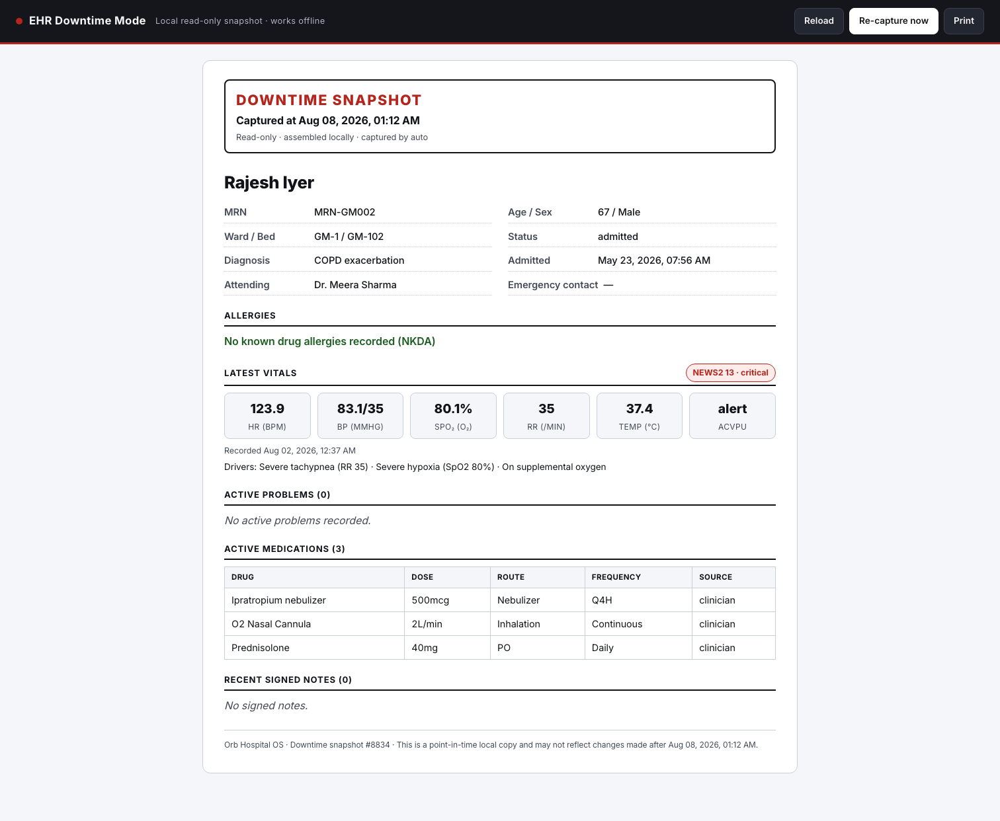

Look at what is on that page: the capture time stated at the top, the patient's identifiers, the
allergy line, the latest vitals with the score and the reasons for the score, active problems,
the full active medication list with the source of each, and recent signed notes. At the bottom,
a line saying this is a point-in-time local copy and may not reflect changes made after the
capture time. **Print it and the ward can work on paper.**

There is also a nightly export of the whole record to local disk in a standards-based format, so
the data is readable by other software without Orb running at all.

**Not yet.** Downtime Mode is read-only. It cannot take new orders or new observations. Anything
recorded during the outage is recorded on paper and typed in afterwards, and Orb does not help
with that reconciliation.

## Data rights under India's law

India's Digital Personal Data Protection Act gives a person the right to know what a hospital
holds about them and the right to have it erased. Indian medical-record law simultaneously
**compels** the hospital to keep most of that same material for years. And Orb's audit trail is a
chain, so deleting a row inside it destroys the tamper-evidence of every row after it.

Three obligations pointing three different directions. Orb's position, and where it lives:

**The line falls on the lawful basis, not on the data type.** Personal data Orb holds because a
law requires it cannot be erased. Personal data Orb holds because the patient agreed to it can
be, and is actually destroyed. That distinction lives in one column of one table, twelve
retention categories, each with a lawful basis, a retention period, a legal citation, and a flag
saying whether it is erasable, which is a row the hospital's own counsel can edit.

So an erasure request is not answered yes or no. It is adjudicated **per category**, and a
refusal comes back with the statute that compels the retention attached to it. A "no" with a
citation is a lawful answer; silence is not. The permanent trace the request itself leaves in the
audit trail is stated to the patient up front rather than discovered by them later.

Consent is recorded as an immutable row; withdrawing consent writes a *new* row pointing at the
one it retires, never an edit. Whether a consent is currently active is worked out at the moment
of reading, not stored as a status somebody could flip.

**Not yet, and this is a significant gap.** **There is no user interface for any of this.** The
tables, the rules, the machinery and the tests all exist and are complete. But a consent cannot
be recorded from a screen today, and an erasure request cannot be filed from a screen today. The
only thing on screen is the aggregate summary in the Trust Center. For a hospital that must
demonstrate compliance to a regulator, the machinery is there and the front door is not.

## Moving history off the old system

Orb **replaces** the existing electronic health record rather than sitting beside it. So on
cutover day, years of history have to arrive from a system nobody here designed, exported by
somebody who will not be available to answer questions.

Four rules shape that door:

1. **Imported history must not quietly become live clinical state.** An old medication row does
   not become an active prescription.
2. **Provenance is clinical information.** Every imported row is permanently stamped with which
   system it came from, that system's own identifier for it, and which import run wrote it, so
   years later a clinician can trace a value back.
3. **Re-running an import is safe**, enforced by the database rather than by the importer
   remembering.
4. **Dirty data is normal: handle it, report it, never guess a clinical value.** An ambiguous
   date is left blank. A result of "<0.01" stays as that text. A drug with no recorded dose is
   recorded as the literal word UNKNOWN, not dropped, and not invented.

**Not yet.** **No screen calls any of this**, and, more consequentially, **nothing reads the
provenance stamps back**. They are written correctly to the database and are invisible
everywhere in the product. Rule 2 is honoured in the data and unhonoured on screen.

## When the machine itself has a problem

Because there is no remote support, everything that can go wrong with the appliance has to be
legible **to the hospital's own IT person, standing in front of it, at 3am, without reading code
and without ringing anybody.**

So Orb has a status page that answers eight questions in sentences, and every unhappy answer
carries the thing to *do* about it. **No patient information appears anywhere on it**, that is
tested, with a deliberately distinctive fake patient name seeded into the database and asserted
to appear nowhere in the output. The reason is blunt: the status page is the single thing in this
product most likely to be photographed and sent to a WhatsApp group while somebody asks for help.

**Not yet.** **The status page is not in the administrator's screens.** It exists and it works,
but today it is reached as a page or a text output rather than from the Admin area. If somebody
asks "where is system health in the interface", the honest answer is: nowhere.

---

# The honest list: what Orb does not do yet

Everything above has its own "Not yet". This section collects the three that decide whether a
pilot works, plus the things that are built but not visible.

## What needs a paid data licence

**Drug interaction checking is the big one.**

Orb's medication safety today is strong on the checks that need no licensed data, a severe
allergy match, an implausible dose, a wrong route, a duplicate within an implausible window, an
unverified AI-extracted order. Those are computed from the hospital's own record and they work.

What needs licensed data is comprehensive **drug-drug interaction** screening, and comprehensive
drug naming. Specifically:

- The full standard drug dictionary is behind a free-but-registration-gated licence. Orb ships a
  six-row sample. A real deployment loads the full release.
- The standard clinical terminology used for coded findings is licence-gated. Orb ships a
  starter set of real codes; the freely redistributable parts can be loaded, the gated part
  cannot.
- Interaction checking runs off a table that a hospital can bulk-load from a licensed commercial
  source with no code change, the design anticipates this. What ships is a starter list, not a
  licensed database.

**How Orb behaves in the meantime is the part worth judging.** It does not fake coverage. The
pharmacist's queue shows an amber **"Not screened"** pill for any drug outside the knowledge it
has, and refuses to show a green "no alerts" for a gap. A system that quietly returned "no
interactions found" for a drug it had never heard of would be worse than no system.

**Cost implication:** a per-site annual data licence, on top of the appliance.

## What needs hardware Orb does not have yet

**Barcode scanning at the bedside.** The correct way to prevent wrong-patient and wrong-drug
administration is to scan a barcode on the wristband and a barcode on the drug package. That
needs scanners, printed wristbands, and barcoded stock.

Orb's current answer is the type-the-drug-name confirmation described earlier. It is honest about
what it is, the screen literally calls it a "barcode-style check", and it catches a
wrong-drug-selected error. It does **not** catch a wrong-patient error, and it does not verify
that the physical package in the nurse's hand is the drug on the screen.

**Connected patient monitors.** Orb can accept vital signs from monitors and laboratory systems
over the two standard hospital messaging formats, and that pathway is built, tested and
monitored. But in the pilot ward, nothing is physically connected: every observation is typed by
a nurse. Connecting monitors requires the monitors to support it, the network to reach them, and
in most cases a per-device licence from the monitor vendor.

**A second appliance.** Orb runs on one machine. A warm standby exists as a procedure; the
hospital has to buy the second box.

## What needs the hospital's other systems connected

**Laboratory results.** Orb can receive results and store them. Today, on the patient chart, some
lab trend tiles carry an **ESTIMATED** badge, which is Orb saying out loud that it does not have
a real feed for that value. Connecting the laboratory information system is a per-site
integration.

There is also a real boundary in the current data ingestion: **vitals and lab values flow all
the way through into the clinical record. Demographics, medications, allergies and problems that
arrive from an external system are captured but not turned into clinical rows.** An externally
supplied medication order lands as a captured observation, not as a medication. Interoperability
is complete for vitals and labs and capture-only for the rest.

**Billing.** Orb suggests clinical codes and flags documentation gaps with a rupee estimate.
Nothing posts a bill, nothing talks to an insurer, and nothing reconciles a payment. A human
takes the suggestions into whatever billing system the hospital already runs.

**Anything the hospital wants to keep.** Orb replaces the electronic record. If a hospital wants
to keep its existing system for some function, theatre stock, HR, purchasing, that is a
separate integration, and none exists today.

## Built, tested, and not on a screen yet

These are complete on the server side, with tests, and have no interface. They are listed
because an investor will otherwise assume they are missing entirely, and a hospital will
otherwise assume they are available.

| What | State |
|---|---|
| **Escalation chain**, a deterioration that climbs from ward nurse to duty registrar to consultant on a timer, stays visible until a named human acknowledges it, and closes only on a written reason | Server complete, 35 tests. **No screen.** |
| **Consent and data rights**, recording consent, withdrawal, erasure requests adjudicated per category with legal citations, patient data export | Seven tables, sixteen operations, 40 tests. **No screen** except the Trust Center summary. |
| **History import**, bringing years of a legacy record across at cutover | Server complete, 43 tests. **No screen**, and the provenance it writes is read back nowhere. |
| **Medication override with a written clinical reason**, including validation that rejects reflex answers | Server complete. **No button** in the nurse's screen. |
| **Ward tablet registration** | Works. **No screen**; an operator does it. |
| **System health status page** | Works, PHI-free, tested. **Not in the Admin area.** |
| **WHO Surgical Safety Checklist** | Groundwork exists. **Nothing renders it.** |

## Known rough edges

Small, real, and named rather than hidden:

- The surgical case detail always shows a blank bed number.
- The two pharmacy stock thresholds disagree with each other (30 units on one screen, 100 on
  another).
- The Alerts tab loses alerts older than the most recent 200.
- The AI status indicator disappears when it fails rather than showing an error, so "the AI is
  down" and "the indicator never loaded" look identical.
- Signing out destroys any writes still waiting to be sent, and the counter simply disappears.
- The patient portal's status card fails silently.
- Some administrator tabs have a Retry button on failure and some do not.

---

# Glossary

| Term | What it means here |
|---|---|
| **NEWS2** | National Early Warning Score 2. A standard scoring system that turns six vital signs into one number between 0 and 20. Higher means sicker. Orb computes it in one place only, so every screen agrees. |
| **I-PASS** | A structured handover format: Illness severity, Patient summary, Action list, Situation awareness, Synthesis by receiver. |
| **eMAR** | Electronic medication administration record, the digital drug chart a nurse charts against. |
| **The five rights** | Right patient, right drug, right dose, right route, right time. The standard check before giving a medication. |
| **Sepsis Six** | Six interventions that should be delivered within an hour of suspected sepsis. |
| **Shadow mode** | Running Orb so it watches, scores and records, while no clinician sees any AI output. The first phase of a pilot. |
| **Appliance** | The single physical machine Orb runs on, inside the hospital. |
| **On-prem** | Running on hardware the hospital owns, in the hospital's building, as opposed to in a vendor's data centre. |
| **DPDP** | India's Digital Personal Data Protection Act 2023. |
| **Provenance** | The record of where something came from, which feed produced a reading, or which AI model produced an answer. Orb keeps both, separately. |
| **PHI** | Protected health information, any data that identifies a patient and relates to their health. |
| **Tamper-evident** | Not "impossible to change", "impossible to change without it being detectable". |

---

*This manual describes Orb as it stands. Every "Not yet" in it is a statement about today, not a
statement about the plan. Where a limitation has a cost attached, a data licence, a scanner, an
integration, the cost is named rather than deferred.*
