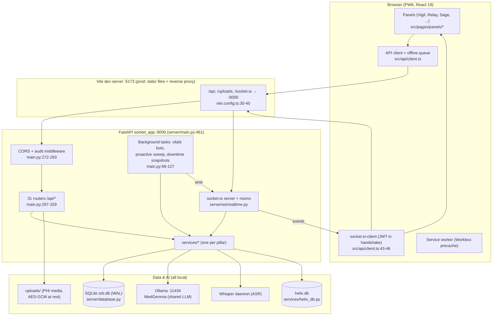
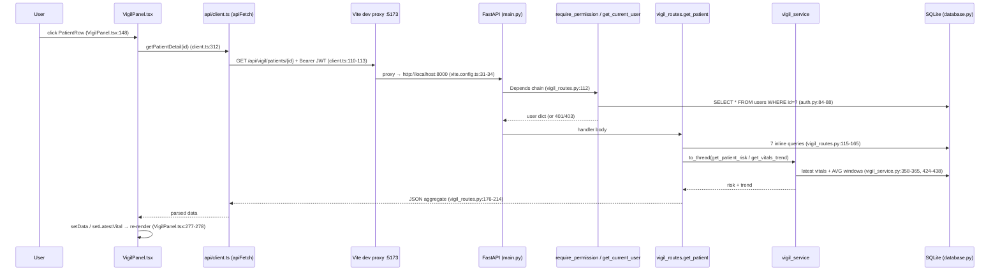
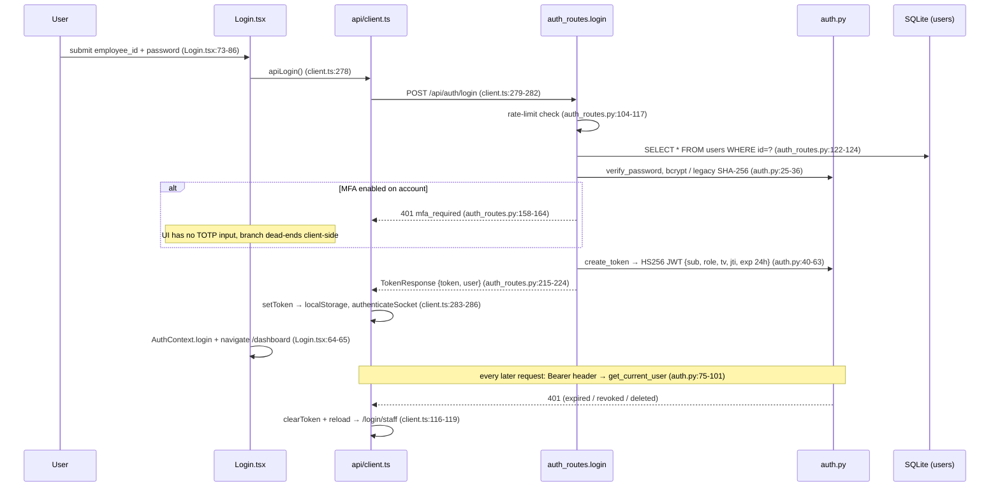

# Orb: The Master Document

> The single entry point to the Orb teaching corpus. Read this first, top to bottom.
> Then either follow **[REBUILD_PLAN.md](./REBUILD_PLAN.md)** to rebuild Orb from an
> empty folder, or jump into any deep dive in **[docs/guide/](./guide/)**.
>
> Every claim in this corpus carries a `file:line` citation into the real code.
> Where the code is odd or buggy we say so, see the Discrepancies sections in each
> guide. The corpus was written against the repository as of 2026-07.

---

## 1. What Orb is

Orb is a **local-first hospital operating system**: a single web application that a
hospital runs on its own hardware (one FastAPI server + one SQLite file + a local
LLM runtime), giving clinical staff one place to watch patients deteriorate in real
time, message each other, order tests and drugs, document encounters by voice,
and let an on-prem medical LLM help with all of it, without any patient data
leaving the building.

"Local-first" is a deliberate architectural stance, visible throughout the code:

- The API server describes itself as a *"Local-first hospital operating system"*
  (`server/main.py:251`) and binds to loopback by default (`server/config.py:23`).
- All persistence is a single SQLite file, `server/orb.db` (`server/config.py:10`),
  not a hosted database.
- The LLM is served by **Ollama on localhost** (`server/config.py:65`), one shared
  MedGemma instance for every AI feature (`server/config.py:66-69`).
- Fonts are bundled, not fetched from a CDN, *"so type renders identically on an
  offline, CSP-locked, on-prem hospital deployment"* (`index.html:19-21`,
  `src/main.tsx:3-8`).
- The frontend is a **PWA** (Progressive Web App, a web app the browser can
  install and partially run offline via a service worker) with an offline write
  queue (`vite.config.ts:9-25`, `src/api/client.ts:199-260`), and the backend keeps
  hourly "downtime snapshots" of every admitted patient so the ward still has a
  read-only picture when the network or EHR dies (`server/main.py:80-107`).

The counterweight to all this autonomy is **accountability**: every mutation is
recorded in a tamper-evident, hash-chained audit log (`server/services/audit_service.py`),
and PHI (Protected Health Information, any data that identifies a patient) is
treated as radioactive: media access is authenticated, patient-scoped, audited
fail-closed, and encrypted at rest (`server/main.py:375-441`).

## 2. Who uses it: the roles

Orb has five live roles, defined as a TypeScript union in `src/App.tsx:12` and
authorized server-side by the permission map in `server/permissions.py:93-134`.
A sixth spelling, `surgeon`, may be emitted by the backend and is normalized to
`doctor` + department "Surgery" at login (`src/pages/Login.tsx:47-55`); `clinician`
is a server-side alias for `doctor` (`server/permissions.py:137`).

| Role | Who they are | What they see (sidebar tabs, `src/pages/ClinicianShell.tsx:153-169`) | Signature powers (`server/permissions.py`) |
|---|---|---|---|
| **doctor** | Physicians | Vigil, Orders, Relay, Sage, Scribe, Lens, Forecast, Command, Simulator, Revenue, Appointments (Surgical Suite instead of Appointments if department is Surgery) | Everything clinical: sign notes (`scribe.sign`), publish discharges, write orders & medications |
| **nurse** | Ward nurses | Vigil, Orders, Relay, Sage, Scribe, Lens, Forecast, Revenue, Appointments | Clinical read/write but **cannot** sign notes or publish discharges (`permissions.py:103-111`) |
| **pharmacist** | Pharmacy staff | Helix (Pharmacy), Verify Queue, Sage | Only `sage.query`, `helix.read`, `helix.write` (`permissions.py:112-116`), a deliberately tiny surface |
| **admin** | Governance/ops | Vigil, Relay, Sage, Forecast, Command, Simulator, Revenue, Appointments, Admin | Read-only clinical + audit/ingestion/governance (`audit.read`, `admin.overview`, `permissions.py:117-129`) |
| **patient** | The patient during their admission (login closes at the end of the discharge day, ruling R029) | The Bridge portal only (`/bridge`, `src/App.tsx:84`) | Self-only: `bridge.read_own`, `bridge.ask` (`permissions.py:130-133`) |

Demo credentials (dev builds only, the quick-access chips are tree-shaken out of
production bundles, `src/pages/Login.tsx:10-13`): `DOC001/password` (doctor),
`DOC004/password123` (surgeon), `NUR001/password` (nurse), `PHA001/password`
(pharmacist), `ADM001/password` (admin), `P001/patient123` (patient)
(`src/pages/Login.tsx:16-27`).

## 3. The pillars

Orb's features are branded "pillars". Each sidebar tab maps to one pillar
(`src/pages/ClinicianShell.tsx:14-151`); a few pillars live outside the tab bar
(Bridge, Downtime, Handoff, they are full routes in `src/App.tsx:84-87`).

| Pillar | Tab / route | One line | Deep dive |
|---|---|---|---|
| **Vigil** | Patients | Live vitals board, NEWS2 early-warning scores, deterioration alerts, sepsis care-bundle timers | [07-vigil](./guide/07-vigil.md) |
| **Relay** | Messages | Role/case-scoped clinical messaging with alert escalation, over socket.io rooms | [08-relay](./guide/08-relay.md) |
| **Sage** | Sage | The clinical AI copilot: RAG-grounded Q&A over local guidelines + patient context | [09-sage](./guide/09-sage.md) |
| **Sage Proactive/Ambient** | (feeds into Sage/Relay) | Background surveillance loop that pushes insights; ambient listening in Relay | [10-sage-proactive-ambient](./guide/10-sage-proactive-ambient.md) |
| **Scribe** | Scribe | Ambient voice documentation: streaming Whisper ASR → LLM-structured, clinician-signed notes | [11-scribe](./guide/11-scribe.md) |
| **Lens** | Lens | Medical image upload + vision-LLM reference analysis (demo-gated, `server/config.py:97-102`) | [12-lens](./guide/12-lens.md) |
| **Forecast** | Forecast | Demand/census forecasting with an LSTM + fallbacks | [13-forecast](./guide/13-forecast.md) |
| **Helix** | Pharmacy | Formulary, inventory, drug-interaction screening, RxNorm reconciliation | [14-helix](./guide/14-helix.md) |
| **Pharmacy Verify** | Verify Queue | Pharmacist verification queue for medication orders | [15-pharmacy-verify](./guide/15-pharmacy-verify.md) |
| **Orders / CPOE** | Orders | Computerized provider order entry with terminology validation | [16-orders-cpoe](./guide/16-orders-cpoe.md) |
| **Surgical Suite** | Surgical Suite | Theatre board, WHO checklist, team alerts, emergency intake | [17-surgical-suite](./guide/17-surgical-suite.md) |
| **Command Center** | Command | Hospital-wide operational KPIs; **Pulse** is its ambient header widget | [18-command-center](./guide/18-command-center.md) |
| **What-If Simulator** | Simulator | Capacity simulation, vary admissions/staffing, see projected strain | [19-capacity-simulator](./guide/19-capacity-simulator.md) |
| **Revenue Integrity** | Revenue | AI-assisted clinical coding review | [20-revenue-integrity](./guide/20-revenue-integrity.md) |
| **Admissions/Discharge** | Admit button + flows | Admit → ward → discharge lifecycle, discharge summaries, time-limited patient access links | [21-admissions-discharge](./guide/21-admissions-discharge.md) |
| **I-PASS Handoff** | `/handoff/:patientId` | AI-drafted shift-change handoffs in the I-PASS format | [22-handoff-ipass](./guide/22-handoff-ipass.md) |
| **Bridge** | `/bridge` | The patient-facing portal (status, reports, meds, questions) | [23-bridge-patient-portal](./guide/23-bridge-patient-portal.md) |
| **Admin** | Admin | Governance sub-tabs: overview, audit log, flight recorder, compliance, impact, model governance, security, trust center, ingestion monitor, alert ops | [25-admin-panel](./guide/25-admin-panel.md) |
| **Downtime Mode** | `/downtime/:patientId` | Read-only patient snapshot page for EHR/network outages | [28-offline-pwa-downtime](./guide/28-offline-pwa-downtime.md) |

## 4. The tech stack: and why each piece

| Choice | What it is | Why Orb chose it |
|---|---|---|
| **Vite** | Frontend build tool + dev server | Instant dev startup and HMR; its dev server also acts as the reverse proxy that unifies frontend and backend under one origin (`vite.config.ts:30-45`), which keeps auth simple (same-origin `fetch`, no CORS dance in dev). |
| **React 19 + TypeScript** | UI library + typed JS | A hospital UI is deeply stateful (live vitals, sockets, queues). React's declarative re-render model plus TS types on API payloads (`src/api/client.ts`) keep 30+ panels coherent. React 19 is used conventionally, hooks, contexts, `lazy`/`Suspense` (`src/pages/ClinicianShell.tsx:197-211`). |
| **react-router-dom v7** | Client-side router | Five top-level routes separate the security worlds: staff shell, patient shell, tokenized discharge access, downtime, handoff (`src/App.tsx:81-88`). |
| **FastAPI** | Python async web framework | Async fits the workload (LLM streaming, socket.io, background sweeps); **dependency injection** via `Depends()` makes auth/RBAC declarative per-route (`server/auth.py:75`, `server/permissions.py:164`); Pydantic gives validated request/response models. Python is also the only sane host for the ML stack (Whisper, torch, embeddings). |
| **Raw-SQL SQLite** | Embedded database, no ORM | Local-first: one file (`server/orb.db`), zero ops, survives on a ward PC. Raw SQL (no ORM) keeps every query visible and auditable, important when queries ARE the clinical logic. WAL mode + generous pragmas tune it for one-box concurrency (`server/database.py:800-812`). Optional SQLCipher encryption at rest (`server/database.py:743-773`). |
| **socket.io** | Realtime layer over WebSocket | Vitals, alerts, chat and insights must push, not poll. socket.io adds auth handshake, rooms, and reconnection on top of raw WebSockets; the ASGI app wraps FastAPI (`server/main.py:461`) so REST and realtime share one port and one JWT. |
| **Ollama + MedGemma** | Local LLM runtime | All AI features share ONE locally-served model instance (~17 GB VRAM) instead of per-feature models (`server/config.py:66-69`); a queue + GPU coordinator arbitrate access ([26-ai-infrastructure](./guide/26-ai-infrastructure.md)). No PHI ever leaves the machine. |
| **PWA (vite-plugin-pwa)** | Installable, offline-capable app | Ward tablets need the shell to load during network blips; Workbox precaches the static bundle (`vite.config.ts:13-16`) and `client.ts` queues writes offline (`src/api/client.ts:199-260`). |
| **i18next** | Internationalization | Target market includes India: full English + Hindi locales with a runtime toggle in the shell header (`src/pages/ClinicianShell.tsx:243-245`, `src/i18n/`). |
| **Playwright + vitest + pytest** | Test harness | Five e2e "golden journeys" drive the real UI against the real backend (`e2e/`), vitest covers frontend units, pytest covers ~40 backend behavioral contracts; CI gates on build+tests (`.github/workflows/ci.yml`). |

## 5. Full-system architecture



Key structural facts:

- **One origin.** The browser only ever talks to the frontend origin; Vite proxies
  `/api`, `/uploads` and `/socket.io` (WebSocket-aware, `ws: true`) to FastAPI on
  :8000 (`vite.config.ts:30-45`). This is why `API_BASE` is simply
  `window.location.origin + '/api'` (`src/api/client.ts:8-10`).
- **One ASGI app.** `socketio.ASGIApp(sio, app)` wraps the FastAPI app so REST and
  realtime share a port; the uvicorn target is `main:socket_app`, not `main:app`
  (`server/main.py:461,488`).
- **Routers → services → SQL.** Every pillar is a `routes/<x>_routes.py` (HTTP
  concerns: auth deps, request parsing) delegating to `services/<x>_service.py`
  (business logic + SQL via `db_session()`, `server/database.py:817-828`). The
  full route inventory is in [31-api-reference](./guide/31-api-reference.md).
- **Startup choreography.** The FastAPI `lifespan` hook (`server/main.py:130-245`)
  initializes the DB, registers event-bus triggers, seeds Helix/terminology/
  interaction data, reconciles orphaned Scribe jobs, initializes the RAG knowledge
  base, warms the LLM, then spawns the background loops (proactive sweep every
  15 s, downtime snapshots hourly, vitals bots every 5 s per
  `server/config.py:156`).

## 6. Repo map

| Path | What lives there |
|---|---|
| `index.html` | HTML entry: error-catcher overlay script, PWA meta, `#root` (`index.html:4-12`) |
| `vite.config.ts` | Vite + PWA plugin + the dev proxy to :8000 |
| `src/main.tsx` | Bootstrap: fonts, global CSS, i18n, root error boundary, `createRoot` |
| `src/App.tsx` | AuthContext, theme bootstrap, the 7-route map |
| `src/pages/` | Shells (`ClinicianShell`, `PatientShell`), full-page routes (`Login`, `DischargeAccess`, `DowntimeMode`, `HandoffPage`), and `panels/` (one per tab) |
| `src/components/` | Feature components grouped by pillar (`vigil/`, `relay/`, `sage/`, `surgery/`, `helix/`, `orders/`, `coding/`, `command/`, `capacity/`, `handoff/`, `admin` widgets) + shared chrome (`OrbLogo`, `ClockWidget`, `PulseWidget`, `Aurora`, `ProvenanceChip`, `FlightRecorder`) |
| `src/api/` | `client.ts` (the ~1200-line API client: apiFetch, socket, SSE, offline queue, every endpoint wrapper) + thin domain modules (`bundles`, `downtime`, `ipass`, `pharmacy`) |
| `src/contexts/` | `ActivePatientContext`, cross-panel "currently selected patient" |
| `src/hooks/` | `useFocusTrap`, `useSageHotword`, `useStreamingTranscription` |
| `src/i18n/` | i18next setup + `en.json` / `hi.json` locales |
| `src/index.css` | THE design-token sheet: dark tokens, light overrides, glass recipes ([27-design-system](./guide/27-design-system.md)) |
| `server/main.py` | FastAPI app assembly: lifespan, middleware, router mounting, authenticated `/uploads`, socket_app |
| `server/config.py` | Every env-driven setting: profiles, JWT, models, modes, feature gates |
| `server/auth.py` / `server/permissions.py` | JWT + bcrypt; the permission constants, role map, and `require_permission` |
| `server/database.py` | Baseline schema (48 tables), pragmas, `db_session`, additive migrations, `SCHEMA_VERSION` (`database.py:20`). The other 88 tables of the live schema are added by the 37 versioned migrations in `server/migrations.py`, and ~16 more by service modules that own their own tables (`helix_db.py`, `sage_provenance_service.py`, `frontdesk_service.py`, others), for ~152 tables in `orb.db` |
| `server/migrate.py` | Standalone migration runner (schema-version mechanism) |
| `server/routes/` | 53 routers, one per pillar/domain, all prefixed `/api/<domain>` |
| `server/services/` | 112 service modules, the business logic and SQL |
| `server/ws/` | `realtime.py` (socket.io server, rooms, chat events) + `scribe_stream.py` (streaming transcription events) |
| `server/models/` | Pydantic schemas (`user.py`, `message.py`) + ML wrappers (`vigil_cfc.py`, `forecast_lstm.py`) |
| `server/corpus/` | Markdown clinical guidelines embedded into the Sage RAG index |
| `server/scripts/` | Seeding, training, benchmarking, data-loading utilities |
| `server/tests/` | ~40 pytest modules, the backend's behavioral contracts |
| `e2e/` | 5 Playwright golden-journey specs + helpers ([30-harness-and-ci](./guide/30-harness-and-ci.md)) |
| `docs/` | This corpus (`ORB_MASTER.md`, `REBUILD_PLAN.md`, `guide/`) + older prose docs (treat as historical) |
| `.github/workflows/ci.yml` | CI: backend pytest job + frontend lint/typecheck/build/test job |
| `install.sh`, `setup-mac.sh`, `run-orb.sh`, `ops/` | Deployment artifacts (the Docker files were retired on 4 October 2026, see `docs/archive/retired-docker-2026-10-04/`) |

## 7. The request lifecycle: one click, end to end

**The traced interaction:** clicking a patient row in the Vigil census, which mounts
`PatientDetailView` and fetches the full record via `getPatientDetail()`. This is
the only Vigil read path that actually traverses the service layer, which exposes
the trace's biggest surprise up front:

> **⚠ Surprise:** the panel's *list* load, `GET /api/vigil/patients`, has **no
> service-layer hop at all**, the route handler runs its SQL inline
> (`server/routes/vigil_routes.py:40-74`). `vigil_service.py` is only consulted by
> the detail route, and even there only for risk/trend computation; the seven
> entity queries are inline in the route. "Route → service → DB" is the *ideal*
> Orb pattern (and the one the rebuild plan teaches), but in Vigil it is the
> exception, not the rule.

| Hop | File:line | What happens | Why this layer exists |
|---|---|---|---|
| 1a | `src/pages/panels/VigilPanel.tsx:148` | User clicks a `PatientRow`; `onClick` calls `setSelectedPatientId(p.id)` | React state drives which view is mounted; the detail view is a conditional render (`VigilPanel.tsx:83-90`), no router involved |
| 1b | `src/pages/panels/VigilPanel.tsx:241-245` | `PatientDetailView`'s `useEffect([patientId])` runs `loadPatientData()` | Effects tie data-fetch lifetime to mount + prop identity, so switching patients refetches automatically |
| 1c | `src/pages/panels/VigilPanel.tsx:273-284` | `loadPatientData()` sets `loading=true`, awaits `getPatientDetail(patientId)`, then `setData(detail)` | A local async wrapper centralizes loading/error state for the view |
| 2 | `src/api/client.ts:312-314` | `getPatientDetail(patientId)` → `apiFetch('/vigil/patients/' + id)` | A typed API module keeps every endpoint path in one file; components never build URLs or read tokens |
| 3 | `src/api/client.ts:9-10,101-136` | `apiFetch` prefixes `API_BASE = window.location.origin + '/api'`, merges `authHeaders()` (JWT from `localStorage['orb_token']` → `Authorization: Bearer …`). Non-OK: 401 → `clearToken()` + reload (`:116-119`); 403 → structured permission error (`:123-129`) | One wrapper gives every call identical auth attachment, session-expiry handling, and RBAC error shaping |
| 4 | `vite.config.ts:31-34` | Dev proxy: `'/api' → http://localhost:8000` (`/uploads` `:35-38`, `/socket.io` with `ws: true` `:39-43`) | Browser talks only to the Vite origin, no CORS in dev, same build works on localhost/LAN/ngrok |
| 5a | `server/main.py:298` + `server/routes/vigil_routes.py:11` | `app.include_router(vigil_router)`; the router carries `prefix="/api/vigil"` | Per-domain routers keep 30+ feature modules independently mountable |
| 5b | `server/routes/vigil_routes.py:111-112` | `GET /patients/{patient_id}` with `Depends(require_permission("patient.read_all"))` | Declarative per-route RBAC, the handler body can assume an authorized user |
| 5c | `server/permissions.py:164-217` → `server/auth.py:75-101` | The dependency chain: `HTTPBearer` extracts the header, `decode_token` verifies HS256 signature + expiry, the user row is **re-read from the DB**, `token_version` compared, then the role's permission set checked; denials are audit-logged and raised as structured 403 | Splits authentication (who are you) from authorization (what may you do); the DB re-read means a stale JWT role can never widen access |
| 6 | `server/routes/vigil_routes.py:172-174` → `server/services/vigil_service.py:348-412,416-467` | `await asyncio.to_thread(get_patient_risk, …)` computes a NEWS2 baseline and overlays CfC neural-net risk (may escalate, never de-escalate, `vigil_service.py:390-410`); `get_vitals_trend` compares 6 h vs prior-6 h averages | The service layer holds clinical *logic* reusable by bots/Sage/routes; `to_thread` keeps synchronous torch inference off the asyncio event loop (`vigil_routes.py:167-171`) |
| 7 | SQL: `vigil_routes.py:115-165`; connection: `server/database.py:800-829` | Inside `with db_session() as db:`, seven queries over `patients`, `users`, `vitals`, `clinical_documents`, `scribe_notes`, `risk_scores`, `lens_analyses`, `medications`. `get_db()` opens SQLite with `row_factory=sqlite3.Row` + WAL/busy-timeout/mmap pragmas; `db_session()` commits on success, rolls back on error | The helper guarantees uniform pragmas, dict-like rows, and transaction discipline for every caller |
| 8 | `server/routes/vigil_routes.py:176-214` | Response: one aggregate `{patient, risk, trend, vitals[], notes[], scribe_notes[], risk_history[], lens_analyses[], medications[]}`; medications carry an explicit `unverified` flag for AI-extracted, pharmacist-unreviewed entries (`:207-213`) | One round-trip populates the whole detail view; the flag encodes a safety rule in the API contract itself |
| 9 | `src/pages/panels/VigilPanel.tsx:277-278,729-732` | `setData(detail)` triggers re-render: command bar, vitals cells with sparklines (`:822-853`), and every `useMemo` keyed on `data` recomputes (timeline `:353-413`, lab-trend parser `:535-596`) | React re-renders declaratively from state; `useMemo` confines expensive derivations to when inputs change |

**The list-load variant** (panel opening): `useEffect` at `VigilPanel.tsx:26-30`
calls `loadPatients()` and then **polls every 30 s**. `getPatients()`
(`client.ts:308-310`) hits `GET /api/vigil/patients` (`vigil_routes.py:36-94`),
one inline join of `patients ⋈ admissions(active) ⟕ risk_scores(latest) ⟕ users`,
**filtered by the caller's own department** when set (`:39-58`). This polling loop
also backstops the realtime channel (below) when the socket is down.



## 8. The realtime lifecycle: from login to a live pixel

| Hop | File:line | What happens | Why this layer exists |
|---|---|---|---|
| 1 | `src/api/client.ts:43-46` | The socket.io client is created at module load with `auth: (cb) => cb({ token: getToken() })`, a **callback**, so the freshest localStorage token is read on every (re)connect handshake. After login, `authenticateSocket()` (`:49-56`, called from `login()` at `:286`) force-reconnects with the new JWT; logout calls `deauthenticateSocket()` (`:60-65`) | One shared socket for the whole app; presenting the JWT in the handshake makes realtime enforce the same Bearer identity as REST |
| 2 | `server/ws/realtime.py:68-89` (`_authenticate` `:28-65`) | `connect(sid, environ, auth)` verifies the token via the same `decode_token` as REST, refuses `sub == 'discharge_access'` grants (`:55-56`), re-reads the user row from the DB. Failure → `return False` → **connection refused** (`:77-79`). Success → identity saved in the per-connection session (`:80-84`) | The handshake is the WS analogue of `get_current_user`: identity is server-verified once and never trusted from client event payloads again |
| 3 | `server/ws/realtime.py:87,111-127`; client `src/pages/panels/RelayPanel.tsx:79` | Two kinds of **rooms** (a room is a named broadcast group a socket can join): every socket auto-joins its personal room `user:{id}` (`:87`); Relay channel rooms are joined on request via `join_channel`, authorized against the same channel-visibility function the REST layer uses (`:97-108`) | Rooms scope fan-out: per-user rooms for targeted alerts, per-channel rooms so chat only reaches authorized members, WS authorization mirrors REST RBAC by construction |
| 4 | `server/main.py:233,120-127` → `server/services/bot_service.py:99-256` | The lifespan hook starts `vitals_simulator()`, which runs the vitals bot every 5 s (gated by `INGESTION_MODE`). The bot batch-INSERTs vitals (`bot_service.py:218-223`), computes NEWS2 risk, then `await sio.emit("vitals:update", payload)` per patient (`:251-252`), and bridges critical readings into Relay alert messages | Server push means monitoring data reaches screens without polling; the DB write happens first, so the emit is a notification about durable state, not the source of truth |
| 5 | `src/pages/panels/VigilPanel.tsx:34-49` (list), `:247-271` (detail) | List: `socket.on('vitals:update', …)` patches the matching patient's risk via `setPatients(prev => prev.map(...))`, throttled to one update per 2 s. Detail: filters to the open patient, `setLatestVital` + prepend to `data.vitals` (5 s throttle, 2000-point cap). Both effects unsubscribe on cleanup | Handlers translate transport events into React state; throttling keeps a 5-second firehose from thrashing renders; cleanup prevents duplicate handlers |
| 6 | `src/pages/panels/VigilPanel.tsx:62-81,160,823-853` | `setPatients` re-runs the `sortedPatients` memo so rows re-order live by risk; `PatientRow` is `memo`-wrapped so only the changed row repaints; `latestVital` drives the command-bar cells and sparklines | Memoized rows + throttled state give live dashboards without full-list re-renders every tick |

**Auth failure:** a refused handshake surfaces as socket.io's `connect_error`, and
**no code in `src/` listens for it**, so a rejected socket silently stays
disconnected. That is the normal pre-login state (the module-load socket connects
with `token: null` and is refused). The UI degrades gracefully because REST
polling backstops it (`VigilPanel.tsx:28`).

**Reconnect:** socket.io-client auto-reconnects; each retry re-invokes the `auth`
callback so the current token is presented, and the server re-enters `user:{id}`
(`realtime.py:80-88`). **Caveat:** Relay channel-room membership is *not*
re-established on reconnect (`join_channel` is only emitted from the
channel-selection effect, `RelayPanel.tsx:79`), so a reconnected client misses
room-scoped messages until the channel is reselected.

> **⚠ Surprises:** (1) `vitals:update` is emitted with **no room argument**
> (`bot_service.py:252`), every authenticated socket receives every patient's
> vitals, even though the REST list endpoint filters by department
> (`vigil_routes.py:39-58`). (2) The WS handshake does **not** check
> `token_version` (`realtime.py:28-65`), so a JWT revoked via logout can still
> open a socket until it expires, REST would reject it (`auth.py:96-99`).

```mermaid
sequenceDiagram
    participant L as Login flow
    participant C as socket (client.ts:43)
    participant WS as ws/realtime.py
    participant DB as SQLite
    participant B as bot_service (vitals bot)
    participant VP as VigilPanel

    L->>C: authenticateSocket() after login (client.ts:286)
    C->>WS: handshake auth={token: JWT} (client.ts:45)
    WS->>DB: decode_token + SELECT users row (realtime.py:46-64)
    alt invalid/missing token
        WS-->>C: return False → connect_error (realtime.py:77-79)
        Note over VP: no listener; UI falls back to 30s REST polling
    else authenticated
        WS->>WS: save_session + enter_room("user:{id}") (realtime.py:80-88)
    end
    loop every 5s (main.py:120-127)
        B->>DB: batch INSERT INTO vitals (bot_service.py:218-223)
        B->>WS: sio.emit("vitals:update", payload), global (bot_service.py:251-252)
        WS-->>C: vitals:update
        C->>VP: handler (VigilPanel.tsx:47 / :269)
        VP->>VP: setPatients / setLatestVital → throttled re-render
    end
```

## 9. The auth flow

| Hop | File:line | What happens | Why this layer exists |
|---|---|---|---|
| 1 | `src/pages/Login.tsx:73-86,42-71` | Form submit → `handleLogin` calls `apiLogin`, normalizes `surgeon → doctor` (`:51-55`), calls the AuthContext `login(user, token)` and navigates to `/dashboard` or `/bridge` | The page owns UX (modes, errors, dev-only demo chips `:13`); credential transport and storage live in the API module |
| 2 | `src/api/client.ts:278-288` → `server/routes/auth_routes.py:96-97` | `login()` POSTs `{employee_id, password}` to `/api/auth/login`; the body is validated by the Pydantic `UserLogin` model (`server/models/user.py:9-17`, includes optional `totp_code`) | Pydantic rejects malformed bodies before handler logic; `response_model` pins the success contract |
| 3 | `server/routes/auth_routes.py:104-117` (limiter `:28-60`) | Per-IP sliding-window rate limit: 5 attempts / 15 min, in-memory, capped at 10k IPs; over-limit → audited 429; dev localhost exempt | Slows online credential guessing; audit events make lockouts investigable (limitations candidly documented `:16-27`) |
| 4 | `server/routes/auth_routes.py:122-142` → `server/auth.py:25-36` | User row lookup; `verify_password`: **bcrypt** for `$2…` hashes, legacy **SHA-256** compared constant-time (`hmac.compare_digest`). Failure → audited generic 401. On success a legacy hash is **auto-upgraded to bcrypt** (`auth_routes.py:186-196`) | bcrypt is deliberately slow (offline-cracking resistance); the upgrade path migrates old accounts without a reset campaign; identical 401s avoid username enumeration |
| 5 (MFA) | `server/routes/auth_routes.py:144-180` (`consume_totp` `:68-93`) | If the role requires MFA but is unenrolled → 403 `mfa_enrollment_required`; if enrolled: missing code → 401 `mfa_required` (not counted toward lockout), codes verified single-use via `users.totp_last_step` (anti-replay per RFC 6238) | A second factor caps the blast radius of a phished password |
| 6 | `server/auth.py:40-63` (`server/config.py:37-45`) | `create_token` signs an **HS256** JWT `{sub, role, tv, jti, exp: now+24h, iat}`; secret from `ORB_JWT_SECRET`, the server **refuses to boot in prod without it** (`config.py:37-43`) | Stateless auth without a session store; `tv` (token_version) restores revocability, the classic stateless-JWT weakness |
| 7 | `server/routes/auth_routes.py:215-224` | Success audited, returns `TokenResponse {token, user}` | Returning the user saves a follow-up `/auth/me` round-trip |
| 8 | `src/api/client.ts:283-286` → `src/App.tsx:65-69` | Token → `localStorage['orb_token']`, user → `orb_user`, then `authenticateSocket()` re-handshakes realtime; AuthContext state flips the route guards (`App.tsx:81-84`) | localStorage survives reloads; context state drives routing. The XSS tradeoff of localStorage tokens is documented at `client.ts:15-23` |
| 9 | `server/auth.py:75-101` | Every later request: `HTTPBearer` parses the header, signature + expiry verified, `sub` re-read from `users`, and `payload.tv` must equal the row's `token_version`, `POST /api/auth/logout` bumps that counter to kill all outstanding sessions (`auth_routes.py:340-353`) | Validation is pure dependency injection, handlers can't forget it; revocation takes effect on the very next request |
| 10 | `src/api/client.ts:116-119` | Any 401 on a non-login path → `clearToken()` + `window.location.reload()`; the reload boots with `user=null` and the guards bounce to `/login/staff` | Fail-closed session expiry, handled in exactly one place |

> **⚠ Surprises:** (1) **MFA is server-complete but client-incomplete**, the
> login route implements the full TOTP branch, but `client.ts login()` never
> sends `totp_code` and `Login.tsx` has no TOTP input; an MFA-enabled account
> cannot log in through this UI today. (2) The UI `logout()` (`App.tsx:71-75`)
> only clears local state, it never calls `POST /api/auth/logout`, so
> server-side revocation never fires on a normal logout and the JWT stays valid
> until its 24 h expiry.



## 10. Cross-cutting systems

### 10.1 Auth + RBAC: [03-auth-rbac](./guide/03-auth-rbac.md)

Login (`POST /api/auth/login`) verifies bcrypt-hashed passwords (with a
constant-time legacy SHA-256 fallback, `server/auth.py:25-36`) and issues a
**JWT**, a signed JSON token the client presents on every request, carrying
`sub` (user id), `role`, a unique `jti`, and `tv`, the user's **token_version**
(`server/auth.py:40-63`). Every request re-reads the user row from the DB
(`get_current_user`, `server/auth.py:75-101`): the role in the token is *never*
trusted for authorization, and if the DB's `token_version` no longer matches the
token's `tv`, the session is revoked, this is how logout/password-change kills
all outstanding tokens without a blocklist (`server/auth.py:92-99`).
**RBAC** (role-based access control) is enforced by `require_permission(...)`
dependencies consulting the central role→permission map, audit-logging every
denial (`server/permissions.py:164-217`). The older `require_role` is explicitly
deprecated (`server/auth.py:104-111`).

### 10.2 The tamper-evident audit chain: [05-audit-chain](./guide/05-audit-chain.md)

Every mutation is written to `audit_logs` (`server/database.py:362`) where each row
is hash-linked to the previous one, so deleting or editing history breaks the
chain visibly. A generic middleware audits *every* state-changing request as a
HIPAA safety net on top of the richer per-route events (`server/main.py:289-293`).
Some categories are **fail-closed**: if the audit write fails, the operation is
refused, e.g. PHI media is not served without a durable `phi_access` record
(`server/main.py:405-422`). The Flight Recorder replays system events for
admins ([05-audit-chain](./guide/05-audit-chain.md)).

### 10.3 Offline queue + idempotency: [02-api-client](./guide/02-api-client.md), [28-offline-pwa-downtime](./guide/28-offline-pwa-downtime.md)

When offline, selected writes are queued in `localStorage` (`orb_offline_queue`)
and replayed once connectivity returns; items are only removed after the server
confirms success, and the code explicitly documents that handlers must be
idempotent because a replay may repeat a request whose response was lost
(`src/api/client.ts:229-260`). The shell surfaces queue depth and a "Synced"
confirmation in the header (`src/pages/ClinicianShell.tsx:270-320`).

### 10.4 Design tokens + themes: [27-design-system](./guide/27-design-system.md)

All styling flows from CSS custom properties defined once in `src/index.css:4-102`
(dark default) and overridden under `[data-theme="light"]`
(`src/index.css:299-338`). The theme attribute is set on `<html>` at boot
(`src/App.tsx:36-43`) and toggled in the shell (`src/pages/ClinicianShell.tsx:224-233`).
The signature **liquid-glass** surfaces are the `.glass`, `.glass-card`,
`.glass-strong` recipes (`src/index.css:189-227`). In light mode the accent family
switches from gold to Sierra Blue, and accent-colored **text** must use
`--accent-deep` (`#2C465E` in light, `src/index.css:314`), the mid-tone accents
fail contrast on white. Known bug: `App.tsx:37` reads the saved theme from key
`orb-theme` but the shell persists it as `orb_theme` (`ClinicianShell.tsx:225,230`),
so the boot-time initializer never sees the saved choice.

### 10.5 Error containment

Three nested layers: a raw `window.onerror` overlay in `index.html:4-12` (catches
even bundle-load failures), a root React **error boundary**, a component that
catches render-time exceptions in its subtree, with a reload affordance
(`src/main.tsx:26-77`), and a per-panel boundary so one crashing panel fails in
place instead of blanking the shell (`src/pages/ClinicianShell.tsx:177-195`).

### 10.6 i18n: [29-i18n](./guide/29-i18n.md)

i18next with full English and Hindi locales; the header button toggles languages
at runtime (`src/pages/ClinicianShell.tsx:243-245`). All shell/nav strings go
through `t()`, adding a language is a locale-file exercise.

### 10.7 The test harness + CI: [30-harness-and-ci](./guide/30-harness-and-ci.md)

Five Playwright golden journeys (login→Vigil, Scribe, Orders, Pharmacy Verify,
Admin flight recorder) run serially against a real seeded backend
(`playwright.config.ts`, `e2e/README.md`). CI runs backend pytest and frontend
lint (non-blocking) + typecheck + build + unit tests (`.github/workflows/ci.yml`).
Note: some project briefs mention a `tests/visual/` harness, **no such directory
exists**; the e2e suite in `e2e/` is the visual/behavioral gate.

## 11. Glossary

Terms are defined where they first appear in the guides; this is the quick
reference. **Web/framework** terms first, then **clinical**.

### Web, framework, and architecture

| Term | Meaning in Orb |
|---|---|
| **ASGI** | Asynchronous Server Gateway Interface, the async contract between a Python web server (uvicorn) and an app. Orb's app object is `socket_app`, a socket.io ASGIApp wrapping FastAPI (`main.py:461`). |
| **bcrypt** | The deliberately-slow salted password-hashing algorithm Orb uses (`auth.py:17-22`); a legacy SHA-256 path is auto-upgraded on next login. |
| **CfC** | Closed-form Continuous-time, a "liquid" neural network type used as Vigil's deterioration overlay (`models/vigil_cfc.py`); escalate-only, torch-optional. |
| **context (React)** | App-wide shared state without prop-drilling. `AuthContext` (`App.tsx:28`) and `ActivePatientContext` are Orb's two. |
| **CPOE** | Computerized Provider Order Entry, the Orders pillar; validates against terminology codes. |
| **CORS** | Cross-Origin Resource Sharing, browser rule about which origins may call an API. Orb splits dev (permissive) vs prod (locked to `CORS_ORIGINS`) at `main.py:272-287`. |
| **CSS Module** | A `*.module.css` file whose class names are locally scoped to one component (vs global `index.css`). Orb uses both; see guide 27. |
| **db_session** | The `contextmanager` that yields a SQLite connection and commits on success / rolls back on error (`database.py:817-828`). The standard way every service touches the DB. |
| **dependency injection / Depends** | FastAPI's mechanism where a route declares `Depends(fn)` and the framework runs `fn` first. Orb's auth/RBAC is entirely `Depends(require_permission(...))`. |
| **design token** | A CSS custom property (`--accent-gold`, `--space-4`) defined once and reused; the whole theme system is tokens (`index.css:4-102`). |
| **error boundary** | A React component that catches render-time exceptions in its subtree. Orb has a root one (`main.tsx:26`) and a per-panel one (`ClinicianShell.tsx:177`). |
| **FHIR / HL7** | Healthcare interoperability standards (resources, Bundles, `$everything`). Orb ingests and exports FHIR; see guide 24. |
| **hook (React)** | A function like `useState`/`useEffect`/`useMemo` that lets a component hold state or run side effects. Custom hooks: `useFocusTrap`, `useSageHotword`, `useStreamingTranscription`. |
| **idempotency** | A request that can be safely repeated without duplicate effect. Orb's offline replay *requires* it because a lost response may be retried (`client.ts:250-253`). |
| **JWT** | JSON Web Token, a signed token (`{sub, role, tv, jti, exp}`) the client presents as `Authorization: Bearer`. Signed HS256 (`auth.py:40-63`). |
| **LSTM** | Long Short-Term Memory, a recurrent neural net for sequences; Forecast's core model (`models/forecast_lstm.py`), with a heuristic fallback. |
| **migration** | A versioned, idempotent schema change applied at startup; Orb guards each with `PRAGMA table_info` so re-running is safe (`database.py` init blocks; `SCHEMA_VERSION` at `:14`). |
| **PWA** | Progressive Web App, an installable, partially-offline web app via a service worker. Orb precaches its bundle with Workbox (`vite.config.ts:9-25`). |
| **RAG** | Retrieval-Augmented Generation, grounding an LLM answer in retrieved documents. Sage's pipeline; see guide 09. |
| **RBAC** | Role-Based Access Control, the role→permission map (`permissions.py:93-134`) enforced by `require_permission`. |
| **router** | Maps URLs to components (frontend, react-router `App.tsx:81-88`) or path-prefixes to handlers (backend, `APIRouter(prefix="/api/...")`). |
| **socket room** | A named broadcast group a socket can join; Orb has per-user rooms (`user:<id>`) and per-channel Relay rooms (`ws/realtime.py`). |
| **SSE** | Server-Sent Events, a one-way streaming response (`text/event-stream`); Orb streams Sage/Scribe/Lens answers this way (`client.ts:169-195`). |
| **token_version (tv)** | A per-user counter embedded in the JWT; bumping the DB value revokes every outstanding token at once (`auth.py:92-99`). |
| **WAL** | Write-Ahead Logging, a SQLite journal mode enabling concurrent reads during writes; enabled in `get_db()` (`database.py:804`). |

### Clinical

| Term | Meaning in Orb |
|---|---|
| **NEWS2** | UK National Early Warning Score 2, a 0–20 aggregate of seven vital-sign bands driving Vigil's risk level (`vigil_service.py:225`). |
| **Sepsis Six / care bundle** | A time-boxed set of interventions (six elements, 60-min targets) auto-opened on NEWS2 ≥ 7; see guide 07. |
| **SOAP note** | Subjective/Objective/Assessment/Plan, the note structure Scribe generates. |
| **I-PASS** | Handoff mnemonic: Illness severity, Patient summary, Action list, Situation awareness, Synthesis; the Handoff pillar. |
| **WHO checklist** | WHO Surgical Safety Checklist (sign-in / time-out / sign-out); the Surgical Suite. |
| **RxNorm / formulary** | RxNorm = a normalized drug-naming vocabulary; formulary = the approved drug list. Helix reconciles free-text drug names to RxNorm codes. |
| **LOINC / SNOMED / ICD-10** | Terminology code systems for labs / clinical concepts / diagnoses; Orders validate against a seeded subset; Revenue Integrity codes in ICD-10. |
| **PHI** | Protected Health Information, patient-identifying data; treated as radioactive (authenticated, patient-scoped, audited, encryptable media). |
| **provenance** | The recorded origin of a datum (bot-simulated vs device-ingested vs clinician-entered); surfaced by `ProvenanceChip`. |

## 12. Where do I find X?

| I want to… | Go to |
|---|---|
| Understand the whole system fast | This document, §5 (architecture) + §7–9 (lifecycles) |
| Rebuild Orb from scratch | [REBUILD_PLAN.md](./REBUILD_PLAN.md) |
| See every DB table + column | [guide 04-database-schema](./guide/04-database-schema.md) |
| See every REST endpoint | [guide 31-api-reference](./guide/31-api-reference.md) |
| See every socket event | [guide 06-realtime](./guide/06-realtime.md) (event reference) |
| See every design token / the theme + glass recipe | [guide 27-design-system](./guide/27-design-system.md) |
| Understand login / JWT / permissions | [guide 03-auth-rbac](./guide/03-auth-rbac.md); flow in §9 |
| Understand the audit hash-chain | [guide 05-audit-chain](./guide/05-audit-chain.md) |
| Add a new pillar/panel | Copy the Vigil template, [guide 07-vigil](./guide/07-vigil.md) + REBUILD_PLAN Phase 3 |
| Add a new role | [guide 03-auth-rbac](./guide/03-auth-rbac.md) (the "add a role" change guide: `permissions.py` map, `App.tsx` union, `getAccessibleTabs`, i18n `role.*`) |
| Add a new translated string / language | [guide 29-i18n](./guide/29-i18n.md) |
| Change how the LLM is called / shared | [guide 26-ai-infrastructure](./guide/26-ai-infrastructure.md) |
| Understand offline / downtime behavior | [guide 28-offline-pwa-downtime](./guide/28-offline-pwa-downtime.md) |
| Trace a request end to end | §7 of this doc, or [guide 02-api-client](./guide/02-api-client.md) |
| Run / understand the tests + CI | [guide 30-harness-and-ci](./guide/30-harness-and-ci.md) |
| Find where the frontend calls the backend | `src/api/client.ts`, every endpoint wrapper ([guide 02](./guide/02-api-client.md)) |
| Know what's buggy / deferred | Every guide's "Discrepancies and open questions" section; §13 below aggregates them |

## 13. Known discrepancies and deferred work (aggregate)

Every guide ends with a Discrepancies section; the load-bearing ones, collected:

- **Theme key mismatch:** `App.tsx:37` reads `orb-theme`; `ClinicianShell.tsx:230`
  writes `orb_theme`, the saved theme is ignored at boot (guide 01).
- **Fonts:** `index.css:1` imports Google Fonts by CDN (Lora/Raleway/Inter/Fira
  Code) despite the "self-hosted, offline, CSP-safe" fonts loaded in `main.tsx:3-8`
  a live contradiction; the mono face requested by `ClockWidget.css` (Fira Code)
  is not among the bundled faces (JetBrains Mono) (guides 01, 27).
- **MFA is server-complete but client-incomplete:** the login route implements the
  full TOTP branch, but the shipped UI has no TOTP input, so MFA-enabled accounts
  cannot log in (guide 03).
- **UI logout doesn't revoke:** `App.tsx:71-75` only clears local state; it never
  calls `POST /api/auth/logout`, so the JWT stays server-valid for its 24 h
  lifetime (guide 03).
- **Socket handshake skips revocation:** `ws/realtime.py` validates the JWT but not
  `token_version`, so a revoked token can still open a socket until expiry (guides
  03, 06).
- **Un-scoped vitals broadcast:** the vitals bot emits `vitals:update` with no room
  argument, so every socket receives every patient's vitals regardless of
  department (guides 06, 07).
- **Relay membership gap:** `POST /api/relay/channels/{id}/messages` has no
  channel-membership check and `message_type` is unconstrained, any `relay.send`
  holder can post into hidden channels and forge targeted alerts (guide 08).
- **Sage voice bypasses guardrails:** the safety/mutation/refusal gates run in the
  text query path but not the voice path (guide 09).
- **Offline replay isn't idempotent in practice:** a UUID is generated per queued
  request but never transmitted, and the two queued endpoints have no server-side
  idempotency, a lost response can double-chart a note or medication (guide 02).
- **Vigil Scale-2 disagreement:** the bot's alert path computes NEWS2 without the
  `on_scale_2` COPD flag while `get_patient_risk` honors it, so the two disagree
  for COPD patients (guide 07).
- **`tests/visual/` does not exist:** despite external references to a "visual-audit
  harness," the real behavioral gate is `e2e/` (Playwright) + vitest + pytest
  (guide 30).

These are documentation observations, not a change mandate, the corpus is
read-only. Each is cited to its guide for the intern who wants to fix it.
