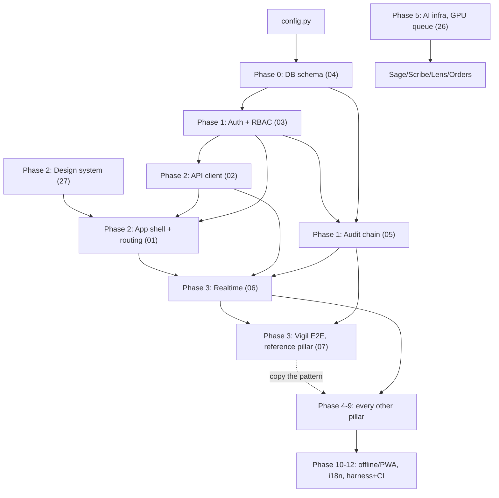

# Orb: The Rebuild Plan

> A dependency-ordered curriculum for rebuilding Orb from an empty folder. Each
> phase states its **goal**, the **files to create**, **what to build**, and an
> **acceptance check** you can actually run. Every phase points at the deep-dive
> guide ([docs/guide/](./guide/)) that documents that subsystem function by function.
>
> Read [ORB_MASTER.md](./ORB_MASTER.md) first for the big picture. This plan is the
> *order of operations*; the guides are the *reference manual*.

---

## How to read this plan

Orb has a genuine bootstrapping problem: authentication needs the database, the
database's audit hooks want the auth actor, the API client wants routes to call,
and the realtime layer wants both auth and the DB. The plan breaks these cycles by
building **the smallest working slice first** and layering capability on top. The
rule of thumb throughout: *build the pure function before the route, the route
before the socket, the happy path before the fallback.*

Two milestones frame the work:

- **Minimum Viable Orb (end of Phase 3):** a clinician can log in, land on the
  shell, and watch one patient's vitals tick live with NEWS2 risk scoring, one
  pillar wired end to end (schema → service → route → API client → panel →
  realtime). Everything after Phase 3 copies this template.
- **Full Orb (end of Phase 12):** all 18 pillars, offline/PWA, i18n, the AI
  infrastructure, and the test harness + CI.

### The dependency graph

**Reading the arrows:** an arrow from A to B means "A must substantially exist
before B is buildable." The one true cycle, auth ⇄ database, is resolved in
Phase 0/1: the schema (guide 04) needs only `config.py`, and auth (guide 03) needs
only the `users` table, so you build the schema first and auth immediately after.
The audit chain's `log_audit_event` is imported lazily / stubbable, so it does not
block auth (guide 03's summary: "log_audit_event or a no-op stub").

### Phase-to-guide map

| Phase | Goal | Primary guides |
|---|---|---|
| 0 | Scaffold: repo, config, DB schema, FastAPI + Vite skeletons, health check | [04](./guide/04-database-schema.md) |
| 1 | Auth + RBAC + the tamper-evident audit chain | [03](./guide/03-auth-rbac.md), [05](./guide/05-audit-chain.md) |
| 2 | Design system, the API client, the app shell + routing | [27](./guide/27-design-system.md), [02](./guide/02-api-client.md), [01](./guide/01-app-shell.md) |
| 3 | **MVP**, Realtime + Vigil end to end (the reference pillar) | [06](./guide/06-realtime.md), [07](./guide/07-vigil.md) |
| 4 | Relay (messaging), reuses realtime + rooms | [08](./guide/08-relay.md) |
| 5 | AI infrastructure, then Sage (RAG copilot) | [26](./guide/26-ai-infrastructure.md), [09](./guide/09-sage.md), [10](./guide/10-sage-proactive-ambient.md) |
| 6 | Scribe (voice) + Lens (imaging) | [11](./guide/11-scribe.md), [12](./guide/12-lens.md) |
| 7 | Orders/CPOE → Helix → Pharmacy Verify (the medication spine) | [16](./guide/16-orders-cpoe.md), [14](./guide/14-helix.md), [15](./guide/15-pharmacy-verify.md) |
| 8 | Admissions/Discharge, Handoff, Bridge, Surgical Suite, Appointments | [21](./guide/21-admissions-discharge.md), [22](./guide/22-handoff-ipass.md), [23](./guide/23-bridge-patient-portal.md), [17](./guide/17-surgical-suite.md) |
| 9 | Analytics: Forecast, Command Center/Pulse, Capacity Simulator, Revenue Integrity | [13](./guide/13-forecast.md), [18](./guide/18-command-center.md), [19](./guide/19-capacity-simulator.md), [20](./guide/20-revenue-integrity.md) |
| 10 | Interop + Admin surfaces (ingestion, FHIR, governance dashboards) | [24](./guide/24-ingestion-interop.md), [25](./guide/25-admin-panel.md) |
| 11 | Offline + PWA + Downtime Mode; i18n | [28](./guide/28-offline-pwa-downtime.md), [29](./guide/29-i18n.md) |
| 12 | The test harness + CI + deployment | [30](./guide/30-harness-and-ci.md), [31](./guide/31-api-reference.md) |

---

## Phase 0: Scaffold

**Goal.** An empty folder becomes two running skeletons, a FastAPI server that
answers `/api/health` and a Vite/React app that renders, sharing one origin
through the dev proxy, backed by the full SQLite schema.

**Files to create.**

- Backend: `server/config.py`, `server/database.py`, `server/migrate.py`,
  `server/main.py` (skeleton), `server/requirements.txt`.
- Frontend: `package.json`, `index.html`, `vite.config.ts`, `tsconfig.json`,
  `tsconfig.app.json`, `tsconfig.node.json`, `eslint.config.js`, `src/main.tsx`,
  `src/App.tsx` (stub), `src/index.css` (stub).

**What to build.**

1. **`config.py` first**, it has almost no dependencies and everything imports it.
   Define `DB_PATH` (env-overridable so tests can point at a temp DB,
   `config.py:10`), the deployment profile (`ORB_DEPLOYMENT_PROFILE`, default
   `prod`), and the fail-closed guards: the server must *refuse to boot in prod
   without `ORB_JWT_SECRET`* (`config.py:37-43`) and without `ORB_INGESTION_API_KEY`
   (`config.py:169-176`). This is a deliberate security posture, copy it exactly.
2. **The database schema**, the heart of Phase 0. Guide
   [04](./guide/04-database-schema.md) documents all 48 tables. Build
   `database.py`: the `SCHEMA` string (tables + ~35 indexes + the append-only
   audit triggers), then `get_db()` with the eight tuning pragmas (WAL mode,
   `busy_timeout=30000`, mmap, etc., `database.py:800-812`) and the `db_session()`
   context manager that commits on success / rolls back on error
   (`database.py:817-828`). Then `init_db()`: run the schema, then the
   introspection-guarded *additive migration* blocks, ending with an
   `INSERT OR IGNORE` into `schema_version` recording `SCHEMA_VERSION`
   (`database.py:14`). A **migration** here means a versioned, idempotent schema
   change applied at startup, Orb checks `PRAGMA table_info(...)` before each
   `ALTER`, so re-running is safe.
3. **`migrate.py`**, a thin CLI wrapper (`--status` reports the current version).
4. **FastAPI skeleton**, `main.py` with the `lifespan` hook calling `init_db()`,
   the `/api/health` route (`main.py:453-456`), and CORS. Run it with
   `uvicorn main:socket_app` later; for now `main:app` is fine until sockets land.
5. **Vite scaffold**, `vite.config.ts` with the **dev proxy** that forwards
   `/api`, `/uploads`, and `/socket.io` (WebSocket-aware, `ws: true`) to
   `localhost:8000` (`vite.config.ts:30-45`). This is what lets the frontend treat
   the API as same-origin. `src/main.tsx` mounts a placeholder.

**Acceptance check.** `python server/migrate.py --status` reports uninitialized;
`python server/migrate.py` exits 0 at version 4; `curl localhost:8000/api/health`
returns `{"status":"ok",...}`; `npm run dev` serves a page; hitting `/api/health`
through the Vite origin (`:5173`) proxies through to the backend.

---

## Phase 1: Auth, RBAC, and the audit chain

**Goal.** A doctor and a patient can log in over HTTP and receive a JWT; every
route can declaratively demand a permission; every mutation is recorded in a
tamper-evident log.

**Files to create.** `server/auth.py`, `server/permissions.py`,
`server/models/user.py`, `server/routes/auth_routes.py`,
`server/services/mfa_service.py`, `server/services/audit_service.py`,
`server/services/audit_middleware.py`, `server/services/crypto_service.py`,
`server/routes/audit_routes.py`, and the tests `test_rbac.py`,
`test_auth_mfa_revocation.py`, `test_audit.py`.

**What to build.** (Deep dives: [03-auth-rbac](./guide/03-auth-rbac.md),
[05-audit-chain](./guide/05-audit-chain.md).)

1. **`auth.py`**, password hashing with **bcrypt** (salted, `auth.py:17-22`) plus
   a constant-time legacy SHA-256 fallback (`auth.py:25-36`); `create_token` mints
   an **HS256 JWT** carrying `{sub, role, tv, jti, exp: +24h}` (`auth.py:40-63`);
   `get_current_user` is the dependency that decodes the token, **re-reads the
   user row from the DB** (so a stale token role can never widen access), and
   enforces the `token_version` revocation check (`auth.py:75-101`). A **JWT**
   (JSON Web Token) is a signed token the client presents on every request; **RBAC**
   (role-based access control) maps roles to permissions.
2. **`permissions.py`**, the permission constants, the `ROLE_PERMISSIONS` matrix
   (`permissions.py:93-134`, the single source of truth for who-can-do-what), and
   the `require_permission(...)` dependency factory that checks the caller's role
   against the map and **audit-logs every denial** (`permissions.py:164-217`). This
   is where you meet FastAPI **dependency injection**: `Depends(require_permission(
   "patient.read_all"))` on a route means the handler body only runs for an
   authorized user.
3. **`auth_routes.py`**, `POST /api/auth/login` with the per-IP rate limiter, the
   bcrypt check, the legacy-hash auto-upgrade, and the MFA (TOTP) branch; plus
   enrolment endpoints and `POST /api/auth/logout` (which bumps `token_version` to
   revoke all sessions).
4. **The audit chain**, `audit_service.py`: `_HASH_FIELDS` (the frozen list of 20
   fields that get hashed), `compute_audit_row_hash` (`row_hash = SHA256(prev_hash
   || canonical_json(fields))`), and `log_audit_event` writing under
   `BEGIN IMMEDIATE` so the prev-hash read + insert are atomic. Add the
   `audit_mutations` middleware (auto-logs every `POST/PUT/PATCH/DELETE` under
   `/api/`) registered *before* the routers (`main.py:293`). Port the 40-writes /
   8-threads concurrency test immediately, it pins the invariant that matters.
   A **hash chain** makes tampering *evident*: change any historical row and every
   subsequent `row_hash` stops matching.

**Acceptance check** (from guides 03 + 05): `pytest server/tests/test_rbac.py
test_auth_mfa_revocation.py test_audit.py` passes. Over HTTP: a doctor logs in and
gets a token; a patient hitting a doctor-only route gets a structured 403 *that
also appears as a `permission_denied` row in `/api/audit/logs`*; a logged-out
token is rejected with "Session revoked"; editing one `summary_message` directly
in the SQLite file makes the chain verification flip to "Tampered".

> **Footgun (from the audit deep dive):** some audit categories are *fail-closed*, 
> `security`, `clinical_access`, `phi_access`, `authentication`, `ai_inference` (the set as
> corrected on 2026-09-04; it previously named `auth`, which nothing emitted). If their audit write fails,
> the operation must be *refused*, not logged-and-continued. Guide 05 shows PHI
> media returning 503 when its `phi_access` write fails (`main.py:409-422`).

---

## Phase 2: Design system, API client, and the app shell

**Goal.** The frontend becomes real: tokens and themes, a typed API client that
attaches the JWT and survives offline, and a routed shell that gates staff vs
patient worlds.

**Files to create.** `src/index.css` (full), `src/App.css`, `src/print.css`,
`src/api/client.ts`, `src/App.tsx` (full), `src/main.tsx` (full),
`src/pages/Login.tsx` + `Login.css`, `src/pages/ClinicianShell.tsx` + `.css`,
`src/pages/PatientShell.tsx`, `src/contexts/ActivePatientContext.tsx`,
`src/hooks/useFocusTrap.ts`, `src/components/OrbLogo.tsx`, `ClockWidget.tsx`,
`Aurora.tsx`, and `src/i18n/` (stub locales).

**What to build.** (Deep dives: [27](./guide/27-design-system.md),
[02](./guide/02-api-client.md), [01](./guide/01-app-shell.md).)

1. **The design system first**, `src/index.css` defines every **design token** (a
   CSS custom property like `--accent-gold`) in `:root` for dark mode
   (`index.css:4-102`) and overrides them under `[data-theme="light"]`
   (`index.css:299-338`). Build the **liquid-glass** recipes (`.glass`,
   `.glass-card`, `.glass-strong`, `index.css:189-227`). Memorize the load-bearing
   rule: **accent-colored text uses `--accent-deep`** in light mode
   (`#2C465E`, `index.css:314`) because the mid-tone accents fail contrast on white.
2. **`client.ts`**, the ~1200-line spine. Build in order (guide 02): token/user
   localStorage helpers → `authHeaders()` + `apiFetch` (401→reload except on
   `/auth/login`; structured 403) → `login()` → the SSE helpers
   (`readSSEEvents`/`parseSSEData`, test-first from `sse.test.ts`) → the socket
   singleton (Phase 3) → the offline queue → the ~90 endpoint wrappers.
3. **`App.tsx`**, the `AuthContext` (a React **context** = app-wide shared state
   without prop-drilling; `App.tsx:28-34`), the boot-time theme init
   (`App.tsx:36-43`), and the route map (`App.tsx:81-88`): `/login/:mode`,
   `/dashboard/*` (staff), `/bridge/*` (patient), `/discharge/:token`,
   `/downtime/:patientId`, `/handoff/:patientId`. A **router** maps URLs to
   components; each route here is guarded by the current user's role.
4. **`main.tsx`**, fonts, global CSS, i18n, and the root **error boundary** (a
   component that catches render-time exceptions and shows a reload affordance
   instead of a blank screen; `main.tsx:26-77`).
5. **`ClinicianShell.tsx`**, `TABS` + `getAccessibleTabs(role)` (the client-side
   half of RBAC: which tabs each role sees, `ClinicianShell.tsx:153-169`), the
   per-panel error boundary, `Suspense` + `lazy()` panel loading, and the
   theme/language/offline-badge chrome. Panels are stubs for now.

**Acceptance check** (guide 01): `npm run dev`; `/` redirects to `/login/staff`;
`DOC001/password` lands on `/dashboard` with the doctor's tabs, a ticking clock,
and panels lazy-loading on first click; `P001/patient123` lands on `/bridge`, and
manually navigating to `/dashboard` bounces back to `/login/staff`; the theme
toggle flips `data-theme` and restyles every glass surface.

> **Known bug to reproduce-or-fix (guide 01):** `App.tsx:37` reads the saved theme
> from key `orb-theme`, but `ClinicianShell.tsx:230` persists it as `orb_theme`, so
> the boot initializer never sees the user's saved choice. Pick one key.

---

## Phase 3: MVP: Realtime + Vigil end to end

**Goal, Minimum Viable Orb.** A clinician watches a live, self-updating patient
roster; opening a patient shows vitals ticking every ~5 s with NEWS2 risk; a
critical patient auto-opens a sepsis care bundle. This is the **reference pillar**, 
every later pillar copies its schema → service → route → client → panel → realtime
shape.

**Files to create.** `server/services/event_bus.py`, `server/ws/realtime.py`,
`server/services/bot_service.py`, `server/services/nervous_system_triggers.py`,
`server/services/vigil_service.py`, `server/services/sepsis_bundle_service.py`,
`server/routes/vigil_routes.py`, `server/routes/bundle_routes.py`,
`server/models/vigil_cfc.py`, `src/pages/panels/VigilPanel.tsx`, `src/pages/Vigil.css`,
`src/components/vigil/CareBundleTimer.tsx`, `src/api/bundles.ts`, and the tests
`test_news2.py`, `test_sepsis_bundle.py`, `test_hospital_nervous_system.py`.

**What to build.** (Deep dives: [06-realtime](./guide/06-realtime.md),
[07-vigil](./guide/07-vigil.md).)

1. **Realtime foundation.** `event_bus.py` (in-process pub-sub that persists every
   event to the `event_log` WAL table, dispatch bounded by a 64-slot semaphore);
   `ws/realtime.py` (the `socketio.AsyncServer` whose **handshake** validates the
   same JWT as REST, re-reads identity from `users`, rejects `discharge_access`
   tokens, and auto-joins each socket to its personal **room** `user:<id>`, a room
   is a named broadcast group); wire `socketio.ASGIApp(sio, app)` in `main.py` and
   switch uvicorn to `main:socket_app` (`main.py:461,488`). On the client, the
   socket singleton in `client.ts:43` presents the JWT via an auth *callback* so
   reconnects always use the fresh token.
2. **NEWS2 first, as a pure function.** `compute_news2` (`vigil_service.py:225`), 
   the UK National Early Warning Score 2, an aggregate of seven vital-sign bands.
   Build it with both SpO2 scales and the single-parameter-3 escalation rule, and
   pin it with `test_news2.py` before anything calls it. The returned dict shape
   `{score, level, raw_news2, single_param_3, drivers, scoring_model, spo2_scale}`
   is a contract many callers depend on.
3. **Risk + trend.** `get_patient_risk` / `get_vitals_trend`
   (`vigil_service.py:348-467`), NEWS2-only at first. The CfC neural overlay
   (`vigil_cfc.py`) comes last and may only *escalate*, never de-escalate, the
   NEWS2 baseline, and degrades to NEWS2-only when torch/checkpoints are absent.
4. **Routes + panel.** `/api/vigil/*` roster + detail + vitals
   (`vigil_routes.py:11`), then `VigilPanel.tsx` roster and detail views.
5. **The push loop.** `bot_service.py`'s vitals bot inserts vitals every 5 s,
   computes NEWS2, emits `vitals:update`, and posts case-room alerts; gate it on
   `INGESTION_MODE` (default `ingestion` = off; set `simulation` to see it).
   `VigilPanel` subscribes to `vitals:update` and patches state (throttled).
6. **Care bundles.** `sepsis_bundle_service.py`'s state machine (six elements, each
   a 60-min target; `completion_pct` vs `compliance_pct` distinguished) + routes +
   `CareBundleTimer.tsx`; auto-open on NEWS2 ≥ 7 via the `vigil.alert.critical`
   trigger in `nervous_system_triggers.py`.

**Acceptance check** (guide 07): with seeded data and `ORB_INGESTION_MODE=
simulation`, a clinician sees the roster reorder live with critical patients on
top (no refresh); opening a patient shows command-bar vitals ticking ~5 s; a
critical patient produces a case-room alert *and* an auto-opened Sepsis Six bundle
with `source='vigil_auto'`; completing all six elements flips status to
`completed` with 100% compliance if inside the hour; a tokenless socket gets
`connect_error`; `pytest test_news2.py test_sepsis_bundle.py
test_hospital_nervous_system.py` passes.

> **The template to internalize.** From here on, every pillar is: (a) tables in
> `database.py` (guide 04), (b) a `services/<x>_service.py` with pure logic + SQL
> via `db_session()`, (c) a `routes/<x>_routes.py` with `require_permission` deps,
> (d) `client.ts` wrappers, (e) a panel, (f) socket emits for anything live.

> **Two live defects Vigil teaches (don't copy them):** the bot's alert path
> computes NEWS2 *without* the `on_scale_2` COPD flag while `get_patient_risk`
> honors it (`bot_service.py:199-200` vs `vigil_service.py:374-380`), so they
> disagree for Scale-2 patients; and `vitals:update` is emitted with **no room
> argument** (`bot_service.py:252`), so every socket receives every patient's
> vitals regardless of department.

---

## Phase 4: Relay (clinical messaging)

**Goal.** Two clinicians in the same case room exchange messages that appear
instantly and survive reload; structured alerts reach targeted users and can be
acknowledged.

**Files.** `server/models/message.py`, `server/services/relay_service.py`,
`server/routes/relay_routes.py`, `src/pages/panels/RelayPanel.tsx`, `Relay.css`,
`src/components/relay/{AlertsSection,CaseList,RelaySearch}.tsx`.

**What to build.** (Deep dive: [08-relay](./guide/08-relay.md).) `relay_service.py`
bottom-up: `send_message` (every message in Orb flows through it, bots, lens,
surgery, ingestion, and the WS handler all reuse it), `get_channel_messages`,
`get_channels_for_user` (the single **visibility oracle**, it also doubles as the
membership/IDOR guard on nearly every route and the WS `join_channel` authorizer),
`mark_channel_read`, `get_user_alerts`. Then the five core routes with the
membership-guard pattern, each emitting `sio.emit('message:new', room=channel_id)`
*after* the DB write. Frontend: `CaseList`, `RelaySearch`, `AlertsSection`, then
`RelayPanel` (list view, then chat view with the socket effect + optimistic send).

**Acceptance check.** Two doctors in two browsers open the same case room; A's
message appears in B's window within a second and survives both reloads; a
surgery-prep alert lands in B's "Action Required" list, and B's Confirm flips the
card to "✓ Confirmed by B" in A's chat and removes it from `/api/relay/alerts` for
both.

> **Security gap to fix while rebuilding (guide 08):** `POST /api/relay/channels/
> {id}/messages` has **no channel-membership check** (`relay_routes.py:205-229`)
> and `MessageCreate.message_type` is an unconstrained string, so any `relay.send`
> holder can post into hidden channels and forge targeted structured alerts. Add
> the `get_channels_for_user` membership guard and constrain `message_type`.

---

## Phase 5: AI infrastructure, then Sage

**Goal.** A shared local-LLM serialization layer exists, and Sage answers clinical
questions grounded in local guidelines + patient context, with guardrails.

**Files.** `server/services/gpu_coordinator.py`, `llm_queue_service.py`,
`clinical_knowledge.py`, `corpus_loader.py`, `retrieval_eval.py`,
`sage_service.py`, `sage_proactive_service.py`, `sage_ambient_service.py`,
`server/routes/sage_routes.py`, `sage_proactive_routes.py`, `server/corpus/*.md`,
`src/pages/panels/SagePanel.tsx`, `src/components/sage/*`.

**What to build.** (Deep dives: [26-ai-infrastructure](./guide/26-ai-infrastructure.md),
[09-sage](./guide/09-sage.md), [10-sage-proactive-ambient](./guide/10-sage-proactive-ambient.md).)
First the **GPU/LLM queue**: several features share one local GPU (~17 GB
MedGemma), so `llm_queue`/`gpu_coordinator` serialize access by priority (Sage
voice P1 > Scribe P2 > background P3). Then Sage's RAG pipeline, **RAG**
(retrieval-augmented generation) grounds the LLM's answer in retrieved documents:
`clinical_knowledge.py` (seed docs, embedder with mock fallback,
`search_guidelines` doing dense→FTS→reciprocal-rank-fusion, optional reranker);
`retrieval_eval.py` + a question bank (build the measuring stick before tuning);
`corpus_loader.py` (structure-aware chunking, idempotent replace, approval
workflow); `sage_service.py` (prompt assembly, risk/mutation classifiers,
patient-context injection, `query_ollama`); `sage_routes.py` (the refusal/guardrail
gate, the buffered SSE pipeline, citation validation, history persistence). Then
the proactive sweep (background loop pushing `sage:insight`) and ambient sidebar.

**Acceptance check.** With Ollama serving the model, a clinician asks a question in
Sage and gets a streamed, source-cited answer; a harmful/injection/mutation query
is refused deterministically before reaching the model; retrieval eval reports its
metric; `pytest test_sage_guardrails.py test_reranker.py test_retrieval_eval.py
test_corpus_loader.py` passes.

> **Guardrail footgun (guide 09):** the safety gates (`_safety_refusal`,
> `detect_mutation_intent`, `_strip_forbidden`) run in the text `sage_query` path
> but **not** in `sage_voice_query`, the voice route streams raw model tokens with
> no deterministic guardrails. When rebuilding, put the gate in one place both
> routes call.

---

## Phase 6: Scribe (voice) and Lens (imaging)

**Goal.** A doctor dictates and gets a structured, verifiable, signable SOAP note;
a doctor drops an image and gets a streamed, human-reviewed reference read.

**Files.** Scribe: `scribe_service.py`, `scribe_providers.py`, `whisper_daemon.py`,
`voice_agent_service.py`, `ws/scribe_stream.py`, `routes/scribe_routes.py`,
`src/pages/panels/ScribePanel.tsx`, `src/hooks/useStreamingTranscription.ts`.
Lens: `lens_service.py`, `routes/lens_routes.py`, `src/pages/panels/LensPanel.tsx`.

**What to build.** (Deep dives: [11-scribe](./guide/11-scribe.md),
[12-lens](./guide/12-lens.md).) Scribe is a 4-stage pipeline, ASR (Whisper
large-v3 via MLX), correction (RxNorm phonetic + optional LLM), drafting (SOAP/
discharge/I-PASS prompts), verification (LLM hallucination cross-check), each
stage env-configurable in the `SCRIBE` dict (`config.py:113-153`). Live streaming
rides the *main* authenticated socket with `scribe:`-prefixed events (not a
separate namespace). Note **governance** is the point: notes save as draft,
background-verify with a race-guarded state machine, and signing is *fail-closed*
(HTTP 428 unless the doctor acknowledges an unverified note, permanently audited).
Signing publishes `scribe.note.signed`, which triggers autonomous LLM extraction of
vitals/meds into the EHR. Lens does **no classical computer vision**, it's a single
streamed multimodal Ollama call with a FINDINGS/IMPRESSION/RECOMMENDATIONS prompt,
**demo-gated** (403 in prod unless `ORB_LENS_ENABLED`), with hardened uploads
(magic-byte sniff + 25 MB cap + AES-GCM at rest) and a mandatory clinician-
responsibility checkbox before filing.

**Acceptance check.** Dictating streams per-utterance transcripts; "Structure Note"
streams a sectioned SOAP note; with verification on, the badge cycles
Verifying→Verified; signing writes an audit row + `scribe.note.signed` event.
Lens: in dev, dropping a JPG streams a read ending with the investigational banner;
ticking the checkbox files it, creating a `lens_analyses` row and a Relay case-room
notice; in prod without `ORB_LENS_ENABLED`, `POST /api/lens/analyze` returns 403.
`pytest test_scribe_pipeline.py test_lens.py` passes.

---

## Phase 7: The medication spine: Orders → Helix → Pharmacy Verify

**Goal.** A doctor places an order that validates against terminology, screens for
drug interactions, and reaches a pharmacist's verification queue.

**Files.** `orders_service.py` + `routes/orders_routes.py`; `helix_service.py`,
`helix_db.py`, `interaction_db.py`, `drug_safety_service.py`, `rxnorm_corrector.py`,
`rxnorm_reconciler.py`, `terminology_service.py` + `routes/helix_routes.py`;
`pharmacy_verification_service.py` + `routes/pharmacy_routes.py`; the matching
panels and `src/api/pharmacy.ts`.

**What to build.** (Deep dives: [16-orders-cpoe](./guide/16-orders-cpoe.md),
[14-helix](./guide/14-helix.md), [15-pharmacy-verify](./guide/15-pharmacy-verify.md).)
**CPOE** (computerized provider order entry) validates orders against a seeded
terminology subset (LOINC/SNOMED/ICD-10). Helix is the medication brain: a separate
`helix.db` SQLite file (isolated formulary/inventory), a drug-drug-interaction
screening pipeline with severity levels, and RxNorm correction/reconciliation
(fuzzy-matching free-text drug names to codes). Pharmacy Verify is the pharmacist's
state machine (pending → verified/rejected) with realtime queue updates.

**Acceptance check** (guide 16): a doctor creates an order with a valid LOINC code
and sees it in the list with a status chip (this is e2e spec 03); an interacting
drug pair raises a severity-graded warning; a pharmacist opens the Verify Queue and
verifies/rejects an order, updating its state live. `pytest test_orders_service.py
test_pharmacy_verification.py test_interaction_db.py` passes.

---

## Phase 8: Patient lifecycle: Admissions, Discharge, Handoff, Bridge, Surgery

**Goal.** The full patient journey, admit → ward → handoff between shifts →
discharge with a time-limited patient access link, plus the patient portal and the
surgical board.

**Files.** `admission_service.py`, `clinical_records_service.py`,
`discharge_service.py`, `discharge_access_service.py`, `ipass_service.py`,
`sage_handoff_service.py`, `bridge_service.py`, `surgery_service.py`,
`surgery_escalation_service.py`, `who_checklist.py`, their routes, and the
frontend: `AdmitPatientModal`, `DischargePrintView`, `DischargeAccess` page,
`HandoffPage` + `IpassHandoffView` + `HandoffPrintView`, `PatientShell` +
`AppointmentsPanel`, `SurgicalSuitePanel` + `src/components/surgery/*`.

**What to build.** (Deep dives: [21](./guide/21-admissions-discharge.md),
[22](./guide/22-handoff-ipass.md), [23](./guide/23-bridge-patient-portal.md),
[17](./guide/17-surgical-suite.md).) Admission provenance records *where* patient
data came from. Discharge Access mints a time-limited tokenized link
(`DISCHARGE_ACCESS_TTL_DAYS`, attempt lockout, `config.py:184-186`) so a patient
can view their own summary without a full account. **I-PASS** is the handoff
mnemonic (Illness severity, Patient summary, Action list, Situation awareness,
Synthesis); `sage_handoff_service` AI-drafts it. Bridge is the patient portal
(same auth, `patient` role, deliberately narrowed data). Surgical Suite adds the
**WHO Surgical Safety Checklist** (sign-in / time-out / sign-out phases) and team
escalation.

**Acceptance check.** Admit a patient via the modal → they appear on the Vigil
roster; generate a discharge summary and open its tokenized `/discharge/:token`
link in a private window with the correct DOB; draft an I-PASS handoff and print
it; log in as `patient` and see only Bridge. `pytest test_admission_provenance.py
test_discharge_access.py test_ipass.py test_handoff.py` passes.

---

## Phase 9: Analytics: Forecast, Command Center/Pulse, Capacity, Revenue

**Goal.** The operational-intelligence surfaces: demand forecasting, the
hospital-wide picture, what-if simulation, and AI-assisted coding.

**Files.** `forecast_service.py` + `models/forecast_lstm.py` + routes + panel;
`command_center_service.py` + `pulse_service.py` + routes + `CommandCenter`/
`PulseWidget`/`PulseDetail`; `capacity_sim_service.py` + routes + `CapacitySimulator`;
`coding_service.py` + routes + `RevenueIntegrityPanel`.

**What to build.** (Deep dives: [13](./guide/13-forecast.md),
[18](./guide/18-command-center.md), [19](./guide/19-capacity-simulator.md),
[20](./guide/20-revenue-integrity.md).) Forecast's core is an **LSTM** (a recurrent
neural net for sequences), a 2-layer bidirectional LSTM with attention and four
task heads over a 48×19 patient window, but it **fails closed** to a labeled
rule-based heuristic when no checkpoint exists (`prediction_source='heuristic'`),
and the 7-day census forecast is transparent statistics, not the LSTM.
`WARD_CAPACITY` (4 wards × 8 beds = 32) in forecast is the census source of truth
reused by Command Center and the Capacity Simulator. Revenue Integrity generates
ICD-10 coding suggestions with a human-review loop.

**Acceptance check.** With no checkpoint, `GET /api/forecast/patient/<id>` returns
`prediction_source='heuristic'` and the panel shows an "untrained" provenance chip;
a `patient` role gets 403. Command Center shows live KPIs; the Capacity Simulator
projects strain from varied inputs. `pytest test_forecast_service.py
test_command_center.py test_capacity_sim.py test_coding.py` passes.

---

## Phase 10: Interop and Admin

**Goal.** Data flows in from devices/EHRs with provenance, exports as FHIR, and the
admin sees governance dashboards.

**Files.** `ingestion_service.py`, `ingestion_adapters.py`, `fhir_export_service.py`
+ routes + `ProvenanceChip`; `compliance_service.py`, `impact_service.py`,
`metrics_service.py`, `model_governance_service.py`, `flight_recorder_service.py`
+ routes + `AdminPanel` and its sub-tabs.

**What to build.** (Deep dives: [24](./guide/24-ingestion-interop.md),
[25](./guide/25-admin-panel.md).) **FHIR** is the healthcare interop standard
(resources, Bundles, `$everything`). `INGESTION_MODE` (simulation/ingestion/hybrid)
governs whether the bots or real adapters feed the same vitals tables;
`ProvenanceChip` distinguishes the source. The Admin panel surfaces the audit log,
Flight Recorder (built in Phase 1), compliance center, impact/ROI dashboard, model
governance (model cards, override rates), security activity, trust center, and the
ingestion monitor.

**Acceptance check.** Post a vitals reading through the ingestion API with the key
and see it on the Vigil board with an "ingested" provenance chip; export a
patient's FHIR bundle; as admin, open Flight Recorder and see the green
"Chain verified" badge (this is e2e spec 05). `pytest test_ingestion.py
test_fhir_export.py test_compliance.py test_impact.py test_model_governance.py`
passes.

---

## Phase 11: Offline, PWA, Downtime Mode, and i18n

**Goal.** The app installs, survives network blips, keeps a read-only picture when
the EHR is down, and speaks Hindi.

**Files.** `vite.config.ts` PWA config (already present from Phase 0),
`src/api/downtime.ts`, `server/services/downtime_service.py` +
`routes/downtime_routes.py`, `src/pages/DowntimeMode.tsx`; `src/i18n/index.ts` +
`locales/en.json` + `hi.json`.

**What to build.** (Deep dives: [28](./guide/28-offline-pwa-downtime.md),
[29](./guide/29-i18n.md).) Three offline layers, kept distinct: the **PWA** layer
(vite-plugin-pwa Workbox precache of the static bundle, `vite.config.ts:9-25`); the
**apiFetch offline queue** (writes queued to `localStorage`, replayed on reconnect,
handlers must be idempotent, built in Phase 2); and **Downtime Mode** (the backend
hourly-snapshots every admitted patient + nightly FHIR self-export from
`main.py:80-107`, and `DowntimeMode.tsx` renders those snapshots read-only when the
backend is unreachable). i18n: i18next with full en + hi locales and a runtime
toggle in the shell header.

**Acceptance check.** `npm run build && npm run preview`, install the PWA, go
offline, the shell still loads and charting a note queues it (badge shows pending),
then syncs on reconnect. Kill the backend and open `/downtime/:patientId`, the
last snapshot renders. Toggle to Hindi and the shell chrome translates.
`pytest test_downtime.py` and `npx vitest run src/i18n/i18n.test.ts` pass.

---

## Phase 12: The test harness, CI, and deployment

**Goal.** The whole thing is provable and shippable.

**Files.** `e2e/*.spec.ts` + `helpers.ts`, `playwright.config.ts`,
`vitest.config.ts`, `src/test/setup.ts`, `server/tests/conftest.py`,
`server/pytest.ini`, `.github/workflows/ci.yml`, `Dockerfile`,
`docker-compose.yml`, `install.sh`.

**What to build.** (Deep dives: [30](./guide/30-harness-and-ci.md),
[31](./guide/31-api-reference.md).) The five Playwright **golden journeys**
(login→Vigil, Scribe, Orders, Pharmacy Verify, Admin flight recorder) drive the
real UI against a real seeded backend, run **serially** because they share one DB.
`conftest.py` isolates the test DB via `ORB_DB_PATH`. CI runs backend pytest and
frontend lint (non-blocking) + typecheck + build + unit tests. Use guide 31's
complete route table to write endpoint-level tests.

**Acceptance check.** `pytest -q` (backend) and `npm run build && npm run test`
(frontend) both green; `npx playwright test` runs all five journeys; CI passes on
push.

> **Corpus note:** some project briefs reference a `tests/visual/` harness, **no
> such directory exists** in this repo. The real behavioral/visual gate is the
> `e2e/` Playwright suite plus vitest and pytest. Guide 30 documents this.

---

## Appendix: Minimum Viable vs Full Orb

| | Minimum Viable Orb (Phase 0–3) | Full Orb (Phase 0–12) |
|---|---|---|
| **Auth** | Login, JWT, RBAC, audit chain | + MFA/TOTP, discharge-access tokens |
| **Pillars** | Vigil only (roster, vitals, NEWS2, bundles) | All 18 |
| **Realtime** | Vitals + alerts | + Relay chat, Sage insights, Scribe streaming |
| **AI** | None (NEWS2 is rule-based) | Sage RAG, Scribe ASR, Lens vision, Forecast LSTM, coding, all with fallbacks |
| **Offline** | None | PWA precache, offline write queue, Downtime Mode |
| **Runs on** | Python + Node, one SQLite file | + Ollama, Whisper, optional torch/SQLCipher |
| **Proves** | The end-to-end pattern works | A hospital could actually run it |

The discipline that makes this rebuildable: **every AI/ML path has a coded
fallback** (NEWS2 without the CfC, heuristic LoS without the LSTM, mock embedder
without BGE-M3, cold Whisper subprocess without the daemon). You can stand up a
fully-functional Orb with zero GPU and add intelligence incrementally, which is
exactly the order this plan builds it.
