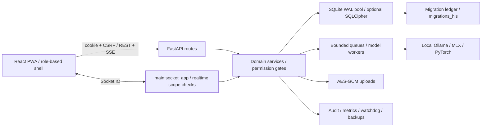

# Repository architecture audit and implementation pass

Audit date: 11 October 2026. Baseline commit: `04e176ee2ac0aa321c59df68d171d84e98dbe3c0`, including the existing working-tree changes. This report distinguishes completed engineering fixes, verified existing capabilities, and remaining product/clinical work.

Follow-up, 12 October: the [ML security and Sage latency record](ML_SECURITY_AND_SAGE_LATENCY_2026-10.md)
supersedes the residual ML advisory status below for a fresh candidate runtime.
Its full installed-tree and Apple production-resolution scans are clean; existing
appliance environments and held clinical decisions remain unchanged. Historical
test/advisory counts below retain their original snapshots and limitations.

## 1. Executive audit summary

**Overall maturity: substantial pre-pilot MVP, not production-ready for clinical deployment.** Orb has real authentication, patient-scoped workflows, migrations, audit trails, encryption, restoration tooling and large automated suites. It is much more than a UI prototype. The largest remaining risks are clinical workflow decisions, wrong-patient resolution in Sage, model-stack dependency vulnerabilities, appliance validation and the scope of the unfinished hospital-system expansion.

The current product is the **Ward Record** profile: observations and a rounds file. The broader AI/HIS vision is an expansion, not evidence that every named capability is approved for use. The October HIS plan describes 14 waves and 81 clusters, approximately 460 engineer-days. Implementing every entry indiscriminately would contradict its held decisions and default-off gates.

This pass fixes confirmed engineering defects: streamed request-body enforcement, privacy-sensitive offline cache invalidation, replay identity checks, simulator retention, secure media publication, cross-patient Relay thread races, proactive-insight patient authorization, shared Bridge authentication transport, readiness, installer failure propagation, process ownership checks, test isolation, security scanning, dependency updates, misleading measurement denominators and documentation drift. It preserves default-off features and existing clinical policies.

### Scope and evidence

- Static inventory covers 2,336 nonignored tracked/untracked text files, including 782 production source files. It records 822 route-decorator candidates, 369 model candidates and 219 distinct literal table names. See [repository-inventory.json](audit-2026-10/repository-inventory.json) and the repeatable [inventory script](../scripts/audit_repository.py). AST routes, SQL tables and unreachable modules are **candidates**, not claims of mounted endpoint counts or formal dead-code proof.
- Architectural tracing used `README.md`, the documentation index, `ORB_MASTER`, `DATA_LAYER`, roadmaps, pilot/deployment/backup guides, the HIS build plan, gap/history registers, current rulings and implementation files. Historical snapshots are context; current rulings and executable behavior take precedence.
- The implementation scope was confirmed: fix confirmed defects and production blockers while preserving held decisions.
- No Git remotes are configured.
- The working tree already contained extensive admission, pharmacy, identity, facility and UI work. Those changes were preserved. The overall Git diff is **not** solely this audit's work.
- No live database, `.env`, patient uploads, backup contents or secrets were inspected. No real appliance was seeded, stopped, migrated or deployed. Browser tests use a copied application and disposable synthetic database.
- This is broad static/dynamic engineering evidence, not a penetration test, clinical validation, legal opinion, measured coverage percentage, formal proof of dead code or review of every sentence of every historical document.

### Maturity by dimension

| Dimension | Rating | Evidence and limit |
|---|---|---|
| Core records and ward workflows | MVP | Persistent records, observations, rounds, scoped roles, admission services, audit and readmission work exist; site and clinical acceptance remain necessary. |
| Security | MVP, release blockers open | Cookie/JWT/CSRF, permission/patient/facility fences, SQLCipher/AES-GCM and audit controls exist; ML advisories, operational key management and clinical access scenarios remain. |
| Automated verification | MVP, strong breadth | Thousands of backend/frontend checks and real browser journeys exist. Coverage thresholds, hardware/inference validation and a release acceptance gate remain absent. |
| Scalability | MVP for one appliance | SQLite WAL/pool, worker boundaries, bounded queues and loop watchdog suit local operation. Single-writer contention and shared GPU inference require measured limits; PostgreSQL is not implemented. |
| Maintainability | MVP with concentrated debt | Typed client, route/service packages, migration discovery and tests help. Large legacy modules, duplicated HTTP transports and extensive documentation drift raise change cost. |
| Operations and recovery | MVP | Backup, restore, warm standby, metrics, liveness, readiness and watchdog exist. A successful real-site restore/key-escrow drill and hardware soak cannot be inferred from unit tests. |
| AI clinical capability | Proof of concept / pre-pilot | Local RAG/ASR/vision/sequence pipelines exist, but clinical validation and several safety rulings are unfinished. An available model is not an approved clinical device. |
| Full HIS / multi-site expansion | Partial MVP behind gates | Registration, OPD, ADT, LIS, store and medication-order packages exist. The remaining build plan and the multi-facility fence must govern rollout. |

## 2. Architecture and state against intent

### Runtime map

| Area | Entry points and ownership | State against documented intent |
|---|---|---|
| UI bootstrap and navigation | `src/main.tsx`, `src/App.tsx`, `src/pages/ClinicianShell.tsx`, `src/shellConfig.tsx` | Role/module/profile-dependent shell and lazy discovery are implemented. Default-off HIS gates are intentional. |
| HTTP/session/offline transport | `src/api/client.ts`, `src/lib/offline/phiCache.ts`, `src/hooks/useOfflineSnapshot.ts` | Shared cookie/CSRF transport, refresh handling, queued mutation replay and timestamped user-scoped snapshots exist. This pass closes malformed persistence, identity-change and denial-cache gaps. |
| ASGI lifecycle | `server/main.py`, `server/ws/realtime.py` | Use `main:socket_app`, not just the FastAPI object, to retain Socket.IO. Lifecycle registers sweeps, model warming, replay, watchdog and static SPA hosting. |
| Configuration and authorization | `server/config.py`, `auth.py`, `roles.py`, `permissions.py`, `facility_fence.py` | Production secret guards, feature prerequisites, patient/department checks and data-driven multi-facility fencing exist. Extra facilities can intentionally cause 503 on unswept surfaces. |
| Persistence | `server/database.py`, `db_backend.py`, `migrations.py`, `migrations_his/` | Connection-taking service cores and pooled transactions use SQLite/SQLCipher. The PostgreSQL seam deliberately refuses unsupported operation. SQL/schema candidate lists are in the inventory. |
| Identity, encounters and beds | `routes/{registration,admission,facility}_routes.py`, `routes/adt/`, `services/{admission,registration}_service.py`, `services/adt/` | Patient identity and admissions are separate concepts. Current working-tree services substantially exceed older “not built” roadmap descriptions. Cross-stay and facility behavior still need scenario acceptance. |
| Observations and clinical record | `routes/vigil_routes.py`, `ward_record_routes.py`, `clinical_records_routes.py`; associated services | Manual/ingested/simulated provenance matters. Ward Record forces scoring/models/Lens/sepsis autostart off. Real readings must survive simulator cleanup. |
| Medication and pharmacy | `routes/{orders,helix,emar}_routes.py`, `routes/medorders/`, `routes/pharmacy_store/`, matching services | Legacy chart/Helix and the gated medication-order store coexist during migration. Stat completion, prescribing/verbal orders, reconciliation and substitution epics remain held or incomplete. |
| Laboratory and OPD | `routes/lab/`, `opd_routes.py`, `registration_routes.py`, `schedule_routes.py`; `services/lab_*` | Implemented gated workflows are present. Site-approved ranges/critical limits and analyser documents are prerequisites, not missing values to invent. |
| Sage, Lens and Scribe | `routes/{sage,lens,scribe}_routes.py`, knowledge/LLM/model/voice services, `ws/scribe_stream.py` | Local pipelines exist; no internet inference is authorized. Clinical safety and model-quality evidence remain separate. Upload paths were hardened in this pass. |
| Forecast and Vigil models | `services/{forecast,vigil}_service.py`, `models/forecast_lstm.py`, training/conversion scripts | Local checkpoints and deterministic fallbacks exist. Dataset adapters, train/serve parity and promotion criteria remain incomplete. |
| Bridge and Relay | `routes/{bridge,relay}_routes.py`, `services/patient_portal_access.py`, `src/api/bridgeClient.ts` | Portal admission/end-of-discharge-day access is implemented. Bridge now shares cookie/CSRF transport. R024 atomic confirmation is already built; it must not be relisted as absent. |
| Pulse | `routes/pulse_routes.py`, seasonal calendar services and `site_config/seasonal_calendar.json` | Current implementation follows the offline seasonal-calendar ruling. Old weather/AQI/recall/cloud-feed claims are obsolete. Calendar review status is a clinical prerequisite. |
| Operations | `scripts/backup.sh`, restore/standby scripts, `server/services/{loop_watchdog,ops_health_service}.py`, metrics/ops routes | Existing recovery and observability tooling was retained and strengthened; this was not a repository without CI or backups. |

### Workflow, developer experience and reliability gaps

| Concern | Present evidence / remaining gap |
|---|---|
| Automated integration | Backend pytest, frontend lint/typecheck/build/unit tests, mocked browser audit and five real journeys already existed. This pass repairs their dependency, fixture, artifact and isolation gaps and adds scheduled advisory scanning. Clean Linux CI remains to be run. |
| Quality and release controls | No Python lint/type/format or coverage budget is enforced by CI; no versioned release/signing/clinical-acceptance pipeline exists. Add measured baselines before making these gates mandatory. |
| Local setup and data | macOS setup/install/run/stop scripts, environment examples, synthetic seeders and API fixtures exist. Installer failure propagation, Node requirements and E2E isolation were corrected. Setup on a clean target machine still needs acceptance. |
| Containers and commit hooks | No Dockerfile/Compose definition or pre-commit configuration was found. A lightweight CPU/test container can help reproducibility; Apple MLX and appliance device integration require native acceptance. Hooks should call the same established checks as CI. |
| Service health and failure recovery | Local metrics, audit, worker queues, watchdog, backup/restore and standby are implemented; database-aware readiness is now added. Hardware saturation, power loss, restore/key escrow and backup-under-load tests remain. |
| Logging and telemetry | Routine downtime PHI logging is fixed. Broader exception redaction, access/retention policy and consistent event fields remain work. No cloud telemetry is needed for an offline appliance. Machine-initiated drafts no longer inflate the clinician time-saved proxy. |

### Planned work that remains

Use [current rulings](RULINGS_NEEDED_2026-10.md) together with [the HIS build plan](HIS_BUILD_PLAN_2026-10.md), rather than treating an older roadmap checkbox as proof of absence.

| Planned capability | Current gap / dependency | Disposition |
|---|---|---|
| Safe Sage bed/patient resolution | R026 documents repeated failed reviews; attempt 13f.1 is under review and not on main. Wrong-chart/order binding is a release blocker for that lane. | Do not import a failed/under-review implementation as cleanup. Complete its adversarial acceptance corpus and sign-off separately. |
| Stat dose completion | `medorders-14`, R001 define a held clinical policy. | Keep held; choose explicit server behavior before implementation. |
| Prescriber attribution and verbal/telephone orders | `medorders-12`, `medorders-16`, R010, W099 | Needs prescribing, read-back/countersign and legacy-lane transition decisions. |
| Scribe-extracted medications/vitals | `medorders-13`, W111 | Needs exam-time/proposal/confirmation semantics; do not silently promote extracted facts to latest observations. |
| Substitution and medication reconciliation | `medorders-15`, `medorders-17`, R002 and dependencies | Hospital-approved equivalence and prescriber acceptance are clinical work, not seed-data guesses. |
| Discharge/escalation/multi-site moves | R009 and MS-R3 | Define blocked/warned/override behavior and close-with-reason semantics; preserve current cross-facility refusal. |
| Rounds/portal readmission completeness | HIS W6-B / R029 | Current-stay medication/summary scope and fresh portal credentials need encounter-level acceptance; identity reuse alone is insufficient. |
| ADT discharge integrations | HIS explicitly leaves diet termination and Relay read-only behavior unscheduled | Track these as missing workflow integration, not an implemented full discharge cascade. |
| Laboratory release/critical communication | LIS settings, ranges, thresholds and interfaced-critical gates | Code exists, but site pathologist approval and configured communication/read-back paths are prerequisites. |
| Pharmacy regulatory/site options | GRN-RS4 has no scheduled increment; ward stock and NDPS depend on confirmed site modes | Keep prerequisites/fail-closed behavior; do not enable from an audit. |
| Per-facility escalation ladders | MS-R8 says approximately three extra days, not scheduled | Multi-site deployment needs the shared-ladder sign-off or this missing implementation. |
| Alternative data store / horizontal scale | `db_backend.py` refuses PostgreSQL | Intentional unimplemented backend. A real port needs SQL, transaction, migration and concurrency acceptance, not a driver switch. |
| Validated learned predictions | Non-sepsis training adapters, train/serve parity and checkpoint promotion | Requires credentialed data, measured baselines, model provenance and hardware validation. |
| Pilot/release acceptance | Pilot roadmap, intended-use wording, site configuration, restore/escrow and latency/soak criteria | Engineering tests cannot close these product/clinical/operational gates. |

## 3. Prioritized issue matrix

Statuses: **fixed** means implemented in this pass; **open** requires additional engineering; **held** requires the documented ruling/site evidence. None implies clinical approval.

| ID | Priority | Finding and affected paths | Result / next action |
|---|---|---|---|
| A01 | Critical | Header-only body limits allowed absent/chunked/understated bodies; multipart had a broad exemption (`server/main.py`, Lens/Scribe routes). | **Fixed.** Count ASGI receive bytes; validate lengths; route-specific multipart caps; bounded file reads; malformed/oversized requests rejected. |
| A02 | Critical | Cached chart could survive a 401/403/404 and reappear offline after remount (`useOfflineSnapshot`, `phiCache`, `VigilPanel`). | **Fixed within the active page.** Authoritative refusal evicts the exact cache and invalidates memory; a refusal tombstone protects remounts even if storage deletion throws. Only network/server failure permits labelled fallback; user/key/TTL bounds enforced. Cross-reload/tab revocation when persistent deletion fails still needs the session policy in A17. |
| A03 | Critical | Simulator cleanup pruned shared risk-score history without provenance (`bot_service.py`). | **Fixed.** Stop deleting risk scores with mixed real provenance; simulated-vital retention stays scoped. |
| A04 | Critical | Offline replay and a 401/refresh retry could continue under a newly signed-in user; delayed replies could affect the new session. Malformed/denied storage could crash auth/replay. | **Fixed.** Validate envelopes, recheck request ownership across fetch/refresh/retry/body parsing, hold pending work on identity change without expiring the new session, always release replay lock, and contain storage failures. |
| A05 | Critical | Uploaded media was written before restrictive chmod and could publish partial output (`crypto_service.py`); streaming WAV, Whisper daemon, live subprocess fallback and developer audio benchmarks used unsafe temporary names. | **Fixed.** Private staging, flush/fsync, atomic replacement and cleanup; shared stdlib-only private conversion with checked ffmpeg failures; worker cleanup on import/transcription/result/interruption failures; private benchmark WAV allocation/cleanup; off-loop upload work and generic upload errors. |
| A06 | Critical / blocker | Dependency scans exposed old parser/session/crypto/tooling packages plus vulnerable ML pins. | **Fixed for the fresh candidate dependency tree.** Core/HTTP tooling upgrades are followed by Torch 2.14.1, Transformers 5.19.0 and local-only adapters removing the unused training chain. Strict installed-runtime and complete Apple production-resolution scans report zero advisories; see the [follow-up evidence](ML_SECURITY_AND_SAGE_LATENCY_2026-10.md). Existing environments require rebuilding and validation; native Apple speech build and site acceptance remain open. |
| A07 | Critical / blocker | R026 wrong-patient resolution and other held clinical order/discharge decisions. | **Held/open.** Keep model lanes/gates out of clinical rollout until documented acceptance. Ward Record is a distinct limited profile. |
| A08 | Blocker for release | No database-aware readiness probe; liveness alone stayed healthy with schema/pool failure. | **Fixed.** `/api/ready` checks core schema and migration ledger off the event loop, returns generic 503 on dependency failure, accepts zero patients and models-off. |
| A09 | Blocker for dependable setup | Installer continued after pip failure; slim test deps omitted encryption/SQLCipher/QR support, letting important tests skip. | **Fixed.** Fail installation before secrets/migrations; explicit aligned dependencies and import preflight; lightweight PNG encoder included. |
| A10 | Blocker for safe test execution | E2E auto-reused default servers and seeded checkout DB; sandbox-specific Chromium path was assumed. | **Fixed.** Disposable copied app/database, isolated paths/services, loopback-only managed mode, no reuse, standard browser cache; real journeys retained. |
| A11 | Improvement | `bridgeClient.ts` used a legacy localStorage-token/raw-fetch transport. | **Fixed.** Shared `apiFetch`, cookie/CSRF behavior, encoded resource IDs and transport regressions. |
| A12 | Improvement | `stop-orb.sh` globally matched Python processes and could affect another checkout. | **Fixed.** Verify executable/script/cwd ownership before each signal; hermetic tests cover unrelated/recycled PIDs. Portable ps→signal races still require operator care. |
| A13 | Improvement | Restore/standby scripts assumed macOS stat and a fixed virtualenv. | **Fixed.** Python-selected portable mtime and `ORB_PYTHON`; real SQLCipher cases execute in the prepared test environment. |
| A14 | Improvement | Lint total-only budget hid new errors; `check` typecheck did not build referenced projects; setup Node policy lagged Vite. | **Fixed.** Error-aware ratchet, local CLI, 9-warning/0-error budget, `tsc -b`, matching engine/setup requirements. |
| A15 | Improvement | Blob/time/midnight/async test races and model-availability assumptions made baseline suites unreliable. | **Fixed.** Browser-compatible Blob reads, explicit local-day cases, observable readiness waits, deterministic test-only model tiers. No runtime model availability was faked. |
| A16 | Improvement | Six domain API wrappers plus Forecast/Appointments duplicate fetch/session handling. | **Fixed in the completion pass.** Six domain wrappers, Forecast and Appointments use the shared identity/session/CSRF transport, including NABH text exports; structured permission/conflict/MFA details remain available. |
| A17 | Improvement / session acceptance | Reactive refresh cannot recover an expired JWT: `/auth/refresh` authenticates the current token. Cross-tab/session-generation coherence and offline revocation acceptance remain incomplete. | **Open.** Agree on full reauthentication versus bounded proactive renewal/refresh-token policy, cookie/session synchronization and the offline cache revocation contract; do not simply accept expired credentials. Cross-user request/replay ownership is fixed separately in A04. |
| A18 | Improvement | Lens still has synchronous post-header materialization/base64 work and stream error semantics; other Scribe streams expose raw exception strings. | **Fixed in the completion pass.** Lens materialisation is off-loop; Lens/Scribe/ASR failures use sanitised typed contracts without partial saves. Browser clients guard identity and incomplete streams; Sage consumers also require explicit completion. Hardware/model acceptance remains separate. |
| A19 | Improvement | Backup same-second names can collide; manual/admin rotation is not uniformly tied to verification receipts; offsite/media warnings need a tested recovery contract. | **Engineering fixes complete.** Unique private atomic publication, shared producer/verification/rotation locks, strict integrity receipts and receipt-aware manual/admin/nightly rotation are covered by failure-injection tests. Media/offsite writes preserve recovery evidence. A site restore/key-escrow drill remains open; no live rotation was attempted. |
| A20 | Improvement | CI lacks Python lint/type/format/coverage budgets and a versioned release acceptance pipeline; issue/PR intake templates were absent. | **Partly fixed.** Issue/PR templates and a candidate-only release workflow are implemented. Candidate CI/security run against a resolved immutable tagged SHA; packaging does not publish or deploy. Strict direct, installed-runtime and complete Apple production-resolution scans cover the upgraded ML stack. Incremental Python quality gates are recorded in the completion report; full-backend typing/format/coverage expansion and hosted CI execution remain acceptance work. |
| A21 | Improvement | Large `main.py`, configuration, migrations, shared client and panels concentrate coupling; SQLite single-writer and model queue limits are unmeasured on target hardware. | **Open.** Incremental domain extraction after behavior tests; hardware soak/concurrency/backup-under-load evidence. Containers alone do not resolve Apple MLX constraints. |
| A22 | Cleanup | Unreachable hardcoded doctor constants, unused keyboard helper and unused passlib dependency. Four private Python helpers have no source/test/script references. | **Removed:** `src/constants.ts`, `src/lib/a11y.ts`, passlib pins, `_round`, `_reserved_beds`, `_parse_drivers`, `_recent_dedup_exists` and the now-unused Sage JSON import. Reachable role/API behavior is retained. |
| A23 | Cleanup | `HandoffPrintView.tsx` is statically unreachable from app entry but has tests/docs/CSS; unread forecast state triggers an extra request in Vigil. | **Partly fixed.** Removed the unread Vigil forecast state/request and added a negative-request regression. The unreachable legacy `HandoffPrintView.tsx` is retained as an explicitly documented cleanup candidate pending its intended print contract; active I-PASS printing remains separate. |
| A24 | Cleanup | README overstated maturity, Pulse feeds and missing privacy services; guide symbol anchors drifted. | **Fixed.** Current product/profile/deploy guidance, offline Pulse and privacy wording; citation resolver improved and stale anchors updated. Historical rulings preserved. |
| A25 | Critical | Two expected-failure tests documented live cross-patient Relay races: foreign-channel socket payloads appended to the active thread; a delayed send repainted a newly opened room. | **Fixed.** Channel and visit/request ownership guard new/update/send paths; abandoned results cannot repaint, restore drafts or release another room's send state. Both expected failures are normal regressions, with stale success/failure/draft cases added. |
| A26 | Improvement / measurement integrity | Backend expected failures recorded hardcoded `chat` outcome lanes and a time-saved proxy that counted machine-initiated drafts as clinician lookups. | **Fixed.** Derive episode/lane from durable assessment linkage; exclude `VIGIL_ALERT_*` drafts from count and timing while preserving legacy interactive rows and the metric formula. Both expected failures converted to passing regressions. |
| A27 | Improvement | Five expected failures recorded ambient-gate prefix matches on address/additional/homesick/painting/startled, wasting GPU inference. | **Fixed.** Bound those lexical forms while preserving closed clinical inflections and intentional worsening/deterioration/haemolysis stems. Retraction/ambient regressions pass. Historical admission-volume/model measurements must be refreshed before extrapolating performance. |
| A28 | Improvement / DX | Vite scanned every HTML file, including ignored local worktrees/backups, and exhausted a 4 GB heap during browser verification. Generated evaluation output/vendor directories were also missing from watch exclusions. | **Fixed known gaps.** Explicit `index.html` dependency entry and bounded worktree/backup/venv/runtime/generated-evaluation watch paths. A later local dev-server stall accepted TCP but returned no HTTP bytes; its cause is unproven, so affected captures are invalidated. Final visual verification and CI use the production bundle/preview. Clean Linux CI and target-host dev-server acceptance remain necessary. |
| A29 | Improvement / privacy | Routine downtime snapshot logs printed the patient's name, MRN and clinical narrative. | **Fixed.** Routine success logs contain only the snapshot identifier; the narrative remains in the scoped database response. A log-content regression verifies the boundary. Broader log retention/access and exception redaction still require operational review. |
| A30 | Improvement / accessibility | A neutral NEWS2 badge blended into an emergency red row and became unreadable in both themes (`src/pages/Vigil.css`). | **Fixed.** Opaque theme surface for neutral/stable emergency badges; the 12-capture Vigil flow passes the existing browser gate with no allowlist changes. Critical/elevated status meanings are retained. |
| A31 | Cleanup / maintainability | Exact `_parse_mapping` duplication in `routes/admin_routes.py` and `routes/roster_import_routes.py`; legacy Pydantic `.dict()` in admissions and `datetime.utcnow()` in eMAR/Helix. | **Fixed in the completion pass.** Shared pure mapping parser, Pydantic `model_dump`, UTC-aware current-time construction and explicit-offset eMAR normalisation. Regression tests preserve naive-UTC storage and order equivalent offset timestamps before pagination. |
| A32 | Improvement / verification | Visual fixtures lagged current DTOs/selectors. Startup/action console errors were discarded, and broad network-error allowances could hide missing fixtures. Clipping checks flagged intentional screen-reader-only labels. | **Fixed.** Update contracts/selectors, collect console errors from scenario start through teardown, explicitly gate unmatched API fixtures, and skip only the existing strict screen-reader-only classifier in the clipping loop. Actual-runner browser regressions retain startup/action errors and genuinely clipped visible text as failures. Discovery and fresh verification results remain separate. |
| A33 | Critical / authorization | Proactive insights with a `NULL` recipient exposed patient names outside the clinician's department. Explicit recipient assignment also bypassed chart access in list/transition/action-card paths; manual evaluation accepted arbitrary patients or malformed JSON that became a hospital-wide mutation. | **Fixed.** Scope reads in SQL before the 50-row limit using stored account role/department and canonical facility scope. Check chart access before idempotent responses, state changes, feedback or action creation. Scope manual single/all-patient evaluation and reject malformed bodies/identifiers; retain the authorized scheduled system sweep and existing multi-facility fence. |
| A34 | Improvement / developer data isolation | `server/scripts/benchmark_wer.py` seeds fixed synthetic patient IDs into the configured database through raw connections with foreign keys off. It can leave synthetic records on interruption; seeding errors are printed and swallowed, and an all-synthesis-failed run divided by zero. | **Fixed in the completion pass.** A stdlib-only launcher allocates an owned disposable database before app imports/workers; foreign-key-on seeding is transactional and fails closed. Installed model registry data is copied privately and no warm daemon is reused. Cleanup covers failure/interruption; genuine empty speech differs from worker failure. Actual model benchmark/hardware execution was not performed. |

### Marker and apparent-stub review

The complete machine-readable marker/candidate inventory is linked above. Production-source review found five explicit TODOs and one explicit `NotImplementedError`; `NOTE_STUB` is an ingestion enum value, not an empty handler.

| Location | Meaning | Treatment |
|---|---|---|
| `src/hooks/useStreamingTranscription.ts` | Deprecated ScriptProcessor → AudioWorklet migration | Open browser-audio improvement; needs PCM/backpressure/browser tests. |
| `server/scripts/train_vigil_cfc.py` (train/serve skew TODO) | Feature parity spans trainer and serving pipeline | Open ML correctness gate; not fixed with arbitrary feature constants. |
| Same file, non-sepsis adapter `NotImplementedError` | Credentialed dataset adapters intentionally absent | Explicit deferred feature; fail-fast is preferable to fake training data. |
| Same file, promotion TODO | Gate checkpoints against clinical baselines | Open validation/release requirement. |
| `server/services/bot_service.py` | Replace row-cap retention with provenance-aware time windows | Real-score deletion fixed; full policy remains open and applies beyond simulator maintenance. |
| `server/routes/vigil_routes.py` | Serve computed patient baseline from snapshot/cache | Open performance work; keep timestamp/provenance correctness. |

Empty bodies, `pass`, `return []` and optional fallback branches were not deleted merely for matching syntax. Many are abstract seams, exception guards, feature-off returns, empty valid results or test doubles. Static import reachability does not prove a public script/export unused.

The bounded Python reference review identified and removed `_round` (`adt_census_service.py`), `_reserved_beds` (`bed_master_service.py`), `_parse_drivers` and `_recent_dedup_exists` (`sage_proactive_service.py`): private helpers with definition-only occurrences across current Python source, tests and scripts. The bed board calls its reservation service directly; the proactive atomic insert already owns deduplication. These differ from intentionally public compatibility facades. Developer ASR/WER benchmarks allocate private WAV files and clean owned audio on failure/interruption; supplied input audio is retained. The completion pass also resolves the WER configured-database seeding debt through disposable-database isolation (A34).

## 4. Execution plan and completed implementation

The executive findings, priorities and sequence were presented in chat **before code changes**. The sequence below records the concrete reviewable implementation and remaining work.

| Sequence | Files | Expected behavior / completion |
|---|---|---|
| 1. Establish baseline and ownership | Instruction/doc search; Git status; build/lint/test collection | Existing changes retained; no hidden instruction files found; failures recorded before fixes. |
| 2. Close request/storage/privacy boundaries | `server/request_limits.py`, `main.py`, Lens/Scribe/WAV/crypto services; client/offline snapshot/cache/Vigil files; proactive insight service/routes | Bounded streams, private atomic media writes, refusal-driven cache eviction, identity-safe replay and patient-scoped insight reads/writes/evaluation; focused regression coverage added. |
| 3. Preserve data and restore shared transport | `bot_service.py`, `src/api/bridgeClient.ts` | Real history preserved; Bridge uses the established session transport. |
| 4. Make startup/recovery/shutdown dependable | `install.sh`, setup/stop scripts, restore/standby scripts, `/api/ready` and allowlists | Fail closed on installation errors; restrict signals by ownership; portable restore checks; truthful DB readiness. |
| 5. Fix dependency and CI gaps | Requirements, npm manifest/lock, `.github/workflows/{ci,security}.yml` | Explicit security/QR test dependencies, compatible security updates, locked JS tooling, direct-pin Python scan with honest transitive limits, scheduled advisory checks. |
| 6. Repair verification harness | Relevant existing tests, `playwright.config.ts`, `scripts/e2e_server.py`, E2E journeys/docs, Vite dependency/watch configuration | Deterministic clocks/async waits, working solution typecheck, no dependence on installed local model tiers, disposable browser test data, bounded development discovery and owned-child cleanup. |
| 7. Fix demonstrated expected-failure and measurement gaps | Relay panel/routes, ambient gate, shadow scorecard, downtime logs and Vigil styles | Correct cross-room races, outcome lane attribution, measurement population, wasteful lexical matches, sensitive routine logs and browser contrast. Convert genuine expected failures into ordinary passing regressions. |
| 8. Remove proven dead code and reconcile docs | Two deleted TS files; README/SETUP/index/guides; citation/inventory scripts | Remove only verified unused implementations, correct claims and symbol citations, retain historical plans. Source indexing avoids generated evaluation/runtime trees. |
| 9. Complete remaining work | Open matrix items and held plan increments | Clinical rulings, model-stack migration, session policy, streamed error protocol, backup receipts, developer benchmark isolation, hardware validation and release acceptance remain explicit work. |

### Verification record

Focused test counts overlap and must not be summed into an invented coverage total. The shared backend `.venv` was preserved; upgraded Python dependencies/tooling were validated in an isolated environment. Local validation used Python 3.12.13 and Node 24.19.0 on macOS arm64. CI declares Python 3.12 and Node 22; its clean Linux run was not executed locally. Local browser evidence is synthetic and does not certify deployment hardware or model quality.

Exact frontend/tooling commands, counts, timestamps and local evidence paths are in [frontend-and-tooling-verification.json](audit-2026-10/frontend-and-tooling-verification.json). Backend partition membership and follow-up runs are in the separate manifest linked below.

| Check | Result / scope |
|---|---|
| Full frontend unit/component suite | **352 files, 3,494 tests passed**, zero failures or expected failures. Includes the cross-room Relay, delayed-session and refused-cache deletion regressions. |
| Typecheck and production build | `tsc -b` and Vite/PWA production build **passed** after the dependency/tooling migration. |
| Lint ratchet | **Passed:** zero errors, nine warnings, within the recorded budget. |
| Documentation citations | **Passed:** 9,020/9,020 path/line citations and 490/490 symbol anchors. This checks the configured guide/manual trees, not the factual accuracy of every historical document. |
| Real browser journeys | **5 passed**, exercising the production bundle, real ASGI lifecycle, authentication and synthetic seeded database. SIGTERM teardown and disposable-directory cleanup completed. No inference engine was provisioned. |
| Source contrast checks | **Passed:** 378 token/surface pairs across three themes; 3,310 resolved component calls / 1,154 colour-background pairs; 96 hover/focus surfaces. Browser compositing is checked separately. |
| Complete mocked production browser sweep | **245 captures across 49 scenarios / 133 capture states**, exactly matching every expected capture/theme key: 121 dark, 112 light and 12 night. **Zero gating findings**, ten existing allowlist matches and 163 informational findings retained. No missing, extra or duplicate captures and no new exemptions. |
| Visual checker and actual driver regressions | **6 passed**, including startup/action error retention, failed-scenario teardown, unmatched-fixture CI failure, strict screen-reader-only exclusion and visible-text clipping/control checks. |
| Ambient gate / retraction / Relay ambient / critical path | **244 passed**, including all five former expected failures and additional positive clinical inflections. |
| Downtime persistence and privacy logs | **17 passed**; the success log regression excludes patient name, MRN, narrative and staff identity. |
| Outcome lanes and time-saved attribution | **71 passed**, including both former expected failures and the machine/interactive matrix. |
| Actual SQLCipher backup producer / receipts / rotation | **5 passed**, using a temporary synthetic database; no appliance backup was read or rotated. |
| Secure media / Whisper / harness / DB-seam focused regression selection | **39 passed** in the final backend-agent selection. This overlaps other backend checks. |
| Shared daemon/fallback audio conversion and worker cleanup | **31 passed** after the late active-fallback fix, without actual ffmpeg, MLX, model imports or daemon startup. |
| Developer ASR/WER private files and empty-result behavior | **11 synthetic checks passed**; caller audio preserved, owned files cleaned on failure/interruption, all-synthesis-failed CLI exits 1. Existing shared audio selection rerun: **31 passed**, overlapping the preceding row. No models, real synthesis or benchmark database execution. |
| Private helper removal | **169 passed:** ADT census/NABH, bed master, proactive/latest-vitals/observed-at/feedback and DB-seam regression selection. |
| Proactive insight patient/facility authorization and malformed requests | **234 passed:** new scope regressions and nine existing guard modules, including real rule generation, no-write denials, closed-state responses, scoped manual sweeps and the preserved system scheduler. Independently reviewed against the canonical scope helpers. |
| Event-loop boundary regression module | **596 passed** after discovery of the shared audio helper added two parametrized source checks. |
| Configuration and whitespace | Four YAML files, three application JSON manifests and eight audit JSON records parsed; shell syntax and `git diff --check` passed. |

Backend validation used two sorted-file shards. The first snapshot completed with 6,737 passes, one skip, six old expected failures and two reported failures. One was an outdated Socket.IO test double, fixed and rechecked (15 passes); the other was a strict expected failure that unexpectedly passed after its implementation fix, before collection markers were refreshed. The second snapshot was interrupted at a CPU-active source-inventory walk through generated evaluation output: 7,249 passes, one skip and five fixture-contamination failures. The remaining partition then completed with **1,332 passes and one skip**, including the two test files added after the snapshot. Fresh dose/Sage checks passed **134 tests**; clean/polluted multi-site scenarios and the DB-seam guard passed **38 tests**. See the [final partition manifest](audit-2026-10/backend-verification.json) for membership and follow-up evidence. These overlapping counts describe execution, not one immutable all-green invocation or a coverage percentage.

The original accumulated-census Sage failures returned an outside-department refusal with no attached chart. Fresh absent-patient fixtures preserve the original `NO MATCHING PATIENT` assertions without changing the resolver; they do not close R026. Source inventory now prunes only generated/runtime/vendor outputs while retaining application/evaluation harness Python. Final fresh collection found **15,408 backend tests**; this is a collection count, not a claim that all ran together after the final changes. Late worker/checker regression results are recorded with the manifests.

Visual discovery initially found 66 gating errors from missing synthetic API fixtures after startup/action console collection was repaired. Those contracts were corrected against implementation DTOs. Later development-server partitions were invalidated when the host stopped returning HTTP bytes; their apparent navigation errors are not treated as UI defects or passing captures. The final complete sweep uses the production bundle, as CI now does. Its 163 informational findings comprise 74 text-contrast findings, 23 chart-contrast findings and 66 small targets; passing the existing gate does not mean those accessibility improvements are complete.

See [Python dependency evidence](audit-2026-10/python-dependency-advisories.json) for exact before/after advisories, primary maintainer sources, affected API assessment and the dependency validation scope. Production direct-pin matches fell from 77 to 46 (22 Torch, 24 Transformers); the test dependency scan retains 22 Torch matches. These are package/advisory matches, not 46 proven exploits. There are no suppressions to make that release blocker appear green. [JavaScript before](audit-2026-10/javascript-dependency-advisories-before.json) and [after](audit-2026-10/javascript-dependency-advisories-after.json) evidence records the native npm final scan: zero findings at all severities after compatible runtime patches and the Node-20-compatible Vitest 4 migration.

The subsequent [offline completion and browser acceptance report](OFFLINE_COMPLETION_AND_BROWSER_2026-10.md) supersedes A16/A18/A19/A23/A31/A34 implementation status and records the new browser evidence. Earlier test runs below remain historical evidence, not final-source certification.

## 5. Decisions and remaining acceptance work

1. Resolve or confirm the held clinical items in the current rulings, particularly R001/R002/R009/R010/R011/W111/R023. Current implementation must also be rechecked where newer work has superseded old examples.
2. Keep the R026 patient-resolution candidate in its existing review process. A named version and adversarial acceptance results are needed before integration; repeated failed alternatives are not a safe source for a broad cleanup patch.
3. Validate the limited Ward Record product independently of AI/HIS expansion: configured departments, observation/rounds acceptance, restore/key escrow, supported offline browsers and target-appliance soak.
4. Migrate and validate the compatible ML dependency/model stack before calling the broader system production-ready; establish artifact provenance, signatures/checksums, trusted loading and performance baselines.

No deployment, feature enablement, model download, clinical policy change or live-data operation is part of this implementation pass.
