# Orb Hospital OS: User Manual

**The local-first, AI-native hospital operating system.**

*Edition: July 2026 · Covers every module as shipped in this build · Written for clinicians, nurses, pharmacists, administrators, and patients.*

> All AI output in Orb is decision support for a qualified clinician, never autonomous care.
> Every model runs on hospital hardware; no patient data leaves the building.

---

## Table of Contents

- [1. Welcome to Orb Hospital OS](#1-welcome-to-orb-hospital-os)
  - [1.1 What Orb is](#11-what-orb-is)
  - [1.2 The privacy thesis: PHI never leaves the building](#12-the-privacy-thesis-phi-never-leaves-the-building)
  - [1.3 Who uses Orb](#13-who-uses-orb)
  - [1.4 The module map](#14-the-module-map)
  - [1.5 What the AI can and cannot do](#15-what-the-ai-can-and-cannot-do)
  - [1.6 Hardware and deployment at a glance](#16-hardware-and-deployment-at-a-glance)
  - [1.7 An honest word on compliance](#17-an-honest-word-on-compliance)
  - [1.8 How this manual is organized](#18-how-this-manual-is-organized)
  - [Troubleshooting](#troubleshooting)
  - [Safety & limitations](#safety-limitations)
- [2. Getting Started](#2-getting-started)
  - [2.1 Opening Orb and choosing your sign-in](#21-opening-orb-and-choosing-your-sign-in)
  - [2.2 Signing in as a clinician](#22-signing-in-as-a-clinician)
  - [2.3 Demo accounts](#23-demo-accounts)
  - [2.4 Roles and what each role sees](#24-roles-and-what-each-role-sees)
  - [2.5 A tour of the clinician shell](#25-a-tour-of-the-clinician-shell)
  - [2.6 The command palette (Cmd-K)](#26-the-command-palette-cmd-k)
  - [2.7 When your session ends: the re-authentication overlay](#27-when-your-session-ends-the-re-authentication-overlay)
  - [2.8 Security & MFA enrollment](#28-security-mfa-enrollment)
  - [2.9 Signing out](#29-signing-out)
  - [2.10 The patient's Bridge portal](#210-the-patients-bridge-portal)
  - [Troubleshooting](#troubleshooting-1)
  - [Safety & limitations](#safety-limitations-1)
- [3. Vigil, Patient Monitoring & Risk](#3-vigil-patient-monitoring-risk)
  - [3.1 The patient board at a glance](#31-the-patient-board-at-a-glance)
  - [3.2 How Vigil scores risk: NEWS2](#32-how-vigil-scores-risk-news2)
  - [3.3 The patient detail view](#33-the-patient-detail-view)
  - [3.4 Medications and administration](#34-medications-and-administration)
  - [3.5 Admitting a patient](#35-admitting-a-patient)
  - [3.6 Discharging a patient](#36-discharging-a-patient)
  - [Troubleshooting](#troubleshooting-2)
  - [Safety & limitations](#safety-limitations-2)
- [4. Sage, Clinical Intelligence Assistant](#4-sage-clinical-intelligence-assistant)
  - [4.1 Opening Sage and asking a question](#41-opening-sage-and-asking-a-question)
  - [4.2 How Sage builds an answer (RAG, in plain terms)](#42-how-sage-builds-an-answer-rag-in-plain-terms)
  - [4.3 Reading a Sage answer: badges, confidence, and display modes](#43-reading-a-sage-answer-badges-confidence-and-display-modes)
  - [4.4 Patient-context awareness: "this patient" works everywhere](#44-patient-context-awareness-this-patient-works-everywhere)
  - [4.5 Voice mode in the Sage tab](#45-voice-mode-in-the-sage-tab)
  - [4.6 The floating Ask Sage orb](#46-the-floating-ask-sage-orb)
  - [4.7 Asking Sage to *do* something: drafted actions, never executions](#47-asking-sage-to-do-something-drafted-actions-never-executions)
  - [4.8 Sage beyond the chat: proactive insights and ambient actions in Relay](#48-sage-beyond-the-chat-proactive-insights-and-ambient-actions-in-relay)
  - [4.9 Speed: what to expect on local hardware](#49-speed-what-to-expect-on-local-hardware)
  - [4.10 Thinking Mode: trading accuracy for speed, with a floor under it](#410-thinking-mode-trading-accuracy-for-speed-with-a-floor-under-it)
  - [4.11 Troubleshooting](#411-troubleshooting)
  - [4.12 Safety & limitations](#412-safety-limitations)
- [5. Scribe, Clinical Documentation](#5-scribe-clinical-documentation)
  - [5.1 What Scribe is for](#51-what-scribe-is-for)
  - [5.2 Opening Scribe](#52-opening-scribe)
  - [5.3 Choosing a transcription language](#53-choosing-a-transcription-language)
  - [5.4 Capturing a note: three ways](#54-capturing-a-note-three-ways)
  - [5.5 Linking the note to a patient](#55-linking-the-note-to-a-patient)
  - [5.6 Structuring the note](#56-structuring-the-note)
  - [5.7 The Structured AI Note window](#57-the-structured-ai-note-window)
  - [5.8 Reviewing, editing, signing, and rejecting](#58-reviewing-editing-signing-and-rejecting)
  - [5.9 Versioning and the audit trail](#59-versioning-and-the-audit-trail)
  - [5.10 Admit to Vigil, from note to admitted patient](#510-admit-to-vigil-from-note-to-admitted-patient)
  - [5.11 Troubleshooting](#511-troubleshooting)
  - [5.12 Safety & limitations](#512-safety-limitations)
- [6. Lens, Medical Image Analysis](#6-lens-medical-image-analysis)
  - [6.1 Who can use Lens and how to open it](#61-who-can-use-lens-and-how-to-open-it)
  - [6.2 Uploading an image](#62-uploading-an-image)
  - [6.3 The analysis controls](#63-the-analysis-controls)
  - [6.4 Running an analysis and reading the streamed draft](#64-running-an-analysis-and-reading-the-streamed-draft)
  - [6.5 Reviewing and editing the draft](#65-reviewing-and-editing-the-draft)
  - [6.6 Filing the report to a patient record](#66-filing-the-report-to-a-patient-record)
  - [6.7 Past analyses](#67-past-analyses)
  - [6.8 What the AI actually does, and what it does not](#68-what-the-ai-actually-does-and-what-it-does-not)
  - [6.9 Administrator note: the demo-only gate](#69-administrator-note-the-demo-only-gate)
  - [Troubleshooting](#troubleshooting-3)
  - [Safety & limitations](#safety-limitations-3)
- [7. Relay, Clinical Messaging](#7-relay-clinical-messaging)
  - [7.1 Opening Relay](#71-opening-relay)
  - [7.2 The channel list](#72-the-channel-list)
  - [7.3 Inside a room](#73-inside-a-room)
  - [7.4 Automated Vigil alerts](#74-automated-vigil-alerts)
  - [7.5 The Action Required section](#75-the-action-required-section)
  - [7.6 Actionable alert cards: Confirm and Escalate](#76-actionable-alert-cards-confirm-and-escalate)
  - [7.7 Surgical team alerts: Confirm and Decline](#77-surgical-team-alerts-confirm-and-decline)
  - [7.8 The Sage Copilot sidebar](#78-the-sage-copilot-sidebar)
  - [7.9 Common workflows](#79-common-workflows)
  - [7.10 Troubleshooting](#710-troubleshooting)
  - [7.11 Safety & limitations](#711-safety-limitations)
- [8. Orders (CPOE), eMAR & Drug Safety](#8-orders-cpoe-emar-drug-safety)
  - [8.1 The Orders panel](#81-the-orders-panel)
  - [8.2 Creating an order](#82-creating-an-order)
  - [8.3 Order lifecycle: draft → active → completed](#83-order-lifecycle-draft-active-completed)
  - [8.4 Printing the orders list](#84-printing-the-orders-list)
  - [8.5 Order-time drug safety](#85-order-time-drug-safety)
  - [8.6 The eMAR: recording bedside administration](#86-the-emar-recording-bedside-administration)
  - [8.7 Troubleshooting](#87-troubleshooting)
  - [8.8 Safety & limitations](#88-safety-limitations)
- [9. Helix, Pharmacy & Verification](#9-helix-pharmacy-verification)
  - [9.1 Who can use Helix, and how to open it](#91-who-can-use-helix-and-how-to-open-it)
  - [9.2 The medication order lifecycle](#92-the-medication-order-lifecycle)
  - [9.3 The Overview tab, your work queue](#93-the-overview-tab-your-work-queue)
  - [9.4 Reviewing an order, the Order Review dialog](#94-reviewing-an-order-the-order-review-dialog)
  - [9.4a Delivery, the ward signs for the drug](#94a-delivery-the-ward-signs-for-the-drug)
  - [9.5 Inventory, lots, and stock deduction](#95-inventory-lots-and-stock-deduction)
  - [9.6 The Patient Board tab](#96-the-patient-board-tab)
  - [9.7 The Formulary tab](#97-the-formulary-tab)
  - [9.8 Where orders come from, Sage drafts and the safety gate](#98-where-orders-come-from-sage-drafts-and-the-safety-gate)
  - [9.9 The Verify Queue, verifying AI-charted medications](#99-the-verify-queue-verifying-ai-charted-medications)
  - [9.10 How Helix connects to CPOE and the eMAR](#910-how-helix-connects-to-cpoe-and-the-emar)
  - [Troubleshooting](#troubleshooting-4)
  - [Safety & limitations](#safety-limitations-4)
- [10. Forecast, What-If Simulator & Command Center](#10-forecast-what-if-simulator-command-center)
  - [10.1 Who can see these modules](#101-who-can-see-these-modules)
  - [10.2 Orb Forecast](#102-orb-forecast)
  - [10.3 What-If Simulator](#103-what-if-simulator)
  - [10.4 Command Center](#104-command-center)
  - [Troubleshooting](#troubleshooting-5)
  - [Safety & limitations](#safety-limitations-5)
- [11. Surgical Suite, Checklists & Care Bundles](#11-surgical-suite-checklists-care-bundles)
  - [11.1 Opening the Surgical Suite](#111-opening-the-surgical-suite)
  - [11.2 The schedule: three tiers of drill-down](#112-the-schedule-three-tiers-of-drill-down)
  - [11.3 The AI risk assessment](#113-the-ai-risk-assessment)
  - [11.4 Emergency cases: intake and the prep package](#114-emergency-cases-intake-and-the-prep-package)
  - [11.5 The "Prep for Surgery" alert](#115-the-prep-for-surgery-alert)
  - [11.6 Team alerts, responses, and the case timeline](#116-team-alerts-responses-and-the-case-timeline)
  - [11.7 The WHO Surgical Safety Checklist](#117-the-who-surgical-safety-checklist)
  - [11.8 Sepsis Six care bundles](#118-sepsis-six-care-bundles)
  - [11.9 I-PASS shift handoff](#119-i-pass-shift-handoff)
  - [11.10 Troubleshooting](#1110-troubleshooting)
  - [11.11 Safety & limitations](#1111-safety-limitations)
- [12. Bridge, The Patient Portal](#12-bridge-the-patient-portal)
  - [12.1 Signing in as a patient](#121-signing-in-as-a-patient)
  - [12.2 The Bridge home screen](#122-the-bridge-home-screen)
  - [12.3 Asking questions, the Bridge AI assistant](#123-asking-questions-the-bridge-ai-assistant)
  - [12.4 My Records](#124-my-records)
  - [12.5 Scheduling a follow-up appointment](#125-scheduling-a-follow-up-appointment)
  - [12.6 Discharge summaries and post-discharge access](#126-discharge-summaries-and-post-discharge-access)
  - [12.7 Troubleshooting](#127-troubleshooting)
  - [12.8 Safety & limitations](#128-safety-limitations)
- [13. Administration & Governance](#13-administration-governance)
  - [13.1 Opening the Admin console](#131-opening-the-admin-console)
  - [13.2 Overview: the governance snapshot](#132-overview-the-governance-snapshot)
  - [13.3 User management (Users tab)](#133-user-management-users-tab)
  - [13.4 The audit trail and hash-chain integrity](#134-the-audit-trail-and-hash-chain-integrity)
  - [13.5 AI model governance (Model Governance tab)](#135-ai-model-governance-model-governance-tab)
  - [13.6 Compliance & Trust Center](#136-compliance-trust-center)
  - [13.7 EHR Downtime Mode](#137-ehr-downtime-mode)
  - [13.8 Backups and data erasure (Data & Backups tab)](#138-backups-and-data-erasure-data-backups-tab)
  - [13.9 Revenue integrity and coding review](#139-revenue-integrity-and-coding-review)
  - [13.10 Operational metrics for IT](#1310-operational-metrics-for-it)
  - [13.11 Shadow mode: how Orb is introduced to a live ward](#1311-shadow-mode-how-orb-is-introduced-to-a-live-ward)
  - [Troubleshooting](#troubleshooting-6)
  - [Safety & limitations](#safety-limitations-6)
- [14. Pulse, Integrations & Data Exchange](#14-pulse-integrations-data-exchange)
  - [14.1 Orb Pulse, environmental intelligence](#141-orb-pulse-environmental-intelligence)
  - [14.2 FHIR export, getting data out of Orb](#142-fhir-export-getting-data-out-of-orb)
  - [14.3 Inbound clinical data ingestion (administrators)](#143-inbound-clinical-data-ingestion-administrators)
  - [14.4 Appointments](#144-appointments)
  - [Troubleshooting](#troubleshooting-7)
  - [Safety & limitations](#safety-limitations-7)
- [15. Operations, Troubleshooting & FAQ](#15-operations-troubleshooting-faq)
  - [15.1 Starting and stopping Orb](#151-starting-and-stopping-orb)
  - [15.2 The AI models: what runs on this machine](#152-the-ai-models-what-runs-on-this-machine)
  - [15.3 "Session expired", what it means and what to do](#153-session-expired-what-it-means-and-what-to-do)
  - [15.4 "Updating to the latest version..."](#154-updating-to-the-latest-version)
  - [15.5 When Sage, Lens, or Scribe error: the AI engine is down](#155-when-sage-lens-or-scribe-error-the-ai-engine-is-down)
  - [15.6 Passwords, lockouts, and resets](#156-passwords-lockouts-and-resets)
  - [15.7 Demo data and reseeding](#157-demo-data-and-reseeding)
  - [15.8 Backups](#158-backups)
  - [15.9 Safety & limitations](#159-safety-limitations)
  - [15.10 Frequently asked questions](#1510-frequently-asked-questions)
  - [15.11 Glossary](#1511-glossary)

---

## 1. Welcome to Orb Hospital OS

Orb is a hospital operating system: a single application through which clinical staff monitor patients in real time, message each other, place orders, document encounters by voice, manage the pharmacy, run the operating theatre schedule, and let a locally hosted medical AI assist with all of it. This chapter explains what Orb is, why it is built the way it is, what each module does, what its AI can and cannot be trusted with, and how the rest of this manual is laid out.

### 1.1 What Orb is

Two words define Orb's design: **local-first** and **AI-native**.

**Local-first** means the entire system, the application, the database, and every AI model, runs on a single machine inside your hospital. There is no cloud service behind it. When a nurse opens the patient board, when a doctor asks the AI assistant a question, when a pharmacist verifies a medication, the request travels across your local network to a server in your building and comes straight back. Nothing about a patient is transmitted to any outside company, and the system keeps working when the internet connection does not.

**AI-native** means artificial intelligence is not a bolt-on chatbot in the corner; it is woven through the clinical workflow. The same locally hosted medical language model (MedGemma, a 27-billion-parameter model with vision capability) powers the Sage assistant, the Lens image reader, Scribe's note drafting, the Bridge patient portal's plain-language answers, and the Revenue module's coding suggestions. A smaller companion model handles quiet background work, classifying messages, extracting structure from conversations, so the main model stays responsive for clinicians. Speech recognition (Whisper large-v3) and the semantic search that grounds Sage's answers in clinical guidelines (BGE-M3 embeddings) also run entirely on the same machine.

You use Orb through an ordinary web browser. Staff sign in with an Employee ID and password on the **Clinician Login** screen; patients use the separate **Patient Access** screen with a Patient ID. After signing in, clinicians land in a shell with a vertical sidebar of module tabs on the left, a header across the top, and the active module filling the rest of the screen. Orb is also an installable web app: on a ward tablet it can be added to the home screen, and its offline mode keeps the shell loading and queues the three kinds of write that are safe to apply without a server answer, Relay messages, free-text clinical notes, and bedside medication administration, replaying them automatically when connectivity returns (the header shows an "Offline" badge, a pending count, and a "Synced" confirmation). **Everything else fails visibly rather than queueing, and that is deliberate.** New medication orders, CPOE orders, observation sets, admissions and discharges all require a live connection, because each of them can come back from the server carrying a safety response, a severe drug-interaction block, an allergy interlock, a computed NEWS2 escalation, that a clinician cannot acknowledge while offline. A queued order that silently applies the moment the network returns is a worse failure than an order that refuses now.

### 1.2 The privacy thesis: PHI never leaves the building

Most AI products for healthcare send patient data to a cloud provider for processing. Orb's founding argument is that this is an unnecessary risk. Because modern desktop hardware can now run capable medical language models locally, Orb performs **all inference on premises**: the language model, the vision model, the speech-to-text engine, and the document-search index all live on the Orb server itself. Protected Health Information (PHI), anything that identifies a patient, is never uploaded anywhere.

This stance is enforced in the software, not just promised:

- **There is no cloud AI lane at all.** This is stronger than "off by default", and it is worth stating precisely because it is the claim a reviewer will check. Orb ships exactly one chat provider, the local one, and there is no cloud AI SDK in its dependencies at all, so there is no hosted lane to enable, no provider to configure and no switch to leave in the wrong position. Every clinical AI request runs on the machine in your building, and the audit record for each one is written with its lane recorded as local because that is the only value it can take. (An optional hosted lane existed in an earlier version; it was removed entirely in July 2026, and this paragraph previously described its controls. If you are auditing against an older copy of this manual, that is why.)
- **No cloud speech recognition by default.** Browser-based cloud dictation streams your voice to an outside service, so Orb refuses to use it unless an administrator has explicitly allowed it. Voice features use the local Whisper engine instead.
- **Self-contained by design.** Fonts and interface assets are bundled with the application rather than fetched from the internet, so Orb renders correctly on an offline, locked-down hospital network.
- **Accountability alongside autonomy.** Every change anyone makes is written to a tamper-evident audit log in which each entry is cryptographically chained to the previous one, deleting or editing history breaks the chain visibly. Access to patient media (images, audio) is authenticated, scoped to the patient, and refused outright if the audit record cannot be written first.

### 1.3 Who uses Orb

Orb has five roles, and the sidebar adapts to each. Access is enforced on the server, not just hidden in the interface.

| Role | Typical user | Sidebar tabs they see |
|---|---|---|
| Physician | Doctors | Patients, Orders, Messages, Sage, Scribe, Lens, Forecast, Command, Simulator, Revenue, Appointments (doctors in a surgical department see Surgical Suite in place of Appointments) |
| Nurse | Ward nurses | Patients, Orders, Messages, Sage, Scribe, Lens, Forecast, Revenue, Appointments |
| Pharmacist | Pharmacy staff | Pharmacy, Verify Queue, Sage |
| Administrator | Governance and operations | Patients, Messages, Sage, Forecast, Command, Simulator, Revenue, Appointments, Admin |
| Patient | The patient, at home or at the bedside | The Bridge portal only (a separate, simplified interface) |

Demonstration installations are seeded with sample accounts so you can explore every role (all with the password "password" unless noted): **DOC001** Dr. Meera Sharma (physician), **NUR001** Priya Reddy (nurse), **PHA001** Deepa Joshi (pharmacist), and **ADM001** Rajesh Kumar (administrator). The demo patient portal account is **P001** with the password "patient123". On demo builds, the login screen shows Quick access chips that fill these in with one click; production builds do not include them.

Below the sidebar tabs, every clinician sees an **Admit Patient** button (pharmacists excepted), a user card showing their name, role, and department with a lock icon labelled **Security & MFA** for enrolling in multi-factor authentication, and a **Sign Out** button. The header on every screen carries the current module's name and subtitle, the offline/sync status badge, a clock, the **Orb Pulse** environmental-intelligence popover, a critical-alert notification bell, a language toggle that switches the navigation chrome and sign-in screen, not the clinical content, between English and Hindi (see §2.5), and a theme toggle that cycles Dark → Light → Night Shift. Pressing Cmd-K (Ctrl-K on other keyboards) opens a command palette for jumping straight to any *currently admitted* patient from anywhere.

### 1.4 The module map

Each sidebar tab opens one module. Orb's internal name for a module is a "pillar", you will see both the tab label (for example, "Patients") and the pillar name (for example, "Orb Vigil") in the header. Here is what each one is for; every module gets its own chapter later in this manual.

**Vigil, the "Patients" tab.** The live patient board and the heart of clinical monitoring. Vigil streams vital signs in real time, computes NEWS2 early-warning scores (including the Scale 2 oxygen-saturation adjustment for COPD patients), classifies each patient's trajectory as improving, stable, or deteriorating, and raises deterioration alerts. Clicking a patient opens their full record: vitals with sparkline trends, notes, risk history, imaging analyses, and medications. NEWS2 scores of 7 or higher automatically open a time-tracked Sepsis Six care bundle.

**Orders, the "Orders" tab.** Computerized provider order entry (CPOE) for laboratory tests, imaging, and procedures. Orders are validated against standard clinical terminologies (LOINC, SNOMED, ICD-10), and medication orders pass through order-time allergy and drug–drug interaction screening before they reach the pharmacy.

**Relay, the "Messages" tab.** Internal clinical messaging: direct messages, group channels, and a dedicated case room per patient. Automated bot alerts post into Relay when a patient deteriorates, so the conversation and the clinical event live in the same place. Message delivery is instant over Orb's real-time channel.

**Sage, the "Sage" tab.** The clinical AI assistant. You ask a question in plain language; Sage retrieves relevant passages from the locally indexed clinical guideline corpus and live data on the patient under discussion, then drafts an answer grounded in that evidence, streaming it word by word with citations. Sage also runs a proactive background sweep that surfaces insights without being asked, and a floating Sage assistant is available from any tab. Its guardrails are described in section 1.5.

**Scribe, the "Scribe" tab.** Voice-to-text clinical documentation. Scribe transcribes dictation or ambient conversation using the local Whisper engine, applies a second-pass correction of medical vocabulary, and structures the result into standard formats such as SOAP notes, discharge summaries, and handoffs. **The correction is not an RxNorm dictionary check.** Orb does not ship the RxNorm vocabulary, it is licence-gated and must be downloaded from the NLM and loaded separately (`server/scripts/load_rxnorm_formulary.py`). Without it, drug-name accuracy in Scribe rests on three things that *are* shipped: a list of high-consequence drug names fed to the speech recogniser as decoding bias, the patient's own current medications used as further bias, and an LLM correction pass over the draft, which is skipped for drafts under 150 characters, exactly the length a short verbal medication order lands at. Read back every drug and dose in a Scribe transcript before signing. Every note is a draft until a physician reviews and signs it, nurses can create drafts but cannot sign. Transcription supports English, Hindi, and automatic detection for code-switched speech.

**Lens, the "Lens" tab.** Medical image analysis. Upload a photograph or export of an ECG, X-ray, CT slice, MRI, or clinical photo, and the vision model streams back a structured draft read, Findings, Impression, Recommendations, for your review. Lens is deliberately the most restricted AI feature in Orb: every output carries a non-removable disclaimer, filing an analysis to a patient's record requires an explicit clinician review-and-edit step, and the module is disabled entirely in production deployments unless an administrator opts in. It is a reference aid, never a diagnostic device.

**Forecast, the "Forecast" tab.** Predictive intelligence for patient flow. A neural network (a multi-task LSTM with temporal attention) trained on patient time-series estimates expected length of stay, discharge probability, and acuity trajectory, alongside ward-level census and demand forecasts. When the neural model is unavailable, Forecast falls back to transparent heuristic estimates rather than failing.

**Command, the "Command" tab.** The house-wide operations command center: hospital-level occupancy, admissions and discharge flow, staffing pressure, and operational key indicators on one screen, intended for charge roles and administrators watching the whole building rather than one ward.

**Simulator, the "Simulator" tab.** The what-if capacity simulator. Adjust assumptions, admission surges, staffing levels, bed availability, and see projected strain on the hospital before it happens. Useful for surge planning and staffing decisions; it changes nothing in the live system.

**Revenue, the "Revenue" tab.** Revenue-integrity and clinical documentation improvement. The AI reviews clinical documentation and suggests ICD-10 coding, flagging likely under- or mis-coded encounters for human review. Suggestions are proposals for a coder or clinician to accept, not automatic changes.

**Appointments, the "Appointments" tab.** Scheduled clinical follow-ups and reviews for your patients.

**Surgical Suite, the "Surgical Suite" tab.** Shown to doctors in surgical departments. A live theatre board with the weekly surgical calendar, pre-operative planning, the WHO Surgical Safety Checklist (sign-in, time-out, sign-out), team alerts, and emergency intake.

**Pharmacy (Helix), the "Pharmacy" tab.** The pharmacist's home: formulary and inventory management, drug-interaction screening, and phonetic reconciliation of free-text drug names to **the hospital's own loaded medication catalogue**. That catalogue is designed to be keyed by RxNorm concept ids, but the RxNorm release itself is licence-gated and is not shipped with Orb; until a hospital loads one, reconciliation matches against whatever formulary rows exist on the machine.

**Verify Queue, the "Verify Queue" tab.** The pharmacist verification queue. Medications that entered the record through AI extraction (for example, from a Scribe note) are explicitly marked unverified and held here until a pharmacist reviews them. Elsewhere in Orb, unverified medications are visibly flagged so no one mistakes an AI extraction for a pharmacist-checked order.

**Admin, the "Admin" tab.** The governance console, visible to administrators only. Its sub-tabs cover a system overview, the audit log, the **Flight Recorder** (a forensic timeline that replays everything that happened to a patient or hospital-wide while continuously verifying the audit chain's integrity, with a green "verified" or red "tampered" badge), compliance posture, impact metrics, AI model governance, security, the trust center, the data-ingestion monitor, and alert operations.

**Pulse, the heart-rate icon in the header, on every screen.** Environmental and epidemiological intelligence: local weather, air quality index, and flu/viral surveillance, cross-referenced with your ward's clinical picture to warn, for example, of asthma-exacerbation risk during poor air quality. Click the icon to open the popover; it refreshes itself periodically.

**Bridge, the patient portal.** A separate, simplified interface for patients, reached through the Patient Access login. Bridge translates the clinical record into plain, reassuring language, shows medications and reports, generates patient-friendly discharge summaries and timelines, and answers patient questions in non-technical terms without ever dispensing direct medical advice. Discharged patients can also be given a time-limited access link that expires automatically and locks after repeated failed attempts.

**Two further surfaces** sit outside the sidebar: the **I-PASS Handoff** page, which drafts structured shift-change handoffs in the I-PASS format (Illness severity, Patient summary, Action list, Situation awareness, Synthesis) for the outgoing clinician to edit and confirm; and **Downtime Mode**, a read-only patient snapshot page fed by hourly automatic snapshots of every admitted patient, so the ward retains a picture of its patients even if the network or an upstream EHR fails.

### 1.5 What the AI can and cannot do

Orb's position, stated plainly in its own documentation, is that its models are **not fine-tuned or clinically validated, outputs are decision support, not ground truth.** Everything the AI produces is a draft for a qualified human to accept, edit, or discard. Concretely:

**What it can do.** Sage can answer clinical questions grounded in the local guideline corpus and the selected patient's live data, citing what it retrieved and stating its confidence. Scribe can turn speech into a structured draft note. Lens can produce a first-pass structured description of an image. Forecast can estimate length of stay and discharge probability. Bridge can rephrase the record for a patient. The Revenue module can propose codes. The ambient model can classify and summarize in the background.

**What it will not do, by design.** The guardrails are deterministic code, not polite requests to the model:

- **Sage cannot modify the chart.** It is read-only decision support. If you ask it to "add paracetamol to the patient's medications," a mutation-detection gate recognizes the request, the interface states explicitly that nothing was done, and an action card requires an explicit clinician click to perform anything real. A hallucinated "done, I've added it" cannot stand, because the refusal is enforced outside the model.
- **Sage refuses unsafe and manipulative prompts.** Queries matching harm patterns or prompt-injection attempts (such as "ignore previous instructions") receive a canned refusal before the model is ever consulted.
- **High-risk topics escalate deterministically.** Certain queries always trigger an escalation banner and a detailed display mode regardless of what the model itself says.
- **Retrieval refuses to bluff.** If nothing in the guideline corpus is genuinely relevant to your question, Sage says so rather than citing a tangential document as authoritative, and each citation is labelled by source tier (local policy, local formulary, external guideline).
- **Nothing files itself.** Scribe notes require a physician's signature. Lens analyses require a review-and-edit step and carry a permanent disclaimer. AI-extracted medications are quarantined as unverified until a pharmacist clears them in the Verify Queue.
- **Risk scores can escalate but not reassure.** Vigil's neural deterioration overlay may raise a patient's computed risk above the NEWS2 baseline but is never allowed to lower it, the validated score is the floor.

**What it cannot promise.** The model can be wrong, confidently. It can mishear a drug name despite correction layers, misread an image, or produce a plausible answer that does not apply to your patient. Latency also varies: the first AI request after a quiet period may take noticeably longer while the model loads, and simultaneous heavy use (a Lens analysis during several Sage conversations) is queued rather than parallelized, because one shared model serves the whole hospital. Treat every AI output exactly as you would a suggestion from a well-read student: often useful, always requiring your judgement, never a substitute for it.

### 1.6 Hardware and deployment at a glance

Orb is designed to run on a single Apple Silicon Mac, a Mac Studio–class machine for a department, or a well-equipped MacBook Pro for evaluation. The main 27-billion-parameter model occupies roughly 17 GB of unified memory on its own, so **64 GB of unified memory is the recommended configuration**; smaller machines can run Orb with reduced model tiers in the development profile. The server process listens on port 8000 and serves both the application and its data interface; clinicians simply browse to the Orb address on the hospital network. All persistence is a single database file on that machine, there is no external database to operate. Administrators should note that the server binds only to the local machine by default and must be deliberately configured (with TLS) before being exposed to the wider network.

### 1.7 An honest word on compliance

Orb's documentation is deliberately candid here, and this manual repeats it: **local-first removes the cloud data-egress risk, but it does not by itself make a deployment HIPAA, GDPR, or DPDP compliant.**

**Implemented today.** Strong password hashing; token-based sessions with server-side revocation; role-based access control on every endpoint; an append-only hash-chained audit log; optional multi-factor authentication; optional encryption at rest for the database (SQLCipher) and uploaded media (AES-256-GCM); opt-in TLS for data in transit; and a verified, scheduled backup that refuses to rotate an older copy away until the new one has been proved restorable.

**Implemented with a limit you should know about.** Behind the per-route audit events sits a middleware backstop that logs every state-changing API call. That backstop records the method, path, outcome, correlation id and timestamp, **but not the acting user**, it identifies the actor only from an `Authorization: Bearer` header, and the shipped browser authenticates with an HttpOnly session cookie instead. Attribution therefore comes from the purpose-built per-route audit events, which do carry the actor; the middleware row is a completeness net, not an attribution record. Do not present it to an auditor as satisfying HIPAA §164.312(b) attribution on its own.

**Built but not yet working, and not to be relied on.** The GDPR/DPDP patient-erasure workflow exists in the Admin console and derives its delete plan from the live schema, but it currently fails for any patient with real (non-simulator) shadow-mode records: those rows are deliberately immutable at the database layer and the purge aborts against that guard rather than completing. Treat data-subject erasure as unavailable until this is fixed.

**Not in place, and on the roadmap.** A retention policy, a data-protection impact assessment, business-associate agreements, and a rehearsed full swap-and-boot disaster recovery on second hardware (the restore pipeline and runbook exist; the standby machine has not been bought, and nothing pages a human when a backup fails).

Until those exist, **Orb should not be deployed against real patient data.** Demonstration and pilot environments use the seeded synthetic dataset described above.

### 1.8 How this manual is organized

The manual follows the way you will actually meet the system. This chapter and the next cover orientation: signing in, the shell, navigation, themes, languages, and offline behavior. The chapters after that take the modules one at a time, in roughly the order they appear in the sidebar, the patient board and monitoring first, then ordering and messaging, then the AI surfaces (Sage, Scribe, Lens), then forecasting and operations (Forecast, Command, Simulator, Revenue), then the pharmacy pair, the Surgical Suite, and admissions, handoff, and discharge workflows. Later chapters cover the Bridge patient portal, the Admin console and audit tooling, and downtime and recovery procedures. Every module chapter follows the same shape: what the module is for, how to open it, a tour of every control, step-by-step common workflows, what the AI contributes and where it is limited, and a troubleshooting section. You do not need to read the manual linearly, each chapter stands alone, but every reader should finish this chapter and the orientation chapter before their first shift on the system.

### Troubleshooting

| Symptom | Likely cause and what to do |
|---|---|
| The Orb page will not load | The Orb server is not running or you have the wrong address. Confirm the address with your administrator; on the server itself, Orb answers on port 8000. |
| "Sign In" fails repeatedly, then stops responding | After 5 failed attempts within 15 minutes from the same location, login is temporarily locked to slow password guessing. Wait 15 minutes and try again, or contact your administrator. |
| Signed in, but a tab you expect is missing | Sidebar tabs depend on your role and department (see the table in 1.3). If your role is wrong, an administrator must correct your account. |
| The first Sage/Lens/Scribe request is very slow | The model is loading into memory after a quiet period. Subsequent requests are much faster. If it never completes, the AI runtime on the server may be stopped, contact your administrator. |
| An "Offline" badge appears in the header | Your device lost its network connection. Orb keeps working from cache and queues eligible writes; when the badge changes to "Synced," they have been delivered. If it instead reports that queued actions failed to sync, those actions did **not** go through, re-enter them. |
| You were logged out without warning | Sessions expire after 24 hours, and certain security events (password change, administrator revocation) end all of a user's sessions immediately. Sign in again. |
| A panel shows "This panel hit an error" | A single module failed without affecting the rest of the shell. Click **Reload panel**. If Orb was just updated, you may briefly see "Updating to the latest version...", this is routine. |

### Safety & limitations

- Orb's AI features are **clinical decision support**. They do not diagnose, prescribe, or treat, and no Orb output replaces the judgement of a licensed clinician.
- The underlying models are **not clinically validated or fine-tuned for your institution**. Lens in particular ships as an investigational reference and is disabled in production unless an administrator explicitly accepts that posture.
- Guardrails reduce, but cannot eliminate, model error. Always verify drug names, doses, laterality, and patient identity in AI-drafted content before signing.
- The demonstration dataset is synthetic. Simulated data generation is disabled by default in production so fabricated clinical data can never be written into a real deployment.
- Orb is not yet certified for regulated PHI. Review section 1.7 before any deployment decision involving real patient data.

---

## 2. Getting Started

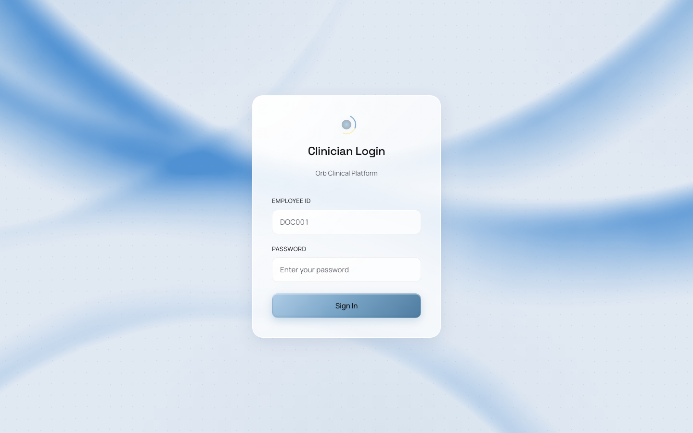

*The clinician sign-in screen. Patients use the same address and are routed to the Bridge portal after signing in.*

This chapter walks you through your first minutes with Orb: opening the application, signing in as a clinician or as a patient, understanding what your role lets you see and do, and finding your way around the clinician workspace, the sidebar, the header controls, the command palette, and the security features that protect your session. By the end you should be able to sign in, orient yourself on any screen, enroll in two-factor authentication, and sign out safely.

Orb runs entirely on hospital hardware. There is no cloud account to create and no internet connection required to sign in, your credentials, your patients' records, and the AI models all live on the machine in your facility.

### 2.1 Opening Orb and choosing your sign-in

Open a web browser on a workstation connected to the hospital network and go to the Orb address your administrator has given you (on a single-machine installation this is typically the local machine's address). Orb has two separate front doors:

- **Clinician Login**, for doctors, nurses, pharmacists, and administrators. This is the default page you land on.
- **Patient Access**, the Orb Bridge portal, where admitted patients check their own status, records, and appointments.

Both pages share the same look: an animated aurora background, the Orb logo, and a single sign-in card. The card's title tells you which door you are at, "Clinician Login" with the subtitle "Orb Clinical Platform," or "Patient Access" with the subtitle "Orb Bridge." If you are already signed in and revisit the address, Orb skips the login page and takes you straight to your workspace.

### 2.2 Signing in as a clinician

#### The sign-in form

The Clinician Login card has two fields and one button:

1. **Employee ID**, your staff identifier (for example, `DOC001`).
2. **Password**, your account password.
3. Press **Sign In**. The button reads "Signing in…" while Orb verifies your credentials.

On success you land in the clinician workspace, opened to the first tab your role can access (for most clinical roles, the Patients board).

In demonstration and development installations, a **Quick access** section appears below the form with one-click chips for the demo accounts (each chip shows the role and the person's name). These chips are removed from production builds, a live hospital deployment never shows working credentials on the login page.

#### If your account uses two-factor authentication

If two-factor authentication (MFA) is enabled on your account, signing in is a two-step process:

1. Enter your Employee ID and password, then press **Sign In**.
2. The form reveals an **Authenticator code** field with the hint "Enter the 6-digit code from your authenticator app to finish signing in." Open your authenticator app (Google Authenticator, Authy, 1Password, or similar), type the current 6-digit code, and press **Verify code**.

If you started the sign-in by mistake, the **Use a different account** link below the button returns you to the password step. Each authenticator code is single-use: once a code has been accepted it cannot be replayed, so if you need to sign in twice in quick succession, wait for the next code (codes rotate every 30 seconds).

#### Sign-in errors and lockouts

Orb protects accounts against password guessing, and the messages you see tell you exactly what happened:

| Message | Meaning | What to do |
|---|---|---|
| "Invalid credentials" | The ID or password was wrong. | Re-check and try again. |
| "Too many login attempts. Please try again in 15 minutes." | Five failed attempts from your workstation within 15 minutes. | Wait 15 minutes, or use another workstation if urgent. |
| "Account temporarily locked after too many failed attempts. Try again later." | Eight failed attempts against your account (from any workstation). The lock lasts 15 minutes. | Wait, then try again; contact an administrator if you suspect someone else is trying your account. |
| "Invalid authenticator code, check the 6-digit code and try again." | The 6-digit MFA code was wrong or already used. | Wait for the next code in your app and re-enter it. |
| "This account must set up an authenticator app before signing in. Contact your administrator to enroll." | Your role requires MFA but your account has not yet enrolled. | Ask an administrator to complete enrollment for your account. |
| "Account deactivated. Contact an administrator." | Your account has been disabled. | Speak to your administrator. |

Every sign-in attempt, success or failure, including lockouts and MFA failures, is written to Orb's tamper-evident audit log with the time, workstation address, and outcome.

### 2.3 Demo accounts

A freshly seeded demonstration installation includes the following accounts. All clinician demo passwords are `password`; the demo patient's password is `patient123`.

| ID | Name | Role | Department | Password |
|---|---|---|---|---|
| DOC001 | Dr. Meera Sharma | Doctor | General Medicine | `password` |
| NUR001 | Priya Reddy | Nurse | General Medicine | `password` |
| PHA001 | Deepa Joshi | Pharmacist | Pharmacy | `password` |
| ADM001 | Rajesh Kumar | Administrator | Administration | `password` |
| P001 | Raj Patel | Patient (Bridge portal) | n/a | `patient123` |

The seed data also includes additional demo physicians across Cardiology, General Surgery, Orthopedics, Pulmonology, Neurology, and Anesthesiology (for example DOC002, Dr. Arjun Mehta, Cardiology), all with the same demo password. Surgeons, doctors in a Surgery department, such as Dr. Vikram Rathore, see a slightly different tab set (see below).

**These credentials are for evaluation only.** Before any real clinical use, an administrator must replace the demo accounts and passwords through the Admin panel's user management.

### 2.4 Roles and what each role sees

Orb enforces role-based access control (RBAC) on the server: every request is checked against a central permission map, and anything your role does not permit is refused with an "Insufficient permissions" error and recorded in the audit log. The interface mirrors the same map, tabs and buttons you cannot use are simply not shown.

#### What each role can do

| Capability | Doctor | Nurse | Pharmacist | Admin | Patient |
|---|:-:|:-:|:-:|:-:|:-:|
| View any patient record, vitals, and alerts | Yes | Yes | n/a | Yes (read-only) | Own data only |
| Create/edit patient records; prescribe or modify medications | Yes | Medications only | n/a | n/a | n/a |
| Create and edit Scribe draft notes | Yes | Yes | n/a | Read only | n/a |
| Sign or reject Scribe notes | Yes | n/a | n/a | n/a | n/a |
| Query Sage (AI assistant) | Yes | Yes | Yes | Yes | Ask via Bridge |
| Upload and analyze images in Lens | Yes | Yes | n/a | View only | n/a |
| Generate and publish discharge summaries | Yes | View only | n/a | View only | n/a |
| Read and send Relay messages | Yes | Yes | n/a | Yes | n/a |
| Execute Relay AI action cards | Yes | n/a | n/a | n/a | n/a |
| View Forecast and surgical schedule; surgery prep and management | Yes | Yes | n/a | Yes | n/a |
| Create lab/imaging/procedure orders (CPOE) | Yes | Yes | n/a | View only | n/a |
| Pharmacy (Helix): view inventory, verify orders, adjust stock | n/a | n/a | Yes | Yes | n/a |
| Governance: audit log, correlation tracing, ingestion monitor, admin dashboard | n/a | n/a | n/a | Yes | n/a |

Two practical consequences are worth calling out:

- **Nurses can draft but not sign.** A nurse can transcribe and structure a clinical note in Scribe, but only a doctor can sign it into the record (or reject it).
- **Admins observe; they do not treat.** The administrator role reads clinical data for governance purposes but cannot prescribe, order, sign notes, or publish discharges.

#### Sidebar tabs by role

The sidebar shows only the modules your role can use:

| Role | Sidebar tabs (in order) |
|---|---|
| Doctor | Patients, Orders, Messages, Sage, Scribe, Lens, Forecast, Command, Simulator, Revenue, Appointments |
| Doctor (Surgery department) | Same, but **Surgical Suite** replaces Appointments |
| Nurse | Patients, Orders, Messages, Sage, Scribe, Lens, Forecast, Revenue, Appointments |
| Administrator | Patients, Messages, Sage, Forecast, Command, Simulator, Revenue, Appointments, Admin |
| Pharmacist | Pharmacy, Verify Queue, Sage |

Each tab belongs to a named Orb "pillar", hover over a tab to see it (for example, hovering Patients shows "Patients · Orb Vigil"). The pillar name also appears as the page title in the header when the tab is open.

### 2.5 A tour of the clinician shell

Once signed in, every clinician works inside the same three-part layout: a sidebar on the left, a header across the top, and the active module filling the rest of the screen.

#### The sidebar

From top to bottom:

- **Orb logo.**
- **Navigation tabs**, one per module, each with an icon and label. Click a tab to switch modules. The tabs are fully keyboard-accessible: with focus on the navigation, the Up/Down (or Left/Right) arrow keys move between tabs, and Home/End jump to the first or last tab.
- **Admit Patient**, a prominent button that opens the patient admission form from anywhere in the app (see the Admissions chapter). Pharmacists do not see this button.
- **Your user card**, your avatar initial, name, and role · department (for example, "Physician · General Medicine"). The small lock icon on this card is the **Security & MFA** button, which opens two-factor authentication management (Section 2.8).
- **Sign Out** (Section 2.9).

Modules keep their state while you work: once you have visited a tab, switching away and back does not lose your place, an open patient chart, a half-written message, or a running analysis is still there.

#### The header

The left side of the header names the active module ("Orb Vigil," "Orb Scribe," and so on) with a one-line description beneath it. The right side holds, in order:

- **Sync status badge** (only when relevant), see "Working offline" below.
- **Clock**, the current date and a live clock with seconds, useful when timing observations or documenting in real time.
- **Pulse**, a heartbeat icon that opens the Orb Pulse popover (next section). A small badge appears on the icon when environmental alerts are active.
- **Notifications bell**, controls browser notifications for critical alerts. On first click it asks the browser for notification permission; once granted, clicking toggles the alert chime between muted and unmuted (the tooltip always states the current state, e.g. "Critical-alert sound on, click to mute"). If notifications are blocked at the browser level, the button is disabled and its tooltip explains that they must be re-enabled in your browser settings.
- **Language toggle**, switches Orb's *navigation chrome* and the sign-in screen between English and Hindi. The button shows "हि" when you are in English (click for Hindi) and "EN" when you are in Hindi. **Be clear about the scope: this is not a translated product.** Hindi covers the sidebar tab names, the header subtitles, the theme/offline/role labels and the login form, 65 strings in total. Every module's actual content, the Vigil patient board, Sage, Orders, Pharmacy, Admin, the nurse shift board, Bridge, remains English regardless of this setting. Two of Orb's 91 screen files consult the translation layer at all. The plumbing is in place and the remaining work is string extraction rather than new infrastructure, but as shipped a Hindi-only user cannot operate Orb. (Scribe's *transcription* language is a separate, genuinely multilingual feature, see §5.)
- **Theme toggle**, cycles through three themes: **Dark → Light → Night Shift → Dark**. Night Shift is a high-contrast, low-brightness theme designed for overnight wards and operating-room ambience. The button's tooltip names the theme you will switch *to*. Your choice is remembered on that workstation; if you never choose, Orb follows the operating system's light/dark preference.

#### The Pulse popover

**Orb Pulse** is Orb's environmental-intelligence overlay: outside-world context that can affect your patients, gathered into one glanceable panel. Click the heartbeat icon to open it.

- **Location**, on first open, Pulse asks the browser for your location so weather and air-quality data are local (the default is Mumbai if you decline). Click the location name at the top of the panel to update it.
- **Active Clinical Alerts**, alerts generated by the Orb Pulse engine when environmental conditions cross clinical thresholds (for example, hazardous air quality relevant to respiratory patients). Click an alert to read its detail.
- **Weather**, current conditions, feels-like temperature, humidity, and a seven-day forecast strip (data: Open-Meteo).
- **Air Quality**, the US AQI value, color-coded category, and PM2.5 reading (data: Open-Meteo AQI).
- **Flu Surveillance**, regional influenza-like-illness activity level (data: CDC FluView; a seasonal estimate is shown when live data is unavailable).
- **Recent FDA Drug Recalls**, the latest drug recall notices (data: openFDA).

Click any tile for a detail view; press Escape to step back, and Escape again (or click outside the panel) to close. The panel refreshes itself every 15 minutes while open, and a **Refresh** button in the footer forces an immediate update. The footer also states Pulse's privacy guarantee: **"Inbound only · Zero patient data transmitted."** Pulse pulls public data in; it never sends anything about your patients out.

#### Working offline

Orb is built to keep working when the network drops. When that happens, a status badge appears in the header:

- **"Offline Mode: Caching locally"**, you are offline; reads come from the local cache and your actions are queued.
- **"Offline · N pending"**, N actions are queued and will be sent when the connection returns.
- **"Syncing · N pending"**, the connection is back and the queue is draining.
- **"Synced"** with a check mark, everything queued has been delivered (shown briefly).
- A red warning, "N queued action(s) failed to sync, please re-enter", means an action queued offline could no longer be applied when it reached the server (for example, the order it targeted had already been completed). **That action did not take effect**: review and re-enter it, then dismiss the notice with the ✕ button.

#### The workspace

The rest of the screen belongs to the active module. If a single panel hits an error, it fails in place, you will see "This panel hit an error and couldn't be shown" with a **Reload panel** button, while the rest of Orb keeps running. Immediately after a software update you may briefly see "Updating to the latest version…" as the page refreshes itself; this is routine.

### 2.6 The command palette (Cmd-K)

The fastest way to reach any patient from anywhere in the clinician shell:

1. Press **Cmd-K** (macOS) or **Ctrl-K**.
2. A search box opens: "Search patients by name, MRN, bed, or diagnosis…". Type at least two characters.
3. Results appear as you type, each showing a risk-colored dot (red = critical, amber = elevated, green = stable), the patient's name and diagnosis, their MRN, and their bed.
4. Use the Up/Down arrow keys (or the mouse) to highlight a result and press **Enter** (or click) to open it. Orb switches to the Patients tab and opens that patient's record.
5. Press **Esc** (or click outside the box) to close without selecting.

If nothing matches, the palette says so ("No admitted patients match …"). The search covers currently admitted patients.

### 2.7 When your session ends: the re-authentication overlay

Clinician sessions are valid for up to 24 hours, and two situations interrupt one sooner:

- **Session expired**, your sign-in token is no longer valid (it aged out, or your sessions were revoked, for example by signing out on another device). A blocking overlay appears titled **"Session expired"**: "For your security, your session has ended. Re-enter your password to continue as *your name*."
- **Screen locked**, you were inactive for 15 minutes at the workstation. The same overlay appears titled **"Screen locked"**: "This workstation locked after a period of inactivity. Re-enter your password to continue as *your name*."

In both cases the overlay works the same way:

1. Type your **Password** and press **Continue** ("Verifying…" while it checks). On success the overlay disappears and you resume exactly where you were, nothing you were working on is lost.
2. Or press **Sign out** to end the session and return to the login page (for instance, if a colleague needs the workstation).

The overlay is deliberately inescapable: pressing Escape does nothing, and no other part of the screen is clickable until you re-authenticate or sign out. If your account uses MFA, password-only re-entry is not sufficient; the overlay will tell you: "Your account requires MFA, sign out and log in again with your authenticator code."

The idle lock applies to staff only, the patient Bridge portal is not idle-locked.

### 2.8 Security & MFA enrollment

Two-factor authentication adds a second proof of identity, a rotating 6-digit code from an authenticator app on your phone, on top of your password. Orb strongly recommends it for every clinical account, and administrators can make it mandatory for chosen roles.

#### Enabling two-factor authentication

1. In the sidebar, click the **lock icon** on your user card (tooltip: "Security & MFA"). The **"Set up two-factor authentication"** dialog opens.
2. Follow the on-screen steps:
   - Open your authenticator app (Google Authenticator, Authy, 1Password, or any standard TOTP app).
   - Add a new account using **manual key entry** and paste the **Setup key** shown in the dialog (a **Copy** button is provided). Alternatively, copy the full **Provisioning URI** into apps that accept it. The dialog confirms the technical parameters: account "Orb Hospital OS," algorithm SHA1, 6 digits, 30-second period.
   - Your app now shows a rotating 6-digit code for Orb.
3. Type the current code into the **Verification code** field and press **Enable MFA** ("Verifying…" while it checks). This proves your app is set up correctly, MFA is not switched on until a live code is confirmed, so a half-finished setup can never lock you out.
4. On success the dialog shows **"✓ Two-factor authentication is now enabled"** and reminds you: "You'll be asked for a code from your authenticator app each time you sign in." Press **Done**.

There is no QR code in the current version, use your app's manual/setup-key entry option. If you close the dialog before confirming and open it again later, a fresh setup key is generated; always use the key currently on screen.

#### Disabling two-factor authentication

Open the same lock icon. If MFA is already enabled, the dialog (titled **"Two-factor authentication"**) switches to the disable flow. As a deliberate safeguard, turning MFA off requires **both** your current **Password** and a current **Authenticator code**; enter them and press **Disable MFA**. Enabling and disabling MFA are both recorded in the audit log.

### 2.9 Signing out

Click **Sign Out** at the bottom of the sidebar. Signing out in Orb is deliberately thorough: it revokes **all** of your active sessions, on this workstation and every other device where you were signed in. This is the correct response if you ever suspect your account has been used by someone else, sign out once, and every outstanding session dies. The sign-out is audit-logged.

On shared ward workstations, prefer signing out over walking away; the 15-minute idle lock is a safety net, not a substitute.

### 2.10 The patient's Bridge portal

Patients have their own, deliberately separate entrance: **Orb Bridge**.

1. Go to the Patient Access page (your care team or discharge paperwork provides the address; from the clinician login it is the patient-mode login page).
2. The card is titled **"Patient Access"** with the subtitle "Orb Bridge." Enter your **Patient ID** (for example, `P001`) and your **Password**, then press **Sign In**. In demo installations, a Quick access chip signs in the demo patient Raj Patel.
3. You arrive at the Bridge home: a header with the Orb logo, "Orb Bridge," a personal greeting, and a **Sign out** button; below it, your **Your Status** card, a **Schedule Follow-Up** card for booking appointments, **My Records** (medications, clinical reports, labs, discharge summary, and a downloadable copy of your record in standard FHIR format), and a question box where you can ask Orb about your care in plain language.

The same account-security rules apply to patients as to staff: wrong credentials produce "Invalid credentials," and repeated failures trigger the same temporary lockouts. A patient account can only ever see that patient's own information, this is enforced on the server for every single request, not just hidden in the interface. The Bridge portal is covered in full in its own chapter.

### Troubleshooting

| Symptom | Likely cause | Fix |
|---|---|---|
| "Invalid credentials" with a password you are sure of | Wrong ID field (e.g., Patient ID on the clinician page), stray spaces, or wrong keyboard layout | Confirm you are on the right login page (Clinician Login vs. Patient Access) and re-type both fields. |
| "Too many login attempts…" or "Account temporarily locked…" | Rate limiting after repeated failures | Wait 15 minutes. If you did not cause the failures, tell an administrator, the audit log shows where the attempts came from. |
| Authenticator codes are always "invalid" | The phone's clock has drifted | Codes are time-based (30-second window). Set the phone's clock to automatic/network time and try the next code. A code also fails if it was already used once, wait for the next one. |
| MFA-required account cannot sign in at all | Role requires MFA but the account never enrolled | An administrator must complete enrollment; the login page cannot enroll you. |
| "Session expired" appears immediately after signing in, repeatedly | Workstation clock badly wrong, or sessions being revoked elsewhere | Correct the workstation's date/time; if it persists, contact your administrator. |
| Quick access chips are missing on the login page | You are on a production build | Expected, production builds never show demo credentials. Sign in with your own account. |
| A tab you expect (e.g., Orders, Admin) is not in the sidebar | Your role does not include it | See the role table in Section 2.4. Access changes must be made by an administrator. |
| The notifications bell is grayed out | Browser-level notification block | Re-enable notifications for the Orb site in the browser's settings, then refocus the page. |
| Cmd-K / Ctrl-K does nothing | You are on the login page or the Bridge portal | The command palette exists only inside the clinician shell. |
| A red "failed to sync" badge appears in the header | An action queued while offline could not be applied | That action did not take effect. Re-enter it manually, then dismiss the badge with ✕. |

### Safety & limitations

- **Least privilege, enforced twice.** Permissions are enforced on the server for every request, independent of what the interface shows. Hiding a button is a courtesy; the server-side check is the guarantee. Denied attempts are audit-logged.
- **Everything is audited.** Sign-ins and failures, lockouts, MFA enrollment and removal, sign-outs, and permission denials all land in the tamper-evident audit log with time, actor, and workstation address (see the Admin chapter).
- **Your password is never stored.** Orb keeps only a strong one-way hash. Sessions live in a protected browser cookie rather than in scripts' reach, and the token is never written to browser storage.
- **Sign-out is global.** One Sign Out revokes every session on every device. There is no "sign out of this device only."
- **MFA has no self-service recovery.** If you lose the phone holding your authenticator app, an administrator must reset MFA on your account. There are no backup codes in the current version.
- **Demo credentials are a known risk.** The seeded accounts and passwords in Section 2.3 are public knowledge. Never expose an installation that still has them beyond a demo network.
- **Pulse is inbound-only.** The Pulse popover fetches public environmental data (and needs internet access to do so); it transmits no patient data. Everything else in Orb works fully offline. Pulse's alerts are environmental context, not clinical directives, they never replace your judgment.
- **The idle lock is a fallback.** Fifteen minutes is a long time in a busy corridor. Sign out, or lock the workstation, when you step away.

---

## 3. Vigil: Patient Monitoring & Risk

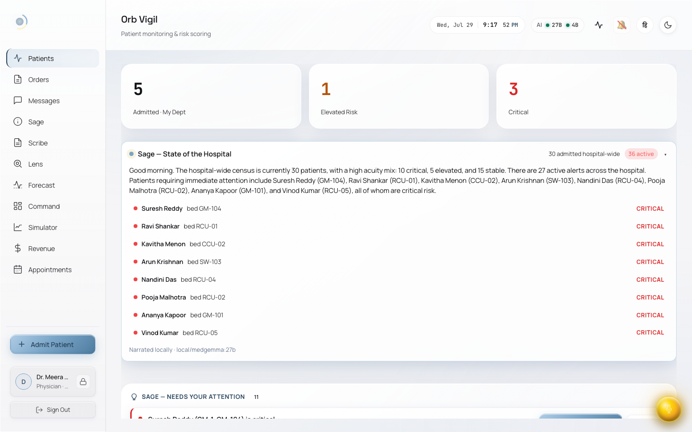

*The Vigil patient board. The metric tiles count your own department; the Sage brief beneath them is hospital-wide.*

Vigil is Orb's live patient board, the screen most clinicians keep open all shift. It shows every admitted patient in your department, continuously scores each one with the NEWS2 early-warning system, streams live vitals into each chart, and layers Sage's hospital-wide situational brief and proactive alerts on top. From Vigil you can open any patient's full chart, order and administer medications, review notes and reports, admit a new patient, and run a complete discharge.

To open Vigil, sign in with your employee ID and password and select **Patients** in the left sidebar. Vigil is the default landing tab for clinical roles, so in most cases it is simply the first screen you see.

### 3.1 The patient board at a glance

The board is arranged top to bottom as: metric tiles, the **Sage, State of the Hospital** brief, the **Sage, needs your attention** feed, and the **Active Patients** list.

#### Metric tiles

| Tile | What it counts |
|---|---|
| **Admitted · My Dept** | Patients currently admitted **under your department only**. Hover the label to see the reminder: "Patients admitted under your department." The number reflects the full server-side count for your department, even if not all rows are loaded yet. |
| **Elevated Risk** | Patients on the loaded board whose current risk band is *elevated*. |
| **Critical** | Patients on the loaded board whose current risk band is *critical*. |
| **Bed Occupancy** | Administrators only, occupancy as a percentage of the department bed baseline. |

The department scoping matters: a doctor in Cardiology sees Cardiology's admissions here, not the whole hospital. The one deliberate exception is the Sage brief directly below, which is always hospital-wide, the two scopes are labelled so they cannot be confused.

Because the Elevated Risk and Critical tiles are tallied over the rows currently loaded in the list, on very large boards (more than 100 patients) load the remaining pages with **Load more** if you want those two tiles to reflect every patient.

#### Sage: State of the Hospital

This collapsible card is the shift brief. Its header shows a live census, for example "42 admitted hospital-wide", and hovering that count explains the scope: "All admitted patients across the hospital, the Vigil tiles above count only your department."

The card contains:

- **A narrative paragraph.** A 3–5 sentence situational brief written by the local AI model, leading with who needs eyes first. It is regenerated in the background when ward events occur (a deterioration alert, a signed note, an incoming emergency) and on a slow periodic refresh, but never more often than every 90 seconds, an alert storm produces one new brief, not thirty. If the AI engine is unavailable, the card falls back to a plain deterministic line (for example "3 patients need attention first." or "All admitted patients are currently stable."), it degrades to facts, never to silence.
- **A watchlist.** Up to eight patients currently at *critical* or *elevated* risk, hospital-wide, worst first, each showing name, bed, and risk band. Click any watchlist row to jump straight into that patient's chart.
- **An active-alert badge.** When present, "N active" counts Sage insights of *critical* or *warning* severity that are currently open. This count is self-cleaning: an insight whose triggering condition has been clear for about ten minutes resolves itself automatically, and insights belonging to discharged patients are retired on the next sweep. So the badge reflects present ward truth, not an ever-growing backlog. Insights you dismiss or act on are removed immediately.
- **A provenance footer.** "Narrated locally · …" names the local model that wrote the paragraph; "Deterministic snapshot (local)" means you are looking at the AI-free fallback. Nothing on this card ever leaves the machine.

Click the card's header to collapse or expand it.

#### Sage: needs your attention

Below the brief, this feed lists proactive insight cards produced by Sage's continuous surveillance of every admitted patient. The rules are deterministic and grounded in real charted numbers, Sage cannot invent a patient or a value here. Current rules include:

- **Deterioration**, a patient is critical on their latest vitals, or their NEWS2 band has risen since a reading at least 15 minutes earlier. The band is the one on their Vigil board row, and the card names the parameters that scored. When their vitals put them below that band, the card turns blue, changes to "was critical" (or "was deteriorating") and clears itself 10 minutes later; if they go back up first, the same card turns red again at once. An incomplete set counts only when the parameters it is missing could not, even at their worst, put the patient back in that band. Otherwise the card stays and says what was not measured.
- **Trajectory**, SpO2 falling by 3+ points, or respiratory rate rising by 4+, across the last three readings.
- **Possible sepsis**, when the latest vitals meet SIRS: any two of fever (above 38.0 °C) or hypothermia (below 36.0 °C), heart rate above 90, and respiratory rate above 20. SIRS also counts the white cell count, which Orb does not record, so the card says it was not checked. It suggests a sepsis screen and cultures.
- **Antibiotic stewardship**, a broad-spectrum antibiotic running for more than 72 hours, prompting a de-escalation review.

Each card shows a severity dot (red critical, amber warning, blue info), a title naming the patient and location, a one-line detail with the actual numbers, and up to two actions:

- **⚡ Draft …**, where a suggested action exists, one click drafts it into the patient's case room in Relay. No surveillance rule suggests a drug, and none of the four rules above attaches a suggested action today, so these cards offer **Dismiss** only. A confirmation toast appears: the draft is *not* an order until you open Relay and confirm it. Nothing is prescribed from this button alone.
- **Dismiss**, removes the card. Dismissals are recorded, and Sage learns from them: nudge patterns that clinicians consistently reject are quietened over time, but critical-severity insights are never suppressed by this feedback loop.

Duplicate suppression means the same insight will not be re-raised within 30 minutes, and only the first four cards show by default, use **Show N more** to expand.

#### Active Patients list

Every row is one patient: a coloured risk bar on the left edge, the patient's name, bed, diagnosis, and a risk percentage on the right. Patients whose band is *critical* carry a red **EMERGENCY** badge and always float to the top of the list regardless of sort order.

Two sort buttons sit in the section header:

- **Stability**, highest risk first (the default).
- **Recent**, most recently admitted first.

The board loads 100 patients per page; if your department has more, a **Load more (X of Y)** button appears. The list refreshes itself every 30 seconds while the tab is visible (refreshing pauses when the browser tab is in the background), and live vitals updates adjust each row's risk in near-real time.

Click any row to open the patient's detail view.

### 3.2 How Vigil scores risk: NEWS2

Vigil's risk engine is the UK Royal College of Physicians **National Early Warning Score 2 (NEWS2)**, a deterministic, auditable scoring table, not a black box. Each of seven parameters contributes 0–3 points from the most recent vitals:

| Parameter | Scores points when… |
|---|---|
| Respiratory rate | Below 12 or above 20 breaths/min (3 points at ≤8 or ≥25) |
| SpO2 | Below target (scale-dependent, see below) |
| Supplemental oxygen | +2 points whenever the patient is on oxygen |
| Systolic BP | ≤110 (up to 3 points at ≤90) or ≥220 |
| Heart rate | ≤50 or ≥91 (3 points at ≤40 or ≥131) |
| Temperature | ≤36.0 °C or ≥38.1 °C |
| Consciousness (ACVPU) | 3 points for anything other than Alert |

The aggregate maps to Vigil's three risk bands:

- **Critical**, NEWS2 of 7 or more.
- **Elevated**, NEWS2 of 5–6, **or** any single parameter scoring 3 (the NEWS2 single-parameter escalation rule: one severely deranged vital elevates the patient regardless of the total).
- **Stable**, everything else.

#### Scale 2 SpO2 for COPD

NEWS2 defines two oxygen-saturation scales, and Vigil implements both. **Scale 1** (the default) treats ≥96% as normal. **Scale 2** is for patients with COPD or chronic type-2 respiratory failure, whose target is 88–92%: saturations in that range score zero, and, critically, saturations *above* target score points **when the patient is on supplemental oxygen**, because over-oxygenation is dangerous in this group. On air, a high saturation scores nothing. Scale 2 is selected per patient as a flag on the patient record; when active, the score breakdown labels the parameter "SpO2 (Scale 2)" so it is always visible which scale produced the number.

#### The number you see, and the number that decides

Vigil displays two related figures and it is worth knowing which is which:

- On the **board rows**, the right-hand percentage is a normalized 0–100% index of the NEWS2 aggregate. It is a *ranking convenience*, it lets the board sort the sickest to the top, and it is **not** a probability that the patient will deteriorate.
- In the **patient detail view**, the risk badge and gauge show the **raw NEWS2 integer** (for example "NEWS2 7 · CRITICAL"). All escalation decisions are taken from this raw score and its clinical bands, never from the percentage.

#### The learned overlay (when installed)

Sites that have trained Vigil's optional neural-network models (one each for deterioration, sepsis, and mortality, predicting risk at 1, 3, 6, 12, and 24 hours ahead) get a learned overlay on top of NEWS2. The overlay is deliberately one-directional: it can **escalate** a patient's band when the model sees high near-term risk, including lifting a clinically-quiet, NEWS2-stable patient, but it can **never lower** the NEWS2 baseline. When an escalation happens, the risk drivers say so explicitly (for example "CfC: high near-term deterioration risk"). If no trained models are installed, Vigil runs on NEWS2 alone and behaves identically otherwise.

### 3.3 The patient detail view

Opening a patient replaces the board with a full chart. The top strip, the command bar, packs identity, risk, live vitals, and every action into one row.

- **Back arrow** (top left) returns to the board.
- **Identity**, name, MRN, age, and sex. When another clinician is viewing the same chart at the same moment, small presence chips appear here ("Priya Reddy also viewing") so two people never chart the same patient unknowingly.
- **Bed & risk badge**, bed number plus "NEWS2 n · LEVEL", coloured by band.
- **Diagnosis & comorbidities**, the primary diagnosis, with comorbidity tags shown *only* when genuinely recorded on the patient's problem list. Vigil never invents history: if nothing is recorded, nothing is shown.
- **Vital cells**, HR, BP, SPO2, TEMP, and RR, updating live. A cell highlights when its value is outside normal limits, and hovering any cell reveals a six-hour mini trend chart for that vital.

#### Action buttons

| Button | Opens |
|---|---|
| **Diag. Reports** | Imaging reports (X-ray, CT, MRI, ultrasound, ECG, echo) with the scan image, AI findings, and search by keyword or date (DDMMYYYY). |
| **Lab. Reports** | Laboratory reports, searchable the same way; results containing critical values carry a red **⚠️ CRITICAL** badge. |
| **Medications** | The medication list and eMAR (section 3.4). |
| **Notes** | The Clinical Notes History, every clinical document and Scribe note, searchable by word, date, or type. Click a note to read it in full. |
| **Story** | One scrollable, filterable clinical narrative merging admission, alerts, notes, imaging, medications, orders, administrations, and discharge onto a single timeline. |
| **HANDOFF** | The auto-drafted I-PASS shift handoff for this patient (opens in a new tab). |
| **DOWNTIME** | A read-only offline snapshot of the chart for downtime use. |
| **PRINT RECORD** | Prints the patient record. |
| **PRINT MEDS** | Prints the Medication Administration Record. |
| **DISCHARGE** | Starts the discharge workflow (section 3.6). |

#### Below the command bar

- **Care bundle timer.** When a Sepsis Six bundle is active for the patient, a live timer shows elapsed time since trigger, an overall compliance badge, and the six bundle elements with per-element **Mark done** actions.
- **Clinical Course.** Sage's deduced expected inpatient course: ordered care phases with the current phase highlighted, plus an expected length of stay, reasoned from the diagnosis, comorbidities, age, and sex. While it computes, the card reads "Sage is charting the expected course…".
- **Orb Risk Assessment.** The risk gauge (raw NEWS2 in the centre, band underneath), the top risk drivers in plain language, and a trend line, "↗ Improving", "→ Stable", or "↘ Deteriorating", computed by comparing the last six hours of vitals against the six hours before that. Expand **"Why NEWS2 n?, per-parameter contribution"** for a transparent table of exactly which vital contributed how many points, worst first, with a warning line when the single-parameter rule applied. The panel states its own limits: this is the deterministic RCP scoring table, a decision-support aid, *not* a clinically-validated deterioration probability.
- **MedGemma AI Assessment.** Directly under the risk panel, the local AI model streams a short clinical narrative, who the patient is, day of admission, current vitals with notable findings, risk context, trend, and active medications. Click the panel (or **Expand to Glass Window**) to read it full-screen. Concurrent opens of the same patient share one generation rather than each triggering the model. If the AI engine is not running, the panel simply reports that analysis is unavailable; nothing else on the chart depends on it.
- **Lab Trends.** A grid of per-analyte tiles (value, unit, reference range, trend arrow, status colour). Hovering a tile shows its trend chart with the reference range shaded; clicking opens a full-size graph modal (**Close Tracker** to dismiss). When real lab results are on file, trends are built from them. When *no* labs are on file, Vigil shows model-estimated values instead, and says so loudly: an amber **Estimated** badge appears in the panel header, and estimated trend lines render dashed. Estimated values are derived from the diagnosis, not measured; treat them as illustrative only and never as a substitute for ordering real labs.

### 3.4 Medications and administration

The **Medications** button opens the medication table: **Drug, Dose, Route, Frequency, Status** ("● Active", "◌ PRN", "○ D/C"), and **Administration**. The **+** icon in the header opens **Add Medication**.

#### Ordering a medication

1. Click **+** in the Medications modal.
2. Complete **Drug Name**, **Dose**, **Route** (Oral, IV, IV Infusion, IM, SC, Nebulizer), **Frequency**, and **Status** (Active, PRN, Discontinued). Drug name, dose, and frequency are required.
3. Click **Add Medication**.

Every order passes through the **drug-safety gate**, an allergy and interaction screen that runs *before* anything is written to the chart:

- **Severe alerts block the order.** A safety modal lists each alert with its severity. To proceed anyway you must type a clinical justification of at least 10 characters and click **Acknowledge & Order**. The override, who, what, and why, is written to the tamper-evident audit chain.
- **Sub-severe alerts do not block.** The order succeeds, and the same modal appears once, informationally, so the alerts still get eyes.
- **Unrecognised drugs**, ones Orb cannot map to a known drug class, are flagged as unscreened rather than silently passed as safe. Note the converse does not hold: a recognised drug with no curated interaction pair reports "No alerts" without the chip. See §8.5 for the size of the shipped interaction set and what a clean screen does and does not mean.

#### Recording an administration (eMAR)

Each active medication has an **Administer** button in the Administration column. It opens the bedside administration modal, which enforces the five rights:

1. Verify the summary, patient, drug, dose, route, and time (now).
2. Type the drug name exactly as charted into the confirmation field. The **Given** button stays disabled until the typed name matches, a deliberate check of the physical medication in your hand against the chart row.
3. Click **Given** to chart the dose. A green "Given HH:MM" chip then appears beside the medication (times display in your local clock), with the recording clinician on hover.
4. If the dose was not given, choose **Not given** and select a structured reason: Refused, Held, clinical decision, NPO, Unavailable, or Other (with detail).

One important guard: medications that were AI-extracted or drafted by the agentic loop and **not yet verified by a pharmacist** appear with their Administer button disabled and the tooltip "Pharmacist verification required". An unreviewed AI suggestion can never be administered as if it were a confirmed order.

### 3.5 Admitting a patient

Click **Admit Patient** in the footer of the app shell. The modal ("Create clinical admission record across Orb modules") is organised into tabs, with a live summary panel on the right and completion dots on each tab. Required fields are starred.

1. **Identity**, Full Name*, Age*, Sex*, plus phone, address, and emergency contact.
2. **Admission**, Admission Source* (Emergency Room, Outpatient Clinic, Hospital Transfer, Direct Admission), Admission Type* (Inpatient, Observation, ICU, Emergency), Department*, Attending Doctor ID* (pre-filled with you), Ward*, Bed, and Referring Clinician. Department also pre-fills from your profile, this is what scopes the patient onto your board.
3. **Clinical**, Chief Complaint* (free text), Initial Diagnosis, and Triage Severity (1 Resuscitation through 5 Non Urgent).
4. **History**, Allergies, Comorbidities, and Current Medications as chip inputs (type and press Enter for each entry), plus free-text past medical, surgical, family, and social history. Allergy and comorbidity chips echo into the summary panel as red and amber flags.
5. **Vitals**, Heart Rate, SpO2, Systolic/Diastolic BP, Temperature, Respiratory Rate, Consciousness (ACVPU: Alert, New confusion, Responds to voice, Responds to pain, Unresponsive), and On supplemental O₂. Both of those start at **Not assessed**: leave them there unless someone has assessed the patient, and the score is shown as an incomplete set (a minimum) rather than counting the patient as alert on room air. As the tab itself notes, entering initial vitals immediately computes a NEWS2 risk score, so the patient lands on the board with a real risk band rather than a blank.
6. **Notes**, Code Status (Full Code, DNR, DNI, Comfort Care Only), Isolation Precautions (chips, e.g. Contact, Droplet), and Admitting Notes.
7. **Review**, a read-back of identity, admission context, and clinical overview. Click **Review Admission** at any point to jump here; then click **Confirm Admission**.

A single confirmed admission creates the patient record, the admission record, the clinical profile, an initial risk score, and a dedicated case room in Relay with an admission message, the patient is immediately live across every Orb module.

**The one-time credential screen.** After a successful admission you see "Patient admitted ✓" with the patient's **Login ID** and **One-time password** for the Bridge patient portal. Hand these to the patient now, use **Copy credentials** if helpful, because the password is stored only as a hash and **cannot be shown again**. Each patient receives a unique generated password; there is no shared default. Click **Done** to finish.

### 3.6 Discharging a patient

1. Open the patient's chart and click **DISCHARGE**.
2. The confirmation modal recaps the diagnosis, ward and bed, admission date, and current NEWS2 band, and explains what will happen: a comprehensive discharge summary with timeline is generated, the patient's status changes to discharged, and a QR code is created for records access.
3. Click **Confirm Discharge** (the button reads "Generating Summary…" while it works; **Cancel** or Escape aborts before this point).
4. On success, "✓ Patient discharged successfully", the modal shows the discharge summary preview, the hospital-stay timeline, and the **Discharge QR Code** ("Scan to access discharge summary").
5. Finish with **Print Summary Only**, **Print with Timeline**, or **Done**.

Two things about the summary are worth knowing. First, the narrative hospital course is AI-assisted, but the **medication reconciliation is deterministic**: it is computed directly from the real charted medication record, splitting medications into continued and stopped, carrying PRN ("as needed") medications onto the discharge list rather than letting them silently vanish, and explicitly flagging any AI-extracted medication a pharmacist has not verified so it is never carried onto a discharge script unreviewed. Second, if the AI engine is unavailable, discharge still completes with a clearly-labelled offline summary, discharge never blocks on the model.

Discharged patients leave the Active Patients board on its next refresh, their open Sage insights auto-resolve, and their chart remains reachable through the discharge summary and QR-code access path.

### Troubleshooting

| Symptom | Likely cause and fix |
|---|---|
| A patient you expect is not on the board | The board shows only your department's admissions. Check the patient's admitting department; on boards over 100 patients, click **Load more**. Discharged patients do not appear. |
| "Admitted · My Dept" disagrees with the hospital-wide count in the Sage brief | Working as designed, the tile is department-scoped, the brief is hospital-wide. Hover either number for its scope note. |
| Risk shows "No vitals recorded" | The patient has no vitals yet. Record a first set (or include vitals at admission) and NEWS2 computes immediately. |
| MedGemma AI Assessment says analysis is unavailable | The local AI engine (Ollama) is not running. Everything else on the chart, NEWS2, trends, labs, medications, is unaffected. Start the engine and reopen the chart. |
| The Sage brief shows no narrative, only a one-line status | The AI narrative layer is unavailable or still pending; you are seeing the deterministic fallback, which is still trustworthy ward truth. The footer confirms which engine produced what you see. |
| Lab Trends shows an amber "Estimated" badge and dashed lines | No real lab results are on file; values are model-estimated from the diagnosis. Order and file real labs and the panel switches to measured trends automatically. |
| The board or insight feed seems frozen | Background refresh pauses while the browser tab is not visible. Refocus the tab; polling resumes automatically. |
| **Administer** is greyed out with "Pharmacist verification required" | The medication was AI-extracted or agent-drafted and awaits pharmacist verification. It cannot be administered until verified. |
| A "Given" time looks wrong | Administration chips display in your local time zone; hover the chip to see who recorded the dose. |

### Safety & limitations

- **NEWS2 is an escalation aid, not a prediction.** The score is a deterministic lookup from the RCP table. The percentage on board rows is a normalized ranking index, it is not, and is never presented in the detail view as, a validated probability of deterioration. Clinical judgement always governs.
- **The learned overlay can only escalate.** Where neural-network risk models are installed, they may raise a patient's band but can never lower the NEWS2 baseline, the auditable rule-based floor always stands.
- **AI narratives are drafts, not findings.** The MedGemma assessment, the Sage ward narrative, and the discharge hospital course are generated locally from the chart and must be verified against source data before being relied on. The deterministic layers beneath them (snapshot, NEWS2, medication reconciliation) are the trusted signals.
- **Sage insight cards suggest; they never act.** The **⚡ Draft** action creates a draft in the patient's Relay case room that a clinician must explicitly confirm. The feedback loop that quietens frequently-dismissed nudges never suppresses critical-severity insights.
- **Nothing is invented.** Comorbidity tags appear only when genuinely recorded; estimated lab trends are visibly badged and dashed; unscreened drugs are flagged rather than passed as safe.
- **Overrides are accountable.** Ordering through a severe drug-safety alert requires a written clinical justification and is recorded on the tamper-evident audit chain.
- **Everything runs locally.** Risk scoring, AI narration, and the ward brief all execute on the hospital's own hardware; no patient data leaves the machine to produce anything described in this chapter.

---

## 4. Sage: Clinical Intelligence Assistant

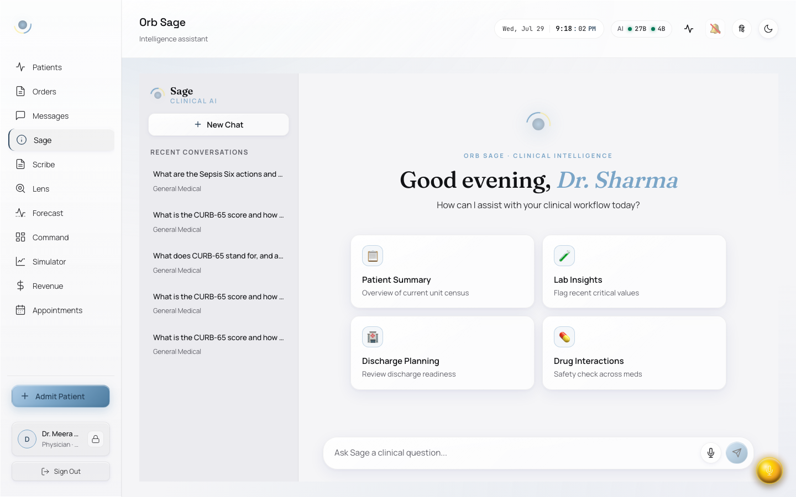

*The Sage tab. Suggestion cards start a query; answers carry governance badges and cited sources.*

Sage is Orb's clinical intelligence assistant: a chat interface where you ask questions in plain language, about a single patient, the whole ward, a drug, or a protocol, and receive an evidence-grounded answer generated entirely on the hospital's own hardware. Sage reads live chart data, searches the hospital's guideline library, and cites what it used. It is a **decision-support tool, not an ordering system**: it can never change a chart, place an order, or administer anything on its own. Anything that looks like an action becomes a *draft* a clinician must explicitly approve.

Sage appears in three places:

| Surface | Where you find it | What it does |
|---|---|---|
| **Sage tab** | Sidebar → **Sage** | Full chat workspace with history, details, sources, and voice mode |
| **Floating orb** | Bottom corner of every clinician screen | Hands-free voice assistant ("Ask Sage"), aware of what is on your screen |
| **Sage Copilot / insights** | Relay case rooms and the Patients dashboard | Ambient listening and proactive alerts that draft actions for your confirmation |

All three run on the same local AI models and the same safety rules. Nothing you type or say to Sage about a patient leaves the building.

### 4.1 Opening Sage and asking a question

1. Sign in with your employee ID and password, then click **Sage** in the left sidebar.
2. A fresh visit shows the landing screen: the Orb logo, the line **Orb Sage · Clinical Intelligence**, a time-of-day greeting with your name, and the prompt *"How can I assist with your clinical workflow today?"*
3. Type into the box labelled **"Ask Sage a clinical question..."** and press **Enter** (or click the send arrow). **Shift+Enter** inserts a new line without sending.
4. While Sage is generating, the send arrow becomes a **Stop** button ("Stop generating"). Clicking it keeps the text already received and tags the message **⏸ Stopped by user**. Typing a new question mid-answer also works, Sage abandons the old response and starts the new one.

#### The suggestion cards

The landing screen offers four one-click starter queries. Each card sends a fully formed question so you can see what Sage does without composing anything:

| Card | Subtitle | What it asks |
|---|---|---|
| **Patient Summary** 📋 | Overview of current unit census | A brief summary of all active patients and their current status |
| **Lab Insights** 🧪 | Flag recent critical values | The most recent lab results across all patients, with abnormal values highlighted |
| **Discharge Planning** 🏥 | Review discharge readiness | Which patients are closest to discharge and what criteria remain |
| **Drug Interactions** 💊 | Safety check across meds | A review of current medications for all active patients, flagging potential interactions |

#### The conversation sidebar

The left rail shows the **Sage / Clinical AI** brand and two controls:

- **New Chat**, clears the screen *and* deletes your stored Sage conversation history. Use it when switching topics so old patient context cannot bleed into new answers.
- **Recent Conversations**, your last five questions, each labelled with the patient concerned (e.g. "Patient: Ananya Iyer") or "General Medical". Clicking one reloads that exchange. History is per-user and stored locally.

Sage also uses your recent history for context: a follow-up like "and what about her potassium?" is understood because the previous turns are passed back to the model. History is deliberately *not* used for standalone general-medicine questions, so an old patient cannot contaminate an unrelated pharmacology answer.

### 4.2 How Sage builds an answer (RAG, in plain terms)

Sage does not answer from the model's memory alone. Before the model writes a word, Orb assembles an evidence pack, this is the "retrieval-augmented generation" (RAG) pattern:

1. **Query scoping.** Sage first works out what kind of question you asked:
   - **One patient**, you named a patient, bed, or ward ("How is Ramesh in bed 4 doing?"). Matching tolerates partial names and voice-transcription mangling.
   - **Follow-up / pronoun**, "what are *her* latest labs?", "*this patient*". Sage resolves the pronoun against the patient on your screen, or the patient in your recent messages.
   - **Whole-ward**, census, handoff, "all patients", "who is deteriorating". Sage pulls a compact one-line-per-patient snapshot of the live census with latest vitals and risk levels.
   - **Aggregate statistics**, pure counts and distributions ("how many patients are admitted?", "bed occupancy"). Answered from counts only, no identifiers; small counts in breakdowns are masked (shown as "<5") so an individual cannot be inferred from a number.
   - **General medical**, drug mechanisms, side effects, protocol questions with no patient attached.
2. **Patient facts.** For patient-scoped questions Sage assembles: demographics and diagnosis, latest vitals with trend arrows, the current risk score and its drivers, active medications, recent labs, the most recent *signed* Scribe note, the latest Lens imaging analysis, and the patient's trajectory over time. It also tracks what is *missing* (e.g. "No recent labs"), see the Partial-data badge below.
3. **Guideline retrieval.** Sage searches the local clinical knowledge base, a guideline corpus stored and indexed on the hospital server, combining meaning-based (semantic) and keyword search with a second-stage reranker. Nothing is fetched from the internet.
4. **Case-room discussion (when you ask for it).** If your question is about the *conversation*, "summarise this thread", "what did the team decide", "who flagged that", "catch me up", Sage additionally reads the most recent clinician messages from that patient's Relay case room and quotes them as attributable context. This is deliberately narrow, and the limits are worth knowing: it reads **case rooms only** (never department channels or direct messages), never a discharged patient's room, at most the **six** most recent human messages, each truncated to 220 characters, and only when the question actually asks about the discussion, a vitals or medication question pays none of the time cost. It also requires you to hold the Relay-read permission in your own right: a pharmacist, who can query Sage but is refused Relay messages at the door, is refused them here too. Ward scoping is enforced with the same rule as the patient chart, so a thread from another department is not readable through Sage. On any failure the messages are simply omitted and the answer is degraded, never widened.
5. **Generation.** The evidence pack plus your question goes to the local language model, which writes the answer under a strict response contract (see section 4.12).

#### Trust tiers: local policy beats external guidance

Every document in the guideline library carries a trust tier, and Sage is instructed that **local policy overrides external guidance**:

| Tier | Label in the details view | Meaning |
|---|---|---|
| 1 | Local Policy | Your hospital's own SOPs and protocols, highest authority |
| 2 | Local Formulary | Your hospital's formulary and pharmacy rules |
| 3 | External Guideline | Medical-society guidance and literature, advisory |

In the expanded details of an answer, retrieved evidence is split into **🏥 Local Policy** and **📚 External Guidance** sections so you can see which tier drove the recommendation. Demonstration documents are explicitly marked as synthetic.

#### Citations are verified, not trusted

The model must list which documents it relied on. Orb then **validates those citations against what was actually retrieved**: if the model cites a document that was not in the evidence pack (i.e. it may have invented a source), the citation is discarded and the answer's confidence is downgraded to *low*, which triggers the "Limited evidence" badge. The source count shown next to **Show details** (e.g. "· 2 sources") reflects only verified citations.

### 4.3 Reading a Sage answer: badges, confidence, and display modes

#### Governance badges

Coloured banners can appear above an answer. They are applied by Orb's own logic, not by the model, so the model cannot suppress them:

| Badge | Colour | Trigger |
|---|---|---|
| **⚠️ High-Risk Query, Verify with attending** | Red | The question matched a high-risk pattern: chest pain/ACS, respiratory failure, stroke/tPA, sepsis and shock, high-risk medications (anticoagulants, insulin infusions, opioids, potassium), or any dose change. Treat the answer as a discussion aid and confirm with the attending before acting |
| **🔍 Limited evidence, Verify independently** | Amber | Retrieval was weak, or the model's citations failed validation. Check the source material yourself |
| **⚠️ Partial data: …** | Amber | The chart is missing categories Sage would normally use (e.g. "No recent labs, No signed Scribe notes"), the answer was formed without that data |
| **⏸ Stopped by user** | Grey | You pressed Stop mid-generation; the answer is incomplete |

For high-risk scenarios Sage is additionally instructed never to give a definitive, unverified drug dose, it will recommend escalation instead.

#### Concise vs. detailed display

Sage answers in a short, colleague-style **concise answer** by default. The fuller reasoning lives behind the **Show details / Hide details** button beneath the bubble, which expands into the sections that have content: **📋 Patient Facts**, **🏥 Local Policy**, **📚 External Guidance**, **⚕️ Clinical Assessment**, **⚠️ Caveats**, and **🚨 Escalation**. The details row also shows a gold patient chip (the patient the answer was scoped to, marked "(discharged)" in amber if no longer admitted) and the verified source count.

Whether the panel starts open is decided by Orb, not the model: it **auto-expands** whenever the answer is high-risk, confidence is low, critical chart data was missing, or you explicitly asked for reasoning or evidence. The model's own preference is advisory only.

#### Disambiguation and non-existent patients

- If your question matches **more than one patient** (two Sharmas on the ward), Sage will not guess, it lists the matches with bed and ward and asks you to specify.
- If you ask about a patient **who is not on the census or in recent discharges**, Sage is hard-grounded to say no matching patient was found. It is explicitly forbidden from inventing vitals, labs, or diagnoses for a name it cannot find.

### 4.4 Patient-context awareness: "this patient" works everywhere

Every clinician screen quietly publishes a small description of what you are looking at, the active tab, the open patient's name, and any open item (for example, a selected report). Sage uses this two ways: **pronoun resolution**, with a chart open, "summarise this chart" or "what are her latest labs?" scopes automatically to the on-screen patient, in the Sage tab, voice mode, and the floating orb alike, and **situational awareness**, letting the answer reflect what you have open.

Two properties are worth knowing: the on-screen context is treated strictly as *data*, never as instructions to the model; and opening a patient pre-warms Sage's context for them in the background, so your first question about them answers faster.

### 4.5 Voice mode in the Sage tab

The microphone icon in the composer toggles **Voice mode** (tooltip "Voice mode" / "Switch to text").

1. Click the microphone. Sage shows "Voice Mode, Sage is ready to listen" and begins recording automatically.
2. Speak your question. A status card shows **"Listening… tap to stop & send"** with an elapsed timer and, where enabled, a live transcript. After about two seconds of silence recording stops on its own; you can also tap the stop square.
3. The audio is transcribed **locally by Whisper** ("Transcribing with Whisper AI…"). Transcription is biased with the current patient names so spoken names resolve correctly, and a clinical spelling corrector fixes common drug-name mis-hearings (e.g. "meropenim" → "Meropenem").
4. The transcript is sent to Sage ("Sending to Sage…"), and the reply is displayed and **spoken aloud** sentence-by-sentence. When Sage finishes speaking it automatically listens for your follow-up, giving a continuous back-and-forth.

Voice replies come from the faster conversational model rather than the large reasoning model, trading some depth for speed. Status lines cycle through "Sage is thinking…", "Sage is speaking…", and "Tap to speak".

**Privacy gating.** The live on-screen transcript and silence auto-stop use the browser's speech recognition, which sends audio to a cloud service. If your deployment's privacy posture forbids that, the live preview is disabled and the status reads **"Listening… (local transcription; tap to stop)"**, recording and Whisper transcription still work fully locally; you tap to stop instead of relying on silence detection.

**One microphone, many surfaces.** Only one Sage surface may hold the microphone at a time; if the floating orb or Scribe dictation has it, the panel shows "Microphone is in use by another Sage surface."

### 4.6 The floating Ask Sage orb

A small glowing orb sits in the bottom corner of **every** clinician screen, Patients, Orders, Relay, anywhere. Its tooltip reads **"Ask Sage"**. It is a hands-free voice assistant with four visible states: dormant, listening (pulsing rings and a "Listening..." label), processing ("Thinking"), and speaking (a stop square).

- **Click to talk.** Click the orb, speak, and pause, after about a second of silence the question submits. A card pops up showing your question and the streamed answer, with the active patient's name in the header when one is open.
- **"Sage" hotword.** A small toggle beside the orb enables the wake word (tooltip: "Enable 'Sage' hotword"). With it on, saying *"Sage, what's the latest on bed six?"* from anywhere wakes the assistant and carries straight into the question.
- **Barge-in.** Say "Sage" while it is speaking to interrupt and ask something new; clicking the orb mid-speech stops it.
- **Follow-ups.** After an answer, the orb listens for about five seconds for a follow-up, no hotword needed, then goes dormant. It remembers your last ten exchanges in the session.
- **Screen awareness.** The orb sends the same view context as the panel, so "summarise this chart" works on whatever patient you have open.

The orb greys out while another surface owns the microphone (panel voice mode, Scribe dictation). If the deployment forbids cloud speech, clicking the orb explains that voice input is disabled by the privacy posture and points you to text chat in the Sage tab.

### 4.7 Asking Sage to *do* something: drafted actions, never executions

Sage is read-only against the chart. When you ask it to act, "Add paracetamol 500 mg for Ajay", two independent detectors fire: a deterministic phrase gate on your request, and the model's own declared intent. Either puts the turn into **action mode**:

1. The model's prose answer is **discarded and replaced** with a fixed, policy-written message, the model never describes an action in its own words.
2. A **Chart Action card** appears, titled e.g. **"Chart Action: ADD MEDICATION"**, showing the patient, the medication, and a status badge:

   | Badge | Meaning |
   |---|---|
   | **Drafted** (amber) | The medication was found in the pharmacy formulary; a request has been drafted and awaits your approval |
   | **Not Available in Pharmacy** (red) | The medication is not in the formulary; nothing was drafted |
   | **Sent to Pharmacy** (green) | You approved the draft and it was sent to Helix, the pharmacy queue |
   | **Not Executed** | The requested change (e.g. an arbitrary chart edit) is not supported; no chart change was made |
   | **Failed** (red) | The send to pharmacy failed |

3. For a drafted medication, the card's footer shows **"Approve & Send to Helix"**. Only clicking that button, a deliberate clinician action, sends the request onward, and even then it lands in the pharmacy verification queue, not directly on the medication chart. The footer text spells this out: the action "requires explicit clinician approval before sending to Helix."

Any other chart mutation is refused with: *"I understood your request to update the chart, but direct modifications … are not currently supported in this environment. No chart change has been made."*

### 4.8 Sage beyond the chat: proactive insights and ambient actions in Relay

#### "Sage: needs your attention" (Patients dashboard)

Server-side surveillance continuously evaluates admitted patients. When it finds something noteworthy, a card stack titled **"Sage, needs your attention"** appears on the Patients (Vigil) dashboard, each insight carrying a severity dot (red critical, amber warning, blue info), a title, and detail text. Each offers:

- **Dismiss**, clears it. Dismissals are tracked: insight patterns clinicians consistently dismiss are suppressed over time, except critical ones, which are never suppressed.
- **⚡ Draft …** (e.g. "⚡ Draft Pantoprazole"), one click turns the suggestion into a draft action card in that patient's Relay case room, confirmed by a toast: *"Drafted '…' in \<patient\>'s case room, open Relay to confirm."* Nothing has been executed at this point.

Four insights show by default; **"Show N more"** expands the list.

#### Sage Copilot (Relay case rooms)

Inside a patient's case room in Messages (Relay), Sage passively listens to the team's conversation, filtering out chit-chat and acknowledgements, and maintains a compact room memory. When it has something to show, the **Sage Copilot** sidebar appears with:

- **Discussion summary** and the **current concern** the team is working.
- **Risk Flags**, shown only at 80%+ confidence, each labelled **Active** or **Stale** (older than 30 minutes) with the message signal that triggered it.
- **Suggested Actions**, cards (e.g. START MEDICATION, TRANSFER TO SURGERY) drafted from the conversation, each with target, triggering signal, and three buttons: **Acknowledge**, **Dismiss**, **Confirm**. Suggestions below 75% confidence are not shown at all.

**Confirm is the only button that does anything downstream.** It dispatches an auditable handoff to the right module, medications to Helix (the pharmacy queue), documentation to Scribe, surgical transfers to the surgery/transfer workflow, and the card moves to **Handled Actions** with a status badge: **Sent to Helix** (or Scribe/Transfer), **Charted only**, **handoff pending**, **handoff failed**, **Blocked**, or **Unsupported route**. **Blocked** means the drug-safety screen stopped a medication order, so nothing was charted; the reason is shown under the card. **Charted only** means the medication is on the chart for review but no pharmacy order exists; the reason is shown under the card. When the screen raised alerts that did not stop the order, they are listed under the card as **Drug-safety alerts when confirmed**. Dismissed and confirmed cards remain visible as a record of what was suggested and decided.

### 4.9 Speed: what to expect on local hardware

Sage runs a 27-billion-parameter medical model on the hospital's own Apple Silicon machine. That is the price of keeping patient data on-premises, and it is measurably slower than cloud chatbots:

- **First words on a question that carries a patient's chart: about 6–8 seconds, median, with the model warm.** That is the measured figure, not a target. Across five 70-turn evaluation runs on the development machine (an M2 Max, 64 GB) between 2 and 4 August 2026, the median time to first words on chart-carrying questions was 5.5–7.5 s and the 95th percentile was in the 15–21 s band. Sage streams sentence-by-sentence, so you read while it writes.
- **Do not expect sub-three-second answers to chart questions, and treat any claim of them as wrong.** The reason is arithmetic rather than tuning: the chart block and retrieved guideline text come to roughly 1,500 tokens that must be read by the model on every turn, and the 27B model reads at about 163 tokens per second on this hardware. That is ~9 s of unavoidable work before the first word. Caching the shared, unchanging part of the prompt saves real time and is enabled, but it does not touch this term. On the pilot appliance (Mac Studio, more memory bandwidth) the figure improves; the order of magnitude does not.
- **Speed tracks how much evidence the question drags in, not how hard it is.** In the same runs, short definitional and follow-up turns reached first words in roughly 3–5 s; exam-style clinical questions that pull guideline passages sat around 9 s, slower than many patient questions. A refusal or a guardrail response is effectively instant, because no model runs at all.
- **Full answers**, especially detailed single-patient syntheses and census summaries, can take tens of seconds to finish.
- **The first question after a quiet period is the slowest**, because the model may need to load into memory. Opening a patient chart pre-warms their context, which helps.
- **Drafted-action turns appear all at once** at the end rather than streaming, deliberate, because the safety layer must rewrite an action answer before anything is shown.
- **Voice replies are faster**, using the smaller 4B conversational model.
- Requests from multiple clinicians queue for the same local model, so answers slow under simultaneous heavy use.

Each answer's timing (retrieval, first token, total) is recorded in its metadata for administrators reviewing performance.

### 4.10 Thinking Mode: trading accuracy for speed, with a floor under it

Next to the send button in the Sage composer is a labelled pill that reads **Thinking** or **Fast**. It is the one place in Orb where a clinician chooses how much model to spend on a question.

- **Thinking (the default).** Answers come from the 27B clinical model. This is the state described everywhere else in this chapter, and it is what you get if you never touch the control, if the setting is missing, or if an older client sends nothing at all. There is exactly one way to get the fast model: ask for it.
- **Fast.** General questions are answered by the 4B model instead, quicker, and measurably less accurate. The pill turns warning-toned and a standing notice sits under the composer for as long as fast mode is armed, so you know which model is about to read your question before you type it.

**The safety floor is the part that matters.** Some questions go to the 27B model *even with the toggle off*, because the 4B was measured getting them wrong on this appliance in ways a clinician could act on. Three categories are floored:

| Category | Example of what triggers it |
|---|---|
| Anything about a specific patient | "this patient", "her potassium", "bed 4", a follow-up while a chart is open |
| Anything involving a medication or a dose | a drug name, "how much", "bolus", "titrate", a bare `mg/kg` quantity |
| Anything about a score Orb computes itself | "why did this escalate?", NEWS2 thresholds |

When the floor fires, the answer says so: a shield notice reads *"Fast mode is on, but this one needed the careful model, because this question is about a specific patient."* A silent substitution in either direction is the failure this design exists to prevent, so every answer carries which model produced it.

**Why those three.** In a 140-call head-to-head on Orb's own prompts, the 4B was wrong on 8 of 20 single-fact recall questions (40%), it offered protamine to reverse warfarin (protamine reverses heparin), recommended a 4 mL/kg sepsis bolus (the correct initial bolus is 30 mL/kg), and invented a NEWS2 escalation trigger that contradicted Orb's own deterministic logic. On chart questions it fabricated patient data on 3 of 8 turns. The floor is deliberately over-inclusive: a false positive costs a clinician a few seconds, a false negative costs a wrong dose.

The floor can be disabled by deployment configuration (`ORB_FAST_MODE_SAFETY_FLOOR=0`), and Orb ships with it **on**. Turning it off means the measurements above apply to your patient and dosing questions; do not do it without reading the reasoning recorded in `server/services/thinking_mode.py`.

**A limitation to be clear about:** the fast tier's 4B model is not listed in the Model Governance registry (§13.5), which covers the four clinical decision surfaces only.

### 4.11 Troubleshooting

| Symptom | Likely cause | What to do |
|---|---|---|
| **"Connection failed. Ensure local models are running and responsive."** | The local model server is down or the model is not installed | Ask an administrator to check the AI service; the Pulse popover in the header shows system health |
| First answer very slow, then fine | Model loading into memory after idle | Wait it out once; subsequent answers are faster |
| Answer stops mid-sentence | You pressed Stop, or the model hit its output limit | Re-ask, or ask Sage to continue |
| Sage lists several patients and asks which one | Your question matched more than one patient | Repeat with the full name or bed number |
| Sage says no matching patient was found | The name/bed is not on the census or recent discharges | Check spelling; the patient may be discharged |
| Sage refuses and mentions safety rules | Your phrasing tripped the harm or injection gate | Rephrase as a genuine clinical question; for real safety concerns escalate to the senior clinician on duty |
| **"Limited evidence"** on most answers | The corpus lacks material for your specialty, or citations failed validation | Verify against primary sources; ask an administrator about extending the corpus |
| **"Mic blocked…" / "Mic busy…" / "No mic detected…"** | Browser or OS microphone problem | Follow the on-screen message; the panel retries mic access once automatically |
| **"Microphone is in use by another Sage surface."** | The floating orb or Scribe dictation holds the mic | Stop the other surface, then retry |
| Orb won't listen; "privacy posture" message | The deployment disallows cloud speech recognition | Use text chat in the Sage tab, or ask an administrator to review the setting |
| "Sage" hotword not responding | Hotword toggle off, mic permission denied, or cloud speech disabled | Check the toggle beside the orb and browser mic permission |
| An old patient keeps appearing in answers | Conversation history is scoping follow-ups to them | Press **New Chat** before switching topics |

### 4.12 Safety & limitations

Sage's guardrails are layered, and most are enforced by deterministic software *around* the model, so a model error cannot bypass them:

- **No autonomous chart mutations.** Sage cannot write to the chart. Medication requests become drafts requiring the **Approve & Send to Helix** click; ambient suggestions in Relay require **Confirm**; everything else is refused with an explicit "No chart change has been made."
- **Pre-model refusal gates.** Requests expressing intent to harm a patient, and prompt-injection attempts ("ignore your previous instructions", "reveal your system prompt"), are refused by a deterministic filter *before* the model runs, in text and voice alike.
- **Forbidden-phrase stripping.** Phrases in which the model falsely claims to have acted, "I've added…", "Order placed", "Chart updated", a bare confirmatory "Done.", are stripped from every response, typed or spoken. Streaming is sentence-gated so an unsanitized fragment can never reach your screen, and action-mode turns are held back entirely until the safety layer has rewritten them.
- **Record content is data, not instructions.** Everything retrieved from the chart or guideline library is fenced off as data; instruction-like text inside a note or lab comment is ignored as a command.
- **Cited-source validation.** Citations are checked against what was actually retrieved; unverifiable ones are dropped and confidence is downgraded, surfacing the "Limited evidence" badge.
- **No fabrication.** Census answers may only reference patients actually in the census, and questions about unknown patients return "no matching patient" rather than invented data.
- **Privacy by architecture.** Every Sage request, patient-scoped or not, is answered by the local model on this machine. Orb ships exactly one chat provider and carries no cloud AI SDK in its dependencies, so there is no external lane to enable and no provider to configure (see §1.2). Hospital-wide questions are additionally answered from counts and distributions only, with no patient row produced and any non-zero count below five masked as "<5" (plus a second cell masked so the suppressed one cannot be recovered by subtraction). Every inference is recorded, provider, model, and a lane value that can only ever read `local`, in the tamper-evident audit chain.
- **High-risk discipline.** High-risk scenarios trigger the escalation badge, forced display of reasoning, and a prohibition on definitive unverified dosing.

**Limitations to keep in mind.** Sage's knowledge is bounded by its local guideline corpus and the model's training; it does not search the internet. A small corpus means tangential matches are possible, exactly what the "Limited evidence" badge flags. Voice transcription, even with clinical spell-correction, can mis-hear names and doses: read back the transcript before relying on it. Ambient Copilot suggestions come from informal team chat and carry confidence thresholds precisely because conversational language is ambiguous. Above all: **Sage advises, clinicians decide.** Every answer, especially one carrying a badge, is an input to your judgement, not a substitute for it.

---

## 5. Scribe: Clinical Documentation

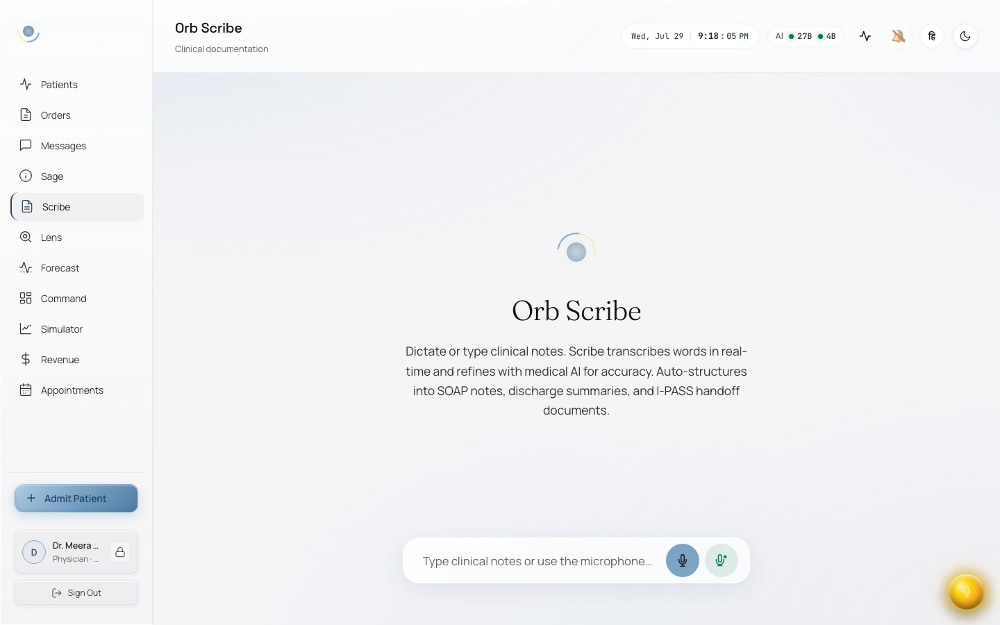

*Scribe. Type or dictate, then structure the transcript into a SOAP note, discharge summary, or I-PASS handoff.*

### 5.1 What Scribe is for

Scribe is Orb's clinical documentation studio. It turns what you say, or type, into a correctly structured, reviewable, signable clinical note. You dictate a patient encounter in your own words; Scribe transcribes it with a locally-running medical speech engine, cleans up drug names and clinical vocabulary, and drafts the content into one of three standard formats: a SOAP note, a discharge summary, or an I-PASS handoff document. An optional automated verification pass then compares the drafted note against what you actually said and flags anything the AI may have invented or left out, before you sign.

Everything happens on the hospital's own hardware, and every step of the note's life, creation, editing, verification, signing, rejection, revision, is written to Orb's audit trail.

Scribe is available to doctors, nurses, and administrators. Anyone in those roles can dictate, structure, and edit draft notes; only doctors can sign or reject a note (see 5.8).

### 5.2 Opening Scribe

1. Sign in to Orb with your employee ID and password.
2. In the left sidebar, click **Scribe**.

When no note is in progress you will see the Scribe welcome screen: the Orb emblem, the title **Orb Scribe**, and a short description, "Dictate or type clinical notes. Scribe transcribes words in real-time and refines with medical AI for accuracy. Auto-structures into SOAP notes, discharge summaries, and I-PASS handoff documents."

At the bottom of the panel is the input bar, which is always present:

| Control | What it does |
|---|---|
| Text field ("Type clinical notes or use the microphone…") | Type or paste a note directly. Editing this field clears any previously structured note so the draft always matches the transcript. |
| Microphone button ("Start voice dictation") | Starts a standard dictation session: record, then refine (see 5.5.2). While recording, the same button shows a stop square and its tooltip reads "Stop recording". |
| Streaming button ("Start live streaming (VAD)") | Starts live utterance-by-utterance transcription (see 5.5.3). While active, it becomes "Stop live streaming". |

The two voice buttons are mutually exclusive: while one mode is running, the other button is disabled, and both are disabled while the AI is structuring or refining a note.

### 5.3 Choosing a transcription language

Above the transcript area is a **Language** selector. It controls the language used by the local speech-recognition engine and offers three options:

| Option | When to use it |
|---|---|
| **English** | Default. Dictation is entirely in English. |
| **Hindi (हिन्दी)** | Dictation is primarily in Hindi. |
| **Auto-detect / code-switching** | Mixed-language dictation, for example a clinician who moves between Hindi and English mid-sentence. The engine detects the language as you go. |

Choose the language **before** you start recording, the selector is locked while a recording or refinement is in progress. The selection applies to both dictation modes.

Note that the instant on-screen preview text shown during standard dictation (see below) is English-only; the accurate transcript that replaces it when you stop respects your language selection.

### 5.4 Capturing a note: three ways

#### 5.4.1 Typing

The simplest path: click into the input bar, type or paste your note, and proceed straight to structuring (5.6). Nothing about the AI pipeline requires voice, a typed transcript flows through exactly the same drafting and verification stages as a dictated one.

#### 5.4.2 Dictation: record, then refine

This is the standard microphone workflow, designed for a complete dictation done in one take.

1. Click the **microphone button**. Your browser may ask for microphone permission the first time, allow it.
2. The status line shows **"Recording, speak now…"** and a red recording indicator with a running timer appears next to the **Transcript** heading.
3. Speak naturally. Depending on how your deployment is configured, you may see instant live text appear as you talk (see the note below). Don't worry about its accuracy, it is only a preview.
4. Click the microphone button again (**Stop recording**) when you are done.
5. The status changes to **"Refining with medical AI…"** and a "Refining…" indicator appears. Orb now runs the full recording through its local medical speech engine, which is far more accurate on clinical vocabulary and drug names than any live preview.
6. When refinement completes, the transcript is replaced with the accurate version and the status reads **"Medical transcription complete"**. You can now edit the text freely before structuring.

**About the live preview.** During recording, Scribe can display instant, word-by-word text using the browser's built-in speech recognizer. Because that recognizer may send audio to a cloud service, a patient-privacy consideration, Orb only enables it when the deployment's privacy posture permits cloud speech. If your installation disallows it, you will simply see "Listening…" while you speak, and the full transcript appears after you stop, produced entirely by the local engine. Either way, the local engine's output is the source of truth.

**Shared microphone.** Scribe shares the microphone with Sage's voice features. If Sage is actively listening, Scribe will refuse to start and display "Microphone is in use by Sage, stop it before dictating." Stop the Sage voice session first, then start dictation.

**Very short recordings.** A recording of less than roughly a second is rejected with "Recording too short", record again and speak for at least a few seconds.

#### 5.4.3 Live streaming: utterance by utterance

The streaming button (the microphone icon with a green dot) starts a continuous live-transcription session that is better suited to long, interrupted dictations, for example documenting during a ward round.

1. Click the **streaming button** ("Start live streaming (VAD)").
2. A live indicator appears next to the **Transcript** heading showing one of three states, **Speaking** (red, you are talking), **Processing** (gold, an utterance is being transcribed), or **Listening** (green, waiting for speech), along with a small audio-level meter and a running count of utterances captured.
3. Speak in natural sentences. Scribe detects when you pause (voice-activity detection), transcribes that utterance on the server, and appends the result to the transcript. The status line alternates between **"Listening…"** and **"Processing utterance…"**.
4. Click the button again ("Stop live streaming") when you are finished. The accumulated transcript remains on screen for editing and structuring.

Streaming mode transcribes each utterance with the same local medical speech engine used by the refine step, including drug-name correction, so the text you see is already the accurate version, there is no separate refinement pass at the end.

**The local speech engine is an optional server component.** Both dictation modes depend on Orb's locally installed speech-recognition engine (a Whisper model accelerated for Apple Silicon). On some installations this component is deferred at setup time and installed later. If it is not present, typing still works fully, and the live browser preview (where permitted) still works, but the refine step will report **"Refinement unavailable, using browser transcript"** and live streaming will return errors. Ask your administrator to complete the speech-engine installation if you see this persistently; administrators can check the engine's warm-daemon status from the server's diagnostics.

### 5.5 Linking the note to a patient

Once a transcript exists and recording has stopped, an action row appears beneath the transcript. Its first control is a patient selector:

- **"No patient linked"** (the default), the note is saved without a patient association, attributed only to you as its author.
- Any admitted patient, the list shows each patient's name and bed (for example "Asha Rao · ICU-4"). Selecting one files the structured note under that patient's record, so it appears alongside their chart and is attributed to them in the audit trail.

Link the patient **before** clicking Structure Note; the association is stored when the note is created. If you dictated a note about a patient who has not yet been admitted, you can admit them directly from the note afterwards, see **Admit to Vigil** (5.10).

### 5.6 Structuring the note

Next to the patient selector are the format selector and the **Structure Note** button.

#### 5.6.1 Choosing a format

| Format | Purpose | Typical structure |
|---|---|---|
| **SOAP Note** | Routine encounter or progress documentation | Subjective, Objective, Assessment, Plan |
| **Discharge Summary** | End-of-admission summary for the patient and receiving providers | Course of admission, diagnoses, medications, follow-up |
| **I-PASS Handoff** | Shift-change or transfer-of-care handoff | Illness severity, Patient summary, Action list, Situation awareness, Synthesis |

#### 5.6.2 What happens when you click Structure Note

Click **✨ Structure Note**. The button changes to "Processing..." and the **Structured AI Note** window opens, streaming the note onto the screen word by word as the AI writes it. Behind the scenes, Scribe's pipeline has up to four stages:

1. **Transcription**, the speech engine converts audio to text (already done by the time you click, for dictated notes). A local drug-name dictionary corrects phonetically mangled medication names ("phosphomycin" → "Fosfomycin").
2. **Correction**, for longer transcripts, a language model fixes acoustic and grammatical errors without summarizing or removing content. Very short dictations skip this stage, since the speech engine is already highly accurate on them and skipping saves time.
3. **Drafting**, the main clinical language model reshapes the corrected transcript into the format you chose. This is the streaming text you watch appear in the window.
4. **Verification (optional)**, after the draft is delivered and saved, a background check compares the draft against your original transcript, hunting for unsupported claims (hallucinations), omissions, and mismatched clinical entities. Verification runs only if it is enabled in your server's configuration; because it is a background task, you can read and edit the note while it runs.

The note is saved as a **Draft** the moment drafting completes, closing the window does not lose it, and the audit trail records its creation.

A small footer line in the window reports how long each stage took, for example "Pipeline: ASR 1.2s · Correct 4.1s · Draft 8.3s · Verify 6.7s".

### 5.7 The Structured AI Note window

The window titled **✨ Structured AI Note** is where the note lives through its whole lifecycle. Its header shows two kinds of badges.

**Note status badges:**

| Badge | Meaning |
|---|---|
| **Draft** | Editable; not yet part of the permanent record. |
| **Signed** | Finalized by a doctor; read-only. |
| **Rejected** | A doctor rejected the draft, with a recorded reason. |
| **Superseded** | A newer signed revision has replaced this note. |

**Verification badges:**

| Badge | Meaning |
|---|---|
| **Verifying…** (spinner) | The background faithfulness check is still running. The panel polls for the result automatically for about a minute. |
| **✅ Verified** | The check passed, the draft is faithful to the transcript. Hover to see the confidence percentage. |
| **⚠️ Review suggested** | The check finished but found issues. Click the badge to expand the **Verification Findings** list: warnings tagged by note section (with the type of issue), and any **Omission** entries for content you said that did not make it into the draft. Review each finding against your transcript and edit the note accordingly. |
| **⚠ Verification unavailable** + **↻ Retry** | The check could not complete (engine busy, timeout, or a server restart interrupted it). Click **↻ Retry** to run it again. |

Below the badges is the note body. While a draft is streaming you will see a typing cursor; once complete, the full note is shown.

### 5.8 Reviewing, editing, signing, and rejecting

All lifecycle actions live in the button row at the bottom of the Structured AI Note window. What you see depends on the note's status and on your role.

#### 5.8.1 Editing a draft

1. Click **✏️ Edit**. The note body becomes an editable text area.
2. Make your corrections, fix findings from verification, adjust wording, add anything the AI missed.
3. Click **💾 Save** to store the edit (the edit is recorded in the audit trail, including who made it and when), or **Cancel** to discard your changes.

Only drafts can be edited. Signed notes are locked (see 5.8.4 for how to amend one).

#### 5.8.2 Signing a note (doctors only)

Clicking **✍ Sign & Finalize** transitions the note from Draft to **Signed**. Signing is the clinical act of finalization: it stamps the note with your identity and the signing time, locks its content, and publishes a signing event into Orb's audit chain. A green banner then reads: "Signed and finalized, this note is read-only. To make changes, create a revision."

**The sign-gate.** Orb will not let an AI-generated note be finalized casually. If the automated verification did not positively pass, because it found high-severity problems, could not complete, or never ran, the system blocks one-click signing and requires the signer to explicitly acknowledge that they are signing an unverified AI note. That acknowledgement, and the fact that the note was signed over an unverified verdict, is permanently recorded in the audit trail alongside the signature. In practice: wait for the **✅ Verified** badge (or resolve the findings behind **⚠️ Review suggested**, retry verification, and confirm the result) before signing.

The Sign and Reject buttons are only shown to users with signing authority (doctors). Nurses can create, dictate, and edit drafts, but their drafts must be signed by a doctor.

#### 5.8.3 Rejecting a note (doctors only)

If a draft is unsalvageable, wrong patient, garbled dictation, fundamentally incorrect content:

1. Click **✕ Reject**.
2. An input appears: "Reason for rejection…". A reason is mandatory; the **Confirm** button stays disabled until you type one.
3. Click **Confirm** (or **Cancel** to back out).

The note moves to **Rejected**, and the reason is stored with the note and written to the audit log. Rejected notes are not deleted, they remain part of the record of what the AI produced and why it was declined.

#### 5.8.4 Amending a signed note: revisions

Signed notes are never edited in place. To amend one:

1. Open the signed note and click **📋 Create Revision**.
2. Orb clones the signed content into a **new draft** with a version number one higher than the original, linked back to the note it supersedes.
3. Edit the new draft as usual, then have a doctor sign it.
4. Only at the moment the revision is **signed** does the original note change status to **Superseded**. Until then, the original remains the authoritative signed record.

This means there is never a gap where no signed note exists, and the full lineage, version 1 signed, version 2 draft, version 2 signed, version 1 superseded, is preserved and auditable.

### 5.9 Versioning and the audit trail

Every consequential Scribe action generates an audit event that administrators can review in Orb's audit tooling:

- Draft creation (including revisions, with their version number and the note they supersede)
- Draft edits (editor, timestamp)
- Verification lifecycle: started, completed (with the verdict and confidence), failed, manually retried, and reconciled after a server restart
- Signing (signer, version, the verification status at signing time, and whether an unverified verdict was explicitly acknowledged)
- Rejection (rejector and the stated reason)
- Supersession (which note replaced which)

The raw transcript is stored alongside every structured note, so it is always possible to compare what was said with what was documented. Dictation audio saved on the server is encrypted at rest.

### 5.10 Admit to Vigil: from note to admitted patient

If you dictated a note about a new patient, for example an emergency presentation, you can admit them straight from the structured note.

1. After structuring, click **✨ Admit to Vigil** (available both inside the Structured AI Note window and on the main panel next to **View Note** once the window is closed).
2. The **✨ Quick Admission** form opens. While it loads you will see "Auto-filling from context...": Orb's AI reads your note and transcript and pre-fills the form, name, age, sex, ward, bed, and a chief-complaint summary, extracting the initial diagnosis from the note's Assessment section where present.
3. Review and complete the fields. All are editable, and several are required:
   - **Patient Name**
   - **Age** and **Sex** (Male / Female / Other)
   - **Attending Doctor** (chosen from the hospital's doctor list)
   - **Ward** and **Bed Number**
   - **Initial Diagnosis (Assessed)**
4. Click **✨ Confirm Admission**.

On success the patient is created and appears in the Patients (Vigil) list immediately. If your deployment issues patient-portal accounts, the confirmation message also shows the patient's one-time Bridge login, an ID and temporary password, with the warning that it is **shown once**. Record it before the dialog closes (it stays on screen for a few seconds); it cannot be retrieved again.

Always verify the auto-filled demographics against the source dictation. The extraction is an AI convenience, not a data-entry guarantee.

### 5.11 Troubleshooting

| Symptom | Likely cause and fix |
|---|---|
| "Microphone access denied." | The browser blocked microphone access. Allow microphone permission for Orb in your browser's site settings and try again. |
| "Microphone is in use by Sage, stop it before dictating." | Sage's voice listening is holding the microphone. Stop the Sage voice session, then start Scribe. |
| "Recording too short" | The recording was under about a second. Record again and speak for several seconds. |
| "Whisper empty, using browser transcript" | The local speech engine returned nothing (usually silence or an audio problem). The live-preview text, if any, is kept. Re-record closer to the microphone. |
| "Refinement unavailable, using browser transcript" | The local speech engine could not be reached, it may not be installed yet on this server, or its warm daemon is down. Typing still works; ask your administrator to check the speech-engine installation and daemon status. |
| "Streaming error" messages in live mode | The live-transcription session lost its connection or the speech engine failed on an utterance. Stop and restart streaming; check the network connection to the Orb server. |
| "Structuring failed: … Is Ollama running?" | The local AI model service is not running or the model is not loaded. An administrator should confirm the AI runtime is up; then click **✨ Structure Note** again, your transcript is not lost. |
| Badge shows "Verification timed out, try again later" or "⚠ Verification unavailable" | The background check exceeded its polling window or failed (a server restart mid-check will also do this). Click **↻ Retry** next to the badge. If verification is disabled in server configuration, it will not run at all. |
| **Sign & Finalize** does not finalize the note | The sign-gate is refusing an unverified note. Wait for verification to complete, retry it if it failed, resolve any high-severity findings, and sign again. Also confirm you are signed in with a doctor account, other roles cannot sign. |
| Sign / Reject buttons are missing | You are signed in as a nurse or another role without signing authority. Ask the attending doctor to review and sign the draft. |
| The dictation upload is refused as too large | Audio uploads are capped at 100 MB. Break very long dictations into shorter sessions, or use live streaming mode, which sends audio in small utterances. |

### 5.12 Safety & limitations

- **The AI drafts; you author.** Every structured note is created as a draft and is presumed unreliable until a clinician has read it against the transcript. Nothing Scribe produces enters the permanent record without a human signature.
- **Verification is an aid, not a guarantee.** The hallucination check is itself an AI model. A **✅ Verified** badge raises confidence but does not replace your own reading; conversely, findings under **⚠️ Review suggested** may include false positives. The one thing the system enforces is that a note which *failed* or *never received* verification cannot be silently one-click signed.
- **Fail-safe verification.** If the verifier itself breaks mid-check, Orb records "could not verify" rather than inventing a pass, an unverifiable note is treated the same as a failing one at the sign-gate.
- **Speech recognition mishears.** Clinical dictation is hard for any speech engine. Orb biases recognition toward medical vocabulary and corrects drug names against a pharmacology dictionary, but numbers, doses, and similar-sounding drugs remain the highest-risk transcription errors. Always check doses and medication names in the draft against what you said.
- **Live preview privacy.** The instant word-by-word preview during dictation may use the browser's cloud speech service and is disabled entirely on deployments that forbid sending audio off-site. The accurate transcript is always produced locally.
- **Signed means signed.** Signed notes cannot be edited or deleted from the interface, only superseded through the revision workflow, keeping the original visible in the record. Rejections require a stated reason. All of it is audited.
- **Not a decision-support tool.** Scribe documents what you said. It does not validate the clinical correctness of your assessment or plan, and its output must not be used as diagnostic advice.

---

## 6. Lens: Medical Image Analysis

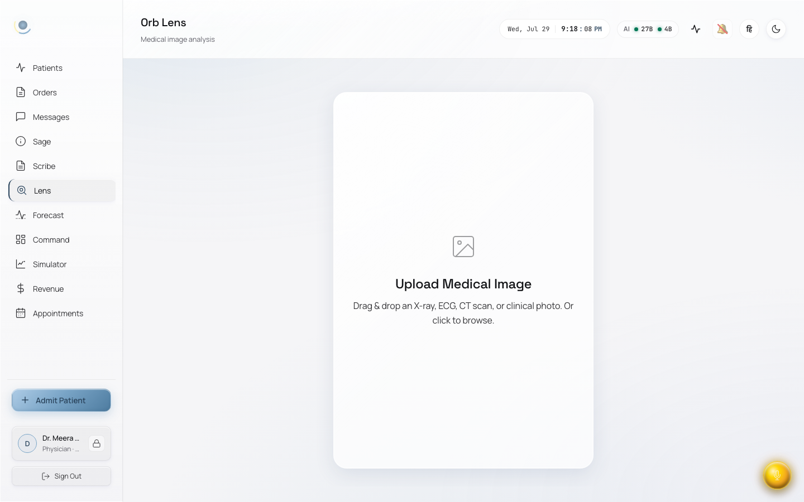

*Lens. Drag in an X-ray, ECG, CT, or clinical photo; the draft that returns is always for clinician review.*

Lens is Orb's medical image analysis workspace. You give it a picture, a chest X-ray, an ECG strip, a CT slice, an MRI image, or a clinical photograph, and Orb's locally hosted vision-capable AI model produces a structured first-pass reading, streamed onto your screen as it is generated. The reading is organised into **Findings**, **Impression**, and **Recommendations**, and it is always, without exception, presented as a *draft reference for a clinician*, never as a diagnosis and never as a substitute for a radiologist's report.

Lens is designed around a strict human-in-the-loop principle: the AI's text is an editable draft, and nothing enters a patient's record until a clinician has read it, corrected it where necessary, and explicitly taken responsibility for it by ticking a review declaration. The system enforces this, the filing button is physically disabled until the declaration is confirmed.

Like every AI feature in Orb, Lens runs entirely on the hospital's own hardware. The image never leaves the building: it is analysed by the same local model that powers Sage, and the report is stored in the hospital's own database.

### 6.1 Who can use Lens and how to open it

Lens appears as the **Lens** tab in the left sidebar of the clinician shell for doctors, surgeons, and nurses. Administrators and pharmacists do not see the tab; filed reports still reach them through each patient's record in Patients.

To open the module:

1. Sign in with your employee ID and password (for the demo environment, DOC001 or NUR001 with the password `password`).
2. Click **Lens** in the left sidebar.

You will land on the upload screen described below. Viewing previously saved analyses does not require the Lens tab at all, filed reports appear inside each patient's record (see section 6.7).

### 6.2 Uploading an image

When no image is loaded, Lens shows a single large drop zone titled **Upload Medical Image**, with the hint "Drag & drop an X-ray, ECG, CT scan, or clinical photo. Or click to browse."

There are two ways to load an image:

- **Drag and drop.** Drag an image file from your desktop or file manager anywhere onto the drop zone. The zone highlights while you hover over it; release to load the file.
- **Click to browse.** Click anywhere on the drop zone to open your computer's standard file picker, then choose an image file.

As soon as a file is loaded, the drop zone is replaced by the analysis workspace: your image is shown on a dark viewing card (scaled to fit without cropping), with the analysis controls beneath it. A **✕ Clear** button on the image discards the current image and any draft analysis and returns you to the drop zone. Loading a new image also resets everything, a stale reading can never sit next to a fresh image.

The preview you see at this point is entirely local to your browser. Nothing is uploaded to the server until you click **Analyze Image**.

#### Supported files

Lens accepts common raster image formats only. The server verifies the actual content of every upload, not just the file name, so a mislabeled or disguised file is rejected even if its extension looks right.

| Accepted | Details |
|---|---|
| JPG / JPEG | Most exported scans and all phone photographs |
| PNG | Screenshots, exported ECG strips |
| WEBP | Modern web exports |
| GIF, BMP, TIFF | Legacy and scanner formats |

| Not accepted | What to do instead |
|---|---|
| DICOM (.dcm) | Export the study (or the relevant slice) as JPG or PNG from your PACS viewer, or photograph the displayed image |
| PDF reports | Take a screenshot of the image page and upload that |
| Files over 25 MB | Re-export at a lower resolution; 25 MB is the hard upload limit |

A rejected upload produces a clear error before any analysis starts, see Troubleshooting.

### 6.3 The analysis controls

Below the image preview sits a single control bar with three elements:

| Control | What it does |
|---|---|
| **Image type selector** | A dropdown identifying what kind of image this is: **X-Ray** (the default), **ECG**, **CT Scan**, **MRI**, **Clinical Photo**, or **Other**. This label is saved with the analysis and determines where the filed report appears later, imaging types (X-ray, CT, MRI, ECG and similar) are grouped under a patient's diagnostic reports, while non-imaging types are grouped with laboratory reports. |
| **Clinical context (optional)…** | A free-text field for the clinical question or relevant history, for example "62M, 3 days productive cough, fever 38.5, ?consolidation" or "post-op day 2, check line placement". Anything you type here is passed to the AI alongside the image and is also saved with the analysis for later reference. Good context measurably improves the relevance of the draft: the model will address your question rather than describing the image generically. |
| **Analyze Image** | Starts the analysis. The button reads **Analyzing…** and is disabled while a reading is in progress. |

Two practical notes on the clinical context field:

- It is treated strictly as *data about the case*. The AI is explicitly instructed that nothing in this field is an instruction to it, a deliberate safeguard against text manipulating the model's behaviour. Write clinical facts, not commands.
- Keep it concise. A line or two of focused history beats a pasted discharge summary; extremely long context can be truncated before it reaches the model.

### 6.4 Running an analysis and reading the streamed draft

Click **Analyze Image**. The image is uploaded, validated, stored securely under a randomised file name (encrypted at rest when the hospital has configured upload encryption), and handed to the vision model. Within a few seconds the draft begins to appear, streaming word by word into a card titled **AI Reference Read**.

The title line of that card carries three permanent markers:

- The badge **DRAFT · CLINICIAN REVIEW REQUIRED**, a constant reminder of the output's status.
- A small **AI provenance chip** showing the governing model's validation status (for the shipped configuration this reads **Unvalidated**). Hovering over the chip shows which model and version produced the output, what data it was trained on, and points you to **Admin → Model Governance** for the full lineage. This is Orb's "honesty layer": every AI output declares, at the point of use, exactly what produced it and whether that model has been clinically validated.
- Directly beneath the title, a fixed disclaimer paragraph: *"Decision-support reference for a clinician, not a diagnosis and not a radiologist read. Review and edit the findings below, then confirm before they enter the record."*

#### The structure of the draft

The model is instructed to produce its reading in a fixed clinical skeleton, so every Lens draft follows the same shape:

| Section | Content |
|---|---|
| **FINDINGS** | Each observation listed individually, anatomy visualised, abnormalities, devices and lines, image quality caveats |
| **IMPRESSION** | The overall clinical impression synthesised from the findings |
| **RECOMMENDATIONS** | Suggested follow-up actions, correlation with examination or labs, further imaging, specialist review |

The model is also instructed to flag critical findings prominently, so urgent observations (for example a suspected pneumothorax) are usually called out explicitly rather than buried in a list. Treat such flags as a prompt for immediate human review, not as a verified alert.

#### The mandatory investigational banner

Every completed analysis ends with a banner appended by the Orb application itself, not by the model, so it cannot be omitted, reworded, or "forgotten":

> ⚠️ INVESTIGATIONAL, NOT FOR DIAGNOSTIC USE. This is an unverified, AI-assisted image interpretation generated by a local model that has not been clinically validated. It is NOT a radiologist read. Do not make clinical decisions on this output alone; correlate with the full clinical picture and obtain a qualified human read.

This banner is part of the saved analysis text, so it travels with the report wherever it is later displayed, in the patient's diagnostic reports, in the patient portal, and in any downstream summary.

#### While it streams

- Text typically appears token by token; a full reading usually completes within thirty seconds to two minutes depending on how busy the AI queue is. Lens analyses share one AI model with the rest of Orb and queue behind live Sage conversations but ahead of background simulation activity.
- The first analysis after the system has been idle can take noticeably longer while the model loads into memory; subsequent analyses are faster.
- If you navigate away or the connection drops mid-stream, the analysis is cancelled and **nothing is saved**, there is no half-finished report in the archive. Simply re-run the analysis.

### 6.5 Reviewing and editing the draft

The streamed text lands directly in an editable text area, the draft you see *is* the working copy. Once streaming finishes:

1. Read the entire draft, including the Findings, Impression, and Recommendations sections, against the image itself.
2. Correct anything the model got wrong: delete hallucinated findings, fix laterality, adjust hedged language, add observations it missed. Edit the text in place exactly as you would edit a dictated draft.
3. Leave the investigational banner intact, it is part of the record's provenance.

Your edits become the *clinician-confirmed findings* that accompany the report when you file it (see below). Editing is not optional busywork: with an unvalidated model, the reviewed text is the only clinically meaningful version of the report, and the filing step is built to capture your version, not the machine's.

### 6.6 Filing the report to a patient record

When an analysis completes, a card titled **Assign to Patient Record** appears beneath the draft, explaining: "Link this analysis to a patient's Vigil record so it appears in their diagnostic reports."

To file the reviewed report:

1. In the field labelled **Search patient name or bed…**, start typing either the patient's name or their bed number. A live results list appears showing each matching patient's name and bed; "No matching patients" is shown if nothing matches.
2. Click the correct patient. A gold confirmation chip appears, **Selected: [patient name] · Bed [bed]**, so you can verify you have the right person before anything is written.
3. Make any final edits to the draft text above.
4. Tick the review declaration checkbox: *"I have reviewed this AI reference read, made any necessary edits, and take clinical responsibility for the findings filed to the record."*
5. Click **Confirm & File to Record**. The button is disabled (greyed out) until *both* a patient is selected *and* the declaration is ticked, this is enforced, not advisory. While filing is in progress the button reads **Filing…**.
6. A green confirmation banner appears: **✓ Report added to [patient name]'s Vigil record**. If something goes wrong, a red banner explains the failure instead.

If the image should not be linked to any patient, a teaching image, a test, a quality-review exercise, click **Skip**. The analysis is still preserved in the archive (see 6.7) but is not attached to any patient and generates no care-team notification.

#### What filing actually does

Filing is the moment the AI text crosses from "scratchpad" into "record", and Orb does three things at once:

1. **Links the analysis to the patient.** The report becomes part of that patient's imaging history.
2. **Notifies the care team in Relay.** A system message is posted automatically to the patient's case room in Messages (Relay). When you filed with reviewed text (the normal path), it is headed **Clinician-reviewed AI imaging reference** and includes the scan type, your clinical context, the note "Reviewed & filed by [your name]", and your clinician-confirmed findings (the first 1,500 characters). An analysis filed without reviewed text is instead headed **AI imaging reference (investigational, not a diagnostic read)** so its status is unmistakable.
3. **Surfaces the report across the system.** See the table below.

| Where the filed report appears | How to find it |
|---|---|
| Patient's record in **Patients (Vigil)** | Open the patient, then click **Diag. Reports** in the patient's action bar for imaging types (X-ray, CT, MRI, ECG, ultrasound, echo). Reports with non-imaging types appear under **Lab. Reports**. Both lists are searchable by content, type, or date. |
| Patient's case room in **Messages (Relay)** | The system message described above, posted at filing time |
| **Patient portal** | The patient sees their imaging reports in their own portal view of their record |
| **Sage** | When you ask Sage about the patient, recent imaging analyses are part of the context it draws on |
| Discharge documentation | Imaging history feeds the patient's discharge timeline |

One nuance worth knowing: the permanent archive keeps the *original* AI draft (with its mandatory banner) as the record of what the machine produced, while your reviewed and edited text is what goes to the care team in the Relay message. In other words, Orb preserves both what the AI said and what the clinician confirmed, an audit-friendly separation between machine output and human judgement.

### 6.7 Past analyses

Every analysis that streams to completion is saved automatically, whether or not it is ever assigned to a patient, together with the image, the image type, the clinical context, the full analysis text, the author, and a timestamp. Cancelled analyses are not saved.

- **Per patient:** the complete imaging history is available in the patient's record, newest first, as described above.
- **Hospital-wide:** the archive holds recent reads across the hospital (the general listing shows the fifty most recent), available to clinical staff with imaging-read access.

The Lens panel itself is deliberately a *capture* workspace, not a browsing archive: the assignment card appears immediately after each analysis, and that is the intended moment to file. If you clicked **Skip** and later decide the report belongs on the record, re-run the analysis on the same image and file it properly, the review-and-confirm step must accompany any filing regardless.

### 6.8 What the AI actually does: and what it does not

It is important to understand what is happening behind the streamed text, because it defines both the tool's usefulness and its limits.

Lens does **not** contain a purpose-built radiology algorithm. There is no trained fracture detector, no measurement pipeline, no bounding boxes, and no FDA/CE-cleared computer-aided-detection component. What Lens does is send your image, together with your clinical context, to a general-purpose multimodal medical language model (MedGemma 27B, the same locally hosted model that powers Sage) with instructions to describe the image in the Findings / Impression / Recommendations format. The model runs at low creativity settings with a bounded response length, so a reading is a sober, focused page.

Consequences of this design that you should internalise:

- **The model describes; it does not measure.** It cannot reliably report dimensions, angles, or densities, and it has no memory of the patient's prior imaging for comparison.
- **It can be confidently wrong.** Language models produce fluent text even when uncertain; a crisply worded finding is not evidence of a correct finding. Laterality errors, missed subtle findings, and over-called normal variants all occur.
- **Image quality matters enormously.** A phone photograph of a screen, taken at an angle with reflections, degrades the reading. Upload the cleanest export you can.
- **ECG readings are qualitative.** The model reads the ECG as a picture; never rely on it for rate, interval, or subtle ST-segment quantification.
- **The safeguards are layered, not decorative.** The structured format, the data-only fencing of your context text, the draft badge, the mandatory banner, the enforced review checkbox, and the provenance chip together form the safety envelope. None of them makes the underlying model validated.

### 6.9 Administrator note: the demo-only gate

Because Lens ships with **no clinically validated imaging model**, the entire analysis capability is controlled by an explicit deployment switch, `ORB_LENS_ENABLED`:

- In the **development/demo profile**, Lens is enabled by default, this is what you experience in the demo environment.
- In a **production profile**, Lens analysis is **disabled by default**. Any attempt to analyse an image is refused with the message: "Lens image analysis is disabled in this deployment. It has no validated imaging model and is decision-support reference only. Set ORB_LENS_ENABLED=true to enable it explicitly."
- An operator who wants Lens active in production must set `ORB_LENS_ENABLED=true` in the server's environment configuration and restart the backend. This is a deliberate, positive opt-in: an unvalidated vision model can never silently process patient images in a real deployment because someone forgot a setting. Enabling it is an institutional decision and should be documented under your local clinical-AI governance process.

The gate controls *analysis* only. Previously saved analyses remain readable in patient records regardless of the switch.

Related controls: the model powering Lens, its version, and its validation status are visible under **Admin → Model Governance**, the same place the provenance chip points. Stored images are kept under randomised, non-guessable file names, encrypted at rest when the upload-encryption key is configured, and every retrieval requires a signed-in staff session and is written to the audit trail.

### Troubleshooting

| Symptom | Likely cause | What to do |
|---|---|---|
| "Analysis failed: … Ensure Ollama is running with medgemma:27b." | The local AI runtime is not running, or the vision model is not installed | Ask your administrator to start the AI runtime and confirm the model is loaded; then click **Analyze Image** again |
| "Lens image analysis is disabled in this deployment…" | The deployment is running with the demo-only gate closed (production default) | This is a policy setting, not a fault. An administrator must explicitly enable Lens (see 6.9) |
| "Unsupported image type. Allowed: JPG, PNG, WEBP, GIF, BMP, TIFF." | You uploaded a DICOM file, PDF, or another non-image format | Export or screenshot the image as JPG/PNG and retry |
| "Upload content is not a recognized image format." | The file's extension says image, but its contents are not a valid image (renamed or corrupted file) | Re-export the image from its source application |
| "Image exceeds maximum size of 25 MB." | The export is too large | Re-export at reduced resolution or higher compression |
| First analysis of the day is very slow | The model is loading into memory | Wait, subsequent analyses will be much faster |
| Text stalls mid-stream, then resumes | Another AI task (for example a live Sage conversation) holds the shared model | Normal queuing behaviour; the analysis will complete |
| Stream stopped and no report was saved | You navigated away or the connection dropped mid-analysis | Cancelled analyses are discarded by design; re-run the analysis |
| **Confirm & File to Record** stays greyed out | A patient is not selected, or the review declaration is not ticked | Both are required, select the patient from the search results and tick the checkbox |
| "No matching patients" in the assignment search | Name or bed doesn't match any current patient | Search is a simple contains-match on name and bed; check spelling, or search by bed number instead |
| "✗ Assignment failed: Patient not found" | The patient record was removed (for example, discharged) between search and filing | Refresh the patient list by re-running the search and select again |
| Filed report not visible under **Diag. Reports** | The image type was set to Clinical Photo or Other | Non-imaging types are grouped under **Lab. Reports** instead; check there |

### Safety & limitations

- **Lens is not a diagnostic device.** It is an investigational, decision-support reference produced by a locally hosted AI model that has **not** been clinically validated for image interpretation and has no regulatory clearance of any kind. The mandatory banner and the provenance chip state this on every reading, take it literally.
- **It is not a radiologist read and does not replace one.** Every image that clinically warrants formal reporting must still receive a qualified human read through your normal pathway. Lens output may inform your differential while you wait; it may never close it.
- **Never act on Lens output alone.** Correlate with the patient's examination, history, laboratory results, and prior imaging. Critical findings flagged by Lens require immediate human verification; equally, the *absence* of a finding in a Lens read is not evidence of absence.
- **The clinician who files a report owns it.** The review declaration, "…and take clinical responsibility for the findings filed to the record", means exactly what it says. Filing an unedited, unread AI draft to a patient record is a misuse of the tool.
- **The disclaimer cannot be removed.** The investigational banner is appended by the application itself, independent of the AI, and is stored as part of every report.
- **Patient-visible consequences.** Filed imaging reports appear in the patient portal. File only text you would be comfortable with the patient reading, and remember the report carries its investigational banner there too.
- **Privacy.** Analysis happens entirely on hospital hardware; images and reports never leave the local system. Uploaded images are stored under randomised names, encrypted at rest where configured, and access to them is authenticated and audit-logged.
- **Demo environment caveat.** In the demo deployment, simulated background activity also files imaging and laboratory entries into patient histories. Reports authored by the simulation are attributed accordingly and should not be confused with clinician-filed reads.

---

## 7. Relay: Clinical Messaging

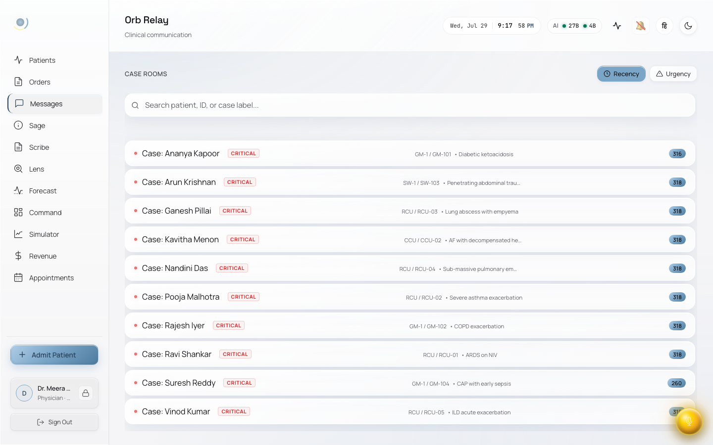

*Relay case rooms, one per patient, sorted by recency or urgency with unread counts and criticality badges.*

Relay is Orb's clinical messaging hub. Instead of pagers, phone tag, or personal chat apps, every conversation about a patient happens in that patient's own **case room**, a message channel automatically tied to their record, while broader coordination happens in shared **department channels**. Everything posted in Relay is stored alongside the clinical record, delivered live to everyone in the room, and visible to Orb's AI layer, which quietly reads along and surfaces risks and suggested actions in the **Sage Copilot** sidebar.

Relay is also where Orb's automated systems talk to you. The Vigil monitoring engine posts deterioration alerts directly into a patient's case room, surgery preparation produces actionable alert cards with **Confirm** and **Escalate** buttons, and emergency surgical staffing sends targeted assignment alerts that individual team members can **Confirm** or **Decline**, all in the same stream as human conversation, so the context never gets separated from the decision.

### 7.1 Opening Relay

1. Sign in with your employee ID and password.
2. In the left sidebar, select **Messages** (the Relay pillar).

Relay is available to doctors, nurses, and administrators. Doctors and nurses can read and send messages; administrators can read and send in every channel and see every targeted alert. Acting on Sage's suggested action cards (Acknowledge / Dismiss / Confirm) is reserved for doctors. Patients never see Relay, the patient portal (Bridge) is a separate, read-only experience.

### 7.2 The channel list

When you open Relay you land on the channel list. From top to bottom it contains:

| Section | What it shows |
|---|---|
| **Case Rooms** header with sort buttons | The heading plus two sort toggles: **Recency** and **Urgency**. |
| **⚠️ Action Required** | Unresolved alert cards targeted at you (see 7.6). Hidden when there is nothing to act on. |
| Search bar | A search field with the placeholder *"Search patient, ID, or case label..."*. |
| Case room list | One entry per admitted patient you can see. |
| **Department** | Shared channels for your department. |

#### Case room entries

Each case room row is a card showing, at a glance:

- **Patient / room name**, usually the patient's name.
- **Criticality badge**, a colored pill reading **CRITICAL** (red), **ELEVATED** (amber), or **STABLE** (green), driven by the patient's most recent Vigil risk score. Rooms for patients without a risk score show no badge.
- **Alert dot**, a small dot on the left edge when the room received at least one automated alert in the last 24 hours.
- **Ward / bed**, e.g. "ICU / 4", when the patient has an assigned bed.
- **Diagnosis**, the working diagnosis, truncated if long.
- **Unread count**, a numeric badge showing how many messages in the room you have not yet read. Opening the room clears it.

The list shows the ten most relevant rooms by default. If there are more, a **Show N More ↓** button expands the full list, and **Show Less ↑** collapses it again.

Case rooms follow the patient lifecycle: a room is created automatically when a patient is admitted, and it disappears from Relay when the patient is discharged. If a room you were using vanishes, check whether the patient has been discharged, that is expected behavior, not data loss.

#### Sorting: Recency vs. Urgency

Two buttons in the header switch the ordering of the case room list:

| Sort | Ordering |
|---|---|
| **Recency** | Rooms with the most recent message activity first. |
| **Urgency** | Rooms with the most alerts and unread messages first; ties broken by recent activity. |

Use **Urgency** at the start of a shift to surface the rooms demanding attention; use **Recency** to follow live conversations.

#### Searching

Type into the search bar to filter case rooms as you type (the filter applies about 150 ms after you stop typing, to keep the list steady). The search matches against:

- the room / patient name,
- the patient ID,
- the MRN (medical record number),
- the diagnosis.

A small **×** button clears the query. The search filters case rooms only; department channels are unaffected.

#### Department channels

Below the case rooms, the **Department** section lists shared channels. You only see channels matching your department, for example, staff in Surgery and Anesthesiology both see the Surgery channel. Administrators see every department channel. If no channel matches, the section reads *"No department channels found."*

### 7.3 Inside a room

Selecting any channel opens the chat view. A back arrow at the top left returns you to the channel list; the channel name is shown beside it.

#### Reading messages

Messages appear in chronological order. Each message header shows the **sender's name**, their **role**, and the **time**. Automated messages additionally carry a small **AUTO** badge, hovering over it explains: *"Automated / AI-generated message, not a clinician."* This provenance badge is how you distinguish, at a glance, a colleague's note from a bot posting.

The main kinds of message you will see:

| Message | Sender | Appearance |
|---|---|---|
| Clinician message | A doctor or nurse | Plain chat bubble with name, role, time. Supports **bold** and *italic* text and bullet lists. |
| Bot / AI message | "Orb Vigil", lab bots, "Sage Ambient", "Orb System" | Same layout plus the **AUTO** badge. |
| System notice | "Orb System" | Muted styling; records events such as a team member confirming a surgical assignment. |
| Vigil alert | "Orb Vigil" | Highlighted alert styling; see 7.5. |
| Actionable alert card | Surgery prep and similar workflows | Structured card with **Confirm** / **Escalate** buttons; see 7.6. |
| Surgical assignment alert | "Orb System" or "Sage Ambient" | Red-bordered card with **✓ Confirm** / **✕ Decline** for the targeted user; see 7.7. |

#### Typing indicators

While another member of the room is typing, a small line appears above the composer, *"Priya Reddy is typing…"*, and disappears a few seconds after they stop. When several people type at once, up to two names are listed, followed by "and others". Your own typing is never shown to you.

#### Sending a message

1. Click the input at the bottom of the room (*"Type a message…"*).
2. Type your message. You can use `**bold**`, `*italic*`, and `-` bullet points; they render as formatted text for everyone.
3. Press **Enter** or click the paper-plane send button.

Your message appears instantly (optimistically) and is delivered live to every clinician who has the room open, no refresh needed. If the send fails (for example, a network drop), the message is removed from the stream and your text is restored to the input box so you can retry. Messages composed while offline are queued and replayed safely: the same message is never posted twice.

Every message you send in a patient-linked case room is also passed, in the background, never delaying your message, to Sage's ambient observation pipeline (see 7.8).

### 7.4 Automated Vigil alerts

Vigil, Orb's continuous monitoring engine, bridges directly into Relay. Whenever a patient's NEWS2-based risk level is **elevated** or **critical**, Vigil posts an alert into that patient's case room as the bot user **Orb Vigil** (with the AUTO badge). A typical alert reads:

> ⚠️ VIGIL ALERT: Moderate hypoxia (SpO2 88%); Tachypnea (RR 24); Hypotension (SBP 92) (+2 more)
> Current vitals: HR 118 · BP 92/60 · SpO2 88% · Temp 38.4°C · RR 24
> NEWS2 10 (critical). Immediate review recommended.

Each alert contains:

- **The reason(s)**, the NEWS2 parameters that scored points, in the same words as the NEWS2 drivers, worst first. The first three are named and any others are counted, for example "(+2 more)". A reading that scored nothing, such as a blood pressure of 170, is never listed as a reason; it is still in the vitals snapshot.
- **A vitals snapshot**, heart rate, blood pressure, SpO2, temperature, respiratory rate at the moment of the alert.
- **The NEWS2 aggregate and band**, reported as the raw score plus its clinical band (e.g. "NEWS2 9 (critical)"). Orb deliberately reports the ordinal score, not a percentage: NEWS2 is an escalation trigger, not a calibrated probability.

#### MedGemma AI recommendation

For **critical** alerts only, Vigil appends a single-sentence recommendation generated by the local MedGemma model, labeled:

> **✦ MedGemma AI**: Consider immediate supplemental oxygen and urgent senior review for suspected respiratory deterioration.

This is decision support, not an order. It is one concise sentence based on the vital-sign deviations, produced entirely on-device. If the AI model is temporarily unreachable, Orb pauses recommendation calls rather than delaying alerts, the alert is still delivered, just without the MedGemma line.

#### Alert fatigue protection

To avoid flooding a room, Vigil enforces a two-minute cooldown per patient between alerts, with two deliberate exceptions that always break through:

- **Escalation always re-alerts.** A patient moving from elevated to critical is never muted by the cooldown.
- **Critical patients are exempt entirely.** A further deterioration in an already-critical patient (e.g. SpO2 88 → 80) pages the team immediately.

### 7.5 The Action Required section

At the top of the channel list, the **⚠️ Action Required** section gathers every unresolved actionable alert that targets *you*, either because you were explicitly assigned, or because your role and department match the alert's audience (administrators see all of them). Alerts stay listed for up to 48 hours or until someone resolves them, and duplicates of the same surgical case are collapsed into one entry.

Each entry shows the alert title and required action, with an arrow on the right. Clicking it jumps you straight into the relevant patient's case room, where the full alert card awaits.

### 7.6 Actionable alert cards: Confirm and Escalate

Certain workflows, most prominently surgery preparation, post **structured alert cards** into both the department channel and the patient's case room. A surgery-prep card is titled **PREP FOR SURGERY ALERT** and displays:

- **Patient**, name and MRN,
- **Procedure**, the planned procedure name,
- **OR**, the operating room and scheduled time,
- an amber highlighted strip with the required action, e.g. *"Navigate to Surgical Suite to review Handoff Context."*

Below the details are two buttons:

| Button | Meaning | Result |
|---|---|---|
| **Confirm** | You acknowledge the alert and are acting on it. | The card is marked resolved; everyone in the room sees *"✓ Confirmed by \<your name\>"*. |
| **Escalate** | The alert needs attention beyond you. | The card is marked escalated; everyone sees *"✓ Escalated by \<your name\>"*. |

Each alert can be resolved exactly once, hospital-wide. If a colleague beats you to it, your click returns the inline error *"Alert already processed"* and the card refreshes to show who resolved it. Buttons are disabled while a resolution is in flight, and any failure (permission, network) is shown inline next to the card so nothing fails silently. Once resolved, the alert also disappears from everyone's Action Required list.

### 7.7 Surgical team alerts: Confirm and Decline

When an emergency procedure is staffed, whether triggered from the Surgical Suite or by a confirmed Sage transfer-to-surgery action, each assigned team member receives a personal **Surgical Alert** in the patient's case room, delivered live to them even if they don't have the room open. The card has a red border and reads, for example:

> ⚠ Surgical Alert
> SURGICAL ALERT: You have been assigned as Anesthetist for an emergency procedure.
> Role: **Anesthetist**

Everyone in the room can *see* the card, but only the person it targets sees the response buttons:

- **✓ Confirm**, accepts the assignment. A system message is posted for the whole team: *"SYSTEM: \<name\> (\<role\>) has confirmed the surgical assignment."*
- **✕ Decline**, declines it. The decline is posted the same way, and Sage immediately suggests a re-route: a new targeted alert is issued to an available colleague in the same role (*"SAGE SUGGESTION: Re-routing assignment to available Anesthetist."*).

The surgery cannot be started in the Surgical Suite until every alerted member has responded and at least one has confirmed, the alerts in Relay are the gate.

### 7.8 The Sage Copilot sidebar

Open any case room linked to a patient and, once Sage has something worth showing, a sidebar appears to the right of the conversation headed **Sage Copilot**. This is Orb's *ambient intelligence*: Sage passively reads the room's clinical conversation and maintains a live picture of the case, without ever posting into the chat or taking any action on its own.

While the sidebar first loads you may briefly see *"Connecting to Sage..."*. If Sage has observed nothing noteworthy yet, the sidebar stays hidden entirely; it is normal for quiet rooms to have no sidebar.

#### How ambient observation works

Every human message in a patient-linked room passes through a series of cheap filters before any AI runs:

1. Bot and system messages are ignored, Sage never analyzes its own output.
2. Only patient-linked case rooms are observed; department channels are not.
3. Short acknowledgments ("ok", "thanks", "noted", a thumbs-up) are skipped.
4. Repeated or duplicated messages are skipped.
5. Only messages containing clinical signal, deterioration language, medication verbs, imaging, escalation or transfer talk, doses, are passed to the AI at all.

Messages that pass the gates are classified a few seconds later by the smaller, always-warm ambient model (MedGemma 4B in the standard setup), which updates the room's structured memory: a running discussion summary, the current concern, risk flags, and possible action intents. Unambiguous clinical directives, "start IV ceftriaxone 1 g", "she needs an emergency laparotomy", are additionally caught by a deterministic rule, so a clear order surfaces an action card even if the small model misses it. All of this runs in the background on your local machine; the chat itself is never delayed.

#### What the sidebar shows

From top to bottom:

**Current concern and summary.** A short statement of the room's active clinical concern, followed by Sage's running summary of the discussion.

**Risk Flags.** Cards titled **Risk Detected**, each with:

- a badge reading **Active**, or **Stale** if the flag is more than 30 minutes old (stale cards are visually dimmed, treat them as historical context, not a live concern);
- the risk description;
- a **Signal:** line quoting the evidence in the conversation that triggered the flag.

Sage applies a confidence filter here: risk flags below 80% model confidence are never shown. You see fewer flags, but the ones you see are meant to be worth your time.

**Suggested Actions.** When the conversation implies a concrete next step, Sage drafts an action card, for example **START MEDICATION** or **TRANSFER TO SURGERY**, showing the **Target** (the drug, procedure, or destination), the **Signal** evidence, a state badge, and three buttons:

| Button | What it does |
|---|---|
| **Acknowledge** | Marks the suggestion as seen and under consideration. The card stays active with an "acknowledged" badge. Available only while the card is newly suggested. |
| **Dismiss** | Rejects the suggestion. The card moves to Handled Actions and can never be re-actioned. |
| **Confirm** | Accepts the suggestion and hands it off to the right module (see below). This is the only path by which a Sage suggestion ever touches the chart. |

Cards older than 30 minutes are badged **Stale**, and only doctors can press these buttons. Each card carries a version number behind the scenes: if two clinicians act on the same card simultaneously, the second receives *"Action was modified concurrently. Please refresh."* and the list reloads with the true state. Once a card is confirmed or dismissed it is final, resolved cards cannot be transitioned again.

**Handled Actions.** Dismissed and confirmed cards collect here, each showing its final state plus, for confirmed cards, a handoff badge reporting where the work went and whether it landed:

| Badge | Meaning |
|---|---|
| **Sent to Helix** | A medication action was handed to the pharmacy system. Any drug-safety alerts that did not stop it are listed under the card. |
| **Charted only** | The medication is on the chart for review, but no pharmacy order was created (usually because the drug as written is not in the Helix catalog). The reason is shown under the card; place the order in Helix. |
| **Sent to Scribe** | A documentation action created a draft clinical note. |
| **Sent to Transfer** | A surgical/transfer action staged the transfer and surgery. |
| **… handoff pending** | Dispatch is still in progress. |
| **… handoff failed** | The downstream module rejected the handoff; the action did not complete. |
| **Blocked** | The drug-safety screen stopped the medication order: a severe allergy or interaction match, or the screen could not run. Nothing was charted, and the reason is shown under the card. Order it from the chart if it is still wanted. |
| **Unsupported route** | Sage could not map the action to a module; nothing was executed. |

#### What Confirm actually does: and the guardrails around it

Confirming a card routes it by intent:

- **Medication actions** go to Helix (pharmacy). Crucially, the drug is charted as an *unverified*, AI-extracted entry with the dose explicitly marked **REVIEW REQUIRED**, Sage never invents a dose. Before anything is written, the drug is screened against the patient's allergies and active medications; a severe allergy match blocks the entry outright. The unverified entry then appears in the Pharmacy Verify queue, where a pharmacist must review it before it becomes an active order.
- **Documentation actions** create an AI-generated draft note in Scribe, attributed to Sage's observation, for a clinician to review and sign.
- **Transfer / surgery actions** stage the surgery, move the patient's admission to the surgical service, and fire the targeted surgical alerts of section 7.7 to the lead surgeon, a scrub nurse, and an anesthetist, live, into this same case room.

For medication dispatch, Orb additionally provides a hardened **agentic confirmation** pathway with pre-flight checks. Before an order is committed, the platform:

1. **Reconciles** the free-text drug name against the Helix master catalog (phonetic matching with a confidence score), refusing to proceed if no match is found.
2. **Checks stock**, and if the drug is out of stock, either substitutes a pre-approved therapeutic alternative or requires a documented override reason.
3. **Detects high-alert medications** (epinephrine, heparin, insulin, potassium, tPA, and opioids such as morphine, fentanyl, oxycodone, hydromorphone).
4. **Requires the confirming clinician's signing PIN**, provisioned per user by an administrator, rate-limited, and locked for 15 minutes after repeated failures.
5. **Requires an explicit dose and frequency** from the clinician. An order with an unresolved ("TBD") dose is never dispatched, under any circumstance.
6. **Runs the drug-safety gate**, allergy and interaction screening, where severe findings, and *all* high-alert medications, demand an explicit acknowledgment with a written reason before the order proceeds.
7. **Writes a cryptographic audit record**: a delegation hash chaining the source conversation, the AI suggestion, and the signing clinician onto Orb's tamper-evident audit log, alongside the safety-screen results.

### 7.9 Common workflows

#### Start-of-shift triage

1. Open **Messages** and set the sort to **Urgency**.
2. Work through the **⚠️ Action Required** list first, each click lands you in the relevant case room.
3. Then review rooms with **CRITICAL** badges and unread counts, oldest alerts first.

#### Responding to a Vigil deterioration alert

1. Open the case room (from Action Required, an unread badge, or a notification).
2. Read the Vigil alert: reasons, vitals snapshot, NEWS2 band, and, for critical alerts, the MedGemma suggestion.
3. Discuss in the room; the whole team sees the conversation in context.
4. Check the **Sage Copilot** sidebar for risk flags and drafted actions arising from your discussion, and Acknowledge, Dismiss, or Confirm as clinically appropriate.

#### Finding a patient fast

1. From the channel list, type any fragment of the name, patient ID, MRN, or diagnosis into the search bar.
2. Select the room; the unread badge clears as it opens.

### 7.10 Troubleshooting

| Symptom | Explanation / fix |
|---|---|
| A case room disappeared | The patient was discharged; rooms close automatically at discharge. |
| A department channel is missing | You only see channels matching your department. Ask an administrator to check your department assignment. |
| *"Alerts could not be loaded."* above the channel list | A transient fetch failure; click **Retry**. |
| *"(alert could not be fully displayed)"* under an alert | The alert payload was malformed; the raw content is shown as text. Report persistent cases to your administrator. |
| *"Alert already processed"* when clicking Confirm/Escalate | A colleague resolved the alert first. The card refreshes to show who. |
| *"Action was modified concurrently. Please refresh."* | Another clinician actioned the same Sage card at the same moment; the list reloads with the authoritative state. |
| A sent message vanished and returned to the input box | The send failed (usually network); your text is preserved, press Enter to retry. |
| Live messages stopped after a network blip | Relay rejoins the room automatically on reconnection; if messages still seem stale, go back and reopen the room. |
| Unread badge won't clear | Badges clear when the room is opened; reopen the room. |
| No Sage Copilot sidebar | The channel isn't patient-linked (department channels have no sidebar), or Sage simply has nothing to show yet. |
| Acknowledge / Confirm / Dismiss rejected | Only doctors can action Sage suggestion cards; nurses and administrators see them read-only. |
| Agentic confirmation says no signing PIN is provisioned | Ask an administrator to provision a PIN for your account; without one, PIN-signed dispatch is unavailable by design. |

### 7.11 Safety & limitations

- **Provenance is always visible.** Every automated post carries the **AUTO** badge. If a message has no AUTO badge, a human wrote it; if it does, treat it as machine output requiring clinical judgment.
- **AI content is advisory.** Vigil alerts, MedGemma recommendations, Sage summaries, risk flags, and drafted actions are decision support, not diagnoses or orders. Nothing Sage observes ever changes the chart without an explicit clinician **Confirm**.
- **Confidence and staleness filters are deliberate.** Risk flags under 80% confidence are hidden, and anything older than 30 minutes is badged **Stale**, Sage prefers silence to noise, which also means it will not surface every conceivable concern.
- **Doses are never invented.** AI-drafted medication actions are charted dose-less ("REVIEW REQUIRED") and held for pharmacist verification; PIN-signed dispatch demands clinician-entered dose and frequency. Severe allergy conflicts block the order outright.
- **Alert cooldowns trade noise for vigilance.** Identical elevated-level alerts are suppressed for two minutes per patient; escalations and critical patients always alert immediately. Do not rely on Relay alone for continuous observation of an unstable patient.
- **Everything is local and audited.** All AI runs on the machine in front of you, no patient data leaves the building, and alert resolutions, action transitions, and agentic dispatches are written to Orb's tamper-evident audit chain with the acting clinician's identity.

---

## 8. Orders (CPOE), eMAR & Drug Safety

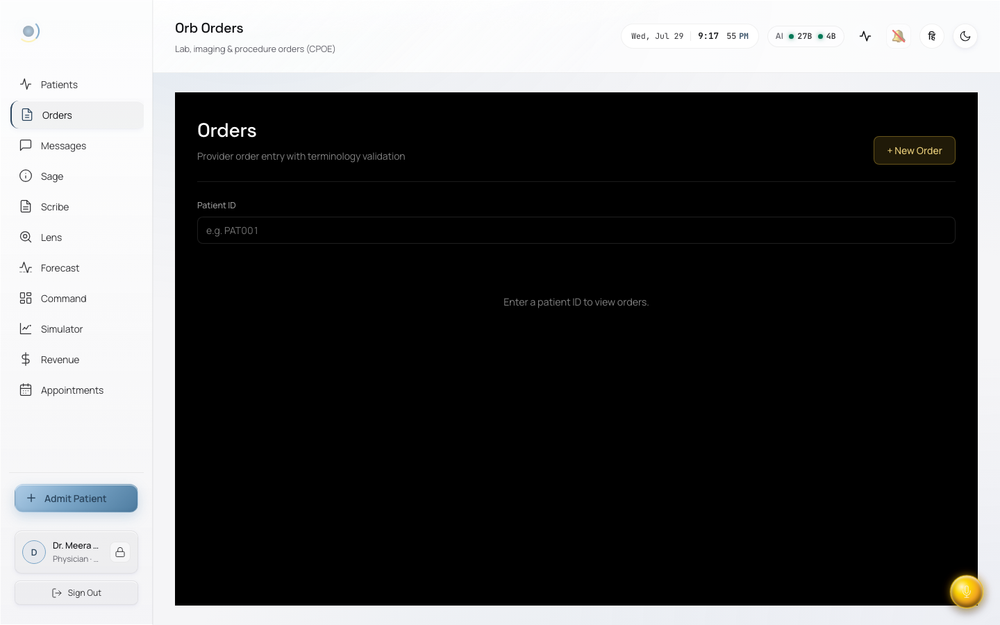

*Provider order entry. Codes are validated against LOINC, SNOMED, or ICD-10 before the order can be created.*

This chapter covers the ordering half of Orb's medication and diagnostics loop: the **Orders** panel (computerized provider order entry with terminology validation), the order-time **drug safety screen** that checks every medication order against the patient's allergies and current medications, and the **eMAR** (electronic Medication Administration Record) that nurses use at the bedside to record that a dose was actually given, or deliberately withheld.

Together, these three pieces enforce one principle: a medication cannot reach a patient's chart without a safety screen, and a dose cannot be charted as given without a bedside confirmation. Every screen, override, and administration is written to Orb's tamper-evident audit chain.

### 8.1 The Orders panel

#### What it is for

The Orders panel is Orb's provider order entry surface. Doctors use it to place lab, imaging, medication, procedure, and nursing orders for a patient; the panel then tracks each order through its lifecycle from draft to completion, and (for labs and imaging) captures the result. The panel's subtitle describes it precisely: *"Provider order entry with terminology validation"*, coded orders are checked against real LOINC, SNOMED, and ICD-10 terminology before they are accepted.

#### Opening the panel

1. Sign in with a clinician account (for example the demo doctor **DOC001**).
2. Click **Orders** in the left sidebar of the clinician shell.
3. In the **Patient ID** field at the top of the panel, type the patient's identifier (for example `P001`). The panel loads that patient's orders immediately.

If no patient ID has been entered, the panel shows *"Enter a patient ID to view orders."* Once a patient is selected, an empty list reads *"No orders for this patient yet."*

#### Reading the order list

Each order appears as a card showing:

| Element | Meaning |
|---|---|
| **Description** | The order text (e.g. "Lactate [Moles/volume] in Serum or Plasma"). |
| **Order type** | One of `lab`, `imaging`, `medication`, `procedure`, `nursing`, `other`. |
| **Code badge** | The terminology system and code (e.g. "LOINC 2524-7"), shown only for coded orders. |
| **Priority** | `routine`, `urgent`, or `stat`. Urgent and stat priorities are visually highlighted so they stand out in the list. |
| **Source** | Shown only when the order did not come from a clinician directly (for example, orders raised by other Orb modules). |
| **Status chip** | The current lifecycle state: draft, active, in progress, completed, resulted, or cancelled, each with its own color. |
| **Result line** | For resulted labs/imaging, the recorded result text appears beneath the description. |

To the right of each card are the action buttons available for that order's current state (see 8.3).

### 8.2 Creating an order

Click **+ New Order** in the panel header. The button label changes to **Close** while the form is open, so you can collapse it again without creating anything.

#### The order form, field by field

1. **Order Type**, choose `lab`, `imaging`, `medication`, `procedure`, `nursing`, or `other`. This choice determines whether a terminology code is required: `nursing` and `other` orders may be free-text; all other types **must** carry a valid code.
2. **Priority**, `routine` (default), `urgent`, or `stat`.
3. **Code System**, shown for coded order types. Choose **LOINC** (laboratory tests), **SNOMED** (procedures and clinical findings), or **ICD10** (diagnoses).
4. **Code**, type the code itself (the field hints with an example, `e.g. 2524-7`).
5. **Description**, the human-readable order text. If you validate a code first, this fills itself in automatically (see below).

#### The Validate button

The **Validate** button next to the Code field checks your code against Orb's local terminology tables. Validation also runs automatically when you click out of the Code field.

- While checking, an ellipsis (…) appears.
- A **✓** with the code's official display name means the code is real and active, for example, validating LOINC `2524-7` shows *"✓ Lactate [Moles/volume] in Serum or Plasma"*. If the Description field is still empty, the display name is copied into it automatically, which is the fastest way to write a correctly-worded order.
- A **✗ unknown code** means the code is not in the terminology tables. You cannot submit a coded order with an unvalidated or invalid code, the **Create Order** button stays disabled until the code shows ✓ (or, for nursing/other orders, until a description is entered).

Changing the code, or switching the code system or order type, resets the validation state, so a stale ✓ can never carry over to a different code.

Validation is not only a front-end nicety: the server independently re-checks the code when the order is submitted and rejects unknown codes outright, so an invalid code can never be saved even by an integration that bypasses the form.

> **About the terminology subset.** Orb ships with a curated starter set of real codes: common LOINC laboratory panels and analytes (CBC, BMP/CMP, troponins, coagulation studies, HbA1c and more), SNOMED CT findings and procedures (chest pain, pneumonia, transfusion of blood product, CABG…), and frequent ICD-10 diagnoses (E11.9, I10, J18.9, A41.9…). It is deliberately small; a site administrator can bulk-load the full LOINC, ICD-10-CM, and licensed SNOMED CT releases into the same tables, after which validation transparently covers the complete terminologies. If a legitimate code shows "unknown", it simply has not been loaded yet, see Troubleshooting.

#### Submitting

Click **Create Order**. The button shows *"Creating…"* while the order is submitted, then the form closes and the new order appears in the list with a **draft** status chip. If the order is a **medication**, the drug-safety screen runs before anything is saved, see 8.5.

### 8.3 Order lifecycle: draft → active → completed

Orders move through a guarded state machine. Illegal jumps (for example draft straight to completed) are rejected by the server; every legal transition writes an order-event record, so the full history of who moved an order and when is preserved.

| From | Allowed next states |
|---|---|
| draft | active, cancelled |
| active | in progress, resulted*, cancelled |
| in progress | completed, resulted*, cancelled |
| completed / resulted / cancelled |, (terminal) |

\* *resulted* applies only to lab and imaging orders, the two types that produce a result.

On each order card, the panel offers exactly the buttons that make sense for its state:

- **→ active**, **→ in progress**, **→ completed**, advances the order one step. The arrow button always shows the next legal forward state.
- **+ Result**, shown for lab and imaging orders that are active or in progress. Clicking it opens a prompt (*"Result for ‹order description›:"*); entering text attaches the result and moves the order directly to **resulted**, its terminal state. The result text then appears on the card as *"Result: …"*.
- **Cancel**, available on any order that has not yet reached a terminal state. Cancelled is terminal: a cancelled order cannot be reactivated (place a new order instead).

Repeating a transition an order has already made is treated as a harmless no-op rather than an error, which keeps double-clicks and retried requests safe.

Orders may only ever be *created* in draft (or active) state. There is no way to create an order that is already completed or resulted, the state machine is the only path to later states, which keeps the ordering audit trail honest.

### 8.4 Printing the orders list

When a patient has at least one order, a **Print** button appears in the panel header. Clicking it (the label changes to *"Preparing…"*) renders a print-formatted **Active Orders List**, headed "Orb Hospital System", stamped with the generation time and marked **CONFIDENTIAL MEDICAL RECORD**, and opens your browser's print dialog automatically. The printout lists each order's type, description, priority, status, result (if any), and creation time. Printing or cancelling the dialog returns you to the normal panel view.

### 8.5 Order-time drug safety

Every **medication** order passes through Orb's drug-safety gate before it is written to the chart. The same single gate guards every other route by which a medication can enter Orb, adding a med directly in a patient's Vigil chart, ambient actions from Relay, agentic suggestions from Sage, medications auto-extracted from signed notes, and Helix approvals, so there is no back door around the screen.

#### What the screen checks

1. **Allergy screening**, against the patient's documented active allergies:
   - *Direct matches*, the ordered drug's name overlaps a documented allergen (e.g. ordering amoxicillin for a patient allergic to amoxicillin).
   - *Drug-class matches*, the drug belongs to the same class as a documented allergen (e.g. ordering flucloxacillin, a penicillin, for a penicillin-allergic patient).
   - *Cross-reactivity*, known cross-reactive classes (e.g. a cephalosporin ordered for a penicillin-allergic patient, and vice versa). The alert is graded by the documented reaction, exactly as the bedside check grades it: a penicillin anaphylaxis, or a penicillin allergy whose severity was never recorded, makes a cephalosporin order a severe alert that stops until acknowledged; a moderate rash history warns.
2. **Drug–drug interaction screening**, comparing the new drug against every medication the patient currently has active. It covers high-consequence pairs such as warfarin + NSAIDs/aspirin (severe bleeding risk), duplicate anticoagulation, potassium + potassium-sparing diuretics (severe hyperkalaemia), SSRIs + MAOIs, and statin combinations.

   **Know the size of this knowledge base before you rely on it.** Orb ships a *starter* set of **55 curated interaction pairs**, screened through a map of **12 drug classes over about 78 ingredient names**. That is a deliberate, high-consequence shortlist, it is not a comprehensive interaction database, and it is roughly two orders of magnitude smaller than a licensed one. A maintained commercial or open source (First Databank, Micromedex, DDInter) **must be bulk-loaded before go-live**; Orb includes a loader for the DDInter format (`server/scripts/load_interactions.py`) and the screening engine reads from the database table, so loading one widens coverage without a code change. Until you do, treat this screen as a backstop against a short list of well-known catastrophes, not as interaction cover.

Each alert carries a severity, **mild**, **moderate**, or **severe**, and the screen reports the single worst severity found.

#### What you will see

**No alerts, drug recognised.** The order is created normally with no interruption.

**Sub-severe alerts (mild/moderate), or the drug was not screened.** The order **is** created, but a review-only dialog titled **"Drug-safety review"** appears first, listing the *Allergy alerts* and *Interaction alerts* that were raised, each tagged with a severity chip. Read it, then click **Close** to finish. Nothing further is required, this mode is informational, so useful alerts are seen without adding friction to routine ordering.

**Severe alerts.** The order is **blocked** before anything is saved, and a dialog titled **"Severe drug-safety alerts"** opens with the warning: *"This order is blocked until the alerts below are reviewed. Acknowledging records your identity and justification on the audit chain."* To proceed anyway you must:

1. Read the listed allergy and interaction alerts.
2. Type a **Clinical justification** of at least 10 characters into the text box, a genuine reason why proceeding is clinically appropriate despite the alerts.
3. Click **Acknowledge & Order**.

The order is then re-submitted with your acknowledgement attached and is created. Your identity, the justification you typed, and the full list of alerts you overrode are written permanently to the tamper-evident audit chain. Click **Cancel** instead to abandon the override; the order form stays open so you can change the drug.

**"Not screened" notice.** If Orb cannot map the ordered drug to one of its twelve known drug classes, the safety dialog shows a **Not screened** chip with the note that *drug–drug interactions were NOT screened, verify manually*. An unrecognised drug is deliberately never presented as "screened and clean". Allergy matching by name still runs regardless.

**The limit of that notice, read this carefully.** The chip fires on drugs Orb cannot *classify*. It does **not** fire on a drug that Orb classifies successfully but for which the curated table happens to hold no interaction pair. Such a drug returns "No alerts" and looks identical to a genuinely clean screen. Given the starter table's size, that is the common case rather than an edge case. In other words: **"Not screened" is a strong positive signal, but its absence is not a guarantee that the drug was compared against anything.** This is a known gap; until the interaction table is bulk-loaded from a maintained source, a clean screen carries the weight of "nothing on our shortlist matched", and no more.

**Screening unavailable.** If the safety screen itself fails to run, Orb fails **closed**: the order is refused with a clear message that screening is unavailable, rather than quietly proceeding unchecked. Resolve the fault or route the medication through pharmacist verification.

#### Automation never overrides

Only an interactive clinician, present at the screen, can acknowledge severe alerts. Non-interactive paths, AI-driven or automated flows, can never acknowledge a severe alert away; a severe hit on those paths blocks the medication and routes it to human review instead. Every screen (clean, alerting, blocked, or overridden) is audited, whether or not you ever see a dialog.

The same acknowledgement flow appears when adding a medication from a patient's chart in Vigil (the **Add Medication** dialog with its Drug Name, Dosage, Route, and Frequency fields), the modal, the 10-character justification, and the audit trail behave identically there.

### 8.6 The eMAR: recording bedside administration

CPOE and pharmacist verification put a medication *on the chart*; the eMAR records what actually happened *at the bedside*. Every administration attempt, given or withheld, becomes one permanent record in the patient's administration history.

#### Where to find it

1. Open **Patients (Vigil)** from the sidebar and select your patient.
2. In the patient detail command bar, click **Medications**.
3. The Medications dialog lists every prescribed medication in a table: **Drug**, **Dose**, **Route**, **Frequency**, **Status** (● Active, ◌ PRN, or ○ D/C), and **Administration**.

The **Administration** column is the working MAR for the row:

- A green **"Given ‹time›"** chip shows when the most recent dose was recorded; hovering over it shows who recorded it. Together with the **Frequency** column (e.g. QID), this is how you judge whether the next dose is due.
- An **Administer** button appears on every *active* medication. It is disabled, greyed out with the tooltip *"Pharmacist verification required"*, for any AI-sourced medication that a pharmacist has not yet verified. Such medications cannot be administered under any circumstances until verification happens (see the Pharmacy chapter).

#### The Administer modal

Clicking **Administer** opens the **"Administer medication"** dialog, which is built around the five rights of medication administration:

1. **Five-rights summary.** The top of the dialog lists **Patient** (name and bed), **Drug**, **Dose**, **Route**, and **Time** (the current time, marked "now"). Check each line against the physical medication in your hand and the wristband on the patient.
2. **Confirm drug name.** The dialog's central safety control is a barcode-style type-to-confirm field: you must type the drug name *exactly as charted* (case-insensitive) into the **Confirm drug name** box. The **Given** button stays disabled until the typed name matches, which forces a deliberate comparison between the medication in hand and the chart row before a dose can be recorded. The dialog states this explicitly: *"Barcode-style check: type the drug name exactly as charted (case-insensitive) to enable 'Given'."*
3. **Given.** Once confirmed, click **Given** (it shows *"Recording…"* while saving). The dose and route recorded default to exactly what was ordered, the ordered dose is the administered dose unless stated otherwise.
4. **Not given.** If the dose is being withheld, click **Not given** instead. A **Reason not given** section appears with a structured dropdown: **Refused**, **Held, clinical decision**, **NPO**, **Unavailable**, or **Other**, plus a free-text detail line (optional for the named reasons, *required* when the reason is Other). The **Record not given** button stays disabled until a valid reason is in place, a withheld dose can never be recorded without one.
5. **Cancel** closes the dialog without recording anything.

After a successful recording the dialog closes, the history refreshes, and the row's "Given" chip updates.

#### Guarantees behind the modal

- **Active orders only.** A dose can only be recorded against a medication whose order is active. Attempting anything else is refused with an inline error message in the dialog.
- **Unverified AI medications are blocked** server-side as well as in the UI, even a crafted request cannot chart a dose of an unverified, AI-extracted medication.
- **Append-only history.** Administration records are never edited or deleted; corrections are new rows. The history stays faithful to what was recorded, when.
- **Safe against double-charting.** Each recording carries a one-time key, so if a flaky network causes the same recording to be sent twice (for example an offline replay), the second attempt returns the original record instead of charting the dose twice.
- **Audited atomically.** The administration row and its audit entry are committed together on the tamper-evident chain, an administration can never exist without its audit record. The audit captures the drug, dose and route given (or the reason not given), who recorded it, and how it was confirmed.

The patient's full administration history (newest first, with the administering user's name) is retrievable per patient and feeds the "Given" chips throughout Vigil.

### 8.7 Troubleshooting

| Symptom | Likely cause | What to do |
|---|---|---|
| **Create Order** stays disabled | Coded order types require a validated code *and* a description. | Click **Validate** until you see ✓; check the description field is not empty. For free-text orders, switch the type to `nursing` or `other`. |
| "✗ unknown code" for a code you know is real | The full terminology release has not been loaded; only the curated starter subset is present. | Double-check the code and system match (a LOINC code under ICD10 will fail). If correct, ask your administrator to bulk-load the full terminology release. |
| Order rejected with "Unknown … code" on submit | The server re-validates codes independently of the form. | Re-validate the code; do not attempt to bypass the ✓ check. |
| A transition button seems missing | The order is in a terminal state (completed, resulted, cancelled), or the transition is not legal from its current state. | Check the status chip against the lifecycle table in 8.3. Terminal orders cannot move; place a new order. |
| **+ Result** not offered | Only lab and imaging orders in active/in progress state accept results. | Advance the order to active first; other order types never take results. |
| Medication order blocked by a 428/"Severe drug-safety alerts" dialog | The screen found a severe allergy or interaction hit. | Review the alerts. Either change the drug, or complete the **Clinical justification** (minimum 10 characters) and click **Acknowledge & Order**, knowing the override is permanently audited. |
| "The drug-safety screen could not run" | The screening service errored; Orb fails closed rather than ordering unchecked. | Retry; if it persists, report the fault and use the pharmacist verification path. |
| **Administer** button greyed out | The medication is AI-sourced and awaiting pharmacist verification, or is not an active order. | Hover the button to see the reason. Ask pharmacy to verify the medication; it becomes administrable immediately after. |
| **Given** button disabled in the Administer modal | The type-to-confirm field does not match the charted drug name. | Type the name exactly as displayed in the **Drug** line (capitalisation does not matter). |
| **Record not given** disabled | No reason selected, or "Other" chosen without a description. | Pick a reason from the dropdown; if Other, fill in the required detail line. |
| Error message inside the Administer modal | A server-side guard fired (inactive order, unverified medication, missing reason). | Read the inline message, it states the exact guard, and resolve it; nothing was recorded. |

### 8.8 Safety & limitations

- **The starter knowledge bases are deliberately small.** Both the terminology subset and the drug-interaction table ship as curated, real-data starter sets sized for demonstration and pilot use. They catch the common, high-consequence cases (penicillin/cephalosporin cross-reactivity, warfarin + NSAIDs, duplicate anticoagulation, hyperkalaemia combinations), but they are **not** comprehensive. For production use, load the full terminology releases and back the interaction table with a licensed, maintained source.
- **"No alerts" is not a clinical clearance.** A clean screen means nothing in Orb's 55-pair starter interaction set matched, it does not replace pharmacist review or clinical judgement. The **Not screened** chip tells you Orb could not even classify the drug; its *absence* only tells you the drug was classified, not that a meaningful comparison was available. See §8.5.
- **Overrides are audited, not erased.** Acknowledging severe alerts records your identity, your written justification, and the alerts overridden on a tamper-evident chain. Overrides are for genuine clinical judgement calls, and the record is permanent.
- **The screen fails closed.** If safety screening cannot run, medication orders are refused rather than silently unscreened. This is intentional; do not interpret a screening outage as clearance.
- **Automated paths cannot self-approve.** No AI or background process in Orb can acknowledge a severe alert or administer an unverified medication. Human review is structurally required, not just recommended.
- **The eMAR type-to-confirm is a check, not a barcode scanner.** It enforces a deliberate name comparison but cannot physically verify the vial in your hand. Perform the full five-rights check at the bedside every time.
- **Dose timing is by clinical judgement.** The Medications table shows the ordered frequency and the time of the last recorded dose; Orb does not currently generate a scheduled due-time worklist, so due-ness is judged from those two facts by the nurse.

---

## 9. Helix: Pharmacy & Verification

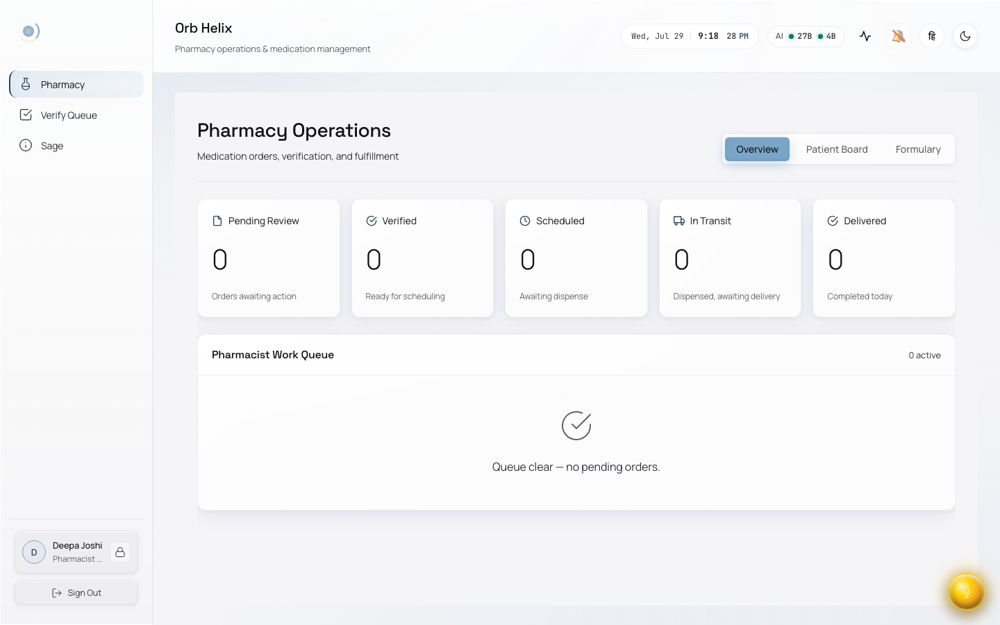

*The Helix pharmacy workspace: catalogue, inventory lots, and the pending verification queue.*

Helix is Orb's pharmacy pillar: the medication catalog and physical stock, a strict audited lifecycle for every medication order from prescription to delivery, and the pharmacist's role as the final human checkpoint on every drug the hospital's AI has touched. It appears as two sidebar entries:

- **Pharmacy** (the Helix workspace), the day-to-day operations board: pending orders, verification and fulfillment, the patient medication board, and the formulary with live stock levels.
- **Verify Queue** (Pharmacy Verification), a safety queue holding every medication charted by an AI pathway, awaiting pharmacist review before it can become an active, administrable order.

This chapter covers both surfaces, the order lifecycle, stock deduction, and how Helix interlocks with order entry (the Orders tab) and bedside administration (the eMAR in the Patients tab).

### 9.1 Who can use Helix, and how to open it

Helix is governed by dedicated pharmacy permissions: a read permission (viewing the catalog, inventory, and queues) and a write permission (approving, verifying, rejecting, substituting, dispensing). The **pharmacist** role holds both, plus Sage for clinical context, a pharmacist's sidebar shows exactly three tabs: **Pharmacy**, **Verify Queue**, and **Sage**. Administrators hold the underlying permissions too, but the tabs belong to the pharmacist's sidebar; doctors and nurses do not see them.

To follow along on a demo system:

1. Sign in with the seeded pharmacist account, employee ID **PHA001** (Deepa Joshi), password **password**.
2. Click **Pharmacy** in the sidebar. The panel briefly shows *"Connecting to Helix..."* while it loads orders, inventory, and the catalog, then opens on the Overview tab.

The workspace header reads **Pharmacy Operations** with the subtitle *"Medication orders, verification, and fulfillment"*, and offers three view tabs on the right: **Overview**, **Patient Board**, and **Formulary**.

### 9.2 The medication order lifecycle

Every medication order in Helix moves through a fixed set of statuses. Only specific, legal steps are permitted, the system will refuse any transition that is not in this table, so an order can never skip verification or be dispensed twice.

| Status | Badge | Meaning | What can happen next |
|---|---|---|---|
| Pending | **Pending** | Newly created; awaiting a pharmacist | Begin Review |
| Reviewing | **Reviewing** | A pharmacist has picked it up | Verify, Reject, or Suggest Substitute |
| Verified | **Verified** | Clinically approved by pharmacy | Schedule |
| Rejected | **Rejected** | Declined by pharmacy, terminal | Nothing (final state) |
| Substitute suggested | **Substitute** | An alternative product was proposed | Return to Review |
| Scheduled | **Scheduled** | Queued for dispensing at a set time | Dispense |
| Dispensed | **Dispensed** | Stock deducted; en route to the ward | Nothing for pharmacy. The **ward** records receipt |
| Delivered | **Delivered** | A named nurse signed for the drug on the ward, terminal | Nothing (final state) |

Two properties matter in daily use:

- **Every step is recorded.** Each transition writes an immutable history entry, who acted, when, from which status to which, with any notes or substitution, so the full journey of any order can be reconstructed.
- **Every step is idempotent.** A button pressed twice, or a request replayed over a flaky network, is not applied twice; the system returns the already-recorded result. You cannot double-dispense by double-clicking.
- **Pharmacy cannot close its own dispatch.** `Dispensed → Delivered` is the one transition no pharmacist can make. It lives on its own endpoint under its own permission, `helix.receive`, which nurses hold and pharmacists do not, and the server additionally refuses the write when the account signing for the drug is the account that dispensed it. See section 9.4a.

### 9.3 The Overview tab: your work queue

The Overview tab is the pharmacist's home screen. It has three zones.

#### Metric cards

A row of cards summarizes the state of the whole pharmacy at a glance:

| Card | Counts | Subtitle |
|---|---|---|
| **Pending Review** | Orders in Pending, Reviewing, or Substitute status | "Orders awaiting action" |
| **Verified** | Verified orders | "Ready for scheduling" |
| **Scheduled** | Scheduled orders | "Awaiting dispense" |
| **In Transit** | Dispensed orders | "Dispensed, awaiting delivery" |
| **Delivered** | Delivered orders | "Completed today" |
| **Rejected** | Rejected orders | "Requires attention", this card only appears when at least one order has been rejected, and is highlighted as critical |

#### Pharmacist Work Queue

The **Pharmacist Work Queue** table lists every order needing pharmacist action, Pending, Reviewing, and Substitute-suggested, with columns **Patient** (name plus ward/bed), **Medication** (name plus dosage, frequency, route), **Prescriber**, **Time**, and **Status**. Orders from an automated pathway with no named prescriber show **System** as prescriber. When there is nothing to do, the queue shows *"Queue clear, no pending orders."* Click any row to open the **Order Review** dialog (section 9.4).

#### Fulfillment Pipeline

Below the work queue, the **Fulfillment Pipeline** table appears whenever orders are in flight, Verified, Scheduled, or Dispensed, showing **Patient**, **Medication** (the substitute's name, if one was approved), **Ward / Bed**, and **Status**. These rows are clickable too, so you can push an order through scheduling, dispensing, and delivery from the same dialog.

### 9.4 Reviewing an order: the Order Review dialog

Clicking any order opens the **Order Review** dialog, which always shows:

- **Current Status**, the order's badge.
- **Order Details**, Patient, Ward / Bed, Medication, Dosage, Frequency, Route, and Prescriber, plus a **Substitute** line if one was proposed and a **Notes** line if a pharmacist has written any.

The action buttons at the bottom change with the order's status, you are only ever offered the legal next steps.

#### Step-by-step: verifying a routine order

1. On the Overview tab, click a **Pending** order in the Pharmacist Work Queue.
2. Click **Begin Review**. The order moves to Reviewing and the dialog closes; click the order again to continue (the queue refreshes automatically).
3. In Reviewing, the dialog offers **Verify**, **Reject**, and **Suggest Substitute**, plus two extra sections:
   - **Substitute Medication (optional)**, a dropdown of every other catalog product, shown as name and strength.
   - **Pharmacist Notes**, a free-text box with the placeholder *"Add verification notes, rejection reason, or substitution rationale..."*; anything typed here is stored on the order and shown to subsequent reviewers.
4. Check the drug, dose, frequency, and route against the patient and your clinical judgment, add any notes, and click **Verify**.
5. The order becomes **Verified**, and Helix posts a system message into the patient's care-team chat room in Relay, *"Pharmacy has verified the order for [medication]. Dispensing will commence."*, so the ordering clinician and nurses see, unprompted, that pharmacy has signed off.

#### Rejecting an order

From Reviewing, click **Reject** instead. Enter your reason in **Pharmacist Notes** first, Rejected is terminal, so the note is the record the care team will see. Nothing is deleted: the order keeps its Rejected badge, and the Rejected metric card surfaces it until dealt with clinically (typically a new order from the prescriber).

#### Suggesting a substitute

When the prescribed product is out of stock or a therapeutic alternative is preferable:

1. From Reviewing, choose the alternative in the **Substitute Medication (optional)** dropdown. **Suggest Substitute** stays disabled until you have selected one.
2. Add your rationale in **Pharmacist Notes**, then click **Suggest Substitute**. The order moves to **Substitute** status, showing both the original and the proposed substitute.
3. To proceed, open the order and click **Return to Review**, then **Verify** as usual. From then on the substitute is what is dispensed and what appears in the Fulfillment Pipeline, the eventual stock deduction comes from the substitute's inventory, not the original's.

#### Scheduling and dispensing

1. Open a **Verified** order and click **Schedule**. The order is stamped with the scheduling time and moves to Scheduled.
2. Open a **Scheduled** order and click **Dispense**, the step that touches inventory (section 9.5). The order moves to Dispensed and counts on the In Transit card.

That is where the pharmacist's work ends. A Dispensed order offers **no further buttons**, and the dialog says so rather than looking broken: *"In transit. The ward records receipt when the drug arrives; pharmacy cannot sign for its own dispatch."* Once a nurse has signed, the same line reads *"Received on the ward."*

While a transition is being applied the buttons show **Processing...** and are disabled. If a transition fails, for example, insufficient stock at dispense time, the error appears in red inside the dialog and the order is left exactly as it was.

### 9.4a Delivery: the ward signs for the drug

**Delivery is a nurse action, not a pharmacy one.** This is the last hop of the medication custody chain, and it is deliberately held by a different person from the one who sent the drug.

The nurse opens the **Deliveries** tab in Nurse Mode, the nurse's landing tab in the clinician shell. It lists only what is genuinely in transit to patients already on that nurse's ward, each row naming the drug, the patient, who dispensed it and when. **Confirm receipt** records the nurse's own name and the time against the order and moves it to its terminal Delivered state.

Two controls stand behind that button, and both are enforced by the server rather than by the screen:

- **`helix.receive` is a nurse permission.** Pharmacists do not hold it, and hold no other route to `delivered`. The Deliveries tab does not appear at all for an account without the grant, rather than appearing and failing.
- **No self-receipt.** The server refuses the write when the account signing is the account that dispensed, so a single person cannot walk an order from prescription to delivered on their own.

Before 2026-09-07 this step did not exist: `Dispensed → Delivered` sat under the pharmacist's own `helix.write` permission, so the desk that sent the drug also clicked the button saying the ward had received it, and the record captured neither who took delivery nor when.

### 9.5 Inventory, lots, and stock deduction

Helix tracks stock at the **lot** level: each catalog medication can have one or more inventory lots, each with a lot number, quantity, and expiration date.

When you click **Dispense**, Helix:

1. Finds the lot of the medication being dispensed (the approved substitute, if there is one) with stock remaining and the **earliest expiration date**, first-expiring, first-out, so short-dated stock is used before fresh stock.
2. Deducts one unit from that lot, atomically with the status change, the deduction and the transition both happen or neither does.
3. Writes a **stock movement** record tying together the lot, medication, order, and quantity change, the permanent audit trail of every unit that left the shelf and why.

If no lot has stock, the dispense is refused with an insufficient-stock error and the order stays Scheduled. The remedy is a restock or a substitution (via the substitute path above).

### 9.6 The Patient Board tab

The **Patient Board** answers a different question from the work queue: not "what do I do next?" but "how is each patient's medication picture going?" The **Patient Medication Board** table shows one row per patient with active orders:

- **Patient**, name and ward/bed.
- **Medications**, every order for that patient with its dose and status badge (the substitute's name where one was approved).
- **Fulfillment**, a progress summary such as "2/3 delivered", with a second line ("1 in transit") when doses are between dispense and delivery. Rejected orders are excluded from the denominator.
- **Stock**, per-order stock for the prescribed medication: total units on hand, a **Low** badge with the remaining count below 100 units, or a red **Out of Stock** badge when nothing is left.

Use this board before ward rounds or when a nurse calls asking where a dose is: you can see instantly whether a patient's medications are stuck in review, in transit, or blocked by a stockout.

### 9.7 The Formulary tab

The **Formulary** tab shows the **Medication Formulary & Inventory**, the master catalog joined with live stock:

| Column | Contents |
|---|---|
| **Medication** | Brand/product name, with the generic name underneath |
| **Formulation** | Form (tablet, injection, etc.) and strength |
| **Available Stock** | Total units across all lots |
| **Active Lots** | The lot numbers currently held ("None" if empty) |
| **Status** | **In Stock**, **Low Stock** (fewer than 30 units remaining), or **Out of Stock** |

The Formulary's **Low Stock** threshold (below 30 units, tuned to the demo inventory scale) differs from the Patient Board's **Low** badge (below 100 units); the Patient Board is deliberately more sensitive because it warns about a specific patient's continuing supply.

The formulary also powers ordering elsewhere in Orb: a medication not in this catalog cannot become a Helix order at all, an AI-drafted request for an unlisted drug is flagged **Not Available in Pharmacy** rather than silently accepted.

### 9.8 Where orders come from: Sage drafts and the safety gate

Helix orders arrive from human prescribers and from Orb's AI assistant, Sage. Sage never writes an order itself. When asked to order a medication it produces a **Chart Action** card in the conversation showing the patient, the medication, and a status badge, **Drafted** at first. The clinician reviews the card and clicks **Approve & Send to Helix** (it reads **Sending...** while it works). Only that human click creates the order, which lands in Helix as **Pending**, at the very start of the pharmacist lifecycle. The card then shows **Sent to Pharmacy**; failures show **Failed**, and a drug not in the formulary shows **Not Available in Pharmacy**.

Two safeguards run at the moment of approval:

- **Patient identity must be unambiguous.** A name matching zero patients, or more than one, is refused outright rather than risk charting a medication to the wrong person.
- **The drug-safety gate runs before anything is written.** Orb screens the drug against the patient's documented allergies (including cross-reactive drug classes) and current medications for interactions. Alerts below severe severity are attached for display and audit. A **severe** alert blocks the approval: the clinician sees the full alert detail and must re-submit with an explicit acknowledgement reason; that override, who, why, and which alerts, goes to the tamper-evident audit chain. If screening itself is unavailable, the gate refuses rather than assuming safety.

The same gate protects every route by which a medication can reach a chart, order entry in the Orders tab, medication additions in the Patients tab, ambient AI actions in Relay, note auto-extraction, and Helix approvals, one screening standard hospital-wide. Fully automated pathways can never acknowledge a severe alert away; they must hand the medication to a human.

Sage's agentic ordering also runs a pre-flight stock check against Helix and can propose an in-stock alternative (same generic, or a standard therapeutic-class substitute) when the requested drug is out of stock, so stockouts surface at drafting time, not at the dispensing bench.

### 9.9 The Verify Queue: verifying AI-charted medications

The **Verify Queue** sidebar tab opens the **Pharmacist Verification Queue**, subtitled *"AI / agentic medications awaiting pharmacist review before they become active orders."* It is a different queue from the Pharmacy workspace, with a different job.

#### Why this queue exists

Some Orb pathways chart medications directly onto a patient's medication list, an AI extraction from an uploaded document, or an autonomous agent acting on a conversation. Orb deliberately charts these in a **quarantined** state: tagged with their machine provenance, dose often the placeholder *REVIEW REQUIRED*, and no verifier recorded. A quarantined medication is visible on the chart but **cannot be administered**: the bedside eMAR refuses it with *"unverified medication, pharmacist verification required."* The Verify Queue is where a pharmacist lifts that quarantine, or refuses to.

#### Reading the queue

Each row is one unverified medication, with columns:

| Column | Contents |
|---|---|
| **Patient** | The patient the medication is charted to |
| **Drug** | The drug name as charted |
| **Dose / Route / Frequency** | Editable fields (see below) |
| **Source** | A provenance badge, **AI extracted** or **Agentic** |
| **Safety alerts** | The freshly-run drug-safety screen for this drug and patient |
| **Actions** | **Verify** and **Reject** buttons |

The **Safety alerts** cell is designed so a screening gap can never masquerade as a clean result:

- A clean, fully-screened drug shows a green **No alerts**.
- Alerts are listed with type and severity (for example *ALLERGY · SEVERE*) and a plain-language message; severe alerts are bold red, moderate amber.
- A drug Orb cannot map to a known drug class shows an amber **Not screened** badge with a coverage note, any allergy alerts it *did* get are still listed, but no green "No alerts" is shown. A classified drug with no curated interaction pair does not get this badge; see §8.5.
- If screening itself failed, a red **Screening unavailable** badge appears and no alert list is rendered, absence of alerts here means "unknown," never "safe."

A **Refresh** button reloads the queue on demand. When nothing is waiting, the panel shows **Queue clear**, *"No AI/agentic medications are awaiting verification."*

#### Step-by-step: verifying a medication

This is the pharmacist's rights-check on the order itself, right patient, right drug, right dose, right route, right frequency, before the medication may become administrable. (The nurse checks the rights once more at the bedside, see section 9.10.)

1. Read the **Patient** and **Drug** columns against the clinical context. Sage is in your sidebar if you need the patient's story.
2. Fill in **Dose**, **Route**, and **Frequency** (placeholders suggest the format: *e.g. 500mg*, *e.g. Oral*, *e.g. TDS*). Where the AI charted a *REVIEW REQUIRED* placeholder these fields start empty, so you type a real value rather than editing boilerplate; where the AI supplied values they are pre-filled for you to correct. What you leave here becomes the authoritative order.
3. Review the **Safety alerts** cell.
4. Click **Verify**. On success the row disappears and a green confirmation appears ("Verified [drug] for [patient]"). The medication is now an **active** order, stamped with your identity and verification time, and the eMAR will accept it for administration.

#### Severe alerts: the acknowledgement flow

The safety screen is re-run at the moment you click **Verify**, not just when the queue loaded, so the decision is always made against current data. If it finds a **severe** alert, or cannot run at all, verification is blocked and an inline panel opens beneath the row, titled **"Severe safety alerts, acknowledgement required"** (or **"Drug-safety screening unavailable, acknowledgement required"**). The panel repeats the alerts and any coverage note, with a text box: *"Clinical reason for verifying despite the alerts (required, audited)."*

- To override, enter your clinical justification and click **Acknowledge & verify** (disabled until a reason is written). The override, your identity, the reason, and the full alert list, is written to the tamper-evident audit chain, and the medication is activated.
- To back out, click **Cancel**. The medication stays quarantined in the queue.

#### Rejecting a medication

Click **Reject**. You are prompted, *"Reason for rejecting [drug]?"*, and an empty reason cancels; a reason is mandatory. On rejection the medication is **discontinued**, your identity and timestamp are recorded as the deciding pharmacist, and the reason is appended permanently to its notes. Nothing is deleted: the discontinued entry remains part of the patient's record.

Every verify and reject, with the alert severity and screening coverage at decision time, is audited. A medication can only be decided once, if a colleague verified it while you were reading, your attempt is refused rather than double-applied.

### 9.10 How Helix connects to CPOE and the eMAR

Helix sits between ordering and administration:

- **Upstream (CPOE).** Doctors and nurses place orders, including medication orders, from the **Orders** tab. Medication orders there pass through the same drug-safety gate as section 9.8, with the same severe-alert acknowledgement rules. Helix's formulary and stock also feed Sage's order drafting.
- **Downstream (eMAR).** Bedside administration happens in the **Patients** (Vigil) tab, where the nurse's Administer dialog presents a five-rights summary, patient, drug, dose, route, time, with type-to-confirm checks before a dose is recorded as given. Two Helix decisions gate that moment: an AI-charted medication not yet verified in the Verify Queue cannot be administered at all, and the dose and route the nurse confirms are the ones the pharmacist fixed at verification.
- **Sideways (Relay).** When a Helix order is verified, the care team's case room receives an automatic system message, closing the loop without phone calls.

### Troubleshooting

| Symptom | Likely cause | What to do |
|---|---|---|
| Pharmacy or Verify Queue tab missing from the sidebar | Not signed in as a pharmacist | Sign in with a pharmacist account (demo: PHA001) |
| Stuck on *"Connecting to Helix..."*, or the Verify Queue shows a load error | Backend unreachable or session expired | Refresh and sign in again; if it persists, contact your administrator |
| **Dispense** shows an insufficient-stock error | Every lot of that medication is empty | Check the Formulary tab; restock or use **Suggest Substitute** |
| **Suggest Substitute** greyed out | No substitute selected | Pick a product in the **Substitute Medication (optional)** dropdown first |
| An "Illegal transition" error appears | The order changed state since your screen loaded (a colleague acted) | Close the dialog; the queue refreshes with the current status |
| **Verify** in the Verify Queue opens a red acknowledgement panel | The re-run screen found severe alerts, or screening is unavailable | Read the alerts; enter a clinical reason and **Acknowledge & verify**, or **Cancel** and reject/escalate |
| **Acknowledge & verify** disabled | Reason box empty | A written clinical reason is mandatory for any override |
| A Verify Queue row shows **Not screened** | Orb could not map the drug to a known drug class | Perform your interaction check manually; listed allergy alerts are still valid |
| A verified medication is refused by the nurse's eMAR | The nurse is administering a different, still-unverified entry | Check the Verify Queue for remaining quarantined entries for that patient |
| Nurse reports a dose "missing" | The order is mid-pipeline | Check the Fulfillment Pipeline / Patient Board for its status |

### Safety & limitations

- **AI never activates a medication.** Sage can only draft; a clinician must click **Approve & Send to Helix**, and even then the order starts at Pending in the pharmacist's queue. AI-charted medications stay quarantined until a pharmacist verifies them, and the eMAR refuses to record administration of an unverified AI medication.
- **The safety screen advises; it does not decide.** Allergy and interaction screening runs from a locally curated knowledge base, 55 interaction pairs across 12 drug classes as shipped, and is emphatically not exhaustive. Drugs Orb cannot classify are flagged **Not screened**, and a failed screen is flagged **Screening unavailable**. But a classified drug with no curated pair reports "No alerts" with no chip, so treat a green "No alerts" as "nothing on Orb's shortlist matched" and apply your own clinical judgment always. See §8.5.
- **Severe alerts fail closed.** A severe alert, or an unavailable screen, blocks activation until a named human records a reason; automated pathways can never supply one. Every override is written to the tamper-evident audit chain with the full alert detail.
- **There is no dispensing robot or tube integration.** **Dispense** is a pharmacist's click standing in for the physical act of picking and sending the drug, and **Confirm receipt** is a nurse's click standing in for taking it off the tray. Everything the software records is real: the lot decrement, the movement ledger, the two named actors, the timestamps, and the audit history. What Orb cannot see is whether the physical drug matched the record.
- **Single-unit deduction.** Each dispense deducts one unit from the earliest-expiring lot; quantities are not dose-calculated from the prescription. Read inventory figures as demo-scale counts, not a validated perpetual-inventory system.
- **Terminal states are permanent.** Rejected and Delivered orders cannot be reopened; corrections require a new order. A rejected Verify Queue medication is discontinued, not deleted, the record and reason persist.
- **Helix is not a dosing reference.** Nothing here checks dose appropriateness for weight, renal function, or age. The dose the pharmacist confirms is the dose that will be administered; verifying it is a professional judgment, not a system output.

---

## 10. Forecast, What-If Simulator & Command Center

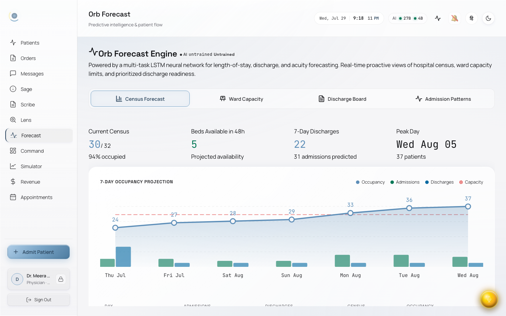

*Forecast. The provenance badge states plainly when a projection is heuristic rather than a trained model.*

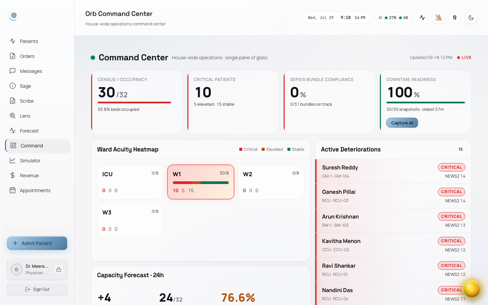

*The Command Center: house-wide census, acuity heatmap, active deteriorations, and today's operating room list.*

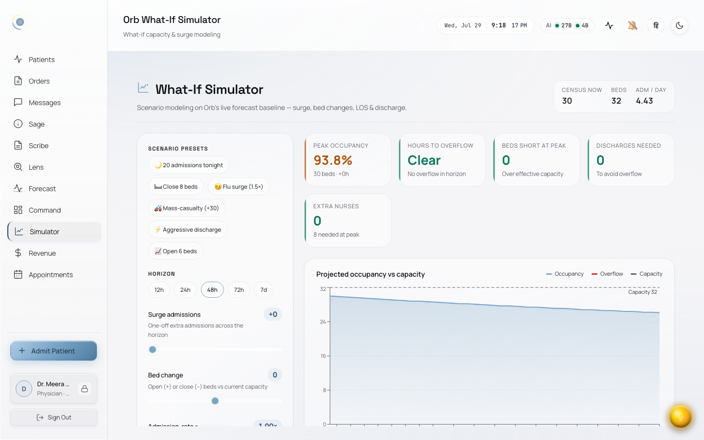

*The What-If Simulator models surges, bed closures, and discharge acceleration against the live baseline.*

Orb includes three closely related operational modules that look forward instead of at the bedside: **Forecast** predicts the hospital's census, bed capacity, and discharge flow over the coming week; the **What-If Simulator** stress-tests that forecast against surge scenarios you define yourself; and the **Command Center** condenses the entire house into a single live operations board. All three draw on the same underlying numbers, the same bed capacities, census, and admission model, so a figure in one module never contradicts the same figure in another. This chapter explains how to open each module, what every control does, how to read the projections, and exactly what the AI is and is not doing behind the numbers.

### 10.1 Who can see these modules

Access is role-based. All three modules are governed by the same operational read permission, but the sidebar tabs differ by role:

| Role | Forecast | Simulator | Command |
|---|---|---|---|
| Doctor | Yes | Yes | Yes |
| Nurse | Yes | No | No |
| Admin | Yes | Yes | Yes |
| Pharmacist | No | No | No |

Doctors and administrators see all three tabs in the left sidebar: **Forecast**, **Command**, and **Simulator**. Nurses see **Forecast** only; pharmacists work in the pharmacy modules and see none of the three.

---

### 10.2 Orb Forecast

Forecast answers the questions charge nurses, bed managers, and unit leaders ask every morning: *How full will we be this week? Which ward is the pressure point? Who is likely to go home in the next 72 hours?* It combines a live read of the current census with a day-by-day projection of admissions, discharges, and occupancy for the next seven days.

#### Opening Forecast

1. Sign in and click **Forecast** in the left sidebar.
2. The panel opens with a header reading **Orb Forecast Engine** and a row of four section pills: **Census Forecast**, **Ward Capacity**, **Discharge Board**, and **Admission Patterns**.
3. Click any pill to switch sections; **Census Forecast** is shown first by default.

The panel refreshes itself every five minutes, and the underlying hospital-level forecast is recomputed at most once per hour, numbers are deliberately stable and will not jump between visits.

#### The honesty badge: what "AI Untrained" means

Next to the **Orb Forecast Engine** title is a small provenance chip labelled **AI**, showing a version number and a status word: **Validated**, **Unvalidated**, or **Untrained**. This chip appears on every AI-generated output in Orb, the system's "honesty layer" made visible at the point of use. Hover over it for the model's task, version, training data, and status, with a pointer to **Admin → Model Governance** for the full lineage.

Forecast is architecturally built around a multi-task LSTM neural network for length-of-stay, discharge, and acuity prediction, but **on a fresh installation that network has not been trained or validated on real clinical data**. Orb refuses to present the output of an untrained network as a neural prediction. Instead the system *fails closed*: while no validated checkpoint is present, every per-patient prediction is routed to a transparent, rule-based heuristic (typical length of stay by ward, adjusted for how long the patient has already been in), and the chip reads **Untrained**. The same honesty is repeated in plain language at the bottom of the panel:

> *Decision-support estimates. The Forecast model is not yet trained or validated on real clinical data, figures are rule-based projections for planning, not validated neural predictions. See Admin → Model Governance.*

Practically, this means you should treat every Forecast number as a **planning estimate**, comparable to a well-organized whiteboard calculation, useful for staffing and bed management, never a substitute for clinical judgement about an individual patient.

#### Section 1: Census Forecast

The default section shows the seven-day hospital-level projection.

**KPI cards** across the top:

| Card | Meaning |
|---|---|
| **Current Census** | Admitted patients against total capacity (e.g. 24 / 32), with percentage occupied beneath. |
| **Beds Available in 48h** | Projected free beds two days out; red when two or fewer. |
| **7-Day Discharges** | Discharges predicted over the week, with predicted admissions as the subtitle. |
| **Peak Day** | The day projected to have the highest census, with the patient count. |

The **7-Day Occupancy Projection** chart shows an amber occupancy line with a numbered data point for each day, green bars for predicted admissions, blue bars for predicted discharges, and a dashed red line marking total bed capacity, occupancy approaching the dashed line means a near-capacity day.

Below the chart, a daily breakdown table lists **Day**, **Admissions** (green, +N), **Discharges** (blue, −N), **Census**, and **Occupancy** (a small bar plus percentage). Any day projected above 90% occupancy is highlighted in red so capacity-risk days stand out at a glance.

**How the projection is built.** The admission forecast is an expected-value model: the average daily admission rate is fitted from the hospital's own last 30 days of admission history, then adjusted by day-of-week patterns (Mondays busiest, weekends quietest) and by live environmental factors from Orb Pulse, thunderstorms (trauma), extreme heat or cold snaps (cardiac and respiratory), poor air quality, or elevated flu surveillance can each raise a day's expected admissions. Discharges are aggregated from the per-patient length-of-stay estimates. Because the model reports expected values rather than random draws, the same conditions always produce the same forecast.

#### Section 2: Ward Capacity

Click the **Ward Capacity** pill to see one card per ward, **ICU**, **W1**, **W2**, and **W3**, each with 8 beds (32 total).

Each ward card contains a status badge, **OK** (green), **HIGH** (amber, above 70% utilization), or **⚠ FULL** (red, 90% or above, with a red-tinted card), a **bed grid** with one icon per physical bed (amber occupied, green available; hover for "Occupied"/"Available"), a **Now** column showing current occupancy (e.g. 6/8) with a utilization bar, and a **48h** column showing projected occupancy two days out based on which patients are estimated to leave within two days (a green down-arrow marks beds expected to free up).

Below the ward cards, a summary strip totals the house: **Total Occupied**, **Available Now**, **Total Capacity**, and **Utilization Rate** (red above 85%).

#### Section 3: Discharge Board

Click the **Discharge Board** pill to open **Discharge Readiness, Next 72 Hours**: every admitted patient, ranked most-discharge-ready first (the header confirms *sorted by discharge likelihood*), with the top five rows visually highlighted.

| Column | Meaning |
|---|---|
| **Patient** | Name, with the working diagnosis beneath. |
| **Ward/Bed** | Current location (e.g. W2 · B4). |
| **Days In** | Days since admission. |
| **Est. Remaining** | Estimated days until discharge; two days or fewer shows green. |
| **Discharge Prob.** | A bar plus percentage, the estimated probability of discharge in the window. |
| **Trajectory** | **↗ Improving**, **→ Stable**, or **↘ Worsening**, colour-coded green/amber/red. |

Use the board in morning huddles to focus discharge planning, pharmacy reconciliation, transport, and family communication for the top of the list; a second look at anyone marked **↘ Worsening**. A high discharge probability is a prompt to *review* the patient for discharge, never a decision.

#### Section 4: Admission Patterns

Click the **Admission Patterns** pill for a retrospective view of the last 30 days of admission history: summary cards for **30-Day Admissions** (with the per-day average), **Avg Length of Stay**, and **Discharge Rate**; an **Admissions by Day of Week** bar chart (weekend bars muted so the weekday pattern reads clearly); and a **Distribution Analysis** breaking admissions down **By Severity** (critical / elevated / stable) and **By Ward** (ICU / W1 / W2 / W3).

This section contains no prediction at all, it is a plain summary of what actually happened, and the historical basis the census forecast's admission rate is fitted from.

---

### 10.3 What-If Simulator

Forecast tells you what is *expected*. The **What-If Simulator** answers "what if it doesn't go that way?", 20 trauma admissions tonight, a flu season at 1.5× normal admissions, eight beds closed for maintenance, a sicker cohort staying longer. You set the scenario with sliders; the simulator projects occupancy hour by hour against capacity and tells you when you would overflow, how many beds short you would be, how many extra discharges would avoid it, and how many extra nurses the peak would require.

Two properties are worth knowing up front. First, it is **built on the live Forecast baseline, not a separate model**: the starting census, bed capacity, and expected admission rate are read directly from the Forecast module, so the simulator can never contradict the numbers Forecast already shows. Second, it is **deterministic**: there is no randomness anywhere in the projection, so the same scenario always produces exactly the same numbers and results can be shared and re-run in a bed meeting without changing under you.

#### Opening the Simulator

Click **Simulator** in the left sidebar. The page opens with the title **What-If Simulator**, and in the top-right a **baseline chip** shows the live starting point: **Census now**, **Beds**, and **Adm / day** (the expected daily admission rate). While a projection is being recomputed, a small **simulating** indicator pulses in this chip.

The simulator runs immediately on opening with everything at baseline and re-runs automatically a fraction of a second after any control changes, there is no "Run" button. Drag a slider and watch the chart and tiles update live.

#### Scenario presets

Six one-click presets set up common situations. A preset **resets all other controls to baseline first**, then applies its settings, always a clean starting point, never layered on what you had before.

| Preset | What it sets |
|---|---|
| **🌙 20 admissions tonight** | +20 surge admissions over a 24-hour horizon. |
| **🛏️ Close 8 beds** | Bed change −8. |
| **🤒 Flu surge (1.5×)** | Admission rate ×1.5 over a 72-hour horizon. |
| **🚑 Mass-casualty (+30)** | +30 surge admissions compressed into a 12-hour horizon. |
| **⚡ Aggressive discharge** | Discharge boost +60%. |
| **📈 Open 6 beds** | Bed change +6. |

To combine effects (say, a flu surge *and* eight closed beds), click the preset first, then adjust additional sliders by hand.

#### Horizon

The **Horizon** row selects how far forward to project: **12h**, **24h**, **48h**, **72h**, or **7d** (the selection is outlined in gold). Short horizons suit acute surge planning; **7d** suits seasonal planning.

#### The six sliders

Each slider shows its label, a one-line hint, and its current value.

| Slider | Range | What it models |
|---|---|---|
| **Surge admissions** | +0 to +60 | A one-off block of extra admissions spread evenly across the horizon. |
| **Bed change** | −16 to +16 | Beds opened (+) or closed (−) versus current capacity. |
| **Admission-rate ×** | 0.5× to 3× | Scales the expected admission rate; the hint offers calibration: *1.5× ≈ flu surge, 2× ≈ epidemic.* |
| **Length-of-stay ×** | 0.5× to 2× | Scales how long patients stay; above 1 models a sicker, slower-turnover cohort. |
| **Discharge boost** | +0% to +100% | How much faster than baseline you discharge, the aggressive-discharge lever. |
| **Nurse : patient** | 1:1 to 1:8 | The staffing ratio for the nursing calculation; the default 1:4 is the common med-surg safe-staffing benchmark. |

The **Reset to baseline** button below the sliders returns every control to its default (48-hour horizon, no scenario changes, 1:4 staffing).

#### Reading the projections

Five stat tiles summarize the scenario, each colour-coded green (fine), amber (pressure), or red (breach):

| Tile | Meaning |
|---|---|
| **Peak occupancy** | Highest projected occupancy as a percentage of effective capacity, with the bed count and hour it occurs (e.g. "34 beds · +18h"). Amber from 85%, red at 100%+. |
| **Hours to overflow** | Hours until occupancy first exceeds capacity: **Clear** (green) if never breached in the horizon, **Now** if already over, red when six hours away or less. |
| **Beds short at peak** | Beds over effective capacity at the worst moment. |
| **Discharges needed** | Extra discharges required to keep the peak at or under capacity, directly actionable on the discharge board. |
| **Extra nurses** | Additional nurses needed at peak versus the current census, at your chosen ratio, with total nurses required at peak beneath. |

Below the tiles, the **Projected occupancy vs capacity** chart plots the hour-by-hour projection: a gold occupancy area, a dashed horizontal **Capacity** line labelled with the effective bed count (baseline beds plus your bed change), and any portion of the curve above capacity shaded red as **Overflow**. Hover anywhere on the chart for a tooltip showing the exact occupancy, capacity, and overflow at that hour.

#### Model assumptions & citations

At the bottom, an expandable panel titled **Model assumptions & citations** discloses exactly what the arithmetic rests on: the average length of stay behind the baseline discharge rate, the admission-rate source (the same 30-day statistical fit Forecast uses), the bed-capacity source, the staffing benchmark behind the default 1:4 ratio, and the fallback admission rate used if history is empty, and it states plainly that the projection is deterministic. When leadership asks "where do these numbers come from?", this panel is the answer.

#### Worked example: preparing for a flu surge

1. Open **Simulator** and note the baseline chip (say, census 24 of 32 beds, 4.5 admissions/day).
2. Click **🤒 Flu surge (1.5×)**. The horizon switches to 72h and the admission rate scales to 1.5×.
3. Winter cases also stay longer, so drag **Length-of-stay ×** to 1.3×.
4. Read the tiles. If **Hours to overflow** shows a number rather than **Clear**, **Discharges needed** tells you how many extra discharges would keep you inside capacity.
5. Test mitigations: raise **Discharge boost** until **Hours to overflow** reads **Clear**, or add beds with **Bed change**, and compare.
6. Check **Extra nurses** for the staffing cost, with **Nurse : patient** set to your unit's real ratio.
7. Take the resulting numbers ("4 extra discharges and 2 extra nurses absorb a 1.5× flu surge") to the bed meeting, anyone re-running the same scenario sees the same figures.

---

### 10.4 Command Center

The **Command Center** is the single pane of glass for whoever is running the house, a CMO, COO, bed manager, or duty administrator. One screen answers: how full are we, who is deteriorating right now, are our sepsis bundles on track, could we survive an IT outage, what is coming in the next 24 hours, and what is happening in the operating rooms today.

It is strictly **read-only aggregation** (with one deliberate exception, the downtime **Capture all** button) and is engineered to *degrade rather than crash*: if one data source hiccups, that tile falls back to zeros while the rest of the board keeps rendering.

#### Opening the Command Center

Click **Command** in the left sidebar. The board opens with the title **Command Center**, the subtitle *"House-wide operations · single pane of glass"*, a pulsing **LIVE** indicator, and an **Updated** timestamp. It refreshes automatically **every 20 seconds**; if a refresh fails, a **reconnecting…** note appears while the board keeps showing the last good snapshot, clearing on the next successful refresh.

#### The four KPI tiles

Across the top, four colour-coded tiles give the house vitals:

| Tile | Shows | Colour logic |
|---|---|---|
| **Census / Occupancy** | Admitted patients over total capacity (e.g. 24/32), a fill bar, and "% beds occupied". | Green under 75%, amber 75–89%, red 90%+. |
| **Critical Patients** | Count of patients at critical acuity, with "N elevated · N stable" beneath. | Red whenever any patient is critical; green otherwise. |
| **Sepsis Bundle Compliance** | Percentage of active sepsis bundles still on track against their 1-hour targets, with the fraction (e.g. "3/4 bundles on track"). No active bundles reads 100%. | Green 90%+, amber 70–89%, red below 70%. |
| **Downtime Readiness** | Percentage of admitted patients with a downtime snapshot fresher than 24 hours, the fraction, and the age of the *stalest* snapshot (e.g. "oldest 3.2h"). | Green 80%+, amber 50–79%, red below 50%. |

**The Capture all button.** The Downtime Readiness tile carries the board's only action: **Capture all**. Clicking it captures a fresh downtime snapshot for every admitted patient, the safety net each ward would rely on if the network, server, or AI stack went down. While running, the button shows **Capturing…** with a spinner; on success a confirmation such as "24 snapshots captured" appears briefly and the readiness percentage refreshes immediately. Treat a red or amber readiness tile as a prompt to click **Capture all** before the end of the shift.

#### Ward Acuity Heatmap

The **Ward Acuity Heatmap** card shows one cell per ward, with a legend for **Critical**, **Elevated**, and **Stable**. Each cell displays the ward name, its occupancy (e.g. 6/8), a stacked bar whose red, amber, and green segments are proportional to the critical, elevated, and stable counts, and the three counts themselves.

Cells shade hotter as acuity load rises, a ward heavy with critical patients glows even if it is not full, because the heat weighting counts a critical patient far more than a stable one, and any ward with at least one critical patient is additionally flagged. Hover over a cell for a plain-text summary ("ICU: 2 critical, 3 elevated, 1 stable"). The heatmap exposes the mismatch raw occupancy hides: a 6/8 ward of stable patients and a 6/8 ward of critical patients are very different problems.

#### Active Deteriorations

The **Active Deteriorations** card lists every patient currently at critical or elevated acuity, with a count badge in the header. Critical patients sort first, then by NEWS2 score, highest first. Each row shows the patient's name, location (ward · bed), a colour-coded level badge (**critical** or **elevated**), and a live **NEWS2** score computed from their most recent vitals. When nobody is deteriorating, the card states: *"No active deteriorations. House is stable."* This is the board's "who needs eyes now" column; for the bedside detail behind any name, switch to the **Patients** tab (Vigil).

#### Capacity Forecast · 24h

The **Capacity Forecast · 24h** card is the Forecast module in miniature, using the identical hospital-flow model: **projected admissions** for the next 24 hours (+N), **projected occupancy** against total capacity, and **projected utilization** (amber at 75%, red at 90%). If tomorrow looks tight, open **Forecast** for the seven-day picture or **Simulator** to test responses. The Forecast honesty caveat applies equally here: planning estimates from the rule-based projection, not validated neural predictions.

#### Operating Room · Today

The **Operating Room · Today** card lists today's surgical schedule with a case-count badge and a table of **Time**, **Procedure**, **Patient**, **OR**, and **Status** (colour-coded, e.g. scheduled, in progress, completed). When the slate is empty it reads: *"No cases scheduled today."* Most of these cases will need a bed tonight, read this card alongside the census tile and the 24-hour forecast.

---

### Troubleshooting

| Symptom | Likely cause and fix |
|---|---|
| Forecast never finishes loading, or shows an error with a **Retry** button | The backend could not be reached or a query failed. Click **Retry**; if it persists, confirm the Orb server is running and your session has not expired (sign out and back in). |
| Forecast numbers seem "stuck" | By design: the hospital-level forecast is cached for up to an hour to keep planning numbers stable, and the panel re-fetches every five minutes. |
| The provenance chip next to "Orb Forecast Engine" is missing | The chip loads model-registry data separately; a transient failure hides it briefly and it retries automatically. The forecast itself is unaffected. |
| Simulator shows an error banner and no chart | A simulation request failed. Nudge any slider to re-run; if the error persists, check the server connection. |
| Simulator numbers differ from Forecast's | The simulator's *effective capacity* includes your **Bed change**. At **Reset to baseline** the baseline chip matches Forecast exactly, it reads from the same source. |
| Command Center says "Command Center unavailable" | The initial snapshot failed to load. Click **Retry**. |
| Command Center shows **reconnecting…** | A 20-second refresh failed; the board keeps the last good data and recovers on the next successful poll. |
| One Command Center tile shows zeros while the rest look right | That subsystem degraded (each section is independently protected). The rest of the board is trustworthy; report the zeroed section to your administrator. |
| **Capture all** reports a failure | The snapshot service could not write for one or more patients. Retry; if it persists, escalate, downtime readiness is a safety control. |
| A tab (Simulator, Command) is missing from your sidebar | Tabs are role-based (see 10.1). Nurses see Forecast only; pharmacists see none of the three. |

### Safety & limitations

- **The forecast model ships untrained.** Until a validated checkpoint is installed and marked validated in **Admin → Model Governance**, every length-of-stay, discharge-probability, and census figure comes from a transparent rule-based heuristic, and the provenance chip says so (**Untrained**). Orb never lets an untrained network's raw output masquerade as a prediction.
- **Planning aid, not clinical decision-making.** Discharge probabilities and trajectories rank patients for *review*; the decision to discharge remains entirely clinical. Never discharge, transfer, or downgrade monitoring because a board said a patient was "likely to go".
- **The Simulator is arithmetic, not prophecy.** It projects smooth, deterministic flows from stated assumptions, real surges arrive in lumps, and the model knows nothing of case mix, isolation requirements, or individual bed constraints. Its value is comparing scenarios and sizing responses, and its assumptions are always one click away in **Model assumptions & citations**.
- **Aggregate acuity is not a monitor.** The Command Center's acuity counts and NEWS2 scores summarize the latest recorded data on a 20-second poll; they complement, never replace, bedside monitoring and the Vigil patient views.
- **Environmental adjustments are coarse.** Weather, air-quality, and flu-surveillance multipliers apply fixed percentage bumps to expected admissions, directionally useful for planning, not calibrated epidemiological forecasts.
- **Everything here is read-only** except the downtime **Capture all** action, which only *adds* safety snapshots. Nothing on these three screens can alter a patient record.

---

## 11. Surgical Suite, Checklists & Care Bundles

This chapter covers Orb's perioperative and protocol-safety tools: the **Surgical Suite** module, the operating-theatre schedule, emergency queue, and live surgical cases; the **WHO Surgical Safety Checklist** record kept for every case; the **Sepsis Six care bundle** timer that turns a deterioration alert into a measurable, time-boxed protocol; and the **I-PASS shift handoff**, auto-drafted from the patient's last twelve hours of data. The Surgical Suite has its own sidebar tab; the care-bundle timer and the handoff are reached from a patient's detail view on the Patients board.

### 11.1 Opening the Surgical Suite

The **Surgical Suite** tab appears in the left sidebar for doctors whose department is Surgery (it takes the place of the Appointments tab that other doctors see). Nurses, pharmacists, and administrators do not see the tab; nursing and anesthesia staff participate through the targeted alerts they receive in **Messages** (see 11.6). All surgical actions are permission-checked on the server: viewing requires surgery read access, changing a case requires surgery write access.

At the top of the panel are two view buttons: **Schedule**, the day-by-day operating-theatre schedule, opened by default, and **Active Cases**, every case not yet completed or cancelled, with team-assignment status and the start/complete controls. A red count badge on Active Cases shows how many exist.

### 11.2 The schedule: three tiers of drill-down

The schedule is organized as three progressively deeper views. You move down by clicking and back up with the back button in the top-left corner.

#### Tier 1: Week overview

The panel opens on a row of day cards covering the next fourteen days. Each card shows the day name and date (with a **Today** badge), a large procedure count ("3 Surgeries"), and a compact list of that day's cases: scheduled time, a colored risk dot (green stable, amber elevated, red critical, the patient's most recent risk score from the Patients board), the procedure, and the patient and operating room. A footer gives three statistics: **Total OR Time**, **Elevated Risk** (cases whose patients are at elevated or critical risk), and **Active Rooms**. If nothing is booked, the panel shows "No surgeries scheduled this week."

When emergency cases exist, a red **Emergency banner** appears above the day cards reading "*N* Emergency Case(s) Pending". Each emergency is a card marked **URGENT** with the procedure, diagnosis, patient and bed, and its stage, **Pending**, **Acknowledged**, or **Ready**. Clicking it jumps straight to Tier 3.

#### Tier 2: Day agenda

Clicking a day card expands it into a timeline of that day's procedures ("*N* scheduled procedures"). Each surgery card shows the time and estimated duration, the procedure and operating room, the surgical diagnosis, the patient (name, age, sex), the risk level, and a **success percentage** from the case's prep package (green at 95% and above, amber from 85%, red below). **Week Overview** returns to Tier 1.

#### Tier 3: Case detail

Clicking a surgery opens the full case record. The header holds the back button (labelled with the day you came from, or "Surgical Suite" if you arrived from the emergency banner) and the **Prep for Surgery** button (see 11.5).

Below it, a patient bar shows the patient's name, age, sex, MRN, and bed, followed by pills for the patient's **co-morbidities** and **drug allergies**, each allergy marked with a warning symbol, or a single **NKDA** pill (no known drug allergies) when none are recorded. Allergies are surfaced here deliberately: the operating team must see them before an emergency case. On the right, pills show the operating room and the scheduled time with duration.

The body is a two-column grid of cards:

| Card | Contents |
|---|---|
| **Clinical Handoff Context (Medicine)** | Shown only when the case arrived by escalation from a medical ward: the active medications, recent vitals, recent labs, and Scribe notes imported at the moment of transfer. |
| **AI Risk Assessment** (badged **MedGemma**) | A streamed, structured pre-operative risk assessment (see 11.3). Click the card to expand or collapse it. |
| **Possible Complications** | The procedure-specific complication list from the prep package. |
| **Surgical Team** | The proposed staff roster, each member's name and role. |
| **Surgical Checklist (N)** | The numbered, procedure-specific preparation and operative steps from the prep package, with a circular gauge showing the case's success probability. |
| **Instruments Required** | The instrument and equipment list for the case. |

This on-screen "Surgical Checklist" card is the case-specific *procedural* checklist drafted with the prep package, distinct from the WHO Surgical Safety Checklist record described in 11.7.

### 11.3 The AI risk assessment

When you open a case at Tier 3, Orb streams a pre-operative risk assessment from the local MedGemma model, word by word, into the AI Risk Assessment card. The model receives the patient's demographics, admission and surgical diagnoses, co-morbidities, current risk level and score, and estimated duration, and is asked for a fixed structure: ASA Physical Status Classification with justification, a surgical risk grade, key pre-operative concerns, anesthetic considerations, intra-operative risk factors, post-operative monitoring priorities for the first 24–48 hours, recommended pre-operative optimizations, and a short risk–benefit summary.

Badges on the card tell you where the content came from: **AI Generated** means the package was produced by the model; **Fallback** means it was not, and the card shows a standard template with the banner "AI-generated surgical package unavailable, showing standard fallback prep summary."

If the AI service is offline when the live assessment streams, the card shows a static assessment stamped "AI-assisted assessment (offline fallback), requires clinical verification," or the message "Risk assessment unavailable, AI service offline." For an emergency case whose package generation failed entirely, opening the case raises a "Feature under development" notice with an **Acknowledge** button, Orb will not present a half-built package as clinical content.

### 11.4 Emergency cases: intake and the prep package

Emergency cases do not come from the booking schedule; they are escalated out of a live clinical conversation. When a discussion in **Messages** turns to the need for emergency surgery, Sage's ambient layer drafts a surgical-prep action for the doctor to review, and a clinician's explicit confirmation of that action creates the case. Orb then:

1. Creates the case as **Pending**, assigned to the emergency operating room ("OR-E (Emergency)") at the current date and time.
2. Moves it to **context generating** while a background task assembles the prep package, risk assessment, possible complications, success probability, surgical checklist, instrument list, and staff roster. This step is time-bounded: the case always reaches **Ready** within 60 seconds, falling back to a clearly labelled standard prep summary if generation fails, so the queue never sits blocked behind the AI.
3. Pushes a live **EMERGENCY INTAKE** popup to the Surgical Suite, marked "Escalated from Relay", showing the patient, procedure, and indication, with two buttons: **Acknowledge** (records that the theatre team has seen the intake) and **Open Case** (acknowledges and jumps straight to Tier 3).

While a package is generating, the Tier 3 view shows "Generating risk assessment via MedGemma..." with a shimmer placeholder and refreshes every few seconds until the case is Ready, no reload needed.

### 11.5 The "Prep for Surgery" alert

From any case's Tier 3 view, the **Prep for Surgery** button broadcasts a structured preparation alert through Relay (the Messages module). While sending it shows a spinner; on success it changes to **Alert Sent** for a few seconds.

The alert goes to the **Surgery department channel** (targeted at the Surgery and Anesthesiology departments) and to the **patient's case room**, addressed to the case's assigned team members where a team exists, or to the staff named in the prep package otherwise. In Messages it renders as a card titled **PREP FOR SURGERY ALERT** carrying the patient's name and MRN, the procedure, the operating room and scheduled time, and the highlighted action line "Navigate to Surgical Suite to review Handoff Context."

Repeat presses are suppressed: if a prep alert for the same case was sent within the last four hours, Orb reports it as already active rather than flooding the channel with duplicates.

### 11.6 Team alerts, responses, and the case timeline

The **Active Cases** view is where a case moves through its lifecycle: prep → team assembly → start → complete. Each card shows a status ribbon in the corner (emergency stages in red, **● In Progress** in green), the patient header (name, age/sex, MRN), the procedure, the diagnosis and operating room, and, once a team has been alerted, a **Team Assignments** section listing each role and person with a colored status chip: **alerted** (amber), **confirmed** (green), or **declined** (red).

#### Alerting the team

For a case with no team yet, the red **Alert Team** button sends a targeted **Surgical Alert** to each proposed member. In Messages, the alert appears as a red-bordered card headed "⚠ Surgical Alert" with the text "SURGICAL ALERT: You have been assigned as *Role* for an emergency procedure" and the role. It is delivered live to the patient's case room and directly to each targeted person, not a department-wide broadcast. Sending the alerts also moves an emergency case to **Ready**.

#### Confirming or declining

Only the person the alert targets sees its response buttons: **✓ Confirm** and **✕ Decline**. Either choice posts a system message to the case room, "*Name* (*Role*) has confirmed/declined the surgical assignment", and updates the chip on the case card. If a member declines, Sage attempts to re-route the assignment: where an alternate for that role is available, a new targeted alert is posted ("SAGE SUGGESTION: Re-routing assignment to available *Role*.") and the replacement joins the team in the alerted state. When declines are present, a **↻ Refresh Status** button re-fetches the latest states.

#### Starting the case

The **Start Surgery** button only becomes active when every alerted member has responded and at least one has confirmed; until then it is greyed out and reads **Awaiting Confirmations**. This is enforced on the server, not just in the interface, an early attempt is refused with "Cannot start surgery until all assigned team members have confirmed." Starting moves the case to **In Progress**.

#### Completing the case

For an in-progress case, the green **Complete Surgery** button closes it. Completion marks the case **completed** (removing it from Active Cases and the emergency queue) and files a **post-operative note** into the patient's record as a Scribe note. On demonstration installations this is an illustrative worked example; on production installations Orb deliberately refuses to fabricate operative details and files a factual stub, procedure, diagnosis, surgeon, and the line "Operative note pending, to be authored by the operating surgeon." Completion is idempotent: pressing the button twice never writes a second note. The note appears afterwards in the patient's Notes on the Patients board.

### 11.7 The WHO Surgical Safety Checklist

Alongside the procedure-specific checklist in the prep package, Orb maintains a **WHO Surgical Safety Checklist** record for every case, following the 2009 WHO standard, the globally adopted three-phase verbal team check. The record is version-stamped, so a completed checklist shows which template it was filled against.

| Phase | When | Items |
|---|---|---|
| **Sign In** | Before induction of anaesthesia | Patient has confirmed identity, site, procedure, and consent · Surgical site marked / not applicable · Anaesthesia safety check completed · Pulse oximeter on patient and functioning · Known allergy reviewed · Difficult airway / aspiration risk assessed and equipment/assistance available · Risk of >500 ml blood loss (7 ml/kg in children), IV access/fluids planned |
| **Time Out** | Before skin incision | All team members have introduced themselves by name and role · Surgeon, anaesthetist and nurse confirm patient, site and procedure · Antibiotic prophylaxis given within the last 60 minutes / not indicated · Surgeon reviews critical/unexpected steps, duration, blood loss · Anaesthetist reviews patient-specific concerns · Nursing team confirms sterility, equipment issues · Essential imaging displayed / not applicable |
| **Sign Out** | Before patient leaves operating room | Nurse verbally confirms the name of the procedure recorded · Instrument, sponge and needle counts are correct · Specimen labelled (incl. patient name) / not applicable · Any equipment problems identified and addressed · Key concerns for recovery and management reviewed by whole team |

The electronic record enforces several rules worth knowing:

- **Attribution.** Every item, when checked, is stamped with who checked it and when. Unchecking an item removes that record.
- **Progress and completion.** Progress is tracked as checked-out-of-19, and the checklist is only complete when all nineteen items across the three phases are checked, there is no partial "complete."
- **Simultaneous checking is safe.** Two team members ticking different items at the same moment cannot overwrite each other's entries.
- **Nothing is destroyed.** Older checklist data from a previous format is preserved alongside the WHO record, never overwritten.

The electronic checklist documents the check; it does not replace it. The WHO checklist is a spoken, whole-team ritual, run it aloud at each pause point and record completion as you go.

### 11.8 Sepsis Six care bundles

A care bundle turns "we alerted you" into "the protocol was completed on time." Orb's built-in bundle is the **Sepsis Six**, the six actions of the 1-hour sepsis response, each with a 60-minute target from the moment the bundle starts:

| Element | Target |
|---|---|
| Give high-flow oxygen | within 60 minutes |
| Take blood cultures | within 60 minutes |
| Give IV antibiotics | within 60 minutes |
| Give IV fluids | within 60 minutes |
| Measure serum lactate | within 60 minutes |
| Monitor urine output | within 60 minutes |

#### Starting a bundle

Open a patient on the **Patients** board; the **Care Bundle** card sits directly beneath the patient's action bar. With no active bundle, it offers a single **Start Sepsis Six** button. Bundles start two ways:

- **Manually**, any clinician presses Start Sepsis Six. The bundle records who started it and why.
- **Automatically**, when a patient triggers a critical deterioration alert (a NEWS2 aggregate of 7 or more, the threshold for urgent clinical review), Orb opens a bundle on its own, recorded with the triggering score (for example "NEWS2 8 (>=7)"). A patient can only have one active Sepsis Six bundle, so an automatic trigger on top of a manual start joins the existing bundle rather than stacking a second one.

Every bundle start and element completion is written to the audit log.

#### Reading the timer card

Once active, the card is titled **Sepsis Six** and shows:

- A large elapsed clock ticking every second from the trigger time, captioned "elapsed · 60m target." The clock turns red once the hour is breached.
- A completion count ("3/6 done") and a compliance badge, "*N*% on track" in green while no element has missed its target, "*N*% at risk" in amber once one has.
- The **Trigger:** line recording why the bundle was opened.
- The six elements, each with its target ("within 60m"), a state chip, and a **Mark done** button. The four states are **Pending** (not yet done, still inside the hour), **Overdue** (not done and past the hour), **On time** (done inside the target), and **Late** (done after the target). Completed elements are struck through.
- A footer with the overall "*N*% complete" figure and a **Cancel bundle** link (which asks for confirmation).

Press **Mark done** as each action is performed, the timestamp is recorded at the moment you press it. When all six elements are marked, the bundle completes automatically.

Two percentages are deliberately kept separate: **completion** (how much is done, regardless of timing) and **compliance** (how much was done *within* the hour). A bundle finished late can reach 100% completion but will never report 100% compliance, the headline metric does not forgive a breached target. The card refreshes roughly every fifteen seconds, so a colleague's updates appear without reloading.

### 11.9 I-PASS shift handoff

Orb auto-drafts a structured shift handover in the **I-PASS** format from the last ~12 hours of a patient's record. From a patient's detail view on the Patients board, press the **HANDOFF** button in the action bar; the handoff opens in a new browser tab ("Drafting I-PASS handoff…" while it assembles).

A crucial design point: the draft is assembled **deterministically from the patient's actual database records, no AI model is involved**. It cannot fabricate a medication or a vital sign, and it works identically when the AI service is down.

The page is headed **I-PASS Shift Handoff**, with the patient, drafting window, and generation time, plus the **Save handoff** and **Print** buttons. The five sections are:

- **I, Illness Severity.** A colored severity badge, **Unstable** (red), **Watcher** (amber), or **Stable** (green), mapped directly from the patient's current NEWS2 band, with the raw score and the risk drivers behind it.
- **P, Patient Summary.** Demographics, ward and bed, primary diagnosis, active problems, and allergies (or NKDA).
- **A, Action List.** Active medications with dose, route, and frequency; any **open care bundles**, with compliance percentage and outstanding elements explicitly flagged ("OVERDUE (sepsis6): Give IV antibiotics"); and outstanding items, including a severity-driven monitoring action so a sick patient's list is never empty (for a critical patient: "Repeat a full set of observations now and keep continuous monitoring.").
- **S, Situation Awareness & Contingency.** The vitals trend over the shift (with heart-rate, blood-pressure, and oxygen-saturation deltas), the latest full set of observations, an "active deterioration" flag where applicable, and **contingency planning**, concrete if-then lines, one for each vital that scored on NEWS2 and for the side it is abnormal on, such as "If systolic BP is 90 mmHg or below (NEWS2 3 points), give a fluid bolus per protocol and escalate to the registrar." The number in each line is the RCP NEWS2 chart's own 3-point threshold, so the sheet and the Vigil command bar call the same reading red. Where Orb has no vital-specific action (a systolic BP of 220 or above, a heart rate of 40 or below, a respiratory rate of 8 or below, a temperature of 35.0°C or below) the line gives the RCP red-score response: inform the covering doctor for urgent review.
- **S, Synthesis by Receiver.** A read-back block with blanks for outstanding questions, the confirmer's name, and the time, the receiver's verbal read-back is a required part of I-PASS, and Orb leaves it to a human.

A **Plain-text handoff** expander at the bottom shows the complete rendered handoff as text. **Save handoff** files the draft into the patient's record as a handoff-format note in draft status (confirmed on screen as "Handoff saved as draft note #N."); the save is audit-logged. **Print** uses the browser's print dialog, so the handoff can go to paper for the huddle.

Because the Action List folds in open care bundles, the tools in this chapter reinforce each other: a Sepsis Six bundle left incomplete at shift change arrives in the incoming clinician's handoff, flagged overdue, with its contingency lines attached.

### 11.10 Troubleshooting

| Symptom | Likely cause and fix |
|---|---|
| No Surgical Suite tab in the sidebar | The tab is shown to doctors in the Surgery department. Other roles work surgical cases through Messages alerts; ask an administrator if your department assignment is wrong. |
| "No surgeries scheduled this week" | Nothing is booked in the 14-day window. Emergency cases appear in the red banner, not on day cards. |
| Emergency case stuck at "Generating risk assessment via MedGemma..." | Generation is bounded at 60 seconds; the case reaches Ready with a labelled fallback package if the AI cannot respond. The view polls automatically. |
| Opening a case shows "Feature under development" | The AI package for that emergency case failed or timed out. Press Acknowledge; the case remains workable from Active Cases. |
| **Start Surgery** greyed out ("Awaiting Confirmations") | Every alerted member must respond and at least one must confirm. Chase the amber chips; use ↻ Refresh Status after declines. |
| No Confirm/Decline buttons on a Surgical Alert | The buttons appear only for the person the alert targets; others see it read-only. |
| **Prep for Surgery** does nothing on a second press | Duplicate prep alerts are suppressed for four hours; the original is still active in the Surgery channel. |
| Risk assessment reads "offline fallback, requires clinical verification" | The local AI service is not responding. The fallback is a template, not a patient-specific assessment; retry once the AI recovers. |
| Care Bundle card shows "No active care bundle" for a septic patient | Auto-start only fires on a critical (NEWS2 ≥ 7) alert. Start the bundle manually with Start Sepsis Six. |
| Care bundle action fails or the card shows an error | Press Retry; the card also refreshes itself every ~15 seconds. |
| Handoff tab shows "Could not draft handoff" | Use Retry; if the patient is reported as not found, reopen them from the Patients board and press HANDOFF again. |

### 11.11 Safety & limitations

- **The AI risk assessment is decision support, not a decision.** It is generated by the local MedGemma model and streams with an explicit model badge. Verify every clinically material claim, ASA class, risk grade, anesthetic concerns, against your own assessment. Fallback content is always labelled.
- **Success probability is an estimate from the prep package**, shown to aid prioritization and consent discussions, not a validated prognostic instrument, and never a guarantee to quote to patients.
- **Emergency prep packages are drafts.** The checklist, instrument list, and staff roster generated at intake are starting points for the theatre coordinator, not orders.
- **Post-operative documentation is the surgeon's.** On production systems Orb files only a factual stub on completion; the operating surgeon must author the operative note.
- **The WHO checklist must be performed aloud.** Orb records completion with per-item attribution, but the safety benefit comes from the spoken team check. Do not tick items that were not verbally confirmed.
- **Sepsis Six targets are a configuration, not a law of nature.** The shipped 60-minute targets reflect standard teaching; confirm them against your hospital's sepsis policy. Compliance figures feed quality reporting, so mark elements done when the action actually happened.
- **Sage's team re-routing is a suggestion.** A declined assignment alerts a replacement automatically, but the surgeon or coordinator remains responsible for confirming the assembled team before starting.
- **The I-PASS draft is only as complete as the chart.** Anything not documented, a verbal order, an unrecorded observation, will be missing. Review every section before handing over, and complete the receiver's read-back in person; the Synthesis section is deliberately left blank for that reason.

---

## 12. Bridge: The Patient Portal

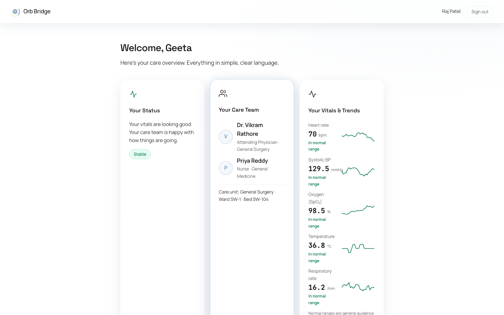

*The Bridge patient portal presents the same clinical record in plain language.*

Bridge is Orb's patient-facing portal. While every other module in this manual is built for clinicians and administrators, Bridge is the one screen designed to be handed to the patient, or to a family member at the bedside. It translates the clinical picture into plain, reassuring language: how the patient is doing right now, who is looking after them, how their vital signs are trending, what medications and reports are on file, and an AI assistant that answers everyday questions about their care in simple words.

Bridge is deliberately narrow. A patient signed into Bridge can see **only their own record**, every request is scoped on the server to the account that is signed in, and there is no way to browse other patients, wards, or staff tools. Bridge also includes a self-service follow-up appointment scheduler and, after discharge, a secure web view of the discharge summary that works without a portal account at all (see *Post-discharge access* below).

This chapter covers three related experiences:

1. The **signed-in patient portal** (the "Orb Bridge" screen) used during an admission.
2. The **AI question box** inside that portal, including exactly what it will and will not answer.
3. The **post-discharge access flow**, the secure link and QR code printed at discharge that lets a patient open their discharge summary from home after verifying their date of birth.

---

### 12.1 Signing in as a patient

Patients sign in on the **Patient Access** page (the patient variant of the login screen, staff use the *Clinician Login* variant of the same page).

1. Open the portal address your hospital provides and choose the patient login page. The card is titled **Patient Access**, with the subtitle **Orb Bridge**.
2. Enter your **Patient ID**, for example `P001` (the field shows this format as its placeholder).
3. Enter your **Password** in the field labeled **Password** ("Enter your password").
4. Select **Sign in**.

On success the portal opens directly on the Bridge home screen. If the account has multi-factor authentication enabled, a second step appears: an **Authenticator code** field asking for the 6-digit code from an authenticator app, with a **Verify code** button and a **Use a different account** link to start over.

Notes for administrators:

- The seeded demonstration environment includes one patient portal account: Patient ID **P001** (Raj Patel) with password **patient123**.
- In development builds only, a **Quick access** section appears under the form with a one-click chip for the demo patient. This section is compiled out of production builds, production login pages never display working credentials.
- If a patient leaves the password blank the page prompts "Please enter your password.", there is no default or shared password; every portal account requires a real credential.

Signing out: the **Sign out** button is always visible at the top right of the Bridge header.

---

### 12.2 The Bridge home screen

After signing in, the patient sees a single scrolling page headed **Orb Bridge** (with the Orb logo), a greeting with their name, and the welcome line:

> **Welcome, <first name>**
> "Here's your care overview. Everything in simple, clear language."

The page is organised as a row of cards, followed by a records panel and the question box:

| Area | Card / control | What it shows |
|---|---|---|
| Status | **Your Status** | Plain-language summary of how the patient is doing, with the level (Stable, Elevated or Critical) in a plain, uncoloured badge |
| Care team | **Your Care Team** | The attending physician, a ward nurse, and the care unit / ward / bed |
| Vitals | **Your Vitals & Trends** | Current readings with mini trend charts and normal-range context |
| Appointments | **Schedule Follow-Up** | Week calendar, time slots, and department picker for booking a follow-up |
| Records | **My Records** | Buttons for Medications, Report History, Lab History, Discharge Summary, and a FHIR download |
| AI assistant | Question box | "What would you like to know about your care?" |

The status card refreshes itself automatically every 30 seconds, so the page can be left open at the bedside.

#### Your Status

The **Your Status** card condenses the clinical risk picture into one of three levels, shown as a badge:

| Badge | Meaning shown to the patient |
|---|---|
| **Stable** (green) | "Your vitals are looking good. Your care team is happy with how things are going." |
| **Elevated** (amber) | "Your care team is keeping a closer eye on you right now. This is a normal precaution, they want to make sure you're comfortable and safe." |
| **Critical** (red) | "Your care team is monitoring you very closely and giving you their full attention. You're in good hands." |

The wording is intentionally calm at every level. Bridge never shows patients raw risk scores, alarm names, or clinical terminology, the level is derived from the same monitoring data clinicians see in Vigil, but the presentation is reassurance-first. If no status is available yet, the card reads "Your care team is monitoring you."

#### Your Care Team

The **Your Care Team** card answers "who is looking after me?" It lists:

- The **Attending Physician** (name and department), taken from the patient's assigned attending.
- A **Nurse** from the same department where one is on record (a ward nurse is shown on a best-effort basis).
- A **Care unit** line at the bottom: department, ward, and bed, for example "Care unit: Cardiology · Ward 3A · Bed 12".

If no team has been assigned yet the card reads "Your care team will appear here once assigned."

#### Your Vitals & Trends

The **Your Vitals & Trends** card shows up to five vital signs: heart rate (bpm), systolic BP (mmHg), oxygen (SpO₂, %), temperature (°C) and respiratory rate (/min). Each shows the latest reading, when it was measured ("Today 14:32", or the date for an older reading), and a small trend line (sparkline). The sparkline plots up to 24 points drawn from the last 48 recorded measurements, so a patient or relative can see whether a number is settling or climbing. A vital that has never been measured reads **No recent reading**.

Readings are printed as charted: whole numbers, and temperature to one decimal place. That is the same number the ward sees and NEWS2 scores.

The card does not call any reading normal, high or low, and nothing on it is colour-coded. Whether a reading is a concern depends on the patient's condition, their oxygen target and the whole set of observations, and that judgement belongs to the care team. A fixed patient-facing range cannot make it: a systolic BP of 90, which NEWS2 scores 3 points, would sit inside a typical "normal" band. The card ends with:

> "Your care team reviews every reading in the context of your condition. If you feel worse, tell your nurse straight away."

If a patient asks what a number means, staff should answer it themselves rather than point back to the card.

---

### 12.3 Asking questions: the Bridge AI assistant

At the bottom of the page is a single input labelled **"What would you like to know about your care?"** with a send (paper-plane) button. The patient types a question and presses **Enter** or the send button. The answer streams in word-by-word into a panel headed **Orb Bridge**, so the patient sees the response being written rather than waiting on a blank screen.

The assistant runs entirely on the hospital's local AI engine, the question and the answer never leave the building. It shares that engine with clinical AI features, so at busy moments an answer may take a few extra seconds to begin.

#### What the assistant knows

The assistant is given only a minimal, patient-safe snapshot: the patient's name, their current status level and status summary, a simplified one-line description of their condition, and their four current vital readings. It does **not** see the full chart, clinical notes, lab values, imaging, or staff conversations. This is a deliberate privacy and safety boundary, the assistant can explain and reassure, but it cannot reveal or interpret detailed clinical material.

#### What it will and won't answer

The assistant follows strict patient-facing rules:

- It uses **simple, everyday language**, no medical jargon.
- It is warm, brief, and reassuring; answers are kept short because patients are often tired or anxious.
- It **never gives medical advice**. For any clinical decision, "should I stop this tablet?", "is this result bad?", it will say, in its own words, *please ask your nurse or doctor*.
- If asked about a medication, it explains simply what the medication is for, but tells the patient to confirm details with their doctor.

If the assistant cannot be reached (for example the AI engine is offline), the panel shows: "Sorry, I couldn't connect to the assistant. Please ask your nurse or doctor directly."

#### Emergency and crisis guardrails

Every question is screened **before** it ever reaches the AI model by a deterministic red-flag filter written in everyday patient language. If the message matches an emergency or crisis pattern, the AI is never consulted; the portal instead returns a fixed, pre-written safety message and simultaneously raises a real-time alert to the care team.

Two categories are screened:

1. **Acute physical emergencies**, chest pain or pressure, trouble breathing or choking, stroke signs (face drooping, slurred speech, sudden numbness or weakness), heavy or unstoppable bleeding, severe allergic reactions or throat swelling, fainting, collapse, or seizures. The fixed response tells the patient this may be a medical emergency, to press the call button or have someone alert staff immediately, and to call the local emergency number if in immediate danger, and confirms the care team has been notified.
2. **Self-harm or suicidal thoughts.** The fixed response is compassionate, asks the patient to press the call button so a nurse can be with them, and points to crisis support (in the US, call or text 988), and confirms the care team has been notified.

In both cases a "patient red flag" event is published to the hospital's real-time notification layer so the duty team is alerted, including the patient's name, ward, and bed. The design principle is that an acute emergency must never be handled by a free-form generative model whose style is biased toward reassurance, the screening is rule-based and always wins.

A second protective layer defends the assistant itself: the patient's data snapshot is passed to the model inside explicit "data-only" fencing, with instruction-like text stripped, so that content in the record cannot be used to manipulate the assistant's behaviour (prompt-injection hardening).

---

### 12.4 My Records

The **My Records** card gives the patient read-only access to their own file through four buttons plus a download:

| Button | Opens | Contents |
|---|---|---|
| **Medications** | *Medication History* | Each medication with dosage, route, frequency, and a status badge (e.g. active) |
| **Report History** | *Clinical Report History* | The most recent clinical documents, title, document type, and date |
| **Lab History** | *Lab & Imaging History* | Diagnostic imaging reports, study type, clinical context, and date |
| **Discharge Summary** | *Discharge Summary* | The latest discharge summary, if one exists |
| **Download my record (FHIR)** | (download) | The full record as a standard FHIR bundle file |

Selecting any row opens a detail view:

- A **medication** detail shows Drug, Dosage, Route, Frequency, Status, and the start date.
- A **document** detail shows the full text of the note plus its type and timestamp.
- A **lab/imaging** detail shows the report analysis text (or "No analysis available.").
- The **discharge** detail shows the summary text and the discharge date.

Empty states are explicit: "No medications on record", "No documents on record", "No lab or imaging reports yet", and "No discharge summary available yet."

**Download my record (FHIR)** saves the patient's complete record to their device as a single machine-readable file (named `orb-record-<patient id>.json`). FHIR is the international standard format for health records, so the file can be given to another hospital, a GP, or a personal health app. If the download cannot be prepared the card shows "Could not download your record right now."

Everything in My Records is strictly self-scoped: the server resolves the patient's record from the signed-in account and never accepts a patient identifier from the page, so no configuration mistake can expose another patient's data here.

---

### 12.5 Scheduling a follow-up appointment

The **Schedule Follow-Up** card lets the patient book their own follow-up visit in four quick steps. Booked appointments are real records in the hospital's appointment system, clinicians see them in the patient's chart, and every booking and cancellation is written to the audit log.

#### Booking, step by step

1. **Pick a day** on the week-strip calendar. The strip shows one week (Sunday–Saturday) with the month and year above it. Use the left and right arrow buttons to move a week back or forward. Today's date is highlighted; days in the past and **Sundays** are greyed out and cannot be selected.
2. **Pick a time.** Once a day is chosen, a **Pick a time** row appears with six slots: **9:00 AM, 10:00 AM, 11:00 AM, 2:00 PM, 3:00 PM, 4:00 PM**.
3. **Pick a department.** A **Department** row appears with five options: **Primary**, **Cardio**, **Neuro**, **Ortho**, and **Lab**.
4. **Optionally add a note.** The field **"Note for your doctor (optional)"** accepts a short free-text message, the placeholder suggests "e.g. I'd like to discuss my medication…".
5. Select **Confirm Appointment**. The button shows a spinner while the booking is submitted.

On success the card flips to a confirmation: a green check mark, the word **Confirmed**, the date, time, and department of the booking, and a **New** button that resets the card so another appointment can be booked.

Safeguards built into booking:

- The server rejects dates in the past and malformed dates or times, so a stale page cannot create an invalid booking.
- Each booking carries a one-time idempotency key, so a double-click or a network retry can never create a duplicate appointment.
- Patients can only ever book **for themselves**. (Clinicians with write access can book on a patient's behalf from the staff side; that flow is covered in the Appointments chapter.)

If a booking fails, the card shows the error in red (for example "Could not book your appointment. Please try again.") and returns to the form with all selections intact.

#### Viewing and cancelling upcoming appointments

When the patient has future bookings, the card shows a **"Your upcoming appointments"** list above the calendar: each entry displays the date, time, and appointment type, with a **Cancel** button. Cancelling removes the entry immediately and marks the appointment cancelled on the server (the record is retained for the audit trail, it is a status change, not a deletion). If a cancel fails the card shows "Could not cancel. Please try again." and re-synchronises the list with the server either way. Past and cancelled appointments drop out of the upcoming list automatically.

---

### 12.6 Discharge summaries and post-discharge access

Bridge handles discharge in two ways: inside the signed-in portal, and through a standalone secure link that requires no portal account.

#### Inside the portal

Once the care team completes a discharge, the patient's **Discharge Summary** button in My Records shows the summary with a **Ready** badge and the discharge date. Opening it displays the full summary text.

#### The secure discharge link and QR code

At the moment a clinician discharges a patient, Orb automatically generates a **secure discharge link** and a matching **QR code** that is printed on the discharge paperwork. This gives patients and families access to the official discharge summary from home, on any phone or computer, without needing a portal password.

Key properties of the link:

- It contains a long random access code unique to this discharge. The hospital stores only a cryptographic fingerprint of the code, never the code itself, so the working link cannot be reconstructed from hospital records.
- It **expires automatically 30 days** after discharge (the period is configurable by the administrator).
- Every access attempt, successful or not, is recorded in the security audit log with the source network address.

#### Opening the link: date-of-birth verification

Scanning the QR code (or typing the link) opens a page titled **Secure Medical Record** with the prompt "Please verify your identity to access your discharge summary."

1. Enter the patient's **Date of Birth** using the date field.
2. Select **Access Records** (the button reads "Verifying..." while it checks).

A notice at the bottom of the card reminds the user: "For your privacy, this link is monitored and will expire automatically."

If the date of birth matches, the page unlocks and displays the record under the header **Orb Hospital Trust, Patient Portal, Discharge Summary**, with a green **✓ Verified Identity** badge. The document shown is the formal **DISCHARGE SUMMARY**, laid out for reading or printing, including: patient details (name, age/sex, ward and bed, registration and admission numbers, dates of admission and discharge, doctor's name), final diagnosis and management, history and examination findings, the hospital course narrative, the **Discharge Medication** list (each drug with dose, route, and frequency), an optional **Hospital Course Timeline** table of dated events, the follow-up instruction ("Follow up in OPD after 1 week or earlier in emergency"), and the attending physician's signature block.

A successful verification is valid for **one hour**; after that, re-opening the record requires entering the date of birth again.

#### Wrong answers, lockout, and throttling

The verification step is defended against guessing:

- After **5 incorrect date-of-birth attempts** (the default; configurable), the link is **temporarily locked for 15 minutes** (also configurable). The page states "Too many failed attempts. Access is temporarily locked until <time>." and disables the form. Once the lock time passes, verification can be attempted again.
- The page never reveals how close a guess was or how many attempts remain, an incorrect entry simply reports that the date of birth was incorrect.
- Independently of any single link, repeated attempts from the same network address across *all* discharge links are throttled, so an attacker holding many links cannot sidestep the per-link lockout.
- The date-of-birth comparison itself is performed in constant time, and failed and successful attempts alike are written to the audit log for security review.

Other messages the page can show:

| Message | Meaning | What to do |
|---|---|---|
| "This secure link has expired for your protection. Please contact the hospital for a new link." | The 30-day validity window has passed | Contact the hospital; staff can issue the summary again |
| "This secure link has been revoked. Please contact the hospital." | The hospital has invalidated this link | Contact the hospital |
| "We could not verify your identity. Please ensure you used the correct link." | The link is not recognised (mistyped, incomplete, or throttled) | Re-scan the QR code or re-copy the full link |
| "Your identity was verified, but the clinical record could not be loaded or is empty." | Verification succeeded but no summary is on file | Contact the hospital |

---

### 12.7 Troubleshooting

| Symptom | Likely cause | Resolution |
|---|---|---|
| Patient can't sign in | Wrong Patient ID or password | Verify the ID format (e.g. `P001`); passwords are required, there is no default. An administrator can reset the account |
| "This account must set up an authenticator app before signing in." | MFA enrollment is required but not completed | An administrator must enroll the account before portal sign-in |
| Status card stuck on "Loading your status…" | The backend is unreachable or the patient record isn't linked to the portal account | Check that the server is running and that the patient row is linked to the login account |
| "We're looking into your records." as the status | The signed-in account has no linked patient record | Link the portal account to the correct patient record |
| Vitals card shows "No recent reading" | No vitals have been recorded for that measure | Expected until monitoring data exists; readings appear automatically |
| Care team card is empty | No attending physician has been assigned | Assign an attending; a ward nurse is shown automatically once a department is known |
| AI answer never appears / connection message shown | Local AI engine is not running or is busy | Confirm the AI engine is up; ask the patient to try again, or answer the question in person |
| Booking fails with a date error | The selected day passed while the page was open | Re-select a current date; past dates are rejected by the server |
| "Download my record (FHIR)" button is greyed out | The record is still loading, or no patient record is linked | Wait for the page to finish loading; verify account-to-patient linkage |
| Discharge link reports "locked" | Five wrong date-of-birth entries | Wait for the stated time (15 minutes by default) and retry with the correct DOB |
| Discharge link "expired" | More than 30 days since discharge | Hospital staff must provide the summary through another channel |

---

### 12.8 Safety & limitations

- **No medical advice.** The Bridge assistant explains and reassures; it does not diagnose, interpret results, or advise on treatment. It is instructed to redirect all clinical decisions to the nurse or doctor, and staff should present it to patients that way.
- **Emergencies bypass the AI.** Messages describing emergencies or self-harm are caught by a rule-based screen before any AI involvement, answered with fixed safety instructions, and escalated to the care team in real time. The portal is **not** an emergency channel, and its fixed responses say so, patients in distress are always directed to the call button, staff, or emergency services.
- **Minimal AI context.** The assistant sees only the patient's name, simplified status, one-line condition, and current vitals, never the full chart. Its answers are therefore general by design; it cannot discuss specific lab values, imaging findings, or notes.
- **Patient-education ranges only.** The normal ranges printed on the vitals card are general guidance bands, not the clinical alarm thresholds the care team uses. The card says as much on screen.
- **Reassurance-first status wording.** Even a Critical status is phrased calmly. Clinicians should be aware that the patient-facing wording deliberately understates urgency; it is not a substitute for a proper conversation about deterioration.
- **Strict self-scoping.** All portal data, status, vitals, records, appointments, downloads, is resolved server-side from the signed-in account. A patient cannot request another patient's data, and staff tools are unreachable from a patient session.
- **Local processing.** Questions and answers are processed on the hospital's own hardware. Nothing typed into Bridge is sent to an external AI service.
- **Discharge links are bearer secrets.** Anyone holding the link *and* the patient's date of birth can read the discharge summary until the link expires. Advise patients to treat the printed QR code like a document containing health information. The design mitigations, hashed storage, 30-day expiry, 5-attempt lockout, cross-link throttling, one-hour sessions, and full audit logging, reduce but do not eliminate this inherent property of shareable links.
- **Booking is a request to attend, not triage.** The scheduler books fixed slots in named departments; it does not check clinician availability conflicts or clinical urgency. Patients needing urgent review should contact the hospital rather than book a routine slot.

---

## 13. Administration & Governance

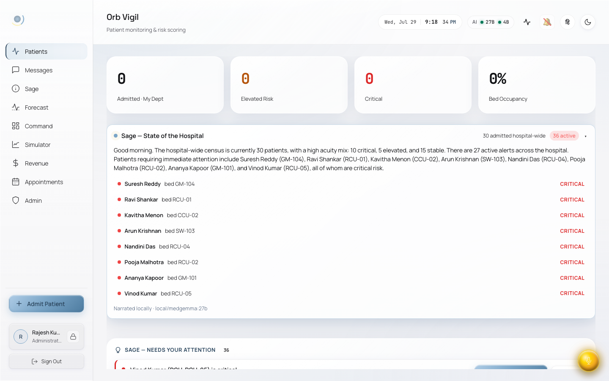

*The administration workspace: user accounts, audit trail, model governance, and compliance.*

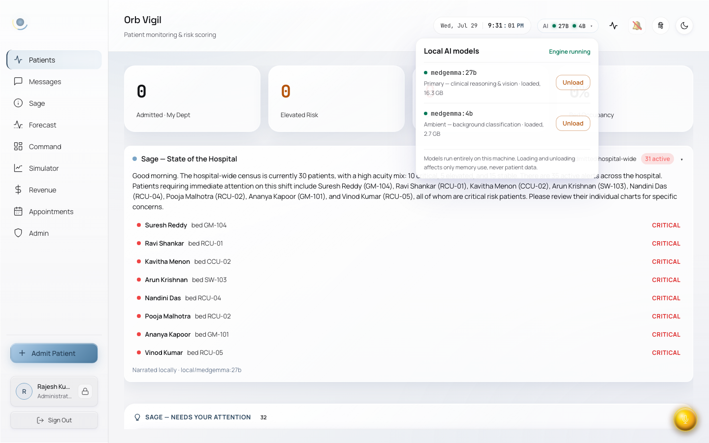

*The AI model panel, opened from the header chip. Administrators can load or unload each local tier.*

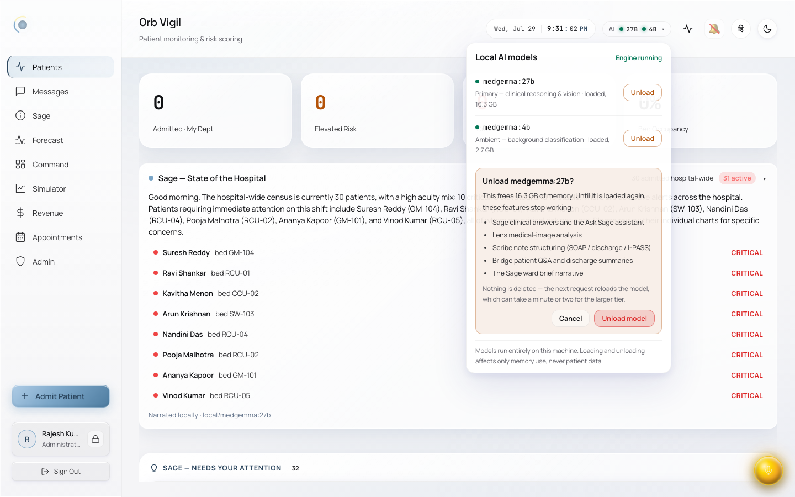

*Unloading asks for confirmation and lists exactly which clinical features stop working until the model is loaded again.*

Every hospital that runs Orb needs one person who can answer three questions at any moment: *who can do what in this system, what has actually happened in it, and can we prove both?* The Admin console is where that person works. It gathers user management, the tamper-evident audit trail, AI model governance, the live compliance posture, backups, data erasure, and downtime preparedness into a single screen, and it is available only to accounts with the **admin** role (in the demo environment, sign in as **ADM001, Rajesh Kumar**).

This chapter covers the Admin console tab by tab, then the three governance surfaces that live outside it: EHR Downtime Mode, the Revenue Integrity panel, and the operational metrics endpoint used by IT.

### 13.1 Opening the Admin console

1. Sign in with an admin account (employee ID and password).
2. In the left sidebar, click **Admin** (the shield icon, at the bottom of the navigation list).
3. A row of sub-tabs appears across the top of the panel. Click any of them to switch views.

| Sub-tab | What it shows |
|---|---|
| **Overview** | Pre-aggregated 24-hour governance snapshot: audit volume, ingestion health, alerts, auth activity |
| **Audit Logs** | The full searchable, filterable audit trail |
| **Trace** | Every audit event that shares one correlation ID, ordered as a pipeline |
| **Ingestion** | Recent device/interface payloads and their parse status |
| **Security** | Authentication and permission events only |
| **Alerts** | Vigil and Relay alert-generation records |
| **Model Governance** | The AI/ML model registry with provenance and validation status |
| **Impact** | Quantified ROI and outcomes dashboard with tunable assumptions |
| **Trust Center** | Live compliance posture: trust score, control checklist, MFA adoption, RBAC matrix |
| **Flight Recorder** | Replayable timeline of audit events, system events and order transitions, with chain verification |
| **Users** | User accounts: create, change role, reset password, deactivate/activate |
| **Data & Backups** | Database backups and GDPR patient erasure |

Admins also see most clinical panels (Patients, Messages, Sage, Forecast, Command, Simulator, Revenue, Appointments) so they can follow up on anything the governance views surface.

### 13.2 Overview: the governance snapshot

The **Overview** tab answers "is the system healthy right now?" with six stat cards, all computed over the last 24 hours:

- **Ingestion Mode**, whether the deployment runs in **Simulation**, **Ingestion**, or **Hybrid** mode (live interfaces vs. the built-in demo generator), plus whether audit simulation is On or Off.
- **Audit Events (24h)**, total audit rows written, broken down by category chips (e.g. `phi_access`, `authentication`).
- **Ingested Payloads (24h)**, interface payloads received, with chips for **parsed**, **failed**, and **dupes**.
- **Source Distribution**, distinct ingestion sources and the volume from each.
- **Alert Activity (24h)**, Vigil and Relay alerts generated, combined and per module.
- **Records Written (24h)**, vitals and observations actually inserted into the chart.

Below the cards, a **Recent Parse Failures** table lists the last five payloads that could not be parsed (time, source, error text, correlation ID), and an **Auth Summary (24h)** section shows login successes, failures and permission denials as outcome-badged chips.

### 13.3 User management (Users tab)

The **Users** tab lists every account in the system, ordered by role and name. Each row shows **Name**, **ID**, **Role** (color-coded chip: doctor, nurse, admin, pharmacist, patient), **Department**, **MFA** (**On** if the user has enrolled a TOTP authenticator, **Off** otherwise), **Status** (**Active** or **Disabled**, disabled rows are tinted), and an **Actions** column. Every action described below is written to the audit log with the acting admin's identity.

#### Creating a user

1. Click **Create user** (top right of the panel).
2. Fill in the dialog: **User ID** (this becomes the login ID, e.g. `DR-0142`), **Full name**, **Role** (doctor, nurse, admin, pharmacist, or patient), **Department** (optional), and a **Temporary password** of at least 8 characters. The password field is shown in clear text so you can read it out or copy it.
3. Click **Create user**. The list refreshes and a "User created" confirmation appears.

Hand the ID and temporary password to the new user; they should change the password from their own session (self-service password change immediately signs them out everywhere, including their current session, so they will log back in with the new password). Duplicate IDs are rejected with a clear error.

#### Changing a role or department

Click **Role** on the user's row. The **Change role & department** dialog opens pre-filled; adjust either field and click **Save changes**. Role changes take effect on the user's next request, permissions are checked per-request against the current role, so there is no need to force a re-login.

#### Resetting a password

Click **Reset password** on the row. The dialog warns that this **revokes all of the user's active sessions**. Type a new password (minimum 8 characters) or click **Generate** for a random one, click **Copy** to put it on the clipboard, then **Set password**. The user is signed out of every device instantly and must log in with the new password.

#### Deactivating and reactivating

Click **Deactivate** on an active user. The confirmation dialog states exactly what will happen: the user *"will be blocked from logging in and all their active sessions will be revoked."* Confirm with **Deactivate**. Session revocation is immediate, any token the user already holds stops working on their next request. A disabled account is re-enabled with **Activate** on its row.

Two guardrails apply: you cannot deactivate your own account (this prevents locking out the last administrator mid-session), and deactivation never deletes anything, the account, its history and its audit trail remain intact.

#### MFA status and signing PINs

The **MFA** column is read-only for the admin: enrollment is self-service. Each staff member enrolls their own authenticator app via the **Security & MFA** button in the sidebar footer of their session; once enrolled, the chip flips to **On**. The Trust Center (section 13.6) tracks adoption per role, including any roles your deployment has configured as MFA-mandatory.

Separately from login MFA, Orb uses a short numeric **signing PIN** as the second factor when a clinician confirms agentic orders. A user provisions their own PIN by re-entering their password (a stolen session token alone can never mint a signing credential); an admin can provision or replace a PIN for any user. Every provisioning is audit-logged.

### 13.4 The audit trail and hash-chain integrity

Orb's audit log is append-only and **tamper-evident**: every row is sealed into a SHA-256 hash chain, meaning each entry's fingerprint incorporates the fingerprint of the entry before it. Altering or deleting any historical row breaks the chain from that point forward, and the break is detectable and locatable. This is the backbone of every governance claim in this chapter.

#### Audit Logs tab

The filter bar accepts a **Correlation ID**, a **Patient ID**, and dropdowns for action type (**All actions**), category (**All categories**) and outcome (**All outcomes**, success, failure, partial success, denied). Press Enter in either text field or click the search button to apply. Results are paginated 25 per page with a running total.

Each row shows Timestamp, Correlation, Category, Action, Outcome, Actor, Patient and Summary. The correlation ID is a link: clicking it jumps to the **Trace** tab with that ID pre-loaded, showing every event that shares it, for example, one device payload traced from *ingestion request received* through *vital inserted* and *NEWS2 recomputed* to *Vigil alert generated*. This is the fastest way to answer "why did this alert fire?"

The **Security** tab is the same log pre-filtered to authentication and permission events, and the **Alerts** tab isolates Vigil and Relay alert-generation records, useful for reviewing alert volume without wading through the full trail.

#### Flight Recorder

The **Flight Recorder** tab is the forensic replay surface: a unified, time-ordered stream of audit events, internal system events, and order state transitions, which an admin can scrub through like a video.

- **Chain badge**, the header always shows the current integrity verdict: a green **Chain verified · N** badge (N sealed rows checked), or a red **Tampered at #N** badge identifying the first broken row. This verification runs live against the actual database every time the recorder loads.
- **Scope**, type into **Filter by patient ID…** and press Enter (or click **Reload**) to replay everything that happened to one patient; leave it empty for the hospital-wide stream (up to the most recent 500 events).
- **Transport bar**, step backward (◀), **play/pause** (advances automatically about once per second), step forward (▶), plus a scrubber slider and a position counter (`current / total`) with the selected event's timestamp.
- **Timeline list**, each entry is color-coded by lane (**Audit**, **Event**, **Order**) and carries a ✓ when its chain link verifies or a ⚠ flag if that row is implicated in a chain break.
- **Detail pane**, for the selected event: Time, Actor, Target, Patient, Correlation, Detail, and the complete **Raw record** exactly as stored.

Use the Flight Recorder for incident reconstruction ("show me everything around 03:20 for bed 12"), for demonstrating tamper-evidence to an auditor, and for verifying that a suspected integrity problem is or is not real.

### 13.5 AI model governance (Model Governance tab)

Orb treats model honesty as a governance feature. The **Model Governance** tab is a registry of the system's four *clinical decision* model surfaces, each with: **Model** (name and task), **Version**, **Training data** (the lineage statement), **Checkpoint** (badge: **present** or **none**, whether a trained model file actually exists on this machine), **Validated** (badge: **validated** or **not validated**), and **Active**.

The registry is deliberately blunt. Every deployment shows exactly these four rows and no others, the registry is written from a fixed list in the code, and any row not on that list is deleted on start-up precisely so a stale entry cannot over-claim:

| Surface | What the registry states |
|---|---|
| Vigil NEWS2 | Deterministic rule-based early-warning scorer (RCP NEWS2, incl. Scale 2 for COPD), no training data by design |
| Vigil CfC overlay | **Untrained**, no checkpoint; the deterioration overlay stays inactive and risk falls back to NEWS2 alone ("fails closed") |
| Forecast LSTM | Trained on **synthetic** demo data, explicitly not validated on real clinical data |
| Sage LLM | MedGemma 27B running locally via Ollama; pretrained, not fine-tuned on your data; decision-support only |

**What the registry does not cover.** These four are the surfaces that produce a clinical judgement. The other models Orb runs locally are not listed in this tab and are not separately version-tracked here: the smaller MedGemma 4B that serves ambient Relay classification and the fast tier of Thinking Mode (§4.10), the Whisper speech-to-text model behind Scribe and voice, the vision model behind Lens, and the embedding/reranking models behind guideline retrieval. If your governance process requires a full model inventory, take it from the deployment runbook rather than from this tab.

The panel's own words set the policy: *"Orb never presents an untrained or unvalidated model as validated."* The same provenance is exposed to clinicians in miniature: AI outputs across the app carry a provenance chip identifying which model and version produced them and whether that model is validated, and the chip links back to this tab for the full record. If a checkpoint has been added or removed on disk, use the registry re-sync action to recompute checkpoint presence.

### 13.6 Compliance & Trust Center

The **Trust Center** tab renders a live compliance-posture report computed from the running system, not a static document. Most probes read real state, so amber and red results appear when they are true; that honesty is what makes the green results credible to an auditor.

**One control is not a probe.** Of the nine controls, *TLS / encryption in transit* is hardcoded to amber with fixed evidence text stating that Orb does not terminate TLS itself. That is untrue of any deployment where `ORB_TLS_CERT` and `ORB_TLS_KEY` are set, Orb then serves HTTPS directly. Read that row against your deployment configuration rather than as an observation. This is a known defect and is on the fix list; every other control on the list is computed.

At the top, a **Trust Score** ring shows a 0–100 weighted score across all controls (green at 80+, amber at 50–79, red below), alongside counts of **Passing**, **Warnings** and **Failing** controls and a **Models validated** tally, plus the generation time and deployment profile.

Below it:

- **Tamper-evident audit log**, a full chain verification with a badge reading **Verified, chain intact** or **Broken, tampering detected**, the number of sealed rows checked, and (if broken) the first failing row number. Category pills summarize audit coverage.
- **Control checklist**, each control shows a Pass/Warn/Fail/Unknown chip, concrete **evidence** ("what we observed"), and a **Remediation** hint. Nine controls are listed: *TLS / encryption in transit* (see the caveat above), *Encryption at rest, database*, *Encryption at rest, PHI uploads*, *Multi-factor authentication*, *Tamper-evident audit log*, *Role-based access control*, *Backup & recovery*, *Session revocation*, and *Data residency / on-prem*.
- **MFA adoption**, TOTP enrollment per role as progress bars, with the org-wide percentage and a **required** marker on any role your deployment mandates MFA for.
- **Posture mini-cards**, encryption at rest for the database and PHI uploads (SQLCipher and AES-256-GCM respectively, when keys are configured), model validation counts, and the on-prem attestation (whether the server binds only to this machine, and the size of the CORS allow-list).
- **RBAC matrix**, click **Show matrix** to expand the complete roles × permissions grid, exactly as enforced per-route on the server. This is the authoritative answer to "can a nurse do X?"

A **Warn** on an encryption control typically means the corresponding key is not configured on this deployment; the remediation text says exactly what to set. The Trust Center is strictly read-only reporting.

### 13.7 EHR Downtime Mode

Downtime Mode is Orb's answer to "what does the ward look at when the EHR, the network, or the AI stack is down?" It is a durable, local, **read-only** snapshot of each patient's essential clinical picture, demographics, allergies front and center (with an explicit "No known drug allergies recorded (NKDA)" statement when clean), latest vitals with the NEWS2 score and level, and current medications, rendered as a high-contrast, print-friendly document. Reading and capturing snapshots involves no AI and no network, which is precisely what keeps it usable during an outage.

#### Viewing and capturing a snapshot

1. From a patient's Vigil view, click **DOWNTIME** in the patient command bar. The snapshot opens in a new browser tab titled **EHR Downtime Mode** ("Local read-only snapshot · works offline").
2. If no snapshot exists yet, the page says so and invites you to capture one. Click **Capture snapshot** (or **Re-capture now** to refresh an existing one). Any clinician with vitals access can capture; every capture is audit-logged.
3. Click **Print** to produce the paper copy. The banner on every snapshot states **DOWNTIME SNAPSHOT**, the capture time, and who captured it, so a printed sheet is never mistaken for a live chart.
4. **Reload** re-reads the stored snapshot (it does not re-capture).

#### Downtime readiness (Command Center)

The Command Center includes a **Downtime Readiness** KPI: the percentage of currently admitted patients who have a recent snapshot, the raw count (e.g. "14/16 snapshots"), and the age of the oldest one. It turns amber below 80% and red below 50%. The **Capture all** button beside it snapshots *every* admitted patient in one action, run it as a pre-downtime drill, before planned maintenance, or on a schedule. The result ("N snapshots captured") appears inline and the KPI refreshes immediately. Capture-all is an admin action; it is also audit-logged with the count captured.

The operational habit to build: keep readiness green during normal operations, and print snapshots for the ward *at the start* of any planned outage, the printed sheet is the fallback, and it can only contain what was captured before the systems went down.

### 13.8 Backups and data erasure (Data & Backups tab)

#### Database Backups

The **Database Backups** card lists every existing snapshot (Filename, Size, Created, newest first) and shows the current count. To create one:

1. Click **Create backup**.
2. The confirmation dialog explains that a consistent snapshot of the live database will be written to the server's backups directory and integrity-checked, and that this is **safe to run while the system is in use**, the snapshot is transactionally consistent even mid-write, and if the database is encrypted at rest the backup is written encrypted with the same key.
3. Click **Create backup** to confirm. A "Backup created" toast appears and the list refreshes. The creation is audit-logged with filename and size.

Backups older than the retention window (14 days by default, configurable by IT) are pruned automatically after each successful backup. Note what is deliberately absent: **there is no Restore button.** As the panel states, restores must be performed out-of-band by an operator with the server stopped, a one-click restore would silently discard every record written since the snapshot, including audit rows, and would break the audit hash chain.

#### Data Erasure (GDPR right to be forgotten)

> **Known defect, this does not currently work on pilot data.** For any patient who has real (non-simulator) shadow-mode records, the purge aborts with a server error and erases nothing. The cause is a collision between two deliberate designs: the delete plan is derived from the live schema, so it includes the shadow-mode event table, and that table is append-only at the database layer for real rows. The transaction is atomic, so nothing is half-erased, but nothing is erased either. **Treat data-subject erasure as unavailable until this is fixed.** The rest of this section describes the intended behaviour.

The **Data Erasure** card permanently anonymizes one patient and deletes all of their clinical records, vitals, medications, notes, documents, messages, appointments, risk scores, snapshots and related data.

1. Type the patient's ID (e.g. `P001`) into the field and click **Erase patient**.
2. A typed-confirmation dialog opens. You must type the exact phrase **ERASE {patient ID}** before the red **Erase patient** button arms. The dialog restates the consequences: irreversible, audit trail preserved.
3. On success you see "Patient P001 erased, N clinical record(s) removed."

Guardrails: erasure is **refused for a currently admitted patient** (discharge or transfer first, erasing a live inpatient's record would be a clinical-safety hazard). The audit trail is deliberately *not* deleted; a single audit row recording the erasure (containing only the patient ID, no clinical data) remains so the fact of erasure stays provable. The operation is idempotent, repeating it on an already-erased patient reports "already erased" and changes nothing.

### 13.9 Revenue integrity and coding review

The **Revenue** tab in the main sidebar (available to doctors, nurses and admins, it is documentation-derived, so it follows documentation-read access) hosts the **Revenue Integrity** panel: AI medical coding and clinical documentation improvement (CDI) review for one patient at a time.

1. Enter a **Patient ID** and click **Analyze** (when opened from a patient context, the ID is pre-filled).
2. The headline banner shows **Captured today** → **Potential with CDI**, with the difference as a **Capture opportunity** uplift figure.
3. **Suggested codes** lists ICD-10/SNOMED candidates as code chips, each with the coding system, a plain-language display, the documentation **evidence** it was derived from, and a **confidence** percentage bar.
4. **CDI gap flags** lists documentation gaps (for example, a non-specific diagnosis that could be documented to higher specificity), each with a rationale and an estimated dollar impact.

Read the banner under the headline before acting on any number: *"Illustrative estimate … Not real payer rates; a coder/CDI specialist must confirm before billing."* Every dollar figure is computed from a stated assumption model with visible caveats and citations. The panel suggests and flags, it never submits codes, and nothing here feeds a billing system directly. Its correct use is as a worklist for your coding/CDI team, not as a billing engine.

### 13.10 Operational metrics for IT

For monitoring, the server exposes a standard Prometheus-format metrics page at `/metrics` on the application port. It reports only coarse operational counts, process uptime, database file size, total patients, total orders, total audit rows, currently active admissions, and the local AI queue depth and active workers, and **never contains patient data**. Because it is PHI-free, it is readable without login by default so a standard monitoring scrape works out of the box; if the port is reachable beyond the host, IT can require a bearer token via server configuration. Watching `orb_llm_queue_depth` is the quickest way to spot an overloaded AI backend before clinicians feel it.

### Troubleshooting

| Symptom | Likely cause and fix |
|---|---|
| The **Admin** tab is missing from the sidebar | The signed-in account is not an admin. Check its role on the Users tab from an admin session. |
| A deactivated user reports they can still see data | Their open page is showing already-loaded content; the next server request will be rejected. Have them refresh. |
| Flight Recorder or Trust Center shows a red **Tampered** / **Broken** badge | Treat as a security incident: note the reported row number, preserve the database and recent backups, and investigate filesystem access. The badge means a stored audit row no longer matches its sealed hash, it does not fix itself. |
| **Create backup** fails with an integrity error | The fresh copy failed its integrity check and was discarded; the live database was untouched. Check disk space and health, retry, escalate if it persists. |
| Patient erasure returns "currently admitted" | By design. Discharge or transfer the patient, then erase. |
| Patient erasure returns a server error on a discharged patient | Known defect, the purge aborts against the append-only shadow-mode table. Nothing was erased. See §13.8. |
| Downtime page says no snapshot has been captured | Click **Capture snapshot**, or run **Capture all** from the Command Center to cover every admitted patient. |
| Model Governance shows **none** under Checkpoint | Honest reporting: no trained model file exists for that surface, which fails closed to its deterministic path. Information, not an error. |
| Overview shows parse failures climbing | Open the failure's correlation ID in **Trace** to see where the pipeline stopped; check **Ingestion** for the raw payload status. |

### 13.11 Shadow mode: how Orb is introduced to a live ward

Orb is not switched on for a ward. It is introduced through **shadow mode**: a period in which Orb ingests real patient data, forms its own view of who is deteriorating, drafts what it would have said, and shows none of it to anyone. Care continues exactly as before, through the existing systems and the existing people, while Orb's judgement accumulates in a log alongside what actually happened.

The reason is that there is only one window in which Orb's central claim can be tested honestly. From the moment a clinician sees an Orb alert, Orb has begun changing the outcomes it is being measured against, and the clean measurement is gone permanently. Shadow mode is that window.

Three phases, with a gate between each:

| Phase | Who sees Orb's clinical output | What it establishes |
|---|---|---|
| **A, Silent** | Nobody. Operator and champion see only the scorecard. | Whether Orb detects real deterioration, how early, and at what false-alert cost, measured at zero clinical risk, because nothing is acted on. |
| **B, Champion-only** | The physician champion, who judges rather than acts. | The failure modes aggregate metrics hide: alerts that are correct but useless, phrasing that misreads at 3 a.m., cohorts where the model is confidently wrong. |
| **C, Phased access** | Widening by role and ward, on the champion's schedule. | Whether Orb works in real clinical hands. |

Out of it comes a **composite scorecard**: detection lead time, false-alert rate, agreement between Sage's drafts and what clinicians actually did, and a clearly-labelled proxy for time saved. Every figure carries its denominator and date range, and "insufficient data" is displayed as insufficient data rather than as a flattering zero.

Two things are worth stating here rather than leaving to the operating manual. First, **the scorecard's most important number depends on the hospital, not on Orb**: detection lead time needs a record of the clinical event Orb was predicting, escalation, rapid-response call, critical-care transfer, death, and that record has to be agreed and captured from day one, because it cannot be reconstructed afterwards. Second, **shadow mode is deliberately reversible**: any phase can be stepped back at any time without clinical consequence, and doing so is a normal operational action rather than a failure.

Full detail, readiness checklist, phase exit bars, what is recorded, how each metric is calculated and what each cannot prove, is in **[SHADOW_MODE.md](SHADOW_MODE.md)**.

### Safety & limitations

- **The audit chain proves integrity, not omniscience.** It guarantees that recorded events have not been altered or deleted; it cannot record actions taken entirely outside Orb (for example, someone reading a printed downtime sheet).
- **Backups protect data; the UI deliberately cannot restore them.** Every restore is a destructive, operator-led procedure with the server stopped. Plan restores; never improvise them.
- **Patient erasure is irreversible** and intentionally hard to trigger: typed confirmation, an admitted-patient block, and a preserved audit record of the erasure itself. There is no undo. It also **does not currently succeed on real pilot data**, see the defect note in §13.8 before promising a regulator that Orb can honour an erasure request.
- **Model governance statements are the ground truth for AI trust.** If the registry says a model is not validated or its checkpoint is absent, no output from that surface should be treated as validated decision support, and Orb will not present it as such.
- **Revenue Integrity figures are illustrative.** They use a stated assumption model, not payer contracts. A qualified coder or CDI specialist must confirm every code before billing.
- **The Trust Center reports; it does not enforce.** An amber MFA control does not block logins, pair the report with policy (mandate MFA for privileged roles, review the Users tab for **Off** chips on admin accounts).
- **Downtime snapshots are only as fresh as their capture time.** The Downtime Readiness KPI exists precisely so stale snapshots are visible before you need them. The AI stack plays no part in downtime views, by design, nothing on that page depends on a model being up.

---

## 14. Pulse, Integrations & Data Exchange

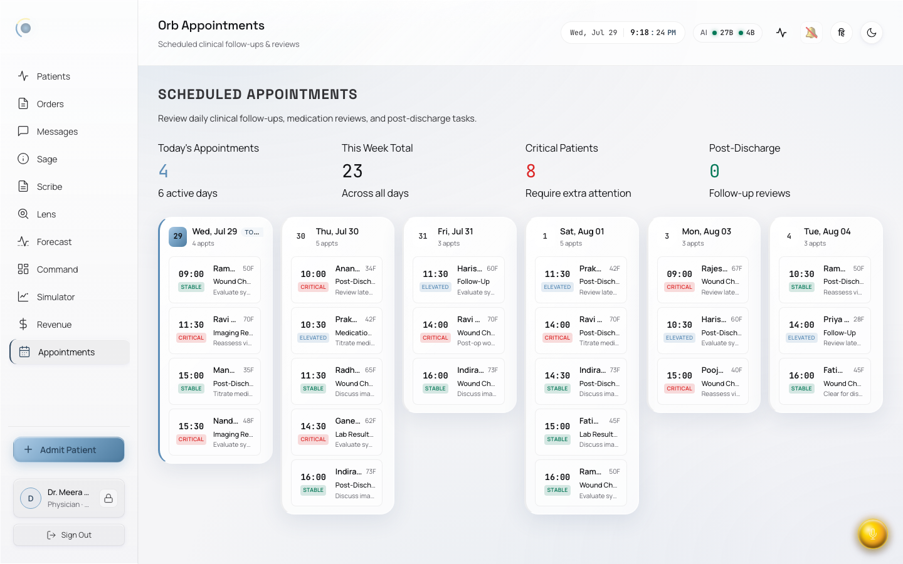

*The Appointments board: scheduled follow-ups, medication reviews, and post-discharge tasks.*

Orb is a local-first system: the clinical record, the AI models, and the database all live on hospital hardware. This chapter covers every place where Orb touches the outside world, and the strict rules that govern each crossing:

- **Orb Pulse**, a live environmental intelligence feed (weather, air quality, flu activity, drug recalls) that flows *into* Orb and never sends anything out.
- **FHIR export**, standards-based export of a patient's record *out* of Orb, for EHR write-back and patient data portability.
- **Clinical data ingestion**, the inbound interface that lets bedside monitors, lab systems, and other hospital software write real vitals and results *into* Orb.
- **Appointments**, the shared scheduling layer that connects the patient portal's booking card to the clinician-facing schedule.

The unifying principle: data about the world flows in freely; data about patients leaves only through audited, permission-gated, standards-based export.

### 14.1 Orb Pulse: environmental intelligence

#### What Pulse is for

Hospitals do not operate in a vacuum. A heat wave fills the wards with dehydrated elderly patients; a spike in air pollution brings asthma and COPD exacerbations; flu season strains respiratory isolation capacity; an FDA recall may affect a drug your pharmacy stocks. Orb Pulse pulls these public signals into one popover and translates them into concrete clinical alerts with recommended actions.

Pulse is strictly **one-directional**. It pulls from free public data services and pushes nothing back. No patient identifier, vital sign, or clinical detail ever leaves the building through Pulse, the only things transmitted are the map coordinates used to fetch local weather and air quality.

#### Opening Pulse

Pulse lives in the header of the clinician shell, next to the notifications bell. Click the small heartbeat-line icon (its tooltip reads **"Orb Pulse, Environmental Intelligence"**). A translucent panel slides open over the workspace.

When at least one environmental alert is active, the trigger icon carries a small colored badge, red for a high-severity alert, amber for moderate, so you can see at a glance that conditions warrant attention without opening the panel.

To close the panel, click the icon again, click anywhere outside the panel, or press **Escape**. If you are inside a detail view, Escape first steps back to the main panel, then closes it.

#### Location

The first time you open Pulse, your browser asks for permission to share your location:

1. If you **allow**, Pulse uses your coordinates, looks up the nearest city name, and shows it in the panel header (during lookup the header briefly reads **"Locating..."**).
2. If you **decline** (or the browser has no location service), Pulse falls back to its configured default city.

Your chosen location is remembered between sessions on that device. To refresh or change it, click the location label (with the map-pin icon) in the panel header, Pulse will re-request your position.

#### Reading the panel

The panel is organized top to bottom, most urgent first. Each section names its data source in small text on the right of its label.

| Section | Source label | What it shows |
|---|---|---|
| **Active Clinical Alerts** | Orb Pulse Engine | Alert cards generated from the feeds below. High-severity alerts carry a red warning triangle; moderate alerts an amber circle. When nothing is active you see "No active environmental alerts". |
| **Weather** | Open-Meteo | Current temperature, conditions, "feels like" temperature and humidity, plus a seven-day forecast strip (day, icon, high/low). |
| **Air Quality** | Open-Meteo AQI | The US Air Quality Index number, color-coded by category (Good, Moderate, Unhealthy for Sensitive Groups, Unhealthy, Very Unhealthy, Hazardous), with the current PM2.5 reading. |
| **Flu Surveillance** | CDC FluView | The national influenza-like illness (ILI) rate and an activity level (minimal, low, moderate, high, very high). |
| **Recent FDA Drug Recalls** | openFDA | The three most recent FDA drug enforcement actions: product, reason for recall, and classification. |

The panel footer always reads **"Inbound only · Zero patient data transmitted"** and includes a **Refresh** button.

#### Detail views

Every card is clickable. Clicking opens a detail overlay with a back arrow in the top-left corner:

- **Weather Details**, full current readings (Humidity, Wind Speed, Pressure, Coordinates), the complete 7-Day Forecast, any Clinical Recommendations, and a source attribution link.
- **Air Quality Details**, the AQI hero number and category, plus individual pollutant rows: PM2.5, PM10, Ozone, Nitrogen Dioxide, and Carbon Monoxide, with Clinical Recommendations when the index is elevated.
- **Flu Surveillance Details**, the ILI percentage, Source, Surveillance Week, Year, and (when real CDC data is flowing) the number of Patients Surveyed.
- **Alert Details**, for any clinical alert: the full message, Severity, Type, At-Risk Groups, and a checklist of Recommended Actions.
- **Drug Recall Details**, the full product description, Reason for Recall, Recall Number, Status, Recalling Firm, Location, Report Date, and Initiation Date.

Every detail view ends with a "Source:" badge linking to the originating public service, so you can verify the data yourself.

#### How clinical alerts are generated

Pulse converts raw environmental readings into alerts using fixed clinical thresholds. Each alert names the at-risk patient groups and lists concrete recommended actions (for example, a heat advisory recommends increasing IV fluid monitoring for at-risk patients and increasing rounding frequency on geriatric wards).

| Alert | Trigger | Severity |
|---|---|---|
| Heat Advisory | Temperature at or above 38 °C | Moderate; **high** at 42 °C or above |
| Cold Advisory | Temperature at or below 5 °C | Moderate |
| Storm Forecast | Rain showers or thunderstorms forecast within the next 3 days | Moderate; **high** for thunderstorms |
| Dangerous Heat Index | Temperature at or above 32 °C combined with humidity at or above 70% | High |
| Air Quality Alert | AQI above 100 | Moderate; **high** above 150 |
| Influenza Surge | National ILI rate above 3.0% | Moderate; **high** above 5.0% |

Alerts are sorted with high severity first, and the count drives the badge on the header icon.

#### Refresh behavior and the flu fallback

While the panel is open, Pulse refreshes itself automatically every 15 minutes; the **Refresh** button in the footer forces an immediate re-fetch. Behind the scenes each feed is cached to be a good citizen to the free public services: weather for 30 minutes, air quality and FDA recalls for one hour, and flu surveillance for 24 hours (the underlying data is weekly). If a feed is temporarily unreachable, Pulse quietly serves the last good data it has rather than showing an error.

Flu surveillance has an explicit fallback: when the CDC service cannot be reached at all, Pulse substitutes a **seasonal estimate**, a typical ILI value for the current month of the year. This is clearly labeled: the popover shows "(seasonal estimate)" next to the ILI figure, and the detail view's Source row reads "Seasonal Estimate (CDC API unavailable)". A seasonal estimate is a climatological guess, not surveillance, treat it as background context only, and never as evidence of an actual surge.

#### Privacy: the INBOUND_ONLY guarantee

Every single external data pull that Pulse makes is written to an ingestion audit trail recording the timestamp, the source, the exact address queried, the outcome, and a cryptographic fingerprint of the response, and every entry is stamped with the direction **INBOUND_ONLY**. Administrators with audit access can review this trail to verify that the only information transmitted outward was a pair of map coordinates. The dashboard payload itself carries the statement "INBOUND_ONLY, zero patient data transmitted", and the panel footer restates it in plain language.

The one nuance worth knowing: the city name shown in the header is resolved by sending your coordinates to a public map service (OpenStreetMap). Coordinates only, never anything about patients or users.

### 14.2 FHIR export: getting data out of Orb

#### What FHIR export is for

FHIR R4 is the lingua franca of modern health data exchange. Orb can serialize its clinical record into standard FHIR resources so that:

- A hospital's main EHR can absorb what happened in Orb (write-back).
- A patient can take a complete machine-readable copy of their own record with them (data portability).

Export is read-only from Orb's perspective, it never modifies the record, but it is treated as the most sensitive operation in this chapter, because protected health information leaves the system.

#### What can be exported

| Export | Contents |
|---|---|
| **Patient** | A single FHIR Patient resource, demographics and identifiers for one patient. |
| **Everything bundle** | A complete FHIR collection Bundle for one patient: the Patient resource plus all Observations (vitals and labs), MedicationRequests, AllergyIntolerances, and Conditions. An optional "since" filter restricts the bundle to data recorded after a given moment, useful for periodic incremental syncs into an EHR. |
| **MedicationRequest bundle** | A searchset Bundle containing just the patient's medications as MedicationRequest resources. |

Two provenance guarantees apply to everything Orb exports:

1. Every exported resource is explicitly flagged as **originating from Orb**, so a receiving EHR always knows where the data came from.
2. Any content that was AI-assisted (for example, an AI-suggested medication that has not been clinician-verified) carries an **ai-draft** provenance tag. Receiving systems can, and should, treat draft-tagged content differently from verified clinical facts.

#### Who can export

- **Clinicians and administrators** with full patient-read access can export any patient's record through the export interface.
- **Patients** can export exactly one record: their own. This is the data-portability path.

There is no anonymous or unauthenticated export of any kind.

#### Patient self-export: "Download my record (FHIR)"

In the patient portal (Bridge), the **My Records** panel contains a button labeled **"Download my record (FHIR)"**. One click assembles the patient's complete everything-bundle and downloads it to their device as a JSON file named after their record. If the download cannot be completed, an error message appears directly beneath the button ("Could not download your record right now."), the patient can simply try again.

The file is a standard FHIR R4 Bundle, readable by any FHIR-aware application, another hospital's intake system, or a personal health record app.

#### Every export is audited: and the audit is fail-closed

Each FHIR export writes a **PHI-access** event to Orb's audit chain: who exported, what resource type, which patient, how many resources, from what network address, and when. This audit category is *fail-closed*: if the audit record cannot be persisted, the export itself is refused. It is impossible for patient data to leave Orb without a durable audit record of the fact. (Chapter on the audit chain covers how to review these events in the Flight Recorder.)

### 14.3 Inbound clinical data ingestion (administrators)

This section is for administrators and hospital integration teams. Clinicians never interact with the ingestion interface directly, they simply see its results: real vitals and lab values appearing on patient dashboards in real time.

#### Simulation mode vs. ingestion mode

Orb's live data layer runs in one of three operating modes, chosen at deployment time by the administrator:

| Mode | Simulation bots | Ingestion endpoints | Intended use |
|---|---|---|---|
| **ingestion** (default) | Off | On | Production. Only real data from real devices enters the record. |
| **simulation** | On | Off (requests are refused with a clear message) | Demos and training. Built-in bots generate synthetic vitals (every 5 seconds), reports, and lab results for the seeded demo patients. |
| **hybrid** | On | On | Development and integration testing, where simulated background activity and real test feeds coexist. |

The design intent is safety in both directions: in production, synthetic data can never contaminate the real record; in a pure demo, external systems can never write into what is understood to be a sandbox. The current mode is reported by the ingestion status query (below), so an administrator can always confirm which regime is active. Related to this, demo mode (which permits synthetic clinical *content* such as mock notes) defaults off in production deployments.

#### Authentication: the ingestion API key

All ingestion endpoints are machine-to-machine and are protected by a dedicated API key sent in the `X-API-Key` header of every request. Two properties matter to administrators:

- **No shipped default in production.** A production deployment refuses to start unless the ingestion key has been explicitly set by the operator. (A well-known development key exists only for dev and test profiles and must never guard real data.)
- The key comparison is performed in constant time, resisting timing-based key-guessing attacks.

Treat this key like a password to the patient record, because that is exactly what it is. Rotate it if a connected system is decommissioned or a compromise is suspected.

#### The three ingestion formats

Orb accepts inbound clinical data in three formats, each on its own endpoint under the ingestion interface:

1. **JSON webhook**, a simple structured payload designed for modern devices and middleware. Its fields:

   | Field | Required | Meaning |
   |---|---|---|
   | patient_id | Yes | The Orb patient the data belongs to |
   | observations | Yes | A list of readings; each has a name, value, and unit, with optional LOINC code, reference range, abnormal flag, and status |
   | encounter_id | No | Encounter association |
   | source_name | No | Human-readable device name, e.g. "BedsideMonitor-ICU-3" |
   | message_id | No | Sender-side unique ID used for duplicate suppression |
   | observed_at | No | When the reading was actually taken |

2. **HL7 v2 ORU**, the classic result-message format spoken by most legacy lab systems and monitor gateways. The raw message is posted as plain text (a JSON wrapper form is also accepted for senders that cannot post raw text).

3. **FHIR R4**, a FHIR Bundle (transaction, collection, or batch) or a single resource. Supported inbound resource types: Observation, Patient, Encounter, MedicationRequest, and AllergyIntolerance.

All three endpoints accept two optional tracing headers: a **correlation ID** (carried through Orb's logs so an event can be traced end to end; one is generated if the sender omits it) and a **message ID** (the sender's deduplication key, replaying the same message ID is treated as an idempotent success rather than creating duplicate data). A source-name header identifies the sending system.

There is also a development-only **replay** endpoint that accepts any raw payload and auto-detects its format, useful when testing fixtures during integration work. Replays are audit-logged.

#### What the sender gets back

Every ingestion request returns a structured result: an event ID, the correlation ID, a parse status, and counts of what happened (observations received, vitals inserted, observations inserted, duplicates skipped), plus any per-item errors.

| Parse status | Meaning | HTTP outcome |
|---|---|---|
| parsed | Everything ingested | 200 |
| partially_parsed | Some items ingested, some failed (details in the errors list) | 207 Multi-Status |
| duplicate | Message ID already seen; nothing re-inserted | 200 (idempotent success) |
| failed | Nothing could be ingested | 422 |

Successfully ingested vitals are emitted to connected dashboards immediately, a reading posted by a monitor appears on the patient's live chart without a page refresh.

#### Monitoring ingestion

Administrators (and any role granted ingestion-monitoring permission) can query recent ingestion events: each event's receive time, source type and name, parse status, any parse error, correlation ID, insert counts, and processing time, filterable by status (received, parsed, failed, duplicate). The response also reports the active ingestion mode. This is the first place to look when a device feed "goes quiet": if events are arriving but failing to parse, the parse errors will say why; if no events are arriving at all, the problem is upstream of Orb.

### 14.4 Appointments

Appointments in Orb have two faces: a **booking card** in the patient portal, and an **Appointments tab** in the clinician shell. Bookings made in one appear in the other.

#### Booking from the patient portal ("Schedule Follow-Up")

On the patient portal home screen, the **Schedule Follow-Up** card walks the patient through a four-step booking:

1. **Pick a date.** A week-strip calendar shows seven days at a time, with arrow buttons to move between weeks and the current month and year shown in the header. Today is highlighted; past days and Sundays are disabled and cannot be selected.
2. **Pick a time.** Once a date is chosen, a "Pick a time" section appears with six slots: 9:00 AM, 10:00 AM, 11:00 AM, 2:00 PM, 3:00 PM, and 4:00 PM.
3. **Choose a department.** Options: **Primary**, **Cardio**, **Neuro**, **Ortho**, and **Lab**.
4. **Optionally add a note.** A free-text field labeled "Note for your doctor (optional)", for example, "I'd like to discuss my medication".

When date, time, and department are all selected, the **Confirm Appointment** button appears. On success the card flips to a confirmation view: an animated check mark, the word **Confirmed**, the booked date, time, and department, and a **New** button to start another booking. If booking fails, an error message appears beneath the button and nothing is saved.

Above the calendar, the card lists **"Your upcoming appointments"**, every future booked appointment with its date, time, and type, each with a **Cancel** button. Cancelling asks no questions and takes effect immediately; the list then re-syncs with the server so it always reflects the truth.

Rules enforced by the system, regardless of what the interface shows:

- A patient can only ever book or cancel **their own** appointments. The patient identity is resolved from the login session, it cannot be supplied or spoofed in the request.
- Appointments cannot be booked in the past, and dates and times must be well-formed.
- Double-submissions are harmless: each booking carries a one-time idempotency token, so an accidental double click (or a network retry) returns the original booking instead of creating a duplicate slot.
- Cancellation is **soft**: the appointment's status changes to cancelled, but the record is kept for the audit trail.
- Every booking and cancellation is written to the audit chain as a clinical-record event, naming who acted, for which patient, and when.

Clinicians with patient-write permission can also book on behalf of a patient (naming the patient explicitly) and can cancel any appointment; the same validation, idempotency, and audit rules apply.

#### The clinician Appointments tab

Doctors, nurses, and administrators see **Appointments** in the sidebar of the clinician shell. The panel is headed **"Scheduled Appointments"** with the subtitle "Review daily clinical follow-ups, medication reviews, and post-discharge tasks."

A summary strip of four metric cards sits at the top:

| Card | Meaning |
|---|---|
| **Today's Appointments** | Count of appointments dated today, with the number of active days beneath |
| **This Week Total** | All appointments in the visible horizon |
| **Critical Patients** | Appointments for patients whose latest risk assessment is critical |
| **Post-Discharge** | Follow-up reviews for recently discharged patients |

Below, the schedule is laid out as one column per day. Today's column is highlighted with an amber edge and a "Today" tag. Each appointment card shows the time, an acuity badge (critical, elevated, or stable, taken from the patient's most recent risk score), the patient's name, age, and sex, the appointment type, and the visit reason.

Two kinds of entries appear side by side:

- **Booked** appointments, real bookings made through the patient portal or by a clinician. These carry a gold **Booked** badge so they are unmistakable.
- **Predicted** entries, a synthesized working schedule generated each day from the current census: a handful of follow-ups for admitted patients (weighted with occasional post-discharge reviews for recently discharged ones), with deterministic times so the schedule does not reshuffle every time the page refreshes. Sundays carry no predicted entries.

The predicted schedule is planning scaffolding, not a source of truth, only entries with the **Booked** badge represent commitments made to a patient. If loading fails, the panel shows an error with a **Retry** button.

### Troubleshooting

| Symptom | Likely cause | What to do |
|---|---|---|
| Pulse shows the default city instead of yours | Location permission was declined, or the browser has no location service | Click the location label in the Pulse header to re-request; allow location access in your browser's site settings |
| Pulse header stuck on "Locating..." | Slow or unavailable device location | Wait a few seconds; if it persists, the last saved or default location is used, click the location label to retry |
| Flu section says "(seasonal estimate)" | The CDC service is unreachable | No action needed, but treat the figure as a monthly climatological estimate, not live surveillance |
| A Pulse section is missing entirely | That feed returned no data and no cache exists yet | Click **Refresh**; the section reappears when the feed responds |
| Pulse readings seem stale | Feeds are cached (weather 30 min; AQI and recalls 1 h; flu 24 h) | This is by design; **Refresh** re-checks, but data within its cache window is reused |
| Patient's "Download my record (FHIR)" shows an error | Transient failure assembling or downloading the bundle | Try again; if it persists, a clinician or administrator can perform the export and check the audit trail |
| FHIR export refused for a clinician | The account lacks full patient-read permission | An administrator must grant the appropriate role; patients can only export their own record |
| Device feed refused with a "disabled in simulation mode" message | The deployment is running in simulation mode | An administrator must switch the deployment to ingestion (or hybrid) mode |
| Ingestion requests rejected as unauthorized | Missing or wrong `X-API-Key` | Verify the connected system is sending the current ingestion key |
| Data posted but not all of it appears | Partial parse (207 status) | Check the errors list in the response and the ingestion status view for the per-item failure reasons |
| Same reading appears once despite being sent twice | Duplicate suppression via the sender's message ID | Working as intended, replays are idempotent |
| Patient cannot select a booking date | Past dates and Sundays are disabled | Choose an upcoming non-Sunday date |
| "Cannot book an appointment in the past" | Date validation rejected the slot | Pick a future date |
| Appointments tab shows entries the patient never booked | Those are predicted schedule entries | Only cards with the gold **Booked** badge are real bookings |
| Appointments panel fails to load | Connectivity to the local server | Click **Retry**; if it persists, check that the Orb server is running |

### Safety & limitations

- **Pulse is situational awareness, not clinical guidance.** Its alerts are generated from fixed environmental thresholds and generic recommendations. They do not know your patients, your census, or your local epidemiology. Use them as a prompt for judgment, never as a substitute for it.
- **The flu fallback is an estimate.** When CDC data is unavailable, the labeled seasonal estimate reflects a typical year, not this year. Do not base surge decisions on it.
- **FDA recall cards are national enforcement actions.** A listed recall does not necessarily involve a lot your pharmacy holds. Always verify lot numbers with pharmacy before acting.
- **Pulse never transmits patient data**, the audit trail proves it, entry by entry, each stamped INBOUND_ONLY. The only outbound information is the coordinates used for local weather, air quality, and city-name lookup.
- **FHIR export is the only door out for PHI**, it requires authentication and authorization on every request, and it is fail-closed on auditing: no audit record, no export. AI-assisted content leaves Orb tagged as draft so downstream systems cannot mistake it for verified clinical fact.
- **Ingestion is fail-safe by mode.** Production defaults exclude synthetic data; simulation mode excludes external writes. Confirm the mode after any redeployment.
- **The ingestion API key is a patient-record credential.** Store it in the connected system's secret store, never in shared documents, and rotate it on staff or vendor changes.
- **Predicted appointments are synthetic planning aids** derived from the current census. They are deliberately excluded from any notion of patient commitment, only **Booked** entries reflect real scheduling promises, and only those are backed by audited booking records.

---

## 15. Operations, Troubleshooting & FAQ

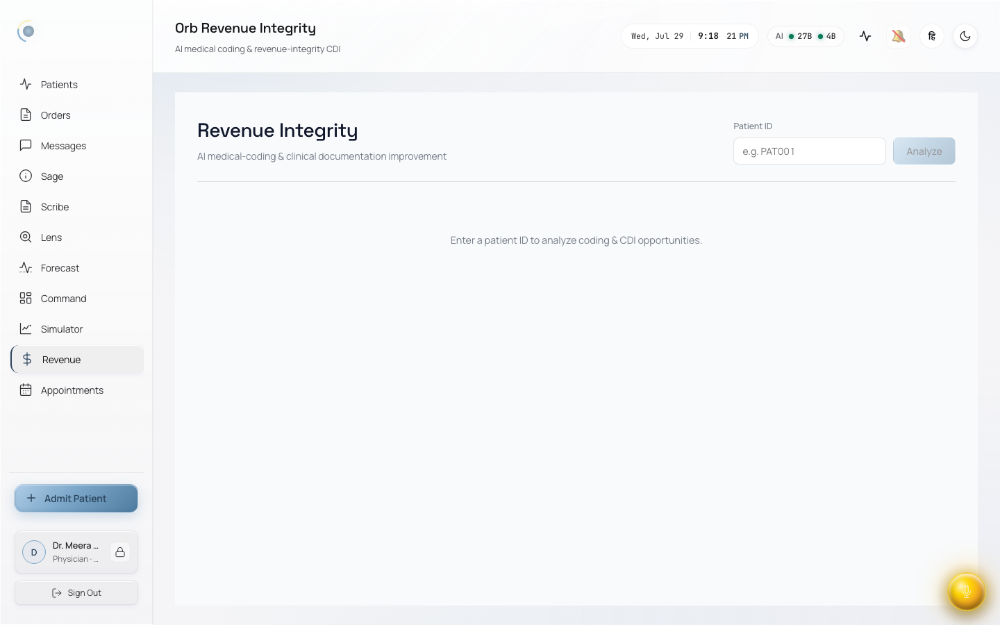

*Revenue Integrity analyses coding and documentation-improvement opportunities for a patient.*

This chapter is the reference you reach for when something is not behaving: the screen says your session expired, Sage answers with an apology, a panel says it is updating, or you need to reset a colleague's password, take a backup, or restore the demo ward to a clean state. The first half is written for whoever operates the Orb machine day to day; the second half is a frequently-asked-questions list and a glossary of the abbreviations used throughout this manual.

The single most useful fact for troubleshooting Orb: **everything runs on one machine in your facility**. When something misbehaves, the cause is almost always local, a service that is not running, a model that is not loaded yet, or a browser tab holding an old version of the interface, and the fix is almost always quick.

### 15.1 Starting and stopping Orb

Orb starts with a single command. On the machine that hosts Orb, open the Terminal application, change into the Orb folder, and run:

```
./run-orb.sh
```

Then open a browser to **http://localhost:8000** (or the address your administrator has published for the machine). The startup script, in order:

1. **Checks that setup has been completed.** If not, it stops with a message telling you to run `./setup-mac.sh` first, the one-time task that installs dependencies, pulls the AI models (roughly 21 GB of downloads), and seeds the demo database.
2. **Starts the Ollama AI engine** if it is installed but not already running. Ollama is the local service that hosts the language models; if it is missing entirely, Orb still starts, see section 15.5.
3. **Starts the Orb server**, which serves the application interface and all data services on port 8000.
4. **Prints a sign-in reminder**, on a demo installation, `Sign in: DOC001 / password`.

To **stop** Orb, return to that Terminal window and press **Ctrl-C**. The script shuts down everything it started. Closing the Terminal window has the same effect, Orb does not keep running in the background after the window is gone, so on a shared ward machine, leave the window open (minimized is fine).

There is also a developer mode, `./run-orb.sh --dev`, which serves a live-reloading copy of the interface on port 5173. Clinical users should ignore it; it exists for people modifying the software.

#### The first start takes longer

The very first time Orb starts after setup, it builds Sage's clinical knowledge index. You will see the message `Initializing clinical knowledge base (chunking & embedding...)` in the Terminal, and it can sit there for several minutes: Orb downloads the BGE-M3 embedding model (about 2.2 GB) from the internet, then reads and indexes the bundled clinical guidelines. This happens once; later starts skip it. If the download fails (for example, no internet connection at first boot), Orb still runs, but Sage's guideline retrieval returns nothing until the index is built on a later start. Administrators can also skip the index build deliberately with the `ORB_SKIP_KNOWLEDGE_BASE` setting.

#### A quick health check

If you are unsure whether the server is up at all, visit **http://localhost:8000/api/health** in a browser. A running server replies instantly with a short "status: ok" message. No reply at all means the server is not running, start it as above.

### 15.2 The AI models: what runs on this machine

Orb's intelligence is entirely local. Nothing you type, dictate, or upload is sent to a cloud AI service. The models involved:

| Model | Role in Orb | Approximate size |
|---|---|---|
| MedGemma 27B (multimodal) | The main clinical model: Sage answers, Lens image analysis, Scribe note drafting, Bridge patient answers | ~17 GB |
| MedGemma 4B | The lighter "ambient" tier: fast background tasks such as Sage's ambient intelligence | ~3.3 GB |
| Gemma 3 1B | Small utility model pulled at setup | ~1 GB |
| BGE-M3 | The embedding model behind Sage's guideline search (RAG) | ~2.2 GB |
| Whisper large-v3 (optional) | Scribe's local speech-recognition engine; deferred on some installations | varies |

Two operational consequences follow from these sizes:

**Memory.** The 27B model needs a machine with generous unified memory, it is intended for the 48 GB-and-up Apple Silicon machines. Smaller machines (for example an 8 GB Mac mini) run a reduced profile that uses the 4B model only; on such machines the 27B model must not be installed, because it will not load.

**Warm-up.** A model must be loaded into memory before it can answer, and loading 17 GB takes time. Orb manages this for you:

- **At startup**, Orb pre-loads both language-model tiers into memory so the first real question is fast, not cold.
- **Every five minutes**, a background heartbeat pings the models so they stay loaded. The heartbeat runs at the lowest possible priority and skips itself entirely whenever real work is in flight, a model that is actively answering is warm by definition, and a keep-warm ping never queues ahead of a clinician's request.
- The keep-loaded window defaults to **one hour** and is configurable (the `ORB_OLLAMA_KEEP_ALIVE` setting; a value of `-1` means "never unload"). If the Ollama engine is restarted, the heartbeat re-warms the models automatically.

**What latency to expect.** With the models warm, the normal state, Sage begins streaming its answer within a few seconds. If you catch the system cold (immediately after starting Orb, or right after an Ollama restart), the first response can take noticeably longer while the 27B model loads; subsequent responses return to normal speed. Also note that **only one AI generation runs at a time**: the machine has one GPU, and Orb deliberately queues AI work so that jobs do not degrade each other. If a colleague's Lens analysis is mid-stream, your Sage question waits its turn, a short delay, not a fault.

### 15.3 "Session expired": what it means and what to do

At some point you will be working and a dialog will cover the screen: **"Session expired"**, with the text *"For your security, your session has ended. Re-enter your password to continue as [your name]."* Nothing is lost, the dialog exists precisely so you can re-authenticate **without losing in-progress work**. Type your password and press **Continue**; the screen unlocks exactly where you were. Or press **Sign out** to return to the login page.

Common reasons the dialog appears:

- **Your sign-in is more than 24 hours old.** Sessions expire after 24 hours by design.
- **The server was restarted** after a database reseed or a configuration change. Reseeding recreates the user accounts, which invalidates every previously issued token; the browser's next request is rejected and the dialog appears. Re-enter your password and carry on.
- **An administrator reset your password or revoked your sessions**, which signs the account out everywhere.
- **Your account was deactivated.** Password re-entry will not succeed; contact your administrator.

If your account uses two-factor authentication, the dialog cannot complete a password-only re-entry. It will tell you: *"Your account requires MFA, sign out and log in again with your authenticator code."* Press **Sign out** and log in normally with your 6-digit code.

A near-identical dialog titled **"Screen locked"** appears after **15 minutes of inactivity** on a clinician workstation: *"This workstation locked after a period of inactivity."* The remedy is the same, password, **Continue**. In both cases the dialog is deliberately blocking: the Escape key does nothing, and the only ways out are re-authentication or an explicit sign-out. This is a patient-privacy feature, not a malfunction.

### 15.4 "Updating to the latest version..."

When your administrator installs an updated build of Orb, any browser tab that was already open still holds the previous version of the interface. The moment you switch to a panel whose files changed in the update, that panel briefly shows:

> **Updating to the latest version...**

and the page then reloads itself **once**, automatically. This is routine, the reload fetches the new interface, and you land back where you were (you may need to re-enter your password if the update also restarted the server; see 15.3).

If a panel instead shows **"This panel hit an error and couldn't be shown."** with a **Reload panel** button, click the button. If the error returns immediately, refresh the whole browser page. If it *still* returns, the server itself is likely down or mid-restart, check the health address from 15.1 and, if needed, restart Orb.

### 15.5 When Sage, Lens, or Scribe error: the AI engine is down

Orb boots and runs perfectly well without its AI engine, patients, vitals, orders, messaging, and pharmacy all keep working. What stops working is everything that generates text or reads images: **Sage** answers, **Lens** analyses, **Bridge** patient Q&A, and **Scribe** drafting all return errors until the engine is back. The typical symptom is Sage replying *"Sorry, I encountered an error. Please try again."* to every question, or Lens failing every analysis.

Work through this list:

1. **Is Ollama running?** On the host machine, check for the Ollama application. The simplest recovery is to stop Orb (Ctrl-C) and run `./run-orb.sh` again, the script starts Ollama automatically if it is installed. If Ollama was never installed on this machine, it must be installed once from ollama.com (macOS requires the graphical installer).
2. **Are the models actually installed?** If Ollama is up but a configured model is not pulled, Orb logs a loud, specific error at startup naming the missing model and suggesting the fix (`ollama list` shows what is installed). AI features using the missing model fail until it is pulled or the configuration points at an installed model.
3. **Is it merely busy?** One generation at a time, remember. A long Lens analysis or a batch of background scoring can make Sage feel briefly unresponsive. Busy is not broken, wait a few seconds and retry.
4. **Sage answers, but cites no guidelines?** The knowledge index was never built (usually a failed first-boot download, see 15.1). Restart Orb while the machine has internet access so the index can build.

One subtle failure deserves its own warning: **the wrong model variant**. The correct models are *vision-capable*; a well-known community build of the 27B model is text-only, and if a machine is misconfigured to use it, Lens does not fail, it accepts your image and returns confident prose about nothing. The setup script checks for vision capability after pulling models and warns if the check fails. If Lens output ever seems disconnected from the image you uploaded, stop using it and have your administrator verify the installed model.

### 15.6 Passwords, lockouts, and resets

**Changing your own password.** Any signed-in user can change their own password (you must supply your current password). Doing so revokes **all** of your sessions, including the one you are in, you will sign in again with the new password. Passwords must be at least the minimum length the form enforces.

**Resetting someone else's password (administrators).** Open the **Command** tab (the admin dashboard), go to the **Users** tab, find the person in the list, and click **Reset password** on their row. The "Reset password" dialog lets you type a new password or click **Generate** to create a strong one, with a copy button to hand it to the user securely. Confirming the reset sets the new password *and revokes every existing session for that account*, the user is signed out everywhere and must sign in with the new password. The action is recorded in the audit log.

**Lockouts.** Repeated failed sign-in attempts temporarily lock the account, and repeated attempts from one network address are rate-limited (Chapter 2 covers the sign-in flow in detail). Locks clear on their own after the cool-down; an administrator password reset also gives a clean start.

**Two-factor authentication.** Enrollment and disabling live behind **Security & MFA** in the sidebar footer. Disabling MFA requires both your current password and a live authenticator code. If a user has lost their authenticator entirely, an administrator resolves it from the Users panel.

### 15.7 Demo data and reseeding

A demonstration installation ships with a fully populated synthetic hospital: roughly 13 staff accounts, 30 admitted patients, 37 message channels, 99 medication orders, 720 vitals readings, 90 lab results, 60 clinical notes, 5 surgeries, and a pharmacy catalog of 14 drugs with inventory lots. In demo mode, simulation bots stream fresh synthetic vitals continuously so the wards look alive.

The seeded demo accounts (password `password` for all staff):

| ID | Name | Role |
|---|---|---|
| DOC001 | Dr. Meera Sharma | Doctor |
| NUR001 | Priya Reddy | Nurse |
| PHA001 | Deepa Joshi | Pharmacist |
| ADM001 | Rajesh Kumar | Administrator |
| P001 | (patient portal) | Patient, password `patient123` |

**Reseeding** restores this clean state after a demo or training session has scrambled the data. It is an operator action run on the host machine: the seeding script wipes all patient-related tables, reloads the clinical and pharmacy demo data, randomizes admission dates so the ward looks current, relinks the P001 patient login, backfills labs, notes, and surgeries, and finally **re-seals the audit hash chain** so the freshly seeded database verifies as tamper-free. Two things to know:

- **Everyone is signed out.** Reseeding recreates user accounts, so every open session hits the "Session expired" dialog on its next request.
- **Seed on a warm database.** The pharmacy tables are created at first application startup; seeding a brand-new database that has never booted can silently skip the pharmacy catalog, leaving Helix empty. The setup script handles this correctly; if the pharmacy ever appears empty after a reseed, re-run the pharmacy seed.

Demo content is gated by the `ORB_DEMO_MODE` setting so fabricated data can never leak into a real deployment: it defaults **on** in the development profile and **off** in production. Never run the demo profile or simulation bots against real patient data.

### 15.8 Backups

Administrators take backups from inside Orb. Open the admin dashboard and choose the **Data & Backups** tab. The **Database Backups** section lists existing snapshots (filename, size, date) and offers a create button. Clicking it opens the confirmation dialog:

> **Create backup?** A consistent snapshot of the live database will be written to the server's backups directory and integrity-checked. This is safe to run while the system is in use.

Press **Create backup**. The snapshot is taken with the database's online-backup mechanism, so it is transactionally consistent even while clinicians are actively writing; it is then integrity-checked before being accepted, and the action is recorded in the audit log. If the live database is encrypted at rest, the backup is written encrypted with the same key, no plaintext patient data touches disk. Backups older than the retention window (**14 days** by default; configurable with `ORB_BACKUP_RETAIN_DAYS`) are pruned automatically after each successful backup.

Three deliberate limitations to understand:

- **There is no restore button.** Restoring a snapshot over the live database silently discards every write made since it was taken, including audit records, so it is intentionally not a one-click action. Restores are performed by an operator with access to the host machine, **with the server stopped**.
- **Backups live on the same machine as the database.** They protect against data corruption and mistakes, not against the loss of the machine itself. Copy backup files to separate media or another machine on a schedule your organization sets.
- **Backups contain patient data.** Treat backup files with the same care as the live database.

### 15.9 Safety & limitations

- **The demo profile is for demonstration machines only.** Before any deployment touches real patient data, the production profile must be enabled, simulation switched off, and the compliance gaps the project openly documents (encryption at rest is optional and key-based; disaster-recovery, retention, and data-protection processes are roadmap items) must be addressed. Local-first design removes the cloud data-egress risk; it does not by itself make a deployment compliant with health-data regulation.
- **AI output is draft decision support, never ground truth.** Sage, Lens, Scribe, and Forecast produce material for clinician review. The models are not clinically validated diagnostic devices, and none of them can place orders or change records on their own.
- **Errors are loud, not hidden.** Orb prefers specific, visible errors (a missing model is named in the log; a failed integrity check rejects the backup) over silent degradation. If something looks wrong, the Terminal window on the host machine is the first place the cause will be written.

### 15.10 Frequently asked questions

**Does Orb need an internet connection?**
Only during setup (model downloads) and the first start (the knowledge-index build). Day-to-day operation is fully local.

**Is any patient data sent to a cloud AI?**
No, all models run on the machine in your facility. The one nuance is Scribe's optional live dictation preview, which can use the browser's own speech recognizer; deployments that forbid off-site audio disable it, and the authoritative transcript is always produced locally.

**Why is the first AI answer after startup slow?**
The model was still loading into memory. Orb pre-warms its models at startup and keeps them warm; if you beat the warm-up, the first answer pays the loading cost. Later answers are fast.

**Sage says "Sorry, I encountered an error. Please try again.", every time. What now?**
The AI engine is down or a model is missing. Work through section 15.5, starting with a restart of Orb.

**Can two people use the AI at the same time?**
They can ask at the same time, but generations run one at a time on the single GPU, in priority order. A short queueing delay under load is normal.

**I closed the Terminal window on the host machine. Is Orb still running?**
No, closing the window (or pressing Ctrl-C in it) stops Orb. Start it again with `./run-orb.sh`, and leave the window open on machines that host the system.

**The machine rebooted. Does Orb come back by itself?**
Not automatically. Log in to the host machine and run `./run-orb.sh` again.

**I forgot my password.**
Ask an administrator to use **Reset password** in the Users panel. You get a new password and are signed out of all existing sessions.

**Why was I suddenly asked for my password mid-shift?**
Either 15 idle minutes passed ("Screen locked"), your 24-hour session expired, or the server restarted ("Session expired"). Enter your password and continue, nothing is lost.

**Why does the login page show one-click demo account chips?**
You are on a demonstration or development installation. Production builds never show working credentials on the login page.

**A panel said "Updating to the latest version..." and the page reloaded. Did I break something?**
No, that is Orb refreshing a browser tab that predated a software update. It reloads once and carries on.

**Lens accepted my image but its report reads like it never looked at it.**
Possible wrong model variant (a text-only build masquerading as the multimodal model). Stop relying on the output and have your administrator verify the installed models.

**Why is the pharmacy (Helix) empty on a fresh installation?**
A seeding pitfall on a never-booted database: the pharmacy tables did not exist yet when the seed ran. Re-run the pharmacy seed (the setup script does this correctly).

**Can I restore a backup from the admin screen?**
No, by design. Restores discard everything written since the snapshot and must be done by an operator on the host machine with the server stopped.

**How long are backups kept?**
14 days by default; older snapshots are pruned automatically after each new backup. The retention window is configurable.

**Does Orb keep working if the upstream hospital EHR is unreachable?**
Yes, Orb includes a read-only downtime mode that preserves continuity of care from its latest snapshots when upstream systems are unavailable.

**Is Orb's AI a medical device? Can I act on its output directly?**
No. Every AI output in Orb, Sage answers, Lens observations, Scribe drafts, Forecast predictions, is decision support for a qualified clinician to review, edit, and take responsibility for.

**Who can take backups or manage users?**
Only administrator accounts. Backup creation, user management, and password resets are gated behind admin-only permissions, and every such action is written to the append-only audit log.

### 15.11 Glossary

| Term | Meaning |
|---|---|
| **NEWS2** | National Early Warning Score 2, the vital-signs scoring system Vigil uses to flag deterioration. Scale 2 is its alternative oxygen-saturation scoring for chronic type-2 respiratory failure. |
| **RAG** | Retrieval-Augmented Generation, Sage retrieves relevant passages from the local guideline index and grounds its answer in them, with citations. |
| **SOAP** | Subjective, Objective, Assessment, Plan, a standard clinical note structure Scribe can draft. |
| **I-PASS** | Illness severity, Patient summary, Action list, Situation awareness, Synthesis, the structured shift-handoff format Orb implements. |
| **eMAR** | Electronic Medication Administration Record, what was given, when, and by whom. |
| **CPOE** | Computerized Provider Order Entry, electronic clinical ordering with safety screening at order time. |
| **FHIR** | Fast Healthcare Interoperability Resources, the data-exchange standard Orb uses for ingestion and export. |
| **WAL** | Write-Ahead Log, the database journaling mode Orb runs in; the source of the small companion files beside the database file, which contain patient data too. |
| **JWT** | JSON Web Token, the signed sign-in token your browser holds; expires after 24 hours. |
| **MFA / TOTP** | Multi-factor authentication via time-based one-time passwords, the rotating 6-digit authenticator codes. |
| **LLM** | Large Language Model, the class of AI model (here, MedGemma) that generates text. |
| **Ollama** | The local service that hosts Orb's language and vision models. |
| **MedGemma** | Google's medical model family; Orb uses the 27B multimodal model as its main engine and 4B for ambient tasks. |
| **BGE-M3** | The embedding model behind Sage's semantic guideline search. |
| **Embedding** | A numeric representation of text that enables search by meaning rather than exact wording. |
| **LSTM** | Long Short-Term Memory, the neural network behind Forecast's length-of-stay and trajectory predictions. |
| **PHI** | Protected Health Information, identifiable patient data, which never leaves the local machine. |
| **RBAC** | Role-Based Access Control, permissions attach to roles, which is why different roles see different tabs. |
| **Audit hash chain** | The append-only audit log, each entry cryptographically chained to the previous one so tampering is detectable. |
| **Unified memory** | Apple Silicon's shared CPU/GPU memory pool, why model sizes translate directly into machine memory requirements. |
| **Keep-warm** | Pre-loading AI models at startup and pinging them every five minutes so they stay resident and fast. |
| **Demo mode** | The configuration gate that allows synthetic patients and simulated vitals on demo machines and forbids them in production. |
