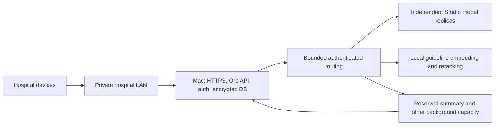

# Apple-only hardware sizing for Orb

Checked 21 October 2026. Prices are configuration snapshots, not quotations or
purchase authorisations. User constraint: **all application and AI compute must
run on Apple hardware**, entirely inside the hospital. GPU servers below are
comparators only. Ordinary hospital switches, access points and UPS equipment
are outside this compute-platform constraint.

## Decision

There is no measured, purchase-ready Apple configuration that establishes 200
simultaneous fresh completed answers within 3/5/15 seconds. The latest
[Orb measurements](../perf/capacity-optimisation-2026-10-21/README.md) do not
qualify even one Ultra: they were performed on an M2 Max with 64 GiB. Neither
additional RAM nor an arbitrary number of Macs supplies missing performance
evidence.

The recommended procurement step is to borrow, rent or obtain a demonstration
of **one M5 Ultra Studio, 36 CPU/80 GPU cores, 256 GB unified memory, 2 TB SSD,
10 Gb Ethernet**, followed by a four-node trial if the individual-query gates
pass. Eight nodes is a later test stage, not an asserted final requirement.
If a single model replica misses a single-query deadline, adding independent
replicas does not solve that latency; compatible tensor parallelism must be
tested before buying more replicas. The strict full-budget requirement may
need substantially more hardware than eight Studios, or remain impractical
on the qualified Apple runtime.

## Current Apple hardware and prices

Apple specifies M5 Ultra up to 36 CPU cores, 80 GPU cores, 1.2 TB/s memory
bandwidth, 512 GB unified memory, 16 TB SSD, six Thunderbolt 5 ports and built-in
10 Gb Ethernet. Its live configurators say the **512 GB option is coming in
late October** and do not currently offer a selectable 512 GB price. The
256 GB configuration must not be described as fully maxed out.
[Apple specifications](https://www.apple.com/in/mac-studio/specs/),
[India configurator](https://www.apple.com/in/shop/buy-mac/mac-studio),
[US configurator](https://www.apple.com/shop/buy-mac/mac-studio).

| Configuration | India, including taxes | US, before sales tax |
| --- | ---: | ---: |
| Announced maximum: M5 Ultra 36/80, 512 GB, 16 TB | No verified selectable price | No verified selectable price |
| Available configuration: M5 Ultra 36/80, 256 GB, 16 TB | ₹21,65,900 | $18,299 |
| Recommended qualification node: same chip, 256 GB, 2 TB | ₹13,25,900 | $11,299 |
| Gateway: M6 Mini, 12 CPU/12 GPU, 32 GB, 1 TB, 10 Gb Ethernet | ₹2,19,900 | $1,899 |

The Mini prices are from the
[India](https://www.apple.com/in/shop/buy-mac/mac-mini) and
[US](https://www.apple.com/shop/buy-mac/mac-mini) configurators. Its role is
HTTPS/application/authentication/database work, subject to the same application
benchmark; it contributes no AI memory to another Mac. An existing suitable Mac
can serve that role during qualification instead of buying a new Mini.

The 16 TB selection costs ₹8,40,000 / $7,000 more than 2 TB per Studio, with the
same processor and memory. Retention and imaging volumes may justify storage,
but this is not a throughput upgrade. Selected 256 GB configurations displayed
13–15-week shipping; availability is location/date sensitive and must be
rechecked before planning delivery or a trial.

### Staged Apple budgets

These are arithmetic subtotals using the 256 GB/2 TB node and specified Mini.
They are **not proven 200-request configurations** or installed-system quotes.

| Test fleet | India Apple hardware subtotal | US Apple hardware subtotal |
| --- | ---: | ---: |
| One Studio + Mini | ₹15,45,800 | $13,198 |
| Four Studios + Mini | ₹55,23,500 | $47,095 |
| Eight Studios + Mini | ₹1,08,27,100 | $92,291 |
| Four interactive + one auxiliary Studio + Mini | ₹68,49,400 | $58,394 |
| Eight interactive + two auxiliary Studios + Mini | ₹1,34,78,900 | $114,889 |

The auxiliary rows illustrate a budget allowance for separating guideline
embedding/reranking, summary refreshes and other background work. Those counts
and allocations are also unqualified. ASR and imaging need their own measured
resource allocation; a single auxiliary Mac is not established as sufficient.
The rows exclude switches, cabling, UPS, encrypted backup/restore equipment,
support, room power/cooling, engineering and US sales tax. There is no verified
fully installed total yet.

## Workload that the hardware must actually pass

The current demonstration mix is 67 general, 67 patient and 66 department
queries submitted together, each distinct and uncached. The deadlines apply to
completed, usable answers, with every attempt counted. First-token latency,
HTTP 200, a capacity rejection or a partial stream is not a completed answer.

Using only the three observed output lengths (233/320/84 tokens), the general
cohort needs at least 5,204 generated tokens/s by three seconds. General plus
patient answers need at least **7,410 generated tokens/s by five seconds**.
These are decode-only demand illustrations: add prompt processing, retrieval,
permissions, database/network time and headroom. They are not measured Ultra
throughput or a guarantee that real answers have these lengths.

The current output allowances are 512 general, 2,048 patient and 1,024 broad
tokens. Filling the general/patient allowances in the same mix raises the
five-second demand to **34,304 generated tokens/s**. An all-patient burst at
2,048 tokens each would need 81,920 tokens/s by five seconds. Sizing for the
short three-answer sample cannot establish a guarantee for all permitted
questions and lengths. The production workload contract must specify the mix,
context/output distributions and acceptance percentile; the stated strict
all-request deadlines remain the qualification goal, not a relaxed p95 claim.

A 233-token general answer alone needs 77.7 tokens/s even with zero startup.
This is why the single-query gate precedes replica-count budgeting.

For guideline retrieval, this scripted mix requires 134 reranks of 12 passages,
or at least **322 query/passage scores/s** by five seconds before other work.
The measured M2 reranker rate was approximately 58/s. Moving generation to
other Macs does not automatically remove that retrieval bottleneck.

The inspected current engine preallocates 3,968 MiB KV per 8,192-token slot:
200 slots would need **775 GiB KV alone**, plus weights and workspaces. Paged
allocation can reduce unused allocation while retaining full context, but
needs a separately qualified runtime. For illustration, 2,048 active tokens
per request at the same KV footprint is about 194 GiB across 200 requests.
These are cache-layout examples, not a universal memory minimum.

For 100 patients, a 30-minute refresh requires 200 completed summaries/hour,
one every 18 seconds on average. The configured summary allowance is 1,536
output tokens and 16,384 context tokens. At the output allowance alone, the
average demand is 85 generated tokens/s, plus prefill and retries. A single
serial worker must average no more than 18 seconds end-to-end to keep up;
otherwise more measured background capacity is required.

## Offline all-Mac topology

For a 27B model that fits a Studio, start by comparing independent model
replicas over private 10 Gb Ethernet. Each retains its own model and cache;
their unified memory is not automatically pooled. Keep the encrypted database
on one application host, with an independently tested restore/failover plan;
do not share SQLite WAL files between Macs.

Apple supports distributed MLX and RDMA over Thunderbolt. Tensor-parallel
two-/four-Mac groups are candidates if required for single-query speed, not
automatic upgrades to the current Ollama engine. Apple's published numbers
use different models and cannot establish Orb's capacity.
[Apple distributed inference research](https://machinelearning.apple.com/research/mlx-distributed-inference).
MLX JACCL requires supported Thunderbolt/macOS configurations and direct mesh
connections. Its experimental fast-synchronisation setting can deadlock and
must remain disabled for clinical qualification.
[MLX distributed documentation](https://ml-explore.github.io/mlx/build/html/usage/distributed.html).

**Implementation gap:** Orb's current configured worker pool is loopback-only.
Multi-Mac inference needs an authenticated, encrypted hospital-LAN worker
transport, coordinated admission, cancellation and failure handling. Network
scaling, remote retrieval and any MLX/format conversion must be implemented
and tested; buying several Macs does not enable them.

Provision models, tokenizers, dependencies and indexes locally from controlled
sources. During operation deny WAN egress, disable cloud fallback and remote
telemetry, and use local authentication, DNS/time, internal certificates and
encrypted local backups. Verify the full browser-to-answer flow with the WAN
physically disconnected, including restarts and summary refreshes. Model
downloads and controlled offline update bundles are provisioning work, not
runtime cloud inference.

## GPU-server comparison only

These suppliers' current public configurations show the alternative cost
classes; all can operate on premises, but they violate the Apple-only
compute constraint and are not recommended purchases for this plan.

| Public configuration | Accelerator memory | Host CPU/RAM | US configured price |
| --- | ---: | --- | ---: |
| Puget multi-GPU workstation, 2 × RTX PRO 6000 Blackwell Max-Q | 2 × 96 GB | Threadripper PRO 9975WX; 256 GB ECC | $52,412.24 |
| Exxact HGX H200, 8 GPUs | 8 × 141 GB | Dual EPYC 9454; 1,536 GB ECC | $326,524 |
| Exxact HGX B200, 8 GPUs | 8 × 180 GB | Dual EPYC 9645; 1,536 GB ECC | $390,703.50 |

[Puget configuration](https://www.pugetsystems.com/solutions/ai-development-and-deployment/deploy/),
[H200 configuration](https://configurator.exxactcorp.com/configure/TS4-118380266),
[B200 configuration](https://configurator.exxactcorp.com/configure/TS4-154079096).
These are different hardware classes, not a claim that eight GPUs are the
minimum. Lower-cost GPU configurations also require the same Orb benchmark.
India landed prices, taxes, import/shipping, installation, local support and
site infrastructure require separate quotations; no exchange conversion is
presented as an India delivered price.

The H200/B200 supplier configurations display 6.845/13.962 kW estimates.
Apple specifies up to 480 W continuous input per Studio: eight Studios have
an arithmetic ceiling of 3.84 kW before auxiliary computers and infrastructure.
These are different specification/estimate methods, not measured energy per
answer. Do not substitute DGX-product power figures for the quoted Exxact
systems. NVIDIA's GPU bandwidth figures and aggregate VRAM do not predict the
3/5/15-second application result.

## Purchase and clinical-quality gate

1. Run the unchanged clinical checkpoint, tokenizer, prompts, context/output
   allowances, retrieval coverage and safety/permission/audit rules on one
   Studio. Record complete-answer timings, prompt/output lengths, quality and
   memory pressure. If the engine/format changes, compare the clinical cases
   and numerical/retrieval behaviour before its speed result counts.
2. Qualify four Studios, then eight only when the measured bottleneck warrants
   it. Independent replicas add concurrency; use tensor parallelism only where
   the actual compatible implementation improves per-query latency.
3. Repeat distinct 200-request bursts plus sustained load using encrypted
   production-like storage, the real LAN and continuous 100-patient summary
   refresh. Exercise all required ASR/imaging work and failure recovery. Every
   attempt remains in the denominator. Report first-readable and completed
   answers separately; do not replace the strict goal with p95 or a stub pass.
4. Have clinicians review factual coverage, missing-data handling, citations
   and unsafe omissions/errors. More powerful hardware does not itself prove
   clinical accuracy. Do not reduce model capability, quantize further, cut
   context/answers, drop retrieval or loosen safety thresholds to obtain a
   timing pass.

An exact fleet size and installed cost can be called sufficient only after
these gates pass. Until then, the four-/eight-Studio prices are evaluation
budgets, with a meaningful risk that additional machines still will not meet
the requested individual-answer deadlines.
