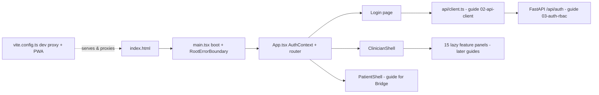
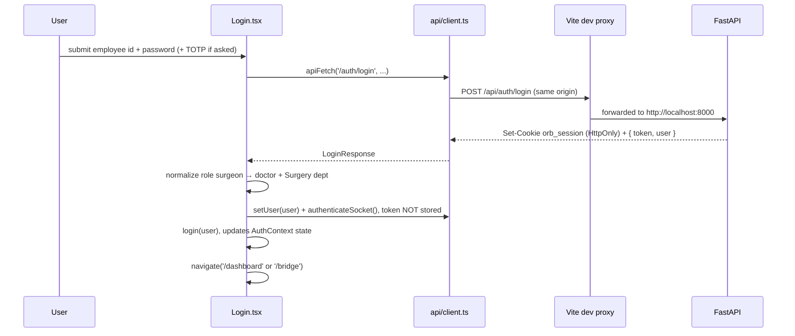

# The App Shell: bootstrap, routing, shells, and shared chrome

Orb's frontend is a single-page application (SPA), one HTML page whose content is swapped in the browser by JavaScript instead of full page reloads. This guide covers everything that runs before any clinical feature does: the HTML entry point, the Vite build/dev configuration (including the proxy that makes the FastAPI backend look same-origin), the React bootstrap in `src/main.tsx` with its top-level error boundary, the route map and authentication context in `src/App.tsx`, the two big screens that frame all features (the `Login` page and the `ClinicianShell` sidebar/header frame), and the small shared "chrome" components every screen borrows: `OrbLogo`, `ClockWidget`, and the animated `Aurora` background. It also covers two shared primitives that live at shell level because many features need them: `ActivePatientContext` (which patient is selected right now) and `useFocusTrap` (keyboard accessibility for modals).

## Purpose and neighbors

Every feature in Orb, Vigil patient monitoring, Relay messaging, Sage AI assistant, Scribe dictation, and the rest, renders *inside* a frame this subsystem provides. The shell solves four problems that would otherwise be re-solved by every feature:

1. **Getting pixels on screen at all**: loading fonts, global CSS, translations, and mounting React exactly once (`src/main.tsx`).
2. **Deciding who sees what**: a URL-to-screen map with role-based guards, so a patient can never land in the clinician dashboard and vice versa (`src/AppRoot.tsx:178-193`).
3. **Failing safely**: error boundaries at two levels so a crash in one panel never blanks the whole clinical UI mid-shift (`src/main.tsx:26`, `src/pages/ClinicianShell.tsx:204`).
4. **Shared chrome and cross-cutting state**: the sidebar, header, clock, logo, theme and language toggles, the currently selected patient, and modal focus management.

Neighbors: the HTTP/WebSocket client this shell calls into is owned by the API-client guide (02-api-client); the JWT login endpoint and role model by guide 03-auth-rbac; the socket lifecycle by guide 06-realtime; the service worker/offline story by guide 28-offline-pwa-downtime; the design tokens (`--accent-gold`, `.glass`, animations) referenced by the shell's CSS live in `src/index.css` and are owned by the design-system guide.

## File map

| File | Lines | Role |
|---|---|---|
| `index.html` | 34 | The only HTML page; inline crash-overlay script; loads `/src/main.tsx` |
| `vite.config.ts` | 79 | Build/dev config: React plugin, PWA plugin, dev proxy to `:8000` |
| `tsconfig.json` | 7 | Solution-style root that references the two real TS configs |
| `tsconfig.app.json` | 29 | TypeScript settings for browser code in `src/` |
| `tsconfig.node.json` | 26 | TypeScript settings for `vite.config.ts` (runs in Node) |
| `eslint.config.js` | 23 | Flat ESLint config: TS + React hooks + React Refresh rules |
| `src/main.tsx` | 110 | React bootstrap: fonts, CSS, i18n, `RootErrorBoundary`, single-root mount |
| `src/App.tsx` | 201 | `AuthContext`, theme init, shared-device idle lock, and the react-router-dom v7 route map |
| `src/App.css` | 1 | Empty placeholder (a single comment) |
| `src/constants.ts` | 6 | `DOCTORS`, seeded attending-doctor IDs |
| `src/pages/Login.tsx` | 506 | Staff/patient sign-in: password, PIN-on-device, TOTP MFA, tablet enrolment |
| `src/pages/Login.css` | 221 | Login layout: one opaque card, hairline borders, input and PIN-pad styling |
| `src/pages/ClinicianShell.tsx` | 830 | The staff frame: sidebar tabs, header, theme/lang toggles, lazy panels |
| `src/pages/ClinicianShell.css` | 963 | Shell frame layout + responsive collapse at 1024px/768px |
| `src/contexts/ActivePatientContext.tsx` | 31 | React context: the currently selected patient (id + name) |
| `src/hooks/useFocusTrap.ts` | 133 | Accessibility hook: keep keyboard focus inside modal dialogs |
| `src/components/ClockWidget.tsx` | 47 | Live header clock, ticks every second |
| `src/components/ClockWidget.css` | 70 | Clock pill styling and blink animation (token-driven, no per-theme overrides) |
| `src/components/OrbLogo.tsx` | 10 | The animated gold orb brand mark |
| `src/components/OrbLogo.css` | 24 | Spinning ring + pulsing core styles |
| `src/components/OrbLogo.test.tsx` | 19 | Vitest unit tests for `OrbLogo` |
| `src/components/Aurora.tsx` | 452 | Login-page background: WebGL aurora shader + interactive dot grid |

## How it works

### Flow 1: cold boot (no user interaction)

1. The browser requests `/` from the Vite dev server (or the production static host). It gets `index.html`, which contains an empty `
` and a module script tag for `/src/main.tsx` (`index.html:31-32`). Before anything else, an inline script installs `window.addEventListener('error')` and `('unhandledrejection')` handlers that paint a full-screen dark-red overlay with the stack trace if anything blows up (`index.html:11-16`), a last-resort debug net that works even if React itself failed to load. It is **dev-only**: the whole block is wrapped in a port check for `5173`/`5174` (`index.html:10`), so in the built app the React error boundaries own failures and no raw overlay can paint over the clinical UI.
2. `src/main.tsx` runs. Its imports execute in order: three self-hosted variable fonts (Inter for UI text, Fraunces for display moments, JetBrains Mono for data/IDs, bundled woff2 files, no CDN, so an offline hospital deployment renders identically, `src/main.tsx:9-11`), then `index.css` (design tokens), `print.css`, and `./i18n`, importing the i18n module runs its `init()` side effect, so translations are ready before the first render (`src/main.tsx:12-14`, `src/i18n/index.ts:33`).
3. Importing `./AppRoot.tsx` (the root component's home since `App.tsx` was split; `App.tsx` now holds only the auth context, `useAuth` and the user types) runs a module-level theme block *before React renders anything*: it stamps `data-theme` on `<html>` from `bootTheme()` (`src/AppRoot.tsx:42-49`), which returns the saved choice (`localStorage['orb-theme']`, else the legacy `orb_theme`) or, failing that, the OS preference via `window.matchMedia('(prefers-color-scheme: light)')` (`src/lib/theme.ts:39-45`). Doing this at import time avoids a flash of wrong theme.
4. `main.tsx` grabs `#root`, reuses (or creates and caches) a React root on `window.__orbRoot`, and renders `<StrictMode><RootErrorBoundary><App /></RootErrorBoundary></StrictMode>` (`src/main.tsx:101-110`). *StrictMode* is a React development aid that double-invokes render functions and effects to surface unsafe side effects; it renders nothing itself.
5. `App` initializes its `user` state from the cached user via `getUser()` (`src/AppRoot.tsx:53-56`), so a page refresh keeps you logged in. It then renders the router.
6. The router matches the URL. Anonymous users at `/` are redirected to `/login/staff`; a stored staff user goes to `/dashboard`, a stored patient to `/bridge` (`src/AppRoot.tsx:180`).

### Flow 2: the route map

*A router* maps the browser's URL to a component tree without a server round-trip. Orb uses **react-router-dom v7** (`package.json:27`) in its classic declarative form: `<BrowserRouter>` listens to the History API, `<Routes>` picks the first matching `<Route>`, and `<Navigate>` performs a client-side redirect.

| URL pattern | Guard | Renders | Cite |
|---|---|---|---|
| `/` | n/a | Redirect: patient → `/bridge`, staff → `/dashboard`, anonymous → `/login/staff` | `src/AppRoot.tsx:180` |
| `/login/:mode` | Logged-in users bounced to their home | `Login` (`:mode` = `staff` or `patient` picks the form variant) | `src/AppRoot.tsx:181` |
| `/dashboard/*` | `user && user.role !== 'patient'` else → `/login/staff` | `ClinicianShell` | `src/AppRoot.tsx:182` |
| `/bridge/*` | `user && user.role === 'patient'` else → `/login/patient` | `PatientShell` (patient-facing "Bridge" portal, own guide) | `src/AppRoot.tsx:183` |
| `/discharge/:token` | none, public | `DischargeAccess` (DOB-verified discharge summary, no login) | `src/AppRoot.tsx:184` |
| `/downtime/:patientId` | staff only | `DowntimeMode` (read-only local snapshot, guide 28-offline-pwa-downtime) | `src/AppRoot.tsx:185` |
| `/handoff/:patientId` | staff only | `HandoffPage` (I-PASS handoff wrapper) | `src/AppRoot.tsx:186` |
| `/display/opd` | none, public kiosk device | `OpdTokenBoard` (waiting-room token board, no patient data) | `src/AppRoot.tsx:190` |
| `*` | n/a | Redirect to `/` | `src/AppRoot.tsx:191` |

This is how **role-based navigation** works in the shell: the guards are inline ternaries on the `user` object from `AuthContext`. Note the split-brain-avoidance design: there is exactly one role fork (`patient` vs everyone else) at routing level; finer-grained role behavior (which tabs a nurse vs a pharmacist sees) is handled *inside* `ClinicianShell` by `getAccessibleTabs` (`src/pages/ClinicianShell.tsx:209`), and true enforcement is server-side RBAC (*role-based access control*, authorizing actions by the user's role; see guide 03-auth-rbac). The client-side guards are UX, not security.

Also note: `/dashboard/*` and `/bridge/*` use wildcard matches, but neither shell defines nested routes, the active tab in `ClinicianShell` is plain component state (`src/pages/ClinicianShell.tsx:339`), not part of the URL. You cannot deep-link to a specific tab by URL; in-app navigation goes through the `orb:goto-tab` event bus instead (`src/pages/ClinicianShell.tsx:485-490`).

### Flow 3: login (spans client and server)

1. `Login.handleLogin` (`src/pages/Login.tsx:148`) POSTs `{employee_id, password, totp_code?}` to `/api/auth/login` through `apiFetch` rather than the client's `login()` wrapper, so it can attach an optional TOTP code. The client's own `login()` (`src/api/client.ts:581-594`) does the same POST for callers that need no MFA step. The endpoint is defined with prefix `/api/auth` at `server/routes/auth_routes.py:25,361` and mounted at `server/main.py:681`.
2. The response is `{token, user: {id, name, role, department?, registration_number?}}` (`LoginResponse`, `src/api/client.ts:570-579`). The token is a **JWT** (JSON Web Token, a signed, self-contained credential string). It is **not** persisted: the session lives in the HttpOnly `orb_session` cookie the server set on this response, unreadable to JS (comment at `src/api/client.ts:586-589`). Only the non-sensitive user object is cached, and the shared socket.io connection is re-handshaked (`src/api/client.ts:590-592`).
3. `applyLoginResponse` normalizes the role: the backend may emit `surgeon`, which the app models as `doctor` + department `Surgery` (`src/pages/Login.tsx:88-92`).
4. `login(user)` updates `AuthContext` state and caches the *normalized* user, then `navigate()` sends the user to `/bridge` or `/dashboard` (`src/pages/Login.tsx:102-103`).

### Flow 4: error containment layers

An **error boundary** is a React class component that implements `getDerivedStateFromError`/`componentDidCatch`; when any component *below it in the tree* throws during render, React unmounts that subtree and asks the boundary to render fallback UI instead. (Only class components can be error boundaries; hooks have no equivalent.) Orb has three nets, outermost first:

1. `index.html`'s inline script, catches errors *outside* React (module load failures, unhandled promise rejections) with a raw DOM overlay (`index.html:4-18`). It is **dev-only**: the whole block is gated on `location.port === "5173" || "5174"` (`index.html:10`), so the built app never paints it.
2. `RootErrorBoundary` in `main.tsx`, catches any uncaught render error anywhere in the app and shows a "Something went wrong / Reload" screen instead of a blank page (`src/main.tsx:44-95`).
3. `PanelErrorBoundary` in `ClinicianShell`, one per feature panel, so a single panel's bad payload or failed lazy chunk fails *in place* with a "Reload panel" button while the rest of the shell keeps working (`src/pages/ClinicianShell.tsx:77-114`). This matters more than usual here because a visited panel stays mounted in a hidden div (`src/pages/ClinicianShell.tsx:521`), so even a background panel could otherwise take the app down.

A fourth net sits outside React entirely: a `vite:preloadError` listener in `main.tsx` (`src/main.tsx:23-30`). After a rebuild this tab's hashed chunk files no longer exist, so lazy imports fail; the listener reloads the page once, guarded by a 30-second `sessionStorage` timestamp (`orb:chunk-reload-at`) so a genuinely down server cannot cause a reload loop. `PanelErrorBoundary` shares that key and that guard (`src/pages/ClinicianShell.tsx:247-260`).

### Flow 5: lazy panels and Suspense

All 17 clinician panels are **lazy-loaded**: `const VigilPanel = lazy(() => import('./panels/VigilPanel'))` (`src/pages/ClinicianShell.tsx:116-132`). `React.lazy` + a dynamic `import()` tells the bundler to split each panel into its own JavaScript chunk, downloaded only when first rendered, the login page and shell frame load fast, and a pharmacist never downloads the surgery suite's code. `<Suspense fallback={...}>` (`src/pages/ClinicianShell.tsx:515`) is React's mechanism for "this subtree is still loading": while a lazy chunk is in flight it renders the fallback (`Loading panel...`) instead. One `Suspense` wraps all panels; per-panel error boundaries sit inside it.

A second saving is mount-on-first-view: `shouldRenderPanel` (`src/pages/ClinicianShell.tsx:352`) only renders a panel's subtree once its tab has been *visited* (`visitedTabs`, `src/pages/ClinicianShell.tsx:343-351`). A panel the user never opens never fetches or polls at all; once opened it stays mounted.

### Flow 6: theme

Theme is a `data-theme="dark|light|night"` attribute on `<html>`; all CSS tokens in `src/index.css` key off it. Three actors touch it:

1. Boot: module-level block in `AppRoot.tsx` (Flow 1 step 3). A saved choice, `night` included, is restored at boot; with none saved it picks `dark` or `light` from the OS.
2. OS changes: an effect in `App` listens to the `prefers-color-scheme` media query and follows the OS *only if the user has no saved choice*, dispatching a `theme-changed` window event so canvas-based components can react (`src/AppRoot.tsx:137-150`).
3. The user: `ClinicianShell`'s theme button cycles `dark → light → night` (`src/pages/ClinicianShell.tsx:457`), and an effect writes `data-theme`, persists `localStorage['orb-theme']`, deletes the legacy `orb_theme` key, and dispatches `theme-changed` (`src/pages/ClinicianShell.tsx:445-454`). The effect brackets the attribute swap with an `orb-theme-switching` class and a forced reflow (`void root.offsetHeight`, `src/pages/ClinicianShell.tsx:448`) so transitions are suppressed across the flip, without it, every element whose `transition` list includes `background` stays pinned to the *previous* theme's colour (the long comment at `:378-412` records the measurement: 12 of 34 painted elements frozen on a light → night flip).

The boot block and the OS listener read the saved choice through one helper, `storedTheme()` (`src/lib/theme.ts:27`), which reads `orb-theme` and falls back to the legacy `orb_theme` (boot at `src/AppRoot.tsx:46`, listener at `src/AppRoot.tsx:143`). The old key mismatch is recorded in Discrepancies.

## Function-by-function

### index.html

#### error-catcher script: `index.html:4`
**Signature:** none (inline script, runs immediately)
**Does:** in dev only, paints a full-screen dark-red overlay with message + stack for any uncaught window `error` or `unhandledrejection`.
**How it works:** 1. Checks the port first, the two listeners are registered only when `location.port` is `5173` or `5174`, i.e. the Vite dev server (`index.html:10`). 2. On either event, appends a fixed-position `
` (z-index 99999) to `document.body.innerHTML` containing the message and stack (`index.html:11-16`).
**Why it exists:** if React or a module fails to even load, no React error boundary exists yet; this guarantees a developer-visible failure instead of a silent white page. The port gate exists because in the built app the React boundaries own failures, and a raw overlay would paint over the clinical UI for any stray rejection, an aborted fetch during navigation, or the stale-deploy chunk load `src/main.tsx:23-30` now self-heals (comment at `index.html:5-9`).
**Data in/out:** browser `ErrorEvent` / `PromiseRejectionEvent` → DOM mutation.
**Talks to:** nothing else; independent of React.
**Change guide:** the production kill-switch is the port check at `index.html:10`; widen or narrow it there rather than adding a build flag (this is plain HTML, so Vite's `import.meta.env` is unavailable). Knock-on: `RootErrorBoundary` (`src/main.tsx:44`) still covers render errors either way.
**Gotchas:** it uses `innerHTML +=`, which re-parses the whole body (destroying event listeners on existing DOM) and injects the raw error string unescaped. That is an XSS sink if an error message ever carries attacker-influenced markup, contained, but not eliminated, by the dev-only gate: a developer running against production data on `:5173` is still exposed.

#### document skeleton: `index.html:20-32`
**Signature:** static HTML
**Does:** declares charset, `/favicon.svg` icon, an apple-touch icon, responsive viewport, meta description, `<title>Orb</title>`, the `#root` mount div (`index.html:31`), and the module script for `/src/main.tsx` (`index.html:32`).
**Why it exists:** Vite treats `index.html` as the build entry; the script tag is where the whole dependency graph starts. The comment at `index.html:25-27` documents the deliberate absence of font CDN links, fonts are self-hosted woff2 bundled through `@fontsource-variable` (`src/main.tsx:9-11`) so type renders identically on an offline, CSP-locked, on-prem deployment.
**Gotchas:** none noteworthy.

### vite.config.ts

#### defineConfig export: `vite.config.ts:6`
**Signature:** `defineConfig({plugins, server}) → UserConfig`
**Does:** configures Vite (the *bundler/dev server*, it serves source modules with instant hot reload in dev and produces optimized static bundles for production) with the React plugin, the PWA plugin, and the dev proxy.
**How it works:**
1. `react()` (`vite.config.ts:8`) enables JSX transform and Fast Refresh (*HMR*, hot module replacement, swapping edited modules into the running page without a reload).
2. `VitePWA({...})` (`vite.config.ts:9-25`) makes the app a **PWA** (Progressive Web App, installable, offline-capable via a *service worker*, a background script that intercepts network requests and can serve cached responses). Config at a glance: `registerType: 'autoUpdate'` (new service-worker versions activate without prompting), `devOptions.enabled: true` (the service worker also runs in dev), `workbox.globPatterns` precaches every built `js/css/html/ico/png/svg` asset, and the `manifest` block (name "Orb Hospital OS", `display: 'standalone'`, dark `#0a0a0a` theme/background) makes it installable as a chrome-less app on ward tablets. The deep dive, caching strategy, offline queue, downtime snapshots, is guide 28-offline-pwa-downtime.
3. `server.host: '0.0.0.0'` binds the dev server to all interfaces so tablets on the ward LAN can reach it, and `server.allowedHosts` (built by `vite.hosts.ts`) limits it to the names the backend also answers to: IP addresses, localhost, the machine's own name, and the hosts in the `ORB_` settings. Anything else gets a 403, which stops DNS rebinding. An ngrok tunnel's name must be added to `ORB_ALLOWED_HOSTS`.
4. `server.proxy` (`vite.config.ts:30-44`) forwards three path prefixes to the FastAPI backend on `http://localhost:8000`: `/api` (all REST), `/uploads` (served files), and `/socket.io` (realtime).
**Why it exists (the proxy, specifically):** the browser's *same-origin policy* blocks scripts on `:5173` from freely calling `:8000`. Rather than configure CORS, the dev server pretends the backend is part of its own origin: the API client builds URLs from `window.location.origin` (`src/api/client.ts:9-10`), so the exact same client code works in dev, on LAN, behind ngrok, and in production behind any reverse proxy that maps the same three prefixes. `changeOrigin: true` rewrites the `Host` header to the target (`localhost:8000`) so a backend that inspects Host behaves as if called directly. `ws: true` on `/socket.io` upgrades proxied connections to WebSockets, without it, socket.io's WebSocket upgrade would fail and it would silently degrade to long-polling or drop.
**Data in/out:** HTTP/WS requests in → forwarded requests to `:8000`.
**Talks to:** consumed by every `fetch` in `src/api/client.ts` and the socket.io client (`src/api/client.ts:43`).
**Change guide (worked example):** to point at a backend on a different port, change all three `target` values (`vite.config.ts:32,36,40`); to expose a new backend prefix (say the backend starts serving `/exports`), add a fourth proxy entry mirroring `/uploads`, and remember production needs the same mapping in its reverse proxy, or those URLs will 404 outside dev.
**Gotchas:** `devOptions.enabled: true` means the service worker caches assets *during development*; if you ever see stale code that survives a reload, unregister the SW in devtools. The proxy only exists in `vite dev`, `vite preview`/production must replicate it.

### tsconfig.json / tsconfig.app.json / tsconfig.node.json

#### project-reference root: `tsconfig.json:1`
**Signature:** JSON config
**Does:** contains no files itself (`"files": []`); references the app and node configs so `tsc -b` (used by `npm run build`, `package.json:8`) type-checks both projects.
**Why it exists:** browser code (`src/`) and Node code (`vite.config.ts`) need different `lib`/`types`; TypeScript *project references* let one repo hold both without leaking `DOM` types into Node code or vice versa.

#### tsconfig.app.json: `tsconfig.app.json:1`
**Does:** TS settings for `src/`. Highlights: `target ES2023` with `DOM` libs, `jsx: react-jsx` (no `import React` needed), `moduleResolution: bundler` + `noEmit` (Vite does the transpiling; `tsc` only type-checks), `verbatimModuleSyntax` (type-only imports must say `import type`, which is why files write `type ReactNode`, e.g. `src/main.tsx:1`), `erasableSyntaxOnly` (bans TS syntax that emits runtime code, like `enum`, keeping files strippable by fast transpilers), and full `strict` mode with `noUnusedLocals/Parameters` deliberately off (`tsconfig.app.json:22-23`).
**Gotchas:** `types: ["vite/client"]` (`tsconfig.app.json:8`) is what would make `import.meta.env` type-check, but no file under `src/` references `import.meta` any more (grep-verified). The last consumer was `Login.tsx`'s `import.meta.env.DEV` guard around the dev-only quick-access chips, and those were deleted when Login was rebuilt. The `types` entry is retained because Vite's client types also cover asset and worker imports, not because any `import.meta.env` read survives.

#### tsconfig.node.json: `tsconfig.node.json:1`
**Does:** same shape but `types: ["node"]`, no DOM lib, includes only `vite.config.ts` (`tsconfig.node.json:25`), and turns unused-variable checks on.

### eslint.config.js

#### flat config export: `eslint.config.js:8`
**Does:** ESLint "flat config": ignore `dist`, then for all `**/*.{ts,tsx}` apply JS recommended + typescript-eslint recommended + `react-hooks` recommended (catches broken hook dependency arrays and conditional hook calls) + `react-refresh` Vite preset (warns when a module exports both a component and non-component values, which breaks HMR).
**Gotchas:** `ecmaVersion: 2020` (`eslint.config.js:19`) is lower than the TS target ES2023, cosmetic inconsistency only, since typescript-eslint's parser handles modern syntax anyway.

### src/main.tsx

#### RootErrorBoundary: `src/main.tsx:44`
**Signature:** class component `{children: ReactNode}` → fallback UI or children
**Does:** app-wide error boundary rendering a "Something went wrong / Reload" screen on any uncaught render error.
**How it works:**
1. `getDerivedStateFromError(error)` flips `{hasError: true, error}` when a descendant throws during render (`src/main.tsx:47-49`).
2. `componentDidCatch` logs `[Orb] Uncaught UI error:` with the component stack (`src/main.tsx:51-53`).
3. Fallback UI is inline-styled (deliberately not dependent on any CSS file that might itself be broken), has `role="alert"` for screen readers, and a Reload button calling `window.location.reload()` (`src/main.tsx:58-90`).
**Why it exists:** the file's own comment says it (`src/main.tsx:32-38`): without it, one malformed vitals payload or failed lazy chunk unmounts the entire clinical UI to a white screen, a patient-safety hazard mid-shift.
**Data in/out:** `Error` → static fallback JSX.
**Talks to:** wraps `<App/>`; backstop behind `PanelErrorBoundary` (`src/pages/ClinicianShell.tsx:263`).
**Change guide:** to report crashes to a server, add the POST in `componentDidCatch` (`src/main.tsx:51`), keep it fire-and-forget so a failing network call can't cascade.
**Gotchas:** error boundaries do *not* catch errors in event handlers, async callbacks, or effects, only render/lifecycle. Async failures surface via the `index.html` unhandledrejection overlay instead.

#### bootstrap block: `src/main.tsx:101`
**Signature:** module side effect
**Does:** mounts the app exactly once into `#root`.
**How it works:**
1. `document.getElementById('root')!` grabs the mount div from `index.html:31` (`src/main.tsx:101`).
2. The created root is cached on `window.__orbRoot`; re-evaluation of the module (HMR, double evaluation) reuses it instead of calling `createRoot()` twice, which would throw "container has already been passed to createRoot()" and double-mount the app (comment at `src/main.tsx:97-100`, cache at `:102-103`).
3. `root.render(<StrictMode><RootErrorBoundary><App/></RootErrorBoundary></StrictMode>)` (`src/main.tsx:104-110`).
**Why it exists:** React 19's `createRoot` API plus a pragmatic HMR guard.
**Talks to:** renders `App` (`src/AppRoot.tsx:51`).
**Gotchas:** `StrictMode` double-invokes effects in dev; components with non-idempotent effects (e.g. `Aurora`'s WebGL setup) must clean up correctly or you get two animation loops.

### src/App.tsx

#### AuthContext / useAuth: `src/App.tsx:44`
**Signature:** `createContext<AuthContextType>` where `AuthContextType = {user: User | null, login(user, token?), logout()}`; `useAuth() → AuthContextType` (`src/App.tsx:50`)
**Does:** makes the logged-in user and the login/logout actions available to any component without prop drilling.
**How it works:** A React **context** is a value published high in the component tree that any descendant can read with `useContext`, skipping the components in between; the component that publishes it is the **provider**. `AuthContext` is created with no-op defaults (`src/App.tsx:44-48`) so components rendered outside a provider (mostly tests) don't crash; `useAuth` is a one-line convenience **hook** (a function whose name starts with `use` that taps into React state/lifecycle) wrapping `useContext(AuthContext)`.
**Data in/out:** `User = {id, name, role: UserRole, department?, registrationNumber?, authMethod?}` with `UserRole` = the storable roles of `server/roles.py` (doctor, nurse, admin, patient, pharmacist, cashier and the five HIS roles) or `null` (`src/App.tsx:11-36`). `authMethod` is `'password' | 'pin'` and marks a session signed in with a PIN on a shared ward tablet (`src/App.tsx:31-32`), that is what drives the shorter shared-device idle timeout.
**Talks to:** consumed by `ClinicianShell` (`src/pages/ClinicianShell.tsx:333`), `Login` (`src/pages/Login.tsx:14`), `PatientShell` (`src/pages/PatientShell.tsx:106`), and `AdmitPatientModal`.
**Change guide (worked example):** to add a role (say `'radiologist'`), extend the `UserRole` union (`src/App.tsx:11`), add a `case 'radiologist'` to `getAccessibleTabs` (`src/pages/ClinicianShell.tsx:211-230`), add a `role.radiologist` label to both locale bundles (and to the `roleKey` allow-list at `src/pages/ClinicianShell.tsx:462`, or the label falls back to "Staff"), and confirm the backend emits that role string from `/api/auth/login`. Watch out: an unknown role silently falls to the two-tab default (`src/pages/ClinicianShell.tsx:230`).
**Gotchas:** the provider value `{user, login, logout}` is a fresh object literal every render of `App` (`src/AppRoot.tsx:153`), so all consumers re-render when `App` does, acceptable here since `App` renders rarely.

### src/AppRoot.tsx

#### module-level theme init: `src/AppRoot.tsx:42`
**Signature:** side effect at import time
**Does:** stamps the initial `data-theme` on `<html>` before first paint.
**How it works:** 1. `bootTheme()` returns the saved choice from `storedTheme()`, which reads `orb-theme` and falls back to the legacy `orb_theme` (`src/lib/theme.ts:39-41`). 2. Else the OS light/dark preference (`src/lib/theme.ts:42-44`). 3. `document.documentElement.setAttribute('data-theme', ...)` (`src/AppRoot.tsx:46`). Wrapped in try/catch so a failure only logs (`src/AppRoot.tsx:47-49`); `storedTheme` has its own try/catch because `localStorage` can throw in private browsing (`src/lib/theme.ts:28-33`).
**Why it exists:** doing this in a `useEffect` would flash the default theme for a frame.
**Gotchas:** it used to read `orb_theme` alone, a key the shell's toggle deletes, and it knew only `dark` and `light`. Reading through `storedTheme` fixed both; see Discrepancies 1 and 2.

#### App: `src/AppRoot.tsx:51`
**Signature:** `() → JSX` (the root component)
**Does:** owns auth state, the OS-theme listener, and the full route map.
**How it works:**
1. `user` state lazily initialized from `getUser()` (localStorage `orb_user`) so refresh keeps the session (`src/AppRoot.tsx:53-56`).
2. An effect subscribes to the `(prefers-color-scheme: light)` media query; on change, *only if `storedTheme()` finds no saved choice*, it re-stamps `data-theme` and dispatches a `theme-changed` `CustomEvent` on `window` (`src/AppRoot.tsx:137-150`). `Aurora` is the only listener for that event (`src/components/Aurora.tsx:310`) and nothing currently renders `Aurora`, see Discrepancies.
3. `login(user)` sets state and persists the user via `storeUser`, it does **not** persist a JWT: the session lives in the HttpOnly cookie the server sets at login, which closes the localStorage XSS-exfiltration hole (`src/AppRoot.tsx:73-79`). `logout()` first revokes the session on the server through `logoutSession()` (not awaited), then clears state, wipes `orb_token`/`orb_user` via `clearToken()`, calls `deauthenticateSocket()` so the previous user's realtime session is not silently kept open, and then clears three shared-tablet leaks: nurse drafts, the offline read cache, and the offline write queue (`src/AppRoot.tsx:81-109`; socket behavior in `src/api/client.ts:68-74`, guide 06-realtime).
4. Two blocking modals sit above the router: `SessionExpiredModal` when the API client reports a 401, and the idle-lock modal underneath it, a real 401 outranks an idle lock (`src/AppRoot.tsx:154-177`).
5. Renders `AuthContext.Provider` → `BrowserRouter` → the nine routes in the table above (`src/AppRoot.tsx:178-193`).
**Data in/out:** `User | null` state; route elements.
**Talks to:** `src/api/client.ts` storage helpers; all page components.
**Change guide (worked example):** to add a printable staff-only page at `/report/:patientId`, add `<Route path="/report/:patientId" element={user && user.role !== 'patient' ? <ReportPage/> : <Navigate to="/login/staff"/>} />` next to `src/AppRoot.tsx:186`; inside the page read the param with `useParams` (pattern at `src/pages/HandoffPage.tsx:6`). Knock-on: none, unless the path collides with a proxied backend prefix (`/api`, `/uploads`, `/socket.io`).
**Gotchas:** guards run only at render time from localStorage-backed state; an expired session still shows the shell until the first API call 401s. The client no longer force-reloads on a 401, it dispatches an `orb:session-expired` `CustomEvent` on `window` (`src/api/client.ts:113-125`) that `App` listens for and answers with the re-auth modal, so in-progress clinical text survives the expiry.

### src/App.css

#### placeholder: `src/App.css:1`
A single comment line; imported at `src/AppRoot.tsx:18` but contributes nothing. Kept, presumably, as the conventional slot for app-level styles.

### src/constants.ts

#### DOCTORS: `src/constants.ts:2`
**Signature:** `{id: string, name: string}[]`
**Does:** the three seeded attending doctors (`DOC001`, `DOC002`, `DOC004`) selectable where an attending must be chosen.
**Why it exists:** the comment warns that a non-existent attending id makes admission 500 (`src/constants.ts:1`), so the list is pinned to what the database seed guarantees.
**Talks to:** imported only by `ScribePanel` (`src/pages/panels/ScribePanel.tsx:7`).
**Change guide:** adding a doctor here requires the same id to exist in the backend seed data, or admissions referencing it will 500.
**Gotchas:** duplicated knowledge, this list has to stay in step with the backend seed. It is the only place the UI hardcodes clinician identities; the dev quick-access credential chips that used to live in `Login.tsx` are gone.

### src/pages/Login.tsx

> **Rewritten.** Earlier editions of this chapter documented `SHOW_QUICK_ACCESS` / `QUICK_ACCESS`
>, dev-only one-click demo-credential chips. Those constants no longer exist. `Login.tsx` was
> rebuilt around three sign-in modes (password, PIN-on-device, patient) plus TOTP MFA and
> tablet enrolment. The section below describes the current file.

#### Login: `src/pages/Login.tsx:11`
**Signature:** `() → JSX` (route component for `/login/:mode`)
**Does:** renders the staff or patient credential form on a single opaque card and performs the login flow. Four flows share it: staff password, staff PIN on an enrolled tablet, patient password, and one-time tablet enrolment. (Earlier editions said the form sits over the animated `Aurora` background. It no longer does, `Login.tsx` imports no canvas; see Discrepancies.)
**On screen:** the sign-in card. On an ordinary browser it shows Staff ID + Password. On a ward tablet that has been enrolled it opens straight onto the 4-digit PIN pad instead, with "use password" one tap away.
**How it works:**
1. Reads `:mode` from the URL via `useParams`; `isPatient = mode === 'patient'` switches labels, placeholders, and which state feeds the password (`src/pages/Login.tsx:12-16`).
2. On mount (staff mode only) it asks the server whether *this browser* is a bound tablet via `getDeviceStatus()`; if enrolled it flips to PIN mode (`src/pages/Login.tsx:42-51`). The call swallows its own errors, so an appliance that cannot answer still shows the ordinary password form.
3. `applyLoginResponse(data, authMethod)` (`src/pages/Login.tsx:83-104`) is the single adopt-a-session path shared by the password and PIN flows, so the two cannot drift: it normalizes `surgeon` → `doctor` with a default department of `Surgery` (`:88-92`), builds the app `User` (camelCasing `registration_number`, stamping `authMethod`) (`:94-101`), calls `login(user)`, then navigates to `/bridge` or `/dashboard` (`:103`).
4. `handleLogin(employeeId, pw, code?)` (`src/pages/Login.tsx:148-167`) POSTs `/auth/login` directly, not through the client's `login()`, so it can attach an optional `totp_code`. The server sets the HttpOnly session cookie; the client caches only the non-sensitive user and re-authenticates the realtime socket (`:165-166`). A `mfa_required` error is not a failure: it stashes the credentials in `mfaCreds` and reveals the 6-digit field so the next submit replays the *same* verified credentials plus the code (`:168-175`).
5. `handleSubmit` (`src/pages/Login.tsx:210-252`) dispatches in priority order: tablet enrolment → PIN → MFA second step → patient → staff password. For patients it *requires* a non-empty credential, the comment records that a hardcoded default `'patient123'` used to be auto-filled, which was a PHI (protected health information) auth bypass (`src/pages/Login.tsx:241-248`).
**Why it exists:** the single entry point for all audiences keeps one form component with a `mode` switch instead of several near-identical pages.
**Data in/out:** in: form fields; out: `POST /api/auth/login` body `{employee_id, password, totp_code?}`, response `LoginResponse`; plus `getDeviceStatus` / `bindDevice` / `pinLogin` from `src/api/deviceAuth.ts` (`src/pages/Login.tsx:6`).
**Talks to:** `useAuth` (`src/App.tsx:50`), `apiFetch` and `authenticateSocket` (`src/api/client.ts:195`, `:57`), `useNavigate`/`useParams` (react-router), `Aurora`, `OrbLogo`, `MfaEnrollmentModal`, i18n `t()`.
**Change guide:** to change the post-login destination per role, edit the ternary at `src/pages/Login.tsx:103` *and* the redirects in `src/AppRoot.tsx:180-181`, or logged-in users revisiting `/` will land somewhere different.
**Gotchas:** the patient password lives in a state variable named `dob` with input id `input-dob` (`src/pages/Login.tsx:20,355-358`), a fossil from a date-of-birth flow; it is a password now. Patient IDs also go through the same `employee_id` field of the login endpoint. The device-enrolment secret is held in component state only and never persisted (`src/pages/Login.tsx:33-37`).

### src/pages/Login.css

#### login styles: `src/pages/Login.css:1`
Centers a max-width 440px card on a flat full-height canvas, the file's own header calls it "Quiet Clinical: one opaque card on the canvas, hairline borders, flat clay primary action. No glass, no glow." (`src/pages/Login.css:1-2`). `.login` is a full-viewport flex centering box (`src/pages/Login.css:4-10`); `.login__content` caps the width at 440px and keeps `z-index: 2` (`src/pages/Login.css:12-17`), a leftover from the era when animated canvases sat beneath at z 0/1. Inputs get a clay border plus a soft functional ring on focus, both from tokens (`src/pages/Login.css:103-106`). `.login__back` (`src/pages/Login.css:20`) styles a back button `Login.tsx` no longer renders, dead CSS. All colors come from `src/index.css` tokens (design-system guide).

### src/pages/ClinicianShell.tsx

#### Tab type and TABS: `src/shellConfig.tsx:354`
**Signature:** `type Tab` = union of 29 tab ids (`src/shellConfig.tsx:28`); `TABS: {id, label, pillar, icon}[]` (`src/shellConfig.tsx:931-1283`)
**Does:** the master list of sidebar destinations ("pillars" in Orb branding), each with an inline SVG icon.
**How it works:** `TABS` order defines sidebar order; `pillar` feeds the header title ("Orb Vigil", `src/pages/ClinicianShell.tsx:644`); the visible label comes from i18n key `nav.<id>` (`src/pages/ClinicianShell.tsx:595`), not from `label`.
**Gotchas:** `label` is effectively dead for display, change the locale files, not `label`, to rename a tab.

#### getAccessibleTabs: `src/pages/ClinicianShell.tsx:209`
**Signature:** `(role: string | null | undefined, department?: string) → Tab[]`
**Does:** maps a role (plus surgeon-ness) to the ordered list of tabs that role may see, the client-side face of RBAC.
**How it works:** 1. `isSurgeon = department === 'Surgery' || department === 'General Surgery'` (`src/pages/ClinicianShell.tsx:210`). 2. `switch (role)`: `surgeon` (raw backend role safety net, comment at `src/pages/ClinicianShell.tsx:212-214`) gets 8 clinical tabs ending in `surgical-suite` (`:188-189`); `doctor` gets 12, swapping `appointments` for `surgical-suite` when a surgeon (`:194-196`); `nurse` 10, led by `shift` (`:200`); `admin` 9, including `admin` (`:201`); `pharmacist` only `helix`, `pharmacy-verify`, `sage` (`:202`); unknown roles fall back to `['vigil', 'relay']` (`:203`).
**Why it exists:** one pure function makes role → capability auditable at a glance and testable without rendering.
**Talks to:** called with `user?.role, user?.department` at `src/pages/ClinicianShell.tsx:335`; its output gates nav buttons, panel mounting, *and* the keyboard shortcut layer, `KeyboardShortcuts` is handed the same `accessibleTabs` array (`src/pages/ClinicianShell.tsx:661`) so a chord cannot become a second door into a tab the role lacks.
**Change guide (worked example):** to give nurses the Command Center, add `'command'` to the nurse array (`src/pages/ClinicianShell.tsx:227`). The nav button, panel mount, and keyboard order all follow automatically because everything filters through `accessibleTabs`. Watch out: this is cosmetic authorization, the backend must separately permit nurse access to the command-center endpoints or the panel renders and then 403s.
**Gotchas:** first array element becomes the landing tab (`src/pages/ClinicianShell.tsx:339`), so order matters beyond aesthetics, this is why `shift` leads for nurses and `vigil` for doctors, both decisions recorded in comments at `:190-193` and `:197-199`.

#### PanelErrorBoundary: `src/pages/ClinicianShell.tsx:263`
**Signature:** class component `{label: string, children} → fallback or children`
**Does:** per-panel error boundary with a "Reload panel" button that resets its own state (`reset` at `src/pages/ClinicianShell.tsx:282`) so the panel remounts without a full page reload.
**Why it exists:** visited panels stay mounted in hidden divs (see below), so even an inactive panel's render error would otherwise bubble to `RootErrorBoundary` and blank everything (comment at `src/pages/ClinicianShell.tsx:233-238`).
**How it works (the stale-deploy case):** `getDerivedStateFromError` classifies the error first (`src/pages/ClinicianShell.tsx:265-270`). If it matches `STALE_CHUNK_RE`, the four browser phrasings for a failed dynamic import plus Vite's CSS-preload helper (`src/pages/ClinicianShell.tsx:247`), *and* no reload has been attempted in the last 30 seconds (`chunkReloadAllowed`, `:231-234`), it renders a quiet "Updating to the latest version..." note while `componentDidCatch` reloads the page once (`:244-254`). Only a fresh `index.html` can map to the new asset hashes. The `sessionStorage` timestamp under `orb:chunk-reload-at` (`:221`) is what stops a reload loop when the server is genuinely down: the second failure inside the window falls through to the ordinary error UI.
**Talks to:** wraps each lazy panel inside the shared `Suspense` (`src/pages/ClinicianShell.tsx:520-640`).
**Gotchas:** `reset` re-renders the same children; if the underlying data is still bad the panel immediately re-throws, the button is a retry, not a fix.

#### lazy panel imports: `src/pages/ClinicianShell.tsx:116`
Seventeen `lazy(() => import(...))` declarations (`src/pages/ClinicianShell.tsx:116-132`) splitting each panel into its own chunk. Panels live in `src/pages/panels/` and `src/components/{orders,helix,command,capacity,coding}/`; each is owned by its feature guide.

#### ClinicianShell: `src/pages/ClinicianShell.tsx:332`
**Signature:** `() → JSX` (route component for `/dashboard/*`)
**Does:** the entire staff frame: sidebar nav, header, offline badge, theme/language toggles, panel switcher, admit-patient modal, floating Sage assistant.
**How it works:**
1. Pulls `{user, logout}` from `useAuth` and i18n's `t`/`i18n` (`src/pages/ClinicianShell.tsx:333-334`).
2. Computes `accessibleTabs` and `visibleTabs`; `activeTab` state starts at the role's first tab, falling back to `'vigil'` so the shell never initializes to `undefined` (comment at `src/pages/ClinicianShell.tsx:337-339`). A second `visitedTabs` set records which tabs have ever been opened (`:316-324`), and `shouldRenderPanel` (`:325`) is what gates mounting.
3. Theme: three-way state (`dark → light → night`) seeded from `localStorage['orb-theme']`, falling back to the legacy `orb_theme` key and then to the `data-theme` already on `<html>`, *not* to a hardcoded `'dark'`, so the system-preference match `App.tsx` applied before this shell mounted survives (`src/pages/ClinicianShell.tsx:399-405`). An effect mirrors it to `data-theme`, persists `orb-theme`, deletes `orb_theme`, and dispatches `theme-changed` (`:377-425`); `toggleTheme` advances the cycle (`:427`).
4. Role label: normalizes raw `surgeon` to `doctor`, maps unknown roles to `'staff'`, translates via `role.<key>` (`src/pages/ClinicianShell.tsx:459-465`).
5. `toggleLanguage` flips i18n between `en` and `hi` (`src/pages/ClinicianShell.tsx:467-469`); persistence happens inside the i18n module (`src/i18n/index.ts:49`, key `orb_lang` defined at `src/i18n/index.ts:17`).
6. `handleNavKeyDown` (`src/pages/ClinicianShell.tsx:476-481`) implements *roving tabindex* keyboard navigation for the sidebar `role="tablist"`: Arrow keys move (wrapping), Home/End jump, selection follows focus ("automatic activation"), and only the active tab has `tabIndex=0` (`src/pages/ClinicianShell.tsx:587`) so Tab exits the group in one keystroke, the ARIA tabs pattern. The behaviour itself is `rovingTabKeyDown` in `src/lib/tablist.ts`, extracted so NursePanel's shift strip gets the identical keys (comment at `:444-445`).
7. Navigation bus: `onGotoTab` subscribes the shell to `orb:goto-tab` so Sage, the command palette and deep links can all drive it, and only tabs this role may access are honored (`src/pages/ClinicianShell.tsx:485-490`). The keyboard-chord layer deliberately routes through the *same* bus via `handleShortcutGoto` (`:467`) rather than calling `setActiveTab`, so the RBAC filter stays the single door.
8. Offline/sync badge effect (`src/pages/ClinicianShell.tsx:511-563`): tracks `navigator.onLine` via `online`/`offline` window events, and polls `localStorage['orb_offline_queue']` every 2 seconds to count requests the API client queued while offline. Polling is required because the `storage` event only fires in *other* tabs while the client mutates the queue in this tab (comment at `src/pages/ClinicianShell.tsx:553-554`). When a non-empty queue drains to zero it shows a 3-second "Synced" confirmation. A fourth state exists for permanent replay failures: the client dispatches `orb:offline-sync-failed` when it drops a queued mutation that will never succeed, and the shell raises a dismissible `role="alert"` badge because a human has to redo the action (`:508-513`, badge at `:619-631`). Header renders one of four badges: sync-failed, offline, syncing, or synced (`src/pages/ClinicianShell.tsx:648-678`). The queue itself is owned by the API client / guide 28-offline-pwa-downtime.
9. Render: everything wrapped in `ActivePatientProvider` → `ActiveViewProvider` → `SageRuntimeProvider` (`src/pages/ClinicianShell.tsx:354-356`); a fixed sidebar (`--sidebar-w`, 232px) with logo, tablist, admit-patient button (hidden for pharmacists, `src/pages/ClinicianShell.tsx:400-408`), user card with an MFA-enrolment button, and logout; a header with pillar title, subtitle (`subtitle.<tab>` i18n key), badges, `ClockWidget`, `AiStatusChip`, `PulseWidget`, `AlertPermissionButton`, a shortcuts button, language and theme toggles (`:450-480`); and the panel area, each *visited* accessible panel rendered in a `role="tabpanel"` div styled `display: activeTab === id ? 'contents' : 'none'` (`src/pages/ClinicianShell.tsx:521`). Panels therefore *stay mounted* once opened: switching tabs preserves scroll position, form state, and live socket subscriptions, at the cost of background renders.
10. `AdmitPatientModal` renders when `isAdmittingPatient`; on success it closes and does `window.location.reload()`, a deliberate sledgehammer to refresh all panels (`src/pages/ClinicianShell.tsx:645-650`). `MfaEnrollmentModal` sits beside it (`:622`), and `CommandPalette` (Cmd/Ctrl-K) registers its own key listener (`:625`).
11. `SageFloatingAssistant` receives `activeTab` so the text-only Sage orb can lift clear of the composers on the Sage, Scribe, Relay and Ward Round tabs (`src/pages/ClinicianShell.tsx:663`). Clicking the orb offers to open Sage to type; it never listens (browser speech was removed on 4 October 2026, Orb is strictly offline).
**Data in/out:** in: `User` from context, localStorage keys `orb-theme`, `orb_offline_queue`; out: `data-theme` attribute, rendered panels.
**Talks to:** `useAuth`, `ActivePatientProvider`, `OrbLogo`, `ClockWidget`, `AiStatusChip`, `PulseWidget`, `AlertPermissionButton`, `CommandPalette`, `KeyboardShortcuts`, `AdmitPatientModal`, `MfaEnrollmentModal`, `SageFloatingAssistant`, all 17 lazy panels, i18n.
**Change guide (worked example, adding a pillar):** to add a "Radiology" tab: (1) extend the `Tab` union (`src/shellConfig.tsx:28`); (2) append a `TABS` entry with icon (`src/shellConfig.tsx:354`); (3) add the id to the right role arrays in `ROLE_CONFIG` (`src/shellConfig.tsx:836`); (4) add a `lazy(() => import(...))` (`src/pages/ClinicianShell.tsx:116`); (5) add the tabpanel block following the pattern at `src/pages/ClinicianShell.tsx:525-529`; (6) add `nav.radiology` and `subtitle.radiology` keys to `src/i18n/locales/en.json` and `hi.json`, missing keys render as the raw key string.
**Gotchas:** because a visited panel hides with `display:none` rather than unmounting, a panel that polls or holds sockets keeps doing so in the background, budget accordingly. The canonical theme key here is `orb-theme` (hyphen) and the effect **deletes** `orb_theme`, which is the key `App.tsx` boots from, see Discrepancies.

### src/pages/ClinicianShell.css

#### shell frame styles: `src/pages/ClinicianShell.css:1`
**Does:** styles the platform frame only; the header comment declares an architecture boundary, module-specific styles are forbidden here and belong in per-feature CSS (`src/pages/ClinicianShell.css:1-18`, FORBIDDEN list at `:13-17`).
**How it works:** the design language is flat, "warm surfaces, hairline borders, one clay accent… nothing blurs, glows, or moves on hover" (`src/pages/ClinicianShell.css:8-11`). `.shell` is a flex row (`:21`); `.shell__sidebar` is a fixed rail of `var(--sidebar-w)` (`:30-35`); `.shell__main` offsets by `margin-left: var(--sidebar-w)` and owns the viewport-height column (`:264-275`). Active nav items get the accent treatment (`:104-112`). The offline badge variants (base, syncing, synced, failed) live at `:331-392`. Shared panel primitives other features rely on: `.orb-panel` (`:548`), `.orb-panel-grid` (`:567`), `.orb-metric-card` (`:573`), `.orb-section`/`.orb-section-title`/`.orb-section-header` (`:602,608,616`). Responsive behavior: at ≤1024px the rail collapses to `var(--sidebar-w-rail)` icon-only (labels hidden, `title` attributes keep them discoverable, `:680-742`); at ≤768px it becomes a sticky horizontal top bar (`:743`).
**Change guide:** the sidebar width is now one variable, change `--sidebar-w` (and `--sidebar-w-rail` for the tablet breakpoint) in `src/index.css:152-153`; the rail, the main offset and both breakpoint overrides all read from it (`:35,266,682,730`).
**Gotchas:** an `!important` block force-fixes header icon sizing (`:660-668`), new header icons inherit it via `.shell__theme-toggle svg`; the `.pulse-trigger svg` selector beside it (`:661`) reaches into PulseWidget's namespace, a small violation of the file's own boundary rule.

### src/contexts/ActivePatientContext.tsx

#### ActivePatientContext: `src/contexts/ActivePatientContext.tsx:11`
**Signature:** `createContext<{activePatientId: string | null, activePatientName: string | null, setActivePatient(id, name?)}>`
**Does:** publishes "which patient is the clinician looking at right now" to the whole shell.
**Why it exists:** several features need the current patient without being ancestors/descendants of each other, e.g. `VigilPanel` sets it when a patient card is opened and `SagePanel` reads it so AI questions are asked *about that patient*. A context avoids threading the id through every intermediate component. Defaults are no-ops so unwrapped components don't crash.

#### useActivePatient: `src/contexts/ActivePatientContext.tsx:17`
**Signature:** `() → ActivePatientContextType`
**Does:** convenience hook over `useContext(ActivePatientContext)`.
**Talks to:** consumers found by grep: `src/pages/panels/VigilPanel.tsx`, `src/pages/panels/SagePanel.tsx` (the floating orb stopped reading it when it went text-only on 2026-10-04).

#### ActivePatientProvider: `src/contexts/ActivePatientProvider.tsx:4`
**Signature:** `{children: ReactNode} → JSX`
**Does:** holds `activePatientId`/`activePatientName` state and a stable `setActivePatient` setter.
**How it works:** two `useState` slots; `setActivePatient` is wrapped in `useCallback` with empty deps so its identity never changes (`src/contexts/ActivePatientProvider.tsx:8-11`), consumers that depend on it in effect arrays don't re-run spuriously. `name` defaults to `null` when omitted.
**Talks to:** mounted once, wrapping the entire clinician frame (`src/pages/ClinicianShell.tsx:566`). Not mounted in `PatientShell` (a patient *is* the patient).
**Change guide:** to persist selection across reloads, initialize state from `sessionStorage` and mirror it in `setActivePatient`; knock-on: `VigilPanel` may assume a null initial value on mount.
**Gotchas:** the provider value object is recreated each render; fine at this scale, but memoize it if consumers multiply.

### src/hooks/useFocusTrap.ts

#### FOCUSABLE_SELECTOR: `src/hooks/useFocusTrap.ts:45`
CSS selector matching the tabbable elements a trap cycles through: links with `href`, non-disabled form controls and buttons, and anything with a `tabindex` other than `-1`.

#### useFocusTrap: `src/hooks/useFocusTrap.ts:54`
**Signature:** `<T extends HTMLElement>(onClose?: () => void) → React.RefObject<T | null>`
**Does:** a **focus trap** for modal dialogs, while the modal is open, keyboard focus cannot escape it.
**Why it exists (the accessibility case):** a modal visually blocks the page, but the keyboard doesn't know that: without a trap, Tab happily moves focus to controls *behind* the dialog, and a screen-reader user can activate buttons they cannot see, a WCAG 2.1 failure (the docstring cites SC 2.4.3 focus order and 2.1.2 no keyboard trap, `src/hooks/useFocusTrap.ts:29-39`). The trap also implements the expected modal contract: Escape closes, and focus returns to the trigger afterward so the user is not stranded.
**How it works:**
1. Returns a ref you attach to the dialog container (`ref={useFocusTrap(onClose)}` plus `role="dialog" aria-modal="true"`, usage comment at `src/hooks/useFocusTrap.ts:41-43`).
2. On mount, records `document.activeElement` (the trigger button) and takes a body-scroll lock (`src/hooks/useFocusTrap.ts:71-73`).
3. `getFocusable()` queries the selector inside the container and filters out invisible elements (`offsetParent === null`) unless currently focused (`src/hooks/useFocusTrap.ts:75-80`).
4. Moves focus to the first focusable (or the container) unless something inside, e.g. an `autoFocus` input, already has it (`src/hooks/useFocusTrap.ts:84-87`).
5. A **capture-phase** `keydown` listener on `document` (`addEventListener(..., true)`, `src/hooks/useFocusTrap.ts:120`) so it runs before component handlers: Escape → `stopPropagation()` + `onCloseRef.current?.()`; Tab at the last element wraps to the first, Shift+Tab at the first wraps to the last; focus that somehow left the container is pulled back in; zero focusables pins focus to the container (`src/hooks/useFocusTrap.ts:89-118`).
6. Cleanup removes the listener, releases the scroll lock, and restores focus to the recorded trigger (`src/hooks/useFocusTrap.ts:121-126`).
**Also in this file, the reference-counted body scroll lock** (`src/hooks/useFocusTrap.ts:13-27`). A `position: fixed` scrim covers the page but does not stop it scrolling underneath, so on a bedside tablet scrolling to the bottom of a modal chains the gesture to the chart behind it. The count exists because modals stack, a safety alert over a med sheet, and the lock must lift only when the *last* trap unmounts (comment at `:3-12`).
**Data in/out:** in: optional `onClose`; out: a ref object.
**Talks to:** the shell's own `AdmitPatientModal`, `MfaEnrollmentModal`, `SessionExpiredModal` and `KeyboardShortcuts`, plus feature modals across Vigil (`PatientStory`, `AdministerModal`, `SafetyAlertModal`), Helix (`HelixOrderReviewModal`), the nurse `MedRoundSheet`, admin `UsersPanel`, and `PatientShell`, grep-verified, 12 call sites.
**Change guide:** to trap focus in a new modal, call the hook, attach the ref to the outermost dialog element, and make sure the container has `tabIndex={-1}` if it might contain zero focusables (so `container?.focus()` at `src/hooks/useFocusTrap.ts:102` actually works).
**Gotchas:** the effect runs **once**, its dependency array is empty (`src/hooks/useFocusTrap.ts:128`) and `onClose` is held in a ref instead (`:67-68`). That is deliberate, and the comment at `:60-66` records why: with `onClose` as a dependency, any caller passing an inline arrow, or a value that flips, like `submitting ? undefined : onClose` (`src/pages/panels/admin/UsersPanel.tsx:184`), would tear the effect down each render, and teardown restores focus to the trigger *outside* the modal, so focus jumped out and back to the first field on every keystroke. Do not "fix" the lint suppression. Escape's `stopPropagation` still means nested traps close only the innermost.

### src/components/ClockWidget.tsx

#### ClockWidget: `src/components/ClockWidget.tsx:4`
**Signature:** `() → JSX`
**Does:** header pill showing live date and 12-hour time with blinking seconds separator.
**How it works:** 1. `time` state holds a `Date`; an effect starts `setInterval(..., 1000)` updating it, cleared on unmount (`src/components/ClockWidget.tsx:7-12`), so the whole component re-renders once per second. 2. `formatTime` hand-rolls 12-hour formatting (0 → 12, zero-padded minutes/seconds, AM/PM) (`src/components/ClockWidget.tsx:14-26`). 3. `formatDate` uses `toLocaleDateString('en-US', {weekday, month, day})` (`src/components/ClockWidget.tsx:28-31`). 4. The full `toLocaleString()` is exposed as a hover `title`.
**Why it exists:** clinicians timestamp everything mentally; an always-visible ward clock in the chrome beats the OS tray clock on kiosk/tablet deployments.
**Talks to:** rendered only by `ClinicianShell` (`src/pages/ClinicianShell.tsx:480`).
**Change guide:** for 24-hour time, replace `formatTime`'s modulo logic (`src/components/ClockWidget.tsx:18-20`) and drop the `ampm` span (`src/components/ClockWidget.tsx:43`); the blink animation lives in `src/components/ClockWidget.css:68-70`.
**Gotchas:** locale is hardcoded `en-US`, the date does not switch when the app language flips to Hindi. Time is the device's local timezone; a mis-configured kiosk clock shows wrong times with no server correction.

### src/components/ClockWidget.css

#### clock styles: `src/components/ClockWidget.css:1`
> **Rewritten.** Earlier editions described a glass pill with per-theme `[data-theme="light"]`
> overrides and a `'Fira Code'` font request that fell back to Courier New. The file was rebuilt
> in the flat redesign: 70 lines, no per-theme blocks, no unbundled font.

A 36px-tall rounded chip on an opaque themed surface, `background: var(--bg-surface)` with a hairline `--border-subtle` (`src/components/ClockWidget.css:1-17`), the comment naming the reason: "Opaque surface chip, theme-aware, legible on the flat topbar" (`:8`). Type is `var(--font-mono)` (`:12`), which resolves to the bundled JetBrains Mono (`src/index.css:130`, imported at `src/main.tsx:11`), so there is no silent system fallback. The accent tokens colour only the blinking separator (`.clock-widget__seconds-dot`, `:47-51`) and the AM/PM suffix (`.clock-widget__ampm`, `:60-66`); `clock-blink` keyframes are the last rule in the file (`:68-70`). There are no per-theme overrides anywhere, every value flows from `src/index.css` tokens, which is what makes the chip correct in all three themes.

### src/components/OrbLogo.tsx

#### OrbLogo: `src/components/OrbLogo.tsx:3`
**Signature:** `({size?: number = 48}) → JSX`
**Does:** the brand mark, a spinning gold ring around a pulsing radial-gradient core.
**How it works:** a square div sized inline from the `size` prop containing two empty divs; all visuals are CSS (`OrbLogo.css`: `orb-spin` rotation on the ring border, `pulse-soft` on the core; both animations and the `--accent-gold`/`--accent-deep`/glow tokens are defined in `src/index.css`).
**Talks to:** used by `ClinicianShell` (`src/pages/ClinicianShell.tsx:573`), `Login` (`src/pages/Login.tsx:260`), `PatientShell` (`src/pages/PatientShell.tsx:447,568`), and several feature components (`SagePanel`, `ScribePanel`, `SageMessage`, `SageEmptyState`).
**Change guide:** it accepts no `className`/`aria` props, decorate the wrapper at the call site.
**Gotchas:** purely decorative and rendered without `aria-hidden`; screen readers see an unnamed div (harmless but not ideal).

### src/components/OrbLogo.test.tsx

#### OrbLogo test suite: `src/components/OrbLogo.test.tsx:5`
Two Vitest + Testing Library specs: the three structural divs exist, and `size={64}` lands on inline width/height. Runs under the jsdom environment configured in `vitest.config.ts:10-11` with jest-dom matchers from `src/test/setup.ts`. It is the shell's only unit test, a smoke test proving the test harness works more than a behavior guarantee.

### src/components/Aurora.tsx

> **Currently unrendered.** Nothing in `src/` imports `Aurora` any more, `Login.tsx` dropped it
> in the flat redesign, and grep finds no other call site. The file is documented here because it
> is still in the tree and still compiles; treat this section as a description of dormant code,
> not of anything a user sees. See Discrepancies.

#### module constants and cheapNoise: `src/components/Aurora.tsx:25`
Dot-grid tuning constants (spacing 24px, mouse radius 600px, max displacement 22px, `src/components/Aurora.tsx:17-23`) and `cheapNoise(x, y, t)` (`src/components/Aurora.tsx:25-29`), a two-sine pseudo-noise giving dots organic idle drift without a real noise library.

#### VERT_SRC / FRAG_SRC: `src/components/Aurora.tsx:34`
**Signature:** GLSL source strings
**Does:** the WebGL *shaders* (small programs run per-vertex/per-pixel on the GPU). The vertex shader passes a full-screen quad through; the fragment shader composites four drifting "aurora" arcs.
**How it works:** each arc is an **SDF** (signed distance field, a function giving distance to a shape's edge, negative inside) circle whose rim is turned into a Gaussian glow (`exp(-d²/w²)`, e.g. `src/components/Aurora.tsx:101`), textured with **FBM** noise (fractional Brownian motion, several octaves of smooth noise summed, `src/components/Aurora.tsx:65-75`), masked to the outside of the circle, and tinted gold (dark theme) or Sierra blue (light theme). Arc centers drift on multi-frequency sine paths so motion never visibly repeats (`src/components/Aurora.tsx:92-96`). A center-darkening term keeps the login card readable (`src/components/Aurora.tsx:176-178`), and the `u_light_mode` uniform (0..1) linearly interpolates the whole palette so a theme switch cross-fades instead of snapping (`src/components/Aurora.tsx:193-196`).

#### createShader / createProgram: `src/components/Aurora.tsx:201`
Standard WebGL boilerplate: compile a shader (`:201-211`) and link the vertex+fragment pair into a program (`:213-223`), logging and returning `null` on failure.

#### Aurora: `src/components/Aurora.tsx:225`
**Signature:** `() → JSX` (two fixed, full-viewport, pointer-events-none canvases)
**Does:** the login page's living background: WebGL aurora (z-index 0) under an interactive 2D dot grid (z-index 1).
**How it works:**
1. WebGL effect (`src/components/Aurora.tsx:234-330`): reads `data-theme` to seed the light-mode uniform (`:235`); gets a `webgl` context; compiles/links the shaders; uploads a two-triangle full-screen quad (`:255-258`); renders in a `requestAnimationFrame` loop that eases `currentLightMode` toward `targetLightMode`. The canvas backing store is *half* the window resolution, stretched by CSS (`src/components/Aurora.tsx:269-275`), the glow is blurry anyway, so this quarters fragment-shader work. Theme changes arrive via the `theme-changed` window event (`src/components/Aurora.tsx:301-310`, dispatched at `src/AppRoot.tsx:145` and `src/pages/ClinicianShell.tsx:454`). It honors `prefers-reduced-motion`: under `reduce` it draws one static frame and stops the loop, redrawing only on theme change or resize (`:263-267,311-316`). Cleanup removes all three listeners and cancels the frame loop (`:324-329`).
2. Dot-grid effect (`src/components/Aurora.tsx:333-423`): builds a centered grid of dots at device-pixel-ratio resolution; each frame, every dot drifts by `cheapNoise` and is pushed radially away from the mouse with a cubic falloff, then eased back (`LERP_BACK = 0.04`, `src/components/Aurora.tsx:21,389-390`); opacity rises near the cursor. It re-reads `data-theme` per frame (`src/components/Aurora.tsx:363,397`) so it needs no theme event.
**Why it exists:** it was the login screen's first impression; the comment block (`src/components/Aurora.tsx:3-14`) says it replicates a "Stitch" raymarched nebula look with a cheaper SDF + FBM approach.
**Data in/out:** mouse position, window size, `data-theme` → pixels.
**Talks to:** nothing today, no component renders it (see the note above). Were it remounted, it would listen for the `theme-changed` event both `App` and `ClinicianShell` dispatch.
**Change guide:** to slow the aurora, scale `float t = u_time * 0.6` (`src/components/Aurora.tsx:87`); to change dark-mode palette, edit the `gold1..gold4` vectors (`src/components/Aurora.tsx:110,130,150,170`). Re-test light mode, it uses a separate flat color + alpha path (`src/components/Aurora.tsx:181-194`).
**Gotchas:** `canvas.getContext('webgl', ...)!` uses a non-null assertion *and then* checks `if (!gl)` (`src/components/Aurora.tsx:240-241`), the runtime guard is live (contexts can genuinely be null) but the `!` lies to the type checker. With reduced motion off, two perpetual rAF loops burn GPU/CPU for as long as the component is mounted. Under StrictMode's dev double-mount, correct cleanup is what prevents duplicate loops.

## Cross-subsystem contracts

**Exported values other subsystems import from shell files:**

| Export | From | Consumers (grep-verified) |
|---|---|---|
| `AuthContext`, `useAuth`, `User`, `UserRole` | `src/App.tsx:11-50` | `ClinicianShell`, `Login`, `PatientShell`, `AdmitPatientModal` |
| `useActivePatient`, `ActivePatientProvider` | `src/contexts/ActivePatientContext.tsx:15,17` | `VigilPanel`, `SagePanel`, `ClinicianShell` |
| `useFocusTrap` | `src/hooks/useFocusTrap.ts:54` | 12 modal call sites, `AdmitPatientModal`, `MfaEnrollmentModal`, `SessionExpiredModal`, `KeyboardShortcuts`, `HelixOrderReviewModal`, `PatientStory`, `AdministerModal`, `SafetyAlertModal`, `MedRoundSheet`, `UsersPanel` (×2), `PatientShell` |
| `DOCTORS` | `src/constants.ts:2` | `ScribePanel` |
| `OrbLogo` | `src/components/OrbLogo.tsx:3` | `ClinicianShell`, `Login`, `PatientShell`, plus Sage/Scribe feature components (`SagePanel`, `ScribePanel`, `SageMessage`, `SageEmptyState`) |

**REST endpoints invoked (not owned) by this subsystem:** `POST /api/auth/login` with `{employee_id, password, totp_code?}` → `Set-Cookie: orb_session` plus `{token, user}` (`src/api/client.ts:581`; server prefix verified at `server/routes/auth_routes.py:25,361`, mounted `server/main.py:681`; owned by guide 03-auth-rbac).

**Socket contract:** the shell never emits or subscribes to named events; on logout it calls `deauthenticateSocket()` (`src/AppRoot.tsx:90`) which nulls the handshake token and disconnects the shared socket (`src/api/client.ts:68-74`); the client's `login()` re-handshakes via `authenticateSocket()` (`src/api/client.ts:592`). The socket is created with `withCredentials: true` so the HttpOnly session cookie authenticates the handshake (`src/api/client.ts:42-50`). See guide 06-realtime.

**localStorage keys the shell reads/writes:** `orb_user`, `orb_token` (via client helpers), `orb-theme` (canonical, written `src/pages/ClinicianShell.tsx:450`), `orb_theme` (legacy, read once as a fallback at `src/pages/ClinicianShell.tsx:401`, then deleted at `:421`; `storedTheme` still reads it as a fallback, `src/lib/theme.ts:29`, see Discrepancies), `orb_lang` (via i18n, `src/i18n/index.ts:17`), `orb_offline_queue` (read-only poll, `src/pages/ClinicianShell.tsx:512`).

**DOM/window contracts:** `data-theme` attribute on `<html>` (every themed stylesheet keys off it); `orb-theme-switching` class stamped across a theme flip to suppress transitions (`src/pages/ClinicianShell.tsx:445-449`); `theme-changed` CustomEvent on `window` (dispatched `src/AppRoot.tsx:145` and `src/pages/ClinicianShell.tsx:454`, consumed `src/components/Aurora.tsx:310`); `orb:session-expired` CustomEvent (dispatched `src/api/client.ts:123`, consumed `src/AppRoot.tsx:133`); `orb:offline-sync-failed` CustomEvent (consumed `src/pages/ClinicianShell.tsx:550`); `orb:goto-tab` navigation bus (`src/pages/ClinicianShell.tsx:486`); `#root` div (`index.html:31`); `window.__orbRoot` root cache (`src/main.tsx:102-103`); `orb:chunk-reload-at` in `sessionStorage`, shared by `src/main.tsx:25` and `src/pages/ClinicianShell.tsx:248`.

**Dev-server contract:** `/api`, `/uploads`, `/socket.io` must reach the backend on the same origin (`vite.config.ts:30-44`); the API client assumes this everywhere (`src/api/client.ts:9-10`), so production deployments must reproduce the mapping.

**DB tables:** none, this subsystem is frontend-only.

## Rebuild notes

**Prerequisites:** Node 20+; a FastAPI backend exposing `POST /api/auth/login` returning `{token, user}` (guide 03-auth-rbac); the API client module with `login/getUser/setUser/setToken/clearToken/deauthenticateSocket` (guide 02-api-client); `src/index.css` design tokens (`--accent-gold`, `.glass`, `.glass-card`, animations) and the i18n bundles with `nav.*`, `subtitle.*`, `role.*`, `login.*`, `shell.*`, `status.*` keys.

**Build order:**
1. Scaffold Vite + React 19 + TS: `package.json` scripts, the three tsconfigs, `eslint.config.js`, `index.html`.
2. `vite.config.ts` with the three-prefix proxy, nothing works against the backend without it; add the PWA plugin last (it is orthogonal).
3. `src/main.tsx`: font/CSS/i18n imports, `RootErrorBoundary`, cached-root mount.
4. `src/App.tsx`: `User`/`UserRole` types, `AuthContext` + `useAuth`, theme init block, the eight routes with role guards.
5. `Login` (+ `Aurora`, `OrbLogo`, `Login.css`) against the real `/api/auth/login`.
6. `ClinicianShell` (+ CSS, `ClockWidget`): `TABS`, `getAccessibleTabs`, `PanelErrorBoundary`, `Suspense` + lazy imports (stub panels with placeholder components at first), theme/lang toggles, offline badge.
7. `ActivePatientContext` and `useFocusTrap` as features begin to need them.

**Acceptance check:** `npm run dev`; visiting `http://localhost:5173/` redirects to `/login/staff`; logging in as `DOC001`/`password` lands on `/dashboard` with a doctor's 12 tabs, the header clock ticking, and panels lazy-loading on first click; logging in as `P001`/`patient123` lands on `/bridge` and typing `/dashboard` into the URL bar bounces back to `/login/staff`; toggling the theme flips `data-theme` and survives reload of the shell; throwing inside one panel shows "Reload panel" while the sidebar keeps working; any unknown URL redirects to `/`.

## Discrepancies and open questions

1. **Theme key mismatch (fixed; kept as a record of the bug):** both readers now go through `storedTheme()` (`src/lib/theme.ts:27`), which reads `orb-theme` and falls back to `orb_theme` (boot at `src/AppRoot.tsx:46`, listener at `src/AppRoot.tsx:143`). As it was: `ClinicianShell` is the writer and its canonical key is `orb-theme` with a hyphen; the effect also **deletes** `orb_theme` on every write (`src/pages/ClinicianShell.tsx:450-451`). `App.tsx` was the boot-time reader and it read `orb_theme` with an underscore, both in the module-level block and in the system-theme listener. Consequences: after a user's very first theme toggle the underscore key is gone, so the boot block never sees the saved preference (the login page always follows the OS theme), and the "only if the user has no saved choice" guard in the listener always passes. The mismatch is *partly* mitigated, the shell reads `orb-theme` first and falls back to `orb_theme` (`:371`), and it falls back to the current `data-theme` rather than a hardcoded `'dark'` (`:373-374`), so once the shell mounts the right theme is restored. The visible symptom is confined to the pre-shell frames. The fix was one reader for both keys.
2. **Boot only knew two of the three themes (fixed).** The module block used to pick `dark` or `light` from the OS media query with no `night` branch, so a Night Shift user booted into dark or light until `ClinicianShell` re-applied. `bootTheme()` now returns a saved `night` too (`src/lib/theme.ts:39-45`).
3. **`'surgeon'` is not in the `UserRole` union** (`src/App.tsx:11`) yet is handled as a raw role in `getAccessibleTabs` (`src/pages/ClinicianShell.tsx:215`) and compared via a cast at `src/pages/ClinicianShell.tsx:461`. `Login` normalizes it away (`src/pages/Login.tsx:88-92`), but a `surgeon` role stored pre-normalization (the "direct/refresh path" the comments mention) bypasses the type system.
4. **Patient password stored in a variable named `dob`** with input id `input-dob` (`src/pages/Login.tsx:20,355-358`), a leftover from a date-of-birth flow; misleading for maintainers. The former hardcoded `'patient123'` default is gone, and the field now rejects an empty credential (`src/pages/Login.tsx:243-248`).
5. **`Aurora` is dead code.** 452 lines of WebGL shader, dot-grid physics and reduced-motion handling that nothing imports (grep-verified across `src/`). It is the only consumer of the `theme-changed` event, which means that event currently has a dispatcher on both `App.tsx` and `ClinicianShell` and no listener at all. Either remount it or delete it; leaving it makes the theme-event contract look load-bearing when it is not.
6. **`index.html` error-catcher, narrowed but not neutralised:** the overlay now only registers on the Vite dev ports (`index.html:10`), so it no longer ships stack traces to end users. It still injects raw error text via `innerHTML +=` and destroys existing DOM listeners by re-parsing `body` on every append (`index.html:12,15`), a developer running it against production data is still exposed.
7. **`ClockWidget` is hardcoded `en-US`** (`src/components/ClockWidget.tsx:29-30`) despite the Hindi language toggle, so the date does not translate. (The old `'Fira Code'` font complaint is resolved: the file now asks for `var(--font-mono)` at `src/components/ClockWidget.css:12`, which resolves to the bundled JetBrains Mono, `src/index.css:130`.)
8. **The JWT in the login response is unused by the browser.** `client.login()` deliberately does not persist `data.token`, the session is the HttpOnly `orb_session` cookie (`src/api/client.ts:586-589`), yet `LoginResponse` still declares `token` (`src/api/client.ts:570-579`) and `getToken()` still reads a `orb_token` key (`src/api/client.ts:24`) that nothing on the browser login path writes. Harmless, but it invites a future contributor to "restore" the localStorage write this design removed on purpose.
9. **Dead CSS:** `.login__back` (`src/pages/Login.css:20-41`) styles a button `Login.tsx` no longer renders; `src/App.css` is an empty placeholder still imported (`src/AppRoot.tsx:18`).
10. **`Aurora`'s dead-looking null guard:** `getContext('webgl', ...)!` followed by `if (!gl)` (`src/components/Aurora.tsx:240-241`), the non-null assertion contradicts the guard; the guard is the correct half.
11. **`ClinicianShell.css` boundary self-violation:** the file forbids module-specific styles (`src/pages/ClinicianShell.css:13-17`) yet styles `.pulse-trigger svg` from PulseWidget (`src/pages/ClinicianShell.css:661`).
