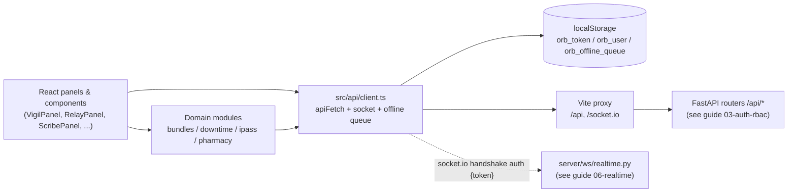
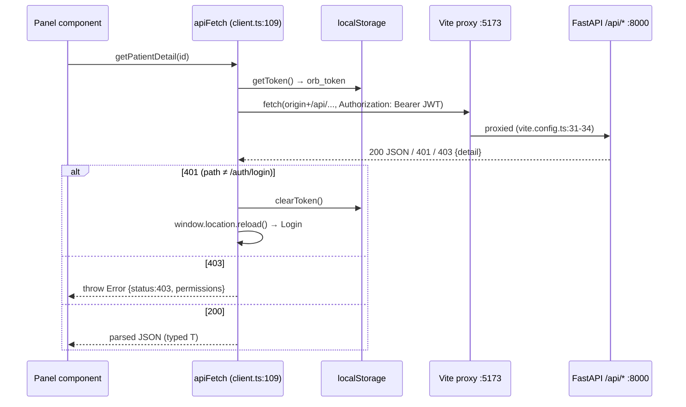
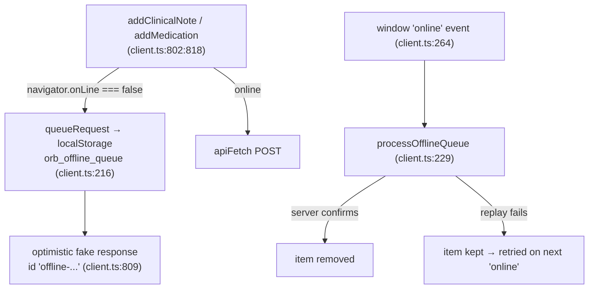

# The API Client: apiFetch, auth headers, the offline queue, and idempotency

Every byte that moves between Orb's React frontend and its FastAPI backend goes through one directory: `src/api/`. Its core file, `src/api/client.ts` (~1,200 lines), is the single place where HTTP requests are built, the login token is attached, session expiry is handled, streaming AI responses are decoded, and clinical writes are queued for replay when the network is down. Four thin domain modules (`bundles.ts`, `downtime.ts`, `ipass.ts`, `pharmacy.ts`) layer typed, per-feature functions on top of the same core, and `sse.test.ts` pins the streaming parser's behavior. If you understand this subsystem, you understand how every panel in Orb talks to the server.

## Purpose and neighbors

**The problem it solves.** Without a shared client, every React component would hand-roll `fetch()` calls: each would read the token from storage itself, invent its own error handling, and drift out of sync (this actually happened, see the comment at `src/api/client.ts:320-326` describing a hand-rolled fetch in VigilPanel that silently swallowed session expiry). The API client centralizes four cross-cutting concerns so components never think about them:

1. **Where the server is**, the base URL is derived from the page's own origin, so one build works on localhost, LAN, and tunneled (ngrok) deployments (`src/api/client.ts:9-10`).
2. **Who you are**, the JWT is read from one place and attached to every request and to the realtime socket handshake (`src/api/client.ts:24-26`, `:43-46`, `:101-106`). A **JWT (JSON Web Token)** is a signed string the server issues at login; it encodes the user's identity and expiry, and the server can verify its signature without a session store. It is sent as a **Bearer token**, an `Authorization: Bearer <token>` HTTP header, meaning "whoever bears this token is this user."
3. **What failure means**, 401 (session expired) and 403 (permission denied) are normalized into one behavior and one error shape for the whole app (`src/api/client.ts:115-131`).
4. **What happens offline**, selected clinical writes are persisted to a browser-local queue and replayed when connectivity returns (`src/api/client.ts:198-264`).

Neighbors: the **auth subsystem** (guide 03-auth-rbac) issues the JWT this client stores and enforces permissions server-side; the **realtime subsystem** (guide 06-realtime) consumes the socket this file creates; every **feature panel** imports its API functions from here; and the **Vite dev proxy** (`vite.config.ts:30-44`) makes the FastAPI backend on port 8000 appear same-origin to the browser.

## File map

| File | Lines | Role |
|---|---|---|
| `src/api/client.ts` | 1,914 | Core client: token/user storage, socket.io singleton, `apiFetch`, error normalization, SSE helpers, offline queue, and ~90 per-domain endpoint wrappers (auth, Vigil, Relay, Sage, Scribe, Bridge, Lens, Surgery, Admin, Discharge-access, Helix). |
| `src/api/bundles.ts` | 127 | Typed client for Sepsis Six care-bundle endpoints (`/api/bundles/*`). |
| `src/api/downtime.ts` | 145 | Typed client for EHR downtime snapshots (`/api/downtime/*`). |
| `src/api/ipass.ts` | 117 | Typed client for I-PASS shift-handoff endpoints (`/api/ipass/*`). |
| `src/api/pharmacy.ts` | 151 | Typed client for pharmacist verification of AI-charted medications (`/api/pharmacy/*`). |
| `src/api/pulse.ts` | 80 | Typed client for Pulse's one endpoint, `GET /api/pulse/season` (`fetchPulseSeason`, `PulseSeason`). Added 6 October 2026 when Pulse was rebuilt as a built-in seasonal calendar; before that `PulseWidget` called `apiFetch('/pulse/dashboard')` directly. |
| `src/api/sse.test.ts` | 67 | Vitest unit tests for the SSE parsing helpers `readSSEEvents` and `parseSSEData`. |

## How it works

### Flow 1: anatomy of an authenticated JSON call

Almost everything in Orb is a variation of this flow. Example: opening a patient in the Vigil panel.

1. A component calls a wrapper, e.g. `getPatientDetail(id)` (`src/api/client.ts:312`), which calls `apiFetch('/vigil/patients/{id}')`.
2. `apiFetch` prefixes the path with `API_BASE = window.location.origin + '/api'` (`src/api/client.ts:9-10`, `:110`), the browser only ever talks to its own origin, so there is no CORS (cross-origin resource sharing, the browser security rule that blocks requests to other domains unless the server opts in) to configure.
3. `authHeaders()` reads the JWT from `localStorage['orb_token']` and builds `{ 'Content-Type': 'application/json', Authorization: 'Bearer <jwt>' }` (`src/api/client.ts:101-106`). **localStorage** is the browser's persistent per-origin key/value store; it survives reloads, which is why the session survives a refresh, and also why the file carries a security warning about XSS (cross-site scripting: injected JavaScript on the page can read localStorage and steal the token, `src/api/client.ts:15-23`).
4. In development, Vite's proxy forwards `/api` to `http://localhost:8000` where FastAPI listens (`vite.config.ts:31-34`); each FastAPI router carries its own `/api/<domain>` prefix (e.g. `server/routes/vigil_routes.py:11`), mounted in `server/main.py:297-329`.
5. On a non-OK response: **401** (unauthenticated, the token is missing/expired) wipes the session and reloads the page back to Login, except for the login call itself (`src/api/client.ts:116-119`); **403** (authenticated but not allowed, the RBAC layer denied it; **RBAC** = role-based access control, permissions attached to roles like `doctor`/`nurse`) is re-thrown as a structured error carrying `.status = 403` and `.permissions` so UIs can render "you lack permission X" (`src/api/client.ts:123-129`); anything else throws `Error(detail)` (`src/api/client.ts:131`).
6. On success the JSON body is parsed and returned typed as `T` (`src/api/client.ts:134-135`).

### Flow 2: session lifecycle (login → socket → logout)

1. `login()` POSTs credentials to `/auth/login`, then persists `token` → `orb_token` and `user` → `orb_user` (`src/api/client.ts:278-288`).
2. It calls `authenticateSocket()` (`src/api/client.ts:592`, defined at `:57`), which re-points the socket.io handshake auth at the fresh token and forces a disconnect/reconnect (`src/api/client.ts:57-64`). The socket itself is a module-level singleton created on first import with `auth` as a *callback* that re-reads the token on every connection attempt (`src/api/client.ts:42-49`), but with `autoConnect: false` (`:43`), so it opens only once a token or session cookie exists (`:54`); the server's `connect` handler verifies the handshake before accepting (`server/ws/realtime.py:358`, guide 06-realtime).
3. On logout, `AppRoot.tsx:90` calls `deauthenticateSocket()` (`src/api/client.ts:60-65`) and clears storage via `clearToken()` (`src/api/client.ts:73-76`), so neither REST nor realtime keeps the old identity.
4. Any 401 from any endpoint at any time repeats the logout effect automatically (Flow 1, step 5).

### Flow 3: streaming AI responses over SSE

**SSE (Server-Sent Events)** is a one-way streaming protocol over plain HTTP: the server keeps the response open and writes events as text frames of the form `data: <payload>\n\n` (a blank line terminates each event). Orb uses it for every token-by-token AI stream (Sage chat/voice, Scribe structuring, Bridge Q&A, Vigil analysis, Lens, Surgery risk). Since the browser's built-in `EventSource` cannot send POST bodies or Authorization headers, the client uses raw `fetch` plus two shared helpers:

1. The call site POSTs with auth headers set manually via `buildHeaders` (e.g. `querySage`, `src/api/client.ts:938-944`) and checks `response.ok`, delegating failures to `handleResponseError` (`src/api/client.ts:946` → `:271`). The one GET-shaped stream, `getPatientAnalysis`, passes `Accept: text/event-stream` the same way (`:1544`).
2. `readSSEEvents(response)` (`src/api/client.ts:169`) reads the body stream chunk-by-chunk, buffers partial frames, and yields each complete event (the text between `\n\n` delimiters).
3. `parseSSEData(event)` (`src/api/client.ts:189`) strips the `data: ` prefix per line to reconstruct the payload.
4. The call site parses each payload (usually JSON like `{"content": "..."}`), accumulates the full text, and invokes an `onChunk` callback so the UI can render progressively.

Before these helpers existed the read/decode/split loop was copy-pasted into seven functions (`src/api/client.ts:160-165`); `sse.test.ts` pins the extracted behavior, including event boundaries that land mid-chunk.

### Flow 4: the offline queue

Orb is built as a **PWA (Progressive Web App)**, a website that installs like an app and caches its static assets through a service worker (`vite.config.ts:9-25`), so the UI shell loads with no network. The API client supplies the *data* half of offline support for two write paths:

1. `addClinicalNote` and `addMedication` check `navigator.onLine` (the browser's connectivity flag) before sending (`src/api/client.ts:806`, `:821`).
2. If offline, `queueRequest` appends `{id: crypto.randomUUID(), url, method, body, timestamp}` to the `orb_offline_queue` array in localStorage (`src/api/client.ts:216-227`) and the wrapper returns an **optimistic response**, a fabricated success object with a fake `offline-<timestamp>` id (`src/api/client.ts:808-809`, `:823-824`) so the UI proceeds as if the save succeeded.
3. When the browser fires the `online` event, `processOfflineQueue` (`src/api/client.ts:229`, registered at `:264`) replays each item through `apiFetch`, which attaches a *fresh* auth header at replay time, removing an item only after the server confirms it, and keeping failures for the next retry (`src/api/client.ts:240-260`).
4. `ClinicianShell` polls the queue length every 2 s to render the "pending / synced" badge (`src/pages/ClinicianShell.tsx:297-339`).

### Flow 5: idempotency

**Idempotency** means an operation applied more than once has the same effect as applying it once. Retries (offline replays, double-clicks, lost responses) make duplicates inevitable, so safety-critical writes need duplicate detection. Orb's mechanism is the **idempotency key**: a unique client-chosen string sent with the request; the server records it, and if the same key arrives again it returns the recorded outcome instead of re-executing. In this codebase the fully wired example is the Helix pharmacy order transition: `transitionHelixOrder` accepts an optional `idempotency_key` (`src/api/client.ts:1174-1185`), the route forwards it (`server/routes/helix_routes.py:133`, `:156`), and `transition_order_status` checks it against the `UNIQUE` column `helix_transitions.idempotency_key` (`server/services/helix_service.py:162-175`, `server/services/helix_db.py:73`), returning `already_applied: true` on a duplicate. The offline queue generates a UUID per queued request (`src/api/client.ts:219`) but, as its own comment admits (`src/api/client.ts:250-253`), never transmits it, so queued note/medication replays are *not* actually protected today (see Discrepancies).

## Function-by-function

### `src/api/client.ts`

#### API_HOST / API_BASE: `src/api/client.ts:9`
**Signature:** module constants → `string`
**Does:** Derives the backend base URL (`<origin>/api`) from the page's own origin.
**How it works:** 1. `API_HOST = window.location.origin` (`:9`). 2. `API_BASE = API_HOST + '/api'` (`:10`). 3. Every REST helper concatenates `API_BASE + path`.
**Why it exists:** Hard-coding `http://localhost:8000` would break LAN and ngrok access; using the page origin means the same build works anywhere, with Vite (dev) or a reverse proxy (prod) forwarding `/api` to FastAPI (`vite.config.ts:31-34`).
**Data in/out:** none → strings.
**Talks to:** read by `apiFetch` and every raw-`fetch` call site; the socket also connects to `API_HOST` (`:43`).
**Change guide:** To point the client at a remote API without a proxy, replace `window.location.origin` at `client.ts:9` with an env-driven value (`import.meta.env.VITE_API_HOST`); knock-on effects: you now have a cross-origin API, so the backend needs CORS headers and the socket.io handshake needs the same host; watch out for the `/socket.io` path, which is proxied separately (`vite.config.ts:39-43`).
**Gotchas:** none noteworthy.

#### getToken: `src/api/client.ts:23`
**Signature:** () → `string | null`
**Does:** Reads the JWT from `localStorage['orb_token']`.
**How it works:** One-line `localStorage.getItem` (`:25`).
**Why it exists:** Single choke point for token reads, so the storage mechanism can be swapped (e.g. to in-memory + refresh cookie) in one place.
**Data in/out:** none → raw JWT string or null.
**Talks to:** called by `authHeaders`, the socket auth callback (`:45`), and every raw-fetch streaming/upload function.
**Change guide:** To move the token out of localStorage, change `getToken`/`setToken`/`clearToken` (`:24`, `:68`, `:73`) together; knock-on effects: session no longer survives reload unless you add a refresh flow, and the socket auth callback (`:45`) picks the new source up automatically; watch out for the documented security caveat, the current design is deliberately deferred pending backend CSRF/cookie work (`:15-23`).
**Gotchas:** Any JavaScript on the origin can read this token (XSS exposure), acknowledged in the header comment (`:15-23`).

#### socket: `src/api/client.ts:42`
**Signature:** module constant → socket.io `Socket`
**Does:** Creates the app-wide realtime WebSocket connection at module load, presenting the JWT in the handshake.
**How it works:** 1. `io(API_HOST, { autoConnect: true, auth: (cb) => cb({ token: getToken() }) })` (`:43-46`). 2. Because `auth` is a callback, the *current* localStorage token is read on every (re)connection attempt. 3. A **WebSocket** is a persistent two-way TCP connection the server can push on; **socket.io** is a library layered on it adding rooms, reconnection, and a **handshake**, the initial exchange where this `auth` payload is delivered. 4. The server's `connect(sid, environ, auth)` handler verifies the token and refuses unauthenticated clients (`server/ws/realtime.py:168`; rationale comment `:29-138`).
**Why it exists:** One shared authenticated socket for the whole app; sending the JWT in the handshake makes realtime enforce the same identity as REST, otherwise any client could join any patient room (`:33-35`).
**Data in/out:** handshake `auth = { token: string | null }` → connected socket (or a refused connection before login).
**Talks to:** imported by VigilPanel, RelayPanel, SurgicalSuitePanel, SageAmbientSidebar, SageInsightsFeed, `useStreamingTranscription`, and others (they register `socket.on(...)` handlers, event catalog in guide 06-realtime).
**Change guide:** To add a new realtime consumer, import `socket` and register/cleanup listeners inside a React `useEffect`; knock-on effects: none in this file; watch out for the module-load side effect, merely importing `client.ts` opens a connection attempt (relevant in tests).
**Gotchas:** Before login the socket connects with `token: null` and is refused server-side; nothing in `src/` listens for `connect_error`, so it just stays silently disconnected until `authenticateSocket()` runs.

#### authenticateSocket: `src/api/client.ts:57`
**Signature:** () → `void`
**Does:** Re-arms the socket handshake with the freshly stored token and forces a reconnect (used right after login).
**How it works:** 1. Overwrites `socket.auth` with the static object `{ token: getToken() }` (`:51`). 2. Disconnects if connected (`:52-54`). 3. `socket.connect()` (`:55`) triggers a new handshake carrying the new token.
**Why it exists:** The pre-login connection was refused (or anonymous); after `setToken` the realtime channel must be re-established as the logged-in user.
**Data in/out:** none → side effect on the singleton socket.
**Talks to:** called by `login` (`:286`); calls `getToken`.
**Change guide:** To re-authenticate after a future token-refresh flow, call this again with the new token stored; knock-on effects: server re-runs its connect auth and re-enters the per-user room; watch out for the subtlety below.
**Gotchas:** Line 51 *replaces* the original auth **callback** (`:45`) with a **static object**, so later automatic reconnects present the login-time token rather than re-reading storage. Today that is equivalent (tokens only change via `login`, which calls this function again), but a silent-refresh feature would break reconnect auth unless this is restored to callback form.

#### deauthenticateSocket: `src/api/client.ts:68`
**Signature:** () → `void`
**Does:** Nulls the socket's auth and disconnects on logout so the previous user's realtime session is not kept open.
**How it works:** Sets `socket.auth = { token: null }` (`:61`), then disconnects (`:62-64`). Deliberately does *not* reconnect.
**Why it exists:** Without it, logging out would clear the REST token but leave an authenticated WebSocket streaming patient data (`:58-59`).
**Data in/out:** none → disconnected socket.
**Talks to:** called by `AppRoot.tsx:90` in the logout handler.
**Change guide:** If you add a "switch user" feature, call this then `authenticateSocket()` after the new login; watch out for listeners registered by unmounted components firing during the gap.
**Gotchas:** none noteworthy.

#### setToken / clearToken: `src/api/client.ts:76` / `src/api/client.ts:81`
**Signature:** `(token: string) → void` / `() → void`
**Does:** Persists / erases the session in localStorage.
**How it works:** `setToken` writes `orb_token` (`:69`); `clearToken` removes both `orb_token` and `orb_user` (`:74-75`).
**Why it exists:** Pairs with `getToken` as the single storage choke point; `clearToken` removing the user object too means a 401 can never leave a half-cleared session.
**Data in/out:** JWT string ↔ localStorage.
**Talks to:** `setToken` called by `login` (`:283`) and `App.tsx`; `clearToken` called by `apiFetch`/`handleResponseError` on 401 (`:117`, `:141`), `transcribeChunk` (`:646`), `getDischargeQrObjectUrl` (`:899`), and App's logout.
**Change guide:** To add "remember me = off", swap `localStorage` for `sessionStorage` in these two plus `getToken`; knock-on effects: multi-tab sessions stop sharing a login; watch out for the offline queue, which intentionally stays in `localStorage` regardless.
**Gotchas:** none noteworthy.

#### StoredUser + setUser / getUser: `src/api/client.ts:89` / `:103` / `:108`
**Signature:** `setUser(user: StoredUser) → void`; `getUser() → StoredUser | null`
**Does:** Persists and restores the logged-in user's profile (`id`, `name`, `role`, `department?`, `registrationNumber?`) across reloads.
**How it works:** JSON-stringify into / parse out of `localStorage['orb_user']` (`:91`, `:96-97`). The `StoredUser` interface keeps `role` as `string | null` explicitly so App's stricter role union stays assignable without a circular import (`:78-80`).
**Why it exists:** Lets `App.tsx` restore the session on refresh and lets panels do cheap role checks (e.g. SurgicalSuitePanel, ScribePanel, RelayPanel, VigilPanel all import `getUser`) without an extra `/auth/me` round trip.
**Data in/out:** `StoredUser` ↔ JSON string in localStorage.
**Talks to:** `setUser` called by `login` (`:284`) and `App.tsx`; `getUser` called by App plus at least five panels (grep `getUser` in `src/pages`).
**Change guide:** To add a field (e.g. `avatarUrl`), extend `StoredUser` (`:81-87`), populate it from the login response (`:267-276`), and it flows through automatically; watch out: existing stored blobs won't have the field until next login, treat it as optional.
**Gotchas:** `getUser` calls `JSON.parse` with no try/catch (`:96-97`); a corrupted `orb_user` value throws during app startup. Note also the naming mismatch: the server sends `registration_number` (`:274`) but `StoredUser` declares `registrationNumber` (`:86`), the raw server object is stored as-is, so the camelCase field is effectively never populated (see Discrepancies).

#### buildHeaders / buildUploadHeaders: `src/api/client.ts:167` / `:185`

> **Renamed.** Earlier editions documented a single `authHeaders()`. That function no longer
> exists; it split into two method-aware builders when the session moved into an HttpOnly cookie
> and CSRF protection arrived.

**Signature:** `buildHeaders(method = 'GET', extra?) → Record<string, string>`; `buildUploadHeaders() → Record<string, string>`
**Does:** Builds request headers. `buildHeaders` sets `Content-Type: application/json`, attaches `Authorization: Bearer <jwt>` *only if* a token happens to exist, and adds `X-CSRF-Token` for unsafe methods. `buildUploadHeaders` does the same minus the JSON content type, so the browser can set its own multipart boundary.
**How it works:** 1. Starts from the JSON content type merged with any caller `extra` (`:168`). 2. Reads `getToken()` and attaches Bearer **only when no `Authorization` was passed in** (`:169-174`). 3. For `POST/PUT/PATCH/DELETE` it reads the `orb_csrf` cookie via `getCsrfToken()` (`:148-151`) and sets `X-CSRF-Token` (`:175-178`).
**Why it exists:** Auth is primarily the HttpOnly `orb_session` cookie, sent automatically by `credentials: 'include'`, so the JWT no longer lives in localStorage where an XSS could read it (docstring at `:153-162`). A cookie-authenticated mutation is exactly what CSRF attacks target, hence the token on unsafe methods.
**Data in/out:** method + optional extra headers → header map.
**Talks to:** called by `apiFetch` (`:200`); `buildUploadHeaders` by the multipart callers (`transcribeAudio`, `transcribeChunk`, `analyzeLensImage`).
**Change guide:** To add a header to *every* JSON request (e.g. a correlation id for the audit trail), add it in `buildHeaders`; knock-on: `buildUploadHeaders` is a separate list and must be updated too. Watch out for FastAPI CORS if you ever go cross-origin, new headers must be allowed.
**Gotchas:** The "explicitly-passed Authorization wins" rule at `:174` is load-bearing, not a nicety. The MFA self-enrolment flow authenticates with a short-lived enrolment **ticket** while no session exists yet; if the ambient token overwrote it, the client would silently send the wrong credential. `MFA_ENROLL_TICKET_HEADER` (`:165`) must stay in step with `server/routes/auth_routes.py`.

#### apiFetch: `src/api/client.ts:195`
**Signature:** `<T>(path: string, options: RequestInit = {}) → Promise<T>`
**Does:** The generic authenticated JSON request wrapper used by ~80 endpoint functions across all five API modules.
**How it works, line by line:**
1. `fetch(`${API_BASE}${path}`, ...)`, prefixes the API base so callers pass router-relative paths like `/vigil/patients` (`:196`).
2. `credentials: 'include'` sends the HttpOnly `orb_session` cookie on every request (`:199`), and headers come from `buildHeaders(method, options.headers)` (`:200`), so caller headers are merged *inside* the builder, where the explicit-Authorization rule applies.
3. If `!response.ok`:
   - **401** and the path is not one of the unauthenticated auth paths: `notifySessionExpired()` (`:204-206`). It does **not** clear the token or reload, it dispatches `orb:session-expired` on `window` and throws, so `App.tsx` can put a re-auth modal over the current screen without destroying unsaved clinical text (`:117-125`).
   - Parses the error body as JSON, falling back to `{detail: 'Unknown error'}` if the body is not JSON (`:207`).
   - **403**: the backend RBAC layer returns a structured `detail` object; the code tolerates both object and string forms (`:211`), wraps it in an `Error` whose message is `detail.message`, and staples `status = 403` and `permissions = detail` onto the error (`:212-214`) so UIs can render which permission was missing. It also lifts the `X-MFA-Enrollment-Ticket` response header onto the error as `mfaEnrollTicket` when present (`:222-223`), without that, a fresh appliance's only admin could never finish TOTP enrolment (comment at `:215-221`).
   - **428 Precondition Required** with `detail.error === 'drug_safety_acknowledgement_required'`: throws a typed `SafetyAckRequiredError` carrying the full safety payload so the caller can render the alerts and re-submit with `safety_ack` (`:231-243`).
   - Anything else: an `Error` whose message is `detail.message` (for structured details) or `detail`, carrying **both** `status` and the raw structured `detail` (`:247-263`). The status is what lets the offline-queue replay tell a permanent 4xx from a transient failure; keeping `detail` is what preserves per-item verdicts on a blocked order set.
4. On success: `response.json()` parsed and returned as `T` (`:266-267`). Note `T` is a compile-time promise only, nothing validates the payload at runtime.
**Why it exists:** One wrapper gives every call identical base-URL handling, cookie + CSRF attachment, session-expiry behavior, and RBAC error shaping. There is deliberately **no retry logic and no timeout** here: a failed request throws once, immediately; the only retry machinery in the client is the offline queue replay (which re-enters `apiFetch` per attempt).
**Data in/out:** router-relative path + standard `RequestInit` → parsed JSON typed `T`; throws `Error` (possibly with `.status`, `.detail`, `.permissions`, `.mfaEnrollTicket`, or the `SafetyAckRequiredError` shape) on any non-2xx.
**Talks to:** called by every wrapper in this file plus all four domain modules and several components that import it directly (`HelixPanel`, `ImpactDashboard`, `TrustCenter`, `ProvenanceChip`, `RevenueIntegrityPanel`, `CapacitySimulator`, `CommandCenter`, `FlightRecorder`, `OrdersPanel`, found by grep); calls `buildHeaders`, `notifySessionExpired`.
**Change guide, worked example (adding a new endpoint):** Suppose the backend gains `GET /api/vigil/patients/{id}/allergies`. 1. Add `export async function getPatientAllergies(patientId: string): Promise<Allergy[]> { return apiFetch(`/vigil/patients/${patientId}/allergies`); }` near the other Vigil wrappers (around `client.ts:614-652`). 2. Define the `Allergy` interface next to it. 3. Import it in the consuming panel. That is the entire client-side change, auth, errors, and base URL come free. Knock-on effects: none. Watch out: paths embedding user-supplied strings should use `encodeURIComponent` (only `bundles.ts:76` does this today, most `client.ts` wrappers interpolate raw ids).
**Gotchas:** (1) `notifySessionExpired()` is typed `never` and throws, so the 401 branch never falls through to the JSON parse, the surviving error message is always `'Session expired'`, not the server's detail. (2) A *network-level* failure (server unreachable) rejects the raw `fetch` with a `TypeError` that bypasses all of this normalization, callers see a generic "Failed to fetch". (3) The generic `T` is unchecked at runtime; a backend shape change fails silently at the type level.

#### handleResponseError: `src/api/client.ts:271`
**Signature:** `(response: Response) → Promise<never>`
**Does:** Applies apiFetch's 401/403/other error normalization to raw `fetch` calls (streams and uploads) that cannot go through `apiFetch`.
**How it works:** 1. 401 → `notifySessionExpired()` (`:272-274`); unlike `apiFetch` there is no unauthenticated-path exception because no login call uses this helper. 2. Parses the error JSON with the same fallback (`:276`). 3. 403 → identical structured permission error (`:278-284`). 4. Otherwise throws `Error(detail)` (`:286`).
**Why it exists:** The streaming/upload functions bypass `apiFetch` (they need streaming bodies or multipart), but session expiry and permission errors must behave identically everywhere.
**Data in/out:** failed `Response` → never returns (always throws).
**Talks to:** called by `querySage`, `querySageVoice`, `transcribeAudio`, `structureNote`, `askBridge`, `getPatientAnalysis`, `analyzeLensImage`, `assignLensToPatient`, `getSurgeryRiskAssessment`.
**Change guide:** Any change to `apiFetch`'s error branches must be mirrored here (and vice versa), the two blocks are intentionally parallel (`:210-225` vs `:278-284`); watch out for drift, the classic duplicated-normalizer bug.
**Gotchas:** the two have already drifted. `apiFetch` grew a 428 drug-safety branch and the MFA-enrolment ticket lift; `handleResponseError` has neither. A streaming endpoint that ever returns 428 would surface as a plain `Error`, losing the safety payload.

#### readSSEEvents: `src/api/client.ts:299`
**Signature:** `(response: Response) → AsyncGenerator<string>`
**Does:** Turns a streaming HTTP response body into an async sequence of raw SSE event strings (the text between `\n\n` delimiters).
**How it works:**
1. Grabs the body's `ReadableStream` reader; yields nothing if the body is unreadable (`:300-301`), the tests pin this (`sse.test.ts:60-66`).
2. An **async generator** (`async function*`) is a function that can `yield` values as they become available and be consumed with `for await`.
3. Loop: `reader.read()` returns byte chunks; `TextDecoder.decode(value, {stream: true})` converts them to text while correctly handling multi-byte characters split across chunks (`:304-307`).
4. The accumulated buffer is split on `\n\n`; the final fragment (a possibly-incomplete event) is put back in the buffer via `events.pop()` (`:308-309`), this carry-over is what makes mid-chunk event boundaries safe, exercised by the deliberately tiny 7-byte chunks in `sse.test.ts:22-35`.
5. Non-empty events are yielded (`:310-312`).
**Why it exists:** This transport/framing loop was copy-pasted into 7 streaming functions with subtly different error handling before being centralized (comment at `:290-295`).
**Data in/out:** `Response` with an open body → yields raw event strings like `data: {"content":"hi"}`.
**Talks to:** consumed by all seven streaming call sites in this file, `querySage` (`:950`), `querySageVoice` (`:1058`), `structureNote` (`:1156`), `askBridge` (`:1261`), `getPatientAnalysis` (`:1552`), `analyzeLensImage` (`:1639`), `getSurgeryRiskAssessment` (`:1715`); tested by `sse.test.ts:37-67`.
**Change guide, worked example (adding a new streaming endpoint):** Backend adds `POST /api/sage/summarize` streaming `data: {"content": "..."}` frames. 1. Copy the `askBridge` pattern (`client.ts:1246-1272`): raw `fetch` with `credentials: 'include'` + `buildHeaders('POST')`, then `if (!response.ok) await handleResponseError(response)`. 2. `for await (const event of readSSEEvents(response))`, `JSON.parse(parseSSEData(event))`, accumulate `data.content`, call `onChunk(full)`. 3. Return the accumulated string. Knock-on effects: none, the helpers are shared. Watch out: decide explicitly what a `data.error` frame does (throw vs ignore); two existing call sites get this wrong (see Discrepancies).
**Gotchas:** The parser only splits on `\n\n`; a server that emits `\r\n\r\n` framing would never yield an event. There is no handling of SSE `event:`/`id:` fields, Orb's backend only uses `data:` lines.

#### parseSSEData: `src/api/client.ts:319`
**Signature:** `(event: string) → string`
**Does:** Reconstructs an SSE event's payload by stripping the `data: ` prefix from each line.
**How it works:** For each line, keeps `line.slice(6)` if prefixed with `data: `, otherwise keeps the line verbatim (documented as deliberately permissive, matching pre-refactor behavior, `:316-318`); joins with newlines and trims the trailing one (`:320-324`).
**Why it exists:** Multi-line SSE payloads arrive as several `data:` lines that must be rejoined before JSON parsing.
**Data in/out:** raw event string → payload string (e.g. `{"content":"hi"}` or `[DONE]`).
**Talks to:** every streaming call site; tested by `sse.test.ts:4-20`.
**Change guide:** To make parsing strict (drop non-`data:` lines), change the ternary at `:322`, but first check the backend never emits bare continuation lines; the permissive branch exists because it did.
**Gotchas:** A line reading `data:x` (no space) is kept verbatim including the prefix, only the exact `'data: '` form is stripped.

#### Offline queue storage: OfflineRequest, getOfflineQueue, setOfflineQueue, queueRequest, offlineMutate: `src/api/client.ts:329-445`
**Signature:** `queueRequest(path, method, body, idempotencyKey?) → void`; `offlineMutate<T>(path, body, offlineResult, method?, key?) → Promise<T>`; getters/setters ↔ `OfflineRequest[]`
**Does:** Persists write requests made while offline into `localStorage['orb_offline_queue']` for later replay, and gives callers one helper (`offlineMutate`) that does the online-or-queue decision.
**How it works:** 1. `OfflineRequest` = `{id, url, method, body, timestamp, idempotencyKey?, userId?}` (`:329-344`). The last two fields are the safety-critical ones: the key lets the server dedupe a replay it already processed, and `userId` records **who** queued the write. 2. `getOfflineQueue`/`setOfflineQueue` JSON-round-trip the array under one key (`:348-355`). 3. `queueRequest` appends a record with `id: crypto.randomUUID()`, `timestamp: Date.now()`, the idempotency key, and `getUser()?.id` (`:391-404`). 4. `offlineMutate` mints (or accepts) an `Idempotency-Key`, and either queues + returns the caller's optimistic `offlineResult(key)` or sends the request straight through with the key header (`:428-445`).
**Why it exists:** A ward tablet losing Wi-Fi mid-shift must not lose a charted note or medication; localStorage is the only storage that is synchronous, persistent, and available in this codebase without adding IndexedDB.
**The safety rule, verbatim from the docstring (`:421-426`):** only route mutations here that are safe to apply *without* a synchronous server response, free-text clinical notes, relay messages, bedside charting of an already-ordered and verified med. Do **not** route safety-gated writes (new medication orders, CPOE) through it: a severe drug-interaction alert is a 428 that cannot be acknowledged while offline, so those stay online-required and fail loudly.
**The retry trap (`:413-419`):** minting a key per *call* protects the offline replay but not a user-initiated retry. A bedside dose whose response was lost to a Wi-Fi drop looks like a failure; the nurse taps Given again; a fresh key goes out; the server charts a **second** dose. Any caller that exposes a retry affordance for a clinical write must mint one key per attempt and reuse it, `AdministerModal` is the reference implementation.
**Also here, the two eviction helpers.** `clearOfflineQueue()` (`:365-369`) drops everything on sign-out or user switch, because the queue holds free clinical text, patient ids and dose payloads, PHI belonging to whoever is walking away from a shared tablet. `clearForeignOfflineQueue(userId)` (`:382-389`) drops only entries whose author is not the current user and **returns** them, so the caller can decide whether anyone needs telling.
**Data in/out:** path/method/body → JSON array in localStorage.
**Talks to:** written through `offlineMutate` by the offline-capable writes; read by `processOfflineQueue` and (read-only, for the badge count) by `src/pages/ClinicianShell.tsx:511-563`.
**Gotchas:** the queue is per-browser-profile: a clinician switching devices leaves pending writes stranded on the first device.

#### processOfflineQueue (+ the `online` listener): `src/api/client.ts:465` / `:567`
**Signature:** () → `Promise<void>`
**Does:** Replays every queued offline request through `apiFetch`, removing items only after server-confirmed success, and refuses to replay a write whose author is not the person now signed in.
**How it works:**
1. A module-level re-entrancy guard returns early if a replay is already running (`:463,466-467`). The browser fires `online` several times in quick succession, and two interleaved replays would each rewrite the queue from a divergent view of it.
2. **Ownership is settled before anything goes on the wire** (`:469-495`). A replay is sent on the *current* session's cookie, so a write queued by the last nurse would be filed against this one. Three cases: nobody signed in → **hold** (the `online` event can land on the login screen); a different user → **drop**, and dispatch `orb:offline-sync-failed` so the shell says so; no author stamp (queued by an older build) → **drop** rather than attribute it to a guess.
3. An outer `for(;;)` loop re-reads the queue each pass, so writes queued *while* replaying, exactly what connectivity flapping produces, are picked up instead of waiting for the next `online` event (`:512-514`).
4. For each item, `apiFetch(req.url, {method, headers: {'Idempotency-Key': ...}, body})`, the replay carries the same key the original attempt did, so the server dedupes a request it already processed but whose response was lost (`:520-527`).
5. Failures are split by `isPermanentReplayFailure` (`:449-456`): a 4xx that will never self-heal (excluding 408/429) is **dropped and reported**; anything else is deferred, left in storage, and skipped for the rest of this run so an unreachable server cannot spin the loop (`:529-547`).
6. After *each* item the queue is rewritten as a read-modify-write against current storage keyed by request id, `setOfflineQueue(getOfflineQueue().filter(r => r.id !== req.id))` (`:552`). Deriving the write-back from the pre-loop snapshot would erase a request queued during the await.
7. Permanently-failed replays are announced on `orb:offline-sync-failed` (`:561-563`), which `ClinicianShell` renders as a dismissible alert.
8. `window.addEventListener('online', processOfflineQueue)` (`:567`) is the sole trigger.
**Why it exists:** Durable, at-least-once delivery of offline clinical writes, with a hard rule that a write is replayed for its author or not at all.
**Data in/out:** localStorage queue → HTTP replays → shrunken queue + `orb:offline-sync-failed` events.
**Talks to:** calls `apiFetch`, `clearForeignOfflineQueue`; triggered by the browser `online` event; observed by ClinicianShell's badge poller.
**Change guide:** To also drain at app startup, call `processOfflineQueue()` from `App.tsx` when `navigator.onLine` is true; the re-entrancy guard already makes that safe against a concurrent `online` event.
**Gotchas:** (1) **At-least-once, not exactly-once**, the `Idempotency-Key` is what makes that safe, so a queued endpoint that ignores the header will double-apply. (2) The only trigger is the `online` event; if the page is closed while offline and reopened while online, the event never fires and items sit until the *next* offline→online transition. (3) The re-entrancy guard is same-tab only; a cross-tab race is bounded to a harmless double-replay by the per-id read-modify-write plus the server-side dedupe (comment at `:458-462`).

#### login (+ LoginResponse): `src/api/client.ts:581` / `:570`
**Signature:** `(employeeId: string, password: string) → Promise<LoginResponse>`
**Does:** Authenticates against `POST /api/auth/login`, caches the user, and re-authenticates the realtime socket.
**How it works:** 1. `apiFetch('/auth/login', {method: 'POST', body: {employee_id, password}})` (`:582-585`), `/auth/login` is in `UNAUTHENTICATED_AUTH_PATHS`, so a wrong password surfaces as a normal thrown error for the form to display rather than a session-expiry event. 2. `setUser(data.user)` (`:590`), and **not** `setToken`: the session is the HttpOnly `orb_session` cookie the server set on this response, so the JWT never reaches localStorage (comment at `:586-589`). 3. `authenticateSocket()` re-handshakes realtime, which now authenticates from the cookie (`:592`).
**Why it exists:** The single entry point into a fully authenticated session (REST + realtime + cached profile).
**Data in/out:** credentials → `LoginResponse` `{token, user: {id, name, role, department?, registration_number?}}` (`:570-579`).
**Talks to:** `src/pages/Login.tsx` imports `apiFetch` directly for the MFA-capable path, so this wrapper is the no-MFA convenience form; calls `apiFetch`, `setUser`, `authenticateSocket`. Token issuance lives in `server/routes/auth_routes.py` (prefix `/api/auth`, `:25`; handler `:362`), see guide 03-auth-rbac.
**Change guide:** the MFA branch already exists in `Login.tsx`, not here; if you add a second challenge type, add it there or promote the whole flow into this function, do not split it across both.
**Gotchas:** `LoginResponse.token` is still declared and returned, but nothing on the browser path stores it (see Discrepancies).

#### Vigil reads: getPatients, getPatientDetail, getPatientVitals: `src/api/client.ts:614`, `:618`, `:627`
**Signature:** see table.
**Does:** Read the ward census, one patient's full aggregate record, and a patient's recent vitals window.
**How it works / Data in/out:**

| Function | Line | Call | Returns |
|---|---|---|---|
| `getPatients` | `:614` | `GET /vigil/patients` | `Patient[]` (typed interface at `:597-612`: id, name, mrn, bed, ward, diagnosis, risk_score/level/drivers, ...) |
| `getPatientDetail` | `:618` | `GET /vigil/patients/{id}` | `any`, the server's aggregate `{patient, risk, trend, vitals, notes, ...}` |
| `getPatientVitals` | `:627` | `GET /vigil/patients/{id}/vitals?hours=` (default 6) | `any[]` |

An **MRN** (medical record number) is the hospital's permanent identifier for a patient; `risk_score`/`risk_level` come from the server's NEWS2-based deterioration scoring (NEWS2 = National Early Warning Score 2, a standard vitals-derived deterioration score).
**Why it exists:** The census list and detail view are Vigil's two core reads; keeping the `Patient` type here gives every consumer one shared shape.
**Talks to:** `getPatients`, VigilPanel and SagePanel; `getPatientDetail`, VigilPanel; `getPatientsList` re-uses `getPatients` (`:1685-1688`). `getPatientVitals` has **no in-repo caller** (dead export).
**Change guide:** To add a census field, extend `Patient` (`:291`) and the server's list query (`server/routes/vigil_routes.py:37`); watch out, `getPatientDetail` returns `any`, so new consumers get no type help.
**Gotchas:** none beyond the `any` typing.

#### getPatientForecast: `src/api/client.ts:638`
**Signature:** `(patientId: string) → Promise<any | null>`
**Does:** Fetches the per-patient deterioration forecast, returning `null` instead of throwing when unavailable.
**How it works:** Wraps `apiFetch(`/forecast/patient/${id}`)` in try/catch; logs a warning and returns `null` on any failure (`:328-333`). The doc comment records why it exists at all: VigilPanel previously hand-rolled this fetch, bypassing 401 handling (`:320-326`).
**Why it exists:** Forecasts are optional decoration on the detail view; their absence must never break the page.
**Data in/out:** patient id → forecast object or `null`.
**Talks to:** called by VigilPanel; hits `server/routes/forecast_routes.py` (prefix `/api/forecast`, `:23`).
**Change guide:** none special, but note the catch also hides *real* errors (expired session gets handled inside `apiFetch` first, so only the throw-after-reload is swallowed).
**Gotchas:** Swallows 403s too, a permissions problem looks identical to "no forecast".

#### admitPatient: `src/api/client.ts:647`
**Signature:** `(data: any) → Promise<any>`
**Does:** POSTs an admission request to `/admissions/admit`.
**How it works:** Plain `apiFetch` POST with the caller-shaped body (`:337-340`).
**Why it exists:** Entry point for the AdmitPatientModal flow (`src/components/AdmitPatientModal.tsx:3`).
**Data in/out:** untyped admission payload → untyped result; server router `server/routes/admission_routes.py` (prefix `/api/admissions`, `:8`).
**Talks to:** AdmitPatientModal.
**Change guide / Gotchas:** untyped both ways, define interfaces if you touch it.

#### Relay wrappers: getChannels, getAlerts, resolveAlert, getMessages, markChannelRead, sendMessage: `src/api/client.ts:778-893`
**Signature:** see table.
**Does:** The chat/alert surface of Relay (Orb's team-messaging module).
**How it works / Data in/out:** All are one-call `apiFetch` wrappers to `server/routes/relay_routes.py` (prefix `/api/relay`, `:18`):

| Function | Line | Call | Returns |
|---|---|---|---|
| `getChannels` | `:778` | `GET /relay/channels` | `Channel[]` (`:344-360`, per-channel patient context, `unread_count`, `has_alert`) |
| `getAlerts` | `:782` | `GET /relay/alerts` | `Message[]` |
| `resolveAlert` | `:786` | `POST /relay/alerts/{messageId}/resolve` body `{action: 'confirm'\|'escalate'}` | `any` |
| `getMessages` | `:793` | `GET /relay/channels/{id}/messages` | `Message[]` (`:362-376`) |
| `markChannelRead` | `:798` | `POST /relay/channels/{id}/read` | `{status, marked_read}` |
| `sendMessage` | `:871` | `POST /relay/channels/{id}/messages` body `{content, message_type:'text'}` | `Message` |

The `Message` type carries provenance flags `is_bot`/`source` so automated posts (simulation vitals, Lens AI, Vigil alerts) are badge-distinguishable from clinician messages (`:371-375`).
**Why it exists:** RelayPanel's whole data layer; realtime `message:new` events (guide 06-realtime) deliver *new* messages, these wrappers do initial loads and writes.
**Talks to:** RelayPanel (`src/pages/panels/RelayPanel.tsx:2`), AlertsSection, CaseList (types only).
**Change guide:** New message types: extend `message_type` at the `sendMessage` body (`:501`) and the server's validation; watch out for the socket path, a message you POST comes back to you via `message:new`, so RelayPanel must de-duplicate.
**Gotchas:** none noteworthy.

#### Sage ambient wrappers: getSageMemory, getSageActions, transitionSageAction: `src/api/client.ts:826`, `:830`, `:834`
**Signature:** `(channelId) → Promise<SageAmbientMemory | null>`; `(channelId) → Promise<SageAction[]>`; `(channelId, actionId, state, version, reason?) → Promise<{status, action?, handoff?}>`
**Does:** Read/advance Sage's ambient understanding of a Relay conversation (its running summary, inferred intents, and suggested actions).
**How it works:** GETs to `/relay/channels/{id}/sage_memory` and `/sage_actions`; `transitionSageAction` POSTs `{state, version, reason}` to `/sage_actions/{actionId}/transition` (`:461-466`). The `version` field implements **optimistic concurrency**: the server rejects a transition if the action has changed since the client read it, preventing two clinicians from double-confirming.
**Data in/out:** `SageAmbientMemory` (`:378-403`), `SageAction` with a state machine `suggested → acknowledged/dismissed/confirmed/failed/superseded` and optional `SageHandoff` (`:405-427`).
**Talks to:** `SageAmbientSidebar` (`src/components/relay/SageAmbientSidebar.tsx:2`).
**Change guide:** New action states must be added to the union at `:421` *and* the server's transition table; watch out for `version`, always pass the version you rendered, never re-fetch-and-retry blindly.
**Gotchas:** `getSageMemory` is typed `| null` because the server returns JSON `null` before Sage has processed the room.

#### Sage insight wrappers: getSageInsights, transitionInsight, actOnInsight: `src/api/client.ts:856`, `:860`, `:867`
**Signature:** see below.
**Does:** Surface and act on Sage's proactive surveillance insights (cross-patient warnings generated without being asked).
**How it works:** `GET /sage/insights` → `{insights: SageInsight[]}` (`:483-485`; type at `:469-481`); `POST /sage/insights/{id}/transition` with `{state: 'dismissed'|'acted'}` (`:487-492`); `POST /sage/insights/{id}/act` returns `{status, action_id, channel_id}`, the server materializes a Sage action in the patient's Relay channel (`:494-496`).
**Why it exists:** Feeds `SageInsightsFeed` (`src/components/sage/SageInsightsFeed.tsx:2`), which also listens on the socket for new-insight events.
**Data in/out:** `SageInsight` `{id, patient_id, insight_type, severity: critical|warning|info, title, detail?, suggested_action_*, state, created_at}`.
**Talks to:** SageInsightsFeed; server `server/routes/sage_proactive_routes.py` (prefix `/api/sage`, `:11`).
**Change guide / Gotchas:** none noteworthy.

#### querySage: `src/api/client.ts:900`
**Signature:** `(query, patientId?, onChunk?, signal?, onMetadata?) → Promise<string>`
**Does:** Streams a Sage (clinical AI assistant) chat answer token-by-token over SSE and returns the full text.
**How it works:**
1. Raw `fetch` POST to `/sage/query` with manual JSON + Bearer headers and an optional `AbortSignal` (`:513-522`), an **AbortSignal** lets the caller cancel the in-flight stream (e.g. user clicks stop).
2. Non-OK → `handleResponseError` (`:524`).
3. For each SSE event: parse JSON; `data.content` chunks are accumulated and the **cumulative** string is passed to `onChunk` (`:531-534`), note callers receive the whole text so far, not the delta; `data.metadata` → `onMetadata` (`:535-537`); `data.structured_response` → `onMetadata({_structured_response})` (`:538-540`).
4. Malformed events are silently skipped via `catch {}` (`:541`).
**Why it exists:** Progressive rendering of AI answers; a blocking request would freeze the chat UI for the full generation time.
**Data in/out:** `{query, patient_id}` → SSE frames `{content?}|{metadata?}|{structured_response?}` → full answer string.
**Talks to:** SagePanel, ScribePanel, RelayPanel; server `server/routes/sage_routes.py` (prefix `/api/sage`, `:12`).
**Change guide:** To surface a new streamed field, add an `if (data.<field> !== undefined)` branch inside the loop (`:530-540`) and thread a callback parameter; watch out for the `catch {}`, it swallows exceptions thrown by *your callbacks*, not just parse errors.
**Gotchas:** The empty `catch` means an error thrown inside `onChunk`/`onMetadata` silently drops that event and continues streaming.

#### getSageHistory / clearSageHistory: `src/api/client.ts:1023` / `:1027`
**Signature:** `() → Promise<any>` / `() → Promise<void>`
**Does:** Fetch and delete the current user's Sage conversation history (`GET`/`DELETE /sage/history`).
**Talks to:** SagePanel.
**How it works / Why / Data / Change guide / Gotchas:** trivial `apiFetch` wrappers; none noteworthy.

#### querySageVoice: `src/api/client.ts:1032`
**Signature:** `(query, patientId?, onToken?, signal?, conversationHistory?) → Promise<{fullResponse, timing?}>`
**Does:** Streams the low-latency Sage voice-agent answer, delivering per-token deltas and final timing stats.
**How it works:** 1. Builds `{query, patient_id, conversation_history?}`, history only included when non-empty (`:564-567`). 2. Raw fetch POST to `/sage/voice` (`:568-576`); non-OK → `handleResponseError`. 3. Per event: `data.token` is the **delta** (unlike `querySage`'s cumulative `onChunk`) appended and forwarded (`:586-589`); `data.done && data.timing` captures `{ttft_ms, total_ms, tokens}` (`:590-592`; ttft = time to first token); `data.error` throws (`:593-595`).
**Why it exists:** The voice assistant needs token deltas (for progressive speech synthesis) and latency telemetry.
**Talks to:** SagePanel's voice mode only. (The floating orb used to call it too; it went text-only on 4 October 2026.)
**Data in/out:** as above; returns `{fullResponse, timing?}`.
**Change guide:** Mirror changes in the backend voice route's frame schema; keep the delta semantics, consumers concatenate.
**Gotchas:** **Error swallowing bug:** the `throw new Error(data.error)` at `:594` is caught by the surrounding `catch (e)` at `:596`, which only re-throws when `e.message === 'Voice agent query failed'` (`:597`). Any *other* server-reported error message is silently discarded and the function returns a truncated `fullResponse` as if successful. See Discrepancies.

#### transcribeAudio: `src/api/client.ts:1086`
**Signature:** `(audioBlob: Blob, hints?, skipCorrection?, language?) → Promise<{transcript, audio_path}>`
**Does:** Uploads a recorded audio blob for full transcription (Scribe's dictation path).
**How it works:** 1. Builds `FormData`, the browser API for **multipart/form-data** uploads (file + fields in one request), with the blob as `recording.webm`, plus optional `hints`, `skip_correction`, `language` fields (`:607-617`). 2. Raw fetch POST to `/scribe/transcribe` with *only* the Bearer header, no Content-Type, so the browser sets the multipart boundary itself (`:619-623`). 3. Non-OK → `handleResponseError`; else parsed JSON (`:625-626`).
**Why it exists:** `apiFetch` force-sets JSON Content-Type (`:103`), which corrupts multipart bodies, hence the raw-fetch pattern for all uploads.
**Data in/out:** audio blob + hints → `{transcript, audio_path}` (audio_path is later passed to `structureNote` for provenance).
**Talks to:** ScribePanel, SagePanel; server `server/routes/scribe_routes.py` (prefix `/api/scribe`, `:29`).
**Change guide:** Add form fields with `formData.append`, never set Content-Type manually.
**Gotchas:** none beyond the Content-Type rule.

#### transcribeChunk: `src/api/client.ts:1110`
**Signature:** `(audioBlob, chunkIndex, hints?) → Promise<{text, chunk_index}>`
**Does:** Uploads one chunk of a live-streaming transcription session.
**How it works:** Same multipart pattern to `/scribe/transcribe-chunk` with `chunk_index` (`:631-642`). Error handling is deliberately different: 401 still nukes the session (`:645-648`), but **any other failure returns `{text: '', chunk_index}` instead of throwing** (`:649`).
**Why it exists:** During live dictation, one failed chunk must not crash the recording session; an empty result lets the stream continue.
**Talks to:** the streaming-transcription flow (the socket-driven `useStreamingTranscription` hook lives in `src/hooks/useStreamingTranscription.ts`).
**Data in/out:** blob + index → `{text, chunk_index}` (possibly empty text on error).
**Change guide:** If you need error visibility, return a `{text, chunk_index, error?}` shape rather than throwing, callers assume this never rejects (except via the 401 reload).
**Gotchas:** Silently degrades: a 500-ing transcription backend produces gaps in the transcript with no user-visible error.

#### structureNote: `src/api/client.ts:1134`
**Signature:** `(transcript, format, patientId?, audioPath?, verify?, onChunk?) → Promise<{id, structured_note, format, verification?, pipeline?, status?}>`
**Does:** Streams the AI structuring of a raw transcript into a formatted clinical note (e.g. SOAP), returning the saved note's id and verification results.
**How it works:** 1. JSON POST to `/scribe/structure` (`:662-670`). 2. SSE loop: `data.content` accumulates cumulative text to `onChunk` (`:682-685`); the terminal `data.done && data.id` frame carries the persisted note id plus `verification`/`pipeline` payloads (`:686-690`); `data.error` throws (`:691-693`). 3. Returns the assembled object (`:701`).
**Why it exists:** Note structuring is the longest AI call in Scribe; streaming keeps the clinician engaged and lets them start reading immediately.
**Data in/out:** transcript/format/patient/audio-path → streamed note text + `{id, verification, pipeline}`.
**Talks to:** ScribePanel (`src/pages/panels/ScribePanel.tsx:2`).
**Change guide:** New terminal fields belong on the `done` frame, extend the capture at `:686-690`.
**Gotchas:** **Error swallowing bug (same family as `querySageVoice`):** the `throw` at `:692` lands in the `catch (e)` at `:694`, whose body is only a comment, every error, including server-reported `data.error`, is silently discarded, and the function returns `{id: 0, structured_note: <partial>}`. Callers can only detect failure by noticing `id === 0`. See Discrepancies.

#### Scribe note lifecycle wrappers: `src/api/client.ts:1184-1224`
**Signature:** see table.
**Does:** Read config/notes and drive a note's review workflow: verify → edit → sign / reject / revise.
**How it works / Data in/out:** all plain `apiFetch` calls:

| Function | Line | Call | Returns |
|---|---|---|---|
| `getScribeConfig` | `:1184` | `GET /scribe/config` | `any` |
| `getScribeNotes` | `:1188` | `GET /scribe/notes[?patient_id=]` | `any[]` |
| `getScribeNoteVerification` | `:1193` | `GET /scribe/notes/{id}/verification` | `{note_id, verification, pipeline}` |
| `retryScribeNoteVerification` | `:1197` | `POST /scribe/notes/{id}/verify` | `{note_id, verification}` |
| `editScribeNoteDraft` | `:1201` | `PATCH /scribe/notes/{id}` body `{structured_note}` | `{ok, note_id}` |
| `signScribeNote` | `:1209` | `POST /scribe/notes/{id}/sign` | `{ok, note_id, status, superseded_note_id?}` |
| `rejectScribeNote` | `:1213` | `POST /scribe/notes/{id}/reject` body `{reason}` | `{ok, note_id, status}` |
| `reviseScribeNote` | `:1221` | `POST /scribe/notes/{id}/revise` | `{ok, new_note_id, version, status}` |

**Why it exists:** Clinical notes are legal documents; the sign/reject/revise trio encodes the review workflow (a signed note is immutable, revision creates a new version, hence `new_note_id`).
**Talks to:** ScribePanel imports the verification/edit/sign/reject/revise five; `getScribeConfig` and `getScribeNotes` have **no in-repo caller** (dead exports).
**Change guide / Gotchas:** `editScribeNoteDraft` and `rejectScribeNote` redundantly pass a `Content-Type` header (`:724`, `:736`) that `authHeaders` already sets, harmless, but a sign the merge order at `apiFetch:112` was not trusted.

#### Bridge wrappers: getBridgeStatus, getBridgeReports, getBridgeMedications, getBridgeDischarge, getBridgeDocuments: `src/api/client.ts:1226-1244`
**Signature:** each `() → Promise<any>`
**Does:** Read the Bridge (patient-facing companion) module's status, reports, medications, discharge info, and documents.
**How it works:** Five one-line `GET` wrappers to `/bridge/*` (server `server/routes/bridge_routes.py`, prefix `/api/bridge`, `:9`).
**Talks to:** `getBridgeStatus`/`getBridgeReports` used by PatientShell (`src/pages/PatientShell.tsx:3`); `getBridgeMedications`/`getBridgeDischarge`/`getBridgeDocuments` have **no in-repo caller** (dead exports).
**Why / Data / Change guide / Gotchas:** trivial; all `any`-typed.

#### askBridge: `src/api/client.ts:1246`
**Signature:** `(question, onChunk?) → Promise<string>`
**Does:** Streams an AI answer to a patient's question in Bridge.
**How it works:** Standard SSE pattern (raw POST to `/bridge/ask`, `handleResponseError`, accumulate `data.content` cumulatively into `onChunk`) (`:770-794`); malformed frames skipped by `catch {}` (`:791`).
**Talks to:** PatientShell.
**Data in/out:** `{question}` → streamed answer string.
**Change guide / Gotchas:** same `catch {}` callback-swallowing caveat as `querySage`; no AbortSignal parameter, so this stream cannot be cancelled.

#### getPatientNotes: `src/api/client.ts:1315`
**Signature:** `(patientId) → Promise<any[]>`
**Does:** `GET /vigil/patients/{id}/notes`.
**Talks to:** **no in-repo caller** (dead export; VigilPanel gets notes inside `getPatientDetail`'s aggregate).
**How / Why / Data / Change guide / Gotchas:** trivial wrapper; none noteworthy.

#### addClinicalNote: `src/api/client.ts:1319`
**Signature:** `(patientId, content, docType = 'Progress Note') → Promise<any>`
**Does:** Creates a manual clinical note, transparently queueing it if the device is offline.
**How it works:** 1. Builds `path` and body `{content, doc_type, title: 'Manual Entry'}` (`:803-804`). 2. `if (!navigator.onLine)`: `queueRequest(path, 'POST', body)` and return an **optimistic** fake note `{id: 'offline-<ts>', ..., created_at: now}` (`:806-810`) so the UI appends it immediately. 3. Otherwise a normal `apiFetch` POST (`:812-815`).
**Why it exists:** Note charting is the write a clinician must never lose to a Wi-Fi dead zone; this is one of exactly two offline-capable writes.
**Data in/out:** content/docType → server note row, or fabricated offline stand-in.
**Talks to:** VigilPanel; queue machinery at `:216-264`.
**Change guide:** see the worked example on the offline-queue unit (`:199-227`) for extending this pattern to other writes.
**Gotchas:** (1) `navigator.onLine === true` does **not** guarantee the server is reachable, a fetch that fails with the flag up throws instead of queueing, and the note is lost unless the caller catches it. (2) The optimistic `offline-` id never reconciles with the real server id; the UI shows the fake row until the next full refetch.

#### addMedication: `src/api/client.ts:1332`
**Signature:** `(patientId, medData: any) → Promise<any>`
**Does:** Charts a medication, with the same offline-queue behavior as `addClinicalNote`.
**How it works:** Identical branch structure: offline → `queueRequest` + optimistic `{id: 'offline-<ts>', ...medData, status: 'active', start_date: now}` (`:821-824`); online → `apiFetch` POST to `/vigil/patients/{id}/medications` (`:827-830`).
**Why it exists:** Medication charting is the second never-lose write.
**Talks to:** VigilPanel.
**Data in/out:** free-form `medData` → medication row or offline stand-in.
**Change guide / Gotchas:** same as `addClinicalNote`; additionally the optimistic response claims `status: 'active'` even though the server may route AI-sourced meds into pharmacist verification (see `pharmacy.ts`), the offline stand-in can overstate the medication's realness.

#### getPatientAnalysis: `src/api/client.ts:1532`
**Signature:** `(patientId, onChunk?, signal?) → Promise<string>`
**Does:** Streams Vigil's AI clinical analysis narrative for one patient.
**How it works:** 1. Raw **GET** (the only GET-based SSE call with `Accept: text/event-stream` set explicitly, `:840-847`). 2. Skips `[DONE]` sentinel frames (`:856`). 3. Parses JSON frames and accumulates `data.content` (`:858-865`). 4. Unparseable chunks are logged and *dropped*, the comment records that raw `[ParseError ...]` text used to be injected into the clinician-facing narrative, making stream glitches look like corrupted clinical content (`:866-872`).
**Why it exists:** The analysis is long-form AI output; streaming plus safe glitch-dropping keeps the narrative trustworthy.
**Talks to:** VigilPanel.
**Data in/out:** patient id → narrative string.
**Change guide:** none special.
**Gotchas:** `eventData.includes('[DONE]')` (`:856`) drops any frame merely *containing* the sentinel, an AI answer that literally discusses "[DONE]" would lose that frame (edge case, but real).

#### Discharge wrappers: dischargePatient, getDischargeSummary, getDischargedPatients: `src/api/client.ts:1577`, `:1581`, `:1608`
**Signature:** `(patientId) → Promise<any>` ×2; `() → Promise<any[]>`
**Does:** Trigger a discharge, read its AI summary, list discharged patients.
**How it works:** Plain wrappers: `POST /vigil/patients/{id}/discharge`, `GET /vigil/patients/{id}/discharge-summary`, `GET /vigil/discharged`.
**Talks to:** `dischargePatient`, VigilPanel; the other two have **no in-repo caller** (dead exports).
**Why / Data / Change guide / Gotchas:** trivial; none noteworthy.

#### getDischargeQrObjectUrl: `src/api/client.ts:1593`
**Signature:** `(qrUrl: string) → Promise<string>`
**Does:** Fetches the discharge QR-code PNG as an authenticated blob and returns an object URL usable in ``.
**How it works:** 1. The server hands back an API-rooted URL (e.g. `/api/vigil/patients/X/qr`); the leading `/api` is stripped because `API_BASE` re-adds it (`:896`). 2. Fetches with `authHeaders()`, a plain `` cannot send the Authorization header, and the QR embeds the discharge access token, which is PHI (protected health information), so it 401s without auth (`:886-893`). 3. 401 → session nuke; other failures throw (`:898-901`). 4. `URL.createObjectURL(blob)` mints a temporary in-memory URL (`:902-903`).
**Why it exists:** Authenticated binary content cannot be loaded by bare image tags; this is the standard blob/object-URL workaround.
**Data in/out:** server-relative QR URL → `blob:` URL string.
**Talks to:** VigilPanel.
**Change guide:** Reuse this pattern for any authenticated image/PDF; watch out, the **caller must call `URL.revokeObjectURL`** when done (`:893`) or the blob leaks memory for the tab's lifetime.
**Gotchas:** the revocation responsibility above.

#### analyzeLensImage: `src/api/client.ts:1613`
**Signature:** `(imageFile: File, options: {clinical_context?, patient_id?, image_type?}, onChunk?) → Promise<string>`
**Does:** Uploads a medical image to Lens and streams back the AI analysis text.
**How it works:** 1. Multipart `FormData` with the file plus optional context fields (`:917-921`). 2. Raw POST to `/lens/analyze`, Bearer-only headers (`:923-927`). 3. SSE loop, but unlike the JSON streams, each event's payload is appended **verbatim** (`fullResponse += eventData`, `:933-938`): Lens streams plain text, not JSON frames.
**Why it exists:** Combines the two hard cases, multipart upload *and* streaming response, in one call.
**Talks to:** LensPanel (`src/pages/panels/LensPanel.tsx:2`); server `server/routes/lens_routes.py` (prefix `/api/lens`, `:11`).
**Data in/out:** image file + context → analysis text.
**Change guide:** If the backend ever switches Lens to JSON frames, this accumulation must change too, the plain-text contract is implicit.
**Gotchas:** Because payloads are concatenated raw, any `data.error`-style structured frame from the server would be pasted into the clinician-visible text.

#### getLensAnalyses / assignLensToPatient / getPatientsList: `src/api/client.ts:1664`, `:1669`, `:1685`
**Signature:** `(patientId?) → Promise<any[]>`; `(analysisId, patientId, reviewedText?) → Promise<{status, patient_name}>`; `() → Promise<{id, name, bed}[]>`
**Does:** List past Lens analyses; assign an analysis to a patient (with optional clinician-corrected text); provide a slim patient picker list.
**How it works:** `getLensAnalyses` is a plain GET (`:1664-1667`, lazily imported by LensPanel at `LensPanel.tsx:69`). `assignLensToPatient` PATCHes **multipart** form fields (not JSON) to `/lens/analyses/{id}/assign` with upload headers (`:1669-1683`), the backend route consumes Form fields. `getPatientsList` reuses `getPatients()` and maps down to `{id, name, bed}` (`:1685-1688`).
**Talks to:** LensPanel.
**Change guide / Gotchas:** `assignLensToPatient` uses `reviewedText != null` (loose inequality) so empty string *is* sent, intentional, allowing an explicit blank correction.

#### Surgery wrappers: `src/api/client.ts:1691-1768`
**Signature:** see table.
**Does:** Read the operating schedule and drive the emergency-surgery escalation demo flow.
**How it works / Data in/out:** all plain `apiFetch` wrappers to `server/routes/surgery_routes.py` (prefix `/api/surgery`, `:13`); all routes verified to exist server-side (`surgery_routes.py:19-452`):

| Function | Line | Call | Notes |
|---|---|---|---|
| `getSurgerySchedule` | `:1691` | `GET /surgery/schedule?days=` (default 7) | schedule list |
| `getSurgeryDetail` | `:1695` | `GET /surgery/{id}` | one case |
| `prepForSurgery` | `:1731` | `POST /surgery/{id}/prep` | returns void |
| `getEmergencyQueue` | `:1735` | `GET /surgery/emergency-queue` | pending emergencies |
| `acknowledgeEmergency` | `:1739` | `POST /surgery/emergency/{id}/acknowledge` | used by EmergencyIntakePopup |
| `getSurgeryCases` | `:1744` | `GET /surgery/cases` | demo flow list |
| `alertSurgicalTeam` | `:1748` | `POST /surgery/{id}/alert-team` body `{team: [{user_id, role}]}` | pages the team |
| `surgicalTeamResponse` | `:1755` | `POST /surgery/{id}/team-response` body `{action: confirm\|decline}` | called from RelayPanel alert buttons (`RelayPanel.tsx:360-371`) |
| `startSurgery` | `:1762` | `POST /surgery/{id}/start` | state transition |
| `completeSurgery` | `:1766` | `POST /surgery/{id}/complete` | state transition |

**Why it exists:** SurgicalSuitePanel's full data layer (`src/pages/panels/SurgicalSuitePanel.tsx:5`); the team-response wrapper is also invoked from Relay because surgical pages arrive as chat alerts.
**Talks to:** SurgicalSuitePanel, EmergencyIntakePopup, RelayPanel.
**Change guide / Gotchas:** none noteworthy; all `any`-typed.

#### getSurgeryRiskAssessment: `src/api/client.ts:1699`
**Signature:** `(surgeryId, onChunk?, signal?) → Promise<string>`
**Does:** Streams the AI pre-operative risk assessment for a case.
**How it works:** GET-based SSE stream to `/surgery/{id}/risk` (`:983-988`); skips `[DONE]`; accumulates JSON `data.content` cumulatively; malformed frames skipped by `catch {}` (`:994-1005`).
**Talks to:** SurgicalSuitePanel.
**Change guide / Gotchas:** same silent-catch caveat as `querySage`.

#### createPatient: `src/api/client.ts:1771`
**Signature:** `(data: any) → Promise<any>`
**Does:** `POST /vigil/patients`, creates a patient record (used when Scribe dictation references an unknown patient).
**Talks to:** ScribePanel. Server route verified (`server/routes/vigil_routes.py:519`).
**How / Why / Data / Change guide / Gotchas:** trivial wrapper; untyped.

#### triggerDeterioration / getEscalationStatus: `src/api/client.ts:1779` / `:1786`
**Signature:** `(patientId, scenario = 'septic_shock') → Promise<any>`; `(patientId) → Promise<any>`
**Does:** Nominally trigger a demo deterioration scenario and poll its escalation status.
**How it works:** POST `/demo/trigger-deterioration` and GET `/demo/escalation-status/{id}`.
**Why it exists:** Leftover demo tooling.
**Talks to:** **nothing**, no component imports them, and **no `/api/demo` router exists on the server** (grep over `server/` finds no such route; `server/main.py:297-329` mounts no demo router). Calling either would 404.
**Change guide:** Safe to delete; if the demo flow returns, mount a `demo_routes.py` router first.
**Gotchas:** Dead code, see Discrepancies.

#### Admin wrappers: getAdminOverview, getModelRegistry, getIngestionStatus: `src/api/client.ts:1829`, `:1833`, `:1852`
**Signature:** `() → Promise<any>`; `() → Promise<{models: any[]}>`; `(limit = 20, status?) → Promise<any>`
**Does:** Read the admin dashboard aggregate, the AI model registry, and document-ingestion job status.
**How it works:** GETs to `/admin/overview`, `/admin/models` (server `server/routes/admin_routes.py` prefix `/api/admin` `:13`; model registry via `server/routes/model_governance_routes.py`, same prefix, `:12`), and `/ingest/status?limit=&status=` (`server/routes/ingestion_routes.py` prefix `/api/ingest`, `:22`) built with `URLSearchParams` (`:1132-1134`).
**Talks to:** AdminOverview, ModelGovernance, IngestionMonitor components (`src/pages/panels/admin/`).
**Change guide / Gotchas:** none noteworthy.

#### getAuditLogs (+ AuditFilters, AuditLog, AuditLogsResponse): `src/api/client.ts:1837` / `:1791` / `:1803` / `:1822`
**Signature:** `(filters: AuditFilters = {}) → Promise<AuditLogsResponse>`
**Does:** Queries the governance audit trail with optional filters and pagination.
**How it works:** 1. Builds a `URLSearchParams` **query string** (the `?key=value&...` URL suffix) from the nine optional filter fields, only setting keys that are present (`:1117-1126`). 2. GETs `/audit/logs[?qs]` (`:1128`; server `server/routes/audit_routes.py` prefix `/api/audit`, `:8`).
**Why it exists:** Four different admin views (AuditLogTable, CorrelationTrace, AlertOperations, SecurityActivity) share this one query function with different filters, e.g. CorrelationTrace passes `correlation_id` to reconstruct one clinical action end-to-end.
**Data in/out:** `AuditFilters` (`:1070-1080`) → `{logs: AuditLog[], total, limit, offset}`; `AuditLog` (`:1082-1099`) mirrors the audit table row (correlation_id, event_category, action_type, outcome, actor, patient, request_path, ip_address, ...).
**Talks to:** the four admin components above.
**Change guide:** New filter = add to `AuditFilters`, add one `if (filters.x) params.set(...)` line, and support it server-side; watch out, the truthiness checks mean `offset: 0`/`limit: 0` are *not* sent (falsy), which is why the server default applies on page one.
**Gotchas:** the falsy-zero filter behavior above.

#### verifyDischargeAccess: `src/api/client.ts:1860`
**Signature:** `(token: string, dob: string) → Promise<any>`
**Does:** Exchanges a discharge QR token plus date-of-birth for a temporary patient access grant, the *unauthenticated* entry point for discharged patients.
**How it works:** Raw fetch POST to `/discharge-access/verify` with **no Authorization header** (`:1140-1144`), the patient has no JWT; the token+DOB pair *is* the credential. On failure it `throw data`, the parsed JSON error object itself, not an `Error` (`:1146-1148`), so the caller can read structured fields like attempt counts.
**Why it exists:** Discharged patients access their summary from a phone with no login; deliberately outside the clinician session machinery (no 401-reload, that would loop, since there is no session to clear).
**Data in/out:** `{token, dob}` → grant payload (includes the access grant used below); server `server/routes/discharge_access_routes.py` (prefix `/api/discharge-access`, `:8`).
**Talks to:** DischargeAccess page (`src/pages/DischargeAccess.tsx:3`).
**Change guide:** Keep this path free of `authHeaders`, attaching a stale clinician JWT here would confuse the server's grant logic.
**Gotchas:** Throws a plain object, not `Error`, `catch (e) { e.message }` is undefined; callers must treat it as the server's JSON. Inconsistent with every other thrower in the file.

#### getVerifiedDischargeSummary: `src/api/client.ts:1873`
**Signature:** `(token: string, accessGrant: string) → Promise<any>`
**Does:** Fetches the discharge summary using the short-lived access grant from `verifyDischargeAccess`.
**How it works:** Raw fetch GET to `/discharge-access/{token}/summary` with `Authorization: Bearer <accessGrant>` (`:1153-1155`), a Bearer header, but bearing the *patient grant*, not a clinician JWT. Failure `throw data` like its sibling (`:1157-1159`).
**Why it exists / Talks to / Data / Change guide / Gotchas:** same page, same caveats as `verifyDischargeAccess`.

#### Helix wrappers: approveHelixOrder, getHelixOrders, getHelixStockMovements, getHelixOrderTransitions: `src/api/client.ts:1884`, `:1891`, `:1908`, `:1912`
**Signature:** see table.
**Does:** Pharmacy order intake and inspection for the Helix module.
**How it works / Data in/out:**

| Function | Line | Call | Caller |
|---|---|---|---|
| `approveHelixOrder` | `:1884` | `POST /helix/orders/approve` body `{patient_name, medication, dose?, route?, frequency?}` | SageMessage, approving a med order Sage proposed in chat (`src/components/sage/SageMessage.tsx:108`) |
| `getHelixOrders` | `:1891` | `GET /helix/orders` | none (HelixPanel uses raw `apiFetch` instead) |
| `getHelixStockMovements` | `:1908` | `GET /helix/stock-movements` | none |
| `getHelixOrderTransitions` | `:1912` | `GET /helix/orders/{id}/transitions` | none |

Server: `server/routes/helix_routes.py` (prefix `/api/helix`, `:8`).
**Why it exists:** `approveHelixOrder` is the human-in-the-loop confirmation that turns an AI suggestion into a real pharmacy order; the three read wrappers duplicate calls HelixPanel makes directly with `apiFetch` (`src/pages/panels/HelixPanel.tsx:7`).
**Change guide / Gotchas:** the three unused reads are candidates for adoption by HelixPanel or deletion (see Discrepancies).

#### transitionHelixOrder: `src/api/client.ts:1895`
**Signature:** `(orderId: string, payload: {target_status, idempotency_key?, pharmacist_notes?, substitute_medication_id?, scheduled_at?}) → Promise<any>`
**Does:** Advances a Helix pharmacy order through its guarded state machine (`pending → reviewing → verified → scheduled → dispensed → delivered`, with `reviewing → rejected|substitute_suggested` branches), optionally protected by an idempotency key.
**How it works:** 1. POST to `/helix/orders/{id}/transition` (`:1181-1184`). 2. Server side, `transition_order_status` (`server/services/helix_service.py:143`) checks the key against the `UNIQUE` `helix_transitions.idempotency_key` column (`server/services/helix_db.py:73`) and short-circuits with `already_applied: true` if seen (`helix_service.py:164-175`); it validates the transition is legal and adjusts stock atomically.
**Why it exists:** Medication state changes must be exactly-once: a double-submitted "dispense" (the `scheduled → dispensed` step, which is the only one that touches inventory) would decrement stock twice and record a phantom dose. This is the reference implementation of Flow 5.
**Data in/out:** payload above → `{ok, order, transition, already_applied}`.
**Talks to:** HelixOrderReviewModal (`src/components/helix/HelixOrderReviewModal.tsx:3`, call at `:101`).
**Change guide, worked example (actually using the idempotency key):** HelixOrderReviewModal currently omits the key. To harden it: generate `const key = crypto.randomUUID()` once when the modal's confirm flow *starts* (not per attempt), pass `idempotency_key: key` in the payload at `HelixOrderReviewModal.tsx:121`, and reuse the same key on user retry after a timeout. Knock-on effects: retries now return `already_applied: true` instead of an "Illegal transition" error; watch out, the server *generates its own random key when none is supplied* (`helix_service.py:158-160`), which makes unkeyed retries look like brand-new operations, so the protection is only real when the client supplies the key.
**Gotchas:** the server-generated-key trap above.

### `src/api/bundles.ts`

Types first: `BundleElementKey` (the six Sepsis Six elements, oxygen, cultures, antibiotics, fluids, lactate, urine_output; **Sepsis Six** is a UK care bundle of six actions to complete within an hour of suspected sepsis) at `src/api/bundles.ts:12-18`; `BundleElementState` (`pending|overdue|done_on_time|done_late`, `:21-25`); `BundleElement` (`:27-35`); `BundleStatus` (`:37`); `CareBundle`, the server-decorated row with `elapsed_min`, `completion_pct`, `compliance_pct` (done *within target*), and `on_track` (`:40-58`). The header comment states the module's contract: it must use `apiFetch` and never reach into `client.ts` internals (`:1-7`).

#### getPatientBundles: `src/api/bundles.ts:70`
**Signature:** `(patientId: string, activeOnly = false) → Promise<CareBundle[]>`
**Does:** Lists a patient's care bundles newest-first, optionally only the open one.
**How it works:** GET `/bundles/patient/{id}` with `?active_only=true` when requested; unwraps the `{bundles}` envelope (`:74-78`). Note this is the only wrapper family that `encodeURIComponent`s its path parameter (`:76`).
**Why it exists:** CareBundleTimer polls this every ~15 s to drive its live checklist.
**Data in/out:** patient id → `CareBundle[]`; server `server/routes/bundle_routes.py` (prefix `/api/bundles`, `:13`).
**Talks to:** CareBundleTimer (`src/components/vigil/CareBundleTimer.tsx:14-22`).
**Change guide:** New bundle types (beyond Sepsis Six) only require widening `BundleElementKey` and the server's element table, the decorated shape is generic.
**Gotchas:** none noteworthy.

#### startBundle: `src/api/bundles.ts:88`
**Signature:** `(patientId: string, reason?: string) → Promise<CareBundle>`
**Does:** Opens a Sepsis Six bundle for a patient; idempotent server-side (returns the existing active bundle if one is open, per the doc comment `:81-85`).
**How it works:** POST `/bundles/patient/{id}/start` with `{reason}` (`:90-96`).
**Why it exists:** The "Start Sepsis Six" button must be safe to double-click, this is idempotency by *natural key* (one active bundle per patient) rather than by idempotency key.
**Data in/out:** reason → decorated `CareBundle`.
**Talks to:** CareBundleTimer.
**Change guide / Gotchas:** none noteworthy.

#### completeBundleElement: `src/api/bundles.ts:106`
**Signature:** `(bundleId: number, element: BundleElementKey) → Promise<CareBundle>`
**Does:** Stamps one element complete; the server auto-completes the whole bundle when the last element is done (`:100-103`).
**How it works:** POST `/bundles/{bundleId}/complete/{element}` (`:108-111`).
**Why it exists:** The per-element "Mark done" action in the timer widget.
**Data in/out:** ids → updated decorated `CareBundle` (the response replaces the widget's state wholesale).
**Talks to:** CareBundleTimer.
**Change guide / Gotchas:** completing an already-completed element is server-defined behavior, the client sends no timestamp, so clock skew is not a client concern.

#### cancelBundle: `src/api/bundles.ts:121`
**Signature:** `(bundleId: number) → Promise<{ok: boolean}>`
**Does:** Cancels an active bundle.
**How it works:** POST `/bundles/{bundleId}/cancel`; a 404 surfaces as apiFetch's thrown Error (`:115-125`).
**Talks to:** CareBundleTimer.
**Why / Data / Change guide / Gotchas:** trivial; none noteworthy.

### `src/api/downtime.ts`

Purpose (header, `:1-7`): read/refresh a durable, local, read-only snapshot of a patient's essential clinical picture that keeps working when the EHR (electronic health record, the hospital's system of record), network, or LLM is down; the backend assembles snapshots from local SQLite with no external dependencies. The file is mostly types mirroring the snapshot JSON: `DowntimeDemographics` (`:10-28`), `DowntimeAllergy` (`:30-37`), `DowntimeProblem` (`:39-46`), `DowntimeMedication` (`:48-56`), `DowntimeVitals` (`:58-68`), `DowntimeNews2` (`:70-77`), `DowntimeNote` (`:79-87`), `DowntimeRiskScore` (`:89-94`), the versioned `DowntimeSnapshot` aggregate with `schema_version` and `counts` (`:96-109`), its DB `DowntimeSnapshotEnvelope` wrapper `{id, patient_id, summary, created_by, created_at, snapshot}` (`:111-118`), and `CaptureAllResult` (`:120-125`).

#### captureSnapshot: `src/api/downtime.ts:128`
**Signature:** `(patientId: string) → Promise<DowntimeSnapshotEnvelope>`
**Does:** Freezes the patient's current essential clinical picture into a new snapshot row.
**How it works:** POST `/downtime/capture/{id}` (`:129`); server `server/routes/downtime_routes.py` (prefix `/api/downtime`, `:23`).
**Why it exists:** The "refresh snapshot" action in Downtime Mode, taken *before* an outage so the data is there *during* one.
**Data in/out:** patient id → envelope containing the full typed snapshot.
**Talks to:** DowntimeMode page (`src/pages/DowntimeMode.tsx:14-18`).
**Change guide:** Snapshot shape changes must bump `schema_version` (`:97`) and keep old snapshots renderable, the whole point is reading stale data safely.
**Gotchas:** none noteworthy.

#### getLatestSnapshot: `src/api/downtime.ts:133`
**Signature:** `(patientId: string) → Promise<DowntimeSnapshotEnvelope>`
**Does:** Reads the most recent snapshot, the downtime fallback view's data source.
**How it works:** GET `/downtime/{id}/latest` (`:134`).
**Talks to:** DowntimeMode page.
**Why / Data / Change guide / Gotchas:** trivial; a patient with no snapshots yields an apiFetch error the page handles by prompting a capture.

#### listSnapshots: `src/api/downtime.ts:138`
**Signature:** `(patientId: string) → Promise<{snapshots: DowntimeSnapshotEnvelope[]}>`
**Does:** Reads the snapshot history, newest first (GET `/downtime/{id}/history`, `:139`).
**Talks to:** **no in-repo caller** (DowntimeMode imports only `captureSnapshot`/`getLatestSnapshot`, `DowntimeMode.tsx:14-18`), dead export.
**Why / Data / Change guide / Gotchas:** trivial.

#### captureAll: `src/api/downtime.ts:143`
**Signature:** `() → Promise<CaptureAllResult>`
**Does:** Snapshots every admitted patient at once (pre-downtime drill / scheduled job; POST `/downtime/capture-all`, `:144`).
**Data in/out:** none → `{count, total_admitted, failed: [{patient_id, error}], captured_at}`, partial failure is a first-class result, not an exception.
**Talks to:** **no in-repo caller**, dead export (presumably intended for an admin drill button or cron).
**Why / Change guide / Gotchas:** trivial.

### `src/api/ipass.ts`

**I-PASS** is a standardized clinical handoff format (Illness severity, Patient summary, Action list, Situation awareness, Synthesis by receiver) used when one shift hands patients to the next. The module (header `:1-7`) auto-drafts, saves, and lists structured handoffs assembled server-side from the last ~12 h of patient data. Types: `IpassMedication` (`:10-15`), `IpassBundle` (`:17-22`), `IpassLatestVitals` (`:24-33`), `IpassSections`, one keyed object per I-PASS letter, each with a prose `text` plus structured fields (`:35-75`), `IpassDraft` `{patient_id, generated_at, window_hours, source_summary, sections, plain_text}` (`:77-84`), and `IpassHandoffRecord`, the persisted scribe-note row (`:86-95`).

#### getIpassDraft: `src/api/ipass.ts:98`
**Signature:** `(patientId: string) → Promise<IpassDraft>`
**Does:** Asks the server to auto-draft an I-PASS handoff from the patient's recent data.
**How it works:** GET `/ipass/{id}/draft` (`:99`); server `server/routes/ipass_routes.py` (prefix `/api/ipass`, `:21`).
**Why it exists:** Drafting from live data (vitals trend, NEWS2, open bundles, active meds) removes the transcription burden from the outgoing clinician.
**Data in/out:** patient id → fully structured `IpassDraft`.
**Talks to:** IpassHandoffView (`src/components/handoff/IpassHandoffView.tsx:9-13`).
**Change guide:** New section fields: extend `IpassSections` and the server's drafting service together; the `text` fields are what the printable view renders, keep them in sync with the structured fields.
**Gotchas:** The draft is a *snapshot*, it does not auto-refresh; the view refetches on demand.

#### saveIpass: `src/api/ipass.ts:103`
**Signature:** `(patientId: string, content: IpassDraft) → Promise<{id, status, note_format}>`
**Does:** Persists the (possibly edited) draft as a scribe note with `note_format='handoff'` (`:102`).
**How it works:** POST `/ipass/{id}/save` with body `{content}`, the entire draft object nested under one key (`:107-110`).
**Why it exists:** A handoff is a clinical document; storing it as a scribe note reuses the note lifecycle (signing, audit) instead of inventing a parallel store.
**Data in/out:** draft → `{id, status, note_format}` of the created note.
**Talks to:** IpassHandoffView.
**Change guide / Gotchas:** none noteworthy.

#### getRecentHandoffs: `src/api/ipass.ts:114`
**Signature:** `(patientId: string) → Promise<IpassHandoffRecord[]>`
**Does:** Lists recent saved handoff notes, unwrapping the `{handoffs}` envelope (`:115-116`).
**Talks to:** **no in-repo caller** (IpassHandoffView imports only draft/save), dead export.
**How / Why / Data / Change guide / Gotchas:** trivial.

### `src/api/pharmacy.ts`

Purpose (header `:1-8`): the closed loop for AI-charted medications, list meds whose provenance is `llm_extracted`/`agentic` that no pharmacist has verified, then verify (optionally correcting the dose) or reject; every response carries a re-run drug-safety screen. Types: `SafetyAlert` `{type: allergy|interaction, severity: mild|moderate|severe, message, ...}` (`:11-19`), `PendingMedication` (`:21-33`, includes `safety_alerts` and `max_severity`), `VerifiedMedication` (`:35-48`, adds `verified_by/at`, `notes`), `VerifyResult` (`:50-55`), `RejectResult` (`:57-63`), both results carry `safety: {max_severity, blocking, safe}`.

#### getPendingVerifications: `src/api/pharmacy.ts:99`
**Signature:** `() → Promise<PendingMedication[]>`
**Does:** Lists all AI/agentic medications awaiting pharmacist verification, unwrapping `{pending}` (`:67-68`).
**How it works:** GET `/pharmacy/pending`; server `server/routes/pharmacy_routes.py` (prefix `/api/pharmacy`, `:20`).
**Why it exists:** The safety principle that no AI-charted medication becomes an active order without a human pharmacist's sign-off; this is the queue view.
**Data in/out:** none → pending rows each pre-decorated with safety alerts so the pharmacist sees allergy/interaction warnings inline.
**Talks to:** PharmacyVerifyQueue (`src/components/helix/PharmacyVerifyQueue.tsx:14-16`, call at `:125`).
**Change guide / Gotchas:** none noteworthy.

#### verifyMedication: `src/api/pharmacy.ts:113`
**Signature:** `(medId: number, corrections: {dosage?, route?, frequency?} = {}) → Promise<VerifyResult>`
**Does:** Verifies a pending med, optionally correcting dose/route/frequency in the same action, turning it into an active order.
**How it works:** POST `/pharmacy/{medId}/verify` with the corrections object as the body (empty object = verify as charted) (`:76-79`).
**Why it exists:** Correction-during-verification is one step, not reject-then-recreate; the response's re-run `safety` block confirms the *corrected* values were screened.
**Data in/out:** corrections → `VerifyResult` with the updated medication and fresh safety screen.
**Talks to:** PharmacyVerifyQueue (`:156`).
**Change guide:** New correctable fields: extend the corrections parameter type and the server's accepted fields together.
**Gotchas:** none noteworthy.

#### rejectMedication: `src/api/pharmacy.ts:153`
**Signature:** `(medId: number, reason: string) → Promise<RejectResult>`
**Does:** Rejects a pending med → status discontinued, with the reason recorded for the audit trail.
**How it works:** POST `/pharmacy/{medId}/reject` body `{reason}` (`:84-87`).
**Talks to:** PharmacyVerifyQueue (`:176`).
**Why / Data / Change guide / Gotchas:** trivial; the caller enforces a non-empty trimmed reason before sending.

### `src/api/sse.test.ts`

#### parseSSEData test suite: `src/api/sse.test.ts:4`
**Signature:** vitest `describe` block.
**Does:** Pins four behaviors of `parseSSEData`: single-line prefix stripping, verbatim retention of non-prefixed lines (the documented permissive mode), the `[DONE]` sentinel, and the empty-event case (`:4-20`).
**Why it exists:** The permissive reconstruction was extracted from seven divergent copies; these tests freeze the agreed semantics so a future "cleanup" doesn't silently change stream parsing for every AI feature.
**Talks to:** imports from `./client` (`:2`), which executes client.ts's module-level side effects (socket creation, `online` listener) in the test environment.
**Change guide / Gotchas:** If you change `parseSSEData`'s permissiveness, update these tests deliberately, they are the contract.

#### sseResponse: `src/api/sse.test.ts:22`
**Signature:** `(text: string, chunkSize = 7) → Response`
**Does:** Test helper that builds a `Response` whose body is a `ReadableStream` emitting the text in deliberately tiny (7-byte) chunks so event boundaries land mid-chunk (`:22-35`).
**Why it exists:** Exercises `readSSEEvents`' buffer carry-over logic, the part most likely to break under refactoring.
**Data in/out:** text → streaming `Response`.
**Talks to:** used by the `readSSEEvents` suite.
**Change guide / Gotchas:** none noteworthy.

#### readSSEEvents test suite: `src/api/sse.test.ts:37`
**Signature:** vitest `describe` block.
**Does:** Verifies (1) each event is yielded even when split across chunks (`:38-48`), (2) the Sage-style JSON accumulation reconstructs `"Hello"` from two content frames (`:50-58`), and (3) a body-less `Response` yields nothing (`:60-66`).
**Why it exists:** End-to-end confidence in the shared streaming transport without a server.
**Talks to:** `readSSEEvents`, `parseSSEData`, `sseResponse`.
**Change guide / Gotchas:** none noteworthy.

## Cross-subsystem contracts

**Exported functions/types other subsystems rely on** (import surface, verified by grep):

| Export | Consumers |
|---|---|
| `apiFetch` | 10+ components call it directly (HelixPanel, ImpactDashboard, TrustCenter, ProvenanceChip, RevenueIntegrityPanel, CapacitySimulator, CommandCenter, FlightRecorder, OrdersPanel) |
| `socket` | VigilPanel, RelayPanel, SurgicalSuitePanel, SageAmbientSidebar, SageInsightsFeed, `useStreamingTranscription` |
| `getUser` / `setUser` / `setToken` / `clearToken` / `deauthenticateSocket` | `AppRoot.tsx:3` (session restore + logout) |
| Types `Patient`, `Channel`, `Message`, `SageInsight`, `AuditLog`, `AuditFilters`, `SageAmbientMemory`, `SageAction` | panels and admin components |
| Domain modules' functions/types | CareBundleTimer, DowntimeMode, IpassHandoffView, PharmacyVerifyQueue |

**localStorage keys (the client's only persistent state, no DB tables touched directly):**

| Key | Contents | Written by | Read by |
|---|---|---|---|
| `orb_token` | raw JWT | `setToken` (`client.ts:68`) | `getToken` (`:24`), socket handshake (`:45`) |
| `orb_user` | JSON `StoredUser` | `setUser` (`:90`) | `getUser` (`:95`), App session restore |
| `orb_offline_queue` | JSON `OfflineRequest[]` | `queueRequest`/`processOfflineQueue` (`:216`, `:257`) | replay loop (`:229`) and ClinicianShell's badge (`ClinicianShell.tsx:304-313`) |

**Socket contract:** handshake `auth: {token: <JWT or null>}` (`client.ts:43-46`); the server must verify it in `connect(sid, environ, auth)` and refuse unauthenticated clients (`server/ws/realtime.py:168`; full event catalog in guide 06-realtime).

**REST endpoints consumed**, grouped by server router (all prefixes verified in `server/routes/*.py`; routers mounted in `server/main.py:297-329`). Every path below is called with `Authorization: Bearer <clinician JWT>` except where noted.

| Router (prefix) | Endpoints used by this client |
|---|---|
| auth (`/api/auth`) | POST `/login` (no auth) |
| vigil (`/api/vigil`) | GET `/patients`, POST `/patients`, GET `/patients/{id}`, GET `/patients/{id}/vitals`, GET+POST `/patients/{id}/notes`, POST `/patients/{id}/medications`, GET `/patients/{id}/analysis` (SSE), POST `/patients/{id}/discharge`, GET `/patients/{id}/discharge-summary`, GET `/patients/{id}/qr` (PNG blob), GET `/discharged` |
| forecast (`/api/forecast`) | GET `/patient/{id}` |
| admissions (`/api/admissions`) | POST `/admit` |
| relay (`/api/relay`) | GET `/channels`, GET `/alerts`, POST `/alerts/{msgId}/resolve`, GET+POST `/channels/{id}/messages`, POST `/channels/{id}/read`, GET `/channels/{id}/sage_memory`, GET `/channels/{id}/sage_actions`, POST `/channels/{id}/sage_actions/{actionId}/transition` |
| sage (`/api/sage`) | POST `/query` (SSE), POST `/voice` (SSE), GET+DELETE `/history`, GET `/insights`, POST `/insights/{id}/transition`, POST `/insights/{id}/act` |
| scribe (`/api/scribe`) | POST `/transcribe` (multipart), POST `/transcribe-chunk` (multipart), POST `/structure` (SSE), GET `/config`, GET `/notes`, GET `/notes/{id}/verification`, POST `/notes/{id}/verify`, PATCH `/notes/{id}`, POST `/notes/{id}/sign`, POST `/notes/{id}/reject`, POST `/notes/{id}/revise` |
| bridge (`/api/bridge`) | GET `/status`, `/reports`, `/medications`, `/discharge`, `/documents`; POST `/ask` (SSE) |
| lens (`/api/lens`) | POST `/analyze` (multipart+SSE), GET `/analyses`, PATCH `/analyses/{id}/assign` (multipart) |
| surgery (`/api/surgery`) | GET `/schedule`, `/emergency-queue`, `/cases`, `/{id}`, `/{id}/risk` (SSE); POST `/{id}/prep`, `/{id}/alert-team`, `/{id}/team-response`, `/{id}/start`, `/{id}/complete`, `/emergency/{id}/acknowledge` |
| admin (`/api/admin`) | GET `/overview`, GET `/models` |
| audit (`/api/audit`) | GET `/logs` |
| ingestion (`/api/ingest`) | GET `/status` |
| discharge-access (`/api/discharge-access`) | POST `/verify` (no auth), GET `/{token}/summary` (Bearer = patient access grant, not JWT) |
| helix (`/api/helix`) | POST `/orders/approve`, GET `/orders`, POST `/orders/{id}/transition` (idempotency key), GET `/orders/{id}/transitions`, GET `/stock-movements` |
| bundles (`/api/bundles`) | GET `/patient/{id}`, POST `/patient/{id}/start`, POST `/{bundleId}/complete/{element}`, POST `/{bundleId}/cancel` |
| downtime (`/api/downtime`) | POST `/capture/{id}`, GET `/{id}/latest`, GET `/{id}/history`, POST `/capture-all` |
| ipass (`/api/ipass`) | GET `/{id}/draft`, POST `/{id}/save`, GET `/{id}/recent` |
| pharmacy (`/api/pharmacy`) | GET `/pending`, POST `/{medId}/verify`, POST `/{medId}/reject` |
| *(none, dead)* | POST `/api/demo/trigger-deterioration`, GET `/api/demo/escalation-status/{id}`, no server router exists |

## Rebuild notes

**Prerequisites.** (1) A FastAPI backend whose routers all live under an `/api` prefix and authenticate via `Authorization: Bearer <JWT>`, with a login endpoint returning `{token, user}` (guide 03-auth-rbac). (2) A reverse proxy or Vite dev proxy mapping `/api`, `/uploads`, and `/socket.io` from the frontend origin to the backend (`vite.config.ts:30-44`), the whole client assumes same-origin. (3) A python-socketio server that reads `auth['token']` in its connect handler (guide 06-realtime). (4) `socket.io-client` as the only runtime dependency of this subsystem.

**Build order.**
1. Token/user storage: `getToken`/`setToken`/`clearToken`/`setUser`/`getUser` over three localStorage keys.
2. `authHeaders` + `apiFetch` with the 401-reload (exempting `/auth/login`) and structured-403 behavior; then `login`.
3. `handleResponseError`, then the SSE pair `readSSEEvents`/`parseSSEData` with the vitest suite from `sse.test.ts` (write the tests first, they define the framing contract).
4. The socket singleton + `authenticateSocket`/`deauthenticateSocket`, wired into `login` and App's logout.
5. The offline queue (`queueRequest`, `processOfflineQueue`, the `online` listener) and the two offline-capable writes; then the ClinicianShell badge reading the same key.
6. The ~90 endpoint wrappers, one domain at a time, adding typed interfaces as consumers need them; the four thin domain modules last (they are pure `apiFetch` consumers).

**Acceptance check.** You can now: log in and see `orb_token`/`orb_user` in localStorage and an authenticated socket connection; call any wrapper and watch the Bearer header attach; force a 401 (delete the token server-side) and land back on Login automatically; run `npx vitest run src/api/sse.test.ts` green; go offline in DevTools, chart a note (UI reports saved, `orb_offline_queue` gains an item, shell badge shows "1 pending"), go online, and watch the queue drain with the note appearing server-side exactly once; and POST the same Helix transition twice with one `idempotency_key` and get `already_applied: true` the second time.

## Discrepancies and open questions

1. *(resolved, was: "Offline replay is not actually idempotent".)* The key is now minted, stored **and** replayed. `offlineMutate` (`src/api/client.ts:428`) mints an `Idempotency-Key` (`:435`) and uses it for BOTH paths: queued via `queueRequest(path, method, body, idempotencyKey)` (`:437`, stored on the record at `:399`) or sent straight through as a header when online (`:442`). `processOfflineQueue` replays it, `headers: req.idempotencyKey ? { 'Idempotency-Key': req.idempotencyKey } : undefined` (`:525`). **The residual hazard is different and worth keeping in view:** the default mints one key *per call*, which protects the automatic offline replay but not a **user-initiated retry**. The docstring spells out the exact clinical failure (`src/api/client.ts:413-419`): a bedside dose whose response was lost to a Wi-Fi drop looks like a failure, the nurse taps Given again, a fresh key goes out, and the server charts a SECOND dose. Callers that expose a retry affordance for a clinical write must mint one key per attempt and reuse it (as `AdministerModal` does). There is also a routing rule attached (`:421-426`): only mutations safe to apply without a synchronous server response, free-text notes, relay messages, bedside charting of an already-verified med, may go through `offlineMutate`. Safety-gated writes stay online-required and fail loudly, because a severe drug-interaction alert (428) cannot be acknowledged while offline.
2. **The queue only drains on an `online` event** (`src/api/client.ts:264`). If the app is closed while offline and reopened while online, no event fires and queued writes sit until the next offline→online transition. Nothing calls `processOfflineQueue` at startup, and ClinicianShell's poller only *counts* the queue (`src/pages/ClinicianShell.tsx:304-339`).
3. **`structureNote` silently swallows all streamed errors.** The `throw new Error(data.error)` at `src/api/client.ts:692` is caught by the enclosing `catch (e)` whose body is only a comment (`:694-698`), so a server-reported structuring failure returns `{id: 0, structured_note: <partial>}` as if it succeeded. The condition `e.message !== 'Structuring failed'` guards an empty block, clearly a refactoring remnant.
4. **`querySageVoice` swallows most streamed errors.** The `throw` at `src/api/client.ts:594` is only re-thrown when the message is exactly `'Voice agent query failed'` (`:596-598`); any other `data.error` text is discarded and a truncated response is returned as success.
5. **Dead demo endpoints.** `triggerDeterioration` and `getEscalationStatus` (`src/api/client.ts:1058`, `:1065`) target `/api/demo/*`, but no demo router exists anywhere in `server/` and no component imports them, calling them would 404.
6. **Dead exports (no in-repo callers, verified by grep):** `getPatientVitals` (`client.ts:627`), `getScribeConfig` (`:1184`), `getScribeNotes` (`:1188`), `getBridgeMedications`/`getBridgeDischarge`/`getBridgeDocuments` (`:1234`, `:1238`, `:1242`), `getPatientNotes` (`:1315`), `getDischargeSummary` (`:1581`), `getDischargedPatients` (`:1608`), `getHelixOrders`/`getHelixStockMovements`/`getHelixOrderTransitions` (`:1891`, `:1908`, `:1912`, HelixPanel uses raw `apiFetch` instead, `src/pages/panels/HelixPanel.tsx:7,27-28`), `listSnapshots`/`captureAll` (`downtime.ts:138`, `:143`), `getRecentHandoffs` (`ipass.ts:114`).
7. **The idempotency key is optional and server-defaulted.** `transition_order_status` generates a random key when the client omits one (`server/services/helix_service.py:158-160`), and the only UI caller, HelixOrderReviewModal, omits it (`src/components/helix/HelixOrderReviewModal.tsx:121`, via `transitionHelixOrder` imported at `:3`), so the duplicate-protection machinery exists but is unused in practice.
8. **`authenticateSocket` downgrades the auth callback to a static object** (`src/api/client.ts:51` vs `:45`), so post-login reconnects present the login-time token instead of re-reading storage. Harmless today (tokens only change through `login`), but a trap for any future token-refresh feature.
9. **Inconsistent error shapes:** `verifyDischargeAccess`/`getVerifiedDischargeSummary` throw the parsed JSON object rather than an `Error` (`src/api/client.ts:1147`, `:1158`); everything else throws `Error` instances. Callers that expect `.message` get `undefined`.
10. **`StoredUser.registrationNumber` is never populated:** the server login payload uses snake_case `registration_number` (`src/api/client.ts:274`) and `login` stores that object verbatim (`:284`), so the camelCase field declared at `:86` stays undefined.
11. **`getUser` parses without try/catch** (`src/api/client.ts:96-97`): corrupt `orb_user` storage throws during App startup.
12. Minor: `eventData === '[DONE]' || eventData.includes('[DONE]')`, the first clause is redundant (`src/api/client.ts:856`, `:935`, `:996`); `editScribeNoteDraft`/`rejectScribeNote` pass a redundant `Content-Type` header already supplied by `authHeaders` (`:724`, `:736`).
