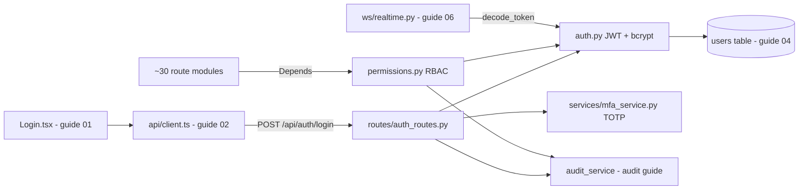

# Authentication and RBAC: login, JWT, permissions, MFA

This guide covers how Orb decides *who you are* (authentication) and *what you may do* (authorization). The server issues signed JSON Web Tokens (JWTs) at `POST /api/auth/login` (`server/routes/auth_routes.py:392`), verifies them on every protected request through a FastAPI dependency called `get_current_user` (`server/auth.py:457`), and gates each route by a central role-based access control (RBAC) map of 51 permissions across 6 roles, `doctor`, `nurse`, `admin`, `pharmacist`, `patient`, `cashier` (`server/permissions.py:221`), with `clinician` aliased to `doctor` (`server/permissions.py:342`). On top of that sit three hardening layers: bcrypt password hashing with automatic upgrade of legacy hashes (`server/auth.py:155`), instant everywhere-at-once token revocation via a per-user `token_version` counter stamped into the token as the `tv` claim (`server/auth.py:396`) and re-checked on every request (`:522-529`), and optional time-based one-time-password (TOTP) multi-factor authentication implemented from the Python standard library alone (`server/services/mfa_service.py`). Every denial and every login outcome is written to a tamper-evident audit log.

## Purpose and neighbors

Orb is a hospital operating system: it stores protected health information (PHI, patient-identifying medical data whose access is legally regulated, e.g. by HIPAA). That makes identity and access the single most consequential subsystem. It solves four problems for every other guide in this corpus:

1. **Proving identity without server-side sessions.** A JWT is a self-contained, cryptographically signed credential, so any of Orb's ~30 route modules can verify a request locally with one HMAC computation, no shared session store (`server/auth.py:40-72`).
2. **Least-privilege access.** A nurse must not sign clinical notes; a pharmacist must not read arbitrary patient charts; a patient must see only their own data. The `ROLE_PERMISSIONS` map plus the `require_permission` dependency make that one declarative line per route (`server/permissions.py:93,164`).
3. **Accountability.** Every login success, login failure, MFA event, and permission denial is written to the append-only `audit_logs` hash chain via `log_audit_event` (`server/services/audit_service.py:159`), a regulatory requirement for PHI systems.
4. **Credential lifecycle.** Enrolling/disabling MFA, upgrading weak legacy password hashes in place, and revoking all of a user's outstanding tokens with one counter bump.



Neighbors: the login form and `AuthContext` live in the app shell (see guide 01-app-shell); token storage and the `Authorization` header live in the API client (see guide 02-api-client); the `users` table schema and migrations belong to the database guide (see guide 04-database-schema); the Socket.IO handshake that reuses `decode_token` belongs to the realtime guide (see guide 06-realtime); `log_audit_event` and the audit hash chain belong to the audit/governance guide.

## File map

| File | Lines | Role |
|---|---|---|
| `server/auth.py` | 509 | Password hashing (bcrypt), JWT mint/verify, `get_current_user` dependency, deprecated `require_role` (`:493`) |
| `server/permissions.py` | 565 | 35 permission constants, `ROLE_PERMISSIONS` role map, `require_permission` / `require_patient_self` dependencies |
| `server/routes/auth_routes.py` | 1,533 | The `/api/auth/*` router: login (with rate limiting + MFA gate), MFA enroll/disable, logout-everywhere, and the device/PIN identity endpoints |
| `server/services/mfa_service.py` | 113 | Stdlib-only RFC 6238 TOTP: secret generation, code verification with replay-step reporting, otpauth URI |
| `server/models/user.py` | 80 | Pydantic request/response schemas: `UserLogin`, `PinLogin`, the four device/PIN bodies, `MfaEnrollBody`, `MfaDisableBody`, `UserOut`, `TokenResponse` |
| `server/config.py` | 505 | Env-driven config: JWT secret (fail-closed in prod), expiry, MFA issuer/required roles, deployment profile |
| `server/tests/test_rbac.py` | 274 | Pins the role×route matrix: who gets 200 vs 403, and that denials write audit rows |
| `server/tests/test_auth_mfa_revocation.py` | 130 | Pins logout revocation, MFA enrollment flow, and TOTP single-use (anti-replay) |
| `server/tests/test_phase0_security.py` | 123 | Pins unique one-time patient passwords, ingestion-key rejection, Scribe sign-gate (uses login as a fixture) |

## How it works

First, the four pieces of jargon everything below depends on:

- **JWT (JSON Web Token)**, a string of three base64url-encoded parts separated by dots: `header.payload.signature`. The *header* names the signing algorithm (`{"alg":"HS256","typ":"JWT"}`), the *payload* is a JSON object of "claims" (here: `sub` = user id, `role`, `tv` = token version, `jti` = unique token id, `exp`/`iat` = expiry/issued-at timestamps, `server/auth.py:55-62`), and the *signature* is HMAC-SHA256 over the first two parts keyed by a server secret. Anyone can *read* a JWT (it is encoded, not encrypted), but nobody without the secret can *forge or alter* one. This makes auth **stateless**: the server keeps no session table; validity is proven by the signature plus the `exp` claim.
- **Password hashing**, passwords are never stored; only a one-way *hash* is. Orb uses **bcrypt** (`server/auth.py:17-22`), an algorithm deliberately designed to be slow and to embed a random *salt* (a per-password random value mixed into the hash) so identical passwords produce different hashes and precomputed "rainbow table" attacks fail.
- **RBAC (role-based access control)**, instead of listing users per resource, each user has one `role` (doctor, nurse, pharmacist, admin, patient) and each role maps to a set of fine-grained *permissions* (strings like `"patient.read_all"`). Routes declare the permission they need; the map decides the rest (`server/permissions.py:93-137`).
- **FastAPI dependency injection / `Depends`**, FastAPI lets a route handler declare parameters like `user: dict = Depends(get_current_user)`. Before calling the handler, FastAPI *resolves the dependency*: it calls `get_current_user`, which can itself declare further dependencies (a chain), and can abort the request by raising `HTTPException`. The handler then receives the resolved value as an argument. This is "dependency injection", the framework supplies (injects) collaborators instead of the handler constructing them, and it is how one line of `Depends(...)` turns any route into an authenticated, permission-checked route.

### Flow 1: password login (happy path, no MFA)

1. The user submits employee ID + password in `Login.tsx`, which calls `login()` in the API client (`src/pages/Login.tsx:46`, `src/api/client.ts:278`). The client POSTs `{employee_id, password}` to `/api/auth/login` and, on success, stores the returned token and user in `localStorage` under `orb_token` / `orb_user` (`src/api/client.ts:283-284,68-70,90-92`), see guides 01/02 for that side.
2. The server checks the in-memory per-IP rate limiter: 5 failed attempts within 15 minutes locks the IP out with HTTP 429 (`server/routes/auth_routes.py:104-117,28-30`).
3. It fetches the `users` row by ID, the same endpoint serves clinicians (employee ID) and patients (patient ID) (`server/routes/auth_routes.py:122-124`).
4. `verify_password` compares the submitted password against `users.password_hash`: bcrypt if the hash starts with `$2`, otherwise a constant-time SHA-256 comparison for legacy rows (`server/auth.py:25-36`). A miss records a failed attempt, audit-logs `login_failure`, and returns a deliberately vague 401 "Invalid credentials" (no hint whether the ID or password was wrong) (`server/routes/auth_routes.py:128-142`).
5. The MFA gate runs (see Flow 3). For a non-MFA account it is a no-op.
6. On success, the IP's and the account's failure history are cleared (`server/routes/auth_routes.py:525-527`), a legacy SHA-256 hash is transparently re-hashed with bcrypt (the plaintext is available only at login time, so this is the only moment an upgrade is possible, `server/routes/auth_routes.py:529-539`), a JWT is minted at the user's current `token_version` (`server/routes/auth_routes.py:541-542`), the HttpOnly session cookie plus a JS-readable CSRF token are set so browser clients can drop the localStorage JWT (`:547`), `login_success` is audit-logged (`:549-561`), and `TokenResponse{token, user}` is returned (`:563-571`).

```mermaid
sequenceDiagram
    participant B as Browser (Login.tsx)
    participant C as api/client.ts
    participant R as auth_routes.login
    participant A as auth.py
    participant D as SQLite users

    B->>C: login(employeeId, password)
    C->>R: POST /api/auth/login {employee_id, password}
    R->>R: is_ip_rate_limited? (429 if locked)
    R->>D: SELECT * FROM users WHERE id = ?
    R->>A: verify_password(pw, row.password_hash)
    A-->>R: true (bcrypt.checkpw)
    R->>R: MFA gate (skip: totp_enabled = 0)
    R->>A: create_token(id, role, token_version)
    A-->>R: JWT (sub, role, tv, jti, exp, iat)
    R-->>C: 200 {token, user}
    C->>C: localStorage.setItem('orb_token' / 'orb_user')
    Note over C: every later request sends<br/>Authorization: Bearer &lt;token&gt;
```

### Flow 2: an authenticated, permission-checked request

1. The client sends `Authorization: Bearer <token>` (built by `authHeaders`, `src/api/client.ts:101-105`).
2. The route is declared as, e.g., `async def list_patients(user=Depends(require_permission("patient.read_all")))`. FastAPI resolves the dependency chain: `require_permission(...)` returned a checker that itself depends on `get_current_user`, which depends on `HTTPBearer` (`server/permissions.py:176-179`, `server/auth.py:75-77`).
3. `HTTPBearer` (a FastAPI "security scheme" object, `server/auth.py:14`) extracts the token from the header; if the header is missing or not `Bearer`, it aborts with 403 before any Orb code runs (this is why the tests accept 401 *or* 403 for unauthenticated requests, `server/tests/test_rbac.py:265-274`).
4. `decode_token` verifies signature and expiry, 401 on failure (`server/auth.py:371-377`).
5. `get_current_user` re-reads the **authoritative** `users` row by the token's `sub` claim, then rejects the token with 401 if its embedded `tv` no longer equals `users.token_version` (revocation, see Flow 4) (`server/auth.py:522-529`).
6. `require_permission`'s checker looks up `ROLE_PERMISSIONS[user.role]` and computes the missing permissions. Any miss → audit-log a `permission_denied` event and raise a structured 403 (`server/permissions.py:405-432`). Otherwise the user dict flows into the handler as its `user` argument.

The crucial design point: the JWT carries a `role` claim, but **authorization never trusts it**, both `get_current_user` and `require_permission` use the role from the freshly read DB row, so promoting/demoting a user takes effect on their very next request even with an old token (`server/auth.py:44-46`, `server/permissions.py:180`).

### Flow 3: MFA: enrollment and login with a second factor

**TOTP (time-based one-time password, RFC 6238)** is the "6-digit code from an authenticator app" scheme: server and app share a secret; both compute `HOTP(secret, floor(unix_time / 30))` (HOTP, RFC 4226, is an HMAC-SHA1 truncated to 6 decimal digits); codes match if clocks roughly agree. Orb implements this in ~100 lines of stdlib Python (`server/services/mfa_service.py`).

Enrollment is two-phase so a mis-scanned QR code can never lock a user out:

1. `POST /api/auth/mfa/enroll/begin` (authenticated) generates a 160-bit base32 secret, stores it in `users.totp_secret` with `totp_enabled` still 0, and returns the secret plus an `otpauth://totp/...` URI the client renders as a QR code (`server/routes/auth_routes.py:244-269`). Re-calling rotates the pending secret.
2. `POST /api/auth/mfa/enroll/confirm` verifies one live code from the app; only then is `totp_enabled` flipped to 1 and `mfa_enrolled` audit-logged (`server/routes/auth_routes.py:677-685`).

Login for an MFA-enabled account (`server/routes/auth_routes.py:144-180`):

1. Password is verified first, as in Flow 1.
2. If the account's role is in `MFA_REQUIRED_ROLES` (env `ORB_MFA_REQUIRED_ROLES`, `server/config.py:50-52`) but the user has not enrolled → 403 `"mfa_enrollment_required"` so the client can route them into enrollment (`:153-156`).
3. If `totp_enabled` and no code was supplied → 401 `"mfa_required"`, deliberately **not** counted toward the IP lockout, because it is the normal two-step flow, not a guessing attempt (`:158-164`).
4. The code is checked by `consume_totp` (`server/routes/auth_routes.py:275-300`), which enforces **single-use**: `verify_code_step` returns which 30-second time-step matched; that step must be strictly greater than `users.totp_last_step`, which is then updated. A captured code therefore cannot be replayed to mint a second session (RFC 6238 §5.2). Failure → attempt recorded, `mfa_failure` audit-logged, 401.

Disabling MFA requires defense in depth, current password **and** a live code (`server/routes/auth_routes.py:305-337`).

### Flow 4: logout-everywhere (token revocation)

**Token revocation** is the hard problem of stateless auth: a signed JWT is valid until `exp`, and the server keeps no session list to delete. Orb's answer is a per-user integer, `users.token_version` (added by migration, `server/database.py:1194-1195`):

1. Every token is minted with a `tv` claim equal to the user's current `token_version` (`server/auth.py:379-396`).
2. `get_current_user` rejects any token whose `tv` differs from the current DB value (`server/auth.py:526-529`).
3. `POST /api/auth/logout` simply runs `UPDATE users SET token_version = COALESCE(token_version,0) + 1`, one write instantly invalidates *every* outstanding token for that user, on every device, with no blocklist to maintain (`server/routes/auth_routes.py:916-928`).

The trade-off versus a blocklist: revocation is all-or-nothing per user (you cannot revoke just one device's token, despite each token having a unique `jti`), and every request pays one `users` SELECT, a cost Orb already pays to get the authoritative role.

## Function-by-function

### server/auth.py

### Token extraction: `_extract_token`: `server/auth.py:419`
**Signature:** `(request: Request) → tuple[str | None, str]`, the token and where it came from.
**Does:** finds the JWT on an incoming request, accepting it from EITHER the
`Authorization: Bearer` header OR the HttpOnly `orb_session` cookie, and reports which.

> **Corrected 2026-08-09.** This section previously documented a module-level
> `HTTPBearer()` object named `security`, consumed as `Depends(security)`. **That object no
> longer exists**, the HttpOnly-cookie migration it was flagged as blocking has since
> happened. `get_current_user` now takes the raw `Request` and resolves the token itself,
> because a `HTTPBearer` dependency can only ever see the header, and a browser session
> arrives in a cookie that JavaScript cannot read.

**How it works:** 1. `get_current_user(request: Request)` (`server/auth.py:457`) calls
`_extract_token`, which returns the token plus a `source` of `"header"` or `"cookie"`.
2. No token at all → 401 `Not authenticated`. Note this is a **401, not the 403** the old
`HTTPBearer(auto_error=True)` produced, anything asserting 403 for unauthenticated requests
is testing behaviour that no longer exists.
3. **The `source` is load-bearing, not diagnostic.** A browser sends a cookie automatically,
so a cookie-authenticated *state-changing* request must also carry a valid double-submit
CSRF token (`server/auth.py:430`). Bearer auth is exempt, an explicit header is something a
cross-site attacker cannot forge, and so are safe methods.

**Why it exists:** the cookie is unreadable to JavaScript, so a single XSS or a compromised
npm dependency can no longer exfiltrate a clinician's session, which the previous
localStorage token allowed. Accepting both keeps machine clients and the test suite working
on the header.

**Why the CSRF check lives HERE:** this is the single dependency every session-protected
route passes through, so the rule cannot be forgotten on a new endpoint, and equally it
never fires on public or alternately-authenticated endpoints that do not use the session
cookie at all.

**Change guide:** if you add a third token source, it must also declare a `source`, and you
must decide explicitly whether that source needs the CSRF check, defaulting it to "exempt"
silently reopens the hole cookies were given the check for. Knock-on: the Socket.IO handshake
(`server/ws/realtime.py`) parses its own auth payload and would need the same treatment.
**Gotchas:** the 403-for-missing-header vs 401-for-bad-token split is an HTTPBearer quirk; tests deliberately accept either (`server/tests/test_rbac.py:268`).

### `hash_password`: `server/auth.py:155`
**Signature:** `(password: str) → str`
**Does:** returns a salted bcrypt hash of the password.
**How it works:** 1. UTF-8-encode the password. 2. `bcrypt.gensalt()` generates a random salt (default cost factor 12, 2^12 internal iterations). 3. `bcrypt.hashpw` produces a self-describing string like `$2b$12$<salt><hash>`; the salt and cost live inside the string, so verification needs no separate storage. 4. Decode to `str` for the TEXT column.
**Why it exists:** bcrypt is deliberately slow and salted, so a stolen `users` table cannot be brute-forced or rainbow-tabled cheaply, the minimum bar for a PHI system.
**Data in/out:** plaintext in → `$2b$...` string (~60 chars) out, stored in `users.password_hash` (`server/database.py:25`).
**Talks to:** called by `login`'s legacy-upgrade path (`server/routes/auth_routes.py:532`), patient-account creation (`server/routes/vigil_routes.py:516`, `server/services/admission_service.py:38`), and virtually every test fixture.
**Change guide:** to raise the work factor, pass `bcrypt.gensalt(rounds=14)`; old hashes keep working (cost is embedded per-hash) and upgrade lazily at next login via the auto-upgrade path, but note that path only fires for non-`$2` hashes (`server/routes/auth_routes.py:187`), so a cost-only upgrade would need that condition widened.
**Gotchas:** bcrypt silently truncates input at 72 bytes; irrelevant for realistic passwords but worth knowing.

### `verify_password`: `server/auth.py:163`
**Signature:** `(password: str, hashed: str) → bool`
**Does:** checks a plaintext password against a stored hash, supporting both bcrypt and legacy SHA-256 rows.
**How it works:** 1. If the stored hash does not start with `$2`, it is a legacy row: compute `sha256(password)` hex and compare with `hmac.compare_digest`, a **constant-time comparison** that takes the same time whether strings differ at the first or last byte, so an attacker cannot learn hash prefixes from response timing (`:27-31`). 2. Otherwise `bcrypt.checkpw`, with any exception (malformed hash) mapped to `False` (`:33-36`).
**Why it exists:** the deployed database predates bcrypt; refusing legacy hashes would lock every existing user out, so both are accepted and login upgrades them opportunistically.
**Data in/out:** (plaintext, stored hash) → bool.
**Talks to:** called by `login` (`server/routes/auth_routes.py:128`) and `mfa_disable` (`:312`).
**Change guide:** to retire the legacy path after all rows are upgraded, run `SELECT COUNT(*) FROM users WHERE password_hash NOT LIKE '$2%'`; when zero, delete `:27-31` and the upgrade block in `login`, watch out for seed scripts that still insert SHA-256 hashes.
**Gotchas:** the legacy SHA-256 is unsalted and fast, it survives only as a compatibility shim and is a listed discrepancy below.

### `create_token`: `server/auth.py:364`
**Signature:** `(user_id: str, role: str, token_version: Optional[int] = None) → str`
**Does:** mints a signed JWT for a user.
**How it works:** 1. If `token_version` was not supplied, read the user's current `users.token_version` (default 0) so the fresh token is immediately valid (`:47-54`); callers that already hold the row pass it to skip the query. 2. Build the claims: `sub` (subject, the user id), `role` (convenience only; never trusted for authorization, per the comment at `:44-46`), `tv` (revocation counter), `jti` (a random UUID making each token individually identifiable), `exp` = now + `JWT_EXPIRY_HOURS` (24 h, `server/config.py:45`), `iat` = now, both timezone-aware UTC (`:55-62`). 3. `jwt.encode(payload, JWT_SECRET, algorithm="HS256")`.
**Why it exists:** one canonical minting point so every token carries the revocation counter and expiry.
**Data in/out:** ids in → compact JWT string out.
**Talks to:** called by `login` (`server/routes/auth_routes.py:419`, via `verify_password_ct`) and directly by test fixtures (`server/tests/test_pharmacy_verification.py:167`); reads `users` via `db_session` (see guide 04-database-schema).
**Change guide:** *worked example, shorten sessions for shared ward workstations:* set `JWT_EXPIRY_HOURS = 4` in `server/config.py:45`. Knock-on effects: clinicians re-login mid-shift (there is no refresh-token flow, so expiry means a full re-login), and the Socket.IO connection, authenticated once at handshake, outlives its token until the next reconnect. Footgun: the frontend stores no expiry metadata; an expired token just starts producing 401s until the user logs out and in.
**Gotchas:** `jti` is minted but nothing persists or checks it, per-token revocation is not implemented, only per-user (see Flow 4).

### `decode_token`: `server/auth.py:412`
**Signature:** `(token: str) → dict`
**Does:** verifies signature + expiry and returns the claims dict, translating failures into HTTP errors.
**How it works:** 1. `jwt.decode(token, JWT_SECRET, algorithms=["HS256"])`, pinning `algorithms` prevents the classic `alg=none` downgrade attack. 2. `ExpiredSignatureError` → 401 "Token expired"; any other `InvalidTokenError` → 401 "Invalid token".
**Why it exists:** single point where cryptographic failure becomes an HTTP response, reused by both HTTP and WebSocket auth.
**Data in/out:** JWT string → `{sub, role, tv, jti, exp, iat}`.
**Talks to:** called by `get_current_user` (`server/auth.py:457`), the Socket.IO handshake `_authenticate` (`server/ws/realtime.py:157`, guide 06-realtime), and the audit middleware's actor identification (`server/services/audit_middleware.py:39`).
**Change guide:** to rotate the signing key without a mass logout, accept a list of secrets (try new, fall back to old) here and mint with the new one in `create_token`; knock-on: `services/discharge_access_service.py:189` signs its own grants with the same `JWT_SECRET` and must rotate in lockstep.
**Gotchas:** it raises `HTTPException`, an HTTP concept, even when called from non-HTTP contexts; the WebSocket caller must (and does) catch it (`server/ws/realtime.py:143-145`).

### `get_current_user`: `server/auth.py:465`
**Signature:** `async (credentials: HTTPAuthorizationCredentials = Depends(security)) → dict`
**Does:** the workhorse dependency: turns a bearer token into the authoritative user row, or aborts with 401.
**How it works:** 1. `decode_token` on the extracted credentials (`:79`). 2. Require a `sub` claim (`:80-82`). 3. `SELECT * FROM users WHERE id = ?` inside a `db_session` context manager (auto-close; see guide 04-database-schema) (`:84-85`). 4. 401 "User not found" if the row is gone, a deleted user's tokens die immediately (`:87-88`). 5. Compare the token's `tv` claim against `users.token_version`; mismatch → 401 "Session revoked; please log in again" (`:96-99`). 6. Return the row as a plain dict, including `password_hash` and `totp_secret`, so downstream code must never echo it wholesale (routes return `UserOut` instead).
**Why it exists:** it is the single place identity is established; everything else (permissions, ownership checks, audit actor fields) builds on the dict it returns.
**Data in/out:** bearer credentials in → full `users` row as dict out.
**Talks to:** wrapped by `require_permission`/`require_patient_self`/`require_role`; used directly by the MFA/logout routes (`server/routes/auth_routes.py:245,273,306,341`), `/api/auth/me` (`server/main.py:444`) and the authenticated uploads route (`server/main.py:376`).
**Change guide:** to add account disabling, add an `is_active` column and a check between steps 4 and 5 raising 403; knock-on: the Socket.IO `_authenticate` duplicates the row lookup (`server/ws/realtime.py:153-161`) and must add the same check.
**Gotchas:** one DB read per authenticated request, deliberate (fresh role + revocation), but it means auth is only as available as SQLite. Note the WebSocket path does **not** check `tv` (see Discrepancies).

### `require_role`: `server/auth.py:548` *(deprecated)*
**Signature:** `(*roles: str) → async dependency → dict`
**Does:** dependency factory restricting an endpoint to a literal set of roles.
**How it works:** 1. Returns an async `checker` that depends on `get_current_user`. 2. 403 "Insufficient permissions" if the DB-row role is not in `roles`, else returns the user (`:116-119`).
**Why it exists:** the pre-RBAC guard. Its docstring (`:107-110`) marks it deprecated because it bypasses the central `ROLE_PERMISSIONS` map *and* skips audit logging of denials. It survives on seven routes: `server/routes/lens_routes.py:52,150` and five Scribe endpoints (`server/routes/scribe_routes.py:313,368,421,558,895`).
**Data in/out:** role names in → user dict out (or 403).
**Talks to:** wraps `get_current_user`; called only by the two legacy route files above.
**Change guide:** to finish the migration, replace e.g. `require_role("doctor","nurse","admin")` on a Lens read route with `require_permission("lens.read")`, consult the matrix below to confirm the same roles pass; footgun: `require_role` includes admin on Lens *analyze* routes, but the RBAC map gives admin only `lens.read`, so a naive swap changes behavior.
**Gotchas:** its 403 body is a bare string, not the structured `{error, required, missing}` shape clients get from `require_permission`, clients parsing the structured form will mis-render these denials.

### server/permissions.py

### Permission constants: `server/permissions.py:34-212`
**Signature:** 51 module-level `str` constants grouped by domain.
**Does:** names every grantable capability once, so typos become `ImportError`s instead of silent security holes.
**How it works:** dotted `domain.action` strings, grouped by comment banner: clinical (`:34-40`), the prescriber's own `MEDICATION_PRESCRIBE` (`:42-71`), Scribe (`:73-78`), AI modules (`:80-83`), discharge (`:85-88`), Relay (`:90-93`), forecast/surgery (`:95-99`), Bridge patient portal (`:101-103`), Helix pharmacy (`:105-107`) and the ward's `HELIX_RECEIVE` (`:109-121`), orders/CPOE (`:123-125`, CPOE = computerized provider order entry, the clinical term for ordering labs/imaging electronically), the insurance/TPA desk (`:127-144`), billing (`:146-155`), the cash counter (`:157-168`), front desk (`:170-176`), procurement (`:178-187`), the pilot instrument's `OUTCOME_RECORD` (`:189-196`), the DPDP consent register's `CONSENT_RECORD` (`:198-206`), governance (`:208-212`). The long comments above the split-out permissions record why each desk got its own permission instead of borrowing `admin.overview`.
**The one that carries a design argument:** `OUTCOME_RECORD` (`:196`) is deliberately *not* folded into `ADMIN_OVERVIEW`. The charge nurse records deterioration events and the once-per-shift "no events" confirmation, and the comment at `:189-195` states the reason plainly: the people generating the pilot's ground truth must never gain the ability to read the scorecard, the adjudication queue or the export, or they would watch the score move as they enter it.
**Why it exists:** a central vocabulary makes the role matrix reviewable at a glance and lets the compliance dashboard enumerate it mechanically (`server/services/compliance_service.py:185-198`).
**Data in/out:** n/a (constants).
**Talks to:** consumed by `ROLE_PERMISSIONS` and by route files that pass the literal strings to `require_permission`.
**Change guide:** *worked example, add an export permission:* add `REPORT_EXPORT = "report.export"` beside `:212`, grant it in `ROLE_PERMISSIONS["admin"]`, then guard the new route with `user=Depends(require_permission("report.export"))`. Knock-on: the Trust Center RBAC matrix picks it up automatically; add a `test_rbac.py` case pinning that doctors get 403.
**Gotchas:** routes pass string literals, not the constants, so a typo in a route (`"patient.readall"`) fails *closed* (nobody has it), safe but confusing to debug.

### `ROLE_PERMISSIONS`: `server/permissions.py:278`
**Signature:** `dict[str, set[str]]`.
**Does:** the entire authorization policy of Orb, as data.
**How it works:** six role keys (`doctor` `:222`, `nurse` `:241`, `pharmacist` `:271`, `admin` `:288`, `patient` `:326`, `cashier` `:336`) map to permission sets; `"clinician"` is aliased to the doctor set at `:342` (same object, so a change to one is a change to both).
**Why it exists:** policy-as-data means changing who-can-do-what is a one-line diff with no control-flow risk, and the map can be exported verbatim to the admin Trust Center.

The full matrix (source: `server/permissions.py:221-342`, regenerated from `ROLE_PERMISSIONS` on 2026-10-03; ✓ = granted; the `clinician` column is omitted, it is identical to `doctor` by the alias at `:342`):

| Permission (line) | doctor | nurse | pharmacist | admin | patient | cashier |
|---|---|---|---|---|---|---|
| `patient.read_all` (:35) | ✓ | ✓ | | ✓ | | |
| `patient.write` (:36) | ✓ | | | | | |
| `vitals.read` (:37) | ✓ | ✓ | | ✓ | | |
| `vitals.write` (:38) | ✓ | ✓ | | | | |
| `alert.read` (:39) | ✓ | ✓ | | ✓ | | |
| `medication.write` (:40) | ✓ | ✓ | | | | |
| `medication.prescribe` (:71) | ✓ | | | | | |
| `scribe.create_draft` (:74) | ✓ | ✓ | | | | |
| `scribe.read_all` (:75) | ✓ | ✓ | | ✓ | | |
| `scribe.edit_draft` (:76) | ✓ | ✓ | | | | |
| `scribe.sign` (:77) | ✓ | | | | | |
| `scribe.reject` (:78) | ✓ | | | | | |
| `sage.query` (:81) | ✓ | ✓ | ✓ | ✓ | | |
| `lens.analyze` (:82) | ✓ | ✓ | | | | |
| `lens.read` (:83) | ✓ | ✓ | | ✓ | | |
| `discharge.read` (:86) | ✓ | ✓ | | ✓ | | |
| `discharge.generate` (:87) | ✓ | | | | | |
| `discharge.publish` (:88) | ✓ | | | | | |
| `relay.read` (:91) | ✓ | ✓ | | ✓ | | |
| `relay.send` (:92) | ✓ | ✓ | | ✓ | | |
| `relay.execute_action` (:93) | ✓ | | | | | |
| `forecast.read` (:96) | ✓ | ✓ | | ✓ | | |
| `surgery.read` (:97) | ✓ | ✓ | | ✓ | | |
| `surgery.prep` (:98) | ✓ | ✓ | | | | |
| `surgery.write` (:99) | ✓ | ✓ | | ✓ | | |
| `bridge.read_own` (:102) | | | | | ✓ | |
| `bridge.ask` (:103) | | | | | ✓ | |
| `helix.read` (:106) | | | ✓ | ✓ | | |
| `helix.write` (:107) | | | ✓ | ✓ | | |
| `helix.receive` (:121) | | ✓ | | | | |
| `order.read` (:124) | ✓ | ✓ | | ✓ | | |
| `order.write` (:125) | ✓ | ✓ | | | | |
| `payer.read` (:143) | | | | ✓ | | |
| `payer.write` (:144) | | | | ✓ | | |
| `billing.read` (:153) | | | | ✓ | | |
| `billing.write` (:154) | | | | ✓ | | |
| `billing.tariff` (:155) | | | | ✓ | | |
| `payments.read` (:165) | | | | ✓ | | ✓ |
| `payments.record` (:166) | | | | ✓ | | ✓ |
| `payments.approve` (:167) | | | | ✓ | | |
| `payments.close_counter` (:168) | | | | ✓ | | ✓ |
| `frontdesk.write` (:176) | | | | ✓ | | |
| `procurement.read` (:185) | | | ✓ | ✓ | | |
| `procurement.write` (:186) | | | ✓ | ✓ | | |
| `procurement.approve` (:187) | | | | ✓ | | |
| `outcome.record` (:196) | ✓ | ✓ | | ✓ | | |
| `consent.record` (:206) | ✓ | | | | | |
| `audit.read` (:209) | | | | ✓ | | |
| `audit.trace` (:210) | | | | ✓ | | |
| `ingest.monitor` (:211) | | | | ✓ | | |
| `admin.overview` (:212) | | | | ✓ | | |

The policy's shape: doctors are the only role that can *sign* (notes, discharges), prescribe, record consent or execute Relay action cards; nurses share the day-to-day clinical write set but not sign-off, and are the only role that takes delivery of a dispensed drug (`helix.receive`, deliberately not given to the pharmacist who dispenses it); pharmacists see Helix, procurement and Sage; admins are governance + broad *read* plus the payer, billing, payments, front-desk and procurement desks (and `surgery.write` and Helix write, despite the `# Governance + read-only clinical` comment at `server/permissions.py:289`); a cashier holds the payment counter and nothing else; patients touch nothing but their own Bridge portal.

**Data in/out:** role string → set of permission strings.
**Talks to:** read by all helpers below, by the WebSocket relay-send check (`server/ws/realtime.py:633`), and by the compliance report (`server/services/compliance_service.py:185-198`).
**Change guide:** *worked example, add a `lab_tech` role:* add `"lab_tech": {VITALS_READ, ORDER_READ}` beside `cashier` (`:336`); also add the string to `STORABLE_ROLES` in `server/roles.py`, the single authority the `users.role` CHECK constraint is rendered from (`server/database.py:38`, `:870`), and add a users-rebuild migration, since SQLite cannot alter CHECK constraints, and add `'lab_tech'` to the frontend `UserRole` union (`src/App.tsx:11`). Footgun: forgetting the CHECK change makes user creation fail at INSERT, not at login.
**Gotchas:** an unknown role gets `set()` from every lookup, unknown roles fail closed. The `clinician` alias shares the *same set object* as `doctor`; mutate one and you mutate both.

### `has_permission` / `has_all_permissions` / `get_permissions_for_role`: `server/permissions.py:473,354,360`
**Signature:** `(role, permission) → bool` / `(role, *permissions) → bool` / `(role) → set[str]` (a defensive `.copy()`).
**Does:** pure lookup helpers over `ROLE_PERMISSIONS` for non-HTTP contexts.
**How it works:** set membership with `.get(role, set())` so unknown roles are empty.
**Why it exists:** WebSocket events and services cannot use FastAPI `Depends`, so they need a plain-function form of the same policy.
**Data in/out:** strings in → bool/set out.
**Talks to:** `has_permission` is called by the Socket.IO relay message guard (`server/ws/realtime.py:633`), the vitals-room and presence joins (`:283`, `:509`) and pinned by Scribe permission tests (`server/tests/test_scribe_pipeline.py:833-864`); `get_permissions_for_role` has no in-repo callers (dead but harmless convenience API).
**Change guide:** none usually, change the map, not the helpers.
**Gotchas:** none noteworthy.

### `require_permission`: `server/permissions.py:876`
**Signature:** `(*permissions: str) → async dependency (request, user) → dict`
**Does:** the canonical route guard: requires the user to hold **all** listed permissions, audit-logging any denial.
**How it works:** 1. The factory captures `permissions` in a closure and returns `_checker` (`:176`). 2. `_checker` declares two dependencies of its own, the raw `Request` (for path/method/IP/user-agent in the audit record) and `get_current_user`, demonstrating that FastAPI dependencies chain (`:176-179`). 3. Compute `missing = [p for p in permissions if p not in ROLE_PERMISSIONS.get(role, set())]` (`:180-182`). 4. If anything is missing, write a `permission_denied` audit event with category `authorization`, outcome `denied`, a fresh correlation UUID, and metadata listing required/missing permissions (`:186-203`), then raise 403 with the structured body `{"error":"permission_denied","message":...,"required":[...],"missing":[...]}` (`:205-213`). 5. Otherwise return the user dict, which becomes the handler's `user` argument.
**Why it exists:** it makes least-privilege enforcement declarative and makes every denial *observable*, the audit trail of denials is itself a compliance artifact.
**Data in/out:** permission strings in → user dict out, or 403 JSON with `required`/`missing` arrays (shape pinned by `server/tests/test_rbac.py:105-113`).
**Talks to:** wraps `get_current_user`; calls `log_audit_event` (`server/services/audit_service.py:159`); used ~120 times across 28 route files (e.g. `server/routes/clinical_records_routes.py:21`, `server/routes/sage_proactive_routes.py:15`).
**Change guide:** *worked example, protect a new endpoint:* `@router.get("/reports") async def reports(user=Depends(require_permission("audit.read", "forecast.read"))): ...`, note ALL listed permissions are required (AND, not OR); to express OR you would add a new combined permission to the map instead. Watch out: calling `require_permission("x")` *evaluates the factory at import time*; the checker runs per-request.
**Gotchas:** the interpolated f-string at `:209` has no placeholders (harmless lint noise). Denials cost an audit INSERT per hit, a scanning attacker writes a lot of audit rows, which is arguably the point.

### `require_patient_self`: `server/permissions.py:1332`
**Signature:** `() → async dependency (request, user) → dict`
**Does:** restricts an endpoint to users whose role is `patient`, for the Bridge portal's self-scoped routes.
**How it works:** 1. Returns `_checker` depending on `Request` + `get_current_user` (`:233-236`). 2. If `role != "patient"`, audit-log a denial with reason `patient_role_required` and raise 403 (`:239-259`). 3. Otherwise return the user dict; the *route* then scopes its queries by `user["id"]`, ownership is enforced by the caller using the returned identity, not by this dependency.
**Why it exists:** patient self-access is the inverse of every other guard (staff must be *rejected*), so it gets its own dependency rather than a `bridge.read_own` permission check bolted onto `require_permission`.
**Data in/out:** none in → patient user dict out, or 403.
**Talks to:** used by Bridge routes (`server/routes/bridge_routes.py`, see the Bridge guide); pinned by `server/tests/test_rbac.py:246-258`.
**Change guide:** to let a guardian/proxy account access a patient's Bridge, this is the choke point, extend the check to consult a `patient_proxies` table before rejecting non-patients.
**Gotchas:** the docstring (`:225-231`) claims it "combines permission checking (bridge.read_own) with ownership validation," but the code checks neither the permission nor ownership, it checks only the role (see Discrepancies).

### server/routes/auth_routes.py

### Rate-limiter module state: `server/routes/auth_routes.py:39-43`
**Signature:** `LOGIN_ATTEMPTS: defaultdict[str, list[float]]`, `MAX_LOGIN_ATTEMPTS = 5`, `LOCKOUT_DURATION_SECONDS = 900`, `_MAX_TRACKED_IPS = 10000`.
**Does:** in-memory sliding-window failed-login tracker keyed by client IP.
**How it works:** each failed attempt appends a unix timestamp to the IP's list; an IP with ≥5 timestamps inside the last 15 minutes is locked out.
**Why it exists:** brute-force throttling with zero schema changes. The long comment at `:27-38` is candid about the limits: per-process (lost on restart, wrong under multiple workers), keyed on the raw TCP peer IP (useless or ward-locking behind a reverse proxy), and per-IP only (distributed credential stuffing against one account is unthrottled). A persistent `login_attempts` table is the recorded follow-up.
**Data in/out:** IP string → list of float timestamps.
**Talks to:** the three helpers below and `login`.
**Change guide:** to change the lockout policy, adjust `:40-41`; the 429 message in `login` and this guide's numbers must follow. `_MAX_TRACKED_IPS` (`:43`) is a memory bound, not a policy knob, `_prune_login_attempts` evicts the oldest-touched buckets once the dict exceeds it (`:56-58`).
**Gotchas:** state is shared across tests in one pytest process; the dev profile exempts localhost precisely so test suites don't lock themselves out (`:64-66`).

### `_prune_login_attempts`: `server/routes/auth_routes.py:76`
**Signature:** `(now: float) → None`
**Does:** garbage-collects the attempts dict so an attacker spraying unique source IPs cannot grow memory unboundedly.
**How it works:** 1. Delete buckets whose newest timestamp is older than the 15-minute window (`:40-43`). 2. If still over 10,000 buckets, evict the oldest-touched until at the cap (`:44-47`).
**Why it exists:** fixes a reported unbounded-memory finding (per its docstring).
**Data in/out:** mutates module state.
**Talks to:** called by `is_ip_rate_limited` on every login attempt.
**Change guide:** raise `_MAX_TRACKED_IPS` (`:32`) if a legitimate NAT population exceeds it.
**Gotchas:** the eviction sort is O(n log n) on every over-cap call, fine at 10k, worth knowing under sustained attack.

### `is_ip_rate_limited`: `server/routes/auth_routes.py:91`
**Signature:** `(ip: str) → bool`
**Does:** decides whether this IP is currently locked out.
**How it works:** 1. Empty IP → not limited (`:51-52`). 2. In the `dev` deployment profile, loopback addresses are exempt (`:53-55`) so local development and CI never self-lock. 3. Prune, filter this IP's timestamps to the window, and compare the count to the max (`:56-60`).
**Why it exists:** separates the read (am I locked?) from the write (`record_login_attempt`) so a lockout check does not itself count as an attempt.
**Data in/out:** IP → bool.
**Talks to:** reads `DEPLOYMENT_PROFILE` (`server/config.py:86`); called at the top of `login` (`:104`).
**Change guide:** behind a reverse proxy, resolve the IP from a trusted `X-Forwarded-For` before this call, but only when the direct peer is the known proxy, or attackers can spoof the header.
**Gotchas:** it counts *attempts within the window*, and note only failures are recorded, successful logins clear the bucket (`:183-184`).

### `record_login_attempt`: `server/routes/auth_routes.py:104`
**Signature:** `(ip: str) → None`
**Does:** appends a failure timestamp for the IP.
**How it works:** one `append(time.time())` guarded by a truthiness check on `ip`.
**Why it exists:** the write half of the limiter; called on bad password (`:129`) and bad MFA code (`:166`), but deliberately **not** on the `mfa_required` prompt (`:160-164`).
**Data in/out:** mutates `LOGIN_ATTEMPTS`.
**Talks to:** `login` only.
**Change guide:** to add per-account throttling, record `credentials.employee_id` here too and check it in `is_ip_rate_limited`, that is the deferred fix named at `:22-25`.
**Gotchas:** none noteworthy.

### `consume_totp`: `server/routes/auth_routes.py:305`
**Signature:** `(user_id: str, secret: str, code: str) → bool`
**Does:** verifies a TOTP code **and** enforces single-use, the anti-replay half of MFA.
**How it works:** 1. `mfa_service.verify_code_step` returns the matched 30-second time-step or `None` (`:80-82`). 2. Read `users.totp_last_step` (default −1 = never used) (`:85-86`). 3. Reject if the matched step ≤ last consumed, the same code, or an older still-in-skew-window code, cannot mint a second session (`:87-88`). 4. Persist the new step and commit (`:89-90`), closing the connection in a `finally`.
**Why it exists:** RFC 6238 §5.2 requires one-time use; without this, an attacker who shoulder-surfs or intercepts a code has a 30–90 s replay window.
**Data in/out:** (user id, base32 secret, "123456") → bool; reads/writes `users.totp_last_step`.
**Talks to:** `mfa_service.verify_code_step`; called from `login` (`:165`), `mfa_enroll_confirm` (`:282`), `mfa_disable` (`:314`).
**Change guide:** none usually; if you widen `_SKEW_STEPS` in the service, this replay guard is what keeps the wider window safe.
**Gotchas:** SELECT-then-UPDATE on two statements without a locking transaction, two truly concurrent logins with the same code could in principle both pass step 3 (see Discrepancies). Also note the side effect ordering in `mfa_disable`: a *valid* code is consumed even if a later step fails.

### `login`: `server/routes/auth_routes.py:392`: `POST /api/auth/login`
**Signature:** `(credentials: UserLogin, request: Request) → TokenResponse`
**Does:** the front door: password (+ optional TOTP) in, JWT + public user out.
**How it works:** the numbered walkthrough is Flow 1 + Flow 3 above; the precise outcome table:

| Condition | Status / detail | Audit event | Counts toward lockout |
|---|---|---|---|
| IP locked out | 429 "Too many login attempts..." (`:104-117`) | `login_rate_limited` | n/a |
| Unknown ID or wrong password | 401 "Invalid credentials" (`:128-142`) | `login_failure` | yes (`:129`) |
| Role in `MFA_REQUIRED_ROLES`, not enrolled | 403 `"mfa_enrollment_required"` (`:153-156`) | none | no |
| MFA enabled, no code supplied | 401 `"mfa_required"` (`:158-164`) | none | no |
| MFA enabled, bad/replayed code | 401 "Invalid MFA code" (`:165-180`) | `mfa_failure` | yes (`:166`) |
| Success | 200 `TokenResponse` (`:215-224`) | `login_success` (`:201-213`) | clears bucket (`:183-184`) |

**Why it exists:** one endpoint for both clinician and patient login keeps the client trivial; the deliberately identical 401 for bad-ID and bad-password prevents *user enumeration* (learning which IDs exist by comparing error messages).
**Data in/out:** `UserLogin{employee_id, password, totp_code?}` → `TokenResponse{token, user: UserOut}`.
**Talks to:** `verify_password`, `consume_totp`, `hash_password` (upgrade), `create_token`, `log_audit_event`, `get_db`; called by `src/api/client.ts:278` and by nearly every server test's fixture.
**Change guide:** *worked example, mandate MFA for all doctors:* deploy with `ORB_MFA_REQUIRED_ROLES=doctor` (`server/config.py:50-52`). Knock-on: every non-enrolled doctor's login now returns 403 `mfa_enrollment_required`, but the shipped frontend has no enrollment screen or TOTP prompt (see Discrepancies), so ship the client flow first; the Trust Center adoption panel (`src/pages/panels/admin/TrustCenter.tsx:216-226`) will show the mandate.
**Gotchas:** it is a `def` (sync) handler, FastAPI runs it in a threadpool, which is what makes the module-level dict mutation tolerable under one process. The `from services import mfa_service` at `:148` is unused in this function body (only `consume_totp` is used); harmless dead import.

### `get_me`: `server/main.py:1257`: `GET /api/auth/me`

> **Moved, and the old bug is gone.** Earlier editions documented a `pass`-bodied stub at
> `server/routes/auth_routes.py:228` that shadowed the real handler and would have 500'd on
> response validation. That stub has been deleted, `auth_routes.py` no longer declares `/me` at
> all. The single live definition is in `main.py`.

**Signature:** `(user: dict = Depends(get_current_user)) → UserOut`
**Does:** returns the caller's own identity, id, name, role, department, registration number, for whatever session the request carries.
**How it works:** the whole handler is a projection. `Depends(get_current_user)` (`server/auth.py:457`) has already resolved the session cookie or Bearer token into a user dict and rejected anything invalid; this endpoint copies five fields into `UserOut` (`server/models/user.py:68`) so the response never leaks the password hash or MFA secret that live on the same row. Declared at `server/main.py:853`, body at `:854-861`.
**Why it exists:** a client holding only a cookie has no way to read its own claims, the JWT is HttpOnly by design. This is the one endpoint that answers "who am I signed in as".
**Data in/out:** in: session credential only; out: `UserOut`.
**Talks to:** the guard chain in `server/auth.py`; nothing in `src/` calls it today (the frontend caches the user object from the login response instead), so treat it as an integration/debug surface rather than a hot path.
**Change guide:** adding a field means changing `UserOut` (`server/models/user.py:68`) *and* this projection, the model alone will not populate it. Do not widen it to return the raw user dict.
**Gotchas:** it is the only auth endpoint not on the `/api/auth` router, so a change to the router prefix or its guards does not reach it. Anyone auditing "every auth route" from `server/routes/auth_routes.py` will miss it.

### `mfa_enroll_begin`: `server/routes/auth_routes.py:710`: `POST /api/auth/mfa/enroll/begin`
**Signature:** `(request: Request, user = Depends(get_current_user)) → {secret, otpauth_uri, issuer}`
**Does:** phase 1 of enrollment: mint and store a pending TOTP secret, return the QR payload.
**How it works:** 1. 400 if already enabled (`:255-256`). 2. `generate_secret()` → store in `users.totp_secret` with `totp_enabled = 0` (pending; re-calling rotates it) (`:258-265`). 3. Build the `otpauth://` URI labeled with the user's registration number, name, or id, under issuer `MFA_ISSUER` (`server/config.py:48`) (`:267-269`).
**Why it exists:** two-phase enrollment means a secret is never *active* until the user proves their app can generate codes from it.
**Data in/out:** none in → `{"secret": "<base32>", "otpauth_uri": "otpauth://totp/...", "issuer": "Orb Hospital OS"}`.
**Talks to:** `mfa_service.generate_secret/provisioning_uri`; writes `users`.
**Change guide:** to require re-authentication before enrollment (industry norm), also demand the current password in the body, mirroring `MfaDisableBody`.
**Gotchas:** the secret is returned in the JSON *and* stored in plaintext in SQLite, TOTP secrets must be recoverable (both sides compute the same HMAC), so hashing is impossible; at-rest protection depends on the optional SQLCipher setup (`server/config.py:54-58`). No audit event is logged for *begin* (only for *confirm*).

### `mfa_enroll_confirm`: `server/routes/auth_routes.py:747`: `POST /api/auth/mfa/enroll/confirm`
**Signature:** `(body: MfaEnrollBody, request, user = Depends(get_current_user)) → {"status": "enabled"}`
**Does:** phase 2: verify the first live code and switch MFA on.
**How it works:** 1. 400 if already enabled, or if no pending secret exists ("Call /mfa/enroll/begin first") (`:277-281`). 2. `consume_totp` with the pending secret, this also sets `totp_last_step`, so the confirmation code itself can never be replayed at first login (`:282-283`). 3. `UPDATE users SET totp_enabled = 1` (`:285-288`). 4. Audit `mfa_enrolled` (`:290-301`).
**Why it exists:** completes the possession proof.
**Data in/out:** `{totp_code}` → `{"status":"enabled"}`; 400 "Invalid code" on mismatch.
**Talks to:** `consume_totp`, `log_audit_event`, `users` table.
**Change guide:** to issue backup/recovery codes, generate and return them here (hashed in a new table), this is the natural point, immediately after possession is proven.
**Gotchas:** the tests must reset `totp_last_step` to −1 before logging in with a same-window code (`server/tests/test_auth_mfa_revocation.py:28-33`), a faithful simulation of time passing, and a reminder that in production a user who enrolls and immediately logs in must wait for the next 30-second window.

### `mfa_disable`: `server/routes/auth_routes.py:780`: `POST /api/auth/mfa/disable`
**Signature:** `(body: MfaDisableBody, request, user = Depends(get_current_user)) → {"status": "disabled"}`
**Does:** turns MFA off, demanding password **and** a live code.
**How it works:** 1. 400 if not enabled (`:310-311`). 2. 401 on wrong password, checked *before* the code, so a wrong password does not consume a valid code (`:312-313`, pinned by `server/tests/test_auth_mfa_revocation.py:117-120`). 3. 401 on bad/replayed code (`:314-315`). 4. Clear `totp_enabled` and NULL the secret (`:317-323`). 5. Audit `mfa_disabled` (`:325-336`).
**Why it exists:** defense in depth, a stolen unlocked session alone (no password), or a stolen password alone (no authenticator), cannot strip the second factor.
**Data in/out:** `{password, totp_code}` → `{"status":"disabled"}`.
**Talks to:** `verify_password`, `consume_totp`, `users`, audit.
**Change guide:** for a role under `MFA_REQUIRED_ROLES`, disabling here re-triggers 403 `mfa_enrollment_required` at next login, consider blocking disable outright for mandated roles by checking `MFA_REQUIRED_ROLES` at step 1.
**Gotchas:** does not bump `token_version`, so existing sessions continue untouched after the security posture changes (the comment at `server/auth.py:93-95` implies password/MFA changes bump it, but no code here does, see Discrepancies).

### `logout`: `server/routes/auth_routes.py:939`: `POST /api/auth/logout`
**Signature:** `(request, user = Depends(get_current_user)) → {"status": "logged_out"}`
**Does:** revokes ALL of the user's outstanding JWTs by incrementing `users.token_version`.
**How it works:** 1. `UPDATE users SET token_version = COALESCE(token_version, 0) + 1`, `COALESCE` handles pre-migration NULLs (`:347-353`). 2. Audit `logout` (`:355-366`). Every token minted at the old version now fails the `tv` check in `get_current_user`.
**Why it exists:** stateless JWTs cannot otherwise be killed before expiry; this is the escape hatch for a stolen device or shared workstation.
**Data in/out:** none → `{"status":"logged_out"}`; requires a currently-valid token (you cannot revoke with an already-revoked token, pinned by `server/tests/test_auth_mfa_revocation.py:36-50`).
**Talks to:** `users`, audit. The frontend calls it through `logoutSession()` (`src/api/client.ts:108`), first thing in `logout` (`src/AppRoot.tsx:87`), see Discrepancies.
**Change guide:** to add per-device logout, persist `jti` values per session in a new table and check membership in `get_current_user`, that abandons the zero-state elegance for finer control.
**Gotchas:** it revokes *this* session too; the client must discard its token and re-login (the test demonstrates the same token then 401s).

### server/services/mfa_service.py

### TOTP parameters: `server/services/mfa_service.py:24-28`
**Signature:** `_DIGITS = 6`, `_PERIOD = 30`, `_ALGORITHM = "SHA1"`, `_SKEW_STEPS = 1`.
**Does:** pins the authenticator-app defaults (6 digits, 30 s window, HMAC-SHA1) and a ±1-step clock-skew tolerance.
**Why it exists:** Google Authenticator and most apps ignore non-default parameters in the otpauth URI; deviating breaks compatibility. SHA-1's known collision weaknesses do not affect HMAC-SHA1 as used here.
**Change guide:** widening `_SKEW_STEPS` to 2 tolerates ±60 s of clock drift; the replay guard in `consume_totp` keeps the wider window single-use.
**Gotchas:** none noteworthy.

### `generate_secret`: `server/services/mfa_service.py:38`
**Signature:** `(num_bytes: int = 20) → str`
**Does:** returns a fresh 160-bit secret, base32-encoded (unpadded, upper-case).
**How it works:** `os.urandom(20)` (cryptographic randomness) → `base64.b32encode` → strip `=` padding. **base32** is the alphabet authenticator apps expect in QR payloads, case-insensitive, no ambiguous characters.
**Why it exists:** 160 bits is the RFC 6238 recommended secret size for SHA-1.
**Talks to:** `mfa_enroll_begin`.
**Gotchas:** none noteworthy.

### `_b32decode`: `server/services/mfa_service.py:48`
**Signature:** `(secret: str) → bytes`
**Does:** decodes a possibly unpadded, spaced, or lower-case base32 secret back to raw key bytes.
**How it works:** strip/upper, re-pad to a multiple of 8 chars, `base64.b32decode`.
**Why it exists:** users may paste secrets with the spacing/case some apps display.
**Gotchas:** raises on genuinely invalid base32, `verify_code_step` catches that and returns `None` (`:84-87`).

### `_hotp`: `server/services/mfa_service.py:56`
**Signature:** `(secret: str, counter: int) → str`
**Does:** the RFC 4226 HOTP primitive: 6-digit code for a counter value.
**How it works:** 1. HMAC-SHA1(key, counter as big-endian 8-byte int) (`:52-53`). 2. "Dynamic truncation": the low nibble of the last digest byte picks an offset; four bytes from there (top bit masked) form a 31-bit integer (`:54-58`). 3. Modulo 10^6, zero-padded (`:59`).
**Why it exists:** TOTP is just HOTP with `counter = floor(time/30)`; implementing it in stdlib avoids adding `pyotp` as a dependency for one feature (the module docstring makes this explicit, `:3-5`).
**Talks to:** `current_code`, `verify_code_step`.
**Gotchas:** none, this is a textbook RFC implementation.

### `current_code`: `server/services/mfa_service.py:69`
**Signature:** `(secret: str, at: float | None = None) → str`
**Does:** the code valid at a given unix time (default: now).
**How it works:** `_hotp(secret, int(now // 30))`.
**Why it exists:** primarily for tests, which use it as a software authenticator app (`server/tests/test_auth_mfa_revocation.py:71,84`).
**Gotchas:** production code never calls it, the server should *verify*, never *display*, codes.

### `verify_code_step`: `server/services/mfa_service.py:76`
**Signature:** `(secret: str, code: str, at: float | None = None) → int | None`
**Does:** timing-safe verification that returns *which* time-step matched, enabling single-use enforcement.
**How it works:** 1. Reject empty inputs, strip spaces, require exactly 6 digits (`:76-80`). 2. For step offsets −1, 0, +1 around `floor(now/30)`, compute the candidate and compare with `hmac.compare_digest` (constant-time) (`:81-89`). 3. Return the absolute matched counter, or `None`.
**Why it exists:** returning the step (not just a bool) is what lets `consume_totp` persist "highest consumed step" and refuse replays, the load-bearing API decision of the whole MFA design.
**Data in/out:** (secret, "123456") → int counter or None.
**Talks to:** called by `consume_totp` and by `verify_code`.
**Gotchas:** any `_hotp` exception aborts the whole loop with `None` (`:84-87`) rather than trying remaining steps, fine, since a bad secret fails for all steps anyway.

### `verify_code`: `server/services/mfa_service.py:100`
**Signature:** `(secret, code, at=None) → bool`
**Does:** boolean wrapper over `verify_code_step`.
**Why it exists:** convenience for callers that do not need replay protection; its docstring warns it is stateless and NOT single-use (`:95-98`).
**Talks to:** only tests use it (`server/tests/test_mfa_service.py`); production paths all go through `consume_totp`.
**Gotchas:** do not use it for anything that mints a session.

### `provisioning_uri`: `server/services/mfa_service.py:110`
**Signature:** `(secret, account_name, issuer) → str`
**Does:** builds the `otpauth://totp/Issuer:account?secret=...&issuer=...&algorithm=SHA1&digits=6&period=30` URI that authenticator apps parse from QR codes.
**How it works:** URL-quote the label and issuer, join the standard params.
**Talks to:** `mfa_enroll_begin`.
**Gotchas:** the *secret itself is not URL-quoted*, safe today because unpadded base32 is URL-safe by construction.

### server/models/user.py

These are **Pydantic models**, Python classes whose typed fields FastAPI uses to validate request JSON (422 on shape errors, before the handler runs) and to serialize/filter responses.

### `UserLogin`: `server/models/user.py:9`
**Signature:** `{employee_id: str, password: str, totp_code: Optional[str] = None}`.
**Does:** login request body; `employee_id` doubles as patient ID for patient logins (`:10-11`), `totp_code` is required only once MFA is enabled (`:14-17`).
**Talks to:** `login`.
**Gotchas:** `login()` in `src/api/client.ts:581` does not carry a `totp_code`; the MFA second step is posted by `Login.tsx` directly (`src/pages/Login.tsx:162`), bypassing the client wrapper, see Discrepancies.

### `MfaEnrollBody` / `MfaDisableBody`: `server/models/user.py:57,62`
**Signature:** `{totp_code: str}` / `{password: str, totp_code: str}`.
**Does:** bodies for enroll-confirm and disable; the disable body's extra password field encodes the defense-in-depth requirement in the schema itself.
**Gotchas:** none noteworthy.

### `UserOut`: `server/models/user.py:68`
**Signature:** `{id, name, role, department?, registration_number?}`.
**Does:** the public-safe user shape, pointedly excludes `password_hash`, `totp_secret`, `totp_last_step`, `token_version`, `pin_hash`.
**Why it exists:** `get_current_user` returns the raw row; `UserOut` is the filter that keeps secrets out of responses (`server/routes/auth_routes.py:217-223`, `server/main.py:445-451`).
**Gotchas:** any new sensitive `users` column stays private *only* because this model whitelists fields, a good reason never to return the raw dict.

### `TokenResponse`: `server/models/user.py:77`
**Signature:** `{token: str, user: UserOut}`.
**Does:** the login success payload; mirrored by the client's `LoginResponse` interface (`src/api/client.ts:570-579`).
**Gotchas:** none noteworthy.

### server/config.py (auth-relevant portion)

### JWT settings + fail-closed secret: `server/config.py:49-58`
**Signature:** `JWT_SECRET: str`, `JWT_ALGORITHM = "HS256"`, `JWT_EXPIRY_HOURS = 24`.
**Does:** the signing key and token parameters, with a production guard.
**How it works:** 1. Read `ORB_JWT_SECRET` from the environment (`:49`). 2. If unset: when `ORB_DEPLOYMENT_PROFILE` is `prod` (the default!) and we are not under pytest, **raise at import time**, the server refuses to boot rather than sign tokens with a known key (`:50-55`). 3. Only the `dev` profile (or pytest) falls back to the hardcoded `"orb-local-dev-secret-key-change-in-prod"` (`:56`).
**Why it exists:** a leaked/known HMAC key means anyone can mint a doctor token; failing closed makes the misconfiguration impossible to ship silently. The same pattern guards `INGESTION_API_KEY` (`:168-178`).
**Talks to:** `create_token`/`decode_token` (`server/auth.py:323` / `:371`), and the discharge-access grant signer (`server/services/discharge_access_service.py:189`) which shares the key.
**Change guide:** *worked example, run locally like production:* `ORB_DEPLOYMENT_PROFILE=prod ORB_JWT_SECRET=$(openssl rand -hex 32) ORB_INGESTION_API_KEY=... python main.py`; omit either secret and the process dies at import with "CRITICAL SECURITY ERROR". Footgun: the pytest exemption (`:52,54`) means tests always boot, do not mistake a green test run for prod-config validity.
**Gotchas:** rotating the secret instantly invalidates every outstanding token *and* every outstanding discharge-access grant.

### MFA settings: `server/config.py:61-65`
**Signature:** `MFA_ISSUER: str` (default "Orb Hospital OS"), `MFA_REQUIRED_ROLES: list[str]` (default empty).
**Does:** the issuer label shown in authenticator apps, and the comma-separated roles for which login demands enrollment (`ORB_MFA_REQUIRED_ROLES=admin,doctor`).
**Talks to:** `login`'s MFA gate (`server/routes/auth_routes.py:497-498`), `mfa_enroll_confirm` (`:673`), `mfa_disable` (`:709`), and the compliance report's `_mfa_adoption` (`server/services/compliance_service.py:106`).
**Gotchas:** the default is *empty*, MFA is opt-in per user unless an operator sets the env var.

### `DEPLOYMENT_PROFILE`: `server/config.py:22-26`
**Signature:** `str`, `"prod"` by default; `is_dev = DEPLOYMENT_PROFILE == "dev"`.
**Does:** the master dev/prod switch, resolved and validated at the very top of the module so every later guard can rely on it. It is rejected outright unless it is `dev` or `prod` (`:12-15`). In auth it controls the JWT-secret fail-closed guard (`:54`) and the localhost rate-limit exemption at `server/routes/auth_routes.py:64-66`. Elsewhere it flips demo mode, Lens gating, and model defaults, `is_dev` is derived at `:275` and the reasoning is recorded at `:271-274` (other guides).
**Why it exists:** defaulting to `prod` means the *safe* profile is the one you get by forgetting to configure anything.
**Gotchas:** the frontend has its own independent dev signal, `index.html`'s error overlay gates on the Vite dev ports (`index.html:10`), and `tsconfig.app.json`'s `types: ["vite/client"]` is what makes `import.meta.env.DEV` type-check at all. Neither is linked to `ORB_DEPLOYMENT_PROFILE`: a frontend built in dev mode can talk to a prod-profile server and vice versa.

The rest of `config.py` (Ollama/LLM, Scribe pipeline, voice, ingestion, discharge access TTLs, Sage ambient, `server/config.py:64-233`) belongs to other guides and is only summarized here: it is uniformly env-var-driven with code defaults, so a deployment is defined entirely by its environment.

## What the tests pin down

**`server/tests/test_rbac.py`**, the RBAC matrix as executable law. It creates one user per role (`:51-64`), logs each in over the real HTTP stack, and asserts: admin reaches governance routes (`/api/audit/logs`, `/api/admin/overview`, `/api/ingest/status`, `:73-98`); doctor/nurse get 403 on those same routes with the structured `{error:"permission_denied", missing:["audit.read"]}` body (`:105-126`); patients get 403 on staff surfaces (Vigil, Sage, Relay, Forecast, `:133-162`) but are *not* 403'd on Bridge (`:246-251`), while doctors are (`:254-258`); nurses cannot trigger discharge and admins cannot prescribe (`:190-208`); every denial writes an `audit_logs` row with actor, role, outcome `denied`, and the missing permission in metadata (`:215-239`); and unauthenticated requests are rejected with 401 or 403 (`:265-274`). The import-time `mock.patch` of `INGESTION_MODE` to `"hybrid"` (`:14-16`) exists because ingestion routes self-disable outside that mode.

**`server/tests/test_auth_mfa_revocation.py`**, the credential lifecycle. Logout revokes: the same token that just succeeded gets 401 "revoked" on reuse, and a fresh login works again (`:36-50`). The full MFA arc: begin → wrong-code confirm fails → real-code confirm succeeds → passwordless-code login now 401 `mfa_required` → login with a live code succeeds (`:54-86`). The replay regression: the exact code that just minted a session is rejected the second time (`:89-105`). Disable order-of-checks: wrong password 401s before the code is consumed; password+code succeeds; login then needs no code (`:108-128`). The `_reset_totp_step` helper (`:28-33`) simulates the passage of time past a consumed window.

**`server/tests/test_phase0_security.py`**, three security regressions, two of which touch this subsystem's contract. (1) Creating a patient returns a *unique* one-time password; the old shared `"patient123"` must not log in, the returned one must (`:42-60`), this pins `login` + `hash_password` as used by patient provisioning. (2) The ingestion API key is required and wrong keys 401 (`:64-75`), that key lives beside `JWT_SECRET` in config with the same fail-closed guard, though the check itself is in ingestion routes (see the ingestion guide). (3) The Scribe sign-gate (428 unless `acknowledge_unverified`) uses a logged-in doctor purely as a fixture (`:90-123`, see the Scribe guide).

## Cross-subsystem contracts

REST endpoints owned by this subsystem (router prefix `/api/auth` declared at `server/routes/auth_routes.py:14`, registered at `server/main.py:297`):

| Method | Path | Auth | Purpose |
|---|---|---|---|
| POST | `/api/auth/login` | public (IP rate-limited) | password (+TOTP) → `{token, user}` |
| GET | `/api/auth/me` | Bearer JWT | current user as `UserOut` (duplicate registration, see Discrepancies) |
| POST | `/api/auth/mfa/enroll/begin` | Bearer JWT | mint pending TOTP secret → `{secret, otpauth_uri, issuer}` |
| POST | `/api/auth/mfa/enroll/confirm` | Bearer JWT | `{totp_code}` → enable MFA |
| POST | `/api/auth/mfa/disable` | Bearer JWT | `{password, totp_code}` → disable MFA |
| POST | `/api/auth/logout` | Bearer JWT | bump `token_version`, revoking all sessions |

Exported functions other subsystems import:

- `auth.get_current_user`, the identity dependency, used by `main.py`'s `/api/auth/me` and `/uploads/{filename}` (`server/main.py:376,444`) and wrapped by every guard.
- `permissions.require_permission` / `require_patient_self`, the guards on ~28 route files.
- `permissions.has_permission`, the non-HTTP policy check, used by the Socket.IO relay-send guard (`server/ws/realtime.py:633`).
- `auth.decode_token`, reused by the Socket.IO handshake (`server/ws/realtime.py:142`, guide 06-realtime) and audit middleware (`server/services/audit_middleware.py:38`).
- `auth.hash_password` / `verify_password`, patient provisioning (`server/routes/vigil_routes.py:506-516`, `server/services/admission_service.py:23-38`) and test fixtures.
- `permissions.ROLE_PERMISSIONS`, exported verbatim into the Trust Center compliance report (`server/services/compliance_service.py:149-162`).

Shared-key contract: `services/discharge_access_service.py` signs *its own* JWTs with the same `JWT_SECRET` but `sub="discharge_access"` (`server/services/discharge_access_service.py:183-189`); both the WebSocket handshake (`server/ws/realtime.py:149-152`) and `get_current_user` (whose `users` lookup fails for that sub) keep those grants from ever acting as staff sessions.

DB tables read/written: `users` (all columns; auth additionally owns the migrated columns `totp_secret`, `totp_enabled`, `token_version`, `totp_last_step`, `server/database.py:1186-1200`) and `audit_logs` (written via `log_audit_event`, owned by the audit guide).

Socket events: none owned. The handshake contract this subsystem underwrites: the client passes `{token}` (or `Authorization`/`Bearer` forms) in the Socket.IO `auth` payload; `decode_token` + a fresh `users` read decide acceptance (`server/ws/realtime.py:29-175`), see guide 06-realtime.

Client-side contract (owned by guides 01/02, summarized): `Login.tsx` calls `login()` (`src/api/client.ts:581`), which **deliberately does not persist the JWT**, the session lives in the HttpOnly `orb_session` cookie the server set on that response, unreadable to JS (comment at `src/api/client.ts:586-589`). Only the non-sensitive user object is cached, via `setUser` (`:590`), and the realtime socket is re-handshaked so it authenticates from the same cookie (`:592`). `buildHeaders()` (`src/api/client.ts:167`) attaches `Authorization: Bearer ...` only when a stored token actually exists, machine clients, or a legacy value, and otherwise relies on the cookie plus `credentials: 'include'` (`src/api/client.ts:15-22`). `App.tsx`'s `AuthContext` holds the user in React state and restores it from the cached user on mount (`src/AppRoot.tsx:53-56`). The old localStorage-JWT XSS exposure this section used to flag is therefore closed.

## Rebuild notes

**Prerequisites:** the SQLite layer with `get_db`/`db_session` and the `users` table including the four MFA/revocation columns (guide 04-database-schema); `log_audit_event` (audit guide), or a temporary no-op stub; config loading with the deployment-profile guard; packages `PyJWT`, `bcrypt`, `fastapi`.

**Build order:**
1. `server/config.py` auth block: `JWT_SECRET` (fail-closed in prod), `JWT_ALGORITHM`, `JWT_EXPIRY_HOURS`, `MFA_ISSUER`, `MFA_REQUIRED_ROLES`, `DEPLOYMENT_PROFILE`.
2. `server/auth.py`: `hash_password`/`verify_password`, then `create_token`/`decode_token`, then `get_current_user` with the `token_version` check.
3. `server/models/user.py` schemas.
4. `server/routes/auth_routes.py`: `login` with rate limiting; wire the router into `main.py` and add `/api/auth/me` there.
5. `server/permissions.py`: constants, `ROLE_PERMISSIONS` (copy the matrix above), `require_permission` with audit-on-deny, `require_patient_self`; start guarding routes.
6. `server/services/mfa_service.py` (pure functions, testable standalone against `test_mfa_service.py`), then `consume_totp` + the three MFA endpoints and the login MFA gate.
7. `logout` and the revocation check.

**Acceptance check:** run `pytest server/tests/test_rbac.py server/tests/test_auth_mfa_revocation.py server/tests/test_mfa_service.py`. Concretely: you can now create a doctor and a patient, log both in over HTTP, watch the doctor get 200 on `/api/vigil/patients` while the patient gets a structured 403 that also appears as a `permission_denied` row in `audit_logs`; enroll the doctor in MFA with any authenticator app, be refused login without a code and with a replayed code; and see a logged-out token rejected with "Session revoked" while a fresh login works.

## Discrepancies and open questions

1. *(resolved, was: "`GET /api/auth/me` is registered twice, and the dead stub appears to win".)* The `pass`-bodied stub is gone from `auth_routes.py`; there is now exactly one handler, `get_me` at `server/main.py:854` (decorated `:853`), and the string `/me` no longer appears in the auth router at all.
2. *(resolved since: `logout` (`src/AppRoot.tsx:81`) now calls `logoutSession()` first, which POSTs `/api/auth/logout` with a bounded timeout, `src/api/client.ts:108`. The rest of this entry records how it was.)* **The frontend never called `POST /api/auth/logout`.** `App.tsx`'s `logout` cleared React state, the cached user, and the socket, and wipes nurse drafts and the offline cache so a shared ward tablet cannot leak the previous nurse's bay, but it does not hit the endpoint, and no `src/` code references it. So the server-side `token_version` bump that `POST /api/auth/logout` exists to perform never happens from the UI. Combined with the 24-hour expiry (`server/config.py:58`), a token "logged out" in the UI remains server-valid for up to a day.
3. *(resolved, was: "No frontend MFA flow exists".)* `Login.tsx` now drives the full second factor: `handleLogin` attaches an optional `totp_code` to the `/auth/login` body (`src/pages/Login.tsx:162`), a `mfa_required` error reveals the 6-digit field and stashes the verified credentials in `mfaCreds` rather than re-reading the form (`:170`, comment at `:54-56`), and the next submit replays the *same* credentials plus the code (`:232-238`). There is also an enrolment modal (`MfaEnrollmentModal`) alongside the read-only Trust Center adoption panel.
4. *(resolved, was: "The WebSocket handshake skips the revocation check".)* `_authenticate` now compares the token's `tv` claim to `users.token_version` and refuses the handshake on a mismatch (`server/ws/realtime.py:218-222`). The comment at `:209-216` records the subtlety that made the first attempt unsound: an earlier `token_tv is not None and row_tv is not None` guard *skipped* the check for a validly-signed token carrying no `tv` claim. Absent is now read as 0, which rejects nothing legitimate because `auth.create_token` always stamps `tv` (`server/auth.py:355`), and a malformed `tv` fails closed.
5. **`require_patient_self`'s docstring overstates what it does.** It claims to combine a `bridge.read_own` permission check with ownership validation (`server/permissions.py:524-531`), but the code checks only `role == "patient"` (`:538`), no permission lookup, and ownership scoping is delegated to the calling route. Equivalent today only because the patient role happens to hold that permission.
6. **`consume_totp` has a race window.** The SELECT of `totp_last_step` and the UPDATE are separate statements on one connection with no locking transaction (`server/routes/auth_routes.py:292-296`); two concurrent logins presenting the same code could both pass the replay check. Low practical risk single-process, but `BEGIN IMMEDIATE` or a guarded `UPDATE ... WHERE totp_last_step < ?` would close it.
7. **Comment/code mismatch on revocation triggers.** `server/auth.py:333-334` says bumping `users.token_version` revokes all outstanding sessions, but neither `mfa_enroll_confirm`, `mfa_disable`, nor the legacy-hash upgrade does, only `logout` bumps it (`server/routes/auth_routes.py:856`).
8. **Legacy weak hashes persist by design.** Unsalted single-round SHA-256 password hashes are still accepted (constant-time, `server/auth.py:27-31`) until each user's next login upgrades them (`server/routes/auth_routes.py:529-539`). *(The related `pin_hash` complaint is resolved.* Schema v5 removed the universal default: `init_db` no longer seeds `sha256("1234")` for every clinician, it **revokes** that hash once, ledger-gated on `schema_version >= 5` (`server/database.py:1494-1516`). A NULL `pin_hash` now means agentic co-sign is unavailable for that user, fail closed, and Relay co-sign verifies through `pin_security.verify_pin` (`server/services/pin_security.py:62`), which also upgrades legacy unsalted hashes, rather than comparing strings.)
9. **The login rate limiter's known limits are documented, not fixed.** Per-process memory, raw-peer-IP keying (wrong behind a proxy), no per-account throttle, all acknowledged as deferred in the code comment (`server/routes/auth_routes.py:27-33`); valid only while the server runs single-process.
10. **The `surgeon` role exists in the frontend but cannot exist in a fresh database.** `Login.tsx` normalizes `'surgeon'` → `doctor` "because the backend may emit it" (`src/pages/Login.tsx:85-92`), yet the `users.role` CHECK constraint allows only the five canonical roles (`server/database.py:25`) and `ROLE_PERMISSIONS` has no `surgeon` key, such a user (possible only in a legacy DB predating the constraint) would hold zero permissions. The `clinician` alias (`server/permissions.py:165`) is similarly unreachable via a fresh schema.
11. **Minor dead code:** the unused `mfa_service` import inside `login` (`server/routes/auth_routes.py:509`), the no-placeholder f-string at `server/permissions.py:209`, and `get_permissions_for_role` having no in-repo callers.
