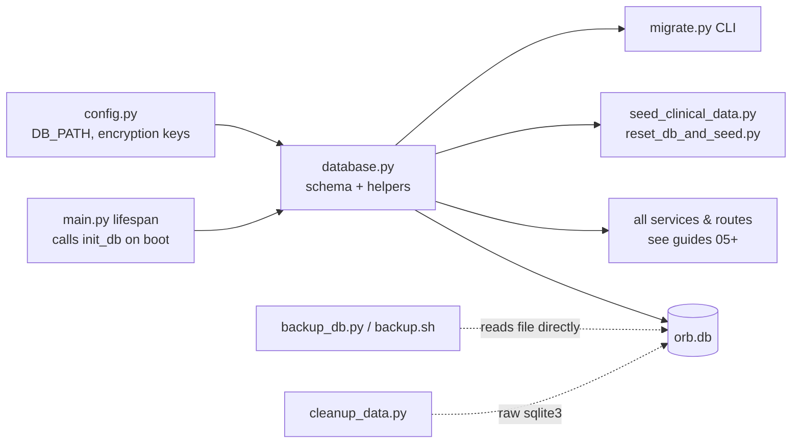
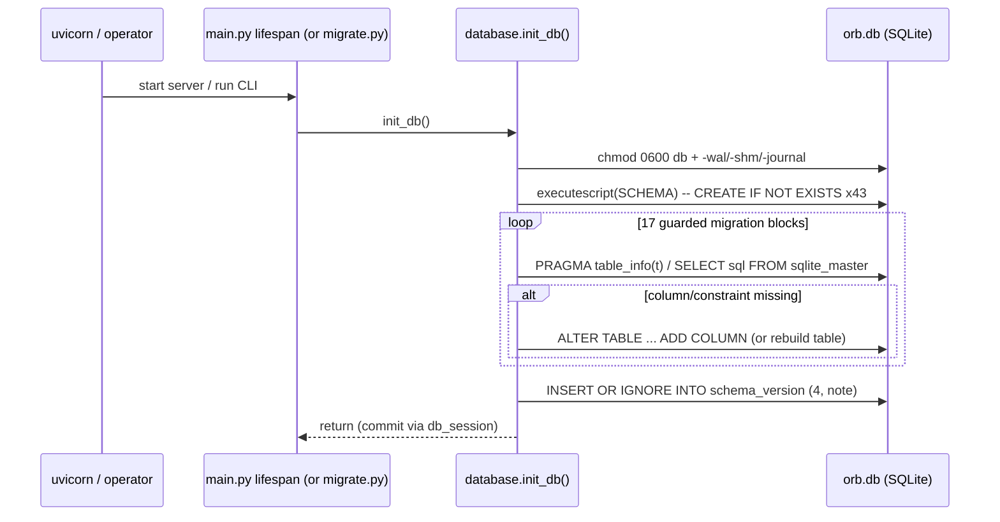
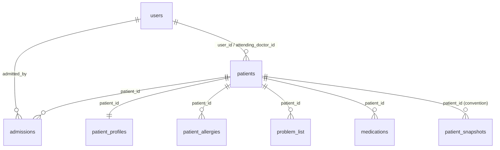
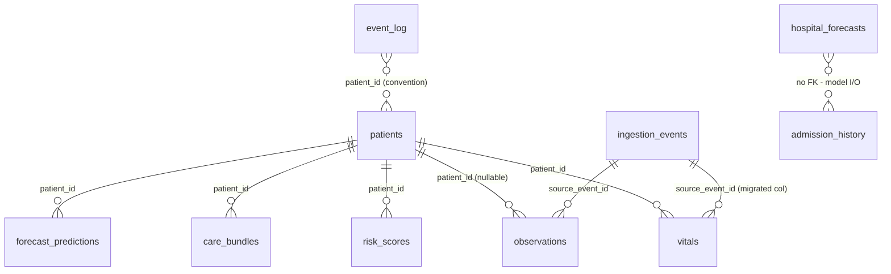
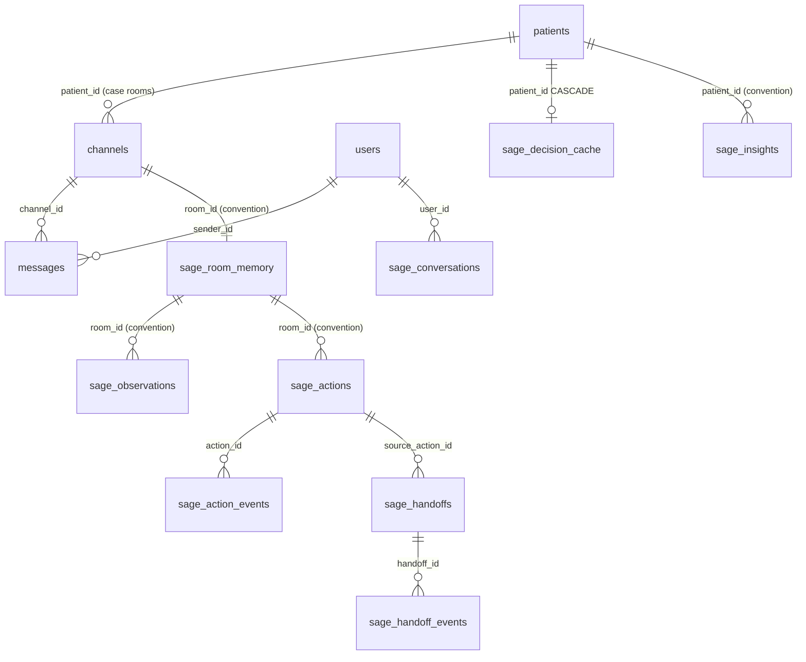
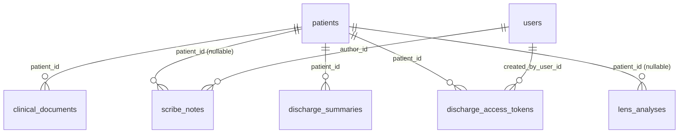
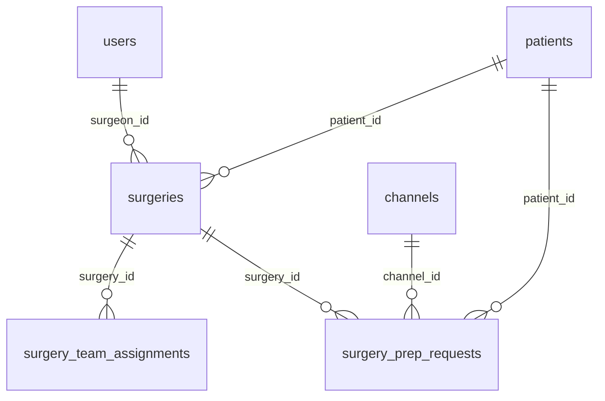
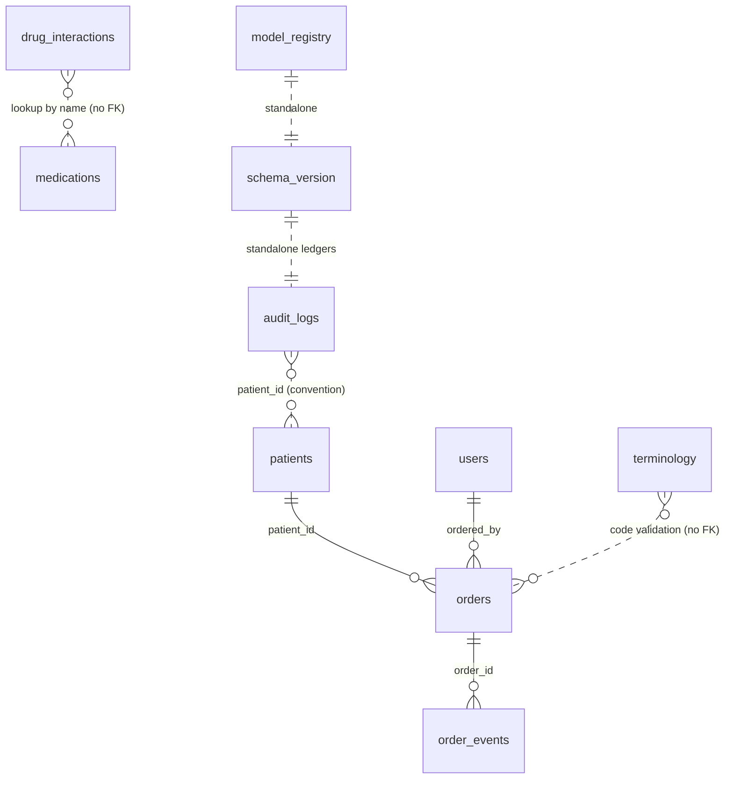

# The Database: every table, the raw-SQL layer, migrations, and seeding

Orb stores everything, patients, vitals, chat messages, AI outputs, audit trails, in a single SQLite file (`server/orb.db`) accessed through hand-written SQL rather than an ORM (an *Object-Relational Mapper*, a library like SQLAlchemy that turns database rows into language objects for you). This guide is the corpus's database reference: it documents all 48 tables created by `server/database.py`, the 37 versioned migrations in `server/migrations.py` that add 88 more, the connection helpers (`get_db`, `db_session`), the additive migration system and its `schema_version` ledger, the `migrate.py` CLI wrapper, the tamper-evident audit chain verifier, the backup and cleanup tooling, and the demo seeders that populate the system with 13 users and 30 patients. Every other backend guide ultimately reads from or writes to the tables defined here.

## Purpose and neighbors

Orb is designed as a **local-first** hospital operating system: the entire clinical record lives on one machine inside the hospital, so the ward keeps working "when the EHR/network/LLM is down, a capability cloud-only systems structurally cannot offer" (`server/database.py:647-650`). That design goal drives three data-layer decisions, all verifiable in code:

1. **SQLite, not a client-server database (e.g. PostgreSQL).** The database is a single file whose path comes from one env var (`ORB_DB_PATH`, default `server/orb.db`, `server/config.py:22`). There is no database server to install, operate, or lose connectivity to; backup is copying one file (safely, see the backup tools below). The same file also hosts the RAG vector index via the `sqlite-vec` loadable extension (RAG, *Retrieval-Augmented Generation*, where an LLM's answers are grounded in documents retrieved from a search index; the `clinical_knowledge_vec` virtual table is created by `server/services/clinical_knowledge.py:554`, outside this guide's scope). The `sqlite-vec` dependency is explicitly cited as a constraint on the data layer's evolution (`server/database.py:756-758`, `859-868`).
2. **Raw SQL, not an ORM.** Every service opens a connection with `get_db()` / `db_session()` and writes parameterized SQL strings directly. No code comment states "we rejected ORMs because X", so treat this as inference: the schema uses SQLite-specific features (CHECK-constraint rebuilds, `PRAGMA` introspection, append-only triggers, WAL tuning, a loadable vector extension) that ORMs abstract poorly, and the whole backend follows the same pattern (85+ files import `get_db`/`db_session`).
3. **Schema and migrations live in one place.** `init_db()` in `database.py` both creates the schema and upgrades old databases in-place; `migrate.py` is only a CLI wrapper around it (`server/migrate.py:2-17`).

**Neighbors:** `main.py` calls `init_db()` at startup (`server/main.py:134`, see the server-boot guide); every route and service imports the connection helpers; the auth subsystem (see guide 03-auth-rbac) consumes the `users` columns (`password_hash`, `pin_hash`, `totp_*`, `token_version`) this layer creates; the audit service (`server/services/audit_service.py`) writes the hash chain that `verify_audit_chain()` re-checks (though in practice the live verifier is a mirror, `flight_recorder_service.verify_chain()`, see Discrepancies); the Helix pharmacy subsystem creates its own six `helix_*` tables in `server/services/helix_db.py:9-68` (documented in the Helix guide, seeded by `seed_helix.py` which the reset script invokes).

## File map

| File | Lines | Role |
|---|---|---|
| `server/database.py` | 1979 | The core: 48-table SQL schema, connection helpers, `init_db()` with the legacy additive blocks, audit-chain verifier |
| `server/migrations.py` | 1719 | **The versioned migration framework**, 17 numbered migrations, a `schema_migrations` ledger, and 23 further tables. All *new* schema work goes here, not into `init_db` |
| `server/migrate.py` | 155 | CLI migration runner: `--status` reporting and orchestration of `init_db()` with exit codes |
| `server/models/__init__.py` | 12 | Package docstring for `server/models/` (Pydantic API schemas + neural-net architectures) |
| `server/models/message.py` | 13 | `MessageCreate` Pydantic schema for posting Relay messages |
| `server/cleanup_data.py` | 107 | One-off demo housekeeping: caps `clinical_documents` and `lens_analyses` row counts |
| `server/scripts/backup_db.py` | 240 | Python backup tool using SQLite's online backup API, with integrity check and pruning |
| `scripts/backup.sh` | 248 | Bash backup: online `.backup` snapshot, AES-256 encryption via openssl, rotation |
| `server/scripts/reset_db_and_seed.py` | 439 | Wipe patient tables, re-seed everything, backfill labs/notes/surgeries, freeze demo dates |
| `server/scripts/seed_clinical_data.py` | 468 | The canonical seeder: 13 users, 30 patients across 6 departments, 24 h vitals history |

## How it works

### Flow 1: boot-time schema creation and migration

A **migration** is a change applied to an existing database's structure (new table, new column, widened constraint) so old data survives a code upgrade. Orb's migrations are *additive and idempotent*: each block first inspects the live database (via `PRAGMA table_info` or `sqlite_master`) and only acts if the change is missing, so running `init_db()` a hundred times is safe (`server/migrate.py:14-16`).

1. `main.py`'s FastAPI lifespan handler calls `init_db()` before anything else (`server/main.py:213`). (FastAPI is the Python web framework serving Orb's REST API; the "lifespan" is its startup/shutdown hook.)
2. `init_db()` chmods the DB file and its WAL sidecars to owner-only 0o600 (`server/database.py:1434`, helper at `:1280`).
3. It runs the entire `SCHEMA` script, every `CREATE TABLE IF NOT EXISTS`, `CREATE INDEX IF NOT EXISTS`, and the two append-only triggers, in one `executescript` call (`server/database.py:1437`). On a fresh file this builds the whole database; on an existing file the `IF NOT EXISTS` guards make it a no-op.
4. Seventeen migration blocks then run in order (detailed under `init_db` below), each guarded by introspection.
5. Finally the applied version is recorded in the `schema_version` ledger table via `INSERT OR IGNORE` keyed on the `SCHEMA_VERSION` constant (currently **5**, `server/database.py:17`, written at `:1897-1900`), giving an auditable record of which baseline generations this file has seen. Then, and this is the step earlier editions missed, `init_db` calls `run_pending_migrations(conn)` (`server/database.py:1913-1914`), which applies every unapplied numbered migration from `server/migrations.py` against its own `schema_migrations` ledger.

### Flow 2: request-time data access

1. A route or service calls `get_db()` (manual close) or enters `with db_session() as conn:` (auto commit/rollback/close).
2. `get_db()` (`server/database.py:1012`) returns a **per-thread pooled connection when `ORB_DB_POOL` is enabled**, and otherwise opens a fresh connection per call, the default, thread-safe model the tests exercise (docstring, `:1011-1014`). Either way it sets a row factory so rows are dict-like and applies performance/safety PRAGMAs, most importantly `journal_mode=WAL` and `foreign_keys=ON` (`server/database.py:1001-1009`). WAL (*Write-Ahead Logging*) is a SQLite mode where writes go to a sidecar `-wal` file so readers never block a writer and vice versa; combined with `busy_timeout=30000` (retry a locked write for up to 30 s) this is what makes one file safe for a multi-threaded FastAPI server.
3. The caller executes parameterized SQL (`?` placeholders, never f-strings, to prevent SQL injection) and the connection is closed at the end of the operation.

### Flow 3: seeding a demo hospital

1. `python server/scripts/seed_clinical_data.py` imports `init_db` and runs it at module import (`server/scripts/seed_clinical_data.py:10`), so the schema always exists first.
2. `seed()` upserts the 13 demo users, creates 7 department channels, then for each of the 30 patient definitions inserts a `patients` row, an `admissions` row, a `patient_profiles` row, its medications, one initial vitals row, a per-patient `case_room` channel, and a `sage_room_memory` row (`server/scripts/seed_clinical_data.py:266-409`).
3. It then writes 24 hourly historical vitals per patient (deteriorating trends for 8 flagged patients) and computes a risk score per patient via the Vigil service (`server/scripts/seed_clinical_data.py:411-449`).
4. `reset_db_and_seed.py` is the "nuke and repave" wrapper: wipe 25 patient-related tables, run `seed()`, run the Helix pharmacy seeder, freeze admission dates to May 21–23 2026, link the demo patient login, and backfill labs/progress notes/surgeries (`server/scripts/reset_db_and_seed.py:41-92`).

---

## The tables

SQLite only enforces a `REFERENCES` clause (a **foreign key**, FK, a column that must match a primary key in another table) when the connection has `PRAGMA foreign_keys=ON`. Connections from `get_db()` do (`server/database.py:809`); the standalone scripts (`cleanup_data.py`, `reset_db_and_seed.py`, `seed_helix.py`) use raw `sqlite3.connect` where FKs default to **off**. Several tables (all `sage_*` ambient tables except `sage_decision_cache`, plus `audit_logs`, `event_log`, `hospital_forecasts`, `admission_history`) have **no** `REFERENCES` clauses at all, their relationships are by naming convention only. Each table below states which kind it is. Unless noted, `TIMESTAMP DEFAULT CURRENT_TIMESTAMP` columns store UTC strings like `2026-05-21 08:00:00` written by SQLite itself, while application code usually writes ISO-8601 strings with `+00:00` offsets, a mixed format every consumer must tolerate.

### Domain A: Identity and the patient core

#### `users`: `server/database.py:39`
Every account: clinicians, admins, pharmacists, and patient portal logins. Consumed by the auth subsystem (guide 03-auth-rbac).

| Column | Type | Meaning |
|---|---|---|
| `id` | TEXT PK | Employee/patient ID, e.g. `DOC001`, `P001` |
| `name` | TEXT NOT NULL | Display name |
| `role` | TEXT NOT NULL, CHECK in (`doctor`,`nurse`,`admin`,`patient`,`pharmacist`) | Drives RBAC (*role-based access control*, permissions granted by role) |
| `department` | TEXT | e.g. `Cardiology` |
| `registration_number` | TEXT | Medical council registration |
| `password_hash` | TEXT NOT NULL | Seeded as unsalted SHA-256; auth upgrades to bcrypt on first login (`server/routes/auth_routes.py:562-572`) |
| `pin_hash` | TEXT | Per-user PIN hash for agentic co-sign. **The universal default is gone (schema v5).** Boot used to seed `sha256("1234")` for every clinician without a PIN, one well-known 4-digit code as the sole human gate on medication dispatch. `init_db` now *revokes* that hash instead, once, ledger-gated on `schema_version >= 5` (`server/database.py:1498-1520`). A NULL `pin_hash` means co-sign is unavailable for that user, fail closed. |
| `created_at` | TIMESTAMP default now | n/a |
| `totp_secret`, `totp_enabled` | TEXT / INTEGER (migration, `server/database.py:1838-1840`) | MFA, TOTP is the 6-digit rotating code from an authenticator app |
| `token_version` | INTEGER default 0 (migration, `server/database.py:1842`) | Bumped to revoke all of a user's JWTs (a *JWT* is a signed login token the client presents on each request) |
| `totp_last_step` | INTEGER default -1 (migration, `server/database.py:1847`) | Highest consumed TOTP time-step, preventing code replay |

A special row `('system', 'Orb Sage', 'admin', 'IT', 'system_hash')` is upserted on every boot so AI/bot writes satisfy `sender_id` FKs (`server/database.py:1892-1893`).

#### `patients`: `server/database.py:38`
The live patient census, one row per person, mutated in place on transfer/discharge.

| Column | Type | Meaning |
|---|---|---|
| `id` | TEXT PK | `PAT-<8 hex>` (seeder format, `seed_clinical_data.py:329`) |
| `user_id` | TEXT REF users(id) | Optional link to a portal login account |
| `name` | TEXT NOT NULL | n/a |
| `mrn` | TEXT UNIQUE NOT NULL | Medical Record Number, the hospital-wide patient identifier |
| `bed`, `ward` | TEXT | Current location |
| `admission_date` | TIMESTAMP | n/a |
| `diagnosis` | TEXT | Working diagnosis (free text) |
| `status` | TEXT default `admitted`, CHECK in (`admitted`,`discharged`,`transferred`) | n/a |
| `age` | INTEGER | n/a |
| `date_of_birth` | DATE (base schema `server/database.py:49`; also an additive migration for legacy DBs, `server/database.py:1730`) | n/a |
| `sex`, `phone`, `emergency_contact_name`, `emergency_contact_phone`, `address` | TEXT (base schema, `server/database.py:50-54`) | Demographics/contacts |
| `attending_doctor_id` | TEXT REF users(id) | The responsible doctor |
| `created_at` | TIMESTAMP default now | n/a |
| `on_scale_2` | INTEGER default 0 (migration only, `server/database.py:1790`) | NEWS2 "Scale 2" flag for COPD patients, changes how Vigil scores SpO2 |

#### `admissions`: `server/database.py:73`
One row per admission episode with the full intake record (who admitted, triage, initial vitals). FKs to `patients` and `users` (enforced on `get_db` connections). Columns: `id` (TEXT PK), `patient_id`*, `admitted_by`*, `admission_source`, `admission_type`, `department`, `ward`, `bed`, `attending_doctor_id` (REF users), `referring_clinician`, `chief_complaint`, `initial_diagnosis`, `triage_severity` (INTEGER, 1=emergency…3=standard per `seed_clinical_data.py:32`), `admitting_notes`, `nursing_notes`, `isolation_precautions`, `code_status` (default `full_code`), `initial_vitals_json` (JSON blob of first vitals), `status` (CHECK `active`/`discharged`/`transferred`), `created_at`. (* = NOT NULL + REFERENCES.)

#### `patient_profiles`: `server/database.py:97`
Longitudinal narrative per patient, keyed 1:1 on `patient_id` (PK + REF patients). Columns `comorbidities`, `past_medical_history`, `past_surgical_history`, `allergies`, `current_medications`, `family_history`, `social_history` are free-text/JSON strings, plus `updated_at`. Note the comment at `server/database.py:590-592`: the free-text `allergies` here is *narrative*; the coded source of truth for safety checks is `patient_allergies`.

#### `patient_allergies`: `server/database.py:718`
Structured, coded allergies, one row per (patient, substance), `UNIQUE(patient_id, substance)` (`server/database.py:604`). Columns: `id` (INTEGER PK AUTOINCREMENT), `patient_id`* REF patients, `substance` (normalized lowercase), `substance_class`, `reaction`, `severity` (CHECK `mild`/`moderate`/`severe`/`unknown`), `status` (CHECK `active`/`inactive`/`resolved`), `source` (default `clinician`; also `llm_extracted`/`ingested_fhir`, provenance for AI-written rows), `recorded_by` REF users, `recorded_at`. Index `idx_allergies_patient (patient_id, status)` (`server/database.py:731`). Used for order-time allergy checking in Helix.

#### `problem_list`: `server/database.py:734`
Active/resolved coded clinical problems. Columns: `id`, `patient_id`* REF patients, `problem`, `icd10_code`, `snomed_code` (ICD-10 and SNOMED are standard clinical coding systems), `status` (CHECK `active`/`resolved`/`inactive`), `onset_date`, `source` (provenance as above), `recorded_by` REF users, `recorded_at`, `resolved_at`. Index `idx_problems_patient` (`server/database.py:747`).

#### `medications`: `server/database.py:233`
Prescriptions. Columns: `id`, `patient_id`* REF patients, `drug_name`, `dosage`, `route` (default `Oral`), `frequency`, `status` (CHECK `active`/`discontinued`/`prn`), `prescribed_by` REF users, `notes`, `started_at`. Migration-added provenance: `source` (default `clinician`, an `llm_extracted`/`agentic` med is not trusted until verified), `verified_by`, `verified_at` (`server/database.py:1181-1188`). Index `idx_meds_patient` (`server/database.py:484`).

#### `patient_snapshots`: `server/database.py:776`
Durable read-only copies of the essential clinical picture for downtime resilience (the local-first flagship, comment at `server/database.py:647-650`). Columns: `id`, `patient_id`* REF patients, `snapshot_json` (full serialized snapshot), `summary`, `created_by` (user id or `'auto'`), `created_at`. Index `idx_snapshots_patient (patient_id, created_at DESC)` (`server/database.py:784`).

### Domain B: Monitoring, ingestion, and forecasting

#### `vitals`: `server/database.py:110`
Time-series vital signs, the highest-volume table. Columns: `id` (INTEGER PK AUTOINCREMENT), `patient_id`* REF patients, `timestamp`* (caller-supplied, NOT defaulted), `heart_rate`, `systolic_bp`, `diastolic_bp`, `spo2`, `temperature`, `respiratory_rate` (all REAL), `consciousness` (TEXT default `alert`). Migration-added: `source` (default `simulated`, `server/database.py:1045-1047`), `source_event_id` REF ingestion_events (`server/database.py:1048-1050`), `on_oxygen` (INTEGER default 0, so NEWS2 scores supplemental O2 from recorded data, `server/database.py:1171-1176`). Index `idx_vitals_patient (patient_id, timestamp DESC)` (`server/database.py:476`).

#### `risk_scores`: `server/database.py:124`
Vigil's computed deterioration scores. Columns: `id`, `patient_id`* REF patients, `timestamp` (default now), `score` (REAL NOT NULL), `level` (CHECK `critical`/`elevated`/`stable`), `drivers` (JSON array of top risk drivers). Index `idx_risk_patient` (`server/database.py:478`).

#### `ingestion_events`: `server/database.py:380`
Raw provenance / dead-letter table for external data feeds (a *dead-letter* table keeps every inbound payload, including failures, so nothing is silently lost). Columns: `id`, `received_at`, `source_type`* (`hl7`/`json`/`csv_replay`/`simulated`, HL7 is the hospital-integration messaging standard), `source_name`, `external_message_id` (sender dedup key), `patient_identifier_raw`, `encounter_identifier_raw`, `raw_payload` (full original payload), `payload_format`, `parse_status` (CHECK `received`/`parsed`/`partially_parsed`/`failed`/`duplicate`), `parse_error`, `fingerprint` (SHA-256 for dedup), `correlation_id`, `processed_at`, `adapter_name`, `vitals_inserted`, `observations_inserted`. Indexes on `fingerprint` and `(parse_status, received_at DESC)` (`server/database.py:491-492`). No FKs, this table exists *before* patient resolution.

#### `observations`: `server/database.py:402`
Structured lab/OBX results. Columns: `id`, `patient_id` REF patients (**nullable** until identity resolution), `encounter_id`, `source` (default `unknown`), `source_event_id` REF ingestion_events, `observation_code` + `observation_code_system` (LOINC, the standard lab-test coding system, or local), `observation_name`*, `value_text`, `value_numeric`, `unit`, `reference_range`, `abnormal_flag`, `status` (default `final`), `observed_at`, `recorded_at`, `panel_name`, `obr_group_id`, `raw_segment_ref`, `created_at`. Indexes `idx_observations_patient (patient_id, observed_at DESC)` and `idx_observations_source` (`server/database.py:493-494`).

#### `care_bundles`: `server/database.py:752`
Sepsis/deterioration bundle timers: a Vigil critical alert or manual start opens a bundle; each element column records completion against 1 h/3 h targets (comment `server/database.py:624-626`). Columns: `id`, `patient_id`* REF patients, `bundle_type` (default `sepsis6`), `triggered_at`, `triggered_by` (user id or `'vigil_auto'`), `trigger_reason`, six element timestamps (`lactate_at`, `cultures_at`, `antibiotics_at`, `fluids_at`, `oxygen_at`, `urine_output_at`; NULL = outstanding), `status` (CHECK `active`/`completed`/`cancelled`/`expired`), `completed_at`, `source`. Index `idx_bundles_patient` (`server/database.py:770`).

#### `forecast_predictions`: `server/database.py:274`
Cached per-patient LSTM output (an LSTM is a recurrent neural network for sequences). Columns: `id`, `patient_id`* REF patients, `predicted_los_days`* (length of stay), `discharge_probability`*, `acuity_trajectory`* (CHECK `improving`/`stable`/`worsening`), `confidence`*, `feature_snapshot`, `created_at`. Index `idx_forecast_patient` (`server/database.py:485`).

#### `hospital_forecasts`: `server/database.py:286`
Hospital-level daily forecasts. Columns: `id`, `forecast_date`* , `hour` (default 0), `predicted_admissions`, `predicted_discharges`, `predicted_occupancy`, `ward_breakdown`, `created_at`. Index on `forecast_date` (`server/database.py:486`). No FKs.

#### `admission_history`: `server/database.py:298`
Last-30-days admission facts for Poisson model fitting (comment `server/database.py:251`). Columns: `id`, `admission_date`*, `patient_name`*, `age`, `sex`, `ward`, `diagnosis`, `severity` (CHECK `critical`/`elevated`/`stable`), `length_of_stay_days`, `discharged` (INTEGER 0/1), `discharge_date`, `created_at`. Index on `admission_date` (`server/database.py:487`). No FKs, deliberately denormalized training data.

#### `event_log`: `server/database.py:619`
Persistent log of all state transitions for the "Hospital Nervous System" event bus (see the realtime/event-bus guide, e.g. guide 06-realtime). Columns: `event_id` (TEXT PK), `topic`*, `source_node`* (`vigil`/`relay`/`sage`/`scribe`), `event_type`*, `patient_id` (nullable, by convention), `payload`* (JSON), `timestamp`* (ISO-8601 UTC), `correlation_id`* (traces one clinical workflow across nodes). Indexes on `(topic, timestamp)`, `patient_id`, `correlation_id` (`server/database.py:630-632`).

### Domain C: Relay messaging and Sage AI

#### `channels`: `server/database.py:134`
Relay chat channels. Columns: `id` (TEXT PK, e.g. `dept-cardiology` or `chan_<12 hex>`), `name`*, `type`* (CHECK `case_room`/`department`/`direct`), `patient_id` REF patients (set for case rooms), `created_at`.

#### `messages`: `server/database.py:143`
Chat messages. Columns: `id` (AUTOINCREMENT), `channel_id`* REF channels, `sender_id`* REF users, `sender_name`*, `sender_role`* (denormalized so history renders without joins), `content`*, `message_type` (CHECK `text`/`alert`/`system`/`ambient_action`/`surgical_alert`), `timestamp` (default now), `read_by` (JSON array of user IDs, default `[]`). Migration-added: `source` (default `clinician`) and `is_bot` (default 0) distinguishing bot posts (`server/database.py:1869-1871`). Index `idx_messages_channel (channel_id, timestamp DESC)` (`server/database.py:477`). This table has the schema's most elaborate migration (the CHECK-widening rebuild, below).

#### `sage_conversations`: `server/database.py:156`
Per-user Sage chat history. Columns: `id`, `user_id`* REF users, `role`* (CHECK `user`/`assistant`), `content`*, `sources` (JSON array of RAG source references), `timestamp`. Index `idx_sage_user (user_id, timestamp)` (`server/database.py:481`).

#### `sage_room_memory`: `server/database.py:497`
One bounded row per case room: Sage Ambient's rolling understanding of the conversation. Columns: `room_id` (TEXT PK), `patient_id`*, `patient_summary`, `discussion_summary`, `current_concern`, `likely_next_steps`, `unresolved_questions`, `active_intents`, `risk_flags`, `participants` (JSON), `last_processed_msg_id`, `last_processed_at`, `message_count`, `llm_call_count`, `created_at`, `updated_at`. **No FKs**, room/patient links are by convention.

#### `sage_observations`: `server/database.py:517`
Append-only clinically-meaningful observations extracted by Sage Ambient. Columns: `id`, `room_id`*, `patient_id`*, `source_message_id`, `observation_type`*, `content`*, `confidence` (REAL), `created_at`. Index `idx_sage_obs_type` (`server/database.py:528`). No FKs.

#### `sage_actions`: `server/database.py:531`
Durable suggested actions (Sage Ambient Stage 3). Columns: `id` (TEXT PK), `room_id`*, `patient_id`*, `action_type`*, `target`*, `rationale`, `confidence`, `state` (CHECK `suggested`/`acknowledged`/`dismissed`/`confirmed`/`failed`/`superseded`), `version` (default 1), `source_msg_id`, `created_at`, `updated_at`. Index `idx_sage_actions_room` (`server/database.py:546`). No FKs.

#### `sage_action_events`: `server/database.py:568`
Audit trail for action state transitions. Columns: `id`, `action_id`* REF sage_actions, `prior_state`, `new_state`*, `actor_id`* REF users, `actor_name`*, `actor_role`, `reason`, `source` (CHECK `ui`/`system`), `created_at`. Index `idx_sage_action_events_action` (`server/database.py:581`).

#### `sage_insights`: `server/database.py:549`
Proactive surveillance insights ("Sage noticed X") pushed to the attending. Columns: `id` (TEXT PK), `patient_id`*, `insight_type`*, `severity` (CHECK `critical`/`warning`/`info`), `title`*, `detail`, `suggested_action_type`, `suggested_action_target`, `target_user_id`, `dedup_key`, `state` (CHECK `active`/`dismissed`/`acted`), `created_at`, `updated_at`. Indexes `idx_sage_insights_active` and `idx_sage_insights_dedup` (`server/database.py:564-565`). No FKs.

#### `sage_handoffs`: `server/database.py:584`
Stage-4 handoffs from a confirmed Sage action into a downstream module (e.g. create an order). Columns: `id` (TEXT PK), `source_action_id`* REF sage_actions, `room_id`*, `patient_id`*, `target_module`*, `handoff_type`*, `payload_json`*, `status` (CHECK `pending`/`accepted`/`failed`/`unsupported`), `downstream_ref_id`, `error_summary`, `created_by`* REF users, `last_attempted_at`, `created_at`, `updated_at`. Index at `server/database.py:602`.

#### `sage_handoff_events`: `server/database.py:605`
Audit trail for handoff status changes. Columns: `id`, `handoff_id`* REF sage_handoffs, `prior_status`, `new_status`*, `actor_id`, `source` (CHECK `system`/`user`/`module_callback`), `reason`, `created_at`. Index at `server/database.py:616`.

#### `sage_decision_cache`: `server/database.py:706`
Pre-assembled per-patient context so Sage answers fast for high-risk patients. Columns: `patient_id` (TEXT PK), `mews_score`* (MEWS, Modified Early Warning Score), `compiled_context`* (pre-assembled JSON of Channel A/B/C data), `preloaded_at`*, `expires_at`*. Notably this is the **only table in the schema with `ON DELETE CASCADE`** (`FOREIGN KEY(patient_id) REFERENCES patients(id) ON DELETE CASCADE`, `server/database.py:587`).

### Domain D: Clinical documentation and discharge

#### `clinical_documents`: `server/database.py:169`
General documents (labs, progress notes) that also feed the RAG index. Columns: `id`, `patient_id`* REF patients, `doc_type`* (e.g. `lab_result`, `note` per the backfiller `reset_db_and_seed.py:138,144`), `title`*, `content`*, `author_id` REF users, `created_at`. Index `idx_docs_patient` (`server/database.py:479`).

#### `scribe_notes`: `server/database.py:180`
AI-transcribed clinical notes. Base columns: `id`, `patient_id` REF patients (nullable), `author_id`* REF users, `raw_transcript`*, `structured_note` (JSON), `note_format` (CHECK `soap`/`discharge`/`handoff`/`raw`, SOAP is the Subjective/Objective/Assessment/Plan note format), `audio_path`, `verification_json`, `pipeline_meta_json`, `created_at`. Migration-added lifecycle columns (`server/database.py:1064-1077`): `status` (default `draft`), `version` (default 1), `supersedes_note_id`, `signed_by`, `signed_at`, `finalized_at`, `rejected_by`, `rejected_at`, `rejection_reason`, `last_edited_by`, `last_edited_at`, `ai_generated` (default 1). Legacy pre-lifecycle rows are force-migrated to `status='signed'` so old notes cannot be edited as drafts (`server/database.py:1715-1718`). Index `idx_scribe_patient` (`server/database.py:480`).

#### `discharge_summaries`: `server/database.py:194`
Columns: `id`, `patient_id`* REF patients, `author_id`* REF users, `summary`*, `timeline_json` (chronological events), `qr_code_path`, `discharged_at`. Index `idx_discharge_patient` (`server/database.py:482`).

#### `discharge_access_tokens`: `server/database.py:205`
Patient-facing time-limited access tokens (for the QR-code discharge portal). Columns: `token_id` (TEXT PK), `token_hash`* (only the hash is stored), `patient_id`* REF patients, `expires_at`*, `failed_attempts` (default 0), `locked_until`, `verified_at`, `last_accessed_at`, `revoked_at`, `created_by_user_id` REF users, `created_at`. TTL/lockout knobs live in `server/config.py:409-411`.

#### `lens_analyses`: `server/database.py:220`
Medical-image interpretations from the Lens module. Columns: `id`, `patient_id` REF patients (nullable), `author_id`* REF users, `image_path`*, `image_type` (`xray`/`ecg`/`ct`/`mri`/`photo`/`other`, comment only, no CHECK), `clinical_context`, `analysis`*, `findings_json`, `created_at`. Index `idx_lens_patient` (`server/database.py:483`).

### Domain E: Surgery

#### `surgeries`: `server/database.py:314`
Scheduled and emergency procedures. Columns: `id` (TEXT PK), `patient_id`* REF patients, `surgeon_id`* REF users, `procedure_name`*, `diagnosis`*, `scheduled_date`*, `scheduled_time`*, `estimated_duration_min`, `operating_room`, `status` (CHECK includes `scheduled`,`in_progress`,`completed`,`cancelled` plus five `emergency_*` states, `server/database.py:278`), `co_morbidities`, `surgical_checklist`, `instruments_required`, `staff_required`, `risk_assessment`, `possible_complications` (JSON-ish TEXT), `success_probability` (REAL), `notes`, `created_at`, and from migrations `started_at`, `completed_at` and `who_checklist` (migration 76: the WHO checklist state, kept out of `surgical_checklist`, which holds only the prep steps). Indexes on `(surgeon_id, scheduled_date)`, `patient_id`, `scheduled_date` (`server/database.py:488-490`).

#### `surgery_team_assignments`: `server/database.py:337`
Per-surgery staffing. Columns: `id`, `surgery_id`* REF surgeries, `user_id`* REF users, `role_name`*, `status` (CHECK `pending`/`alerted`/`confirmed`/`declined`), `updated_at`.

#### `surgery_prep_requests`: `server/database.py:361`
Escalations from Relay into the surgical suite. Columns: `id`, `patient_id`* REF patients, `channel_id` REF channels, `requested_by`*, `requested_by_name`*, `procedure_name`, `indication`, `urgency` (default `emergency`), `clinical_context`, `state` (CHECK `drafted`/`resolved`), `idempotency_key` (UNIQUE, lets a retried request be deduplicated), `surgery_id` REF surgeries, `resolved_by`, `resolved_at`, `created_at`.

### Domain F: Orders, safety reference data, and governance

#### `orders`: `server/database.py:809`
CPOE-lite (*Computerized Provider Order Entry*, the digital form for ordering labs, imaging, drugs). Columns: `id` (TEXT PK), `patient_id`* REF patients, `order_type` (CHECK `lab`/`imaging`/`medication`/`procedure`/`nursing`/`other`), `code` + `code_system` (validated against `terminology` on write, comment `server/database.py:682-683`), `description`*, `priority` (CHECK `stat`/`urgent`/`routine`), `status` (CHECK `draft`/`active`/`in_progress`/`completed`/`resulted`/`cancelled`), `ordered_by` REF users, `source` (default `clinician`), `detail_json`, `result_text`, `result_at`, `created_at`, `updated_at`. Index `idx_orders_patient` (`server/database.py:826`).

#### `order_events`: `server/database.py:828`
Order status audit trail: `id`, `order_id`* REF orders, `prior_status`, `new_status`*, `actor_id`, `reason`, `created_at`.

#### `terminology`: `server/database.py:843`
Local subset of LOINC/ICD10/SNOMED used to validate codes on write (unknown codes are flagged, not silently accepted, comment `server/database.py:714-717`). Columns: `id`, `code_system`*, `code`*, `display`*, `is_active` (default 1); `UNIQUE(code_system, code)`; index `idx_terminology_lookup` (`server/database.py:851`). Seeded at boot by `services/terminology_service.seed_terminology` (`server/main.py:150-154`).

#### `drug_interactions`: `server/database.py:857`
Data-backed drug-drug interaction pairs replacing a hardcoded list (comment `server/database.py:728-731`). Columns: `id`, `term_a`*, `term_b`* (lowercased class or ingredient), `match_type` (CHECK `class`/`ingredient`), `severity` (CHECK `mild`/`moderate`/`severe`), `mechanism`, `source` (default `builtin`); `UNIQUE(term_a, term_b, match_type)`; indexes on `term_a` and `term_b` (`server/database.py:867-868`). Symmetric lookups are the caller's job. Seeded at boot by `services/interaction_db.ensure_seeded` (`server/main.py:156-161`).

#### `audit_logs`: `server/database.py:426`
Healthcare-grade append-only audit trail. Columns: `id`, `timestamp`* (TEXT), `correlation_id`, `event_category`*, `actor_user_id`, `actor_role`, `target_type`, `target_id`, `patient_id`, `encounter_id`, `source_type`, `source_event_id`, `request_path`, `http_method`, `ip_address`, `user_agent`, `session_id`, `outcome` (CHECK `success`/`failure`/`partial_success`/`denied`), `action_type`*, `summary_message`, `metadata_json`, `prev_hash`, `row_hash`. The last two implement a **per-row SHA-256 hash chain**: `row_hash = SHA256(prev_hash || canonical(row))`, so any altered or deleted row breaks the chain (`server/database.py:448-451`). Two `BEFORE UPDATE`/`BEFORE DELETE` triggers `RAISE(ABORT, ...)` making the table genuinely append-only at the DB layer, explicitly citing HIPAA §164.312(b)/(c) (`server/database.py:460-473`; HIPAA is the US health-privacy law, and a *trigger* is SQL that runs automatically on a table event). Five indexes (`server/database.py:454-458`). No FKs, audit rows must persist even if the referenced entity is deleted.

#### `schema_version`: `server/database.py:699`
The migration ledger: `version` (INTEGER PK), `applied_at` (default now), `note`. Read by `migrate.py`, written once per `SCHEMA_VERSION` value by `init_db()`.

#### `model_registry`: `server/database.py:789`
Governance/"honesty layer" for every ML surface: `id`, `model_key`* (`vigil_cfc`/`forecast_lstm`/`sage_llm`…), `version`*, `task`, `training_data` (lineage), `validated` (0/1, externally validated?), `validation_metrics` (JSON), `calibration_stats` (JSON), `is_active`, `checkpoint_present` (is a trained checkpoint actually on disk?), `notes`, `registered_at`; `UNIQUE(model_key, version)` (`server/database.py:802`).

> **Tables NOT owned by this file:** the six `helix_*` pharmacy tables are created in `server/services/helix_db.py:9-68` (Helix guide) and the `clinical_knowledge_vec` vector virtual table in `server/services/clinical_knowledge.py:636` (Sage/RAG guide), all inside the same `orb.db` file.

---

## Function-by-function

### server/database.py

### SCHEMA (module constant): `server/database.py:20`
**Signature:** `SCHEMA: str` (one giant SQL script, `server/database.py:20-855`)
**Does:** Declares 48 tables, their indexes, and the 2 audit append-only triggers, everything guarded with `IF NOT EXISTS`.
**How it works:** Executed as a single `executescript` in `init_db()` (`server/database.py:1437`); because every statement is `IF NOT EXISTS`, re-running is a no-op on existing objects.
**Why it exists:** One canonical, reviewable definition of the fresh-database shape; the additive blocks below it exist only to bring *old* files up to this shape.
**Data in/out:** SQL DDL only.
**Talks to:** consumed by `init_db()` (`server/database.py:1431`); every table is read/written by services (see Cross-subsystem contracts).
**Change guide:** **New schema work does not go here.** Add a numbered migration to `server/migrations.py` instead (see the section below), that is the file's own stated rule (`server/migrations.py:9-14`). The `SCHEMA` constant plus the `init_db` blocks are frozen as the proven baseline.
**Gotchas:** SQLite CHECK constraints cannot be altered in place, widening one requires the full rebuild dance (see `init_db`). `AUTOINCREMENT` ids are INTEGER; entity ids (`patients.id`, `surgeries.id`) are TEXT, don't mix them up in joins.

### SCHEMA_VERSION: `server/database.py:17`
**Signature:** `SCHEMA_VERSION: int = 5`
**Does:** Names the current generation of the *legacy* additive-block sequence; recorded in the `schema_version` ledger.
**How it works:** Per the comment (`server/database.py:13-16`), bump it whenever the additive-migration sequence in `init_db()` changes meaningfully; `init_db()` writes it with `INSERT OR IGNORE` (`server/database.py:1901-1904`), so each version number appears at most once with its first-applied timestamp. v5 is the eMAR `medication_administrations` table plus the removal of universal `'1234'` PIN seeding.
**Why it exists:** An auditable record of which baseline schema a given `orb.db` is at.
**Data in/out:** integer → `schema_version.version`.
**Talks to:** read by `migrate.py:41`.
**Gotchas:** **This counter no longer tracks the live schema.** It governs only the `init_db` blocks; everything added since is versioned independently in `schema_migrations` by `server/migrations.py`. A database at `schema_version = 5` may be missing 17 migrations. Because the check in `migrate.py` is `current >= SCHEMA_VERSION`, a DB touched by newer code reports "AHEAD" and the runner refuses to do anything, by design.

### server/migrations.py: the versioned migration framework

> **Where the schema actually lives.** This file is where every schema change since the
> baseline lives: 37 numbered migrations creating 88 tables. Anyone reading only
> `database.py` sees 48 of the ~152 tables in `orb.db`, under a third of the real schema.
> Migrations 20 to 26 alone (the hospital administration spine, biomedical, housekeeping,
> ABDM/ABHA, workforce, dietary and NABH) add 65 of them.

#### MIGRATIONS (registry): `server/migrations.py:5076`
**Signature:** `list[Migration]`, where `Migration = NamedTuple(version: int, name: str, apply: Callable)` (`server/migrations.py:27-30`)
**Does:** the ordered list of every schema change made after the `database.py` baseline froze.
**How it works:** each entry pairs an integer version with a `_mN_*` function. `_apply_pending` (`:5118`) sorts by version, skips anything already in the `schema_migrations` ledger, applies the rest, and records each on success. `run_pending_migrations` (`:5138`) owns the transaction so the batch is all-or-nothing, its docstring is explicit that the previous "runs inside the caller's transaction" arrangement was true of `init_db` "by luck, not by construction".
**Why it exists:** Alembic-style versioning without the SQLAlchemy weight the app does not use (`:3-4`), and with a ledger that also works against a Postgres backend.
**Talks to:** invoked once from `init_db` (`server/database.py:1931-1932`), after `executescript(SCHEMA)` and the legacy blocks.
**Change guide:** add a `_m38_*(conn)` function, append `Migration(38, "name", _m38_name)` to the list, and make it idempotent with `IF NOT EXISTS`, the ledger prevents re-application, but idempotency keeps it safe even if the ledger is reset (`:16-17`). Do **not** bump `SCHEMA_VERSION`; that counter belongs to the other system.

**The 37 migrations and the tables they add:**

| # | Name | Function | Tables created |
|---|---|---|---|
| 1 | `hot_path_indexes` | `:50` |, (indexes only) |
| 2 | `messages_idempotency` | `:61` | n/a |
| 3 | `sage_insights_auto_resolved` | `:77` | n/a |
| 4 | `shadow_events` | `:112` | `shadow_events` `:132` |
| 5 | `roster_import_runs` | `:243` | `roster_import_runs` `:253` |
| 6 | `allergy_interlock` | `:277` | `medication_allergy_overrides` `:303` |
| 7 | `message_room_fit_flags` | `:326` | `message_room_fit_flags` `:346` |
| 8 | `channel_members` | `:383` | `channel_members` `:426` |
| 9 | `recover_stranded_sage_insights` | `:465` |, (data repair) |
| 10 | `dose_guard` | `:530` | `medication_dose_overrides` `:566` |
| 11 | `escalation_chain` | `:592` | `clinical_escalations` `:633`, `escalation_events` `:689` |
| 12 | `device_pin_identity` | `:713` | `enrolled_devices` `:772` |
| 13 | `order_sets` | `:795` | `order_set_applications` `:843` |
| 14 | `dpdp_act_machinery` | `:902` | `consent_records` `:956`, `consent_withdrawals` `:999`, `retention_policies` `:1036`, `erasure_requests` `:1059`, `erasure_decisions` `:1087`, `erasure_executions` `:1130`, `breach_records` `:1164`, `breach_notifications` `:1191` |
| 15 | `history_import` | `:1345` | `history_import_patient_xref` `:1455`, `history_import_runs` `:1476`, `history_import_rejects` `:1505` |
| 16 | `sage_conversation_threads` | `:1525` | n/a |
| 17 | `patient_review_marks` | `:1556` | `patient_review_marks` `:1589` |
| 18 | `shadow_none_confirmed_once` | `:1613` | n/a |
| 19 | `scribe_unverified_ack_columns` | `:1690` | n/a |
| 20 | `hospital_admin_spine` | `:1756` | `service_items`, `tariff_plans`, `tariff_rates`, `package_rates`, `payers`, `patient_payer_policies`, `encounter_charges`, `invoices`, `invoice_lines`, `document_number_series`, `payments`, `payment_allocations`, `patient_deposits`, `refunds`, `discount_approvals`, `claims`, `claim_events`, `vendors`, `stores`, `inventory_items`, `indents`, `indent_lines`, `purchase_orders`, `purchase_order_lines`, `goods_receipts`, `goods_receipt_lines`, `stock_movements`, `cash_counter_sessions`, `discharge_financial_checks` |
| 21 | `biomedical_assets` | `:2942` | `biomedical_assets`, `biomedical_schedules`, `biomedical_schedule_events`, `biomedical_service_calls`, `biomedical_contracts`, `biomedical_contract_assets` |
| 22 | `housekeeping` | `:3190` | `housekeeping_units`, `housekeeping_unit_events`, `housekeeping_tasks`, `housekeeping_linen_items`, `housekeeping_linen_movements` |
| 23 | `abdm_abha_rails` | `:3518` | `abha_identities`, `abha_verifications`, `abdm_care_contexts`, `abdm_consent_artefacts`, `abdm_events` |
| 24 | `workforce_attendance` | `:3536` | `staff_employment`, `duty_shift_types`, `duty_roster`, `attendance_days`, `leave_types`, `hospital_holidays`, `payroll_export_runs` |
| 25 | `dietary` | `:3995` | `diet_orders`, `meal_plans`, `meal_plan_lines`, `kitchen_indents`, `kitchen_indent_lines` |
| 26 | `nabh_evidence` | `:4029` | `nabh_incidents`, `nabh_incident_actions`, `nabh_incident_events`, `nabh_discharge_dispositions`, `nabh_evidence_exports` |
| 27 | `surgery_timing` | `:4278` | n/a |
| 28 | `patient_appointment_requests_bridge` | `:4319` | n/a |
| 29 | `sage_assessments` | `:4413` | `sage_assessments`, `sage_assessment_events`, `sage_assessment_actions` |
| 30 | `sage_assessment_tiers` | `:4537` | n/a |
| 31 | `sage_patient_specific` | `:4589` | n/a |
| 32 | `allergy_override_attribution` | `:4659` | n/a |
| 33 | `users_role_cashier` | `:4827` | n/a |
| 34 | `minority_retention_authority` | `:4839` | n/a |
| 35 | `ward_receipt` | `:4885` | n/a |
| 36 | `pharmacy_is_not_a_ward` | `:4988` | n/a |
| 37 | `system_account_has_no_ward` | `:5039` | n/a |

Plus the ledger itself, `schema_migrations` (`version`, `name`, `applied_at`), created on demand by `_ensure_ledger` (`server/migrations.py:34`) before the first read of applied versions (`:43-45`).

Each of these tables is documented in the guide that owns the feature, escalations in 32-escalation-chain, `enrolled_devices` in 33-pin-on-device-identity, the DPDP Act set in 25-admin-panel, `shadow_events` in 30-harness-and-ci, `order_set_applications` in 34-order-sets.

### _open_raw_connection: `server/database.py:858`
**Signature:** `() → sqlite3.Connection` (or a SQLCipher driver connection)
**Does:** Opens the underlying connection, encrypted if configured.
**How it works:** (1) Reads `DB_ENCRYPTION_KEY` from config (`ORB_DB_ENCRYPTION_KEY`, `server/config.py:58`). (2) If set, tries to import `pysqlcipher3` then `sqlcipher3` (SQLCipher is a SQLite build that encrypts the file at rest). (3) On success, connects and applies `PRAGMA key = "x'<64 hex>'"` **before any other statement** (`server/database.py:771-774`). (4) If the key is set but no driver is importable, logs a one-time warning and falls back to plaintext stdlib `sqlite3.connect(DB_PATH, timeout=30)` (`server/database.py:775-776`).
**Why it exists:** Encryption at rest is *opt-in* because SQLCipher is a heavy native dependency that can conflict with the `sqlite-vec` extension used by RAG (`server/database.py:1320-1321`).
**Data in/out:** none → live DB connection.
**Talks to:** called only by `get_db()`; calls `_sqlcipher_key_hex` and `_warn_db_encryption_unavailable`.
**Change guide:** To force encryption-or-die (no plaintext fallback), replace the `_warn_db_encryption_unavailable()` call at `server/database.py:895` with a `raise`; knock-on: dev machines without SQLCipher stop booting, and both backup tools break (they cannot read encrypted DBs, see Discrepancies).
**Gotchas:** The key pragma uses an f-string, but the value is a SHA-256 hex digest of the key, not the raw key, so quoting injection is not possible; still, never copy this pattern for user input.

### _sqlcipher_key_hex: `server/database.py:900`
**Signature:** `(key: str) → str` (64 hex chars)
**Does:** Derives a 32-byte raw key from arbitrary operator key material via SHA-256.
**How it works:** `hashlib.sha256(key.encode()).hexdigest()`. Using an explicit raw key (`x'…'`) skips SQLCipher's per-open KDF and accepts any-length input (`server/database.py:782-784`).
**Why it exists:** Lets operators use any passphrase while giving SQLCipher the fixed-size raw key it wants; mirrors the uploads-encryption key handling.
**Data in/out:** passphrase string → hex string.
**Talks to:** `_open_raw_connection` only.
**Change guide:** If you change the derivation, existing encrypted DBs become unreadable, you would need a re-key migration.
**Gotchas:** none noteworthy.

### _warn_db_encryption_unavailable: `server/database.py:913`
**Signature:** `() → None`
**Does:** Logs the "falling back to PLAINTEXT" warning exactly once per process, guarded by module global `_db_enc_warned` (`server/database.py:910`, set at `:913`).
**Why it exists:** `get_db()` is called on every request; without the guard the log would flood.
**Talks to:** `_open_raw_connection`.
**Change guide / Gotchas:** none noteworthy.

### get_db: `server/database.py:1012`
**Signature:** `() → sqlite3.Connection`
**Does:** Returns a new, fully configured connection, the single entry point for all DB access.
**How it works:** (1) `_open_raw_connection()`. (2) `row_factory = sqlite3.Row` so `row["name"]` works. (3) Applies eight PRAGMAs (a *PRAGMA* is a SQLite configuration statement): `journal_mode=WAL` (concurrent readers/writer), `foreign_keys=ON` (enforce `REFERENCES`), `busy_timeout=30000` (wait 30 s on locks instead of erroring), `page_size=16384`, `synchronous=NORMAL` (fsync less aggressively, safe with WAL), `mmap_size=30000000000` (memory-map up to 30 GB of the file), `cache_size=-256000` (256 MB page cache), `temp_store=MEMORY` (`server/database.py:808-815`).
**Why it exists:** Centralizes safety (FK enforcement) and performance tuning; every connection behaves identically regardless of which of the 85+ importing modules opened it.
**Data in/out:** none → connection.
**Talks to:** called by `db_session`, by ~15 modules directly (`auth_routes`, `vigil_routes`, `sage_service`, `relay_service`, `bot_service`, `bridge_service`, `vigil_service`, `metrics_service`, tests' `conftest.py`, `migrate.py`…).
**Change guide:** *Worked example, reduce memory footprint on small machines:* lower `mmap_size`/`cache_size` at `server/database.py:1006-1007`; knock-on is purely performance. To *disable* FK enforcement, don't, dozens of services rely on FK failures as integrity guards (e.g. `scribe_notes.author_id`).
**Gotchas:** (1) **Per-call connections, no pooling**, never cache a connection across threads/requests; SQLite connections are not thread-shareable by default. (2) `PRAGMA page_size` is effectively a no-op: page size cannot change on an existing file, and cannot change at all while in WAL mode (which was just enabled one line earlier). (3) `foreign_keys=ON` is per-connection, scripts using raw `sqlite3.connect` silently skip FK enforcement. (4) WAL creates `orb.db-wal`/`orb.db-shm` sidecar files that also contain PHI (*Protected Health Information*), the permission hardening covers them (`server/database.py:844-848`).

### db_session: `server/database.py:1038`
**Signature:** `@contextmanager () → Iterator[sqlite3.Connection]`
**Does:** The standard "unit of work" wrapper: yields a connection, commits on success, rolls back on exception, always closes.
**How it works:** A *context manager* (Python's `with` protocol) around `get_db()`: `try: yield conn / except: conn.rollback(); raise / else: conn.commit() / finally: conn.close()` (`server/database.py:1038`). A "DB session" here is simply one connection scoped to one logical operation, one transaction unless the caller commits mid-way.
**Why it exists:** Removes the classic leak/half-commit bugs; a service can write several tables and get all-or-nothing semantics for free.
**Data in/out:** none → connection (borrowed).
**Talks to:** the most-imported symbol in the backend (~70 files: every route module, `audit_service`, `event_bus`, `ingestion_service`, `helix_service`, all tests…).
**Change guide:** To add statement logging for debugging, wrap the yielded conn with `conn.set_trace_callback(print)` inside `db_session`; knock-on: massive log volume from the vitals simulator.
**Gotchas:** (1) It commits even for read-only usage (harmless, but means a `with` block always ends the implicit transaction). (2) Exceptions inside the block are re-raised after rollback, callers must not assume partial writes survived. (3) Because Python's sqlite3 starts implicit transactions on the first write, a `PRAGMA foreign_keys` executed *mid-block after a write* is silently ignored by SQLite (this bit the old migration code, see `init_db`, and still lurks in `seed()`, see Discrepancies).

### _harden_db_file_permissions: `server/database.py:1284`
**Signature:** `() → None`
**Does:** Best-effort `chmod 0o600` on `orb.db` and its `-wal`/`-shm`/`-journal` sidecars.
**How it works:** Iterates the four suffixes; on failure logs a warning rather than crashing boot (`server/database.py:846-854`).
**Why it exists:** OS-level PHI mitigation only, explicitly *not* encryption at rest (the big DEFERRED comment at `server/database.py:857-873` explains why SQLCipher wasn't just swapped in: native build burden, incompatibility with `sqlite-vec` and the WAL/mmap tuning).
**Talks to:** called at the start and end of `init_db()` (`server/database.py:1434`, `:1929`, the end call exists because `executescript` may have just created fresh WAL sidecars).
**Change guide / Gotchas:** Windows ignores POSIX modes; the comment notes prior code only chmod'd the main file (`server/database.py:844-845`).

### init_db: `server/database.py:1431`
**Signature:** `() → None`
**Does:** Creates the schema and applies every migration; the single source of truth `migrate.py` wraps.
**How it works (the 17 blocks, in order):**
1. Harden file permissions (`:875`).
2. `executescript(SCHEMA)` (`:878`).
3. **audit_logs hash columns**, add `prev_hash`/`row_hash` if missing; legacy rows keep NULL, chain validity begins at the first hashed row (`:880-889`).
4. **users.pin_hash**, add column if missing (`:892-895`), then **unconditionally backfill** `sha256("1234")` for every clinician whose PIN is NULL (`:897-900`).
5. **messages CHECK widening**, if `sqlite_master.sql` for `messages` lacks the tokens `ambient_action`/`surgical_alert`, rebuild the table. The long comment (`:902-939`) records two previous defects this design fixes: the old probe (`PRAGMA foreign_keys=OFF` + trial INSERT) was a no-op inside a transaction so the destructive rebuild fired on *every* boot, and the old rebuild hard-coded 9 columns so it crashed once `source`/`is_bot` existed. The fixed pattern: gate on the actual schema text (`_messages_type_check_missing`, `:916-923`), build `messages_new` with the known canonical definition *first*, copy the **intersection** of columns, only then drop and rename, under `PRAGMA legacy_alter_table=ON` so child FK references aren't rewritten (`:940-969`).
6. **surgeries CHECK widening**, same discipline, gated on `emergency_pending` being absent from the table's SQL; the comment (`:971-994`) records that the old version corrupted the schema by leaving `surgery_team_assignments` pointing at a dropped `surgeries_old` (`:982-1036`).
7. **vitals** + `source`, `source_event_id` (`:1038-1046`).
8. **scribe_notes** + `verification_json`, `pipeline_meta_json` (`:1048-1055`).
9. **scribe_notes lifecycle**, twelve columns added in a loop (`:1057-1079`), then legacy notes flipped to `status='signed'` so they are immutable, not editable drafts (`:1081-1098`).
10. **patients.date_of_birth** (`:1100-1104`).
11. **sage_actions/sage_action_events** created if a probe SELECT raises `OperationalError` (`:1106-1141`), belt-and-braces; SCHEMA already creates them.
12. **patients contact columns**, `phone`, `emergency_contact_*`, `address` (`:1143-1159`).
13. **patients.on_scale_2** (`:1161-1165`).
14. **vitals.on_oxygen** (`:1167-1172`).
15. **medications provenance**, `source`, `verified_by`, `verified_at` (`:1174-1184`).
16. **users MFA/session columns**, `totp_secret`, `totp_enabled`, `token_version`, `totp_last_step` (`:1186-1200`); **messages provenance**, `source`, `is_bot` (`:1202-1209`).
17. Seed the `system` user (`:1211-1215`), record `schema_version` (`:1217-1227`), re-harden permissions (`:1229-1231`).
**Why it exists:** One idempotent function means "create" and "upgrade" can never drift apart, and the app can self-migrate on every boot with zero operator action.
**Data in/out:** none → mutated `orb.db`.
**Talks to:** called by `main.py:134` (boot), `migrate.py:133`, `seed_clinical_data.py:10`, `tests/conftest.py:74`, `dev_tools/time_pipeline.py:6`, `services/terminology_service.py:179`, and `python server/database.py` directly (`:1284-1285`).
**Change guide:** *Worked example, allow a new `voice_note` message_type:* add the token to the CHECK in the SCHEMA `messages` block (`server/database.py:134`) **and** to the rebuilt `messages_new` definition (`:957`) **and** to `_messages_type_check_missing("ambient_action", "surgical_alert", "voice_note")` (`:925`) so legacy DBs rebuild once; bump `SCHEMA_VERSION`. Miss the third edit and old DBs will reject the new type forever; miss the second and the rebuild reintroduces the old CHECK.
**Gotchas:** Everything runs inside one `db_session()`, i.e. one connection, but `executescript` issues an implicit COMMIT before running, so the rebuild blocks are not fully covered by the session's transaction; the "build new before dropping old" ordering is what makes them crash-safe, not transactional rollback. The whole function must stay safe to run concurrently-ish (two processes booting), `IF NOT EXISTS` and column-existence guards give that, but the table rebuilds are not concurrency-safe; don't run two migrating processes against one fresh legacy DB simultaneously.

### verify_audit_chain: `server/database.py:1932`
**Signature:** `(conn: Optional[sqlite3.Connection] = None) → dict`
**Does:** Recomputes the audit hash chain and reports tampering.
**How it works:** (1) Opens its own connection unless given one. (2) Selects all `audit_logs` rows in id order with the exact field list the writer hashes. (3) Rows with NULL `row_hash` are counted as `skipped` and **restart** the chain (legacy gap). (4) For each hashed row, recomputes `compute_audit_row_hash(row, prev_hash)` (imported locally from `services/audit_service` to avoid an import cycle, `:1242`) and checks both hash equality and that `prev_hash` links to the previous row's `row_hash`. (5) Returns `{ok, rows_total, rows_checked, rows_skipped_legacy, broken_row_ids}`, never raises on a broken chain (`:1248-1278`).
**Why it exists:** The DB triggers stop in-app tampering, but someone editing the file with another tool bypasses triggers; the hash chain makes that detectable.
**Data in/out:** optional connection → summary dict.
**Talks to:** calls `services.audit_service.compute_audit_row_hash` (`server/services/audit_service.py:141`). **No code calls this exact function**, the audit chain is instead verified in production by a mirror implementation, `flight_recorder_service.verify_chain()`; see Discrepancies.
**Change guide:** To expose it operationally, add an admin route calling it (see guide on admin routes); the return dict is JSON-ready.
**Gotchas:** Loads the entire audit table into memory, fine for a single hospital, unbounded in principle. A chain "restart" after a legacy NULL gap means an attacker who nulls a row_hash splits the chain rather than breaking it; the row count deltas are the remaining signal.

### server/migrate.py

### _current_db_version: `server/migrate.py:45`
**Signature:** `() → int | None`
**Does:** Reads `MAX(version)` from the `schema_version` ledger; `None` = file missing or never initialized.
**How it works:** (1) Returns None if the file doesn't exist. (2) Opens via `database.get_db`, deliberately, so a SQLCipher-encrypted DB is opened with its key rather than misread as uninitialized (`server/migrate.py:55-59`). (3) `sqlite3.Error` (table absent) → None. Never mutates anything.
**Why it exists:** `--status` and pre/post-migration reporting need a read-only version probe.
**Talks to:** `main()`; imports `config.DB_PATH`, `database.get_db`.
**Gotchas:** A brand-new *empty file* at DB_PATH returns None via the `sqlite3.Error` path, not the existence check.

### _fmt / _print_status: `server/migrate.py:77` / `server/migrate.py:81`
**Signature:** `(version) → str` / `(current) → None`
**Does:** Formats "none (uninitialized)" and prints the four-line status block including BEHIND/AHEAD/up-to-date classification (`server/migrate.py:84-91`).
**Why it exists / Talks to / Gotchas:** Presentation only; called by `main()`; none noteworthy.

### main (migrate): `server/migrate.py:95`
**Signature:** `(argv: list[str] | None) → int` (exit code)
**Does:** The CLI: `--status` prints and exits 0; otherwise applies migrations by calling `init_db()` once.
**How it works:** (1) Parse args. (2) If already `current >= SCHEMA_VERSION`, print "nothing to apply" and exit 0 without touching the DB, standard Alembic/Flyway-style semantics (applied migrations are not re-run, `server/migrate.py:121-129`; Alembic and Flyway are the mainstream migration runners this mimics). (3) Else call `init_db()`; any exception → exit 2. (4) Re-read the version; mismatch with target → exit 1 (`server/migrate.py:138-147`).
**Why it exists:** Gives operators/cron a scriptable, exit-code-honest way to migrate without booting the whole FastAPI app. It deliberately owns **no schema** (`server/migrate.py:4-8`).
**Data in/out:** argv → exit code 0/1/2; prints human-readable status.
**Talks to:** `database.init_db`, `database.SCHEMA_VERSION`, `config.DB_PATH`. Path setup at `server/migrate.py:36-38` inserts `server/` into `sys.path` because `database.py` uses bare `from config import` imports.
**Change guide:** To target another DB: `ORB_DB_PATH=/data/orb.db python server/migrate.py`, the env var is the only selector, mirroring the app (`server/migrate.py:16-17`).
**Gotchas:** Because the app also runs `init_db()` on every boot, this runner is optional in practice; it exists for pre-deploy checks and containers where you migrate before starting.

### server/models/

### models package docstring: `server/models/__init__.py:1`
**Does:** Documents that the package holds Pydantic API schemas (`user.py`, `message.py`) and neural-net architectures (`vigil_cfc.py`, `forecast_lstm.py`). (Pydantic is the validation library FastAPI uses to parse/validate JSON request bodies into typed objects.)
**Why it exists:** Also a historical record: the package "was reconstructed from the training scripts, services, and docs after the original source was lost in a machine migration"; trained `.pt` checkpoints were not recovered and must be regenerated (`server/models/__init__.py:7-12`).
**Talks to:** `user.py` is consumed by `auth_routes`/`main.py` (guide 03-auth-rbac); the NN files by Vigil/Forecast services (their guides).
**Gotchas:** Despite the name, this is *not* an ORM models package, there are no DB-mapped classes anywhere in Orb.

### MessageCreate: `server/models/message.py:9`
**Signature:** Pydantic model: `{content: str, message_type: str = "text"}`
**Does:** Request body for posting a Relay message.
**How it works:** FastAPI parses the JSON body of `POST /api/relay/channels/{channel_id}/messages` into this model (`server/routes/relay_routes.py:6,205-207`; router prefix `/api/relay` at `server/routes/relay_routes.py:18`).
**Why it exists:** Keeps the wire contract explicit and validated; the allowed `message_type` values mirror the `messages.message_type` CHECK (`server/models/message.py:12-13`) but are **not** validated here, an invalid value only fails at the DB CHECK.
**Data in/out:** JSON `{"content": "...", "message_type": "text"}` → model instance.
**Talks to:** `relay_routes.post_message` → `relay_service.send_message` (Relay guide).
**Change guide:** To hard-validate the type, change `message_type: str` to a `Literal["text","alert","system","ambient_action","surgical_alert"]`; knock-on: callers sending future types get 422 instead of a 500-ish DB error.
**Gotchas:** Docstring says `POST /relay/...` but the real path includes the `/api` prefix (see Discrepancies).

### server/cleanup_data.py

### cleanup: `server/cleanup_data.py:14`
**Signature:** `() → None`
**Does:** Trims demo bloat: caps `clinical_documents` and `lens_analyses` at 3 rows per patient per day and 20 rows globally each.
**How it works:** (1) Connects with **raw** `sqlite3.connect` to a **hardcoded** `server/orb.db` (`server/cleanup_data.py:6,9`). (2) Groups documents by `(patient_id, YYYY-MM-DD of created_at)`, marking everything after the first 3 per group for deletion (`:20-32`). (3) Additionally keeps only the 20 newest overall (`:34-39`). (4) Deletes via a parameterized `IN (…)` list (`:41-43`). (5) Repeats identically for `lens_analyses` (`:48-77`), commits, prints final counts.
**Why it exists:** The simulation bots generate notes/reports continuously; without pruning the demo DB balloons.
**Data in/out:** none → deleted rows + console report.
**Talks to:** nothing imports it; run manually (`python server/cleanup_data.py`, guarded by `__main__`, `:92-95`).
**Change guide:** To keep 5 per day instead of 3, change both `> 3` / `[3:]` occurrences (`:30-31`, `:63-64`); to raise the global cap, change both `> 20` / `[20:]` (`:37-38`, `:70-71`).
**Gotchas:** (1) Ignores `ORB_DB_PATH`, pointed at a non-default DB it silently cleans the wrong file (see Discrepancies). (2) FKs are off (raw connect), so it could in principle delete rows other tables reference, currently nothing references these two tables, so it is safe today. (3) "Keep the first 3" keeps the *oldest* 3 per day (ordered `ASC`), while the global cap keeps the *newest* 20, two opposite retention policies in one script.

### server/scripts/backup_db.py

### _default_db_path: `server/scripts/backup_db.py:51`
**Signature:** `() → Path`
**Does:** Resolves the DB path: `$ORB_DB_PATH` first, else `<server>/orb.db` inferred from the script location (`scripts/` → `server/`).
**Why it exists:** The script is deliberately self-contained, it imports nothing from Orb so it can run in a cron job or container sidecar without FastAPI/torch (`server/scripts/backup_db.py:9-14`; *cron* is the Unix scheduled-task daemon).
**Gotchas:** Duplicates `config.py`'s resolution logic by hand; if config's default ever moves, this must follow.

### parse_args: `server/scripts/backup_db.py:68`
**Signature:** `(argv) → Namespace`
**Does:** CLI flags: `--db-path`, `--out-dir`, `--retain-days` (default 14, 0 disables pruning), `--no-integrity-check`, `-v`.
**Gotchas:** none noteworthy.

### _resolve_out_dir: `server/scripts/backup_db.py:109`
**Signature:** `(db_path, out_dir) → Path`
**Does:** Output dir precedence: explicit flag → `$ORB_BACKUP_DIR` → `<repo>/backups`, matching
`config.BACKUP_DIR` and the three shell scripts.
**Gotchas:** the final fallback was `backups/` **beside the database** until 2026-08-15, and this
function is how `server/backups/` came to exist. `scripts/backup.sh` always passes `--out-dir`
explicitly, so the nightly job never wrote there, but running this script by hand, the documented
way to take an ad-hoc snapshot, quietly wrote to a second directory that the restore drill, the
rotation and the warm standby never read. The two diverged for a fortnight and the drill ended up
certifying a schema-v4 backup. See `stale-backups/README.md`.

### make_backup: `server/scripts/backup_db.py:125`
**Signature:** `(db_path: Path, out_dir: Path, run_integrity_check=True) → Path`
**Does:** Writes one timestamped consistent snapshot `orb-backup-YYYYmmdd-HHMMSS.db`.
**How it works:** (1) Opens the source **read-only via URI** (`file:...?mode=ro`) so the live DB can't be mutated (`:138-139`). (2) Streams a transactionally consistent snapshot with SQLite's **online backup API** (`src.backup(dest, pages=0, progress=_log_progress)`, `:143`), safe on a hot WAL database, unlike `cp` which can capture a torn page or miss WAL frames (`:4-7`). (3) Logs size/duration. (4) Runs `_verify_backup` unless disabled.
**Why it exists:** The only safe way to copy a live SQLite file.
**Data in/out:** paths → backup file path; raises `FileNotFoundError` (missing source) or `RuntimeError` (integrity failure).
**Talks to:** `_verify_backup`, `_log_progress` (debug page-count callback, `:113-118`).
**Change guide:** *Worked example, nightly backups keeping 30 days:* cron `0 2 * * * python server/scripts/backup_db.py --retain-days 30`; or set `ORB_BACKUP_DIR=/mnt/nas/orb` to land them off-box.
**Gotchas:** Uses stdlib `sqlite3`, it **cannot read a SQLCipher-encrypted DB** (see Discrepancies). The output file is *not* encrypted (unlike `backup.sh`) and is not chmod'd.

### _verify_backup: `server/scripts/backup_db.py:169`
**Signature:** `(backup_path) → None` (raises on failure)
**Does:** Runs `PRAGMA integrity_check` on the fresh copy; anything but `ok` raises `RuntimeError` → exit code 2.
**Why it exists:** A corrupt backup is worse than none, you discover it during a restore.
**Gotchas:** none noteworthy.

### prune_old_backups: `server/scripts/backup_db.py:186`
**Signature:** `(out_dir, retain_days) → int` (count deleted)
**Does:** Deletes `orb-backup-*.db` files with mtime older than the cutoff; the fixed prefix/suffix guarantee unrelated files are never touched (`:39-43`).
**Gotchas:** Time-based (days), unlike `backup.sh` which is count-based (newest N), mixing both tools in one directory gives union-of-policies behavior (different suffixes mean they actually never see each other's files: `.db` vs `.db.enc`).

### main (backup_db): `server/scripts/backup_db.py:212`
**Signature:** `(argv) → int`
**Does:** Wires it together; exit 0 success, 1 source missing, 2 integrity failure (`:20-24`).
**Gotchas:** none noteworthy.

### scripts/backup.sh

### backup.sh (whole script): `scripts/backup.sh:1`
**Signature:** env in (`ORB_DB_ENCRYPTION_KEY` required; `ORB_DB_PATH`, `ORB_BACKUP_DIR`, `ORB_BACKUP_RETAIN` optional) → encrypted file `backups/orb-backup-<UTC ts>.db.enc`
**Does:** The production-grade sibling of `backup_db.py`: consistent snapshot + AES-256 encryption + count-based rotation.
**How it works:** (1) Preconditions: `sqlite3` and `openssl` CLIs present, DB exists, key set (`scripts/backup.sh:34-40`). (2) `sqlite3 "$DB_PATH" ".backup '$TMP_DB'"`, the CLI front-end to the same online backup API (`:52-54`), into a `mktemp` file cleaned by an EXIT trap. (3) `PRAGMA integrity_check` must print `ok` or the script dies without writing output (`:57-59`). (4) Encrypts with `openssl enc -aes-256-cbc -salt -pbkdf2`, passing the key via env (`-pass env:ORB_ENC_KEY`) so it never appears in `ps` output (`:61-65`). (5) `chmod 600`. (6) Rotation: lists matching backups newest-first, deletes past `ORB_BACKUP_RETAIN` (default 14 copies, `:70-81`). (7) Prints the exact restore command (`:85-87`).
**Why it exists:** `install.sh` advertises it and suggests a 02:30 cron line / systemd timer (`install.sh:226-232`); `compliance_service._backup_present` checks for its existence as evidence of a backup control (`server/services/compliance_service.py:199-206`).
**Data in/out:** live DB file → `.db.enc`; restore: `openssl enc -d -aes-256-cbc -pbkdf2 -in <file> -out restored-orb.db -pass env:ORB_DB_ENCRYPTION_KEY`.
**Talks to:** `sqlite3`, `openssl`, `date`, `mktemp`; nothing in Python.
**Change guide:** To keep 30 copies: `ORB_BACKUP_RETAIN=30 ./scripts/backup.sh`. To change cipher, edit both the enc line (`:63`) and the printed restore hint (`:86-87`), they must stay in sync.
**Gotchas:** (1) Reuses `ORB_DB_ENCRYPTION_KEY`, the *database* encryption key, as the *backup* passphrase; it never decrypts the source, so on a genuinely SQLCipher-encrypted DB the `sqlite3` CLI `.backup` step fails outright (see Discrepancies). (2) Timestamps are UTC (`date -u`) whereas `backup_db.py` uses local time, interleaved names won't sort together chronologically across the two tools.

### server/scripts/reset_db_and_seed.py

### patient_scoped_tables (+ TABLES_TO_KEEP, EXTRA_TABLES_TO_CLEAR): `server/scripts/reset_db_and_seed.py:35` / `:17` / `:25`

> **Replaced.** Earlier editions documented a hand-maintained `TABLES_TO_CLEAR` constant of 25
> names. That constant is gone. The wipe list is now *derived from the live schema* on every run,
> precisely because the hand-maintained version rotted.

**Signature:** `patient_scoped_tables(conn) → list[str]`; `TABLES_TO_KEEP: set[str]`; `EXTRA_TABLES_TO_CLEAR: list[str]`
**Does:** computes every table a reseed must wipe, by walking `sqlite_master` rather than trusting a list.
**How it works:** 1. Read every non-`sqlite_%` table name (`:52-56`). 2. For each, read its columns and its foreign-key parents via `PRAGMA table_info` / `PRAGMA foreign_key_list`, skipping virtual tables whose module is not loaded, sqlite-vec shadow tables cannot be introspected and hold no patient rows (`:58-67`). 3. Seed the target set with every table that *has* a `patient_id` column, plus `EXTRA_TABLES_TO_CLEAR` (`:69-70`). 4. Grow the set through foreign keys for up to 8 rounds, bounded rather than a true fixpoint so an accidental FK cycle terminates (`:71-76`). 5. Subtract `TABLES_TO_KEEP` and return sorted (`:78`).
**Why it exists:** the docstring names the exact failure (`:38-48`): the previous constant predated a dozen migrations, so a reseed left verified orphans behind, phantom "active" `care_bundles` that the sepsis compliance dashboard still counted, orphan `sage_insights` / `patient_snapshots` / `orders` / `event_log` rows pointing at patients that no longer existed. Walking the schema picks up whatever a future migration adds.
**The two hand-maintained lists that remain, and why they must be:**
- `TABLES_TO_KEEP = {"audit_logs"}` (`:17-21`), the tamper-evident hash chain. A reseed **re-seals** it rather than wiping it, so the demo database keeps a verifiable audit history.
- `EXTRA_TABLES_TO_CLEAR` (`:25-32`), six patient-derived tables the walk cannot reach on its own, because they have neither a `patient_id` column nor a foreign key into a patient-scoped table: `patients` itself (its key is `id`), `hospital_forecasts`, `admission_history`, `world_model_state`, `event_deliveries`, and `ingestion_events` (the raw HL7/FHIR parent of vitals and observations).
**Gotchas:** a new table that holds PHI but names its column something other than `patient_id` *and* declares no FK is invisible to the walk, that is exactly the gap `EXTRA_TABLES_TO_CLEAR` exists to close, and the only part still needing a human.

### reset_and_seed: `server/scripts/reset_db_and_seed.py:126`
**Signature:** `() → None`
**Does:** Full demo reset orchestration.
**How it works:** (1) `_build_connection()`, not raw `sqlite3.connect`, so the script also works against a SQLCipher-encrypted database, applying `PRAGMA key` before anything else (`:83-85`). (2) `PRAGMA foreign_keys = OFF`, then `DELETE FROM` each table `patient_scoped_tables(conn)` returned, skipping missing ones (`:88-101`). (3) Re-enables FKs, closes. (4) Calls `seed()` (the clinical seeder). (5) Calls `seed_helix()`, clears and reloads the Helix drug catalog (14 drugs) and inventory lots (14 lots, several deliberately out-of-stock to exercise substitution flows; `server/scripts/seed_helix.py:61-94`, Helix guide). (6) `randomize_dates()`, demo date freeze. (7) `link_patient_login()`, Bridge portal fix-up. (8) `seed_clinical_history()`, labs/notes/surgeries backfill.
**Why it exists:** One command to rebuild the exact demo the e2e suite and sales demos expect.
**Talks to:** imports `seed` from `scripts.seed_clinical_data` and `seed_helix` from `scripts.seed_helix` (`:12-13`), and `_build_connection` from `database` (`:10`).
**Change guide:** Adding a new patient-linked table to the product? If it has a `patient_id` column or a foreign key into a patient-scoped table, `patient_scoped_tables` finds it automatically. If it has neither, add it to `EXTRA_TABLES_TO_CLEAR` (`:25-32`) or resets will strand its rows.
**Gotchas:** The wipe connection never runs `init_db()` itself, but `seed()`'s module import does (`seed_clinical_data.py:10`), so schema existence is guaranteed by step (4) at the latest.

### seed_clinical_history: `server/scripts/reset_db_and_seed.py:223`
**Signature:** `() → None`
**Does:** Backfills 3 lab documents and 2 progress notes per admitted patient, plus up to 5 scheduled surgeries, so Vigil's panels and the Surgical Suite aren't empty until the slow simulator bots catch up (comment `:87-91`).
**How it works:** (1) `random.seed(42)` for reproducibility. (2) Joins `patients`×`admissions` for admitted patients; collects doctor ids. (3) Generates CBC and BMP lab panels with plausible values and HIGH/LOW flags (`cbc()`/`bmp()` closures, `:114-127`), inserted as `clinical_documents` rows with `doc_type='lab_result'` at admission+2 h, +5 h, +26 h. (4) Two SOAP-style progress notes per patient at day 1/2 08:00 (`doc_type='note'`). (5) Inserts up to 5 surgeries (`INSERT OR IGNORE`, ids `SURG-<pid tail>-<i>`) from a fixed spec list across the next 5 days (`:147-164`).
**Data in/out:** DB rows; prints counts.
**Talks to:** `clinical_documents`, `surgeries` tables.
**Gotchas:** Author fallback is `docs[0]` or literal `'DOC001'` if no doctors exist, with FKs on, that insert would fail on an empty users table; in practice `seed()` ran first.

### link_patient_login: `server/scripts/reset_db_and_seed.py:298`
**Signature:** `() → None`
**Does:** Points `patients.user_id = 'P001'` at the first admitted patient so the Bridge patient portal's `_resolve_patient_id` (which reads `patients.user_id`) resolves for the demo patient login (comment `:84-86`).
**Gotchas:** Picks `ORDER BY p.id LIMIT 1`, which patient the demo login "is" changes between seeds because patient ids are random UUID fragments.

### randomize_dates: `server/scripts/reset_db_and_seed.py:329`
**Signature:** `() → None`
**Does:** Sets every patient's `admission_date`, their `admissions.created_at`, `channels.created_at`, and `sage_room_memory.created_at/updated_at` to a uniformly random instant between 2026-05-21 00:00 and 2026-05-23 23:59 UTC (`:198-213`).
**Why it exists:** Freezes the demo into a consistent, screenshot-stable timeframe.
**Gotchas:** Hardcoded dates are already in the past relative to "today" and drift further; vitals timestamps (written relative to *now* by `seed()`) are **not** re-aligned, so vitals can predate or postdate the admission (see Discrepancies).

### server/scripts/seed_clinical_data.py

### h: `server/scripts/seed_clinical_data.py:18`
**Signature:** `(pw: str) → str` (sha256 hexdigest)
**Does:** Hashes demo passwords. Auth treats non-`$2` hashes as legacy and transparently upgrades to bcrypt on first successful login (`server/routes/auth_routes.py:187-191`, guide 03-auth-rbac).
**Gotchas:** Unsalted SHA-256, acceptable only because these are fixed demo credentials.

### USERS: `server/scripts/seed_clinical_data.py:20`
**Signature:** list of 13 tuples `(id, name, role, department, password_hash)`.
**Does:** The demo staff: 9 doctors (including duplicate persona `DOC004`/`dr_rathore` and two anesthetists), 1 nurse, 1 admin, 1 pharmacist, password `password`, and one patient `P001` with password `patient123`. This is the "13 demo users" the e2e README references (`e2e/README.md:21`), and `e2e/helpers.ts:6` names this file as the source of truth for credentials.
**Change guide:** *Worked example, add a radiologist:* append `("DOC008", "Dr. New Name", "doctor", "Radiology", h("password"))`; the role must be one of the `users.role` CHECK values (`server/database.py:22`) or the insert aborts.
**Gotchas:** Upserted with `INSERT OR REPLACE` (`:275`), which **rewrites** `password_hash` back to SHA-256 and drops any bcrypt upgrade, MFA columns keep their values only because OR REPLACE deletes+reinserts the whole row, so re-seeding **wipes** `pin_hash`/`totp_*`/`token_version` for these 13 ids (they revert to NULL, then `init_db`'s PIN backfill reapplies `1234` on next boot).

### TRIAGE / PATIENTS: `server/scripts/seed_clinical_data.py:37` / `server/scripts/seed_clinical_data.py:40`
**Signature:** `TRIAGE: dict` mapping `emergency→1, urgent→2, standard→3`; `PATIENTS`: 30 tuples of `(name, age, sex, dept, doc_id, ward, bed, mrn, chief_complaint, diagnosis, triage_str, comorbidities, allergies, medications, base_vitals, is_deteriorating)`.
**Does:** Five patients in each of six departments (General Medicine, Cardiology, General Surgery, Orthopedics, Pulmonology, Neurology) with clinically coherent diagnoses, med lists, and baseline vitals; 8 are flagged `is_deteriorating=True` (lines 53, 66, 88, 127, 179, 197, 211, 217, e.g. COPD exacerbation `:53`, AF with heart failure `:88`, ARDS `:179`) to give Vigil something to alert on. This is the verified "30 patients" of the e2e README.
**Change guide:** Add a tuple following the field order in the comment (`:36-37`); pick an existing `doc_id` and a unique `mrn` (the seeder skips existing MRNs, `:322-327`).
**Gotchas:** `base_vitals` keys must be exactly `hr, bp_sys, bp_dia, spo2, temperature, rr`, `generate_vitals_history` indexes them directly.

### generate_vitals_history: `server/scripts/seed_clinical_data.py:243`
**Signature:** `(base: dict, hours=24, deteriorating=False) → list[tuple]` of `(iso_ts, hr, sys, dia, spo2, temp, rr)`
**Does:** Produces 24 hourly readings ending one hour ago, with jitter, and, for deteriorating patients, a linear worsening ramp over the final 6 hours (HR +15, SBP −12, SpO2 −4, temp +0.6, RR +6 at peak, `:243-252`), clamped to physiologic bounds (`:254-262`).
**Why it exists:** Vigil's scoring and trend charts need history, not a single point.
**Gotchas:** Timestamps are ISO-8601 with `+00:00`; SQLite's own `CURRENT_TIMESTAMP` rows use space-separated format, consumers must parse both.

### seed: `server/scripts/seed_clinical_data.py:271`
**Signature:** `() → None`
**Does:** The canonical demo seeder (see Flow 3).
**How it works:** (1) Upserts the 13 users (`:272-280`). (2) In a second session, `PRAGMA foreign_keys = OFF` (`:288`), creates 7 department channels each with a system welcome message (`:291-315`), then per patient inserts: `patients`, `admissions` (source/type derived from triage), `patient_profiles` (JSON-encoded lists), `medications`, one current `vitals` row, a `case_room` channel `chan_<12 hex>`, and a pre-warmed `sage_room_memory` row summarizing the admission (`:317-407`). Existing MRNs are skipped, not updated. (3) Third phase: 24 h vitals history per patient (`:411-425`). (4) Fourth phase: calls `services.vigil_service.get_patient_risk(pid)` (contract: dict with `score`, `level`, `drivers`, handled defensively, `:429-449`; Vigil guide) and stores a `risk_scores` row per patient. (5) Prints a stats summary.
**Why it exists:** Referenced by the e2e suite, the load tester (`scripts/loadtest_sage.py:67`), and other seed scripts (`seed_relay_chats.py:25`) as *the* baseline dataset.
**Data in/out:** none → ~13 users, 30 patients, 37 channels, ~90 meds, ~750 vitals rows, 30 risk scores.
**Talks to:** `database.db_session`/`init_db`; `services.vigil_service` (optional import).
**Gotchas:** (1) The FK-OFF pragma at `:288` works because no transaction is open yet, but the FK-ON at `:409` is a no-op, Python's sqlite3 opened an implicit transaction at the first INSERT, and SQLite ignores `foreign_keys` changes mid-transaction. Harmless only because the connection closes immediately after. (2) `INSERT OR REPLACE INTO risk_scores` (`:439`) has nothing to conflict on (AUTOINCREMENT PK, no unique constraint) so repeated seeding *accumulates* risk rows. (3) The comment at `:288` claims system messages use `'system_admin'`; they actually use `'system'` (`:311`), which exists because `init_db()` seeded it at import time.

---

## Cross-subsystem contracts

**REST endpoints:** this subsystem owns none. (Router prefixes were verified in `server/main.py:297-329`; all belong to other guides.)

**Socket events:** none.

**Exported functions other subsystems rely on:**

| Symbol | Consumers | Contract |
|---|---|---|
| `database.get_db()` | ~15 modules (`auth_routes.py:9`, `vigil_routes.py:8`, `sage_service.py:13`, `relay_service.py:4`, `bot_service.py:10`, `bridge_service.py:3`, `metrics_service.py:123`, `conftest.py:41`…) | Fresh connection, `Row` factory, WAL + FK ON + 30 s busy timeout; caller closes |
| `database.db_session()` | ~70 modules, every route file and most services/tests | Context manager: commit on success, rollback+re-raise on exception, always closed |
| `database.init_db()` | `main.py:134`, `migrate.py:133`, `seed_clinical_data.py:10`, `terminology_service.py:179`, `conftest.py:74`, dev tools | Idempotent create+migrate; safe to call repeatedly |
| `database.SCHEMA_VERSION` | `migrate.py:41` | Target version for the ledger |
| `database.verify_audit_chain()` | none found (see Discrepancies) | Returns `{ok, rows_total, rows_checked, rows_skipped_legacy, broken_row_ids}` |
| `models.message.MessageCreate` | `relay_routes.py:6` | Body of `POST /api/relay/channels/{channel_id}/messages` |
| `seed_clinical_data.seed()` / `USERS` credentials | `reset_db_and_seed.py:10`, `e2e/helpers.ts:6`, `scripts/loadtest_sage.py:67` | The demo dataset and login credentials |

**Environment variables consumed:** `ORB_DB_PATH` (`server/config.py:10`; also read directly by `backup_db.py:55` and `backup.sh:24`), `ORB_DB_ENCRYPTION_KEY` (`config.py:58`, `backup.sh:38`), `ORB_BACKUP_DIR`, `ORB_BACKUP_RETAIN` (`backup.sh:25-26`; `backup_db.py:107`).

**Inbound dependencies of this subsystem:** `config.DB_PATH`/`DB_ENCRYPTION_KEY` (server-boot/config guide); `services.audit_service.compute_audit_row_hash` (audit guide) used by `verify_audit_chain`; `services.vigil_service.get_patient_risk` and `scripts.seed_helix.seed_helix` used only by the seeders (Vigil and Helix guides). Tests interact via `tests/conftest.py`, which sets `ORB_DB_PATH` to a temp file **before** any import because `database.py` binds `DB_PATH` at import time (`server/tests/conftest.py:13-27`), a real footgun for anyone writing new tooling.

**DB tables owned (43):** users, patients, admissions, patient_profiles, patient_allergies, problem_list, medications, patient_snapshots, vitals, risk_scores, ingestion_events, observations, care_bundles, forecast_predictions, hospital_forecasts, admission_history, event_log, channels, messages, sage_conversations, sage_room_memory, sage_observations, sage_actions, sage_action_events, sage_insights, sage_handoffs, sage_handoff_events, sage_decision_cache, clinical_documents, scribe_notes, discharge_summaries, discharge_access_tokens, lens_analyses, surgeries, surgery_team_assignments, surgery_prep_requests, orders, order_events, terminology, drug_interactions, audit_logs, schema_version, model_registry.

## Rebuild notes

**Prerequisites:** Python 3.11+ with stdlib `sqlite3`; a `config.py` exposing `DB_PATH` (env-overridable) and `DB_ENCRYPTION_KEY`. Nothing else, this layer is deliberately dependency-free (the SQLCipher driver and `services.audit_service` are optional/lazy imports).

**Build order:**
1. `config.py` with `DB_PATH = Path(os.getenv("ORB_DB_PATH", server_dir/"orb.db"))`.
2. `database.py`: the `SCHEMA` constant (all 48 tables, indexes, audit triggers), then `get_db()` (Row factory + the eight PRAGMAs), then `db_session()` (commit/rollback/close context manager).
3. `init_db()`: `executescript(SCHEMA)` first; add migration blocks only as the schema evolves, each guarded by `PRAGMA table_info` / `sqlite_master` inspection; end by recording `SCHEMA_VERSION` in `schema_version`. Wire it into app startup.
4. `migrate.py` as a thin CLI over `init_db()` with `--status`.
5. Seeders: `seed_clinical_data.py` (users → channels → patients+admissions+profiles+meds+vitals+case rooms → history → risk scores), then `reset_db_and_seed.py` on top.
6. Ops tooling last: `backup_db.py` / `backup.sh` (online backup API + integrity check), `cleanup_data.py`.

**Acceptance check:** From a clean checkout, `python server/migrate.py --status` reports "database not yet initialized"; `python server/migrate.py` exits 0 and reports version 4; `python server/scripts/seed_clinical_data.py` prints `Users: 13`, `Patients: 30 new`, and ~750 vitals; `sqlite3 server/orb.db "SELECT COUNT(*) FROM patients"` returns 30; `UPDATE audit_logs SET summary_message='x'` fails with "audit_logs is append-only"; and `python server/scripts/backup_db.py` writes a backup that passes its integrity check.

## Discrepancies and open questions

1. **`database.verify_audit_chain` has no callers, but the chain _is_ verified elsewhere.** The function at `server/database.py:1932` is never invoked by any route, service, test, or script (repo-wide grep, 2026-07-07); the only references are docstrings (`server/services/audit_service.py:9,91`) and prose docs. It is effectively dead code, because a **parallel implementation** does the real work: `flight_recorder_service.verify_chain()` walks the same chain via `_broken_audit_ids()`, which its own comment describes as mirroring `database.verify_audit_chain` (`server/services/flight_recorder_service.py:73-135`), is exposed as a route (`server/routes/flight_recorder_routes.py:40`), is consumed by `compliance_service` (`server/services/compliance_service.py:76-78`), and is covered by tests (`server/tests/test_flight_recorder_service.py`, `test_audit_fixes.py`). So the tamper-evidence chain _is_ checked in production, just not through this function. (Note the mirror is also stricter: it treats a NULL `row_hash` appearing *after* sealing has begun as a break rather than a chain restart, `server/services/flight_recorder_service.py:96-101`.)
2. **Backup tooling cannot handle an encrypted database.** Both `backup_db.py` (stdlib `sqlite3.connect`, `server/scripts/backup_db.py:139`) and `backup.sh` (plain `sqlite3` CLI, `scripts/backup.sh:54`) open the source without a SQLCipher key. If `ORB_DB_ENCRYPTION_KEY` is actually in force with a SQLCipher driver, both fail ("file is not a database"). `backup.sh` uses the key only to encrypt the *output* (`scripts/backup.sh:63-64`).
3. **`cleanup_data.py` ignores `ORB_DB_PATH`.** It hardcodes `server/orb.db` (`server/cleanup_data.py:6`), unlike every other tool which resolves through `config.py` or the env var. Its docstring also says "max 2-5 per day" while the code keeps exactly 3 per day plus a global cap of 20 (`server/cleanup_data.py:1,30,37`).
4. **`reset_db_and_seed.py` can strand dangling rows.** The wipe runs with FKs off and clears 25 tables (`server/scripts/reset_db_and_seed.py:13-39`), but not `observations`, `ingestion_events`, `sage_insights`, `sage_decision_cache`, `patient_allergies`, `problem_list`, `care_bundles`, `patient_snapshots`, `orders`, `order_events`, or `event_log`, all of which carry `patient_id`s. After a reset, surviving rows in those tables reference deleted patients.
5. **Demo date freeze is internally inconsistent.** `randomize_dates` pins admissions to May 21–23 2026 (`server/scripts/reset_db_and_seed.py:198-201`) but the vitals history written by `seed()` is anchored to the wall clock (`seed_clinical_data.py:239-241`), so vitals timestamps do not align with the randomized admission dates, and the hardcoded window ages out of "recent" as real time passes.
6. **Re-seeding degrades user security state.** `INSERT OR REPLACE INTO users` (`server/scripts/seed_clinical_data.py:275`) deletes-and-reinserts the 13 demo rows, silently discarding any bcrypt-upgraded password hash, enrolled MFA secret, or bumped `token_version` for those ids.
7. **Default PIN backfill on every boot.** `init_db()` sets `pin_hash = sha256("1234")` for any clinician whose PIN is NULL, every time it runs (`server/database.py:901-904`), a clinician can never durably have "no PIN", and the default is public knowledge. Acceptable for the demo, a hazard for real deployments.
8. **`PRAGMA page_size = 16384` is a no-op** (`server/database.py:1004`): page size cannot change on an existing file, nor while in WAL mode, and `journal_mode=WAL` is set three lines earlier (`:997`) on every connection.
9. **`INSERT OR REPLACE INTO risk_scores`** (`server/scripts/seed_clinical_data.py:439`) has no unique key to conflict on, so "REPLACE" never happens and repeated seeding accumulates duplicate score rows per patient.
10. **Stale comments:** `seed_clinical_data.py:292` claims system messages use `'system_admin'` (actual: `'system'`, `:316`); `server/models/message.py:10` documents the path as `POST /relay/...` but the router prefix is `/api/relay` (`server/routes/relay_routes.py:18`); the "FK-ON" pragma at `seed_clinical_data.py:409` does not take effect inside the open transaction (same class of bug `init_db`'s comments describe fixing at `server/database.py:912-917`).
11. **SCHEMA is not fully canonical for fresh databases.** Several columns exist *only* via migration blocks and are absent from the `CREATE TABLE` text: `vitals.source/source_event_id/on_oxygen`, `patients.on_scale_2`, `medications.source/verified_by/verified_at`, `messages.source/is_bot`, and all twelve `scribe_notes` lifecycle columns. Fresh DBs get them because `init_db()` always runs the blocks, but anyone reading only the SCHEMA constant will miss real columns.
12. **`models/` package provenance:** the entire package was reconstructed after the original source was lost in a machine migration, and the trained checkpoints were not recovered (`server/models/__init__.py:7-12`), the Pydantic schemas are verified against call sites, but treat the NN architectures with extra scrutiny (their guides).
