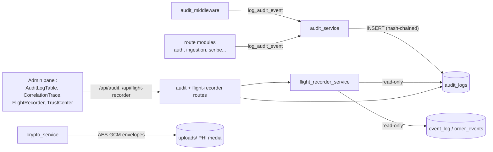

# The Tamper-Evident Audit Chain and Flight Recorder

Orb is a hospital operating system, which means it handles Protected Health Information (PHI, any data that can identify a patient and relates to their health). US law (HIPAA §164.312(b)) requires that every access to and change of PHI be recorded in an audit log that cannot be quietly edited afterward. This subsystem is that record. It has four cooperating parts: an **audit service** that writes append-only, SHA-256 hash-chained rows to the `audit_logs` table so any later tampering is *detectable*; an **audit middleware** that automatically logs every state-changing API request so no mutation slips through unlogged; a **crypto service** that encrypts uploaded PHI media (images, audio) at rest with AES-256-GCM; and a **flight recorder** that lets an admin replay a unified timeline of everything that happened while continuously verifying the chain's integrity. Two admin UI surfaces (`AuditLogTable`, `CorrelationTrace`) and the `FlightRecorder` component expose it all, and a maintenance script (`reseal_audit_chain.py`) can rebuild the chain on dev databases. Four test files pin the guarantees down.

## Purpose and neighbors

**The problem.** A plain log table is worthless as evidence: anyone with database access can `UPDATE` a row to hide what they did. You cannot make tampering *impossible* on a machine the attacker controls, but you can make it *evident*, arrange the data so that any edit, however small, is mathematically detectable. Orb does this with two independent layers:

1. **DB triggers**, `BEFORE UPDATE`/`BEFORE DELETE` triggers on `audit_logs` abort any mutation attempt (`server/database.py:403-413`). A *trigger* is a small piece of SQL the database runs automatically before/after an operation; here it calls `RAISE(ABORT, ...)`, which cancels the statement. This stops the application's own DB connection from rewriting history.
2. **A per-row hash chain**, each row stores a SHA-256 digest of its own content *prefixed by the previous row's digest* (`server/services/audit_service.py:48-63`). Even an attacker who edits the SQLite file on disk with a hex editor (bypassing the triggers entirely) leaves a detectable break, because recomputing the hashes no longer matches what is stored.

The flight recorder is the *read side*: it never writes, it merges `audit_logs` with the event-bus write-ahead log (`event_log`) and order state transitions (`order_events`) into one scrubber-friendly timeline, and re-runs chain verification on demand (`server/services/flight_recorder_service.py:14-21`).



Neighbors: authentication/permissions come from guide 03-auth-rbac (`permissions.require_permission`, `auth.decode_token`); the `db_session`/`get_db` SQLite helpers and the schema/trigger definitions belong to guide 04-database-schema; the frontend `apiFetch`/`getAuditLogs` wrappers belong to guide 02-api-client; the event bus that fills `event_log` and the ingestion pipeline that emits most correlation-traced events are documented in their own guides. The Trust Center compliance dashboard consumes `verify_chain()` as one of its controls (`server/services/compliance_service.py:74-78`).

## File map

| File | Lines (approx) | Role |
|---|---|---|
| `server/services/audit_service.py` | 356 | The writer: `log_audit_event` + the hash algorithm `compute_audit_row_hash` |
| `server/services/audit_middleware.py` | 113 | Starlette middleware auto-logging every POST/PUT/PATCH/DELETE to `/api/*` |
| `server/services/crypto_service.py` | 187 | AES-256-GCM at-rest encryption for uploaded PHI media (opt-in, format-sniffing reads) |
| `server/routes/audit_routes.py` | 79 | `GET /api/audit/logs`, filtered, paginated audit queries (admin only) |
| `server/routes/flight_recorder_routes.py` | 55 | `GET /api/flight-recorder/{timeline,verify,event/...}` (admin only) |
| `server/services/flight_recorder_service.py` | 352 | Read-only: chain verification, unified timeline merge, single-event detail |
| `server/scripts/reseal_audit_chain.py` | 104 | Dev/demo CLI to recompute the whole chain after historical (non-malicious) breaks |
| `src/components/FlightRecorder.tsx` | 244 | Admin replay UI: scrubber, play/step transport, integrity badge, detail pane |
| `src/components/FlightRecorder.css` | 194 | Flat "Quiet Clinical" styling for the recorder; reuses the global `.glass-card` surface (now an opaque bordered card), incl. light-theme overrides |
| `src/pages/panels/admin/AuditLogTable.tsx` | 178 | Filterable, paginated audit-log table in the admin panel |
| `src/pages/panels/admin/CorrelationTrace.tsx` | 147 | Vertical pipeline visualization of all events sharing one correlation ID |
| `server/tests/test_audit.py` | 236 | End-to-end: ingestion/login flows emit the expected audit rows; query endpoint works |
| `server/tests/test_audit_fixes.py` | 290 | Regressions: NULL-hash tamper evasion caught; chain survives concurrent writes |
| `server/tests/test_crypto_service.py` | 83 | Encrypt/decrypt round-trips, GCM tamper detection, plaintext passthrough |
| `server/tests/test_flight_recorder_service.py` | 165 | Timeline merge ordering, verify ok/tamper cases, event-detail round-trip |

## How it works

### A hash chain, from first principles

A *cryptographic hash function* (here SHA-256) turns any input bytes into a fixed 64-hex-character digest. Two properties matter: the same input always gives the same digest, and it is computationally infeasible to find a different input that produces the same digest. A *hash chain* exploits this by making each record's digest depend on the previous record's digest:

```
row1.hash = SHA256( ""        + canonical(row1) )   ← genesis: no predecessor, empty prefix
row2.hash = SHA256( row1.hash + canonical(row2) )
row3.hash = SHA256( row2.hash + canonical(row3) )
```

Edit row 2's content and its stored hash no longer matches a recomputation. Fix row 2's hash too, and row 3's stored `prev_hash` no longer matches row 2's new hash. Fix that, and row 3's own hash breaks... the forgery must cascade to the newest row, and any verifier who saw an earlier chain head (or simply re-walks the whole chain) catches it. This is the same idea a blockchain uses, minus the distributed consensus. It makes tampering **evident**, not impossible, the one blind spot is deleting the *newest* row, which has no successor pointing at it (see Discrepancies).

Orb's concrete contract (`server/services/audit_service.py:40-63`):

- **Fields hashed**, in fixed declaration order, are the 20 names in `_HASH_FIELDS` (`audit_service.py:40-45`): `timestamp, correlation_id, event_category, actor_user_id, actor_role, target_type, target_id, patient_id, encounter_id, source_type, source_event_id, request_path, http_method, ip_address, user_agent, session_id, outcome, action_type, summary_message, metadata_json`. Notably **excluded**: the autoincrement `id` (so content, not position, is what is sealed) and `prev_hash` (it participates as the hash *prefix* instead).
- **Canonicalization**: the selected fields are serialized with `json.dumps(..., sort_keys=True, separators=(",", ":"), default=str)` (`audit_service.py:54-59`). Sorted keys plus no-whitespace separators mean the same logical row always produces byte-identical JSON, essential, because SHA-256 hashes bytes, not meaning.
- **Algorithm**: `row_hash = SHA256( (prev_hash or "") .encode() + canonical_json.encode() )` (`audit_service.py:60-63`).
- **Genesis**: the very first sealed row has `prev_hash = NULL` in the DB; the hash computation substitutes the empty string (`audit_service.py:61`). Verification treats `last_hash is None` as an always-valid link (`flight_recorder_service.py:104`).
- **Legacy rows**: `prev_hash`/`row_hash` were added by a later migration (`server/database.py:1443-1448`), so old rows may have `row_hash = NULL`. A NULL-hash row is legitimate **only as a contiguous prefix** before sealing began; a NULL appearing *after* any sealed row is treated as tampering (`flight_recorder_service.py:89-100`).

### Flow 1: writing a sealed audit row

1. Some caller, one of ~15 route/service modules (auth login, ingestion pipeline, scribe, clinical records, permission denials, the PHI media endpoint...) or the audit middleware, calls `log_audit_event(...)` (`audit_service.py:66`).
2. Simulation suppression: if `AUDIT_SIMULATION_EVENTS` is false (default, `server/config.py:406`) and the event is synthetic demo data (`source_type == "simulation"` or `event_category == "simulation"`), the write is skipped entirely (`audit_service.py:103-104`).
3. The row dict is assembled with a UTC ISO-8601 timestamp and `metadata` serialized to `metadata_json` (`audit_service.py:109-133`).
4. Inside a single transaction, the most recent sealed row's `row_hash` is read (`SELECT row_hash ... WHERE row_hash IS NOT NULL ORDER BY id DESC LIMIT 1`, `audit_service.py:259-262`), the new row's hash is computed from it (`compute_audit_row_hash`, `:150`), and the row is inserted with both `prev_hash` and `row_hash` (`audit_service.py:263-273`).
5. Atomicity: if the caller passed its own connection (`db=`), the caller's transaction serializes the read+insert. Otherwise the function opens its own connection and wraps the pair in `BEGIN IMMEDIATE ... COMMIT` (`audit_service.py:330-335`). `BEGIN IMMEDIATE` is SQLite's "take the write lock *now*" statement, without it, two concurrent writers could both read the same `prev_hash` and produce a forked chain (a race condition the codebase actually hit; the comment at `audit_service.py:303-310` records "dozens of spurious chain-broken links on a busy DB").
6. Failure policy: if the write fails and the category is one of `security, clinical_access, phi_access, authentication, ai_inference` (`_FAIL_CLOSED_CATEGORIES`, `audit_service.py:43-45`; corrected 2026-09-04, the set had named `auth` and `ai_egress`, which nothing emitted), an `AuditWriteError` is raised so the caller can refuse to perform the unaudited action ("fail closed"). Any other category logs a critical message and returns ("fail soft") so operational paths keep running (`audit_service.py:195-207`).

### Flow 2: the middleware safety net and correlation IDs

A *middleware* is a function that wraps every HTTP request before it reaches a route handler. `audit_mutations` is registered globally in `server/main.py:292-293`. For every `POST/PUT/PATCH/DELETE` to a path starting `/api/` (except `/api/auth/login`, which has its own richer audit event), it records who did what with which outcome, even when the route handler itself has no audit call.

A **correlation ID** is a random UUID attached to every audit row that belongs to the same logical workflow, so an investigator can pull "everything that happened because of this one request" with a single filter. The middleware honors a client-supplied `X-Correlation-ID` header or mints a fresh UUID (`audit_middleware.py:58`); the ingestion pipeline mints its own per-payload ID and threads it through parse → insert → alert steps (that is what `CorrelationTrace` visualizes).

```mermaid
sequenceDiagram
    participant C as Client (any panel)
    participant MW as audit_mutations (middleware)
    participant R as Route handler
    participant AS as audit_service
    participant DB as SQLite audit_logs
    C->>MW: POST /api/... (Bearer JWT)
    MW->>MW: decode JWT → actor (best effort)
    MW->>R: call_next(request)
    R->>AS: (optional) richer log_audit_event(...)
    AS->>DB: BEGIN IMMEDIATE; read prev_hash; INSERT sealed row; COMMIT
    R-->>MW: response (or exception → 500)
    MW->>AS: log_audit_event(api_mutation, outcome from status)
    AS->>DB: sealed row #N+1 (prev_hash = hash of row #N)
    MW-->>C: response
    Note over C,DB: Later: admin opens Flight Recorder
    C->>MW: GET /api/flight-recorder/verify
    MW->>R: (GET → not audited by middleware)
    R->>DB: walk chain in id order, recompute every hash
    R-->>C: {ok, broken_at, count}
```

### Flow 3: verification walks the chain

`_broken_audit_ids` (`flight_recorder_service.py:73-109`) reads **every** audit row in `id` order and, for each sealed row, recomputes `compute_audit_row_hash(row, row.prev_hash)`, importing the *exact* function the writer used, never a reimplementation (`flight_recorder_service.py:30-32`), and checks two things: the recomputed hash equals the stored `row_hash`, and the stored `prev_hash` equals the previous sealed row's `row_hash`. Any failure records the row `id` as broken. The chain is **global**: rows for all patients interleave in one chain, so a tampered row anywhere invalidates provenance for everyone; the `patient_id` parameter only scopes the *reported count*, never the walk (`flight_recorder_service.py:14-21, 112-135`).

### Flow 4: resealing (and when it is legitimate)

*Resealing* means recomputing `prev_hash`/`row_hash` for every row from scratch so the chain becomes internally consistent again, which by definition **erases any tamper evidence**. It exists because databases written by the pre-`BEGIN IMMEDIATE` writer contain benign race-induced breaks that make the Trust Center show a red badge on demo data (`server/scripts/reseal_audit_chain.py:4-14`). The script is guarded three ways: no `--force` means dry-run only; `--force` refuses unless `ORB_DEPLOYMENT_PROFILE=dev`; and overriding that requires an explicit `--i-understand` flag (`reseal_audit_chain.py:40-43`). It must never be run against a production audit log that holds real events.

### Flow 5: PHI media encryption at rest

`crypto_service` protects a different asset: files on disk (Lens medical images, Scribe consultation audio). Uploads are wrapped in a self-describing envelope `b"ORBENC1\n" + 12-byte nonce + AES-256-GCM ciphertext(+16-byte tag)` (`crypto_service.py:3-6, 32-33`). AES-GCM is an *authenticated* cipher: decryption fails outright if the ciphertext was modified, rather than returning garbage, so at-rest tampering of media is also evident. Encryption is opt-in (needs `ORB_UPLOAD_ENCRYPTION_KEY` plus the `cryptography` package) and reads are format-sniffing, so plaintext legacy files keep working (`crypto_service.py:12-20`). Writers: `server/routes/lens_routes.py:101-102` and `server/routes/scribe_routes.py:339-340, 395-396`. Reader: the authenticated `/uploads/{filename}` endpoint `serve_upload` (`server/main.py:771`, decorated `:770`), which also emits a **fail-closed** `phi_access` audit event before serving anything (`server/main.py:815-832`), if the audit row cannot be written, the media is not served (HTTP 503).

## Function-by-function

### `server/services/audit_service.py`

### `_HASH_FIELDS`: `server/services/audit_service.py:207`
**Signature:** module constant: `tuple[str, ...]` (20 field names)
**Does:** Defines exactly which columns, in which order, participate in every row's hash.
**How it works:** A frozen tuple consumed by `compute_audit_row_hash`; order and membership are declared "part of the chain contract, do NOT reorder without a schema bump" (`audit_service.py:39-40`).
**Why it exists:** Hashing `SELECT *` would break the moment a column is added by migration; an explicit list makes the sealed surface stable and shared between writer and verifier.
**Data in/out:** field names matching `audit_logs` columns (`server/database.py:413-439`).
**Talks to:** read by `compute_audit_row_hash`; mirrored by `_AUDIT_SELECT` in the flight recorder (`flight_recorder_service.py:38-44`).
**Change guide:** To seal a new column, append it to `_HASH_FIELDS` **and** to the `INSERT` at `audit_service.py:144-158` **and** to `_AUDIT_SELECT` at `flight_recorder_service.py:38`, then every pre-existing sealed row will fail verification (its stored hash was computed without the field, and `row.get(k)` now returns the new column's value instead of `None` for old rows only if the column is NULL... which serializes as `null` and *changes the canonical JSON*). So a field addition requires either resealing dev data or versioning the hash (e.g. a `hash_v` column selecting field sets).
**Gotchas:** `row.get(k)` means a *missing* key and a `None` value serialize identically (`null`), which is what keeps writer dicts and DB-row dicts hash-compatible.

### `compute_audit_row_hash(row, prev_hash)`: `server/services/audit_service.py:141`
**Signature:** `(row: dict[str, Any], prev_hash: Optional[str]) → str` (64-char hex)
**Does:** Computes `SHA256(prev_hash || canonical_json(hashed fields))`, the single sealing function used by writer, verifier, and resealer.
**How it works:**
1. Builds `{k: row.get(k) for k in _HASH_FIELDS}`, only the 20 contract fields, in a dict.
2. Serializes with `sort_keys=True, separators=(",", ":"), default=str` for a canonical byte string (`audit_service.py:54-59`).
3. Feeds `(prev_hash or "").encode()` then the canonical JSON into one SHA-256 and returns the hex digest (`audit_service.py:60-63`).
**Why it exists:** One shared implementation is the whole trust story, if verification used even a slightly different serialization (key order, whitespace), every row would "look tampered."
**Data in/out:** in: any dict carrying the 20 keys (writer's fresh dict or `dict(sqlite3.Row)`); out: hex string.
**Talks to:** called by `log_audit_event._do_insert` (`audit_service.py:142`), `flight_recorder_service._broken_audit_ids` (`flight_recorder_service.py:103`), `database.verify_audit_chain` (`server/database.py:1270`), and `reseal_audit_chain.py:54,78`.
**Gotchas:** `default=str` silently stringifies anything non-JSON (e.g. if a caller ever passed a `datetime` for `timestamp`); harmless today because writers pass strings/ints/None, but it means type drift changes bytes and therefore hashes.

### `AuditWriteError`: `server/services/audit_service.py:60`
**Signature:** `class AuditWriteError(RuntimeError)`
**Does:** Signals that a fail-closed audit event could not be durably persisted.
**How it works:** Raised only from `log_audit_event`'s exception handler when `event_category` is fail-closed (`audit_service.py:191-196`).
**Why it exists:** Lets security-sensitive callers distinguish "the audit control itself failed" from generic errors and abort, e.g. `serve_upload` converts it to HTTP 503 and refuses to serve PHI (`server/main.py:832-833`).
**Data in/out:** message `"audit write failed for {category}/{action}: {cause}"`.
**Talks to:** caught in `server/main.py:421`.
**Gotchas:** none noteworthy.

### `log_audit_event(...)`: `server/services/audit_service.py:159`
**Signature:** `(correlation_id, event_category, action_type, outcome, db=None, summary_message=None, actor_user_id=None, actor_role=None, target_type=None, target_id=None, patient_id=None, encounter_id=None, source_type=None, source_event_id=None, request_path=None, http_method=None, ip_address=None, user_agent=None, session_id=None, metadata: dict|None=None) → None` (raises `AuditWriteError` on fail-closed failure)
**Does:** Appends one sealed, tamper-evident row to `audit_logs`.
**How it works:**
1. Suppresses only genuinely synthetic events: when `AUDIT_SIMULATION_EVENTS` is false and `source_type == "simulation"` or `event_category == "simulation"` (`audit_service.py:103-104`). The comment records why the old `actor_role == "system"` suppression was removed, a real automated actor mutating PHI would have vanished from the log (`audit_service.py:100-102`).
2. Computes `fail_closed = event_category in {"security","clinical_access","auth","phi_access"}` (`audit_service.py:31, 106`).
3. Builds the row dict with `datetime.now(timezone.utc).isoformat()` and `metadata_json = json.dumps(metadata)` (`audit_service.py:109-133`).
4. `_do_insert(conn)` (inner function, `audit_service.py:135-158`): reads the latest non-NULL `row_hash`, computes this row's hash chained off it, and executes a fully parameterized 22-column `INSERT`.
5. If `db` was supplied, the caller's connection/transaction runs `_do_insert` (caller must hold the write lock; `audit_service.py:160-163`). Otherwise a fresh connection with `isolation_level = None` (manual transaction control) runs `BEGIN IMMEDIATE; _do_insert; COMMIT`, with `ROLLBACK` on error and `close()` in `finally` (`audit_service.py:171-185`).
6. On any exception: `logger.critical(...)`, then raise `AuditWriteError` if fail-closed, else swallow (`audit_service.py:355-366`).
**Why it exists:** The single choke point for the append-only log; the `BEGIN IMMEDIATE` design specifically fixes the read-then-write race where two concurrent writers chained off the same `prev_hash`.
**Data in/out:** in: the audit vocabulary above; out: one `audit_logs` row (schema at `server/database.py:413-439`; `outcome` is CHECK-constrained to `success|failure|partial_success|denied` at `database.py:431`).
**Talks to:** called from ~15 modules, heavy users are `services/ingestion_service.py` (10 call sites), `services/discharge_access_service.py` (10), `routes/scribe_routes.py` (11), `routes/auth_routes.py` (7), `permissions.py` (permission-denied events, `permissions.py:187-204`), `services/audit_middleware.py`, and `main.py:409` (media views). Calls `database.get_db` and `compute_audit_row_hash`.
**Change guide:** Worked example, *add a new fail-closed category `"prescription"`*: add the string to `_FAIL_CLOSED_CATEGORIES` at `audit_service.py:43-45`; every caller that logs with `event_category="prescription"` must now be prepared to catch `AuditWriteError` and abort its action, or it will crash with an unhandled 500 when the audit DB is unavailable. Since 2026-09-04 that is the live state of `authentication`: none of its call sites in `routes/auth_routes.py` catch `AuditWriteError`, so a login whose audit write fails returns an unhandled 500 and issues no token. Worked example, *record which downstream system consumed an event*: pass it in `metadata={"consumer": ...}`; do **not** add a column unless you also follow the `_HASH_FIELDS` change guide above.
**Gotchas:** (a) An invalid `outcome` string violates the CHECK constraint and the whole event is rejected, for a fail-soft category that means the event is silently lost (a critical log line is the only trace). (b) When passing `db=`, the *caller* must already hold the SQLite write lock (be inside a write transaction); a caller that only did reads so far still holds no lock, reopening the prev-hash race. (c) The timestamp is text ISO-8601 UTC; sorting is lexicographic in SQL, which works only because the format is fixed-width UTC.

### `server/services/audit_middleware.py`

### `_actor_from_request(request)`: `server/services/audit_middleware.py:39`
**Signature:** `(request) → tuple[str|None, str|None]`, `(user_id, role)`
**Does:** Best-effort decode of the request's bearer JWT to identify the actor; never raises.
**How it works:**
1. Reads the `Authorization` header (either capitalization) and requires the `bearer ` prefix (`audit_middleware.py:32-34`).
2. Calls `auth.decode_token`, a *JWT* (JSON Web Token) is a signed token whose payload carries claims like `sub` (subject = user id) and `role`; `decode_token` verifies the HS256 signature (`server/auth.py:371-377`).
3. Returns `(payload["sub"] or payload["id"], payload["role"])`; any exception (expired, malformed, absent) yields `(None, None)` (`audit_middleware.py:36-41`).
**Why it exists:** Middleware runs *before* FastAPI dependency injection (the `Depends(...)` mechanism that normally resolves the current user), so it must parse the token itself, and an unauditable actor must not make the request fail.
**Data in/out:** in: Starlette `Request`; out: 2-tuple of strings or Nones.
**Talks to:** `auth.decode_token` (guide 03-auth-rbac); called only by `audit_mutations`.
**Gotchas:** `decode_token` raises `HTTPException` for expired/invalid tokens (`auth.py:69-72`); the bare `except Exception` correctly swallows it here, so an expired token logs an *anonymous* mutation rather than blocking it, actor attribution is best-effort by design.

### `audit_mutations(request, call_next)`: `server/services/audit_middleware.py:53`
**Signature:** `async (request, call_next) → Response`, Starlette HTTP middleware
**Does:** Audit-logs every state-changing API call (`POST/PUT/PATCH/DELETE` under `/api/`, except `/api/auth/login`) with actor, path, and outcome.
**How it works:**
1. Computes `should_audit` from method ∈ `_AUDIT_METHODS`, `path.startswith("/api/")`, and `path not in _SKIP_PATHS` (`audit_middleware.py:49-53`); non-matching requests pass straight through.
2. Resolves `correlation_id` from the `x-correlation-id` header or a fresh `uuid4` (`audit_middleware.py:58`).
3. Runs the handler inside `try/finally` with `status` pre-set to 500: if the route raises an unhandled exception, the `finally` still logs it as a 500 (`audit_middleware.py:62-69`).
4. In the `finally`, maps status → outcome (`<400` → `success`; `401/403` → `denied`; else `failure`), and calls `log_audit_event` with `event_category="api_mutation"`, `action_type=f"{method.lower()}_request"`, request metadata, and `metadata={"status_code": status}` (`audit_middleware.py:70-86`).
5. The entire audit call sits in its own `try/except`, "audit must never break the request" (`audit_middleware.py:87-88`).
**Why it exists:** Before it, only ~4 of 18 route modules logged anything (`audit_middleware.py:3-9`); this guarantees a complete mutation trail without hand-wiring every route. GETs are deliberately excluded as too high-volume; sensitive reads are audited at the endpoint level instead (e.g. `media_view` in `main.py:409-420`).
**Data in/out:** in: every HTTP request; out: unmodified response + one `api_mutation` audit row per mutation.
**Talks to:** registered via `app.middleware("http")(audit_mutations)` in `server/main.py:293`; calls `_actor_from_request` and `log_audit_event`.
**Change guide:** To also audit sensitive GETs (e.g. `/api/audit/logs` itself), extend the condition at `audit_middleware.py:49-53` with an allowlist of GET path prefixes; knock-on effects: audit volume grows sharply and the chain write (`BEGIN IMMEDIATE`) serializes all such requests through the SQLite write lock, watch latency. To exempt another self-auditing route, add its exact path to `_SKIP_PATHS` (`audit_middleware.py:27`); note the set holds *exact* paths, not prefixes.
**Gotchas:** (a) `api_mutation` is *not* a fail-closed category, so this safety net is best-effort: if the audit DB is down, mutations still succeed unlogged (only `logger.debug` records it, see Discrepancies). (b) The middleware's correlation ID is not injected into `request.state`, so route-level audit events use their *own* IDs, one HTTP request can legitimately appear under two correlation IDs (see Discrepancies). (c) Because it logs in `finally` *after* the response exists, a streaming response's status is captured at header time, which is correct for FastAPI.

### `server/services/crypto_service.py`

### `is_encryption_enabled()`: `server/services/crypto_service.py:45`
**Signature:** `() → bool`
**Does:** True when uploads will actually be encrypted: a key is configured **and** the `cryptography` package imported successfully.
**How it works:** `bool(UPLOAD_ENCRYPTION_KEY) and _HAVE_AESGCM`, `UPLOAD_ENCRYPTION_KEY` is read from env `ORB_UPLOAD_ENCRYPTION_KEY` at import (`server/config.py:61`); `_HAVE_AESGCM` is set by the guarded import at `crypto_service.py:35-40`.
**Why it exists:** Single source of truth for "are we actually protecting PHI at rest," consumed by the Trust Center's encryption control (`compliance_service.py:57-58`).
**Talks to:** `encrypt_bytes`, tests, `compliance_service`.
**Gotchas:** Both inputs are captured at module import; changing the env var at runtime requires `importlib.reload` (exactly what `test_crypto_service._reload_with_key` does, `test_crypto_service.py:12-18`).

### `_warn_once()`: `server/services/crypto_service.py:50`
**Signature:** `() → None`
**Does:** Logs one (and only one) warning explaining *why* encryption is disabled, missing key vs. missing package.
**How it works:** Module-global `_warned` flag; two distinct messages (`crypto_service.py:50-64`).
**Why it exists:** A silent plaintext fallback would be an invisible compliance hole; a per-write warning would be log spam.
**Gotchas:** none noteworthy.

### `_derive_key()`: `server/services/crypto_service.py:67`
**Signature:** `() → bytes` (32 bytes)
**Does:** Derives the AES-256 key as `SHA256(UPLOAD_ENCRYPTION_KEY)`.
**Why it exists:** Lets the operator supply key material of any length (e.g. `openssl rand -hex 32`) while AES-256 strictly needs 32 bytes (`crypto_service.py:7-8`).
**Talks to:** `encrypt_bytes`, `decrypt_bytes`.
**Gotchas:** A plain SHA-256 is a KDF without salt or stretching, fine for high-entropy random keys, weak if an operator sets a guessable passphrase. There is no key-rotation story: changing the key makes old envelopes undecryptable (ValueError on GCM auth failure).

### `is_encrypted_blob(data)`: `server/services/crypto_service.py:72`
**Signature:** `(data: bytes) → bool`
**Does:** Sniffs the 8-byte magic prefix `b"ORBENC1\n"`.
**Why it exists:** Format-sniffing reads are what make encryption toggleable without migrating existing files (`crypto_service.py:17-20`).
**Gotchas:** Any genuine plaintext file that happens to start with `ORBENC1\n` would be misdetected, vanishingly unlikely for images/audio.

### `_require_encryption()`: `server/services/crypto_service.py:77`
**Signature:** `() → bool`
**Does:** Reads `ORB_REQUIRE_UPLOAD_ENCRYPTION` from the environment **live** (not cached), when truthy, storing PHI unencrypted becomes a hard error.
**Why it exists:** Closes the fail-open gap for regulated deployments: opt-in encryption that silently degrades is unacceptable when the operator *intends* encryption (`crypto_service.py:78-84`).
**Talks to:** `encrypt_bytes` only.
**Gotchas:** Accepts `1/true/yes/on` (case-insensitive); anything else is off.

### `encrypt_bytes(plaintext)`: `server/services/crypto_service.py:87`
**Signature:** `(plaintext: bytes) → bytes`
**Does:** Returns the `ORBENC1` envelope, or the plaintext unchanged when encryption is disabled.
**How it works:**
1. If disabled: raise `RuntimeError` when `_require_encryption()` demands enforcement, else warn once and return plaintext (`crypto_service.py:95-103`).
2. Otherwise: `nonce = os.urandom(12)`, a *nonce* is a number-used-once; GCM's security collapses if a (key, nonce) pair repeats, so it must be fresh random per encryption (`crypto_service.py:105`).
3. `AESGCM(key).encrypt(nonce, plaintext, None)` appends the 16-byte authentication tag; return `MAGIC + nonce + ciphertext` (`crypto_service.py:106-108`).
**Data in/out:** raw bytes → self-describing envelope bytes.
**Talks to:** called by `write_encrypted`; uses `_derive_key`, `_require_encryption`, `_warn_once`.
**Gotchas:** The third `encrypt` argument (associated data) is `None`, the envelope binds nothing about the *filename*, so encrypted files can be swapped between paths undetected at the crypto layer (the registered-media allowlist in `main.py:397-400` partially mitigates this).

### `decrypt_bytes(data)`: `server/services/crypto_service.py:111`
**Signature:** `(data: bytes) → bytes`; raises `ValueError`
**Does:** Decrypts an `ORBENC1` envelope; passes through anything that is not one.
**How it works:**
1. Non-envelope data returns unchanged (`crypto_service.py:118-119`), legacy plaintext files keep working.
2. An envelope without key/driver raises `ValueError` rather than serving raw ciphertext (`crypto_service.py:120-124`).
3. Splits nonce/ciphertext after the magic, decrypts; any GCM authentication failure (tampered file, wrong key) re-raises as `ValueError` (`crypto_service.py:125-131`).
**Why it exists:** The read-side counterpart of the graceful-degradation contract; the *authenticated* failure mode is the point, corrupted PHI must never be silently served.
**Talks to:** called by `read_decrypted` and `materialize_plaintext`.
**Gotchas:** none noteworthy.

### `write_encrypted(path, plaintext)`: `server/services/crypto_service.py:134`
**Signature:** `(path, plaintext: bytes) → None`
**Does:** Encrypts (if enabled) and writes to `path`, then best-effort `chmod 0o600` (owner-only permissions).
**Talks to:** callers: `lens_routes.py:102` (uploaded images), `scribe_routes.py:340,396` (consultation audio).
**Change guide:** Worked example, *encrypt a new upload type (say, wound photos in a future route)*: call `write_encrypted(dest_path, file_bytes)` on write and serve through the existing `/uploads` endpoint (which already calls `read_decrypted`, `main.py:431`); register the file in a media table so `_resolve_media_patient` (`main.py:354-372`) finds its owning patient, otherwise the endpoint 404s it by allowlist.
**Gotchas:** `chmod` failures are swallowed (Windows).

### `read_decrypted(path)`: `server/services/crypto_service.py:146`
**Signature:** `(path) → bytes`
**Does:** Reads a file and transparently decrypts if it is an envelope.
**Talks to:** the `/uploads/{filename}` endpoint (`main.py:431`).
**Gotchas:** Loads the whole file into memory, fine for images/short audio, wrong tool for large video.

### `materialize_plaintext(path)`: `server/services/crypto_service.py:156`
**Signature:** context manager `(path) → yields str path`
**Does:** Yields a filesystem path containing plaintext: the original path if already plaintext, else a temporary decrypted copy (same suffix, 0o600) that is deleted on exit.
**How it works:** Read file → if not envelope, yield original and return (`crypto_service.py:167-171`); else decrypt into `tempfile.mkstemp(suffix=..., prefix="orb_dec_")`, yield, and `os.remove` in `finally` (`crypto_service.py:172-187`).
**Why it exists:** Downstream ML consumers (Whisper transcription, vision LLMs) take file *paths*, not bytes; this slots at-rest encryption underneath them without changing their APIs (`crypto_service.py:158-164`).
**Talks to:** `lens_routes.py:117`, `scribe_routes.py:348,400`.
**Gotchas:** The plaintext briefly exists on disk in the temp directory, a deliberate trade-off; the suffix is preserved because Whisper/ffmpeg sniff formats by extension.

### `server/routes/audit_routes.py`

### `get_audit_logs(...)`: `server/routes/audit_routes.py:12`
**Signature:** `GET /api/audit/logs`, query params `patient_id, correlation_id, action_type, event_category, outcome, start_date, end_date` (all optional), `limit` (1-1000, default 50), `offset` (≥0); auth: `Depends(require_permission("audit.read"))` → `{logs: [...], total, limit, offset}`
**Does:** Filtered, newest-first, paginated read of `audit_logs`.
**How it works:**
1. The router carries `prefix="/api/audit"` (`audit_routes.py:8`) and is mounted in `main.py:308`.
2. Builds `SELECT * FROM audit_logs WHERE 1=1` and appends one `AND col = ?` per supplied filter (dates use `>=`/`<=` on the ISO-8601 text column), the SQL string is concatenated but every *value* is a `?` placeholder, so no SQL injection surface (`audit_routes.py:26-52`).
3. Orders `timestamp DESC LIMIT ? OFFSET ?`.
4. Derives the count query by `query.replace("SELECT *", "SELECT COUNT(id) as total", 1).split(" ORDER BY")[0]` with `params[:-2]` (dropping limit/offset) so `total` reflects the filter, enabling the UI's pagination (`audit_routes.py:57-60`).
**Why it exists:** The one query surface for both `AuditLogTable` (generic filters) and `CorrelationTrace` (single `correlation_id`).
**Data in/out:** rows are raw table dicts (all 23 columns incl. `prev_hash`/`row_hash`); frontend type `AuditLog` at `src/api/client.ts:1803-1821`.
**Talks to:** `permissions.require_permission` (only the `admin` role holds `audit.read`, constant at `permissions.py:93`, granted at `:156`); called by `getAuditLogs` (`src/api/client.ts:1837`).
**Change guide:** Worked example, *add an `actor_user_id` filter*: add `actor_user_id: Optional[str] = Query(None)` to the signature and an `AND actor_user_id = ?` clause after `audit_routes.py:43`; then extend `AuditFilters` + the params builder in `src/api/client.ts:1070-1080,1116-1129`, and add an input to `AuditLogTable`. Knock-on: consider an index, existing indexes cover correlation/action/patient/timestamp/category only (`database.py:394-398`); an unindexed filter forces a table scan.
**Gotchas:** The string-surgery count query silently breaks if the base query's prefix ever changes from exactly `SELECT *`, keep the `replace` in sync.

### `server/routes/flight_recorder_routes.py`

The router: `APIRouter(prefix="/api/flight-recorder", tags=["flight-recorder"])` (`flight_recorder_routes.py:18`), mounted at `main.py:321`. All three handlers use `Depends(require_permission("audit.read"))`, admin-only by the role matrix (`flight_recorder_routes.py:2-5`).

### `timeline(...)`: `server/routes/flight_recorder_routes.py:22`
**Signature:** `GET /api/flight-recorder/timeline?patient_id&since&until&limit(1-5000, default 500)` → `{events: [...], count}`
**Does:** Returns the unified, time-ordered replay stream (audit + event bus + order transitions).
**How it works:** Pure delegation to `get_timeline` with the validated query params (`flight_recorder_routes.py:29-31`).
**Why it exists:** Thin HTTP shell so the service stays testable without FastAPI.
**Talks to:** `flight_recorder_service.get_timeline`; consumed by `FlightRecorder.tsx:68`.
**Gotchas:** none noteworthy.

### `verify(...)`: `server/routes/flight_recorder_routes.py:35`
**Signature:** `GET /api/flight-recorder/verify?patient_id` → `{ok: bool, broken_at: int|null, count: int}`
**Does:** Runs full-chain verification and reports the first broken row id.
**Talks to:** `flight_recorder_service.verify_chain`; consumed by `FlightRecorder.tsx:69` and (in-process) by the Trust Center (`compliance_service.py:76-78`).
**Gotchas:** `patient_id` scopes only `count`, never the walk (see `verify_chain`).

### `event_detail(source, event_id)`: `server/routes/flight_recorder_routes.py:44`
**Signature:** `GET /api/flight-recorder/event/{source}/{event_id}` → `{source, event: {...}}`; 400 for a bad source, 404 when missing
**Does:** Full raw row behind one timeline entry.
**How it works:** Validates `source ∈ {audit, event, order}` explicitly (`flight_recorder_routes.py:50-51`), then delegates to `get_event_detail` and maps `None` → 404.
**Talks to:** consumed by `FlightRecorder.tsx:89`.
**Gotchas:** `event_id` is a string path param; SQLite compares it against integer ids with type affinity, so `"12"` matches row 12, do not "fix" this by casting without checking `event_log.event_id`, which is a TEXT UUID (`database.py:559`).

### `server/services/flight_recorder_service.py`

### `_AUDIT_SELECT`: `server/services/flight_recorder_service.py:38`
**Signature:** module constant: SQL column list string (23 columns)
**Does:** Selects every hashed field under the exact key names the writer used, plus `id, prev_hash, row_hash`.
**Why it exists:** `SELECT *` would couple verification to physical column order; the explicit list guarantees `dict(row)` feeds `compute_audit_row_hash` correctly (`flight_recorder_service.py:35-37`).
**Talks to:** used by every audit query in this module and imported by `reseal_audit_chain.py:38`.
**Gotchas:** Must stay in lock-step with `_HASH_FIELDS`; a column present in `_HASH_FIELDS` but missing here would verify as `None` and flag every row broken.

### `_parse_ts(value)`: `server/services/flight_recorder_service.py:47`
**Signature:** `(value: Any) → datetime` (naive; `datetime.min` on failure)
**Does:** Normalizes heterogeneous timestamp strings into comparable datetimes for the merge sort.
**How it works:**
1. Empty/None → `datetime.min` (sorts oldest).
2. `Z` → `+00:00`; a space separator with no `T` (SQLite `CURRENT_TIMESTAMP` format used by `order_events`) gets its first space converted to `T` (`flight_recorder_service.py:58-60`).
3. `datetime.fromisoformat`, then `tzinfo` stripped so timezone-aware (audit/event rows carry `+00:00`) and naive (order rows) values are mutually comparable (`flight_recorder_service.py:61-66`).
**Why it exists:** Naive *string* sorting interleaves `2026-07-04T10:00:00+00:00` and `2026-07-04 10:05:00` incorrectly (`T` > space in ASCII).
**Talks to:** `get_timeline`'s sort key; exported for tests (`test_flight_recorder_service.py:20,112-113`).
**Gotchas:** Stripping `tzinfo` assumes everything is UTC; a row written with a non-UTC offset would sort at its *local* clock time. All current writers are UTC.

### `_broken_audit_ids(conn)`: `server/services/flight_recorder_service.py:73`
**Signature:** `(conn) → tuple[list[int], int]`, `(broken row ids, sealed rows checked)`
**Does:** Walks the FULL chain in `id` order and returns every row whose hash or prev-link fails.
**How it works:**
1. Fetches all rows via `_AUDIT_SELECT ... ORDER BY id ASC` (`flight_recorder_service.py:80-82`).
2. Tracks `last_hash` (previous sealed row's hash) and `sealing_began` (has any sealed row appeared yet).
3. `row_hash IS NULL` before sealing began → legitimate legacy prefix; reset `last_hash = None` and continue. NULL *after* sealing began → count the row as broken and, crucially, do **not** reset `last_hash`, so the *next* row's prev-link mismatch is caught too, this defeats the "null the hash to restart the chain" evasion (`flight_recorder_service.py:89-100`, regression FR-1).
4. For sealed rows: `expected = compute_audit_row_hash(d, d["prev_hash"])`; `link_ok = last_hash is None or d["prev_hash"] == last_hash`; failure of either appends the id (`flight_recorder_service.py:102-107`).
**Why it exists:** The verification core shared by `verify_chain`, `get_timeline` (per-row `chain_ok` flags), and `get_event_detail`.
**Data in/out:** in: open connection; out: `([ids], checked_count)`.
**Talks to:** imports the writer's exact `compute_audit_row_hash` (`flight_recorder_service.py:32`).
**Gotchas:** (a) O(N) over the whole table on **every** call, and `get_timeline` + `verify` + each `event_detail` all call it, on a huge audit log this is the first thing to optimize (cache by max id, or incremental checkpoints). (b) It flags the row whose *stored* data fails, so a content edit with a stale hash flags the edited row itself; a deleted middle row flags its successor (broken prev-link).

### `verify_chain(patient_id=None)`: `server/services/flight_recorder_service.py:112`
**Signature:** `(patient_id: str|None) → {ok: bool, broken_at: int|None, count: int}`
**Does:** Global chain verification; `broken_at` is the first failing row id.
**How it works:** Runs `_broken_audit_ids` over the full table; when `patient_id` is given, `count` becomes that patient's sealed-row count (`SELECT COUNT ... WHERE patient_id = ? AND row_hash IS NOT NULL`) while `ok`/`broken_at` stay global (`flight_recorder_service.py:121-135`). The design intent, a tampered row anywhere invalidates provenance for everyone, is spelled out at `flight_recorder_service.py:17-21`.
**Why it exists:** The one integrity answer surfaced to the Flight Recorder badge and the Trust Center's `audit_hash_chain` control (`compliance_service.py:298-308`).
**Talks to:** route `verify`, `compliance_service._audit_chain`, tests.
**Change guide:** Worked example, *report every break, not just the first*: return `broken` (already computed) as `broken_ids`; update `VerifyResult` in `FlightRecorder.tsx:33-37` and the badge text at `FlightRecorder.tsx:126-129`; the Trust Center reads only `broken_at`, so keep that key for compatibility.
**Gotchas:** The scoped `count` next to a global `ok` reads ambiguously in the UI ("Chain verified · 3" for a patient means 3 *patient* rows under a *globally* verified chain).

### `_table_exists(conn, name)`: `server/services/flight_recorder_service.py:142`
**Signature:** `(conn, name: str) → bool`
**Does:** Checks `sqlite_master` for a table, parameterized.
**Why it exists:** `order_events` is optional on older databases; the timeline degrades gracefully rather than crashing (`flight_recorder_service.py:241`).
**Gotchas:** none noteworthy.

### `get_timeline(patient_id=None, since=None, until=None, limit=500)`: `server/services/flight_recorder_service.py:149`
**Signature:** `(...) → list[dict]`, each `{id, ts, source, actor, action, target, detail, chain_ok, patient_id, correlation_id}`
**Does:** Merges `audit_logs`, `event_log`, and `order_events` into one ascending, normalized stream, the flight recorder's tape.
**How it works:**
1. Clamps `limit` to 1-5000 (`flight_recorder_service.py:170`).
2. Computes the broken-id set once so each audit row can carry `chain_ok` (`flight_recorder_service.py:174`).
3. **audit**: filtered `_AUDIT_SELECT` query, newest-first per-source `LIMIT`; `target` is `"{target_type}:{target_id}"`, falling back to `request_path`; `chain_ok = row_hash is not None and id not in broken` (`flight_recorder_service.py:177-208`).
4. **event**: the event bus's write-ahead log (`event_log`, every message published on Orb's internal pub/sub bus is durably journaled there; schema at `database.py:558-567`). `actor` = `source_node` (which subsystem emitted it), `action` = `event_type`, `target` = `topic`, `detail` = `_summarize_payload(payload)`, `chain_ok = None`, not hash-chained (`flight_recorder_service.py:211-238`).
5. **order**: `order_events` LEFT JOINed to `orders` for `patient_id`/description; `action` = `order_{new_status}`, `detail` = reason or `"{description}: prior → new"`; `chain_ok = None` (`flight_recorder_service.py:241-273`).
6. Sorts everything by `(_parse_ts(ts), source, str(id))` ascending, then keeps the **last** `limit` entries so the scrubber shows the most recent window while still playing forward (`flight_recorder_service.py:276-279`).
**Why it exists:** Investigating an incident means correlating "the audit row says X changed" with "the event bus dispatched Y" and "the order flipped to Z", one merged tape beats three tabs.
**Talks to:** route `timeline`; reads three tables; calls `_broken_audit_ids`, `_parse_ts`, `_summarize_payload`, `_table_exists`.
**Change guide:** Worked example, *add a fourth source (say, `med_admin_events`)*: copy the `order_events` block (`flight_recorder_service.py:241-273`), normalize to the common shape with a new `source` value, set `chain_ok=None`, add the source to `get_event_detail`, to the route's allowlist (`flight_recorder_routes.py:50`), to the frontend `EventSource` type (`FlightRecorder.tsx:18`), and to `SOURCE_META` (`FlightRecorder.tsx:39-43`). Watch out: per-source `LIMIT` before merging means a chatty new source can crowd others out of the final window.
**Gotchas:** (a) `since`/`until` compare as strings against each source's *native* timestamp format, an ISO `T`-format bound compares against `order_events`' space-separated `created_at` lexicographically, so date-only bounds work but time-precision bounds can be off for order rows. (b) Each source is limited *independently* pre-merge, so the merged window is approximate under heavy volume.

### `_summarize_payload(payload)`: `server/services/flight_recorder_service.py:282`
**Signature:** `(payload: Any) → str|None`
**Does:** One-line `k=v, ...` summary (first 4 keys) of an event's JSON payload for the timeline; truncates non-dicts to 200 chars.
**Why it exists:** Raw payloads are too bulky for a list row; full JSON lives behind `get_event_detail`.
**Gotchas:** none noteworthy.

### `get_event_detail(event_id, source)`: `server/services/flight_recorder_service.py:300`
**Signature:** `(event_id: Any, source: str) → dict|None`, `{source, event: {...}}`
**Does:** Fetches the full raw row behind one timeline entry, with parsed JSON and (for audit) a `chain_ok` verdict.
**How it works:**
1. `audit`: `_AUDIT_SELECT ... WHERE id = ?`; recomputes the broken set and stamps `chain_ok`; parses `metadata_json` into `metadata` when valid (`flight_recorder_service.py:308-322`).
2. `event`: `SELECT * FROM event_log WHERE event_id = ?`; adds `payload_parsed` (`flight_recorder_service.py:324-336`).
3. `order`: joins `orders` for patient/description/type; guarded by `_table_exists` (`flight_recorder_service.py:338-350`).
4. Unknown id or source → `None`.
**Talks to:** route `event_detail`; the detail pane renders `detail.event` verbatim (`FlightRecorder.tsx:234`).
**Gotchas:** Recomputing `_broken_audit_ids` per detail fetch repeats the full-table walk (performance, not correctness).

### `server/scripts/reseal_audit_chain.py`

### `main()`: `server/scripts/reseal_audit_chain.py:32`
**Signature:** CLI: `[--force] [--i-understand]` → exit code (0 ok, 2 refused)
**Does:** Reports broken links (dry-run) or rewrites `prev_hash`/`row_hash` for every row in id order so the chain is internally consistent again.
**How it works:**
1. Guard: `--force` outside the dev deployment profile without `--i-understand` prints a refusal and exits 2 (`reseal_audit_chain.py:40-43`), because resealing **erases genuine tamper evidence** (`reseal_audit_chain.py:11-14`).
2. Dry-run pass mirrors verification: recomputes each row's hash and counts hash/link mismatches; note it resets `last = None` on NULL hashes (the lenient pre-FR-1 walk, acceptable here since this is a repair count, not a security check) (`reseal_audit_chain.py:49-61`).
3. With `--force`: reads the `trg_audit_logs_%` trigger definitions from `sqlite_master`, DROPs them (the append-only triggers would otherwise abort the UPDATEs), rewrites every row chained off the running `prev_hash`, re-CREATEs the saved triggers, commits (`reseal_audit_chain.py:67-89`).
**Why it exists:** Databases written before the `BEGIN IMMEDIATE` fix hold benign race-induced breaks; on demo/dev data a red "chain broken" Trust Center badge is noise, not evidence (`reseal_audit_chain.py:4-9`). Legitimate uses: dev databases, demo resets, and (with `--i-understand`, eyes open) schema-contract migrations that changed `_HASH_FIELDS`.
**Data in/out:** in: `ORB_DB_PATH` SQLite file; out: rewritten `prev_hash`/`row_hash` columns; prints row/broken/resealed counts.
**Talks to:** imports `compute_audit_row_hash` and `_AUDIT_SELECT`, the same sealing contract as everything else (`reseal_audit_chain.py:37-38`).
**Change guide:** To reseal after adding a hashed field, run it **after** deploying the new `_HASH_FIELDS` so the rewrite uses the new contract; knock-on: any external chain-head checkpoint you exported is now invalid.
**Gotchas:** (a) Also resets legacy NULL-hash prefix rows into sealed rows? No, it recomputes for *every* row including previously-NULL ones, so post-reseal there is no legacy prefix; verification then expects a full chain. (b) `SELECT id, {_AUDIT_SELECT}` duplicates the `id` column since `_AUDIT_SELECT` already starts with `id` (`reseal_audit_chain.py:47`), harmless, see Discrepancies. (c) The rewrite is one big transaction; a crash mid-way rolls back cleanly, but the triggers are dropped inside that same transaction, so no unprotected window survives a crash.

### `src/components/FlightRecorder.tsx`

### `SOURCE_META`: `src/components/FlightRecorder.tsx:47`
**Signature:** `Record<EventSource, {label, color}>`
**Does:** Maps the three sources to display labels and marker colors (audit blue `#0a84ff`, event purple `#bf5af2`, order orange `#ff9f0a`).
**Gotchas:** Hard-coded hex, not theme tokens, identical in light and dark themes.

### `fmtTs(ts)`: `src/components/FlightRecorder.tsx:45`
**Signature:** `(ts: string) → string`
**Does:** Renders any backend timestamp as a locale string, normalizing SQLite's space separator to `T` first; falls back to the raw string when unparseable.
**Gotchas:** A naive `YYYY-MM-DDTHH:MM:SS` string (no offset) is interpreted by `new Date` as *local* time in most browsers, so order-event times can display shifted from audit times (which carry `+00:00`), cosmetic only.

### `FlightRecorder()`: `src/components/FlightRecorder.tsx:50`
**Signature:** React function component, no props → JSX
**Does:** The admin replay surface: integrity badge, patient filter, play/step/scrub transport, timeline list, and raw-detail pane.
**How it works:** (React *hooks* are functions like `useState`/`useEffect` that give function components state and lifecycle behavior.)
1. State: `events`, `verify`, `loading`, `error`, `patientId`, `selectedIdx`, `playing`, `detail`, `detailLoading`; `timerRef` (a `useRef`, a mutable box that survives re-renders) holds the play interval id (`FlightRecorder.tsx:51-60`).
2. `load` (a `useCallback`, a memoized function whose identity changes only when its dependency `patientId` changes) fires `Promise.all` of `/flight-recorder/timeline` and `/flight-recorder/verify` through `apiFetch` (the JWT-attaching fetch wrapper, guide 02-api-client, `src/api/client.ts:109-136`), then selects the **newest** event (`FlightRecorder.tsx:62-78`). `useEffect(() => { load() }, [load])` triggers it on mount, and on every `patientId` keystroke (see Gotchas).
3. Detail effect: whenever `selected.source`/`selected.id` change, fetches `/flight-recorder/event/{source}/{id}`; an `alive` flag ignores responses that land after unmount or reselection, the standard stale-closure guard (`FlightRecorder.tsx:85-94`).
4. Play effect: when `playing`, a 900 ms `setInterval` advances `selectedIdx`, auto-pausing at the end; the cleanup clears the interval on pause/unmount (`FlightRecorder.tsx:97-109`).
5. `step(dir)` pauses and moves ±1, clamped (`FlightRecorder.tsx:111-114`).
6. `badge` (`useMemo`, `FlightRecorder.tsx:116-130`): green "Chain verified · N" or pulsing red "Tampered at #broken_at".
7. Render: header controls, transport with a native `<input type="range">` scrubber, the timeline list (each row a button showing colored source marker, action, target, ⚠/✓ chain flag, timestamp), and the detail pane with a `<dl>` key-value grid plus pretty-printed raw JSON (`FlightRecorder.tsx:132-243`).
**Why it exists:** Turns forensic data into an explorable "black box recording", the tamper badge gives at-a-glance assurance and the scrubber replays cause and effect in order.
**Data in/out:** consumes `TimelineEvent`/`VerifyResult` (`FlightRecorder.tsx:20-37`), matching the service's normalized shape.
**Talks to:** mounted as the `flight` tab of `AdminPanel` (`src/pages/panels/AdminPanel.tsx:11,104`); calls the three flight-recorder endpoints.
**Change guide:** Worked example, *adjustable playback speed*: replace the constant `900` (`FlightRecorder.tsx:107`) with a `speed` state fed from a select; include `speed` in the play effect's dependency array or the interval keeps the stale value (a classic *stale closure*, the effect's callback captured the old variable).
**Gotchas:** (a) `load` depends on `patientId`, and the input's `onChange` updates `patientId` per keystroke, so every keystroke re-fetches timeline + verify; the Enter handler and Reload button are effectively redundant (see Discrepancies). (b) The detail effect's dependency array uses `selected?.source, selected?.id` rather than the object, deliberate, since `events` is replaced wholesale on reload.

### `src/components/FlightRecorder.css`

### Stylesheet: `src/components/FlightRecorder.css:1`
**Signature:** ~40 class rules under the `.flight-recorder` / `fr-` namespace
**Does:** Glassmorphic dark-first styling that reuses the global `.glass-card` surface and CSS variables so the recorder sits natively in the admin panel (`FlightRecorder.css:1-3`).
**How it works:** Key pieces: the ok/bad badges with a glowing dot, the bad dot pulsing via `@keyframes fr-pulse` (`FlightRecorder.css:62-67`); timeline rows as 5-column grid buttons with active (blue tint) and tampered (red tint) states (`FlightRecorder.css:114-134`); a two-column body grid collapsing to one under 900 px (`FlightRecorder.css:98-104`); scrollable timeline/detail panes capped at `60vh`; monospace raw-JSON block (`FlightRecorder.css:153-164`).
**Why it exists:** Presentation for `FlightRecorder.tsx`; colors fall back through CSS variables (`var(--accent-red, #ff453a)`) so theme tokens win when defined.
**Talks to:** depends on `.glass-card` and `--text/--border/--accent-*` tokens from the global design system (guide 01-app-shell).
**Change guide / Gotchas:** Light theme is handled by three `[data-theme="light"]` overrides at `FlightRecorder.css:168-170` covering only inputs/controls/raw block, other `rgba(255,255,255,...)` surfaces rely on the fallback tokens; if a new light-theme surface looks washed out, add it to that override block (specificity: the attribute selector beats the bare class).

### `src/pages/panels/admin/AuditLogTable.tsx`

### Filter constants: `src/pages/panels/admin/AuditLogTable.tsx:10`
**Signature:** `ACTION_TYPES` (:10), `CATEGORIES` (:19), `OUTCOMES` (:25), string arrays with a leading `''` for "all"
**Does:** Populate the three filter dropdowns.
**Gotchas:** Hard-coded and already drifting from what the backend emits, e.g. `ingestion_duplicate_detected` is asserted in tests (`test_audit.py:147`) but absent from `ACTION_TYPES`; users can still find such rows via the free-text correlation/patient search, just not the dropdown.

### `AuditLogTable({ onTraceClick })`: `src/pages/panels/admin/AuditLogTable.tsx:28`
**Signature:** `({ onTraceClick: (correlationId: string) => void }) → JSX`
**Does:** Paginated, filterable audit-log table; clicking a correlation ID jumps to the Trace tab.
**How it works:**
1. State: `logs`, `total`, `loading`, `error`, `filters` (`{limit: 25, offset: 0}` initially), plus two search inputs (`AuditLogTable.tsx:29-35`).
2. `fetchLogs` (`useCallback`, `AuditLogTable.tsx:37-47`) merges trimmed search inputs into the filters and calls `getAuditLogs` (`src/api/client.ts:1837-1850` → `GET /api/audit/logs`); `useEffect` re-runs it whenever filters or search text change (`AuditLogTable.tsx:49`).
3. `updateFilter` resets `offset` to 0 on any filter change so you land on page 1 (`AuditLogTable.tsx:51-53`); `page`/`totalPages`/`goPage` derive pagination from `total` (`AuditLogTable.tsx:55-60`).
4. `copyCorrelation` writes to the clipboard, errors swallowed (`AuditLogTable.tsx:62-64`).
5. Render: filter bar (two text inputs, three selects, search button, count + pager), then loading/error/empty states from the shared `Admin*State` components, else the table, timestamp, truncated correlation ID as a trace-link button + copy button, category chip, action, `OutcomeBadge`, actor, patient, summary (`AuditLogTable.tsx:67-178`).
**Why it exists:** The compliance officer's day-to-day view: "show me every denied action this week," then pivot to the full trace.
**Data in/out:** `AuditFilters` → `AuditLogsResponse {logs, total, limit, offset}` (`src/api/client.ts:1791-1827`).
**Talks to:** mounted as the `audit` tab (`src/pages/panels/AdminPanel.tsx:176`, tab declared at `:36`); `onTraceClick` is `handleTraceClick`, which sets the shared correlation state and switches to the `trace` tab (`src/pages/panels/AdminPanel.tsx:120`); badges/empty-states come from `./AdminBadges` and `./AdminEmptyState`; styling from `src/pages/panels/admin/Admin.css:288` (there is no `AdminPanel.css`, admin styles live in `Admin.css`).
**Change guide:** To change the page size, change the two `|| 25` fallbacks *and* the initial `limit: 25` (`AuditLogTable.tsx:33,55-56`) together, or the pager math desynchronizes from the fetch.
**Gotchas:** Same per-keystroke refetch pattern as `FlightRecorder`, `fetchLogs` depends on the search strings, and the effect fires on every identity change (`AuditLogTable.tsx:37-49`); harmless at admin traffic levels but each keystroke is an API round-trip.

### `src/pages/panels/admin/CorrelationTrace.tsx`

### Removed: the unused pipeline ordering
**Was:** `PIPELINE_ORDER` (`string[]`) and `stepIndex` (`(action: string) → number`), a canonical ingestion-pipeline ordering (request received → parse → vital inserted → NEWS2 recomputed → alerts) that nothing called. The frontend lint pass deleted both as dead code; only the comment at `src/pages/panels/admin/CorrelationTrace.tsx:10` remains. The rendered order is purely a timestamp sort (`CorrelationTrace.tsx:24`). See Discrepancies.

### `CorrelationTrace({ correlationId })`: `src/pages/panels/admin/CorrelationTrace.tsx:12`
**Signature:** `({ correlationId: string | null }) → JSX`
**Does:** Renders every audit event sharing one correlation ID as a vertical animated pipeline (dots, connectors, per-step outcome badges).
**How it works:**
1. `fetchTrace(id?)` queries `getAuditLogs({correlation_id, limit: 100})` and sorts ascending by timestamp (`CorrelationTrace.tsx:18-27`).
2. A `useEffect` on the `correlationId` prop auto-populates the search box and fetches when the user arrives via `AuditLogTable`'s trace link (`CorrelationTrace.tsx:29-35`).
3. `formatTime` shows `HH:MM:SS.mmm` (millisecond precision matters when pipeline steps are milliseconds apart, `CorrelationTrace.tsx:37-40`); `getNodeColor` maps outcome → status CSS variables (`CorrelationTrace.tsx:42-50`).
4. Render: search bar; empty/error states; else one node per event, connector line (red when that step failed), colored dot, action title, `OutcomeBadge`, time, summary, and patient/target/actor meta, with a staggered 60 ms animation delay per node (`CorrelationTrace.tsx:52-132`).
**Why it exists:** A correlation ID is only useful if you can *see* the causal story; this is the "what happened after that HL7 message arrived" view.
**Data in/out:** `AuditLog[]` from `GET /api/audit/logs?correlation_id=...`.
**Talks to:** mounted as the `trace` tab, fed by `AuditLogTable.onTraceClick` (`AdminPanel.tsx:97, 64-67`).
**Change guide:** To trace beyond audit rows (event bus entries share `correlation_id`, `database.py:566`), fetch `/api/flight-recorder/timeline` filtered client-side by correlation, the timeline shape already includes `correlation_id`.
**Gotchas:** `fetchTrace` is used inside the effect but not memoized and not in the dependency array (`CorrelationTrace.tsx:29-35`), works because it only reads state setters and the passed id.

### The four test files: invariants pinned down

### `test_audit.py`: `server/tests/test_audit.py:1`
End-to-end through `TestClient(app)` with the ingestion mode forced to `hybrid` (`test_audit.py:9-16`). Invariants:
1. A JSON or HL7 ingestion produces the full audited pipeline under **one correlation ID**: `ingestion_request_received`, `ingestion_parse_success`, `vital_inserted`, `news2_recomputed` (`test_audit.py:76-110`).
2. Malformed payloads still audit `ingestion_request_received` + `ingestion_parse_failure`, failure is as auditable as success (`test_audit.py:113-126`).
3. Duplicate payloads audit `ingestion_duplicate_detected` (`test_audit.py:129-147`).
4. Critical vitals audit both `vigil_alert_generated` and `relay_alert_generated` (`test_audit.py:150-163`).
5. Login success/failure rows carry the right actor/outcome; failures record `attempted_id` in `metadata_json` (`test_audit.py:166-193`).
6. `GET /api/audit/logs?correlation_id=...` works for an admin JWT and returns only matching rows (`test_audit.py:196-222`).
The `clear_audit_logs` helper documents the reset ritual: the append-only triggers must be dropped, the wipe performed, and the triggers recreated (`test_audit.py:44-59`), proof the triggers actually block `DELETE`.

### `test_audit_fixes.py`: `server/tests/test_audit_fixes.py:1`
The two chain-critical regressions (the rest of the file covers other subsystems' Tier-1 fixes):
1. **FR-1 NULL-hash evasion** (`test_audit_fixes.py:75-113`): seed sealed rows, simulate *file-level* tampering by dropping the no-update trigger, setting `summary_message='EVIL', row_hash=NULL` on a sealed row, `verify_chain()["ok"]` must be `False`. This is the attack `_broken_audit_ids`'s `sealing_began` logic exists for.
2. **Concurrency** (`test_audit_fixes.py:117-135`): 40 `log_audit_event` calls across 8 threads must leave the chain intact, pinning the `BEGIN IMMEDIATE` serialization.

### `test_crypto_service.py`: `server/tests/test_crypto_service.py:1`
Invariants: encrypt/decrypt round-trip with the magic prefix (`:21-29`); flipping one ciphertext byte makes GCM decryption raise `ValueError` (`:32-40`); with no key configured both functions are identity (`:43-48`); legacy plaintext passes through decryption even when a key *is* configured (`:51-54`); file-level write/read round-trip (`:57-66`); `materialize_plaintext` yields a path whose contents equal the original plaintext (`:69-76`). Uses `importlib.reload` to re-bind the module-level key, restoring the real config in `teardown_module` (`:79-84`).

### `test_flight_recorder_service.py`: `server/tests/test_flight_recorder_service.py:1`
Invariants: the timeline merges all three sources, is non-decreasing by `_parse_ts`, marks intact audit rows `chain_ok=True` and non-audit rows `chain_ok=None` (`:100-118`); an intact chain verifies `{ok: True, broken_at: None, count: N}` and the patient-scoped count matches (`:121-131`); editing one sealed row's hashed column (hash left stale) yields `ok=False, broken_at=<that row>` (`:134-151`); `get_event_detail` round-trips an audit row with `chain_ok=True` and returns `None` for unknown ids (`:154-165`). The fixture again performs the drop-triggers/wipe/restore ritual (`:40-64`).

## Cross-subsystem contracts

**REST endpoints owned** (prefixes verified against `server/main.py:308,321`):

| Method | Path | Auth | Purpose |
|---|---|---|---|
| GET | `/api/audit/logs` | JWT + `audit.read` (admin only) | Filtered/paginated audit rows (`audit_routes.py:11-23`) |
| GET | `/api/flight-recorder/timeline` | JWT + `audit.read` | Unified replay stream (`flight_recorder_routes.py:21-31`) |
| GET | `/api/flight-recorder/verify` | JWT + `audit.read` | `{ok, broken_at, count}` chain check (`flight_recorder_routes.py:34-40`) |
| GET | `/api/flight-recorder/event/{source}/{event_id}` | JWT + `audit.read` | Raw row behind one entry (`flight_recorder_routes.py:43-55`) |

**Exported functions other subsystems rely on:**
- `services.audit_service.log_audit_event` / `AuditWriteError`, called from ~15 modules (auth, ingestion, scribe, clinical records, pharmacy, discharge, permissions, FHIR export, bundles, I-PASS, downtime, main's media endpoint).
- `services.audit_service.compute_audit_row_hash` + the `_HASH_FIELDS` contract, consumed by the flight recorder, `database.verify_audit_chain`, and the reseal script.
- `services.flight_recorder_service.verify_chain`, the Trust Center's `audit_hash_chain` control (`compliance_service.py:74-78`).
- `services.crypto_service.{write_encrypted, read_decrypted, materialize_plaintext, is_encryption_enabled}`, Lens (`lens_routes.py:101-117`), Scribe (`scribe_routes.py:339-400`), the `/uploads` endpoint (`main.py:428-431`), Trust Center (`compliance_service.py:57-58`).

**DB tables:** writes `audit_logs` (insert-only; schema `database.py:366-392`, triggers `:399-409`, hash-column migration `:880-889`, indexes `:390-394`); reads `event_log` (`database.py:558-567`), `order_events` + `orders` join (`database.py:703-711`).

**Config:** `ORB_AUDIT_SIMULATION_EVENTS` (`config.py:181`), `ORB_UPLOAD_ENCRYPTION_KEY` (`config.py:61`), `ORB_REQUIRE_UPLOAD_ENCRYPTION` (read live, `crypto_service.py:84`), `ORB_DEPLOYMENT_PROFILE` (`config.py:86`, gates the reseal script).

**Socket events:** none, this subsystem is REST + direct function calls only.

## Rebuild notes

**Prerequisites:** the SQLite layer with `db_session`/`get_db` and WAL mode (`database.py:804-833`), the `audit_logs` schema with its append-only triggers and hash columns, the `event_log`/`order_events`/`orders` tables (guide 04-database-schema); JWT auth (`decode_token`) and the RBAC permission matrix with `require_permission` (guide 03-auth-rbac); the frontend `apiFetch` wrapper and admin panel shell (guides 02-api-client, 01-app-shell).

**Build order:**
1. `audit_logs` schema + triggers + `prev_hash`/`row_hash` migration.
2. `audit_service.py`: `_HASH_FIELDS` → `compute_audit_row_hash` → `log_audit_event` with `BEGIN IMMEDIATE`; port `test_audit_fixes.py:117-135` immediately, the concurrency test is the only thing that proves the transaction shape.
3. `audit_middleware.py`, registered in `main.py` before the routers.
4. `audit_routes.py` + wire `getAuditLogs` into the frontend; build `AuditLogTable` and `CorrelationTrace`.
5. `flight_recorder_service.py` (verify → timeline → detail; the NULL-hash `sealing_began` rule from the start) + routes + `FlightRecorder.tsx`/`.css`.
6. `crypto_service.py` independently (it has no dependency on the chain), then thread it under Lens/Scribe/`/uploads`.
7. `reseal_audit_chain.py` last, it depends on both the sealing function and `_AUDIT_SELECT`.

**Acceptance check:** log in as admin; POST any mutation (e.g. create an order) and see an `api_mutation` row plus richer route-level rows appear in `GET /api/audit/logs`; open the Flight Recorder tab and see a green "Chain verified · N" badge; stop the server, edit one `summary_message` directly in the SQLite file, restart, the badge must flip to red "Tampered at #id" and the tampered row must show a red flag in the timeline; run all four test files green (`pytest server/tests/test_audit.py server/tests/test_audit_fixes.py server/tests/test_crypto_service.py server/tests/test_flight_recorder_service.py`).

## Discrepancies and open questions

1. **`database.verify_audit_chain` is dead code missing the FR-1 fix.** It is defined at `server/database.py:1932` but has no callers anywhere (the live verifier is `flight_recorder_service.verify_chain`; the Trust Center uses that too, `compliance_service.py:76`). Worse, it still resets `last_hash = None` on **any** NULL `row_hash` (`database.py:1962`), the exact "null the hash to restart the chain" evasion that `_broken_audit_ids` was hardened against (`flight_recorder_service.py:89-100`). If anyone ever wires it back up, it would pass a tampered log. The docstrings in `audit_service.py:9`, `:107` and `:184` still point readers at this stale function.
2. **Split correlation IDs per request.** The middleware mints/uses its own correlation ID (`audit_middleware.py:58`) but does not propagate it (e.g. via `request.state`) to route handlers, and routes like ingestion generate their own per-payload IDs (`server/routes/ingestion_routes.py:117,177,231`). One HTTP request therefore produces audit rows under two different correlation IDs, and `CorrelationTrace` shows only half the story for either ID.
3. **The middleware safety net is fail-soft.** `api_mutation` is not in `_FAIL_CLOSED_CATEGORIES` (`audit_service.py:31`) and the middleware additionally swallows every audit exception at `logger.debug` level (`audit_middleware.py:87-88`), so if the audit DB is unavailable, mutations proceed unlogged with almost no operational signal. Whether the "no mutation goes unlogged" guarantee (`audit_middleware.py:8-9`) should be best-effort is a policy question worth revisiting.
4. **Deleting the newest audit row is undetectable by the chain.** A hash chain proves nothing about its own tail: the last row has no successor whose `prev_hash` would break. The DB triggers block in-app deletion, and the Trust Center remediation text suggests exporting chain checkpoints to a WORM store (`compliance_service.py:303-304`), but no checkpoint-export mechanism exists in the codebase.
5. *(resolved since: the frontend lint pass deleted `PIPELINE_ORDER` and `stepIndex`.)* **Dead code in `CorrelationTrace.tsx`.** The two were defined but never used. The "pipeline step ordering for visual flow" comment (`CorrelationTrace.tsx:10`) still describes behaviour that does not exist; rendering is timestamp-sorted only (`CorrelationTrace.tsx:24`).
6. **Per-keystroke refetch in both admin UIs.** `FlightRecorder.tsx:62-80` (via `load`'s `[patientId]` dependency) and `AuditLogTable.tsx:36-48` re-issue API requests on every keystroke in their text filters, making the Enter-to-search handlers and Reload buttons redundant; no debounce exists.
7. **Duplicate `id` column in the reseal query.** `reseal_audit_chain.py:47` runs `SELECT id, {_AUDIT_SELECT}` but `_AUDIT_SELECT` already begins with `id` (`flight_recorder_service.py:39`); `dict(row)` collapses the duplicates so it is harmless, just sloppy.
8. **Dropdown drift in `AuditLogTable`.** `ACTION_TYPES` (`AuditLogTable.tsx:10-17`) omits actions the backend demonstrably emits, e.g. `ingestion_duplicate_detected` (`test_audit.py:147`); the lists are hand-maintained with no backend source of truth.
9. **Timeline range filters compare mixed timestamp formats as strings.** `since`/`until` are applied per-source against each table's native column (`flight_recorder_service.py:182-187,217-222,251-256`), so an ISO `T`-separated bound compares lexicographically against `order_events`' space-separated `CURRENT_TIMESTAMP` values; date-only bounds are safe, time-precise bounds can mis-include/exclude order rows. The *sort* is format-normalized (`_parse_ts`), only the SQL filters are not.
