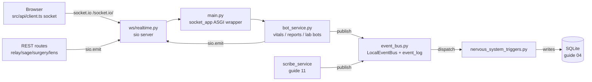
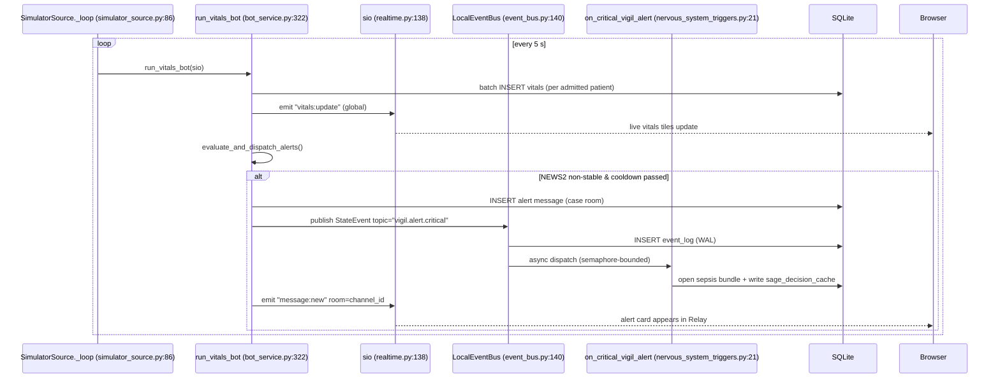

# Realtime: socket.io, rooms, the event bus, nervous-system triggers, and the bots

Orb's realtime subsystem is what makes the UI feel alive: vitals tick across the Patients board every five seconds, chat messages and AI alert cards appear in case rooms without a refresh, and a critical deterioration on one screen instantly pre-warms the AI assistant on another. It is built from four cooperating layers: (1) a **socket.io** server (`server/ws/realtime.py`) that authenticates browser connections with the same JWTs as the REST API and sorts clients into rooms; (2) an in-process **event bus** (`server/services/event_bus.py`) that lets backend services react to each other without importing each other; (3) **nervous-system triggers** (`server/services/nervous_system_triggers.py`), the subscribers that turn bus events into clinical side effects (RAG pre-loading, EHR extraction, model pre-warming); and (4) three **simulation bots** (`server/services/bot_service.py`) that generate demo vitals, imaging reports, and lab results, gated by `INGESTION_MODE`. Everything is wired together at startup by `server/main.py`, which also mounts every REST router and wraps the whole FastAPI app in a socket.io ASGI shell.

## Purpose and neighbors

**The problem.** A hospital dashboard that polls the server every few seconds is both laggy and wasteful, and a monolith where the vitals engine directly calls the AI assistant, the chat system, and the notes pipeline becomes untestable spaghetti. Orb solves the first problem with a persistent socket connection per browser (server pushes, client renders) and the second with a publish/subscribe bus (services *announce* what happened; other services *subscribe* to what they care about).

**Jargon, defined once:**

- **WebSocket**, a browser API and network protocol that upgrades a normal HTTP request into a persistent, two-way TCP connection, so the server can push data to the browser at any time without the browser asking.
- **socket.io**, a library layered *on top of* WebSocket (via its transport engine, engine.io). It adds three things raw WebSockets lack: **named events** (you emit `"vitals:update"` with a JSON payload instead of untyped frames), **automatic fallback** to HTTP long-polling when a proxy blocks WebSockets, and **automatic reconnection**. Client and server must both speak socket.io; a raw WebSocket client cannot connect. All traffic flows over the `/socket.io/` URL path (Vite proxies it to the backend with `ws: true`, `vite.config.ts:39-43`).
- **Socket room**, a server-side label attached to a connection. `sio.emit(event, data, room="X")` delivers only to connections that joined room `"X"`. Rooms are free to create and exist only in server memory. Orb uses three kinds: a **personal room** `user:<user_id>` (every connection joins its own at connect, `server/ws/realtime.py:199`), a **channel room** named by the Relay channel id, e.g. `CH-3F2A9B` (joined on demand, `server/ws/realtime.py:238`), and the implicit **per-connection room** (each socket id `sid` is its own room; `to=sid` targets one client).
- **ASGI** (Asynchronous Server Gateway Interface), the Python standard interface between an async web server (uvicorn) and an async web application (FastAPI, python-socketio). Because both FastAPI and `socketio.AsyncServer` are ASGI apps, one can wrap the other: `socketio.ASGIApp(sio, app)` routes `/socket.io/*` traffic to the socket server and everything else to FastAPI (`server/main.py:461`).
- **JWT** (JSON Web Token), a signed, self-describing credential string. Orb's login endpoint issues one; REST requests carry it in the `Authorization: Bearer` header, and the socket handshake carries it in the socket.io `auth` payload. See guide 03-auth-rbac.
- **RBAC** (role-based access control), permissions are attached to roles (`doctor`, `nurse`, …), not individuals; `has_permission(role, "relay.send")` (`server/permissions.py:145-147`) is the check. See guide 03-auth-rbac.
- **Event bus / pub-sub**, a broker where producers `publish(event)` to a named **topic** (e.g. `vigil.alert.critical`) and consumers `subscribe(topic, callback)`. Neither side knows the other exists.
- **WAL (write-ahead log)**, persisting a record of an event *before* acting on it, so there is a durable audit trail even if processing fails. Orb's `event_log` table plays this role (`server/database.py:605-614`), backed by a per-(event, subscriber) delivery ledger in `event_deliveries` (`server/database.py:625`) that turns the WAL into a real at-least-once guarantee.
- **RAG** (retrieval-augmented generation), feeding an LLM (large language model, a text-generating AI) retrieved documents (here: clinical guidelines) alongside the question, so answers cite real sources.
- **NEWS2**, the UK National Early Warning Score 2, a 0-20 points score computed from seven vital-sign parameters; bands are `stable` / `elevated` / `critical` in Orb (`server/services/vigil_service.py:236`).
- **PHI**, protected health information; anything identifying a patient's health data, which US HIPAA law regulates.
- **CORS** (cross-origin resource sharing), the browser mechanism by which a server declares which *other* web origins may call it.



Neighbors: guide 01 (app shell that renders the panels consuming these events), guide 02 (the API client module where the socket singleton actually lives), guide 03 (JWT + RBAC reused by the handshake), guide 04 (the tables written here), guide 11 (Scribe streaming transcription over this same socket), and the Relay/Sage/Vigil guides that emit into it from REST handlers.

## File map

| File | Lines (approx) | Role |
|---|---|---|
| `server/ws/realtime.py` | 478 | socket.io server: handshake cookie/JWT auth, permission-gated vitals rooms, chat events; imports the scribe stream handlers |
| `server/services/event_bus.py` | 510 | `LocalEventBus`: in-process pub-sub with SQLite `event_log` write-ahead persistence, per-subscriber delivery tracking, and bounded dispatch |
| `server/services/nervous_system_triggers.py` | 816 | The three bus subscribers: Sage RAG preloader, signed-note EHR extractor, voice-model pre-warmer |
| `server/services/bot_service.py` | 1,022 | Vitals bot, Vigil→Relay alert bridge, reports bot, lab bot |
| `server/main.py` | 1,264 | FastAPI app: lifespan/startup, background tasks, router mounting, CORS, PHI media route, socket_app wrapper |
| `src/pages/ClinicianShell.tsx` | 830 | Clinician workspace shell (guide 01). Contains **no** socket code, see Discrepancies |
| `src/api/client.ts` (lines 23-73) | ~50 relevant | The actual socket client singleton: create, authenticate, re-handshake, teardown |
| `server/tests/test_hospital_nervous_system.py` | 204 | Tests for bus pub/sub, WAL durability, and two of the three triggers |
| `server/ws/scribe_stream.py` | 238 | Streaming transcription events on the same `sio` instance, **owned by guide 11**; only its event names are cataloged here |

## How it works

### Flow 1: a browser gets live data (handshake → rooms → events)

1. On module load, `src/api/client.ts:42` creates one socket.io client for the whole app: `io(API_HOST, { autoConnect: false, withCredentials: true, auth: (cb) => cb({ token: getToken() }) })`. **`autoConnect` is `false`** (`src/api/client.ts:43`), the module then connects only when there is already either a persisted token or a session cookie (`src/api/client.ts:54`), so a visitor sitting on the login screen never holds an anonymous socket open. `withCredentials: true` (`:48`) sends the HttpOnly session cookie with the handshake; that cookie, not `auth.token`, is how an ordinary browser session authenticates. The `auth` callback (`:49`) is still evaluated at each (re)connect for machine/back-compat clients that hold a token.
2. The socket.io handshake arrives at `connect(sid, environ, auth)` on the server (`server/ws/realtime.py:391`, decorated `@sio.event` at `:259`). `_authenticate(auth, environ)` (`server/ws/realtime.py:163`) takes the token from the handshake `auth` payload *or* falls back to the session cookie on the handshake request (`_cookie_token`, `:143`), decodes it with the same `decode_token` the REST layer uses (`server/auth.py:372`), and re-reads the user row from the DB so identity/role come from the database, never from the client (docstring, `:72-74`). It is called through `run_db(...)` (`server/ws/realtime.py:401`) because it reads `users` on an encrypted DB and a reconnect storm, a ward wifi blip redialling every tablet at once, would otherwise serialise those reads through the event loop (comment at `:272-274`).
3. On failure, `connect` returns `False` (`server/ws/realtime.py:404`), socket.io refuses the connection and the client's reconnection logic will retry, until `authenticateSocket()` refreshes the handshake after login (`src/api/client.ts:57-64`).
4. On success, the user's `{user_id, name, role, department}` is saved in the per-connection session (`server/ws/realtime.py:510-518`) and the connection auto-joins its personal room `user:<id>` (`server/ws/realtime.py:521`) so surgical alerts can target a single person.
5. **Vitals rooms are gated on the permission, not on mere authentication** (`server/ws/realtime.py:522-534`). A `vitals.read` holder enters `dept:<their department>`, or `dept:__all__` when they have no department (`:448`); a `patient` role instead enters only `patient-self:<their patient id>` (`:544-549`). This matters because patient-portal and pharmacist logins are ordinary rows in the same `users` table and pass the handshake cleanly, authentication alone would hand them the live vitals feed the REST layer denies them. The department is derived by the shared `department_scope(user)` helper (`:532`), the same one `/api/vigil/patients` and the nurse shift board use; the comment at `:528-531` records that the nurse board's private copy of those two lines is exactly how a client-supplied `?all_departments=true` once widened a nurse's PHI reach.
6. When the user opens a Relay channel, `RelayPanel.tsx:79` emits `join_channel` with `{channel_id}`. The server re-checks authorization in `_user_can_access_channel` (`server/ws/realtime.py:730`) via `get_channels_for_user` (`server/services/relay_service.py:12`) before `enter_room` (`server/ws/realtime.py:754-768`), so socket-room visibility exactly matches REST visibility.
7. From then on, any server code that calls `sio.emit("message:new", msg, room=channel_id)` reaches that browser instantly. Vitals go out through `emit_patient_vitals` (`server/ws/realtime.py:594`), which routes to the patient's department room rather than broadcasting globally.
8. On logout, `deauthenticateSocket()` (`src/api/client.ts:68-73`) nulls the auth and disconnects, so the next user on the machine does not inherit a live authenticated socket.

### Flow 2: the nervous system (bot → bus → trigger), the main cross-layer flow



1. `lifespan` registers the deployment's vitals sources via `_configure_vitals_sources()` (`server/main.py:526`, function at `:184`) and starts them with `registry.start_all()` (`server/main.py:527`). There is no `vitals_simulator()` coroutine in `main.py` any more, the synthetic bot is now one `SimulatorSource` peer among several (see `_configure_vitals_sources` below). If `INGESTION_MODE` is `"ingestion"` (the shipped default, `server/config.py:348`) the simulator is simply never registered, and the log line "Simulation bots disabled" is emitted once (`server/main.py:198-199`), real HL7/JSON/CSV feeds via `/api/ingest/*` and the bedside-monitor source are then the only vitals producers. In `"simulation"` or `"hybrid"` mode, `SimulatorSource._loop` (`server/services/vitals_source/simulator_source.py:86`) calls `run_vitals_bot` every `VITALS_INTERVAL_SECONDS` (5 s, `server/config.py:342`), then the companion reports/lab bots on the same tick.
2. `run_vitals_bot` (`server/services/bot_service.py:391`) random-walks each admitted patient's vitals toward severity-appropriate targets, inserts them, computes NEWS2, and emits `vitals:update` per patient through `emit_patient_vitals` (`server/services/bot_service.py:431` → `server/ws/realtime.py:698`), which scopes the emit to that patient's department room.
3. `evaluate_and_dispatch_alerts` (`server/services/bot_service.py:442`) posts a formatted alert into the patient's Relay **case room** (a per-patient channel created at admission, `server/services/admission_service.py:251`) and publishes a `vigil.alert.critical` `StateEvent` to the bus (`server/services/bot_service.py:648-660`); the queued room emits go out at `:654`.
4. `LocalEventBus.publish` (`server/services/event_bus.py:205`) persists the event to `event_log`, records one pending delivery row per matched subscriber, then dispatches them as fire-and-forget tasks capped at 64 concurrent (`_MAX_CONCURRENT_DISPATCH`, `server/services/event_bus.py:72`; semaphore at `:151-154`). All three DB writes are handed to a thread via `_in_db_thread` rather than run inline, the comment at `:210-224` records the 2026-07-30 incident where doing them on the loop serialised the whole API behind the event bus and `/api/health` stopped answering for minutes.
5. `on_critical_vigil_alert` (`server/services/nervous_system_triggers.py:21`) opens a time-boxed sepsis/deterioration care bundle and pre-assembles patient facts + guideline RAG context into `sage_decision_cache`, so that when a clinician opens Sage seconds later, the context is already compiled.

### Flow 3: startup order (main.py lifespan)

`lifespan` is at `server/main.py:210`. Every long-lived loop it starts is collected into one
`lifespan_tasks` list (`server/main.py:217`) so shutdown can cancel them deterministically
instead of leaving them pending.

1. `init_db()` creates/migrates the schema (`server/main.py:213`; guide 04).
2. `register_triggers()` subscribes the nervous-system callbacks (`server/main.py:220-224`), then the ward narrator's idle loop is spawned (`:231`) and the event bus's replay poller is started (`:240`), the poller comes *after* subscriber registration so replay can find their callbacks (comment at `:235-237`).
3. Best-effort, non-fatal seeds: Helix DB (`:244-248`), the Sage formulary lexicon (`:256-261`), clinical terminology, LOINC/SNOMED/ICD-10 (`:263-268`), drug-interaction pairs (`:270-275`), and stale Scribe verification reconciliation (`:277`). Each is wrapped in its own `try/except` so a missing optional dependency cannot stop the server.
4. Fire-and-forget warmups, each spawned into `lifespan_tasks`: `warmup_models()` (`server/main.py:374`, spawned `:423`), `keep_warm_loop()` (`:424`), `warmup_torch_models()` (`:440`), and `warmup_voice_agent()` (`:443`, spawned `:454`) which pre-loads the MLX voice model if enabled.
5. Long-running sweeps are spawned: `proactive_sweep()` (Sage surveillance, `server/main.py:123`, spawned `:457`), `downtime_snapshot_sweep()` (hourly snapshots, daily FHIR export, `:140`, spawned `:458`), and the shadow-instrument negatives sweeper (`:470-476`). The comment at `:461-469` is worth reading: that sweep is the *only* producer of `alert.expired`, `action.abandoned` and `episode.closed`, so without it the scorecard silently scores the successes only.
6. Started last, deliberately: the event-loop starvation watchdog (`:486-492`), after all synchronous seeds, so a slow first boot is never mistaken for a stall, then the fresh-install access posture check (`:502-506`) on its own daemon thread. (The outbound heartbeat that also started here was removed on 4 October 2026: Orb is strictly offline.)
7. Vitals sources are configured and started (`server/main.py:526-527`). `start_all` never raises: a monitor whose VLAN is down must not stop Orb booting, because manual entry lives in the same process and is the ward's redundancy layer (comment at `:520-524`).
8. `yield` (`server/main.py:541`) hands control to the server. On shutdown the order is deliberate: disarm the watchdog first (`:546-550`), drain and reset the vitals sources (`:564-569`), a monitor feed holds a bound TCP port, and leaving it open across a reload is what turns "restart Orb" into "port already in use", then cancel and gather every task in `lifespan_tasks` (`:571-573`), and finally reap the knowledge worker child (`:576-580`) so no orphaned 2-4 GB model process holds memory.

## Function-by-function

### server/ws/realtime.py

### sio (AsyncServer instance): `server/ws/realtime.py:139`
**Signature:** `socketio.AsyncServer(async_mode="asgi", cors_allowed_origins=_origin_allowed, logger=False, engineio_logger=False)`
**Does:** Creates the single socket.io server object the entire backend shares.
**How it works:**
1. `async_mode="asgi"` makes it awaitable-native so it can be wrapped by `socketio.ASGIApp` in main.py.
2. `cors_allowed_origins` is the callable `_origin_allowed` (`server/ws/realtime.py:118`). engine.io calls it with the `Origin` header and the request environ on every polling request and on the WebSocket upgrade. It admits an origin listed in `ORB_CORS_ORIGINS` (`_configured_origins`, `server/ws/realtime.py:66`), or the page's own address (`_is_own_origin`, `server/ws/realtime.py:97`): host and port equal to the `Host` header's, and a scheme that is the request's own or https (a TLS proxy that sends no `X-Forwarded-Proto`), never an http page on a connection known to be https. `"*"` in the list still means any origin, as it always did. The comment above it (`server/ws/realtime.py:35-65`) carries the DNS-rebinding reasoning: a rebinding page passes the origin check but never gets the real host's session cookie, so `connect` refuses it.
3. Every other module (`bot_service`, `relay_routes`, `sage_ambient_service`, …) does `from ws.realtime import sio` to emit.
**Why it exists:** One process, one socket server; sharing the instance is how REST handlers and background tasks push to browsers.
**Data in/out:** n/a (infrastructure object).
**Talks to:** wrapped by `socketio.ASGIApp` (`server/main.py:1600`); imported by 10+ modules (see event reference below).
**Change guide:** To add a new allowed frontend origin, set `ORB_CORS_ORIGINS` (comma-separated, `server/config.py:69`); this feeds both the socket's list and (in prod) the REST CORS middleware. Dev REST CORS is permissive regardless (`server/main.py:919`), so a mismatch only bites the socket. A page the backend serves itself needs no entry. Do not swap the callable back for a list: a list without the appliance's own address is the 3 October 2026 hang (INSTALL_RUNBOOK F11), and `[]` tells engine.io to skip the origin check entirely, so an empty `ORB_CORS_ORIGINS` used to admit every origin. engine.io's built-in same-origin mode (`None`) is no substitute: its ASGI driver assumes http without `X-Forwarded-Proto`, so it refuses a page served over `ORB_TLS_CERT`. Watch out: Chrome sends no `Origin` on a same-origin GET, so the polling handshake GET passes even for a refused origin; the POSTs and the WebSocket upgrade are where a refusal shows. Tests: `server/tests/test_ws_origin.py`.
**Gotchas:** `DEPLOYMENT_PROFILE` is imported at `server/ws/realtime.py:25` but never used in this file, dead import.

### _authenticate: `server/ws/realtime.py:163`
**Signature:** `(auth: Any) → dict | None`
**Does:** Validates the JWT presented in the socket.io handshake and returns the authoritative user row, or `None` to reject.
**How it works:**
1. Requires `auth` to be a dict; reads `token`, `Authorization`, or `authorization` (`server/ws/realtime.py:139-143`).
2. Strips a `"Bearer "` prefix if present (line 43-44), so both raw tokens and header-style values work.
3. Calls `decode_token` (`server/auth.py:372`), which raises `HTTPException` on expiry/invalid signature; any exception here means reject (`server/ws/realtime.py:198-200`).
4. Rejects tokens whose `sub` is missing or equals `discharge_access`, those are patient-facing discharge-link grants that share the signing key but must never become a staff socket session (lines 50-56).
5. Fetches `SELECT * FROM users WHERE id = ?` and returns the row as a dict; DB failure or missing user → `None` (lines 57-65).
**Why it exists:** The realtime channel must be exactly as authenticated as REST. Re-reading the DB row (rather than trusting token claims for name/role) means a role change or user deletion takes effect on the next connect.
**Data in/out:** in: `{token: "eyJ..."} | {Authorization: "Bearer eyJ..."}`; out: full `users` row dict or `None`.
**Talks to:** `decode_token` (guide 03), `db_session` (guide 04). Called only by `connect`.
**Change guide:** To force sockets to drop when a token expires mid-session (currently they live until disconnect), you would need a periodic re-validation loop or per-event expiry check, today only the *handshake* is validated; every later event trusts the saved session. Watch out: `decode_token` raises FastAPI's `HTTPException`, which is caught generically here, do not "improve" it to let exceptions propagate, or a malformed token would crash the handshake handler instead of rejecting.
**Gotchas:** Token expiry is checked once, at connect. A connection made 1 minute before a 24-hour token expires stays authenticated for as long as it stays connected.

### connect: `server/ws/realtime.py:391`
**Signature:** `async (sid: str, environ: dict, auth: dict | None) → bool`
**Does:** The socket.io connection gate: authenticate, save the session, join the personal room.
**How it works:**
1. `_authenticate(auth)`; `None` → log and `return False`, which makes socket.io refuse the connection (client sees `connect_error`) (lines 76-79).
2. `sio.save_session(sid, {user_id, name, role})` stores identity server-side, keyed by the connection id, every later event handler reads this instead of trusting client fields (lines 80-84).
3. `sio.enter_room(sid, f"user:{user['id']}")`, the personal room used for targeted surgical alerts (line 87).
**Why it exists:** Without this gate, anyone who can reach the port receives every `vitals:update` and can join any channel room.
**Data in/out:** in: handshake `auth` dict; out: `True`/`False`.
**Talks to:** `_authenticate`, `sio.save_session`, `sio.enter_room`. Triggered by the client singleton in `src/api/client.ts:43`.
**Change guide:** Worked example, *make sockets role-aware for broadcasts*: add `await sio.enter_room(sid, f"role:{user['role']}")` after line 87, then emit e.g. `sio.emit("vitals:update", p, room="role:nurse")` in `bot_service.py:252`; knock-on: the frontend needs no change (rooms are invisible to clients), but every emit site that assumed global broadcast must pick a room; watch out for the pharmacist role, which has no vitals UI and would silently stop receiving nothing it used anyway.
**Gotchas:** Returning `False` yields a generic rejection with no reason string; the client cannot distinguish "expired token" from "server down", so `authenticateSocket()` after login is essential to break a bad-token retry loop.

### disconnect: `server/ws/realtime.py:718`
**Signature:** `async (sid) → None`
**Does:** Logs the disconnect.
**How it works:** Single `logger.info` line.
**Why it exists:** Operational visibility.
**Data in/out:** none.
**Talks to:** nothing.
**Change guide:** Put any per-connection cleanup here, but see Gotchas first.
**Gotchas:** **Likely dead code.** `server/ws/scribe_stream.py:233` registers a second `disconnect` handler on the same `sio` instance *after* this one (via the import at `server/ws/realtime.py:1033`). python-socketio (pinned `python-socketio==5.12.1`, `server/requirements.txt:4`) keeps exactly one handler per event name per namespace, so the later registration replaces this one and the "WS disconnected" log never fires. Recorded in Discrepancies.

### _user_can_access_channel: `server/ws/realtime.py:730`
**Signature:** `async (user_id: str, user_role: str, channel_id: str) → bool`
**Does:** Checks whether this user may see this Relay channel, by reusing the REST visibility function.
**How it works:**
1. Calls `get_channels_for_user(user_id, user_role)` (`server/services/relay_service.py:10`), the same department/role filter the REST channel list applies.
2. Returns `True` iff the channel id appears in that list; any exception → `False` (fail closed).
**Why it exists:** One source of truth for channel visibility. If WS had its own rule it would drift from REST and someone would join a room they cannot list.
**Data in/out:** in: ids/role strings; out: bool.
**Talks to:** `relay_service.get_channels_for_user` (guide for Relay). Called by `join_channel`, `typing`, `new_message`.
**Change guide:** To change who sees which channels, change `get_channels_for_user` only, both REST and WS follow. Watch out: this runs a multi-subquery SQL statement per check, and `typing` calls it on every emit, the client's 1.5-second throttle (`src/pages/panels/RelayPanel.tsx:263-270`) is what keeps that off the per-keystroke path.
**Gotchas:** It is O(all channels) per call, fine at demo scale, a hotspot at hospital scale.

### join_channel: `server/ws/realtime.py:754`
**Signature:** `async (sid, data: {channel_id}) → None` (client→server event `"join_channel"`)
**Does:** Puts an authorized connection into a channel room.
**How it works:**
1. Loads the saved session; silently returns if absent (unauthenticated race) (lines 114-116).
2. Extracts `channel_id`; missing → return.
3. Authorization check via `_user_can_access_channel`; on failure emits `error` `{error: "not authorized for channel"}` to that socket only (line 124).
4. `sio.enter_room(sid, channel_id)` (line 126).
**Why it exists:** Room membership is the delivery filter for all `message:new`/`message:update`/`sage:*` channel traffic.
**Data in/out:** in: `{channel_id: "CH-3F2A9B"}`; out: nothing or `error` event.
**Talks to:** called by `RelayPanel.tsx:79` when the user selects a channel. Counterpart: `leave_channel`.
**Change guide:** none beyond the visibility note above.
**Gotchas:** Channel rooms and channel ids share a namespace with the personal `user:` prefix deliberately avoiding collision; if you ever mint a channel id starting with `user:` you would cross-deliver.

### leave_channel: `server/ws/realtime.py:773`
**Signature:** `async (sid, data: {channel_id}) → None`
**Does:** Leaves a channel room. No auth check needed, leaving is always safe.
**How it works:** `sio.leave_room(sid, channel_id)` if the id is present.
**Why it exists:** RelayPanel emits it in the effect cleanup when the user switches channels (`RelayPanel.tsx:139`), so a client stops receiving rooms it no longer displays.
**Data in/out:** `{channel_id}` → nothing.
**Talks to:** `sio.leave_room`.
**Change guide:** n/a.
**Gotchas:** none noteworthy.

### typing: `server/ws/realtime.py:781`
**Signature:** `async (sid, data: {channel_id}) → None`; re-broadcasts server→client event `"typing"`.
**Does:** Relays a typing indicator to the rest of a channel room.
**How it works:**
1. Requires a session and an authorized channel (`server/ws/realtime.py:783-790`).
2. Rebuilds the payload from the session, `{channel_id, sender_id, sender_name}`, ignoring any client-supplied identity (`:957-962`).
3. Emits `typing` to the room with `skip_sid=sid` so the typist does not see their own indicator (`:526`).
**Why it exists:** Standard chat UX affordance.
**Data in/out:** in: `{channel_id}`; out: `{channel_id, sender_id, sender_name}` to the room.
**On screen:** the italic "… is typing…" line just above the Relay composer (`src/pages/panels/RelayPanel.tsx:712-715`), which names one peer or summarises two-plus.
**Chain:** `RelayPanel.tsx:270` emits `typing` (throttled) → `server/ws/realtime.py:781` → re-emit `:628` → `RelayPanel.tsx:181` subscribes → `typingUsers` state (`:47-48`) → the indicator at `:712-715`.
**Talks to:** `_user_can_access_channel` (`server/ws/realtime.py:730`); `RelayPanel` on both ends.
**Gotchas:** the client throttles its emit to at most once every 1.5 s (`src/pages/panels/RelayPanel.tsx:263-270`), and each received indicator self-expires after ~4 s via a per-sender timer (`:158-168`), there is no "stopped typing" event, so the timeout *is* the clear. The per-emit authorization check runs a multi-subquery SQL statement, so removing that throttle puts one such query on the server per keystroke per typist.

### new_message: `server/ws/realtime.py:801`
**Signature:** `async (sid, data: {channel_id, content, message_type?}) → None`
**Does:** WS-path message send: authenticate, RBAC-check, persist, broadcast.
**How it works:**
1. Session check → `error {error:"unauthenticated"}` to sender if absent (lines 166-169).
2. RBAC: `has_permission(session["role"], "relay.send")` (`server/permissions.py:173`) → `error {error:"insufficient permissions"}` if denied (`server/ws/realtime.py:818-820`).
3. Channel authorization via `_user_can_access_channel` → `error {error:"not authorized for channel"}` (lines 181-186).
4. Persists via `relay_service.send_message` with identity taken **from the session** (lines 189-198) and broadcasts the returned message dict as `message:new` to the channel room (line 200).
**Why it exists:** A lower-latency alternative to `POST /api/relay/channels/{id}/messages`; both paths enforce the same RBAC and produce the same broadcast. (The REST path additionally schedules Sage ambient analysis, `server/routes/relay_routes.py:225-227`, the WS path does not.)
**Data in/out:** in: `{channel_id, content, message_type="text"}`; out: the full message row (`{id, channel_id, sender_id, sender_name, sender_role, content, message_type, timestamp, is_bot, source}`, `server/services/relay_service.py:246-257`).
**Talks to:** `permissions.has_permission`, `relay_service.send_message`.
**Change guide:** To make WS messages also trigger Sage ambient observation (parity with REST), add `asyncio.create_task(sage_ambient_observe(channel_id, msg["id"]))` after line 200; knock-on: bot chatter would then also be analyzed if a bot ever used this path; footgun: `sage_ambient_observe` gates on sender, so import cost is the only real risk.
**Gotchas:** The current frontend sends messages via REST (`RelayPanel` calls the API client), so this WS handler is a parallel, currently-unused write path, keep its RBAC in lockstep with the REST route or it becomes a privilege bypass.

### import ws.scribe_stream: `server/ws/realtime.py:513`
**Does:** Side-effect import that registers the streaming transcription handlers (`scribe:start_session`, `scribe:audio_chunk`, `scribe:end_utterance`, `scribe:stop_session`, and its own `disconnect`) on this same `sio` instance. The pipeline itself (Whisper daemon, RxNorm correction) is **guide 11's** territory; realtime only hosts the transport. Note `scribe_stream._require_authenticated` (`server/ws/scribe_stream.py:34`) leans on the session saved by `connect` above, the handshake gate protects Scribe streams too.

---

### server/services/event_bus.py

### StateEvent: `server/services/event_bus.py:98`
**Signature:** `StateEvent(topic, source_node, event_type, patient_id, payload, correlation_id=None)`
**Does:** The bus's event envelope.
**How it works:** Constructor assigns a UUID `event_id`, a UTC ISO-8601 `timestamp`, and a `correlation_id` (auto-minted `corr-<12 hex>` if not supplied) so one clinical workflow can be traced across services (lines 26-33). `to_dict()` (line 35) serializes all fields.
**Why it exists:** A typed envelope beats loose dicts: every event is guaranteed to carry provenance (`source_node`), classification (`topic`, `event_type`), the affected patient, and tracing identity.
**Data in/out:** fields exactly as `to_dict()` returns: `{event_id, topic, source_node, event_type, patient_id, payload, timestamp, correlation_id}`.
**Talks to:** constructed by publishers (`server/services/bot_service.py:648`, `server/services/scribe_service.py:847`, `server/services/sage_ambient_service.py:1915`, `server/services/bridge_service.py:84`); consumed by subscribers in `server/services/nervous_system_triggers.py`.
**Change guide:** Adding a field means also adding a column to `event_log` (`server/database.py:605-614`) and to the INSERT in `_persist_event` (`server/services/event_bus.py:242-258`), or the WAL silently loses it.
**Gotchas:** `timestamp` is always UTC (`datetime.now(timezone.utc)`), good; keep any new time fields the same or cross-event ordering breaks.

### LocalEventBus.subscribe: `server/services/event_bus.py:157`
**Signature:** `(topic: str, callback: async (StateEvent) → None) → None`
**Does:** Registers an async callback for a topic or pattern.
**How it works:** Appends to `self._subscribers[topic]`, deduplicating by identity so repeated `register_triggers()` calls (tests do this per-test) do not double-fire (`server/services/event_bus.py:159-166`).
**Why it exists:** Decoupling: `bot_service` never imports `sage_service`; it publishes, and whoever cares subscribes.
**Data in/out:** topic patterns: exact (`"vigil.alert.critical"`), prefix wildcard (`"vigil.alert.*"`), or global (`"*"`).
**Talks to:** called by `register_triggers` (`server/services/nervous_system_triggers.py:1015`) and tests.
**Change guide:** n/a.
**Gotchas:** Registration is synchronous and not lock-protected (unlike dispatch); fine because all registration happens at startup on one thread. Subscribers are keyed by a **stable** id, `module.qualname`, computed by `subscriber_id` (`server/services/event_bus.py:91-95`), so a replay after restart can find the same callback. Renaming or moving a subscriber function orphans its pending delivery rows.

### LocalEventBus.publish: `server/services/event_bus.py:205`
**Signature:** `async (event: StateEvent) → None`
**Does:** Persists the event to `event_log`, records one `pending` row per matched subscriber in `event_deliveries`, then dispatches, so a crash or a subscriber exception is recoverable rather than a silent loss.
**How it works:**
1. `await _in_db_thread(self._persist_event, event)`, the WAL insert (`server/services/event_bus.py:226`, implementation at `:242-258`).
2. Under `self._lock`, collects callbacks whose registered pattern matches `event.topic` (`:229-230`).
3. `await _in_db_thread(self._record_delivery_intents, ...)` writes one `pending` delivery row per matched subscriber (`:233-236`, implementation at `:259-271`).
4. `self._spawn_dispatch(cb, event, sid)` per callback (`:239-240`), non-blocking for the publisher, and skipped if that `(event_id, subscriber)` pair is already in flight (`:190-203`).
**Why every DB write here runs off the loop:** the comment at `:210-225` is a post-mortem, not a style note. All three writes used to run inline on the event loop, each blocking on SQLite's single writer lock that the vitals simulator and the audit hash-chain also compete for. Under real load that serialised the entire API behind the event bus, `/api/health` stopped answering for **minutes**, and a blocked loop cannot run signal handlers, so the worker ignored SIGTERM too. Captured live on 2026-07-30 with `kill -USR1 <worker>`: the main thread sat in `db_session.__exit__` under `event_bus._mark_delivered`. Handing the writes to a thread works because `sqlite3` releases the GIL around execute/commit, so a thread parked on the writer lock costs the loop nothing while the ordering guarantees are unchanged.
**Why a private single-worker executor:** `_DB_EXECUTOR` is a one-thread pool, deliberately (`:50-61`). SQLite allows exactly one writer, so fanning these writes across threads would just park N threads on the same lock; and `asyncio.to_thread`'s default executor is shared process-wide, so an alert burst could occupy every slot and stall unrelated work.
**Data in/out:** in: `StateEvent`; side effects: one `event_log` row, N `event_deliveries` rows, N dispatch tasks.
**Talks to:** `_in_db_thread`, `_matched_callbacks`, `_spawn_dispatch`, `_safe_dispatch`.
**Change guide:** Worked example, *add a new nervous-system reaction*: (1) write `async def on_my_event(event: StateEvent)` in `nervous_system_triggers.py`, doing blocking DB work off the loop; (2) add `event_bus.subscribe("my.topic", on_my_event)` in `register_triggers` (`server/services/nervous_system_triggers.py:1015`); (3) publish from the producing service with `asyncio.create_task(event_bus.publish(StateEvent(topic="my.topic", ...)))`. Knock-on: nothing else changes, that is the point of the bus. **Make your subscriber idempotent**: redelivery is at-least-once and replay will re-run it (`:33-36`).
**Gotchas:** delivery is at-least-once, not exactly-once, and the durability story is now real, see the replay section below. The remaining caveat is scope: this is a *single-process* bus. `_IN_FLIGHT` is a plain in-memory set (`:77-84`), and the comment is explicit that a persisted `in_flight` status plus a lease would be required for cross-process replay.

### LocalEventBus.replay_undelivered / start_replay_poller: `server/services/event_bus.py:436` / `:486`

> **New in this edition.** Earlier editions stated that the bus had "no ack/replay" and that the
> `event_log` row was "an audit trail, not a delivery guarantee". Both claims are now false. The
> module's own title line reads "Local Event Bus (at-least-once delivery)" (`:1`), and
> `event_deliveries` is the ledger that makes it true.

**Does:** re-dispatches every delivery row still marked `pending`, called once at startup (catching work dropped by a crash) and then on a periodic poller (catching subscriber exceptions and transient failures).
**How it works:** on success a delivery flips to `delivered` (`_mark_delivered`, `:272-281`); on failure it stays `pending` with `attempts++` and `last_error` recorded (`_mark_failed`, `:335-365`); after `MAX_ATTEMPTS = 8` (`:75`) it is parked as `dead` so a poison event cannot loop forever. `start_replay_poller` defaults to a 45-second interval (`:486`).
**The three guards on replay, and why each exists (`:21-31`):** a delivery row stays `pending` for the whole time its callback runs, and heavy subscribers, RAG retrieval, the single-slot LLM queue, routinely outlive the poll interval. So: (1) the in-memory `_IN_FLIGHT` set stops a tick re-dispatching a delivery whose earlier dispatch is still queued or running, which would otherwise multiply the same work every tick; (2) a replay re-dispatch counts as an attempt, so a delivery that never acks, hung, not raising, eventually parks as `dead` instead of retrying forever; (3) rows whose subscriber is not registered in *this* process are excluded from the query (`_query_replayable`, `:403-435`), so they cannot occupy the `ORDER BY created_at LIMIT` window and starve newer, replayable deliveries.
**Gotchas:** guard (3) means a build that drops a subscriber leaves its pending rows permanently unreplayable. `_orphans_logged` (`:148`) exists so the bus warns about them exactly once instead of silently.

### LocalEventBus._match_topic: `server/services/event_bus.py:366`
**Signature:** `(pattern: str, topic: str) → bool`
**Does:** Pattern matching: `"*"` matches everything; exact match; `"prefix.*"` matches `topic.startswith("prefix")`.
**Gotchas:** `"vigil.alert.*"` strips only the two characters `.*`, leaving prefix `"vigil.alert"`, so it also matches the topic `"vigil.alert"` itself and `"vigil.alerts.other"` (any topic *starting with* the prefix, not just dot-separated children). Harmless with current topic names; a trap if you add `vigil.alerting.x`.
**Signature/Data/Talks to/Why/Change:** trivial; used only by `publish`.

### LocalEventBus._safe_dispatch: `server/services/event_bus.py:374`
**Signature:** `async (callback, event) → None`
**Does:** Runs one subscriber under the concurrency semaphore, acks its delivery row on success, and on failure logs at ERROR (with `correlation_id`) and marks the delivery for replay instead of crashing.
**How it works:** `async with self.dispatch_sem` (lazily created `asyncio.Semaphore(_MAX_CONCURRENT_DISPATCH)` in the owning loop, `server/services/event_bus.py:150-155`) → `await callback(event)` → `_mark_delivered` off the loop (`:379-384`). On exception: log with `exc_info`, then `_mark_failed` so the row stays `pending` for `replay_undelivered()`, bounded by `MAX_ATTEMPTS` (`:385-396`).
**Why it exists:** **Backpressure** (limiting how much work may be in flight so a burst cannot exhaust resources): an alert storm otherwise spawns one unbounded `create_task` per (event × subscriber), piling thousands of coroutines into the single-slot LLM queue and starving interactive Sage (comment at `:68-72`).
**Talks to:** every subscriber.
**Change guide:** Raise `_MAX_CONCURRENT_DISPATCH` (`server/services/event_bus.py:72`) only alongside capacity work in `llm_queue_service`; the two are sized together.
**Gotchas:** the `finally` block releases the `_IN_FLIGHT` key only once the callback has *fully settled*, and holding it across the semaphore wait is the point, queued duplicates are what multiplied the work (`:397-401`). Lazy semaphore init exists because creating an `asyncio.Semaphore` at import time can bind it to the wrong event loop under pytest/uvicorn-reload.

### event_bus (singleton): `server/services/event_bus.py:510`
**Does:** The module-level `LocalEventBus()` all code shares. Process-local: with multiple uvicorn workers each worker has its own bus and subscribers, a documented single-process design (the same constraint `_IN_FLIGHT` records at `server/services/event_bus.py:77-84`).

---

### server/services/nervous_system_triggers.py

### on_critical_vigil_alert: `server/services/nervous_system_triggers.py:21`
**Signature:** `async (event: StateEvent) → None`; subscribed to `vigil.alert.critical`.
**Does:** On a critical Vigil alert, opens a care bundle and pre-compiles Sage's RAG context into `sage_decision_cache`.
**How it works:**
1. Reads `risk_score` (falling back to `score`) and `drivers` from the payload (lines 20-21).
2. **Care bundle** (best-effort, lines 30-41): if the payload carries `raw_news2`, calls `sepsis_bundle_service.maybe_autostart`; otherwise calls `start_bundle(triggered_by="vigil_auto", ...)` directly, on the reasoning that this event *only* fires for critical alerts. Runs in `asyncio.to_thread` because it is blocking SQLite work; failures only warn.
3. **RAG preload** (lines 43-71): inside `to_thread`, assembles patient facts via `sage_service._assemble_patient_context` and guideline text via `_get_guideline_context(query)` where the query is the joined driver strings (default `"sepsis protocol hemodynamic instability"`); writes the compiled JSON into `sage_decision_cache` via `INSERT OR REPLACE`, keyed by patient, with a 10-minute `expires_at`.
**Why it exists:** Sage answering "what should I do for this crashing patient?" needs seconds of retrieval + context assembly; doing it *at alert time* makes the eventual Sage query feel instant.
**Data in/out:** in: `StateEvent(payload={score, level, drivers, message_id})`; out: one `sage_decision_cache` row: `{patient_id, mews_score, compiled_context: {channel_a_facts, channel_b_c_guidelines, sources, confidence, preloaded_at}, preloaded_at, expires_at}`.
**Talks to:** `sepsis_bundle_service` (bundles guide), `sage_service` internals (Sage guide), `db_session`. Published to by `server/services/bot_service.py:648-662` and (per test) any manual publisher.
**Change guide:** To lengthen the cache TTL, change the `timedelta(minutes=10)` at line 63; knock-on: Sage's cache-read path decides staleness from `expires_at`, so no other change needed; footgun: the cache is one row per patient (PK), so rapid re-alerts overwrite, intended.
**Gotchas:** (a) The bot publisher never includes `raw_news2`, so the `maybe_autostart` branch is dead from that producer, `start_bundle` always runs (see Discrepancies). (b) The column is named `mews_score` (an older scoring system, MEWS) but stores the NEWS2-derived score, naming fossil, also visible in `database.py:583`.

### on_scribe_note_signed: `server/services/nervous_system_triggers.py:707`
**Signature:** `async (event: StateEvent) → None`; subscribed to `scribe.note.signed`.
**Does:** When a clinician signs a SOAP note, asks the local LLM to extract structured vitals/medications/problems and writes them into the EHR tables, failing closed on any extraction error.
**How it works:**
1. Loads `structured_note` and `author_id` from `scribe_notes` by the payload's `note_id`; empty note → warn and return (lines 83-93).
2. Builds a strict "output ONLY valid JSON" extraction prompt (SOAP = Subjective/Objective/Assessment/Plan, the standard clinical note format) (lines 96-106).
3. Acquires the shared LLM queue at priority 3, POSTs to Ollama `/api/chat` at temperature 0, strips ``` fences, parses JSON (lines 111-129).
4. **Fail-closed**: any exception sets `updates = {}` and aborts, the long comment (lines 131-141) records that a previous version *fabricated* a hardcoded Metoprolol order on the error path, a critical software-as-a-medical-device failure mode that was removed. The regression test at `server/tests/test_hospital_nervous_system.py:186-195` guards this.
5. On success: medications with `action == "stop"` are discontinued, `"start"` inserted as active prescribed-by-the-note-author (malformed entries skipped with a warning, lines 164-185); vitals inserted with `source='llm_extracted'` so the simulator's prune never deletes them (lines 187-197); a summary row goes into `clinical_documents` (lines 199-204).
6. Emits `patient:timeline_updated` to `room=patient_id` (line 208), a room no client joins; see Discrepancies.
**Why it exists:** The signed note is the legal record; auto-extraction keeps the structured EHR (med list, vitals trend) synchronized with it without double data entry.
**Data in/out:** in: `payload={note_id, signer_id}`; out: rows in `medications`, `vitals`, `clinical_documents`.
**Talks to:** `llm_queue_service.llm_queue` (LLM guide), Ollama HTTP, `db_session`, `ws.realtime.sio`. Published to by `server/services/scribe_service.py:847-860` on note signing (guide 11).
**Change guide:** Worked example, *stage extractions for human confirmation instead of auto-committing*: per the in-code deferred note (lines 153-161), add a `provenance`/`status` column to `medications`/`vitals` (guide 04), write rows as `status='proposed'` here, and add a confirm endpoint; knock-on: Vigil's NEWS2 path must then exclude proposed vitals; footgun: the existing `source='llm_extracted'` vitals tag (line 195) exists precisely so the prune in `bot_service.py:232-240` skips them, keep any new writes off `source='simulated'`.
**Gotchas:** The medication "stop" uses `LOWER(drug_name) = ?` with `drug.lower()`, exact-match after lowering, so "Metoprolol tartrate" will not discontinue "Metoprolol". Vitals are only written if HR, SBP, or SpO2 is present (line 189), temperature-only extractions are dropped.

### on_relay_voice_prewarm: `server/services/nervous_system_triggers.py:798`
**Signature:** `async (event: StateEvent) → None`; subscribed to `relay.intent.voice_prewarm`.
**Does:** Schedules loading of the MLX voice model when chat text suggests someone is about to talk to Sage by voice.
**How it works:** `get_voice_agent()` then `asyncio.create_task(asyncio.to_thread(agent.load))`, loading happens off-loop; errors only log (lines 219-224).
**Why it exists:** Model load takes seconds; detecting "hey sage"/"ask sage" markers in Relay chat (`sage_ambient_service.py:680-690`) and pre-warming hides that latency.
**Data in/out:** in: `payload={content}`; out: side-effect model load.
**Talks to:** `voice_agent_service` (voice guide). Published to by `server/services/sage_ambient_service.py:1915-1925`.
**Change guide:** Marker phrases live in `sage_ambient_service.py:680`, not here.
**Gotchas:** none noteworthy.

### register_triggers: `server/services/nervous_system_triggers.py:1015`
**Signature:** `() → None`
**Does:** Subscribes the three callbacks above to their topics: `vigil.alert.critical`, `scribe.note.signed`, `relay.intent.voice_prewarm` (lines 228-230).
**Why it exists:** Single startup entry point; called from `lifespan` (`server/main.py:220-224`) and re-called per test (idempotent thanks to `subscribe`'s dedup).
**Talks to:** `event_bus.subscribe`.
**Change guide / Gotchas:** Note there is **no** subscriber for `bridge.emergency.flag`, which `server/services/bridge_service.py:84` publishes, see Discrepancies.

---

### server/services/bot_service.py

### Module constants: profiles, spikes, cooldowns: `server/services/bot_service.py:15-65`
**Does:** Tunables for the simulator. `MAX_VITALS_PER_PATIENT = 2000` and `PRUNE_EVERY_N_CYCLES = 60` control pruning (lines 15-16); `_alert_cooldowns` maps patient → `(last_alert_ts, last_level)` with `ALERT_COOLDOWN_SECONDS = 120` and `_LEVEL_RANK` ordering `stable < elevated < critical` (lines 23-26); `_severity_cache` memoizes patient severity (line 29). `SEVERITY_PROFILES` (line 34) defines, per band, target vitals, mean-reversion strength (how strongly values are pulled back toward the target each tick), Gaussian noise amplitudes, clamp ranges, and a per-cycle `spike_chance`. `CRISIS_SPIKES` (line 59) are five named deterioration patterns (acute decompensation, respiratory distress, septic shock, hypertensive crisis, bradycardic event) applied as one-tick deltas.
**Gotchas:** All of this is **process-local state**; multiple workers would each keep their own cooldowns and double-alert (flagged in the comment at lines 21-22). `_severity_cache` never invalidates, a patient upgraded to ICU mid-session keeps their old profile until restart.

### _get_patient_severity: `server/services/bot_service.py:101`
**Signature:** `(db, pid: str) → "critical" | "elevated" | "stable"`
**Does:** Derives (and caches) a patient's simulation profile from ward + latest risk score.
**How it works:** ICU ward or latest `risk_scores.level == 'critical'` → critical; level elevated → elevated; else stable (lines 74-93).
**Talks to:** `patients`, `risk_scores`. Called by `run_vitals_bot` and `run_lab_bot`.
**Why it exists:** Makes the demo clinically plausible: ICU patients stay sick, ward patients stay boring.
**Data in/out:** string band.
**Change guide:** Clear `_severity_cache` in an admission/transfer hook if you want live re-profiling.
**Gotchas:** The `LEFT JOIN ... ORDER BY rs.timestamp DESC LIMIT 1` picks one row; with no risk score, ward alone decides.

### run_vitals_bot: `server/services/bot_service.py:322`
**Signature:** `async (sio) → None`; called every 5 s by `SimulatorSource._loop` (`server/services/vitals_source/simulator_source.py:86`, via `_default_tick` at `:58`).
**Does:** Generates one new vitals row per admitted patient, emits live updates, and hands the batch to the alert dispatcher.

> **Split since earlier editions.** The generation work is no longer inline in this coroutine.
> `run_vitals_bot` is now a thin loop-side wrapper; everything that touches SQLite lives in the
> module-level `_generate_vitals(now_ts, cycle_counter)` (`server/services/bot_service.py:227`)
> and its per-patient helper `_next_reading` (`:132`), both run on a worker thread via `run_db`.
> The comment at `:222-226` records why `_generate_vitals` is module level rather than a closure:
> nested inside the coroutine it was one edit away from silently capturing a loop-side local and
> reading it from another thread.

**How it works:**
1. Increments the module cycle counter (`server/services/bot_service.py:328-329`); every 120 cycles (~10 min) refreshes LSTM forecasts via `forecast_service.refresh_all_predictions` (`:327-332`). That call is handed to `run_db` too, the comment at `:320-326` notes it is the heaviest thing in the tick (a query plus an LSTM forward pass and a cache write *per* admitted patient) and that running it inline froze the whole API on every 120th tick.
2. Snapshots the cycle number on the loop and passes it in as an argument (`:339`), rather than letting the worker read the global, otherwise the prune schedule would sample whatever the counter happened to be when the thread got scheduled (comment at `:335-338`).
3. Inside `_generate_vitals`, one DB session for everything: fetches all admitted patients (`:229-231`), then the latest vitals for *all* of them in a single self-join query (`:238-245`).
4. Per patient, `_next_reading` (`:132`) pulls the severity profile and computes each vital's shift as `gauss(0, noise) + reversion * (target - current)`, a **mean-reverting random walk** (drifts randomly but is pulled toward the profile target) (`:157-162`); with probability `spike_chance` adds a crisis spike (`:165-172`); a `hash(pid) % 3` trajectory modifier lets only *stable* patients slowly improve (`:175-179`); clamps everything to profile ranges (`:185-190`). Every channel is resolved through `_coalesce_vital` (`:80`) to a float *before* any arithmetic, because partial vitals rows are normal (`:147-154`).
5. Carries forward `consciousness` (ACVPU, Alert/Confusion/Voice/Pain/Unresponsive, the NEWS2 consciousness scale) and `on_oxygen` from the previous row so the full 7-parameter NEWS2 is scored, not a 5-parameter subset (`:192-198`), then computes NEWS2 (`compute_news2`, `server/services/vigil_service.py:236`) and returns an `(insert_tuple, emit_dict)` pair (`:203-219`).
6. Each patient's call sits in its own `try/except` (`:258-269`). This is the real lesson of the NULL-BP crash: the *bug* was one patient's missing diastolic, but the *damage* was that the exception escaped the loop, so every other patient on the ward silently lost their reading too, every 5 seconds, for a week, with nothing on any board moving.
7. Batch-INSERTs all rows via `executemany` (`:355-361`). Every `PRUNE_EVERY_N_CYCLES` it prunes `source='simulated'` vitals beyond the newest `MAX_VITALS_PER_PATIENT` per patient and risk scores beyond 100 (`:371-387`), the comment at `:364-370` stresses that real ingested vitals are append-only and must never be capped.
8. **Outside** the DB session, back on the loop, emits `vitals:update` per patient through `emit_patient_vitals` (`:345-347`), then `await evaluate_and_dispatch_alerts(sio, emit_queue)` (`:351`).

**Why it exists:** Demo realism without hardware: severity-aware synthetic telemetry that actually drives the Vigil scoring path end-to-end.
**Data in/out:** emits `vitals:update` = `{patient_id, timestamp, heart_rate, systolic_bp, diastolic_bp, spo2, temperature, respiratory_rate, consciousness, on_oxygen, risk: {score, level, drivers, raw_news2,...}}` (`server/services/bot_service.py:206-218`).
**Talks to:** `vigil_service.compute_news2`, `forecast_service`, `db_session`, `emit_patient_vitals`. Called only by `SimulatorSource` (`server/services/vitals_source/simulator_source.py:62-63`).
**Change guide:** Worked example, *slow the simulation to 15 s*: change `VITALS_INTERVAL_SECONDS` (`server/config.py:342`); knock-on: the prune cadence and the forecast refresh (~10 min) both stretch proportionally, since both are cycle-counted, not clock-timed; footgun: the frontend has no interval assumption, so nothing else breaks.
**Gotchas:** The prune SQL interpolates `MAX_VITALS_PER_PATIENT` with an f-string (`:372-379`), safe because it is a module constant, but it is the one non-parameterized SQL in this file; keep it constant. New patients with no vitals row are skipped entirely (`:332-334`), seeding must insert an initial vitals row or the bot never picks the patient up. Emits happen after the session closes deliberately, so slow sockets never hold the SQLite write lock.

### evaluate_and_dispatch_alerts: `server/services/bot_service.py:442`
**Signature:** `async (sio, emit_queue: list) → None`
**Does:** The Vigil→Relay bridge: turns non-stable NEWS2 results into alert messages in case rooms and publishes the bus event that wakes the nervous system.
**How it works:**
1. For each payload: skip `stable` (line 277-278). Cooldown check with **escalation override**: a level escalation always re-alerts, and `critical` patients are exempt from the cooldown entirely (lines 285-291).
2. Builds the reason line with `news2_reason_line` (shared by all three alert lanes since 2026-10-02): the NEWS2 parameters that scored, worst first, three named plus "(+N more)". It is wording only and must never gate dispatch (a prior bug silently swallowed NEWS2-elevated patients whose trigger was e.g. altered consciousness); if the helper raises, the alert goes out with the band alone.
3. Formats one of three alert templates with a `NEWS2 <raw> (<band>)` line, deliberately not a fabricated percentage (comment lines 347-353).
4. For `critical` only, appends a one-sentence MedGemma recommendation via `generate_ai_recommendation` (`server/services/vigil_service.py:656`), an awaited LLM call inside the loop (lines 364-366).
5. Records the cooldown (line 373). Then, in a second loop over `alerts_to_send`: ensures the `bot_vigil` user exists (`INSERT OR IGNORE`, line 379-382), finds the patient's case-room channel, inserts an `alert`-type message with `sender_role='intelligence'`, `is_bot=1`, `source='bot'` (lines 385-398).
6. Publishes `StateEvent(topic="vigil.alert.critical", ...)` to the bus as a fire-and-forget task (lines 400-417) and emits `message:new` to the channel room (lines 419-432).
**Why it exists:** Single source of truth for alert dispatch, the docstring notes both the bot loop and a deterministic demo trigger route through here (though only `run_vitals_bot` calls it today; grep finds no second caller).
**Data in/out:** in: the `emit_queue` payloads from `run_vitals_bot`; out: `messages` rows, `event_log` rows, `message:new` emits.
**Talks to:** `vigil_service.generate_ai_recommendation`, `event_bus.publish`, `sio`.
**Change guide:** Worked example, *change the alert cooldown to 5 minutes*: edit `ALERT_COOLDOWN_SECONDS` (`bot_service.py:24`); knock-on: none elsewhere (ingestion alerts have no cooldown at all, `_check_ingested_alert`, `server/services/ingestion_service.py:987`, alerts on every non-stable ingest); footgun: critical patients ignore the cooldown by design (line 287-291), so this only throttles `elevated`.
**Gotchas:** **Two real bugs here** (details in Discrepancies): (1) the `StateEvent` payload at lines 408-413 uses the loop variables `risk_score`/`risk_level`/`drivers` left over from the *last* patient of the first loop, when several patients alert in one cycle, every event carries the final patient's numbers; (2) the topic is always `"vigil.alert.critical"` even when `alert["risk_level"] == "elevated"`, so elevated alerts also fire the critical-only preloader and auto-open care bundles.

### get_dynamic_finding: `server/services/bot_service.py:675`
**Signature:** `(db, pid, scan_type) → (analysis_text: str, urgency: "info" | "alert")`
**Does:** Picks a randomized canned radiology/ECG interpretation, personalized with the patient's latest heart rate.
**How it works:** Reads latest HR (default 75), then `random.choice` from per-modality template lists (ECG/XRAY/MRI/CT), one entry per list flagged `alert` (lines 446-485).
**Why it exists:** Demo texture for the reports bot.
**Talks to:** called by `run_reports_bot`.
**Data/Change/Gotchas:** Pure demo strings; unknown scan types fall back to "No abnormal findings detected." (line 484). none noteworthy otherwise.

### run_reports_bot: `server/services/bot_service.py:762`
**Signature:** `async () → None`; called every 5 s tick.
**Does:** Rarely (0.2% per tick ≈ once per ~40 min) files a mock imaging study for a random admitted patient and announces it in their case room.
**How it works:**
1. Requires the mock scan PNGs to exist under `UPLOAD_DIR` (lines 499-504); rolls the 0.002 dice (lines 507-509).
2. Picks a random patient + available scan, generates a finding, ensures the `bot_lens` user, inserts a `lens_analyses` row pointing at `/uploads/<mock file>` (lines 511-538).
3. If a case room exists, posts a "Diagnostic Update" via `relay_service.send_message` (`message_type` = the urgency if `alert`/`system`, else `text`; `is_bot=True, source="bot"`) and emits `message:new` to the room (lines 542-555).
**Why it exists:** Keeps the Lens/timeline surfaces populated during demos.
**Data in/out:** `lens_analyses` row + `message:new` payload (full message dict from `send_message`).
**Talks to:** `relay_service.send_message`, `sio`, `db_session`.
**Change guide:** To make reports more frequent for a demo, raise the `0.002` at line 508, expected period ≈ `5s / p`.
**Gotchas:** The final `logger.info` (line 557) references `scan`/`pid`, which are defined only after the patient check, safe because earlier `return`s bail first, but fragile to reordering. The `sender_name` is "Orb Lens AI" while the user row says "Orb AI Lens" (lines 521-523 vs 548), cosmetic mismatch.

### LAB_PANELS + run_lab_bot: `server/services/bot_service.py:816` and `:989`
**Signature:** `async () → None`; called every 5 s tick.
**Does:** Rarely (same 0.2% gate, line 644) delivers a synthetic lab panel to one admitted patient, weighted toward the sick.
**How it works:**
1. Selects among patients whose 3-minute per-patient lab cooldown (`_lab_cooldown`, `LAB_COOLDOWN_SECONDS = 180`, lines 561-562) has passed, with weights 3/2/1 for critical/elevated/stable (lines 662-672).
2. Prefers diagnosis-specific panels from `seed_labs.DIAGNOSIS_LAB_SCHEDULE` (keyword match on the diagnosis string); falls back to severity-banded `LAB_PANELS`, dict of panel generators producing `{analyte: (value, unit, flag, ref_range)}`, with critical panels salting in `⚠️ CRITICAL` flags (K⁺, lactate) (lines 564-636, 679-697).
3. Formats a monospace-ish text block, appends a "CRITICAL VALUES" banner when any flag contains `CRITICAL` (lines 700-713).
4. Writes it twice: `clinical_documents` (doc_type `lab_result`) and `lens_analyses` (image_type `lab`, empty image path) so the patient timeline picks it up (lines 716-732).
5. Posts to the case room via `send_message` (`message_type` `alert` if critical else `system`) and emits `message:new` (lines 741-754).
**Why it exists:** Labs are the third data stream clinicians expect; critical potassium/lactate values also exercise the alert-styling UI.
**Data in/out:** rows in `clinical_documents` + `lens_analyses`; `message:new` to the case room.
**Talks to:** `seed_labs`, `_get_patient_severity`, `relay_service.send_message`, `sio`.
**Change guide:** Add a panel by appending to `LAB_PANELS[<band>]`, each entry needs `panel` (title) and `generate` (zero-arg lambda returning the results dict).
**Gotchas:** `_lab_cooldown[pid] = now` (line 739) executes after the DB block but before the emit; the `channel` row is read inside the session and used outside, fine for a `sqlite3.Row`, but do not move the emit inside the session. Lab bot severity uses both the raw `risk_scores` join (line 651-655) *and* `_get_patient_severity` (line 675), two slightly different definitions in one function.

---

### server/main.py

### proactive_sweep: `server/main.py:123`
**Signature:** `async () → None` (infinite loop)
**Does:** Every 15 s, runs Sage's proactive surveillance over all admitted patients and, if new insights were created, notifies every client.
**How it works:** 8 s startup grace, then loop: `await asyncio.to_thread(evaluate_all_admitted)` (blocking analysis off-loop) → if any ids returned, `sio.emit("sage:insight", {"event":"new","count":n})` globally → sleep 15 (lines 67-75). All exceptions logged, never raised, the loop is immortal.
**Why it exists:** "Always-on" clinical insight generation regardless of whether anyone clicked anything; the socket ping is just a cache-invalidation hint (clients re-fetch `/api/sage/insights`).
**Data in/out:** emits `{event:"new", count}` only.
**Talks to:** `sage_proactive_service.evaluate_all_admitted` (Sage guide); mirrored by the manual REST trigger `POST /api/sage/insights/evaluate` (`server/routes/sage_proactive_routes.py:75-87`).
**Change guide:** Cadence is the literal `15` at line 75.
**Gotchas:** The event is global, every role's client hears it, including pharmacists with no insights UI. Payload carries a count, not the insights; there is no room scoping.

### downtime_snapshot_sweep: `server/main.py:140`
**Signature:** `async () → None` (infinite loop)
**Does:** Hourly, captures a durable LLM-free snapshot of every admitted patient; every 24th tick also writes a FHIR `$everything` self-export to disk.
**How it works:** 30 s grace; loop: `to_thread(capture_all_admitted, "auto")`, log count; if `hours % 24 == 0`, `to_thread(run_nightly_fhir_self_export, "auto")`; `hours += 1`; sleep 3600 (lines 84-103).
**Why it exists:** EHR-downtime resilience: when the network/LLM/EHR dies, the ward still has a recent read-only picture (see downtime guide).
**Talks to:** `downtime_service` (downtime guide).
**Gotchas:** `hours % 24 == 0` is true on the *first* pass, so a FHIR export runs ~30 s after every boot, restart-heavy dev churns export directories. Ticks are "hourly since boot", not wall-clock aligned.

### _configure_vitals_sources (+ _demo_companion_bots): `server/main.py:184` / `:172`

> **Replaced.** Earlier editions documented a `vitals_simulator()` coroutine in `main.py`. There
> is no such function any more. The simulator was refactored into one of several peer *vitals
> sources*, registered here and started later by `lifespan`.

**Signature:** `_configure_vitals_sources() → sources`; `_demo_companion_bots() → None` (async)
**Does:** registers this deployment's vitals sources, the synthetic simulator, the bedside-monitor feed, and manual entry, as peers rather than one hardcoded loop.
**How it works:** `bots_enabled = INGESTION_MODE in ("simulation", "hybrid")`; if false it logs "Simulation bots disabled" once (`server/main.py:197-199`). It then hands everything to `vitals_source.configure_from_env(...)` with `sio`, the enabled flag, `VITALS_INTERVAL_SECONDS`, and `_demo_companion_bots` as the per-tick companion callback (`:201-206`).
**Mode semantics (docstring, `:187-193`):** `simulation` = synthetic bots run; `ingestion` = bots disabled, real feeds only (the safe **default**); `hybrid` = both. Crucially, **`INGESTION_MODE` gates only the simulator.** The monitor feed carries real patient data and is gated solely on `ORB_MONITOR_ENABLED`; manual entry is *always* registered, because it is the redundancy layer a ward falls back to when every automated source is down.
**Why `_demo_companion_bots` exists:** `run_reports_bot()` and `run_lab_bot()` are not vitals, but they had always shared the vitals tick, same 5-second loop, after the vitals bot, in the same `try/except`. Passing them as a companion tick preserves their ordering *and their failure coupling* exactly as they were before the refactor, rather than quietly changing behaviour during a structural change (comment at `:173-178`).
**Data in/out:** none directly; returns the configured source set for `lifespan` to start.
**Talks to:** `services/vitals_source`, the reports and lab bots.
**Change guide:** Worked example, *run a live demo with real ingestion in parallel*: start with `ORB_INGESTION_MODE=hybrid`. Knock-on: both the bot and the ingestion path emit `vitals:update`, distinguishable client-side only by the `source` field the ingestion payload adds. Footgun: simulated rows default to `source='simulated'` and are pruned, ingested rows are not, never write real data without a real source label.
**Gotchas:** the companion bots still share one `try/except` with the vitals tick, so an exception in the vitals bot still skips reports and lab for that tick. That is preserved on purpose, not overlooked.

### lifespan: `server/main.py:210`
**Signature:** `@asynccontextmanager async (app: FastAPI)`, FastAPI's startup/shutdown hook (code before `yield` runs at startup, after it at shutdown).
**Does:** Boots the whole backend in dependency order; see "Flow 3" above for the numbered walkthrough.
**Why it exists:** FastAPI deprecated `@app.on_event("startup")`; the lifespan context is the modern equivalent and guarantees pairing of startup/shutdown.
**Data in/out:** none.
**Talks to:** `init_db` (guide 04), `register_triggers` (this guide), `helix_db`/`terminology_service`/`interaction_db` (Helix/orders guides), `scribe_routes.reconcile_stale_pending_verifications` (guide 11), `clinical_knowledge` (Sage guide), `llm_queue_service` (LLM guide), the three background tasks above.
**Change guide:** New startup work should follow the established pattern: its own `try/except` with a "(non-fatal)" warning, so one broken optional subsystem cannot kill boot.
**Gotchas:** `server/main.py:212` logs `DEPLOYMENT_PROFILE`, a name imported only later at module level (`server/main.py:630`). It works because lifespan *executes* after the module is fully imported, but it is an import-order landmine (see Discrepancies). Background tasks are no longer orphaned: `_spawn` (`server/main.py:114-119`) holds a strong reference in `_BG_TASKS` so a running task cannot be garbage-collected, and every task is appended to `lifespan_tasks` for shutdown.

### warmup_models: `server/main.py:383` (nested in lifespan)

> **Renamed and plural.** Earlier editions documented a singular `warmup_model` at `main.py:178`.
> The function is `warmup_models`, it iterates over *both* configured models, and it is spawned
> at `server/main.py:423`.

**Signature:** `async () → None`
**Does:** Sends a tiny warm-up prompt to Ollama at the lowest queue priority (5) for each distinct configured model, so the LLM is resident before the first real query.
**How it works:** acquire `llm_queue` at priority 5 → iterate `dict.fromkeys([LLM_MODEL, AMBIENT_LLM_MODEL])`, which de-duplicates when both point at the same model (`server/main.py:376-380`) → on a non-200 response, log a loud actionable ERROR explaining the model is probably not pulled in Ollama (`server/main.py:360-372`) → release the queue in a `finally` (`:418-419`).
**Why it exists:** First-token latency on a cold 27B model is tens of seconds; a silent model-name 404 previously made Sage/Lens return empty responses with no visible cause.
**Talks to:** `llm_queue_service`, Ollama. A companion `keep_warm_loop()` is spawned alongside it (`server/main.py:424`), and a third warmup, `warmup_torch_models` (`:430`, spawned `:440`), pre-loads the CfC risk checkpoints and the forecast LSTM, their lazy first load was measured at ~12 s by the soak harness, paid by whichever clinician opened the first patient chart after boot (comment at `:426-429`).
**Gotchas:** Priority 5 means it defers to everything, under load the warmup may effectively never run, which is fine.

### warmup_voice_agent: `server/main.py:452` (nested in lifespan)
**Signature:** `async () → None`
**Does:** If `VOICE['conversational']['enabled']`, pre-loads the MedGemma-4B MLX voice model into Apple Silicon unified memory in an executor thread (`server/main.py:444-452`); spawned at `:454`.
**Talks to:** `voice_agent_service`, same loader the `relay.intent.voice_prewarm` trigger calls.
**Gotchas:** Uses `run_in_executor(None, agent.load)` (`server/main.py:449`) versus the trigger's `asyncio.to_thread`, equivalent behavior, two idioms. Failure is a `warning`, explicitly non-fatal (`:451-452`).

### app + JSON-decode exception handler + body-size limit: `server/main.py:594`, `:601`, `:614`
**Does:** Creates the FastAPI app (title "Orb Hospital OS", version 0.1.0, `lifespan=lifespan`), registers a global handler converting `json.JSONDecodeError` into a clean `400 {"detail": "Malformed JSON in request body"}`, several routes call `await request.json()` raw and would otherwise 500 (`server/main.py:600-612`), and adds a `_limit_body_size` HTTP middleware (`:614-628`).
**Gotchas:** none noteworthy.

### CORS middleware: `server/main.py:646-664`
**Does:** Profile-split CORS: **prod** allows only `CORS_ORIGINS` with credentials; **dev** allows `"*"` with `allow_credentials=False` (the two are mutually exclusive per the fetch spec, a wildcard origin cannot be combined with credentialed requests).
**Why it exists:** Dev must work across localhost/LAN/ngrok; prod must not.
**Change guide:** Prod origins come from `ORB_CORS_ORIGINS` (imported at `server/main.py:630`, applied at `:648-649`); remember the socket server has its **own** origin gate (`_origin_allowed`) fed from the same config, change the env var, not either list. The socket gate also admits the page's own address unlisted; the REST middleware does not need to, because a same-origin fetch never asks CORS.
**Gotchas:** the session now lives in an HttpOnly `orb_session` cookie and the client sends `credentials: 'include'` on every request, so `allow_credentials` matters more than earlier editions of this chapter claimed. The dev branch's `"*"` + `allow_credentials=False` pairing means a dev frontend served from a *different* origin than the API will not carry the session cookie at all.

### audit middleware: `server/main.py:673-679`
**Does:** Registers `audit_mutations` (guide 05-audit-chain) as an HTTP middleware: every state-changing request gets a generic audit row as a HIPAA safety net beneath the richer route-level events.

### Router mounting: `server/main.py:681-724`
**Does:** `app.include_router(...)` for all **42** route modules, each of which carries its own prefix (e.g. `sage_proactive_routes` declares `prefix="/api/sage"`); `main.py` adds **no** prefixes of its own. The first is `auth_router` (`server/main.py:681`).
**Why it exists:** One place to see the whole API surface; individual routes belong to their own guides.
**Gotchas:** Order only matters for path collisions; there are none today because prefixes are disjoint.

### _resolve_media_patient: `server/main.py:758`
**Signature:** `(filename: str) → (patient_id | None, "lens" | "scribe" | None)`
**Does:** Maps an uploads filename back to its owning patient by finding the `lens_analyses.image_path` or `scribe_notes.audio_path` row that references it.
**How it works:** `LIKE '%<basename>'` lookups against `lens_analyses.image_path` then `scribe_notes.audio_path` (`server/main.py:754-767`).
**Why it exists:** Enables the registered-media allowlist + per-patient audit in `serve_upload`, a random file dropped into `uploads/` is not servable.
**Gotchas:** `basename` is interpolated into a LIKE pattern; a filename containing `%`/`_` would over-match. Filenames are server-generated, so practical risk is low.

### serve_upload: `server/main.py:780` (route `GET /uploads/{filename:path}`)
**Signature:** `async (filename, user=Depends(get_current_user)) → Response`
**Does:** Authenticated, patient-resolved, audited, decrypted delivery of PHI media (Lens images, Scribe audio).
**How it works:**
1. Role gate: only `doctor`/`nurse`/`admin` (`server/main.py:796-797`).
2. Path-traversal guard: resolve and require the target inside `UPLOAD_DIR` (`:799-805`).
3. Registered-media allowlist via `_resolve_media_patient`; unknown file → 404 (`:807-810`).
4. **Fail-closed audit**: logs a `phi_access` audit event; if the audit write fails (`AuditWriteError`), the media is *not* served, 503 (`:812-832`; guide 05).
5. Decrypts via `crypto_service.read_decrypted` (passes plaintext legacy files through) and returns it as `application/octet-stream` with a `Content-Disposition: attachment` header to blunt stored-XSS via served HTML/SVG (`:834-851`).
**Why it is `def`, not `async def` (docstring `:781-794`):** every statement blocks, two encrypted-SQLite lookups, a fail-closed audit write, and a whole-file AES decrypt that can run to many MB. It awaits nothing, so FastAPI runs a `def` endpoint in the anyio worker threadpool for free and the loop never sees it. Rewriting it with `run_db` hops would insert an `await` between the fail-closed audit write and the read that write authorises, a suspension point in the middle of a safety control, and would push a multi-MB radiology decrypt through a four-worker pool sized for short statements, convoying every interactive query behind one image download.
**Why it exists:** Replaces a previous public `StaticFiles` mount that served the entire uploads directory unauthenticated (comment `server/main.py:726-737`).
**Data in/out:** raw bytes out.
**Talks to:** `get_current_user` (guide 03), `audit_service` (guide 05), `crypto_service`.
**Change guide:** The in-code TODO (`server/main.py:732-737`) explains the next hardening step: per-patient authorization plus frontend fetch+blob (browsers do not attach `Authorization` headers to plain `` loads).
**Gotchas:** Because of the header requirement, any UI that points an `` straight at `/uploads/...` gets a 401/403 today unless it uses fetch+blob.

### get_me: `server/main.py:863` (route `GET /api/auth/me`)
**Signature:** `async (user=Depends(get_current_user)) → UserOut`
**Does:** Returns the authenticated user's `{id, name, role, department, registration_number}`, the frontend's session-restore probe.
**Gotchas:** Lives in `main.py` rather than `auth_routes`, it is the one auth endpoint not on the `/api/auth` router, so an audit of `auth_routes.py` misses it. Guide 03 covers it in full.

### health: `server/main.py:874` (route `GET /api/health`)
**Does:** Unauthenticated `{"status":"ok","service":"orb-hospital-os","version":"0.1.0"}` for load balancers and smoke tests.

### socket_app: `server/main.py:1183`
**Signature:** `socketio.ASGIApp(sio, app)`
**Does:** The composition trick that makes one port serve both worlds: the ASGI wrapper intercepts requests whose path starts with the engine.io default `/socket.io/` and hands everything else to FastAPI. Uvicorn is pointed at `"main:socket_app"`, **not** `main:app`, running `main:app` silently kills all realtime. That mistake is now guarded twice: `_assert_correct_asgi_entrypoint` (`server/main.py:1184`) fails loudly at startup, and a catch-all route at `server/main.py:1092-1097` answers `/socket.io/*` with an explicit wrong-entrypoint error instead of a bare 404.
**Talks to:** uvicorn; the Vite dev proxy forwards `/socket.io` with `ws: true` (`vite.config.ts:39-43`).
**Change guide:** To move the socket path, pass `socketio_path=` here *and* `path:` in the client `io(...)` options, they must match.

### `__main__` block: `server/main.py:1238-1283`
**Does:** Direct-run entry: optional TLS via `ORB_TLS_CERT`/`ORB_TLS_KEY` (with a loud prod warning when absent, PHI and session cookies must not cross a network in cleartext, `server/main.py:1253`), and auto-reload enabled only when `DEPLOYMENT_PROFILE != "prod"` (`:1261`).
**Gotchas:** Uvicorn's reload mode re-imports the module in a child process, another reason all startup work lives in `lifespan`, which runs exactly once per serving process.

---

### src/api/client.ts (socket client lifecycle: the code the shell was expected to hold)

### socket (singleton): `src/api/client.ts:42`
**Signature:** `io(API_HOST, { autoConnect: true, auth: (cb) => cb({ token: getToken() }) })`
**Does:** The one socket.io client for the entire SPA, created at module load.
**How it works:**
1. `API_HOST = window.location.origin` (`src/api/client.ts:9`), same-origin, so the Vite proxy (dev) or reverse proxy (prod) carries `/socket.io` to the backend.
2. The `auth` **function** form is evaluated on every (re)connect attempt, reading the JWT freshly from `localStorage` (`getToken`, `src/api/client.ts:24-26`), a static object would freeze a stale token.
3. `autoConnect: true` means the socket dials immediately, even pre-login; the server rejects it until a token exists, and socket.io's built-in retry keeps knocking.
**Why it exists:** One connection, many consumers: panels attach/detach listeners on this shared object (`socket.on(...)`/`socket.off(...)` in `useEffect` with cleanup, e.g. `src/pages/panels/VigilPanel.tsx:50-51`, `RelayPanel.tsx:79-139`, `SurgicalSuitePanel.tsx:168-177`, `src/components/sage/SageInsightsFeed.tsx:40-43`, `src/components/relay/SageAmbientSidebar.tsx:51-56`, `src/hooks/useStreamingTranscription.ts:101-108`). The long comment at lines 28-42 documents the auth contract with `server/ws/realtime.py`.
**Data in/out:** handshake out: `{token}`; events per the reference table below.
**Talks to:** everything in `src/` that imports `socket`; the server `connect` handler.
**Change guide:** Panels must always pair `socket.on` with `socket.off` using the **same function reference** in the effect cleanup, or handlers stack up across remounts and events fire N times, the existing panels model this correctly.
**Gotchas:** Storing the JWT in `localStorage` is a documented, deferred XSS-exfiltration risk (lines 14-23; guide 02).

### authenticateSocket: `src/api/client.ts:57`
**Signature:** `() → void`
**Does:** Re-handshakes the socket after login so the new token is presented.
**How it works:** Overwrites `socket.auth` with a fresh `{token}` object, disconnects if connected, reconnects (`src/api/client.ts:59-63`). Called from `login()` right after `setUser` (`src/api/client.ts:590-592`), note `login()` no longer stores a token, so on a browser session the re-handshake authenticates from the HttpOnly cookie.
**Why it exists:** A socket that connected pre-login (and was refused) or under a previous user must renegotiate; socket.io does not re-read auth on a live connection.
**Gotchas:** It replaces the auth *function* installed at line 45 with a static object, correct for this login, but a token refreshed later (there is no refresh flow today) would not be picked up on auto-reconnect until the next `authenticateSocket()` call.

### deauthenticateSocket: `src/api/client.ts:68`
**Signature:** `() → void`
**Does:** Logout teardown: nulls `socket.auth` and disconnects, so the previous user's authenticated realtime session is not silently kept open. Called from `App` `logout` (`src/AppRoot.tsx:110`).
**Gotchas:** With auth set to `{token: null}` the disconnected socket will not successfully reconnect until the next login calls `authenticateSocket()`, intended.

### ClinicianShell.tsx: socket lifecycle: none: `src/pages/ClinicianShell.tsx:498`
**Does:** Contrary to this guide's expected scope, the clinician shell contains **no socket code whatsoever**: its imports (`src/pages/ClinicianShell.tsx:1-56`) include neither `socket.io-client` nor the `socket` singleton, and no `socket.on`/`socket.emit` appears anywhere in the file. The shell (`:471`) is pure layout/navigation/theme/offline-badge logic (guide 01-app-shell). The socket lifecycle lives in `src/api/client.ts` (documented above), and event consumption is distributed into the lazy-loaded panels the shell mounts, which are kept alive in hidden `display:none` tabpanels (`:715-800`), which is *why* a background panel's socket listeners keep receiving events while another tab is active. Note the one nuance that changed: a panel is only mounted after its tab has been *visited* (`shouldRenderPanel`, `:325`), so an unopened panel's listeners are not registered at all. Recorded in Discrepancies so the corpus's scope map can be corrected.

---

### server/tests/test_hospital_nervous_system.py

### setup_hns_test_data (fixture): `server/tests/test_hospital_nervous_system.py:29`
**Does:** Autouse fixture (`server/tests/test_hospital_nervous_system.py:28-29`): re-registers triggers (idempotent), truncates the patient-scoped tables with foreign keys off, seeds one doctor (`D-HNS-DOC`) and one admitted patient (`PAT-HNS-1`), and cleans again on teardown. The module header patches `INGESTION_MODE` to `"hybrid"` in `config`, `routes.ingestion_routes`, and `main` before importing the bus, so import-time mode checks see hybrid.
**Gotchas:** the table-delete loop swallows per-table exceptions, so schema drift silently narrows the cleanup.

### test_event_bus_pub_sub_wildcard: `server/tests/test_hospital_nervous_system.py:78`
**Does:** Proves exact-topic and `vigil.alert.*` wildcard subscribers both receive a published event (after a task-settle sleep), and that the `event_log` WAL row exists with matching topic/source/correlation_id.

### test_trigger_vigil_alert_preloads_sage_cache: `server/tests/test_hospital_nervous_system.py:120`
**Does:** Publishes a critical Vigil `StateEvent` with `score=0.85` and drivers, sleeps 0.3 s for the threaded compile, then asserts a `sage_decision_cache` row exists with `mews_score == 0.85` and a `compiled_context` containing `channel_a_facts` and `channel_b_c_guidelines`.

### test_trigger_scribe_note_signed_syncs_ehr: `server/tests/test_hospital_nervous_system.py:157`
**Does:** The **fail-closed regression guard**: with the LLM queue mocked to no-ops and `httpx.AsyncClient.post` forced to raise, signing a note whose PLAN says "Start Metoprolol 2.5mg IV" must produce **no** medication and **no** vitals rows, asserting the removed fabrication path (see `on_scribe_note_signed`) stays removed.
**Gotchas:** the file docstring promises a test for "Reactive Trigger 3" (voice prewarm); no such test exists, see Discrepancies.

---

## Complete server-emitted socket event reference

Compiled from a full grep of `sio.emit` across `server/` (every hit read in context). "global" = no room argument = every connected authenticated client.

> **Rebuilt.** The largest change since earlier editions: `vitals:update` and
> `patient_status_update` are **no longer global**. Both now go through
> `emit_patient_vitals` (`server/ws/realtime.py:594-601`), which resolves the patient's
> department and emits to `dept:__all__` plus `dept:<department>`. Nothing emits those two events
> directly any more. A presence subsystem (`presence:update`) and two Relay room-fit events were
> also added, and the whole table's line numbers have moved.

| Event | Payload shape | Room / target | Emitting file:line |
|---|---|---|---|
| `vitals:update` | `{patient_id, timestamp, heart_rate, systolic_bp, diastolic_bp, spo2, temperature, respiratory_rate, consciousness, on_oxygen, risk}` (+ `source` from ingestion only), plus `patient_name`, added by `emit_patient_vitals` (`server/ws/realtime.py:705-708`) for every lane from a 60 s cache so the deterioration notification can name the patient; absent when the patient is unknown | `dept:__all__` **and** `dept:<department>` | via `emit_patient_vitals` (`server/ws/realtime.py:698`) from `server/services/bot_service.py:431`; `server/services/ingestion_service.py:1226` |
| `patient_status_update` | `{patient_id, name, status: "critical_alert", timestamp}` | `dept:__all__` **and** `dept:<department>` | via `emit_patient_vitals` from `server/services/ingestion_service.py:1356` |
| `message:new` | full message row: `{id, channel_id, sender_id, sender_name, sender_role, content, message_type, timestamp[, is_bot, source]}` | `room=<channel_id>`; surgical/handoff alerts additionally `room=user:<target_user_id>` | `server/ws/realtime.py:955`; `server/services/bot_service.py:1085,1245,1480`; `server/routes/relay_routes.py:570,916`; `server/routes/lens_routes.py:385`; `server/routes/surgery_routes.py:649,651`; `server/services/sage_handoff_service.py:771,737`; `server/services/nervous_system_triggers.py:930`; `server/services/ingestion_service.py:1516` |
| `message:update` | same message-row shape, updated `content` (alert resolved) | `room=<channel_id>` | `server/routes/relay_routes.py:1065` |
| `typing` | `{channel_id, sender_id, sender_name}` | `room=<channel_id>`, `skip_sid=sender` | `server/ws/realtime.py:797` |
| `error` | `{error: string}` | `to=sid` (sender only) | `server/ws/realtime.py:766,758,768,776` |
| `presence:update` | `{patient_id, viewers: [{user_id, name, role}]}` | `room=patient-presence:<patient_id>` | `server/ws/realtime.py:625` |
| `sage:insight` | `{event: "new"\|"transition"\|"acted", count?, id?}` | global | `server/main.py:133`; `server/routes/sage_proactive_routes.py:54,135,155` |
| `sage:action_update` | `{channel_id}` (fetch hint) | `room=<channel_id>` | `server/routes/relay_routes.py:428,1619`; `server/routes/sage_proactive_routes.py:142`; `server/services/sage_ambient_service.py:1978` |
| `sage:memory_update` | `{room_id, updated_at}` | `room=<channel_id>` | `server/services/sage_ambient_service.py:1983` |
| `sage:ward_brief` | `{updated_at}` | global | `server/services/sage_narrator_service.py:391` |
| `relay:room_fit` | room-fit flag payload | `room=<channel_id>` | `server/routes/relay_routes.py:715` |
| `relay:room_fit_resolved` | resolved flag payload | `room=<channel_id>` | `server/routes/relay_routes.py:778,945` |
| `patient:timeline_updated` | `{patient_id, source}` | `dept:__all__` **and** `dept:<department>` (Scribe extraction, via `emit_patient_vitals`) / `room=<channel_id>` (agentic confirm) | `server/services/nervous_system_triggers.py:935`; `server/routes/relay_routes.py:1620` |
| `surgery:emergency_intake` | `{surgery_id}` | global | `server/services/sage_handoff_service.py:837,830` |
| `scribe:status` | `{status: "processing"\|"ready"}` | `to=sid` | `server/ws/scribe_stream.py:95,150,155,192` (guide 11) |
| `scribe:transcript` | `{text, duration_ms, is_final, utterance_index}` | `to=sid` | `server/ws/scribe_stream.py:142` (guide 11) |
| `scribe:error` | `{error}` | `to=sid` | `server/ws/scribe_stream.py:154,172` (guide 11) |

**Why the vitals fan-out changed.** A global emit sent every bed's observations to every connected client, including clinicians in unrelated departments, a needless PHI spray and the hottest event in the appliance. `_department_for_emit` (`server/ws/realtime.py:579-591`) resolves the department behind a TTL cache precisely because a blanket `run_db` hop would add a thread round-trip to *every* vitals tick; only a genuine miss (an admission or a transfer) pays the encrypted `admissions` read, and that read happens off the loop. `dept:__all__` still receives everything, because a no-department clinician on a whole-census board must not go blind.

**Client → server events** (for completeness): `join_channel`, `leave_channel`, `typing`, `new_message` (`server/ws/realtime.py:920,939,947,967`), plus `enter_patient` / `leave_patient` (`:841,872`); `scribe:start_session`, `scribe:audio_chunk` (binary PCM16), `scribe:end_utterance`, `scribe:stop_session` (`server/ws/scribe_stream.py:168,195,209,220`; guide 11).

**Event-bus topics** (in-process, not socket events): `vigil.alert.critical` (pub `server/services/bot_service.py:648`), `scribe.note.signed` (pub `server/services/scribe_service.py:847`), `relay.intent.voice_prewarm` (pub `server/services/sage_ambient_service.py:1915`), `bridge.emergency.flag` (pub `server/services/bridge_service.py:84`; **no subscriber**). All subscriptions are registered in one place, `register_triggers` (`server/services/nervous_system_triggers.py:1015`).

## Cross-subsystem contracts

**REST endpoints owned by this guide** (defined directly in `server/main.py`; no router prefix applies):

| Method | Path | Auth | Purpose |
|---|---|---|---|
| GET | `/uploads/{filename}` | session + role in doctor/nurse/admin; fail-closed `phi_access` audit | Serve registered, decrypted PHI media (`server/main.py:771`) |
| GET | `/api/auth/me` | session | Current-user echo for session restore (`server/main.py:854`) |
| GET | `/api/health` | none | Liveness probe (`server/main.py:865`) |
| GET | `/api/health/loop` | none | Event-loop responsiveness probe (`server/main.py:870`) |
| GET | `/api/health/access` | `admin.overview` | Access/permission self-check (`server/main.py:892`) |
| GET | `/api/health/models` | session | Which LLM/torch models are loaded (`server/main.py:912`) |
| POST | `/api/health/models/load` | `admin.overview` | Load a configured model (`server/main.py:1004`) |
| POST | `/api/health/models/unload` | `admin.overview` | Unload a model (`server/main.py:1036`) |

**Exported symbols others rely on:** `ws.realtime.sio` (imported by 10+ modules to emit, the whole table above), `services.event_bus.event_bus` + `StateEvent` (publishers: bot, scribe, sage-ambient, bridge), `services.bot_service.run_vitals_bot/run_reports_bot/run_lab_bot` (only `main.py`), `services.nervous_system_triggers.register_triggers` (only `main.py`), and on the frontend `socket`, `authenticateSocket`, `deauthenticateSocket` from `src/api/client.ts` (guide 02 owns the rest of that module).

**Contracts this subsystem consumes:** `auth.decode_token` (`server/auth.py:67`) and `permissions.has_permission` (`server/permissions.py:145`), guide 03; `relay_service.get_channels_for_user`/`send_message` (`server/services/relay_service.py:10,225`), Relay guide; `vigil_service.compute_news2/generate_ai_recommendation` (`server/services/vigil_service.py:227,654`), Vigil guide; `sage_service._assemble_patient_context/_get_guideline_context`, `sepsis_bundle_service`, `voice_agent_service`, `llm_queue_service`, `forecast_service.refresh_all_predictions`, `downtime_service`, `sage_proactive_service`, their respective guides.

**DB tables touched:** `event_log`, `event_deliveries`, `sage_decision_cache` (owned here; `server/database.py:605,621,688`); read/write into `users`, `patients`, `vitals`, `risk_scores`, `channels`, `messages`, `medications`, `clinical_documents`, `scribe_notes`, `lens_analyses` (guide 04 owns the schema).

## Rebuild notes

**Prerequisites:** guide 04 (SQLite schema incl. `event_log`, `sage_decision_cache`, `vitals.source`, `channels`, `messages`), guide 03 (JWT issue/verify + `ROLE_PERMISSIONS`), the Relay service functions (`get_channels_for_user`, `send_message`), Vigil's `compute_news2`, and a config module exposing `CORS_ORIGINS`, `INGESTION_MODE`, `VITALS_INTERVAL_SECONDS`, `DEPLOYMENT_PROFILE`.

**Build order:**
1. `event_bus.py`, pure Python + one table; test with `test_event_bus_pub_sub_wildcard`.
2. `ws/realtime.py`, `AsyncServer`, `_authenticate`, `connect` with personal-room join, then channel join/leave/message handlers reusing REST auth functions.
3. `main.py` skeleton, FastAPI app, CORS split, router mounting, `socketio.ASGIApp(sio, app)`, uvicorn pointed at `main:socket_app`.
4. Frontend singleton in `src/api/client.ts`, `io(origin, {auth: cb})`, `authenticateSocket`/`deauthenticateSocket` wired into login/logout; Vite `/socket.io` proxy with `ws: true`.
5. `bot_service.py`, profiles, `run_vitals_bot`, then `evaluate_and_dispatch_alerts` with the bus publish.
6. `nervous_system_triggers.py` + `register_triggers()` in lifespan; the vitals-source registry (`_configure_vitals_sources` with the `INGESTION_MODE` gate on the simulator only) plus the background sweeps (`proactive_sweep`, `downtime_snapshot_sweep`, the shadow negatives sweeper).

**Acceptance check:** start the server with `ORB_INGESTION_MODE=simulation`, log in as a doctor in the browser, and verify: (a) vitals tiles update roughly every 5 s without refresh; (b) within a few minutes a critical patient's case room shows a "VIGIL ALERT" card live; (c) `SELECT topic FROM event_log ORDER BY timestamp DESC LIMIT 5` shows `vigil.alert.critical` rows; (d) `sage_decision_cache` contains a fresh row for the alerted patient; (e) an unauthenticated socket (`io("http://host:8000")` with no token) receives `connect_error` and no events; (f) `pytest server/tests/test_hospital_nervous_system.py` passes.

## Discrepancies and open questions

1. **ClinicianShell.tsx contains no socket code.** This guide's scope expected the shell to own the socket client lifecycle; in reality the singleton, auth re-handshake, and teardown live in `src/api/client.ts:43-65` and `src/AppRoot.tsx:101-129`, and event listeners live in the individual panels/hooks. The shell (`src/pages/ClinicianShell.tsx:1-56`) never imports the socket. Documented here from the real files; the corpus scope map should be corrected.
2. **Cross-patient data leak in the bus event payload.** In `evaluate_and_dispatch_alerts`, the `StateEvent` built at `server/services/bot_service.py:414-425` reads `risk_score`, `risk_level`, and `drivers`, loop variables from the *first* loop (lines 268-273) that retain the **last processed patient's** values (including from `stable` patients, which set the variables before `continue` at line 278). When two or more alerts dispatch in one cycle, every published event carries the final patient's score/level/drivers while `patient_id` points at a different patient. The per-alert level is stored correctly in `alert["risk_level"]` (line 371) but not used in the event.
3. **Elevated alerts fire the "critical" topic.** The topic at `server/services/bot_service.py:416` is hardcoded `"vigil.alert.critical"` even when the alert's level is `elevated`, so elevated patients also trigger `on_critical_vigil_alert`, auto-opening care bundles and preloading Sage cache designed for critical alerts only (`server/services/nervous_system_triggers.py:27-38` explicitly assumes "This event only fires on a critical Vigil alert").
4. **`patient:timeline_updated` reaches its listener from one lane only.** The Unified Patient Story listens for it and reloads when the `patient_id` matches (`src/components/vigil/PatientStory.tsx:111-112`). The Scribe extraction lane emits it department-scoped through `emit_patient_vitals` (`server/services/nervous_system_triggers.py:935`), to rooms every clinician socket joins (its department room or `dept:__all__`, `server/ws/realtime.py:499`); it used to go to `room=<patient_id>`, which no socket joins (fixed 2026-10-03). The agentic-confirm lane still emits it to the case-room channel only (`server/routes/relay_routes.py:1620`), so a Patient Story open by someone who has not joined that channel room does not hear it.
5. **`patient_status_update` has no listener.** Emitted globally at `server/services/ingestion_service.py:1105`; nothing in `src/` subscribes.
6. **RelayPanel listens for four `ambient:*` events that nothing emits.** `src/pages/panels/RelayPanel.tsx:125-128` registers handlers for `ambient:executed`, `ambient:cancelled`, `ambient:processing`, `ambient:done`; a grep of `server/` finds no emitter for any `ambient:` event, dead listeners (likely removed server feature).
7. *(resolved, was: "`typing` is dead end-to-end".)* It is live in both directions: `src/pages/panels/RelayPanel.tsx:270` emits it, `:181` subscribes, and the server handler at `server/ws/realtime.py:781` re-emits to the room at `:628`. The remaining nit is that there is no "stopped typing" event, the indicator is cleared by a 4-second client-side timer (`src/pages/panels/RelayPanel.tsx:166-168`), so a peer who types and then closes the tab leaves the indicator up for up to four seconds.
8. **Duplicate `disconnect` handlers, realtime's is likely shadowed.** `server/ws/realtime.py:204` and `server/ws/scribe_stream.py:233` both register `disconnect` on the same `sio` instance; python-socketio (pinned 5.12.1, `server/requirements.txt:4`) stores one handler per event per namespace, so the scribe registration (executed later via the import at `server/ws/realtime.py:513`) replaces realtime's, and the "WS disconnected" log presumably never fires. Not verified at runtime in this session (the package is not installed in this environment); scribe's handler does perform its session cleanup, so no functional leak beyond the lost log.
9. **`bridge.emergency.flag` has no subscriber.** `server/services/bridge_service.py:75-97` publishes it and its docstring claims "The duty nurse / Relay layer subscribes"; no `event_bus.subscribe` for that topic exists anywhere, so patient red-flag events land in `event_log` and go nowhere live.
10. **`raw_news2` branch in the vigil trigger is unreachable from the bot.** `server/services/nervous_system_triggers.py:34` reads `event.payload.get("raw_news2")`, but the only production publisher (`server/services/bot_service.py:419-424`) never includes that key, so `maybe_autostart` is never used from this path and `start_bundle` always runs.
11. **`DEPLOYMENT_PROFILE` used before its import line in `main.py`.** `server/main.py:133` (inside `lifespan`) references `DEPLOYMENT_PROFILE`, which is only bound at module level at `server/main.py:270`. It works because lifespan executes after full module import, but deleting the later import (it looks redundant next to line 15) would crash startup. Relatedly, `server/ws/realtime.py:6` imports `DEPLOYMENT_PROFILE` and never uses it.
12. **Global broadcasts ignore RBAC/room scoping.** `vitals:update`, `sage:insight`, `surgery:emergency_intake`, and `patient_status_update` go to every authenticated socket regardless of role or channel access, e.g. a pharmacist's browser receives all patients' live vitals. Authentication is enforced; authorization for these particular events is not.
13. **Test docstring overstates coverage.** `server/tests/test_hospital_nervous_system.py:1-9` lists "Reactive Trigger 3: Relay marker pre-warms MLX model" among what it validates, but the file contains no such test, only the bus, vigil-preload, and scribe fail-closed tests.
14. **Naming fossil:** `sage_decision_cache.mews_score` (`server/database.py:583`) stores a NEWS2-derived score; MEWS is the predecessor scoring system.
