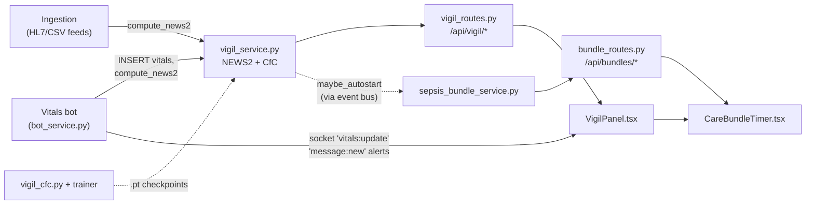
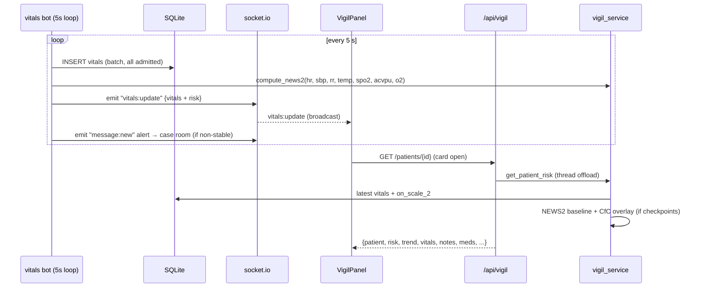

# Vigil: live vitals, NEWS2 scoring, deterioration model, and care bundles

Vigil is Orb's patient-monitoring pillar: it turns a stream of vital signs (heart rate, blood pressure, oxygen saturation, temperature, respiratory rate, consciousness) into a clinical risk score, a live ward dashboard, and, when a patient deteriorates, a time-boxed treatment checklist. The risk engine is **NEWS2** (the UK Royal College of Physicians' National Early Warning Score 2), a rule-based points table computed in `server/services/vigil_service.py:225`, optionally escalated by a learned **CfC (Closed-form Continuous-time) neural network** overlay (`server/models/vigil_cfc.py:87`). Deterioration triggers a **Sepsis Six care bundle** timer (`server/services/sepsis_bundle_service.py:42`) that tracks six interventions against a 60-minute target. The frontend (`src/pages/panels/VigilPanel.tsx:20`) renders the roster, a patient detail "command center", and the bundle timer widget, kept live by the `vitals:update` socket.io event.

## Purpose and neighbors

Hospitals lose patients to *unnoticed* deterioration: vitals drift for hours before anyone connects the dots. Vigil exists to (a) score every new vitals row the moment it lands, (b) surface the sickest patients first, (c) push alerts into the patient's Relay case room, and (d) convert an alert into a measurable protocol (the bundle timer) so a pilot deployment can prove outcomes, not just notifications (`server/services/sepsis_bundle_service.py:1-11`).

Vigil is deliberately split into a **rule-based baseline** (NEWS2, auditable, testable, a clinician can recompute it by hand) and a **learned overlay** (CfC, may only *escalate*, never lower, the baseline, `server/services/vigil_service.py:392-394`). That asymmetry is the core safety design: a broken or missing ML model can never make a sick patient look healthy.

Consumers outside this guide: the I-PASS handoff generator calls `get_patient_risk`/`get_vitals_trend` (`server/services/ipass_service.py:27`), the downtime snapshot and command center recompute NEWS2 directly (`server/services/downtime_service.py:28`, `server/services/command_center_service.py:139`), admission and ingestion write `risk_scores` rows from `compute_news2` (`server/services/admission_service.py:149`, `server/services/ingestion_service.py:554`), and the command center reads active bundles (`server/services/command_center_service.py:190-192`).

## File map

| File | Lines (approx) | Role |
|---|---|---|
| `server/services/vigil_service.py` | 866 | NEWS2 scorer, CfC model loading/inference, risk aggregation, vitals trend, LLM patient-analysis streaming |
| `server/services/sepsis_bundle_service.py` | 180 | Care-bundle CRUD + timer state machine + NEWS2≥7 auto-start |
| `server/routes/vigil_routes.py` | 1174 | REST router `/api/vigil`, roster, patient detail, vitals, notes, meds, analysis stream, discharge, patient creation |
| `server/routes/bundle_routes.py` | 71 | REST router `/api/bundles`, list/start/complete/cancel bundles, with audit logging |
| `server/models/vigil_cfc.py` | 148 | PyTorch CfC cell + per-outcome multi-horizon risk model (`OrbVigilCfC`) |
| `server/scripts/train_vigil_cfc.py` | 363 | Offline trainer: PhysioNet 2019 sepsis adapter, windowing, normalization, AUROC/AUPRC validation, checkpointing |
| `src/pages/panels/VigilPanel.tsx` | 2461 | Roster + patient detail view (command bar, timeline, risk gauge, lab trends, modals, print views, AI narrative) |
| `src/pages/Vigil.css` | 939 | All Vigil-module styles (roster rows, command bar, timeline, tooltips, modals, responsive breakpoints) |
| `src/components/vigil/CareBundleTimer.tsx` | 474 | Self-contained Sepsis Six widget: 15 s poll, 1 s client-side clock, element checklist |
| `src/api/bundles.ts` | 127 | Typed client for `/api/bundles` built on the shared `apiFetch` wrapper |
| `server/tests/test_news2.py` | 267 | Release-gate unit tests for every NEWS2 band edge, both SpO2 scales, escalation rules |
| `server/tests/test_sepsis_bundle.py` | 69 | Bundle lifecycle tests: idempotent start, auto-complete, cancel, auto-start threshold |
| `server/tests/test_clinical_safety.py` | 168 | Allergy/interaction screening + agentic auto-order block invariants (owned by drug-safety services, exercised here as safety gates) |

## How it works

### Jargon crash course (defined once, used throughout)

- **NEWS2**, the UK national early-warning score. Each of seven physiological parameters earns 0–3 points from a lookup table; the aggregate maps to an escalation band. It is an *ordinal trigger*, not a probability (`server/services/vigil_service.py:320-327`).
- **MEWS**, the older Modified Early Warning Score. Orb migrated to NEWS2; `compute_mews` survives only as a deprecated alias (`server/services/vigil_service.py:343`).
- **ACVPU**, the consciousness scale: Alert / new Confusion / Voice / Pain / Unresponsive. Anything other than Alert scores 3 in NEWS2.
- **SpO2 Scale 2**, an alternative oxygen-saturation table for COPD patients (chronic lung disease) whose *normal* SpO2 is 88–92%; scoring them on the default Scale 1 causes constant false alarms (`server/tests/test_news2.py:239-249`).
- **Care bundle / Sepsis Six**, a short checklist of interventions ("give oxygen, take cultures, give antibiotics, give fluids, measure lactate, monitor urine output") that must all happen within one hour of recognizing sepsis. Bundles work because completeness-within-time is measurable.
- **CfC (Closed-form Continuous-time) network**, a recurrent neural network whose hidden state decays continuously between observations, so it natively handles irregularly-timed vitals; see the dedicated section below.
- **JWT (JSON Web Token)**, a signed token the client sends in the `Authorization: Bearer` header; the server decodes it to identify the user (see guide 03-auth-rbac).
- **RBAC (role-based access control)**, every route declares required permission strings via `Depends(require_permission("..."))`; FastAPI's **dependency injection** (`Depends`) runs that checker before the handler and injects the resolved `user` dict (`server/permissions.py:164`).
- **SSE (Server-Sent Events)**, a one-way HTTP streaming format (`data: ...\n\n` frames) used for the token-by-token AI narrative.
- **socket room**, a named socket.io channel; Relay alerts are emitted into the patient's case-room, while `vitals:update` is broadcast to every connected client with no room (`server/services/bot_service.py:252`).
- **React hook**, a function (`useState`, `useEffect`, `useMemo`, ...) that gives a function component state and lifecycle behavior. A **context** (`useActivePatient`) shares state across the component tree without prop drilling.
- **Migration**, an idempotent `ALTER TABLE` run at startup to evolve the SQLite schema, e.g. adding `patients.on_scale_2` (`server/database.py:1163-1165`) and `vitals.on_oxygen` (`server/database.py:1170-1172`).

### Flow 1: the live monitoring loop (the heartbeat of the product)

1. Every 5 seconds (`VITALS_INTERVAL_SECONDS = 5`, `server/config.py:156`), the app-lifespan task calls `run_vitals_bot(sio)` (`server/main.py:120-127`). The bot is a *simulator* (severity-aware random walk), in `ingestion` mode it is disabled and real feeds take over (`server/main.py:115-118`).
2. The bot batch-INSERTs one new `vitals` row per admitted patient, carrying forward `consciousness` and `on_oxygen` from the previous row so the full 7-parameter NEWS2 can be scored (`server/services/bot_service.py:188-223`).
3. For each patient it calls `compute_news2(...)` (`server/services/bot_service.py:199-200`) and emits a `vitals:update` socket event containing the raw vitals plus the `risk` dict (`server/services/bot_service.py:250-252`).
4. `evaluate_and_dispatch_alerts` posts a formatted alert message into the patient's Relay case-room for any non-stable NEWS2 level, with a 2-minute cooldown that escalations bypass (`server/services/bot_service.py:259-437`), and publishes a `vigil.alert.critical` event on the in-process event bus (`server/services/bot_service.py:400-415`).
5. The event-bus subscriber `on_critical_vigil_alert` auto-opens a Sepsis Six bundle via `maybe_autostart`/`start_bundle` (`server/services/nervous_system_triggers.py:26-41`, registered at `server/services/nervous_system_triggers.py:228`).
6. In the browser, `VigilPanel` listens on `vitals:update`: the roster patches each row's risk badge (throttled to one update per 2 s, `src/pages/panels/VigilPanel.tsx:34-49`), and the open detail view prepends the vital to its chart data (throttled to 5 s, `src/pages/panels/VigilPanel.tsx:247-271`).

### Flow 2: opening a patient card

1. Clicking a roster row sets `selectedPatientId`, mounting `PatientDetailView` (`src/pages/panels/VigilPanel.tsx:213-227`).
2. The view fetches `GET /api/vigil/patients/{id}` via `getPatientDetail` (`src/api/client.ts:618-620`), which bundles patient row, latest 288 vitals, notes, scribe notes, risk history, lens analyses, medications, live risk, and trend in one payload (`server/routes/vigil_routes.py:500-557`).
3. Server-side, `get_patient_risk` and `get_vitals_trend` are offloaded to a thread with `asyncio.to_thread` so CfC torch inference cannot block the event loop (`server/routes/vigil_routes.py:167-174`).
4. The `AiNarrative` sub-component opens the SSE stream `GET /patients/{id}/analysis` and renders tokens as they arrive (`src/pages/panels/VigilPanel.tsx:1695-1726`).
5. `CareBundleTimer` mounts beneath the command bar (`src/pages/panels/VigilPanel.tsx:877`) and starts its own 15 s poll of `/api/bundles/patient/{id}?active_only=true`.

### Flow 3: a care bundle's life

1. **Open**: either a clinician clicks "Start Sepsis Six" (`src/components/vigil/CareBundleTimer.tsx:164-165` → `POST /api/bundles/patient/{id}/start`) or Vigil auto-opens on NEWS2 ≥ 7 (`server/services/sepsis_bundle_service.py:167-180`). `start_bundle` is idempotent: an existing active bundle of the same type is returned instead of stacking a duplicate (`server/services/sepsis_bundle_service.py:47-54`).
2. **Tick**: the widget renders a client-side 1 s clock off `triggered_at` and tints it red past 60 minutes (`src/components/vigil/CareBundleTimer.tsx:74-104`).
3. **Complete elements**: each "Mark done" posts `POST /api/bundles/{id}/complete/{element}`, stamping the element's `*_at` column; when all six are stamped the bundle auto-transitions to `completed` (`server/services/sepsis_bundle_service.py:65-85`).
4. **Decorate**: every read passes through `_decorate`, which computes per-element states (`pending`/`overdue`/`done_on_time`/`done_late`) and two distinct percentages, completion (done regardless of timing) vs. compliance (done *within* target) (`server/services/sepsis_bundle_service.py:122-163`).
5. **Cancel**: `POST /api/bundles/{id}/cancel` flips `active → cancelled` only (`server/services/sepsis_bundle_service.py:88-94`).

Bundle status state machine: `active → completed` (automatic, all elements stamped) or `active → cancelled` (explicit). The schema also allows `expired` (`server/database.py:637`) but no code ever sets it.

## Function-by-function

### server/models/vigil_cfc.py: the deterioration model

**What a CfC is (one paragraph).** A conventional recurrent network (like an LSTM, Long Short-Term Memory, a gated recurrent network) assumes observations arrive at fixed intervals; hospital vitals do not. A Closed-form Continuous-time (CfC) network (Hasani et al.) is a "liquid neural network" whose hidden state evolves as a continuous-time process: between two observations separated by `Δt` hours, the state decays exponentially toward a learned steady-state. The closed-form update implemented here is `h(t) = (Wx·x) ⊙ exp(−f(x,h)·Δt) + g(x,h)` (`server/models/vigil_cfc.py:19`), where `f` produces a strictly-positive per-neuron decay rate and `g` the steady-state target. Feeding `Δt` explicitly means irregular sampling is handled natively, no imputation to a fixed grid. Orb trains one independent CfC per clinical outcome (deterioration / sepsis / mortality, `server/models/vigil_cfc.py:43`), each predicting the probability of its event within 1/3/6/12/24 hours (`HORIZONS_HOURS`, `server/models/vigil_cfc.py:40`), a risk *trajectory*, not a single number.

### Module constants: `server/models/vigil_cfc.py:40`
**Signature:** `HORIZONS_HOURS = (1,3,6,12,24)`, `VIGIL_OUTCOMES = ("deterioration","sepsis","mortality")`, `PRODUCTION_FEATURE_ORDER/MEAN/STD` (lines 48–53).
**Does:** Pin the model's output ordering, the outcome registry, and the canonical 9-feature live schema (7 vitals + AVPU + age).
**How it works:** `PRODUCTION_FEATURE_ORDER` must byte-for-byte match `_CFC_FEATURE_ORDER` in the service (`server/services/vigil_service.py:42-43`), the comment at line 47 says so explicitly.
**Why it exists:** A checkpoint trained under one feature order silently mis-predicts under another; making the order a shared constant is the only guard.
**Data in/out:** tuples of strings/floats.
**Talks to:** imported by `vigil_service._load_cfc_models` (`server/services/vigil_service.py:65`) and the trainer (`server/scripts/train_vigil_cfc.py:36-39`).
**Change guide:** To add a feature (say glucose): append to `PRODUCTION_FEATURE_ORDER`, `_CFC_FEATURE_ORDER`, `_CFC_FEATURE_MEAN/STD/DEFAULTS` (`server/services/vigil_service.py:42-50`), extend `_assemble_feature_sequence` to read the new column, and **retrain every checkpoint**, `compute_cfc_risk` skips any model whose `input_dim` no longer matches (`server/services/vigil_service.py:184-185`), so old checkpoints will silently stop running rather than crash.
**Gotchas:** the hardcoded MEAN/STD here are *fallbacks*; real checkpoints carry corpus-computed stats (`server/scripts/train_vigil_cfc.py:343-346`).

### CfCCell: `server/models/vigil_cfc.py:56`
**Signature:** `__init__(input_dim, hidden_dim)`; `forward(x: (B,input_dim), h: (B,hidden), dt: (B,1)) → (B,hidden)`
**Does:** One continuous-time recurrent step.
**How it works:** 1. Concatenate `[x, h]` (line 80). 2. `f` backbone → `softplus` → strictly positive decay rates (line 81). 3. `g` backbone → steady-state target (line 82). 4. `decay = exp(−rate·Δt)`, `dt` broadcasts across the hidden dimension (line 83). 5. Return `Wx(x) * decay + steady` (line 84).
**Why it exists:** Encapsulates the closed-form ODE-solution update so the outer model is a plain Python loop over timesteps.
**Data in/out:** float32 tensors as above.
**Talks to:** owned and called by `OrbVigilCfC.forward`.
**Change guide:** To deepen the cell, add layers inside `self.f`/`self.g` (lines 69–76); state dict keys change, so existing `.pt` checkpoints stop loading (`load_state_dict` at `server/services/vigil_service.py:90` will raise and that outcome is skipped).
**Gotchas:** `softplus` (not `relu`) keeps decay differentiable near zero; removing it allows negative decay → exploding state.

### OrbVigilCfC: `server/models/vigil_cfc.py:87`
**Signature:** `__init__(input_dim, hidden_dim=64, horizons=HORIZONS_HOURS, outcome="deterioration")`; `forward(vitals (B,T,F), dt (B,T,1), return_logits=False) → (B, num_horizons)`
**Does:** Encodes a vitals sequence with a single CfCCell, then a 2-layer readout head emits one risk logit per horizon.
**How it works:** 1. Unsqueeze 2-D inputs to a batch of one (lines 121–124). 2. Zero-init hidden state, loop `t = 0..T-1` through the cell (lines 127–129). 3. Readout (`Linear→ReLU→Dropout(0.2)→Linear`, lines 105–108) produces per-horizon logits. 4. Return raw logits when training, `sigmoid` probabilities otherwise (lines 131–135).
**Why it exists:** One small model (~tens of thousands of params, logged at `server/services/vigil_service.py:101-102`) per outcome keeps each independently trainable and swappable (`server/models/vigil_cfc.py:5-9`).
**Data in/out:** normalized feature tensors in; `[0,1]` risks (or logits) out.
**Talks to:** loaded by `_load_cfc_models`; trained by `train()` in the trainer.
**Change guide:** To add a horizon (e.g. 48 h): extend `HORIZONS_HOURS`, retrain (labels are built per horizon at `server/scripts/train_vigil_cfc.py:151-152`); old checkpoints keep working because horizons are stored in and restored from the checkpoint (`server/services/vigil_service.py:87`).
**Gotchas:** the docstring at lines 113–119 explains *why* training must use `return_logits=True`: reconstructing logits from clamped sigmoids caps them at ~±13.8 and kills gradients on confidently-wrong predictions. The trainer honors this (`server/scripts/train_vigil_cfc.py:306-309`).

### OrbVigilCfC.predict_trajectory: `server/models/vigil_cfc.py:138`
**Signature:** `(vitals, dt) → {"outcome", "risk_by_horizon": {"1h": p, ...}, "peak_risk": max}`
**Does:** Single-sample inference convenience under `@torch.no_grad()`.
**How it works:** calls `eval()`, forwards, rounds each horizon probability to 4 dp, takes the max as `peak_risk` (lines 140–148).
**Why it exists:** Gives the service a JSON-ready dict without tensor handling.
**Talks to:** called only from `compute_cfc_risk` (`server/services/vigil_service.py:200`).
**Gotchas:** `peak_risk` is a max across horizons, a high 24 h risk escalates as strongly as a high 1 h risk in the overlay thresholds.

### server/scripts/train_vigil_cfc.py: the offline trainer

### Config constants: `server/scripts/train_vigil_cfc.py:42`
`HIDDEN_DIM=64`, `MAX_SEQ_LEN=48` (hours of history per window), `MIN_OBS=3`, `MAX_WINDOWS_PER_PATIENT=6`, `BATCH_SIZE=64`, `EPOCHS=30`, `LR=1e-3`, `TRAIN_SPLIT=0.85`, `SEED=42` (all seeded at line 52 for reproducibility). `_PSV_VITALS` (line 59) maps PhysioNet column names to production features; `_DEFAULTS` (line 64) are imputation values.

### parse_psv: `server/scripts/train_vigil_cfc.py:69`
**Signature:** `(filepath: Path) → (rows: list[dict], onset_idx: int|None) | None`
**Does:** Parses one PhysioNet/CinC 2019 `.psv` patient file (pipe-separated hourly rows) into per-hour feature dicts plus the sepsis-onset hour.
**How it works:** 1. Split header, build column index (lines 77–78). 2. Reject files without `SepsisLabel` (line 79). 3. Per row, coerce each mapped vital to float, treating `""`/`"NaN"` as missing (lines 88–101). 4. AVPU is imputed 0 (alert) because PhysioNet has no consciousness field (line 103). 5. Record the first hour where `SepsisLabel >= 1` as `onset_idx` (lines 106–107). 6. Require at least `MIN_OBS` rows (line 109).
**Why it exists:** PhysioNet 2019 is the only *open* dataset here; deterioration/mortality need credentialed ICU data (MIMIC-IV/eICU) and raise `NotImplementedError` (`server/scripts/train_vigil_cfc.py:210-217`).
**Data in/out:** file path in; raw (unnormalized, possibly-None) feature dicts out.
**Talks to:** called from `load_sepsis_dataset`.
**Gotchas:** rows shorter than the header are silently skipped (line 86).

### make_windows: `server/scripts/train_vigil_cfc.py:112`
**Signature:** `(parsed) → list[(features (T,F), dt (T,1), labels (H))]`
**Does:** Builds training windows from one patient: pre-onset only (early-warning framing), labeled per horizon.
**How it works:** 1. Forward-fill each feature, falling back to `_DEFAULTS` (lines 127–137). 2. Candidate prediction points are indices `MIN_OBS..onset` (or end of stay for negatives), subsampled to 6 per patient (lines 140–143). 3. Each window is the trailing `MAX_SEQ_LEN` rows before point `t` (line 146); `Δt` is a constant 1.0 h because PhysioNet is hourly (line 150). 4. Horizon label `h` is 1 iff onset falls within `h` hours after the window end (lines 151–152).
**Why it exists:** Turns a per-patient time series into supervised (sequence → multi-horizon label) samples without leaking post-onset data.
**Data in/out:** raw features in, **raw** tensors out, normalization is deferred (docstring lines 118–123).
**Change guide:** To predict *post*-onset progression instead of early warning, change `last_pred` (line 140), but then labels at lines 151–152 must be redefined; the current framing assumes prediction stops at onset.
**Gotchas:** windows are RAW here on purpose; normalizing per-window with hardcoded stats would create train/serve skew (see `_compute_corpus_stats`).

### _compute_corpus_stats: `server/scripts/train_vigil_cfc.py:159`
**Signature:** `(samples) → (mean (F), std (F))`
**Does:** Computes per-feature mean/std over every timestep in the corpus, std clamped ≥ 1e-3.
**Why it exists:** The checkpoint stores *these* stats, not the hardcoded `PRODUCTION_FEATURE_*` guesses, so inference z-scores exactly as training did (lines 161–165; persisted at lines 343–346, consumed at `server/services/vigil_service.py:96-98`).
**Gotchas:** the clamp guards constant channels (e.g. AVPU, which is always 0 in PhysioNet) from division by ~zero.

### load_sepsis_dataset: `server/scripts/train_vigil_cfc.py:172`
**Signature:** `() → (norm_samples, mean, std)`
**Does:** Globs `server/datasets/physionet_2019/*.psv`, parses, windows, computes corpus stats, z-scores every window, prints the positive-rate summary.
**How it works:** exits with a friendly error if no files (lines 175–177) or no windows (line 185); z-scoring at line 189 (`(f - mean) / std`).
**Talks to:** `parse_psv`, `make_windows`, `_compute_corpus_stats`; called via `load_dataset_for`.
**Gotchas:** run `scripts/download_physionet.py` first (message at line 176).

### collate: `server/scripts/train_vigil_cfc.py:197`
**Signature:** `(batch) → (vitals (B,Tmax,F), dt (B,Tmax,1), labels (B,H))`
**Does:** Pads variable-length windows: features zero-padded, `Δt` one-padded.
**Gotchas:** padded timesteps still pass through the CfC cell (there is no mask); with zero-padded features and Δt = 1 the state keeps evolving over padding. Acceptable at this scale but a known modeling wrinkle.

### _auroc / _auprc / _val_metrics: `server/scripts/train_vigil_cfc.py:221` / `:245` / `:263`
**Signature:** `(probs: np.ndarray, targets: np.ndarray) → float`
**Does:** Dependency-free discrimination metrics: rank-based AUROC (Mann-Whitney U with tie averaging, lines 227–242) and average precision (step-wise PR integration, lines 249–260). `_val_metrics` pools all horizons and maps NaN (single-class) to 0.0 (lines 267–270).
**Why it exists:** "don't checkpoint on loss alone, a clinical risk model must be judged on AUROC/AUPRC" (comment lines 326–328). No sklearn dependency on the server.
**Gotchas:** despite that comment, checkpointing still keys on **val loss** (line 333), the metrics are printed but do not gate the save. Flagged under Discrepancies.

### train: `server/scripts/train_vigil_cfc.py:274`
**Signature:** `(outcome: str) → None` (writes `server/models/vigil_cfc_{outcome}.pt`)
**Does:** Full training loop for one outcome.
**How it works:** 1. Load + shuffle + 85/15 split (lines 275–283). 2. Device is Apple **MPS** (Metal GPU) if available, else CPU (line 285). 3. Class imbalance handled with per-horizon `pos_weight = (1−p)/p` clamped at 20 into `BCEWithLogitsLoss` (binary cross-entropy that takes raw logits, lines 291–294). 4. AdamW, lr 1e-3, weight decay 1e-4, cosine LR schedule, grad-norm clip at 1.0 (lines 295–311). 5. Each epoch: train on **raw logits** (line 308), validate, compute AUROC/AUPRC, print (lines 315–331). 6. On new best val loss, save a checkpoint dict carrying `model_state_dict`, `input_dim`, `hidden_dim`, `horizons`, `feature_order`, corpus `feature_mean/std`, epoch metrics, and `data_source` (lines 333–350).
**Why it exists:** Produces the exact checkpoint format `_load_cfc_models` consumes, the two must evolve in lockstep (see the security note at `server/services/vigil_service.py:77-83`).
**Data in/out:** `.psv` corpus in; `.pt` checkpoint out.
**Talks to:** CLI entry `python scripts/train_vigil_cfc.py --outcome sepsis` (lines 360–363).
**Change guide (worked example, retrain and ship the sepsis model):** 1. `cd server && .venv/bin/python scripts/download_physionet.py` then `... scripts/train_vigil_cfc.py --outcome sepsis`. 2. The file lands at `server/models/vigil_cfc_sepsis.pt`, exactly where `_CFC_CHECKPOINTS["sepsis"]` looks (`server/services/vigil_service.py:34-38`). 3. Restart the server, loading is lazy but cached, so a running process will not pick up a new file (`_cfc_loaded` latch, `server/services/vigil_service.py:59-61`). 4. Verify the log line `[Vigil-CfC] Loaded 'sepsis' (...)` (`server/services/vigil_service.py:102`).
**Gotchas:** the TODO at lines 353–357 is honest: no NEWS2-baseline promotion gate, no calibration, and the live escalation thresholds (0.9/0.85/0.7) are hand-picked literals. Also note the train/serve MAP skew TODO (lines 57–62): PhysioNet supplies measured MAP, production *derives* MAP = DBP + (SBP−DBP)/3 (`server/services/vigil_service.py:141`).

### server/services/vigil_service.py: the risk engine

### Module state and constants: `server/services/vigil_service.py:19`
`_analysis_cache`/`_analysis_locks`/`_ANALYSIS_CACHE_TTL` (lines 19–21), an in-memory LLM-analysis cache (currently dead, see Discrepancies) and per-patient asyncio locks. `_MODELS_DIR` (line 27); CfC globals `_cfc_models`, `_cfc_meta`, `_cfc_device`, `_cfc_loaded` (lines 28–31); checkpoint filename registry `_CFC_CHECKPOINTS` including the legacy `vigil_cfc_checkpoint.pt` alias for `deterioration` (line 34); the production feature schema mirrors `_CFC_FEATURE_ORDER`/`_MEAN`/`_STD` (lines 42–50); `_AVPU_MAP` grading consciousness strings to 0–3 for the *model input* (lines 52–53, distinct from NEWS2's binary alert/not-alert scoring); and `_NEWS2_MAX_AGGREGATE = 20.0` (line 230, with the derivation of that ceiling spelled out in the comment above it, lines 226–229) used at line 348 to normalize the raw aggregate into a 0–1 index without flattening the sickest patients, the old `/10` cap made NEWS2 10 and 20 both read 1.0 (see the comment at lines 343–344).

### _load_cfc_models: `server/services/vigil_service.py:56`
**Signature:** `() → bool` (any model loaded?)
**Does:** Lazily loads whichever per-outcome checkpoints exist; idempotent via the `_cfc_loaded` latch.
**How it works:** 1. If already attempted, report cached result (lines 59–61). 2. Import torch + model class inside a try, if torch is not installed the system degrades to **NEWS2-only** with an info log (lines 63–68). 3. Pick MPS or CPU (line 70). 4. For each outcome, find the first existing filename (line 73), `torch.load(..., weights_only=False)` (line 84, see the security comment at 77–83: this deserializes arbitrary pickle, so a tampered `.pt` is remote code execution at load time; the planned fix is `weights_only=True` + JSON sidecar), rebuild `OrbVigilCfC` from checkpoint metadata, load weights, `eval()`, and stash model + meta (lines 85–100). 5. Per-outcome failures are logged and skipped (lines 103–104).
**Why it exists:** The **fallback contract**: missing weights, missing torch, or a corrupt file must never break risk scoring, Vigil ships NEWS2-only until models are trained (line 107).
**Data in/out:** filesystem checkpoints in; populated `_cfc_models`/`_cfc_meta` out.
**Talks to:** called by `compute_cfc_risk` only.
**Gotchas:** the latch means a checkpoint dropped in after first call is invisible until restart; and `weights_only=False` is a deliberate, documented security debt.

### _assemble_feature_sequence: `server/services/vigil_service.py:120`
**Signature:** `(patient_id, feature_order, mean, std) → (vitals (1,T,F), dt (1,T,1)) | (None, None)`
**Does:** Converts the patient's last 24 `vitals` rows into a normalized tensor sequence with real Δt gaps.
**How it works:** 1. Fetch newest-24 rows plus the patient's age in one `db_session` (lines 117–125). 2. Bail if fewer than 3 rows (line 127). 3. Reverse to chronological (line 130). 4. Per row: default-impute missing vitals (`_CFC_VITALS_DEFAULTS`), derive `map` (mean arterial pressure) as DBP + (SBP−DBP)/3 (line 141), grade consciousness via `_AVPU_MAP` (line 143), z-score with the *checkpoint's* mean/std in `feature_order` order (lines 146–147). 5. Δt is hours between consecutive timestamps (ISO strings parsed with `Z→+00:00`), clamped ≥ 0, defaulting to 1.0 on parse failure, first element 0.0 (lines 133, 150–160).
**Why it exists:** This is the *serving-side* twin of the trainer's windowing, the two must produce identically-shaped, identically-normalized inputs.
**Talks to:** `db_session` (guide 04-database-schema); called per-outcome from `compute_cfc_risk`.
**Gotchas:** SQL is parameterized (`?`), keep it that way; timestamps mix formats across seeders/feeds, hence the defensive parse; and `age` defaults to 62.0 when NULL (line 131).

### compute_cfc_risk: `server/services/vigil_service.py:176`
**Signature:** `(patient_id) → {"outcomes": {name: {"risk_by_horizon", "peak_risk"}}, "primary_risk", "seq_len", "model": "CfC-LNN"} | None`
**Does:** Runs every loaded, schema-compatible outcome model and aggregates their trajectories.
**How it works:** 1. `None` if no models load (lines 184–185). 2. Skip models whose `input_dim` ≠ 9 (a labs-augmented sepsis model cannot run on live vitals yet, lines 193–194). 3. Assemble features **per model** using that checkpoint's own feature stats; insufficient history skips *only that outcome*, the comment at lines 198–200 records the old bug where one sparse outcome returned `None` and suppressed the whole overlay. 4. Inference inside `vram_guard` (a context manager from `server/services/gpu_coordinator.py:38` that garbage-collects and frees GPU memory after the block) and `torch.no_grad()` (lines 207–209). 5. `primary_risk` is the deterioration model's peak, else the max across outcomes (lines 217–220).
**Why it exists:** Central aggregation point so `get_patient_risk` sees one dict regardless of how many outcome models exist.
**Talks to:** `_load_cfc_models`, `_assemble_feature_sequence`, `OrbVigilCfC.predict_trajectory`, `gpu_coordinator.vram_guard`.
**Gotchas:** this runs synchronous torch code, callers on the event loop must offload it (`server/routes/vigil_routes.py:167-174` does; `ipass_service` and the seed script call it from sync contexts).

### compute_news2: `server/services/vigil_service.py:234`
**Signature:** `(hr, sbp, rr, temp, spo2, consciousness="alert", on_oxygen=False, on_scale_2=False) → dict`
**Does:** THE clinical scorer. Pure function, no I/O, every risk level in the product flows from here.
**How it works (scoring bands exactly as coded; all comparisons are `<=` chains, so floats slot into the band they fall under):**

| Parameter | 3 pts | 2 pts | 1 pt | 0 pts | code |
|---|---|---|---|---|---|
| Respiratory rate | ≤8 or ≥25 | 21–24 | 9–11 | 12–20 | lines 252–257 |
| SpO2 (Scale 1) | ≤91 | 92–93 | 94–95 | ≥96 | lines 272–276 |
| SpO2 (Scale 2, on air) | ≤83 | 84–85 | 86–87 | 88–92 and ≥93 | lines 263–268 |
| SpO2 (Scale 2, on O2) | ≥97 | 95–96 | 93–94 | 88–92 | lines 263–271 |
| Supplemental O2 | n/a | +2 flat | n/a | n/a | lines 279–280 |
| Systolic BP | ≤90 or ≥220 | 91–100 | 101–110 | 111–219 | lines 283–288 |
| Heart rate | ≤40 or ≥131 | 111–130 | 41–50 or 91–110 | 51–90 | lines 291–297 |
| Temperature °C | ≤35.0 | ≥39.1 | 35.1–36.0 or 38.1–39.0 | 36.1–38.0 | lines 300–305 |
| Consciousness (ACVPU) | anything not alert/`a`/`""` | n/a | n/a | alert | lines 307–310 |

1. The inner `add(points, msg)` closure accumulates the aggregate, latches `any_param_3`, and collects human-readable driver strings for every non-zero contribution (lines 243–249). 2. `None` parameters are skipped entirely, missing vitals never crash or score (each block is `if x is not None`, verified by `server/tests/test_news2.py:219-222`). 3. **Banding**: raw ≥ 7 → `critical`; raw ≥ 5 *or any single parameter scored 3* → `elevated`; else `stable` (lines 312–318). The single-parameter-3 rule is NEWS2's mandated escalation trigger. 4. `score` in the result is `min(1.0, raw/20.0)`, a normalized *index*, explicitly NOT a calibrated probability; band decisions always use the raw integer (comment lines 320–327). 5. Returns `{score, level, raw_news2, raw_mews (legacy alias), single_param_3, drivers (worst first: points, then Severe before Moderate, then RCP chart order; at most three; since 2026-10-02, before which they were the first three in check order and could omit an ACVPU change), scoring_model: "NEWS2", spo2_scale}` (lines 331–340).
**Divergences from the official RCP NEWS2 to know about:** (a) the official score has four escalation bands (0 / 1–4 / 5–6 / ≥7, plus "3 in any single parameter"); the code collapses them into three labels `stable/elevated/critical`. (b) Official ACVPU scores 3 only for **new** confusion; the code cannot distinguish chronic confusion, so any non-alert value scores 3 (line 309). The parameter point tables themselves match the RCP reference (asserted band-by-band in `server/tests/test_news2.py`).
**Why it exists:** Rule-based, auditable, and instantly available, the "Phase 1" displayed risk while the CfC ensemble matures (`server/services/vigil_service.py:349-355`).
**Data in/out:** scalar vitals in, dict out (shape kept compatible with the legacy MEWS output, docstring line 237).
**Talks to:** called by `get_patient_risk` (line 376), the vitals bot (`server/services/bot_service.py:199`), ingestion (`server/services/ingestion_service.py:554`), downtime snapshots (`server/services/downtime_service.py:181`), command center (`server/services/command_center_service.py:162`), admission (`server/services/admission_service.py:149`), and the test suite.
**Change guide (worked example, tighten the critical band to ≥6):** change `if score >= 7` at line 313 to `>= 6`. Knock-on effects: `maybe_autostart` still fires at raw ≥ 7 (`server/services/sepsis_bundle_service.py:173`) so bundles would lag the new critical band, decide whether to lower it too; the alert bridge keys off `level` so alert volume rises (`server/services/bot_service.py:275-276`); update `test_band_critical_at_seven` (`server/tests/test_news2.py:184-188`). Footgun: do NOT touch the normalized `score` divisor thinking it changes escalation, bands come from the raw integer only.
**Gotchas:** `on_oxygen` +2 applies in both scales (line 279); Scale 2 selection comes from the DB flag `patients.on_scale_2` (migration at `server/database.py:1163-1165`), which every scoring lane now reads, the simulator included (`server/services/bot_service.py:252`, fixed 2026-10-02, see Discrepancies #5).

### compute_mews: `server/services/vigil_service.py:402`
**Signature:** `(hr, sbp, rr, temp, spo2, consciousness="alert") → dict`
**Does:** Deprecated alias forwarding to `compute_news2` (no `on_oxygen`, no Scale 2).
**Why it exists:** keeps old callers alive during the MEWS→NEWS2 migration; parity is tested (`server/tests/test_news2.py:226-233`).
**Gotchas:** none noteworthy.

### get_patient_risk: `server/services/vigil_service.py:407`
**Signature:** `(patient_id) → dict` (NEWS2 result, optionally CfC-augmented)
**Does:** The on-demand "current risk" for one patient: NEWS2 on the latest vitals row, plus the CfC overlay which may *escalate only*.
**How it works:** 1. Fetch newest vitals row and the patient's `on_scale_2` flag (lines 357–365). 2. No vitals → `{score: 0, level: "stable", drivers: ["No vitals recorded"]}` (lines 367–369). 3. Defensive column access (`consciousness`, `on_oxygen` may predate migrations, lines 371–374). 4. `compute_news2(...)` with the Scale 2 flag (lines 376–380). 5. If `compute_cfc_risk` returns anything: attach `cfc`, `cfc_primary_risk`, `cfc_seq_len`, set `scoring_model = "NEWS2+CfC-LNN"` (lines 383–388), then apply the escalation ladder, `primary ≥ 0.9`: force `critical` from any level and prepend a CfC driver; `≥ 0.85`: `elevated → critical`; `≥ 0.7`: `stable → elevated` with driver (lines 395–410). The design note at lines 390–394: escalation scales with model-risk *magnitude* so a NEWS2-quiet patient with very high learned risk can jump straight to critical, the exact case a learned overlay exists to catch.
**Why it exists:** single source for "how sick is this patient right now", with the never-de-escalate safety invariant.
**Data in/out:** patient id in; the NEWS2 dict shape out, plus optional `cfc*` keys.
**Talks to:** DB, `compute_news2`, `compute_cfc_risk`. Called by `get_patient` route (threaded, `server/routes/vigil_routes.py:173`), `generate_patient_analysis` (line 501), I-PASS (`server/services/ipass_service.py:412`), and the seeder (`server/scripts/seed_clinical_data.py:430-433`).
**Gotchas:** the docstring's "Does NOT write to risk_scores (that's done by the bot)" is stale, see Discrepancies #4. The 0.9/0.85/0.7 thresholds are unvalidated literals (trainer TODO, `server/scripts/train_vigil_cfc.py:353-357`).

### get_vitals_trend: `server/services/vigil_service.py:481`
**Signature:** `(patient_id, hours=6) → {"trend": "deteriorating"|"stable"|"improving"|"insufficient_data", hr_delta, sbp_delta, spo2_delta}`
**Does:** Compares average HR/SBP/SpO2/RR of the last `hours` against the preceding equal window.
**How it works:** 1. Two `AVG(...)` queries split at UTC ISO cutoffs (lines 418–438). 2. `insufficient_data` if either window empty (line 441–442). 3. Concern points: HR up > 10, SBP down > 10, SpO2 down > 2 (lines 450–453). 4. ≥2 concerns → deteriorating; 0 concerns and |ΔHR| < 5 → stable; else improving if SpO2 +1 or SBP +5, otherwise stable (lines 455–460).
**Why it exists:** cheap direction-of-travel signal for the detail view banner (`src/pages/panels/VigilPanel.tsx:995-997`) and I-PASS.
**Gotchas:** thresholds are heuristics, not literature-derived; cutoffs are ISO strings compared lexicographically against stored timestamps, consistent for bot-written rows (same `isoformat()` shape) but fragile against mixed formats.

### generate_patient_analysis: `server/services/vigil_service.py:570`
**Signature:** `async generator (patient_id) → yields SSE frames "data: {json}\n\n" ... "data: [DONE]\n\n"`
**Does:** Builds a deterministic clinical summary from real data, then streams a MedGemma-style LLM assessment of it via Ollama.
**How it works:** 1. Load patient, latest vitals, last 3 clinical documents, active meds (lines 472–499; note: uses `get_db()` with manual `close()`). 2. `get_patient_risk` + `get_vitals_trend` (lines 501–502). 3. Compose a plain-English dossier: demographics/diagnosis line, day-of-admission, vitals sentence with rule-based concern tags (None-coerced to 0 so a missing vital can't crash the f-string, comment line 528), risk paragraph reporting **raw NEWS2 + band, never a fabricated percentage** (design note lines 556–559), trend sentence, meds, truncated recent notes (lines 504–605). 4. Wrap in a prompt and stream `POST {OLLAMA_BASE_URL}/api/chat` with `stream: true`, temperature 0.2, 512 max tokens (lines 607–643), re-emitting each Ollama chunk as an SSE frame. 5. LLM access is serialized through `llm_queue.acquire(priority=2)` / `release()` in `finally` (lines 613, 651), the queue (`server/services/llm_queue_service.py:37`) prevents concurrent Ollama calls from thrashing the single local GPU.
**Why it exists:** the "AI narrative" panel; the deterministic dossier means the LLM only *rephrases* grounded facts.
**Data in/out:** patient id in; text/event-stream frames out.
**Talks to:** DB, `get_patient_risk`, `get_vitals_trend`, `llm_queue`, Ollama HTTP. Wrapped by the `/analysis` route; consumed by `getPatientAnalysis` (`src/api/client.ts:1532`).
**Gotchas:** errors yield a friendly frame then `[DONE]` (lines 646–649) so the client loop always terminates; `db.close()` is called on the early-return path too (line 476).

### generate_ai_recommendation: `server/services/vigil_service.py:783`
**Signature:** `async (vitals_summary: str, risk_level: str, drivers: list) → str`
**Does:** One-sentence next-step recommendation for critical alerts, non-streaming, priority 3 (background) in the LLM queue.
**How it works:** single Ollama chat call, temperature 0.1, 64 tokens (lines 663–683); hard fallback string on any failure (line 686).
**Talks to:** called only by the alert bridge for critical alerts (`server/services/bot_service.py:364-366`).
**Gotchas:** a slow Ollama here delays the whole alert dispatch loop, it is awaited inline.

### server/services/sepsis_bundle_service.py: the bundle state machine

### _ELEMENTS / _ELEMENT_COLS: `server/services/sepsis_bundle_service.py:23`
**Signature:** dict of six elements → `{label, target_min: 60}`; `_ELEMENT_COLS` maps each key to its DB column `{key}_at` (line 31).
**Does:** The bundle definition: oxygen, cultures, antibiotics, fluids, lactate, urine_output, each with a 60-minute target.
**Why it exists:** encodes the Sepsis Six / Surviving Sepsis 1-hour bundle; the header note (lines 9–11) warns targets must be confirmed against the deploying hospital's protocol.
**Change guide (worked example, add a "senior review" element with a 30-minute target):** 1. Add `"senior_review": {"label": "Senior clinician review", "target_min": 30}` to `_ELEMENTS` (line 23). 2. Add a `senior_review_at TIMESTAMP` column, new deployments get it via the `CREATE TABLE` (`server/database.py:623-640`), existing DBs need a startup migration like the `on_scale_2` one (`server/database.py:1163-1165`). 3. Extend the `BundleElementKey` union in `src/api/bundles.ts:12-18`. 4. The widget checklist, counts, and compliance all derive from the server's `elements` array, so no other frontend change. 5. Update `test_complete_elements_and_autocomplete` which iterates `_ELEMENTS` (`server/tests/test_sepsis_bundle.py:31-37`). Footgun: `complete_element` interpolates the column name into SQL from `_ELEMENT_COLS` (line 76), safe only because keys are validated against `_ELEMENTS` first (line 68); never build that dict from user input.
**Gotchas:** the DB comment mentions "1-hour / 3-hour targets" (`server/database.py:622`) but all six coded targets are 60 min.

### _now / _now_iso: `server/services/sepsis_bundle_service.py:34` / `:38`
UTC-aware `datetime.now(timezone.utc)` and its `isoformat()`. All bundle timestamps are timezone-aware ISO strings, which is why the frontend's `parseTs` tolerates (but here never needs) a missing zone suffix.

### start_bundle: `server/services/sepsis_bundle_service.py:42`
**Signature:** `(patient_id, *, bundle_type="sepsis6", triggered_by=None, trigger_reason=None, source="clinician") → dict` (decorated bundle)
**Does:** Opens a bundle, idempotently: an existing `active` bundle of the same type for the patient is returned as-is (lines 48–54).
**How it works:** SELECT-then-INSERT inside one `db_session` (commit on exit); re-reads the inserted row by `lastrowid`; decorates.
**Why it exists:** idempotency lets the auto-trigger fire on every ≥7 reading without stacking duplicates (`server/tests/test_sepsis_bundle.py:22-28`).
**Talks to:** called by the `start` route, `maybe_autostart`, and the event-bus trigger (`server/services/nervous_system_triggers.py:31-38`).
**Gotchas:** the SELECT-then-INSERT is not atomic across processes, two simultaneous starts could still both insert (single-process SQLite makes this theoretical today).

### complete_element: `server/services/sepsis_bundle_service.py:65`
**Signature:** `(bundle_id, element, *, actor_id=None) → dict`; raises `ValueError` on unknown element or missing bundle.
**Does:** Stamps `{element}_at = now` (only if not already stamped, completing twice is a no-op, line 75), then auto-completes the bundle when all six columns are non-NULL and status is still `active` (lines 79–84).
**Data in/out:** decorated bundle dict.
**Talks to:** `complete` route; the route converts `ValueError` to HTTP 400 (`server/routes/bundle_routes.py:49-52`).
**Gotchas:** `actor_id` is accepted but never persisted (see Discrepancies #9); the f-string column interpolation at line 76 is safe only via the whitelist check at line 68.

### cancel_bundle: `server/services/sepsis_bundle_service.py:88`
**Signature:** `(bundle_id) → bool`
**Does:** `UPDATE ... SET status='cancelled' WHERE id=? AND status='active'`; returns whether a row changed. Completed/cancelled bundles cannot be cancelled again (rowcount 0 → route 404).

### get_active_bundles / get_bundles_for_patient: `server/services/sepsis_bundle_service.py:97` / `:103`
**Signature:** `() → list[dict]` (all active, oldest first) / `(patient_id, active_only=False) → list[dict]` (newest first).
**Does:** Decorated list reads.
**Talks to:** `active_bundles` and `patient_bundles` routes; the command center wallboard calls `get_active_bundles` directly (`server/services/command_center_service.py:190-192`).
**Gotchas:** `active_only` appends a constant SQL fragment, not user input, parameterization is preserved.

### _parse: `server/services/sepsis_bundle_service.py:113`
`(ts) → datetime | None`; ISO parse with `Z→+00:00`, returning None on garbage so decoration never throws on bad rows.

### _decorate: `server/services/sepsis_bundle_service.py:122`
**Signature:** `(row: dict) → dict` (mutates and returns)
**Does:** Attaches the computed timer state to a raw DB row, the heart of the state machine.
**How it works:** 1. `elapsed_min` from `triggered_at` (falling back to now if unparseable, line 124). 2. Per element: stamped → `done_on_time` iff completion − trigger ≤ target, else `done_late` (breach); unstamped → `overdue` if `elapsed > target` (breach) else `pending` (lines 131–148). 3. Aggregates: `completed_count`, `total_count` (6), `completion_pct` = done/total, `compliance_pct` = **on-time**/total, `on_track` = zero breaches (lines 150–163). The comment at lines 156–160 is the key metric definition: a bundle finished late can be 100% complete but < 100% compliant, the headline pilot metric never lies about the 1-hour target.
**Why it exists:** all timing logic lives server-side so every consumer (widget, wallboard, I-PASS) agrees; the widget only *renders* states.
**Data in/out:** DB row in; row + `elapsed_min, elements[], completed_count, total_count, completion_pct, compliance_pct, on_track` out (mirrored by the `CareBundle` TypeScript interface, `src/api/bundles.ts:40-58`).
**Gotchas:** decoration happens at read time, an `overdue` element flips state as the clock passes target without any DB write, which is why the widget polls.

### maybe_autostart: `server/services/sepsis_bundle_service.py:167`
**Signature:** `(patient_id, news2: dict) → dict | None`
**Does:** Opens a sepsis bundle when `news2["raw_news2"] >= 7` (the RCP urgent-review threshold); idempotent and exception-swallowing so the monitoring path can never be broken by bundle failures (lines 171–180).
**Talks to:** called by `on_critical_vigil_alert` (`server/services/nervous_system_triggers.py:35`); tested at `server/tests/test_sepsis_bundle.py:62-69`.
**Change guide (worked example, auto-start at NEWS2 ≥ 5 instead):** change `raw >= 7` at line 173 and the `trigger_reason` string at line 176; update `test_autostart_triggers_on_high_news2` (`server/tests/test_sepsis_bundle.py:63`). Knock-on: today the only *runtime* caller fires from the critical-alert event, so lowering this threshold has no effect unless you also call `maybe_autostart` from a path that sees elevated patients (e.g. the bot loop). Footgun: keep it non-raising, it runs inside the alert pipeline.

### server/routes/vigil_routes.py: the REST surface

Router: `APIRouter(prefix="/api/vigil", tags=["vigil"])` (`server/routes/vigil_routes.py:22`), mounted bare in `server/main.py:682`, so route paths below are full paths. Every handler (except one, flagged) uses `Depends(require_permission(...))`, the RBAC dependency described in guide 03-auth-rbac, which validates the JWT via `get_current_user` (`server/auth.py:416`) and checks the role's permission set.

### test_stream: `server/routes/vigil_routes.py:240`
**Signature:** `GET /api/vigil/test-stream → StreamingResponse (SSE)`
**Does:** Debug endpoint that word-streams a hardcoded sentence with 15 ms delays to exercise SSE plumbing.
**Gotchas:** **No auth dependency at all**, the only unauthenticated route in the router. Debug leftover; see Discrepancies #6.

### list_patients: `server/routes/vigil_routes.py:265`
**Signature:** `GET /api/vigil/patients` · auth `patient.read_all` → `Patient[]`
**Does:** The roster: admitted patients joined with their *latest* `risk_scores` row, attending doctor name, and active-admission department, ordered by risk score descending.
**How it works:** two nearly identical SQL branches, if the requesting user has a `department`, results are filtered to admissions in that department (lines 39–58), else hospital-wide (lines 60–74). The latest risk score is picked with a correlated `MAX(timestamp)` subquery (lines 50–52). `risk_drivers` is stored as a JSON string and decoded per row (line 90).
**Data in/out:** the exact shape of the `Patient` interface (`src/api/client.ts:291-306`).
**Talks to:** `getPatients` client fn; joins `patients`, `admissions`, `risk_scores`, `users`.
**Gotchas:** the JOIN on `admissions ... status='active'` means a patient with `status='admitted'` but no active admission row disappears from the roster; `risk_scores` staleness, see Discrepancies #4.

### list_discharged: `server/routes/vigil_routes.py:395`
**Signature:** `GET /api/vigil/discharged` · `patient.read_all` → rows of discharged patients LEFT JOIN discharge summaries, newest first. Boilerplate read.

### get_patient: `server/routes/vigil_routes.py:500`
**Signature:** `GET /api/vigil/patients/{patient_id}` · `patient.read_all` → the full detail payload
**Does:** One-shot patient dossier for the detail view.
**How it works:** 1. Patient + attending name, 404 if missing (lines 114–123). 2. Latest 288 vitals rows (`LIMIT 288`; the code comments this as ~24 h of history, line 128, though the 5 s simulator cadence means 288 rows span far less), all clinical documents, scribe notes, last 50 risk-score rows, lens analyses, medications (lines 126–165). 3. Risk + trend computed live, offloaded via `asyncio.to_thread` so torch inference can't stall the event loop (comment lines 167–171, calls 173–174). 4. Medications gain a computed `unverified` flag: AI-extracted (`source` in `llm_extracted`/`agentic`) without `verified_by`, so the UI never presents unreviewed AI meds as clinician-confirmed orders (lines 205–213).
**Talks to:** `getPatientDetail`; feeds `PatientDetailView`'s entire `data` state.
**Gotchas:** vitals arrive newest-first (the UI's chart reverses as needed); the TODO at lines 170–171 notes the baseline should eventually come from precomputed `risk_scores` instead of recomputing CfC per card-open.

### get_patient_vitals: `server/routes/vigil_routes.py:561`
**Signature:** `GET /api/vigil/patients/{patient_id}/vitals?hours=6` · `vitals.read` → chronological vitals rows.
**Does:** Windowed vitals for sparkline charts.
**Gotchas:** compares stored ISO `T`-format timestamps against `datetime('now','-Nh')` which SQLite renders as `YYYY-MM-DD HH:MM:SS` (space separator), a lexicographic comparison that over-includes same-day rows. Discrepancies #7.

### get_patient_notes / add_patient_note: `server/routes/vigil_routes.py:587` / `:599`
**Signature:** `GET` / `POST /api/vigil/patients/{patient_id}/notes` · both `patient.read_all`.
**Does:** List `clinical_documents` newest-first; insert a manual note (400 if `content` missing) with `doc_type` defaulting to "Progress Note" and the JWT user as author (lines 269–274).
**Gotchas:** the POST is gated by a *read* permission (`patient.read_all`), any clinician who can view can also write notes. Deliberate or not, it's the coded behavior.

### get_patient_analysis: `server/routes/vigil_routes.py:624`
**Signature:** `GET /api/vigil/patients/{patient_id}/analysis` · `patient.read_all` → `StreamingResponse` (SSE)
**Does:** Wraps `generate_patient_analysis` with per-patient concurrency control.
**How it works:** 1. The 5-minute response cache block is fully commented out ("Disable cache temporarily for debugging", lines 295–309). 2. A per-patient `asyncio.Lock` is created on demand (lines 312–314). 3. If a generation is already in flight, the second request waits on the lock and would replay `_analysis_cache`, but nothing ever writes that cache, so it falls through and regenerates (lines 316–332; Discrepancies #3). 4. Otherwise streams `generating_stream()` holding the lock (lines 334–347), with `X-Accel-Buffering: no` so reverse proxies don't buffer the stream.
**Talks to:** imports the service's private cache/lock globals directly (lines 290–293), a cross-module reach-in worth cleaning up.
**Gotchas:** `_analysis_locks` grows one entry per patient forever (no eviction).

### medication_reconciliation_route: `server/routes/vigil_routes.py:697`
**Signature:** `GET /api/vigil/patients/{patient_id}/medication-reconciliation` · `discharge.generate`
**Does:** 404-checks the patient then delegates to `discharge_service.build_medication_reconciliation`, a deterministic continued/stopped/unverified med split, previewable before discharge. The logic is owned by the discharge guide; this route just fronts it.

### discharge_patient_route: `server/routes/vigil_routes.py:714`
**Signature:** `POST /api/vigil/patients/{patient_id}/discharge` · `discharge.generate` → discharge result
**Does:** Validates the patient is admitted (400 otherwise, lines 379–385), builds a timeline, generates the LLM discharge summary with a hardcoded offline fallback template if the LLM is down (lines 390–412), then delegates to `discharge_service.discharge_patient` (line 414).
**Talks to:** three `discharge_service` functions (cross-reference the discharge guide); called by `dischargePatient` (`src/api/client.ts:1577-1579`).
**Gotchas:** the fallback template means discharge *always* works offline, an availability-over-polish decision.

### get_discharge_summary: `server/routes/vigil_routes.py:768`
**Signature:** `GET /api/vigil/patients/{patient_id}/discharge-summary` · `discharge.read` → `{summary, timeline, qr_code_url, discharged_at}`; 404 when none exists. Note it returns the API-rooted `qr_code_url` string that the client rewrites (`src/api/client.ts:894-897`).

### add_patient_medication: `server/routes/vigil_routes.py:791`
**Signature:** `POST /api/vigil/patients/{patient_id}/medications` · `medication.write`
**Does:** Inserts a medication row (400 unless drug_name+dosage+frequency present), `prescribed_by` = JWT user.
**Gotchas:** no drug-safety screening on this path, the allergy/interaction gates tested in `test_clinical_safety.py` live in the order/agentic paths, not this manual-entry endpoint.

### get_qr_code: `server/routes/vigil_routes.py:832`
**Signature:** `GET /api/vigil/patients/{patient_id}/qr` · `discharge.read` → `FileResponse` PNG
**Does:** Serves the discharge QR image. The long docstring (lines 475–483) records the fixed vulnerability: this endpoint used to be **unauthenticated**, and the QR embeds the plaintext long-lived discharge access token, so anyone with a patient_id could recover the bearer secret guarding the discharge record. Now gated like its neighbors.
**Talks to:** consumed via `getDischargeQrObjectUrl`, which fetches the image as an authenticated blob and hands the component an object URL (`src/api/client.ts:894-898`, used at `src/pages/panels/VigilPanel.tsx:299-316`), a plain `` cannot carry the Authorization header.

### create_patient: `server/routes/vigil_routes.py:856`
**Signature:** `POST /api/vigil/patients` · `patient.write` → `{id, user_id, channel_id, temporary_password, message}`
**Does:** Admits a new patient: creates a patient *user account* with a unique one-time password (never a shared default, the security note at lines 509–513 records the old "patient123" hole), the patient record, a Relay case-room channel, and an initial admission message (lines 503–544).
**Data in/out:** `temporary_password` is returned exactly once; only its hash is stored (comment lines 546–547).
**Talks to:** `auth.hash_password`; the created `channels` row is what the alert bridge later posts into (`server/services/bot_service.py:385-388`).
**Gotchas:** IDs are `PAT`/`P`/`CH-` + uuid4 hex slices, human-typable, not sequential.

### server/routes/bundle_routes.py: the bundle REST surface

Router: `APIRouter(prefix="/api/bundles", tags=["care-bundles"])` (`server/routes/bundle_routes.py:13`), mounted at `server/main.py:315`. All five handlers are **sync def**, FastAPI runs them in its threadpool, which is fine because the service does blocking SQLite work.

### active_bundles: `server/routes/bundle_routes.py:17`
**Signature:** `GET /api/bundles/active` · `vitals.read` → `{"bundles": [...]}`
**Does:** All active bundles hospital-wide (wallboard feed). No frontend caller in `src/` today; the command center service calls `get_active_bundles` directly server-side.

### patient_bundles: `server/routes/bundle_routes.py:22`
**Signature:** `GET /api/bundles/patient/{patient_id}?active_only=` · `vitals.read` → `{"bundles": [...]}`, the widget's poll target.

### start: `server/routes/bundle_routes.py:31`
**Signature:** `POST /api/bundles/patient/{patient_id}/start` · `alert.read` · body `{bundle_type?, reason?}` → decorated bundle
**Does:** Manual start with `triggered_by = user["id"]`, `source = "clinician"`, then writes an audit event (`bundle_started`) via `log_audit_event`, the tamper-evident audit chain from guide 05-audit-chain (lines 36–42).
**Gotchas:** a *write* gated by a read-named permission (`alert.read`), see Discrepancies #10.

### complete: `server/routes/bundle_routes.py:50`
**Signature:** `POST /api/bundles/{bundle_id}/complete/{element}` · `alert.read` → decorated bundle; 400 on unknown element/bundle (ValueError mapped at lines 49–52); audits `bundle_element_completed` with the element in metadata (lines 53–60).

### cancel: `server/routes/bundle_routes.py:68`
**Signature:** `POST /api/bundles/{bundle_id}/cancel` · `alert.read` → `{"ok": true}`; 404 if no active bundle matched. **Not audited**, unlike start/complete, cancellation writes no audit event.

### src/api/bundles.ts: typed client

### Types: `src/api/bundles.ts:12`
`BundleElementKey` (line 12), `BundleElementState` (line 21), `BundleElement` (line 27), `BundleStatus` (line 37), `CareBundle` (line 40), a faithful mirror of `_decorate`'s output, field comments included (e.g. `elapsed_min` is a server snapshot, line 47). The header comment (lines 4–7) states the architectural rule: use the shared `apiFetch` wrapper (guide 02-api-client) for centralized auth headers and 401/403 handling; never reach into `client.ts` internals.

### getPatientBundles: `src/api/bundles.ts:70`
**Signature:** `(patientId, activeOnly=false) → Promise<CareBundle[]>`
**Does:** `GET /bundles/patient/{id}` (apiFetch prepends `/api`), unwrapping the `{bundles}` envelope. `encodeURIComponent` on the id guards path injection.

### startBundle / completeBundleElement / cancelBundle: `src/api/bundles.ts:88` / `:106` / `:121`
POST wrappers matching the three mutation routes; `startBundle` sends `{reason}` in the body. Errors surface as thrown `Error`s from `apiFetch` (`src/api/client.ts:195-268`), which also handles 401 (token clear + reload) and structured 403 permission errors.

### src/components/vigil/CareBundleTimer.tsx: the timer widget

### parseTs: `src/components/vigil/CareBundleTimer.tsx:45`
**Signature:** `(ts?: string|null) → epoch-ms | null`
**Does:** Parses an ISO timestamp, appending `Z` when no zone suffix is present (regex line 46) so a naive timestamp is read as UTC rather than local time.
**Why it exists:** defends against mixed timestamp provenance; a naive string parsed as local time would skew the clock by the user's UTC offset.

### formatDuration: `src/components/vigil/CareBundleTimer.tsx:61`
`(totalSeconds) → "mm:ss"` or `"h:mm:ss"` past an hour; clamps negatives to 0 (client clock ahead of server must not render `-0:xx`).

### STATE_META: `src/components/vigil/CareBundleTimer.tsx:76`
Maps the four server-computed element states to label + design-token color (pending gray, overdue red, on-time green, late amber). The token constants at lines 31–39 all carry hex fallbacks so the widget renders correctly even outside the app's liquid-glass stylesheet.

### ElapsedTimer: `src/components/vigil/CareBundleTimer.tsx:88`
**Signature:** `({triggeredAt: string}) → JSX`
**Does:** The 1-second ticking clock, deliberately its own component so only this node re-renders every second (comment line 72).
**How it works:** `useState(Date.now())` + `setInterval` 1000 ms in `useEffect` with cleanup (lines 76–81); turns red once elapsed exceeds 60 min (lines 84–85); `aria-live="off"` so screen readers aren't flooded by per-second updates, but `role="timer"` for semantics (lines 89–91); `fontVariantNumeric: 'tabular-nums'` keeps digits from jittering (line 98).
**Gotchas:** breach math uses the fixed 60-min Sepsis Six target, not the per-element `target_min`, fine while all targets are 60, wrong the day one differs.

### CareBundleTimer: `src/components/vigil/CareBundleTimer.tsx:122`
**Signature:** `({patientId: string}) → JSX`
**Does:** The complete widget: fetch/poll, four render states (loading / error / empty-with-start-button / active checklist), and the three actions.
**How it works:** 1. `refetch` (a `useCallback` keyed on `patientId`, lines 115–131) loads the single active bundle (`getPatientBundles(patientId, true)` → `bundles[0] ?? null`), guarding all state writes behind `mountedRef` to avoid setting state on an unmounted component. 2. The mount effect resets state on patient change and installs the 15 s poll (`POLL_MS`, line 24; effect lines 134–145). 3. `runAction` serializes any mutation: `busy` flag disables buttons, then always refetches (lines 147–162). 4. Handlers: start posts a "Manual start (Sepsis Six)" reason (line 165); complete uses `bundle!.id` (non-null because the checklist only renders with a bundle, line 167); cancel gates on `window.confirm` (lines 168–172). 5. Active render: title + done-count (lines 230–235), `ElapsedTimer` + compliance badge with `aria-live="polite"` (the state change worth announcing, lines 253–271), trigger reason, the element checklist mapping `STATE_META` with strikethrough for done items and "Mark done" buttons for the rest (lines 289–355), footer with completion % and cancel link (lines 357–381).
**Why it exists:** self-contained drop-in for the detail view, inline styles + token fallbacks mean no stylesheet dependency (header comment lines 2–11).
**Data in/out:** `CareBundle` from the API; renders only.
**Change guide (worked example, make the widget feel more live):** lower `POLL_MS` (line 24) for faster overdue-state flips, or better, subscribe to a future `bundle:update` socket event and call `refetch()` on it, the decoration is read-time so any refetch is fresh. Footgun: the elapsed clock is client-side; the *element states* only change on refetch, so an element can look "pending" for up to 15 s after crossing its target.
**Gotchas:** the effect depends on `refetch` which depends on `patientId`, switching patients correctly tears down and re-polls; `error` while a bundle is displayed renders inline in the footer rather than replacing the card (lines 367–369).

### src/pages/panels/VigilPanel.tsx: the dashboard

### VigilPanel: `src/pages/panels/VigilPanel.tsx:65`
**Signature:** `({role?: string|null}) → JSX`, default export, lazy-mounted by the clinician shell (`src/pages/ClinicianShell.tsx:203`, rendered inside an error boundary at line 453; see guide 01-app-shell).
**Does:** The roster screen: three/four metric cards, the Sage insights feed, sortable patient list; swaps itself for `PatientDetailView` when a row is clicked.
**How it works:** 1. `loadPatients` on mount + 30 s interval (lines 26–30). 2. A `vitals:update` socket listener patches risk level/score into the matching row, throttled to one update per 2 s via a `useRef` timestamp (a ref, not state, so the throttle doesn't itself cause renders; lines 32–49). 3. `sortedPatients` is a `useMemo`: sort by `risk_score` desc ("stability") or admission date desc ("recent"), then a second stabilizing sort forces the hardcoded emergency patient (PAT007 + General Surgery) to the top (lines 62–81). 4. Header metrics count elevated/critical; admins also see a bed-occupancy card computed against a hardcoded 35 beds (lines 92–116).
**Data in/out:** `Patient[]` from `GET /api/vigil/patients`.
**Talks to:** `getPatients`, `socket` (guide 06-realtime), `SageInsightsFeed` (Sage guide), `PatientRow`, `PatientDetailView`.
**Gotchas:** the socket patch uses `newVital.risk?.score || p.risk_score`, a legitimate score of exactly 0 is falsy and keeps the stale value (line 43); the 2 s throttle drops (not defers) intermediate events, acceptable because another arrives in 5 s.

### isEmergency / PatientRow: `src/pages/panels/VigilPanel.tsx:364` / `:370`
**Signature:** `(p: Patient) → boolean`; `memo(({patient, onClick}) → JSX)`
**Does:** One roster row: risk dot (`patient-row__risk--{level}`), name (+EMERGENCY badge for the hardcoded case), bed, diagnosis, and the risk score rendered as a percentage (line 182).
**Why memo:** the roster re-renders on every socket patch; `memo` skips rows whose props didn't change.
**Gotchas:** `(p.risk_score * 100).toFixed(0)%` displays the normalized NEWS2 *index* as a percentage, exactly what the backend comment warns against presenting as a probability (`server/services/vigil_service.py:320-327`). Discrepancies #11.

### PatientDetailView: `src/pages/panels/VigilPanel.tsx:430`
**Signature:** `({patientId, onBack}) → JSX`
**Does:** The patient "command center": sticky command bar, care-bundle timer, admission timeline, risk gauge + AI narrative, lab trends, and eight modals (discharge, note view/add, report view, notes history, reports history, diag reports, lab reports, meds, med add, lab graph) plus print portals.
**How it works (state and effects):**
1. ~25 `useState` hooks (lines 195–239), data, modal open flags, search queries, print type.
2. On mount/patient change: `loadPatientData` (fetches the full detail payload, lines 273–284) and a forecast fetch through the centralized client (lines 241–245).
3. Publishes the active patient into `ActivePatientContext` so other panels (e.g. Sage) know who is on screen, cleaning up on unmount (lines 198–204).
4. A second `vitals:update` listener: for this patient only, always update `latestVital` (drives the command-bar numbers), and prepend to the chart series at most every 5 s, capping history at 2000 points and replacing `risk` with the socket's NEWS2 (lines 247–271).
5. `handleDischarge` posts the discharge and stores the result for the success modal (lines 286–296); a dedicated effect converts the auth-gated QR URL into a blob object URL and revokes it on cleanup (lines 299–316).
6. `handleAddNote`/`handleAddMed` post then reload (lines 318–349).
**Derived data (`useMemo` chains):**
- `timelineNodes` (lines 353–413): one node per admission day bucketing notes/reports/meds by calendar day, splitting lens analyses into imaging vs. lab by `image_type` keyword, then appending dashed "ghost" future days from the LSTM length-of-stay forecast with the last as the estimated-discharge node.
- History/report filters with free-text + `DDMMYYYY`/`DD/MM/YYYY` date search (`parseDateSearch`, lines 438–453; filters at 415–518).
- **Mock comorbidities** (lines 524–527): deterministically fabricated from an MRN character-sum hash, pure demo dressing (Discrepancies #12).
- `realLabTrendData` (lines 535–596): parses genuinely seeded `lab_result` documents line-by-line with a regex capturing analyte/value/unit/reference range (line 546), groups chronologically per analyte, recomputes high/low/critical status from value vs. range rather than trusting stored flags.
- `syntheticLabTrendData` (lines 599–723): a seeded pseudo-random, diagnosis-keyed estimator (MI / sepsis-peritonitis / default panels) used **only when no real labs exist**; `labTrendData = realLabTrendData ?? synthetic` and `labsAreEstimated` drives a visible amber "Estimated" badge with an explanatory tooltip (lines 726–727, 1011–1018), the honesty mechanism that keeps fabricated values from masquerading as measurements.
**Render highlights:** command bar with per-vital warn thresholds and hover sparklines (`renderSparkline`, lines 736–788, an inline SVG polyline over the last ≤40 points); `<CareBundleTimer patientId>` (line 877); timeline with rich hover tooltips whose items open the report modal (lines 882–979); risk panel with `RiskGauge`, driver list, trend banner, `AiNarrative` (lines 981–1000); lab grid with hover mini-charts and a Recharts `LineChart` deep-dive modal including a green reference band (`ReferenceArea`, lines 1503–1556); discharge modal embedding `DischargePrintView` and the QR (lines 1078–1155); print views injected via `createPortal(…, document.body)` so `window.print()` isn't clipped by `display:none` ancestors (lines 1610–1631).
**Why it exists:** one screen answering "how is this patient, what happened, what do we do next" without navigation.
**Talks to:** `getPatientDetail`, `dischargePatient`, `addClinicalNote`, `addMedication`, `getPatientForecast`, `getDischargeQrObjectUrl`, `socket`, `useActivePatient`, `CareBundleTimer`, `HandoffPrintView`/`DischargePrintView`, Recharts.
**Change guide (worked example, show raw NEWS2 next to the percentage):** the detail payload already carries `risk.raw_news2` (from `compute_news2`'s return); render it beside the badge at `src/pages/panels/VigilPanel.tsx:809` (`{risk.raw_news2 != null ? \`NEWS2 ${risk.raw_news2}\` : ''}`) and in `RiskGauge`'s label. Knock-on: socket-replaced risk (line 264) also has `raw_news2` (the bot emits full `compute_news2` output), so live updates keep working. Footgun: `risk_history` rows from the DB store only the normalized score, historical raw values aren't persisted.
**Gotchas:** `data` is `any` throughout, no compile-time contract with the route; the chart-series socket merge compares against `prev.vitals[0].timestamp`, so a burst of history loaded newest-first is required (the route guarantees `ORDER BY timestamp DESC`, `server/routes/vigil_routes.py:128`).

### VitalCard: `src/pages/panels/VigilPanel.tsx:2064`
**Signature:** `({label, value, unit, icon, warn}) → JSX`
**Does:** Legacy small vital tile (icon/value/unit/label with a warn variant). Defined but not referenced anywhere in the current render tree, dead code kept around.

### RiskGauge: `src/pages/panels/VigilPanel.tsx:2169`
**Signature:** `({score: number (0–1), level: string}) → JSX`
**Does:** SVG donut: circumference `2π·40`, `strokeDashoffset = C·(1−score)` animated over 1 s, color keyed to level (red/amber/green literals, line 1655), center label shows `{pct}%` + level.
**Gotchas:** same percentage-presentation caveat as `PatientRow`.

### AiNarrative: `src/pages/panels/VigilPanel.tsx:2203`
**Signature:** `({patientId, onNarrativeReady?}) → JSX`
**Does:** Streams the SSE analysis into a growing text block with shimmer placeholders, an expandable full-screen "glass window" portal, and a callback that hands the finished text up (the parent reuses it in discharge/handoff print views, lines 1111–1112, 1618).
**How it works:** 1. The stream effect creates an `AbortController` and a `cancelled` flag; cleanup aborts the fetch and suppresses late state writes, the canonical stale-closure/unmount guard (lines 1695–1726). 2. `getPatientAnalysis` (from `src/api/client.ts:833-876`) reads the SSE stream, accumulates `data.content` chunks, invokes `onChunk` with the running full text, skips `[DONE]`, and *drops* unparseable frames rather than injecting parse-error text into a clinician-facing narrative (comment `src/api/client.ts:866-871`). 3. A body-scroll lock effect while expanded (lines 1689–1693). 4. Error state renders a muted "AI analysis unavailable" line (lines 1750–1754).
**Gotchas:** re-runs on every `patientId` change, the abort in cleanup is what prevents two concurrent streams fighting over state.

### src/pages/Vigil.css: module styles

**Does:** All Vigil styling, explicitly scoped ("Do NOT place generic platform shell styles here", `src/pages/Vigil.css:1-6`). Sections: roster rows with risk-dot variants glowing by status token (lines 8–101); `.metric-mono` tabular numerals (line 105); the sticky, blurred command bar and its per-vital warn/danger color overrides (lines 107–172); the admission timeline, an absolutely-positioned track line, gold "today"/has-data dots, dashed ghost nodes, and rich hover tooltips that become interactive on hover via `pointer-events: auto` (lines 174–312); detail grid, risk panel, trend banner variants (lines 314–325); the lab-trend grid whose hover tooltips require the **z-index/overflow dance**, `overflow: visible !important` on the glass card plus hover-raised `z-index: 30 !important` so tooltips escape sibling stacking contexts (lines 327–354); risk gauge (356–361); modal system with heavy blur and `!important` overrides beating the generic `.glass-card` styles (363–405); reports/notes/meds lists (407–446); the emergency row treatment with `color: white !important` on all children (463–486); and two responsive breakpoints (≤1024 px, ≤768 px) collapsing the roster grid, wrapping the command bar, and stacking detail columns (501–595).
**Why it exists:** the liquid-glass aesthetic relies on translucent layered cards; tooltips inside them fight `overflow: hidden` and stacking contexts, hence the escalated specificity.
**Change guide:** to restyle modals, edit `.modal` (line 372), but note its `!important`s exist to defeat `.glass-card`; removing them re-exposes the base card background.
**Gotchas:** theme tokens (`--status-danger`, `--accent-gold`, ...) come from the app shell (guide 01-app-shell); several colors are still hardcoded hex in JSX (e.g. `RiskGauge`), so a token retheme won't recolor everything.

### server/tests: the clinical safety net

### test_news2.py: `server/tests/test_news2.py:1`
**Does:** Release-gate tests for `compute_news2`, the header (lines 3–12) is blunt: before this file existed, no test called the function that produces every shipped risk score.
**Coverage:** an all-normal baseline scoring 0 (line 54); every band edge for RR/SpO2/SBP/HR/temperature as parametrized cases (lines 63–133); ACVPU alert-vs-non-alert (137–147); the **single-parameter-3 escalation** both directions, HR 35 alone must be `elevated` (150–156) and an aggregate of 3 from three 1-point params must stay `stable`, proving escalation keys off the per-parameter 3 (159–166); band boundaries at 4/5/7 and a maximal raw-20 case (169–197); the normalization regression guard, raw 7 and raw 12 must map to *distinct* indices (200–209) and raw 20 to exactly 1.0 (212–215); None-vitals safety (219–222); MEWS-alias parity (226–233); and the full COPD Scale 2 suite including the clinical rationale, SpO2 90 scores 0 on Scale 2 but 3 (with escalation) on Scale 1 (236–267).
**Why these invariants:** each encodes a mis-triage failure mode, a flipped inequality, a flattened index, a crash on missing data, or Scale 1 alarm fatigue for COPD patients.

### test_sepsis_bundle.py: `server/tests/test_sepsis_bundle.py:1`
**Does:** Bundle lifecycle against a real (test) DB with a freshly inserted patient fixture (lines 13–19). Invariants: start is idempotent, same id on double-start, zero initial compliance (22–28); completing all elements auto-completes with 100% compliance (31–37); unknown element raises (40–43); decoration marks done vs. pending and stays on-track within the window (46–54); cancel removes the active bundle (56–59); auto-start ignores raw 3, fires on raw 8 with `source="vigil_auto"`, and returns the same bundle on a repeat trigger (62–69).

### test_clinical_safety.py: `server/tests/test_clinical_safety.py:1`
**Does:** Phase-1 clinical-safety invariants for services owned by the clinical-records/drug-safety guide, kept in Vigil's orbit because they gate the alert→action pipeline. Invariants: drug-class classification (39–43); a direct severe allergy **blocks** (47–53); class-level matches (penicillin → flucloxacillin) block (55–60); penicillin↔cephalosporin **cross-reactivity alerts but does not block** (moderate, 63–69) and works in *both* directions (79–84); combination products match ingredient allergies (co-codamol vs. codeine, 87–93); warfarin+NSAID flags a severe interaction (97–103); allergy upsert/deactivate and problem-list lifecycle (106–122); and the agentic guardrails, an LLM-dispatched order for an allergen returns `"blocked-allergy"` and **charts nothing** (126–140), while a permitted agentic order is charted with `source='llm_extracted'` and `dosage='REVIEW REQUIRED'`, the system must never fabricate a dose (143–157). That last invariant is the same provenance the Vigil detail route surfaces as `unverified` (`server/routes/vigil_routes.py:547-552`).

## Cross-subsystem contracts

**REST endpoints owned here** (all verified against the router prefixes at `server/routes/vigil_routes.py:11` and `server/routes/bundle_routes.py:13`, mounted at `server/main.py:298,315`):

| Method | Path | Auth (permission) |
|---|---|---|
| GET | `/api/vigil/test-stream` | **none** (debug leftover) |
| GET | `/api/vigil/patients` | patient.read_all |
| GET | `/api/vigil/discharged` | patient.read_all |
| GET | `/api/vigil/patients/{id}` | patient.read_all |
| GET | `/api/vigil/patients/{id}/vitals` | vitals.read |
| GET | `/api/vigil/patients/{id}/notes` | patient.read_all |
| POST | `/api/vigil/patients/{id}/notes` | patient.read_all |
| GET | `/api/vigil/patients/{id}/analysis` (SSE) | patient.read_all |
| GET | `/api/vigil/patients/{id}/medication-reconciliation` | discharge.generate |
| POST | `/api/vigil/patients/{id}/discharge` | discharge.generate |
| GET | `/api/vigil/patients/{id}/discharge-summary` | discharge.read |
| POST | `/api/vigil/patients/{id}/medications` | medication.write |
| GET | `/api/vigil/patients/{id}/qr` | discharge.read |
| POST | `/api/vigil/patients` | patient.write |
| GET | `/api/bundles/active` | vitals.read |
| GET | `/api/bundles/patient/{id}` | vitals.read |
| POST | `/api/bundles/patient/{id}/start` | alert.read |
| POST | `/api/bundles/{bundle_id}/complete/{element}` | alert.read |
| POST | `/api/bundles/{bundle_id}/cancel` | alert.read |

**Socket events** (transport owned by guide 06-realtime): `vitals:update`, server→client broadcast, no room, emitted every 5 s per patient by the bot (`server/services/bot_service.py:252`) and by ingestion (`server/services/ingestion_service.py:596`); payload `{patient_id, timestamp, heart_rate, systolic_bp, diastolic_bp, spo2, temperature, respiratory_rate, consciousness, on_oxygen, risk}` where `risk` is the full `compute_news2` dict. `message:new`, server→case-room, carries Vigil alert messages (`server/services/bot_service.py:432`); owned by Relay but originated here.

**DB tables** (schema in guide 04-database-schema): reads/writes `vitals` (`server/database.py:90`), `risk_scores` (`:104`, read + pruned here, written by admission/ingestion/seed), `care_bundles` (`:623`), `patients` (incl. `on_scale_2`), `clinical_documents`, `scribe_notes`, `lens_analyses`, `medications`, `discharge_summaries`, `users`, `channels`, `messages`, `admissions`.

**Exported functions other subsystems import:** `compute_news2` (bot, ingestion, downtime, command center, admission), `get_patient_risk`/`get_vitals_trend` (I-PASS, seeder), `maybe_autostart`/`start_bundle`/`get_active_bundles` (nervous-system triggers, command center), `generate_ai_recommendation` (bot alert bridge), plus the model contract `OrbVigilCfC(input_dim, hidden_dim)` / `model(vitals, dt)` documented at `server/models/vigil_cfc.py:28-31`.

**Inbound dependencies Vigil consumes:** `require_permission`/`get_current_user` (guide 03-auth-rbac), `db_session`/`get_db` (guide 04, `db_session` is a commit-on-success/rollback-on-error context manager, `server/database.py:818-829`), `log_audit_event` (guide 05-audit-chain), `llm_queue` + `vram_guard` (LLM/GPU infrastructure guide), `apiFetch`/`socket` (guide 02-api-client), `ActivePatientContext`, `SageInsightsFeed`, discharge/forecast services.

## Rebuild notes

**Prerequisites:** the SQLite schema + `db_session` (guide 04), JWT auth + `require_permission` (guide 03), the FastAPI app with router mounting and the socket.io server (guides 01/06), and the frontend `apiFetch`/`socket` client (guide 02). Torch/Ollama are *optional at runtime*, every ML/LLM path has a coded fallback.

**Build order:**
1. **`compute_news2`** as a pure function, plus `server/tests/test_news2.py`, this is the keystone; everything else consumes its dict shape `{score, level, raw_news2, single_param_3, drivers, scoring_model, spo2_scale}`.
2. **Tables**: `vitals`, `risk_scores`, `patients.on_scale_2` + `vitals.on_oxygen` migrations, `care_bundles`.
3. **`get_patient_risk` / `get_vitals_trend`** over the tables (skip CfC initially, return the NEWS2 dict unmodified).
4. **`vigil_routes`** roster + detail + vitals endpoints; wire the frontend roster and detail view against them.
5. **The vitals bot** (or an ingestion feed) emitting `vitals:update`; add the socket listeners in `VigilPanel`.
6. **Bundles**: service (state machine + `_decorate`), routes with audit calls, `bundles.ts`, `CareBundleTimer`, `maybe_autostart` from the critical-alert event, plus `test_sepsis_bundle.py`.
7. **AI layer**: SSE analysis route + `AiNarrative`; then `vigil_cfc.py`, the trainer, and the overlay logic in `get_patient_risk` (thresholds 0.9/0.85/0.7, escalate-only).

**Acceptance check:** with the server seeded and the bot running, you can log in as a clinician, see the roster sorted with critical patients on top updating without refresh; open a patient and watch the command-bar vitals tick every ~5 s; force a critical patient (seed severity) and observe (a) an alert message in the patient's case room, (b) a Sepsis Six bundle auto-opened with `source='vigil_auto'`; mark all six elements done and see status flip to `completed` with compliance 100% if done inside the hour; and `pytest server/tests/test_news2.py server/tests/test_sepsis_bundle.py` passes.

## Discrepancies and open questions

1. **Stale module docstring**, `server/services/vigil_service.py:1-5` still describes the service as "MEWS + CfC" with a "normalized 0.0-1.0 risk score"; the shipped scorer is NEWS2 (`compute_news2`, line 225) and the normalized score is explicitly documented elsewhere as *not* the clinical signal.
2. **Max-aggregate comment vs. constant**, the comment at `server/services/vigil_service.py:217-221` derives a maximum of 19 (counting "Temp 2"), but hypothermia scores 3 (line 301), making the true code maximum 20, which is what `_NEWS2_MAX_AGGREGATE = 20.0` uses and what `test_band_critical_high_aggregate` constructs (`server/tests/test_news2.py:191-197`). The constant is right; the comment's arithmetic is wrong.
3. **Dead analysis cache**, `_analysis_cache` (`server/services/vigil_service.py:19`) is *never written* anywhere in the codebase (grep-verified), and the route's cache-read block is commented out "temporarily for debugging" (`server/routes/vigil_routes.py:295-309`). The in-flight dedup path (lines 316–332) therefore always finds `cached=None`, so concurrent requests merely serialize behind the lock and each regenerates. The 5-minute TTL and the dedup-replay stream are dead code. Also `_analysis_locks` grows unboundedly (one lock per patient id, never evicted).
4. **"Written by the bot" is false**, `get_patient_risk`'s docstring says risk_scores writing "is done by the bot" (`server/services/vigil_service.py:356`), but `bot_service.py` contains no `INSERT INTO risk_scores` (it only *prunes* the table, `server/services/bot_service.py:241-248`). Rows come from the seeder (`server/scripts/seed_clinical_data.py:439`), admission (`server/services/admission_service.py:156`), and ingestion (`server/services/ingestion_service.py:559`). Consequence: in pure simulation mode the roster's JOINed `risk_scores` values (`server/routes/vigil_routes.py:49-52`) go stale and are only corrected client-side by socket patches.
5. **Live path ignored Scale 2 (FIXED 2026-10-02).** The bot computed NEWS2 without the patient's `on_scale_2` flag, so a COPD patient at their normal SpO2 90% on air scored 3 (single-param escalation, elevated, Relay alert) on the live path but 0 on the card-open path, and an over-oxygenated one on O2 at SpO2 97% scored 0 for SpO2 and was never paged. The `vitals:update` socket event carried that score into the open chart, where VigilPanel replaces the chart's risk with it. `_generate_vitals` now selects `on_scale_2` with the admitted-patients query (`server/services/bot_service.py:252`) and `_next_reading` scores through `score_vitals_row` (`server/services/bot_service.py:215`); the admission baseline does the same (`server/services/admission_service.py:205`). `server/tests/test_news2_scale2_lanes.py` pins both lanes and adds an AST guard: every `compute_news2` / `score_vitals_row` call in `services/`, `routes/`, `ws/` and top-level `server/*.py` must pass `on_scale_2` (aliased imports included), and nothing there may call the Scale-1-only `compute_mews`. Still open: nothing can prescribe Scale 2 yet (gap register X003).
6. **Unauthenticated debug endpoint**, `GET /api/vigil/test-stream` has no auth dependency (`server/routes/vigil_routes.py:13-32`) and streams a hardcoded fake-patient sentence. Harmless content, but it is the only open route on an otherwise fully RBAC-gated router and should be removed.
7. **Timestamp-format mismatch in the vitals window**, `get_patient_vitals` compares stored ISO `T`-separator timestamps against SQLite's `datetime('now','-Nh')` space-separator format (`server/routes/vigil_routes.py:224-228`). Lexicographically `'T' (0x54) > ' ' (0x20)`, so any row from the *same calendar day* as the cutoff passes the filter even if older than the window, `?hours=6` can return up to a full day.
8. **Trainer checkpoints on loss despite its own advice**, the comment says a clinical model "must be judged on AUROC/AUPRC" (`server/scripts/train_vigil_cfc.py:326-328`), but the save condition remains `vl < best_val` (line 333); metrics are recorded in the checkpoint but do not gate it. Related: acknowledged train/serve MAP definition skew (lines 57–62) and pickle-based `torch.load(weights_only=False)` RCE exposure (`server/services/vigil_service.py:77-84`).
9. **`actor_id` accepted but dropped**, `complete_element(..., actor_id=...)` never persists who completed the element (`server/services/sepsis_bundle_service.py:65-85`); attribution exists only in the route's audit event (`server/routes/bundle_routes.py:53-60`). Also `cancel` writes no audit event at all, and the `expired` bundle status in the schema (`server/database.py:637`) is never set by any code.
10. **Write endpoints behind a read-named permission**, bundle start/complete/cancel require `alert.read` (`server/routes/bundle_routes.py:29,48,65`); note-add requires `patient.read_all` (`server/routes/vigil_routes.py:262`). Both are mutations gated by permissions whose names imply read-only.
11. **Normalized index displayed as a percentage**, the backend documents `score` as "NOT a calibrated probability" and says the UI "must label it as such" (`server/services/vigil_service.py:320-327`), yet the roster, bed badge, and risk gauge all render `score*100` with a `%` sign (`src/pages/panels/VigilPanel.tsx:182,809,1672`).
12. **Demo hardcoding in the UI**, patient `PAT007`/General Surgery is force-pinned to the top with an EMERGENCY badge (`src/pages/panels/VigilPanel.tsx:73-79,158`); comorbidity tags are fabricated from an MRN hash with no "estimated" disclaimer (lines 524–527), unlike lab trends which do get an amber Estimated badge (lines 1011–1018); bed occupancy divides by a hardcoded 35 (line 113). Additionally the roster's socket patch `newVital.risk?.score || p.risk_score` keeps a stale score when the new score is exactly 0 (line 43), and `VitalCard` (line 1638) is dead code.
13. **Bundle target comment drift**, the schema comment says "1-hour / 3-hour targets" (`server/database.py:622`) but every coded element target is 60 minutes (`server/services/sepsis_bundle_service.py:24-29`); `ElapsedTimer`'s red tint also hardcodes 60 min rather than reading per-element targets (`src/components/vigil/CareBundleTimer.tsx:84-85`).
