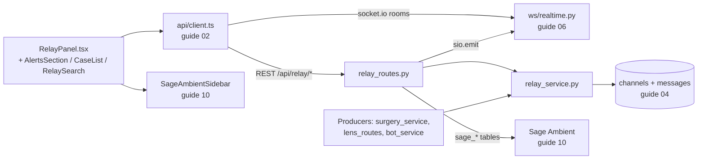
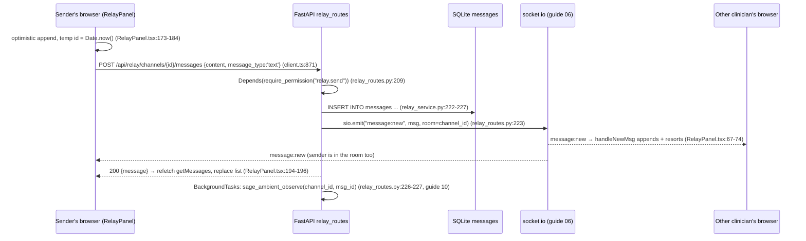

# Relay: clinical messaging, cases, alerts, and search

Relay is Orb's clinical chat: a Slack-like messaging system where every admitted patient automatically gets a **case room** (a chat channel tied to their record) and every department gets a shared channel. On top of plain text chat it layers three clinical features: **structured alerts** (JSON payloads rendered as actionable cards with Confirm/Escalate buttons, targeted at specific users/roles), **AI action cards** (legacy "ambient action" cards and the newer Sage agentic-order flow that can commit medication orders after PIN verification), and a **client-side case search/sort** bar. The backend is a thin FastAPI router (`server/routes/relay_routes.py`) over raw-SQL service functions (`server/services/relay_service.py`) writing to two SQLite tables (`channels`, `messages`); every mutation is broadcast live over socket.io rooms so other clinicians in the same room see it without refreshing. The frontend is one panel component (`src/pages/panels/RelayPanel.tsx`) plus three small subcomponents and two CSS files.

## Purpose and neighbors

**The problem.** Hospital teams coordinate about patients constantly, "start the antibiotic," "she's prepped for the OR," "who's covering bed 12?" Doing this over pagers or personal messaging apps loses the link to the patient's chart and produces no audit trail. Relay solves this by making the *patient* the unit of conversation: one channel per case, department channels for broad announcements, and machine-generated messages (AI imaging summaries, surgery-prep alerts, bot lab results) posted into the same stream as human chat, all persisted in the same database as the clinical record.

**Jargon, defined once (terms defined in earlier guides get a one-liner + a pointer):**

- **Channel**, a named message stream in the `channels` table. Relay has three declared types (`case_room`, `department`, `direct`, `server/database.py:124`), and all three are now created.
- **Case room**, a `case_room` channel linked to one patient via `channels.patient_id`. Created automatically when a patient is admitted (`server/routes/vigil_routes.py:930`, guide 07-vigil).
- **Socket room**, a server-side label on a socket.io connection; `sio.emit(event, data, room=X)` reaches only connections that joined room `X`. Relay reuses the channel id as the room name, plus per-user rooms `user:<id>`. Full definition in guide 06-realtime.
- **JWT / RBAC**, the signed login token and the role→permission map that gate every route. Relay uses three permissions: `relay.read`, `relay.send`, `relay.execute_action` (`server/permissions.py:59-61`). See guide 03-auth-rbac.
- **Dependency injection (FastAPI `Depends`)**, FastAPI's mechanism where a route handler declares `user: dict = Depends(require_permission("relay.read"))` and the framework runs that function first, passing its return value in. It centralizes auth so handler bodies can assume an authorized user.
- **Pydantic model**, a Python class (e.g. `MessageCreate`, `server/models/message.py:9`) that validates and parses the JSON request body; invalid bodies are rejected with HTTP 422 before the handler runs.
- **Optimistic update**, the UI pattern of showing the result of an action immediately (before the server confirms) and rolling back on failure. `handleSend` does this (`src/pages/panels/RelayPanel.tsx:172-201`).
- **Optimistic locking**, a concurrency control where each row carries a `version` number; an `UPDATE ... WHERE version = ?` that matches zero rows means someone else changed it first, and the caller gets HTTP 409 (`server/routes/relay_routes.py:170-176`).
- **IDOR** (insecure direct object reference), the vulnerability where guessing an id (e.g. a message id) lets you act on someone else's data. Several Relay routes explicitly guard against it by re-deriving the caller's visible channels (`server/routes/relay_routes.py:266-269`).
- **Idempotency**, making a repeated request harmless. A Sage action moves through a versioned state transition, so a repeated or stale transition is refused instead of acting twice (see the transition endpoint below). The legacy ambient-action executor that used to be the example here was removed on 3 October 2026.
- **XSS** (cross-site scripting), injecting HTML/JS through user content. `formatMessage` escapes `& < >` *before* adding its own `<strong>`/`<em>` tags, which is why the `dangerouslySetInnerHTML` sink at `src/pages/panels/RelayPanel.tsx:431` is safe.
- **React hook**, a function starting with `use*` that gives a function component state (`useState`), side effects (`useEffect`), memoized values (`useMemo`), stable callbacks (`useCallback`), or mutable refs (`useRef`). All five appear in `RelayPanel.tsx:1`.
- **Debounce**, delaying a reaction until input pauses; `RelaySearch` waits 150 ms after the last keystroke before firing (`src/components/relay/RelaySearch.tsx:12-17`).
- **MRN**, Medical Record Number, the hospital-issued patient identifier shown in search and alert cards.
- **Background task**, FastAPI's `BackgroundTasks.add_task(fn, ...)` runs `fn` *after* the HTTP response is sent, so slow work (AI analysis) never delays the chat message (`server/routes/relay_routes.py:227`).

Neighbors: guide 02-api-client owns the typed fetch wrappers and the socket singleton Relay consumes; guide 03-auth-rbac owns `require_permission`; guide 04-database-schema owns the `channels`/`messages` DDL; guide 06-realtime owns the socket server whose `join_channel`/`new_message` events mirror Relay's REST semantics; guide 07-vigil creates case rooms at admission and produces the `risk_scores` that decorate the channel list; guide 10 owns `SageAmbientSidebar.tsx` and the Sage Ambient pipeline whose data five Relay routes serve. The Surgery and Lens subsystems (their own guides) *produce* Relay messages via `send_message`.

## File map

| File | Lines | Role |
|---|---|---|
| `server/services/relay_service.py` | 853 | Raw-SQL service layer: channel list with enrichment, alert targeting, message fetch/insert, read tracking. |
| `server/routes/relay_routes.py` | 1749 | FastAPI router (`/api/relay`): 12 endpoints, channels, messages, alerts, Sage memory/actions, agentic order confirmation. |
| `server/models/message.py` | 13 | Pydantic body schema for posting a message (`content`, `message_type`). |
| `src/pages/panels/RelayPanel.tsx` | 748 | The whole Relay UI: channel list view ⇄ chat view, socket wiring, optimistic send, alert/surgical-alert cards. |
| `src/pages/Relay.css` | 622 | Styles for the panel, channel list, chat window, message cards, composer, legacy ambient cards, tablet breakpoints. |
| `src/components/relay/AlertsSection.tsx` | 114 | "Action Required" list above the channels: fetches targeted alerts, dedupes by surgery, deep-links to the case room. |
| `src/components/relay/CaseList.tsx` | 92 | Presentational channel list with risk badges, ward/diagnosis line, unread badge, show-10/expand. |
| `src/components/relay/RelaySearch.tsx` | 41 | Debounced search input; lifts the query string to the parent. |
| `src/components/relay/RelayComponents.css` | 131 | Styles for the alert cards, search bar, expand button, empty state. |

## How it works

### The messaging model

There are **channels** and **messages**, no threads. All three declared channel types are now real: `case_room`, `department`, and `direct` (one-to-one and small-group DMs, opened by `POST /api/relay/channels/direct` → `create_direct_channel`, `relay_service.py:420`), with explicit membership held in `channel_members` (migration 8) rather than inferred from who has posted. A channel row is just `(id, name, type, patient_id, created_at)` (`server/database.py:121-127`). A message row carries denormalized sender identity (`sender_id`, `sender_name`, `sender_role`), a `content` string, a `message_type` in `{text, alert, system, ambient_action, surgical_alert}`, a `read_by` JSON array of user ids, and provenance columns `source`/`is_bot` added by migration (`server/database.py:130-140`; `source`/`is_bot` added at `:1865`, `:1867`). The trick that keeps the schema tiny: **structured features are JSON stored in `content`**. An "alert" is a `text`-typed column holding `{"is_structured": true, "target_users": [...], "status": ...}`; acknowledging it means rewriting that JSON. This avoids new tables at the cost of unqueryable payloads (every alert scan is a Python-side `json.loads` loop, `server/services/relay_service.py:548`).

Channel ids double as socket room names. Department channels are seeded with fixed ids like `dept-surgery` (`server/scripts/seed_clinical_data.py:293-307`); case rooms get random ids `CH-XXXXXX` at admission (`server/routes/vigil_routes.py:555`), though seeds and tests also use the `case-<patient_id>` convention, which `surgery_service` relies on (`server/services/surgery_service.py:295`).

### Flow 1: opening Relay (channel list)

1. `ClinicianShell` lazy-loads `RelayPanel` into the shell (`src/pages/ClinicianShell.tsx:231`, `478`; guide 01-app-shell).
2. On mount, `loadChannels()` calls `GET /api/relay/channels` (`RelayPanel.tsx:61`, `147-149` → `src/api/client.ts:429-431`).
3. The route (`relay_routes.py:21-24`) requires `relay.read` and delegates to `get_channels_for_user`, which runs one SQL query enriching each channel with patient info, latest risk score, unread count, last message, 24-hour alert count, and last activity (`relay_service.py:16-51`), then filters out orphaned/discharged case rooms and non-matching department channels in Python (`relay_service.py:53-72`).
4. The panel splits the result into `caseRooms` and `deptChannels` memos, applies the search filter and the Recency/Urgency sort (`RelayPanel.tsx:213-250`), and renders `AlertsSection`, `RelaySearch`, and two `CaseList`s (`RelayPanel.tsx:277-295`).

### Flow 2: sending a message (the main flow)

Persistence happens **before** the broadcast, so the socket event is a notification about durable state, never the source of truth. Both browsers are in socket room `channel_id` because opening a channel emits `join_channel` (`RelayPanel.tsx:79`), which the server authorizes against the same visibility function the REST layer uses before calling `enter_room` (`server/ws/realtime.py:210-226`). There is also a **pure-WebSocket send path**, the `new_message` socket event (`ws/realtime.py:365-407`) authenticates, checks `relay.send` and channel membership, calls the same `send_message`, and broadcasts, but the shipped UI never uses it; RelayPanel sends over REST only.

### Flow 3: alert lifecycle (create → target → acknowledge)

1. **Create.** A producer builds a structured JSON payload and posts it as a `message_type='alert'` message. The canonical producer is `trigger_surgery_prep` (`server/services/surgery_service.py:255-367`): payload includes `is_structured: true`, `surgery_id`, patient identifiers, `target_users` (the assigned surgical team), fallback `target_roles`/`target_departments`, `title`, and `action_required` (`surgery_service.py:297-317`). It is posted to both `dept-surgery` and the patient's case room, with a 4-hour dedupe check (`surgery_service.py:319-333`).
2. **Target.** `GET /api/relay/alerts` → `get_user_alerts` scans the last 48 hours of alert messages, parses each `content`, skips unstructured or already `resolved`/`escalated` ones, and keeps an alert if (a) the caller's id is in `target_users`, or (b) the caller's role is in `target_roles` **and** their department is in `target_departments`, or (c) the caller is `admin` (`relay_service.py:102-139`).
3. **Display.** `AlertsSection` renders these as red "Action Required" cards above the channel list, deduped by `surgery_id`, each deep-linking to the patient's case room (`src/components/relay/AlertsSection.tsx:33-85`). Inside the chat, the same message renders as a structured card with patient/procedure/OR details and Confirm/Escalate buttons (`RelayPanel.tsx:398-429`).
4. **Acknowledge.** Clicking Confirm/Escalate calls `POST /api/relay/alerts/{message_id}/resolve` with `{action: 'confirm'|'escalate'}` (`client.ts:437-442`). The route rewrites the JSON: `status = 'resolved'` or `'escalated'`, `resolved_by = user.name`, updates the row, and broadcasts `message:update` to the channel room (`relay_routes.py:447-497`). Every client's `handleUpdateMsg` swaps the message in place (`RelayPanel.tsx:76-78`), so the card flips to "✓ Confirmed by …" everywhere at once, and the alert drops out of future `get_user_alerts` results (step 2's status filter).

**Surgical alerts** are a second, per-person alert species: `message_type='surgical_alert'` rows with `{text, target_user_id, surgery_id, role}` inserted by emergency-surgery staffing (`server/routes/surgery_routes.py:268-279`) and emitted both to the case room and the target's personal room `user:<id>` (`surgery_routes.py:299-301`). RelayPanel renders them as red cards; only the targeted user sees Confirm/Decline buttons, which call the Surgery subsystem's `/api/surgery/{id}/team-response` endpoint (`RelayPanel.tsx:331-382`, `client.ts:1034-1039`).

### Flow 4: unread tracking

`messages.read_by` is a JSON array of user ids. The channel query counts messages whose `read_by` does not `LIKE '%<user_id>%'` as unread (`relay_service.py:25-27`, parameter at `:51`). Opening a channel optimistically zeroes the local badge and fires `POST /api/relay/channels/{id}/read` (`RelayPanel.tsx:159-161`), whose service loops over every message in the channel appending the user id if absent (`relay_service.py:181-209`). The docstring records the history: the badge existed before anything ever wrote to `read_by`, so it never cleared until `mark_channel_read` was added (`relay_service.py:183-189`).

### Flow 5: search and sort

Search is **entirely client-side** over the already-fetched channel list, there is no search endpoint and no message-content search. `RelaySearch` debounces keystrokes by 150 ms and lifts the string to `RelayPanel` (`RelaySearch.tsx:12-17`), whose `caseRooms` memo filters by channel name, patient id, MRN, or diagnosis, then sorts by recency (`last_activity` desc) or "urgency" (`alert_count + unread_count` desc, tie-broken by recency) (`RelayPanel.tsx:213-240`). Department channels ignore the search box and only sort by recency (`RelayPanel.tsx:242-250`).

## Function-by-function

### `server/services/relay_service.py`

### get_channels_for_user: `server/services/relay_service.py:11`
**Signature:** `(user_id: str, user_role: str) → list[dict]`
**Does:** Returns every channel this user may see, enriched with patient, risk, unread, and activity metadata, Relay's single source of truth for channel visibility.
**How it works:**
1. Looks up the user's `department` from `users` (`:13-14`); empty string if absent.
2. Runs one query joining `channels` to `patients` and to the *latest* `risk_scores` row per patient (the `MAX(id) GROUP BY patient_id` subquery, `:39-43`), with four correlated subqueries per channel: unread count via `read_by NOT LIKE '%user_id%'` (`:25-27`), last message content (`:28-30`), alert count in the last 24 h (`:31-34`), and `MAX(timestamp)` as `last_activity` (`:35-36`).
3. Orders critical risk first, then elevated, then by `last_activity DESC NULLS LAST`, then name (`:46-51`).
4. Python-filters: drops `case_room`s with no patient *and* no messages (orphans, `:56-57`); drops case rooms of discharged patients (`:60-61`); for non-admin users, keeps a `department` channel only if the user's department fuzzily matches the channel name, with hardcoded carve-outs mapping Surgery and Anesthesiology staff into the "surgery" channel (`:62-70`). Admins and all `case_room`s pass through (`:71-72`).
5. Maps rows into plain dicts, defaulting `unread_count`/`alert_count` to 0 and deriving `has_alert` (`:74-93`).
**Why it exists:** Centralizing "what can this user see" in one function lets REST routes, the WS `join_channel` authorizer (`server/ws/realtime.py:203`), and the message-post guards all enforce identical visibility, so a user can never receive live events for a channel they could not list.
**Data in/out:** in: user id + role strings. Out: list of `Channel` dicts matching the frontend interface (`src/api/client.ts:344-360`): `{id, name, type, patient_id, mrn, diagnosis, ward, bed, risk_score, risk_level, unread_count, last_message, last_activity, alert_count, has_alert}`.
**Talks to:** reads `users`, `channels`, `patients`, `risk_scores`, `messages`. Called by every relay route as an authorization primitive (`relay_routes.py:24,39,50,63,97,143,268,471,515,580`) and by `ws/realtime._user_can_access_channel` (`ws/realtime.py:203`).
**Change guide:** To let a nurse see a second department's channel, change the matching block at `relay_service.py:62-70` (e.g. add another carve-out or switch to a proper membership table); knock-on effects: WS join authorization and all IDOR guards change automatically because they call this function; watch out for the substring match `u_dept in ch_name or ch_name in u_dept` (`:69`), which already produces surprising matches (e.g. department "Neuro" matches channel "Neurology").
**Gotchas:** `LIKE '%user_id%'` on `read_by` is substring matching, not JSON matching, if one user id is a prefix of another (`u1` vs `u12`), `u12`'s read marks make messages look read for `u1`. The four correlated subqueries run per channel per call, and this function is invoked as a *guard* on almost every request, it is the subsystem's hot spot. `NULLS LAST` requires SQLite ≥ 3.30.

### get_user_alerts: `server/services/relay_service.py:510`
**Signature:** `(user_id: str, user_role: str) → list[dict]`
**Does:** Returns unresolved structured alerts from the last 48 hours that target this specific user.
**How it works:**
1. Fetches the user's department (`:98-99`).
2. Selects all `message_type='alert'` rows newer than 48 h, newest first (`:102-107`).
3. For each row, `json.loads(content)`; skips rows that are not `is_structured` or whose `status` is `resolved`/`escalated` (`:112-116`).
4. Targeting: match if `user_id ∈ target_users`, else if `role ∈ target_roles` **and** `department ∈ target_departments`, else if role is `admin` (`:121-127`).
5. Appends matching rows as message dicts (`:130-139`); malformed JSON rows are skipped with a debug log rather than crashing the endpoint (`:140-143`).
**Why it exists:** Alerts live in the same `messages` table as chat (no separate alerts table), so a targeted inbox requires filtering by the JSON payload; doing it here keeps the "who should act on this" policy server-side.
**Data in/out:** out: list of raw `Message` dicts (`content` still the JSON string, the client re-parses it).
**Talks to:** reads `users`, `messages`. Called only by `GET /api/relay/alerts` (`relay_routes.py:85`). Payloads are produced by `surgery_service.trigger_surgery_prep` (`surgery_service.py:297-317`).
**Change guide:** To add a new alert producer (e.g. a critical-lab alert), write a `send_message(..., message_type='alert', content=json.dumps({...}))` with `is_structured: true`, `target_users`/`target_roles`+`target_departments`, `title`, `action_required`, and no `status` key; it will appear in `AlertsSection` automatically; watch out, the role fallback requires department to match too (`:124`), so role-only targeting silently matches nobody outside the listed departments.
**Gotchas:** Every admin sees every active alert (`:126-127`). The 48-hour window means an unacknowledged alert silently ages out rather than escalating.

### get_channel_messages: `server/services/relay_service.py:584`
**Signature:** `(channel_id: str, limit: int = 500, offset: int = 0) → list[dict]`
**Does:** Returns a page of a channel's messages in chronological order.
**How it works:** A nested query takes the newest `limit` rows starting at `offset` (`ORDER BY timestamp DESC LIMIT ? OFFSET ?`), then the outer query re-sorts them ascending (`:151-159`), i.e. "the latest N, oldest first," which is what a chat view wants. Each row is mapped to a dict, with `is_bot`/`source` read defensively via `"is_bot" in r.keys()` so pre-migration databases don't crash (`:174-175`).
**Why it exists:** Fetching newest-first then flipping is the standard trick for "last page of chat" without knowing the total count.
**Data in/out:** out: `Message[]` (`client.ts:362-376`).
**Talks to:** reads `messages`. Called by `GET /channels/{id}/messages` (`relay_routes.py:41`).
**Change guide (worked example, raise the visible history):** The *route* defaults `limit=50` (`relay_routes.py:35`) and the client never passes a limit (`client.ts:444-446`), so users only ever see the latest 50 messages. To show 200, either change the route default at `relay_routes.py:35` or add `?limit=200` in `getMessages`; knock-on effects: the initial render and the post-send refetch both grow; watch out for the unused service default of 500 (`:148`), changing it does nothing for REST callers.
**Gotchas:** Timestamps are SQLite `CURRENT_TIMESTAMP` strings with no timezone, the client must (and does) parse them as UTC via `parseUTC` (`RelayPanel.tsx:20-26`). No pagination UI exists; `offset` is dead weight today.

### mark_channel_read: `server/services/relay_service.py:688`
**Signature:** `(channel_id: str, user_id: str) → int` (count updated)
**Does:** Appends the user's id to `read_by` on every message in the channel that doesn't already contain it, clearing the unread badge.
**How it works:** Reads every `(id, read_by)` in the channel (`:192-195`); per row, parses the JSON array (tolerating null/garbage, `:197-199`), skips if the user is present, otherwise appends and issues an `UPDATE` (`:203-208`); returns how many rows changed.
**Why it exists:** The docstring is explicit: the unread counter existed but nothing ever wrote `read_by`, so badges never cleared (`:183-189`). This is the write half that made the read half meaningful.
**Data in/out:** out: integer count, surfaced as `{status:"ok", marked_read: n}` by the route.
**Talks to:** reads/writes `messages`. Called by `POST /channels/{id}/read` (`relay_routes.py:52`), which the client fires on every channel open (`RelayPanel.tsx:161`).
**Change guide:** To make this one statement instead of N, replace the loop with SQLite's `json_insert`/`json_each` (`UPDATE messages SET read_by = json_insert(read_by,'$[#]',?) WHERE channel_id = ? AND ...`); knock-on effects: none, callers only see the count; watch out for legacy rows where `read_by` is NULL (the CREATE TABLE default is `'[]'` but the code defends against NULL, `:198`).
**Gotchas:** Read-modify-write per message (an N+1 pattern, one query becoming N) on every channel open; harmless at demo scale, a real system would track read state per (user, channel) with a watermark timestamp instead of per message.

### send_message: `server/services/relay_service.py:778`
**Signature:** `(channel_id, sender_id, sender_name, sender_role, content, message_type='text', is_bot=False, source='clinician') → dict`
**Does:** Inserts one message row and returns it fully hydrated (with DB-assigned id and timestamp), the single write path for *every* message in Orb.
**How it works:** One parameterized `INSERT` including the provenance columns (`:222-227`), then a `SELECT` of the inserted row by `lastrowid` (`:228-231`) so the caller gets the DB's `CURRENT_TIMESTAMP` rather than guessing, mapped to a dict with defensive `is_bot`/`source` fallbacks (`:242-243`).
**Why it exists:** Denormalizing sender name/role into the row makes history immutable (a renamed user doesn't rewrite old chat) and makes reads join-free. The `is_bot`/`source` flags let the UI badge automated posts ("AUTO") so bot chatter is never mistaken for a clinician (`:216-220`; badge at `RelayPanel.tsx:388-394`).
**Data in/out:** out: a complete `Message` dict, ready to be emitted as the `message:new` payload verbatim.
**Talks to:** writes `messages`. Callers: REST `post_message` (`relay_routes.py:453`), WS `new_message` (`ws/realtime.py:678`), Lens filing imaging reviews as `system` messages (`server/routes/lens_routes.py:249,263`), surgery prep alerts (`services/surgery_service.py:336,355`), the imaging/lab bots (`server/services/bot_service.py:791,1015`, note the shift-report bot at `:397` writes `messages` directly with its own INSERT rather than going through here), and tests.
**Change guide (worked example, add a `handover` message type):** (1) extend the CHECK constraint in the schema and the messages-rebuild migration (`server/database.py:134`, `:961`); (2) note it in `MessageCreate`'s comment (`server/models/message.py:12`); (3) add a render branch in the message map (`RelayPanel.tsx:308-434`), unknown types currently fall through to the plain-text renderer; knock-on effects: the DB CHECK rejects the new type on un-migrated databases, so the schema change must ship first; watch out for the migration's canonical column list (`database.py:947-948`) if you also add columns.
**Gotchas:** No validation that `channel_id` exists beyond the foreign key; a bad id raises from SQLite. It does not emit any socket event, broadcasting is the caller's job, which is why every caller pairs it with `sio.emit("message:new", ...)`.

### `server/routes/relay_routes.py`

All routes live under prefix `/api/relay` (`relay_routes.py:18`), mounted in `server/main.py:299`.

### ActionTransitionRequest: `server/routes/relay_routes.py:13`
**Signature:** Pydantic model: `{state: str, version: int, reason?: str}`
**Does:** Body schema for Sage action state transitions.
**How it works:** Plain Pydantic `BaseModel`; `version` carries the optimistic-lock token.
**Why it exists:** Type-safe parsing of the transition request; oddly it is defined *above* its own imports mid-file (`:10-13` before `:14`), which works only because Python executes top-to-bottom.
**Data in/out:** JSON body → validated object.
**Talks to:** used only by `transition_sage_action`.
**Change guide:** Add fields here and read them in the handler; watch out for the duplicate `from pydantic import BaseModel` imports at `:7` and `:400`.
**Gotchas:** none noteworthy.

### list_channels: `server/routes/relay_routes.py:79`
**Signature:** `GET /api/relay/channels`, auth `relay.read` → `Channel[]`
**Does:** Returns the caller's visible channels.
**How it works:** One line: delegate to `get_channels_for_user(user.id, user.role)` (`:24`).
**Why it exists:** Thin routing layer; all logic lives in the service so the WS layer can reuse it.
**Data in/out:** out: `Channel[]` (shape above).
**Talks to:** `get_channels_for_user`; called by `getChannels()` (`client.ts:778-780`).
**Change guide:** Response-shape changes belong in the service; changing them breaks `RelayPanel`, `CaseList`, `AlertsSection` (channel lookup), and `SageAmbientSidebar` mounting (which checks `patient_id`, `RelayPanel.tsx:468`).
**Gotchas:** none noteworthy.

### list_alerts: `server/routes/relay_routes.py:85`
**Signature:** `GET /api/relay/alerts`, auth `relay.read` → `Message[]`
**Does:** Returns the caller's targeted, unresolved alerts (48 h window).
**How it works:** Delegates to `get_user_alerts` (`:30`).
**Why it exists / Data / Talks to:** see `get_user_alerts`; called by `getAlerts()` (`client.ts:782-784`) from `AlertsSection`.
**Change guide:** see `get_user_alerts`.
**Gotchas:** none noteworthy.

### get_messages: `server/routes/relay_routes.py:91`
**Signature:** `GET /api/relay/channels/{channel_id}/messages?limit=50&offset=0`, auth `relay.read` → `Message[]`
**Does:** Returns a channel's messages, guarding channel membership.
**How it works:** 403 unless `channel_id` appears in the caller's `get_channels_for_user` result (`:39-40`); then delegates to `get_channel_messages` (`:41`).
**Why it exists:** The membership check prevents reading a channel you cannot list (IDOR guard).
**Data in/out:** out: `Message[]`, chronological.
**Talks to:** `get_channels_for_user`, `get_channel_messages`; called by `getMessages()` (`client.ts:793-795`).
**Change guide:** see `get_channel_messages` worked example (history depth).
**Gotchas:** Route default `limit=50` silently overrides the service's 500.

### mark_read: `server/routes/relay_routes.py:102`
**Signature:** `POST /api/relay/channels/{channel_id}/read`, auth `relay.read` → `{status, marked_read}`
**Does:** Marks all messages in the channel read by the caller.
**How it works:** Same membership guard (`:50-51`), then `mark_channel_read` (`:52`).
**Why it exists:** Server-side persistence of the badge clear (the client also zeroes it optimistically, `RelayPanel.tsx:160`).
**Data in/out:** out: `{status:"ok", marked_read:int}`.
**Talks to:** called by `markChannelRead()` (`client.ts:798-800`).
**Change guide / Gotchas:** see `mark_channel_read`.

### get_sage_memory: `server/routes/relay_routes.py:177`
**Signature:** `GET /api/relay/channels/{channel_id}/sage_memory`, auth `relay.read` → memory object or `null`
**Does:** Serves the latest Sage Ambient room memory (AI-maintained conversation summary) for a channel.
**How it works:** Membership guard (`:63-65`); reads the single `sage_room_memory` row keyed by `room_id` (`:67-71`); returns `None` (JSON `null`) if absent; JSON-decodes four list columns (`likely_next_steps`, `unresolved_questions`, `active_intents`, `risk_flags`, `:82-85`).
**Why it exists:** The Sage Ambient *pipeline* (guide 10) writes this table in the background; Relay owns the room-scoped read API because access control is channel membership.
**Data in/out:** out: `SageAmbientMemory` (`client.ts:378+`), `{room_id, patient_id, patient_summary, discussion_summary, current_concern, likely_next_steps[], unresolved_questions[], active_intents[], risk_flags[], last_processed_at, updated_at}`.
**Talks to:** reads `sage_room_memory`; called by `getSageMemory()` (`client.ts:826-828`) from `SageAmbientSidebar` (guide 10).
**Change guide:** New memory fields must be added to the writer (guide 10), this serializer, and the `SageAmbientMemory` interface; watch out for the JSON-decode-or-empty-list pattern, a writer storing a bare string breaks the client's `.map`.
**Gotchas:** none noteworthy.

### get_sage_actions: `server/routes/relay_routes.py:211`
**Signature:** `GET /api/relay/channels/{channel_id}/sage_actions`, auth `relay.read` → action list
**Does:** Returns all Sage-suggested actions for a channel, each with its most recent handoff (dispatch record) folded in.
**How it works:** Membership guard (`:97-99`); a `LEFT JOIN` to `sage_handoffs` restricted to the newest handoff per action via a correlated `ORDER BY created_at DESC LIMIT 1` subquery (`:102-112`); per row, the five `handoff_*` columns are popped into a nested `handoff` object or removed entirely (`:114-131`).
**Why it exists:** The sidebar needs "what did the AI suggest and what happened when it was confirmed" in one request.
**Data in/out:** out: `SageAction[]` with optional `handoff: {id, status, target_module, error_summary, downstream_ref_id}`.
**Talks to:** reads `sage_actions`, `sage_handoffs`; called by `getSageActions()` (`client.ts:830-832`) from `SageAmbientSidebar`.
**Change guide:** To expose more handoff fields, extend the SELECT alias list (`:104-105`) and the folding block symmetrically; watch out, missing a `pop` leaks a flat column alongside the nested object.
**Gotchas:** none noteworthy.

### transition_sage_action: `server/routes/relay_routes.py:444`
**Signature:** `POST /api/relay/channels/{channel_id}/sage_actions/{action_id}/transition`, body `ActionTransitionRequest`, auth `relay.execute_action` → `{status, action, handoff}`
**Does:** Moves a Sage action through its state machine (`suggested → acknowledged/dismissed/confirmed/failed`) with optimistic locking, and on `confirmed` dispatches the downstream handoff **in the same transaction**.
**How it works:**
1. Membership guard (`:451`); state whitelist (`:454`).
2. Anything but a confirm: `_transition_action` (`:303`) opens one session around `_apply_transition` (`:308`), off the event loop (`:474`).
3. `_apply_transition` loads `(state, version)`, 404 if missing; resolved states (`confirmed`, `dismissed`) are terminal and `failed → confirmed` is forbidden (`:324-327`); optimistic-lock `UPDATE ... WHERE id = ? AND version = ?`, bumping `version`, zero rows → HTTP 409 "modified concurrently" (`:332-338`); a `sage_action_events` row with prior/new state, actor, reason, `source='ui'` (`:341-346`); the shadow `action.approved`/`action.declined` emit on the same transaction (`:359`).
4. A confirm goes through `_confirm_and_hand_off` (`:407`), off the event loop (`:461-462`). It runs the drug-safety screen first, outside any write transaction, through `sage_handoff_service.prescreen_handoff` (only for a Helix-bound card, and not for a card the claim will refuse; `:427-435`). Then ONE session holds `_apply_transition` and `dispatch_in_transaction` (`:437-439`): the claim, the handoff record, everything the adapter writes (chart row and Helix order, or the transfer, or the Scribe note) and the handoff's final status commit together (guide 22).
5. After the commit, back on the loop: a newly booked emergency case gets its prep package (`schedule_prep_package`, `:466`), and a staged surgery's team alerts go live to the case room and personal rooms (`emit_team_alerts_live`, `:472`).
6. Emits `sage:action_update {channel_id}` to the channel room so all open sidebars refetch (`:476`).
**Why it exists:** Two clinicians can look at the same suggestion; versioned transitions ensure exactly one confirm wins and the loser is told to refresh instead of double-executing.
**Data in/out:** in: `{state, version, reason?}`; out: `{status:"ok", action: row, handoff: dict|null}`.
**Talks to:** `sage_actions`, `sage_action_events`; `sage_handoff_service`; `sio`. Called by `transitionSageAction()` (`client.ts:834-840`) from `SageAmbientSidebar` (guide 10).
**Change guide:** New states go in `valid_states` (`:454`) plus the terminal-state rules (`:324-327`) plus the sidebar's button logic (guide 10); watch out for emitting `sage:action_update` before the handoff completes if you reorder, clients refetch on that event. Anything a new adapter writes must go on the `db` it is handed, never a session of its own, or it escapes the transaction.
**Gotchas:** A dispatch that fails or is blocked is still a committed outcome on a confirmed card (the handoff says `failed` or `blocked`). A fault outside the adapter (the handoff record, its final status, a lost transaction) rolls back the confirm with everything else and returns 500, so the card can be confirmed again. Until 2026-10-04 the confirm committed first and the handoff after it in separate steps, so such a fault left a confirmed card with no handoff, or a pending Helix order behind a handoff stuck at `pending`; `server/tests/test_handoff_confirm_transaction.py` pins the fix.

### post_message: `server/routes/relay_routes.py:391`
**Signature:** `POST /api/relay/channels/{channel_id}/messages`, body `MessageCreate`, auth `relay.send` → `Message`
**Does:** The REST send path: persist, broadcast, and schedule ambient AI analysis.
**How it works:**
1. **Membership guard first** (`:405-408`): `get_channels_for_user` is called and the target channel must appear in it, else `403 Not authorized to access this channel`. The comment above it (`:402-404`) is the reason it is a *list* rather than a boolean probe, the same list is the sender's PHI visibility boundary and is reused by the wrong-room detector, so there is only one definition of "can see".
2. `send_message` with identity taken from the authenticated `user` dict, never the body, plus the optional `Idempotency-Key` header (`:410-418`). A key already owned by another channel raises `ChannelAccessError` → 409 (`:419-425`).
3. **Idempotent replay short-circuit** (`:429-431`): a replayed offline message returns the stored row *without* re-broadcasting or re-observing.
4. `await sio.emit("message:new", result, room=channel_id)`, everyone joined to the channel room, including the sender, gets it live (`:435`).
5. `background_tasks.add_task(sage_ambient_observe, channel_id, result["id"])`, the Sage Ambient pipeline (guide 10) analyzes the message *after* the response is sent; it is contractually silent and non-blocking (`:437-439`).
6. **Wrong-room check last** (`:441-443`): `_run_room_fit` runs after the insert and after the broadcast, deliberately, so a heuristic can never delay, refuse or lose a message. When it fires, the warning rides back on *this* response and lands on screen with the sent message.
7. Returns the persisted message so the sender can reconcile its optimistic copy.
**Why it exists:** REST-then-broadcast (instead of send-over-socket) gives the sender an HTTP status to key retry/rollback on, which is why `handleSend` can restore the input box on failure.
**Data in/out:** in: `{content: string, message_type?: string}` (`models/message.py:9-13`), plus the `Idempotency-Key` header; out: full `Message`, optionally carrying `room_fit`.
**Talks to:** `get_channels_for_user`, `send_message`, `sio`, `sage_ambient_observe`, `_run_room_fit`; called by `sendMessage()` (`client.ts:871`), which routes through `offlineMutate` so an offline send is queued and replayed under the same `Idempotency-Key` (`:877-879`).
**Change guide:** The membership guard costs one `get_channels_for_user` query on the chat hot path; if that ever matters, cache it per request rather than removing it, the wrong-room detector consumes the same list, so dropping the query breaks two features, not one.
**Gotchas:** The membership hole earlier editions of this chapter flagged is **closed**, the route now refuses channels the sender cannot see, matching its WS twin `new_message` (`ws/realtime.py:665-671`). What remains is that `msg.message_type` is still passed through unvalidated beyond the DB CHECK, so a member of a channel can post `message_type='alert'` with a forged structured payload targeting arbitrary users. See Discrepancies.

### execute_ambient_action: removed 2026-10-03
`POST /api/relay/actions/{message_id}/execute` no longer exists (the note at `server/routes/relay_routes.py:997-1002`). It executed legacy `ambient_action` cards (add, stop or replace a medication, discharge, surgery prep) from a message row. No screen had called it since the cards were retired, nothing writes new cards, and clients can no longer post a message of that type, so it was only an unused door onto the chart. Legacy rows stay in the `messages` table and the readers keep skipping them. Confirmed Sage actions reach the chart through the transition endpoint above and `sage_handoff_service` (guide 22), or through `confirm_agentic` below.

### AlertActionPayload: `server/routes/relay_routes.py:1155`
**Signature:** Pydantic model: `{action: str}`
**Does:** Body schema for alert resolution (`confirm` or `escalate`).
**How it works / Why / Data / Talks to:** trivial; consumed by `resolve_alert`. Note the redundant second `from pydantic import BaseModel` at `:400`.
**Change guide:** none needed. **Gotchas:** `action` is unvalidated free text, anything other than `"confirm"` is treated as escalate (`:428`).

### resolve_alert: `server/routes/relay_routes.py:1249`
**Signature:** `POST /api/relay/alerts/{message_id}/resolve`, body `{action}`, auth `relay.send` → `{status}`
**Does:** Acknowledges a structured alert: flips its embedded `status` to `resolved` (confirm) or `escalated` (anything else) and broadcasts the change.
**How it works:**
1. Loads the message, 404 unless `message_type='alert'` (`:412-418`).
2. 400 if already `resolved`/`escalated` (`:421-422`), first click wins.
3. IDOR guard via channel membership (`:425-426`).
4. Mutates the JSON: `status`, `resolved_by = user.name` (`:428-429`); updates the row (`:431-434`).
5. Emits `message:update` with the *new* content but otherwise the original row fields to the channel room (`:437-447`), so every open chat re-renders the card as acknowledged and `get_user_alerts` stops returning it.
**Why it exists:** Alert acknowledgement must be visible to the whole team instantly (so two nurses don't both run to the OR) and must remove the alert from everyone's Action Required list; storing the acknowledgement in the message JSON gets both from one UPDATE + one broadcast.
**Data in/out:** in: `{action: 'confirm'|'escalate'}`; out: `{status: 'resolved'|'escalated'}`.
**Talks to:** `messages`, `get_channels_for_user`, `sio`. Called by `resolveAlert()` (`client.ts:786-791`) from the structured-alert card buttons (`RelayPanel.tsx:417,423`).
**Change guide (worked example, make Escalate actually escalate):** Today `escalate` only stamps the JSON (`:428`), nobody is notified. To page a senior, after the UPDATE build a new structured alert payload targeting e.g. `target_roles=['doctor'], target_departments=[...]` and `send_message(...)` + `sio.emit("message:new", ...)` into the same channel; knock-on effects: `AlertsSection` shows the new alert to the escalation targets on next load; watch out for the surgery-prep dedupe window (`surgery_service.py:268-282`) if you reuse `type='surgery_prep'`.
**Gotchas:** Requires only `relay.send`, not `relay.execute_action`, any nurse can resolve any alert they can see. The UI renders *both* outcomes with a green check ("✓ Escalated by …", `RelayPanel.tsx:409-411`), which reads like success.

### ConfirmAgenticRequest / DoseConfirmation: `server/routes/relay_routes.py:1129` / `:1072`
**Signature:** Pydantic model: `{clinician_pin: str, co_signer_id?: str, co_signer_pin?: str, override_reason?: str, dose_confirmation?: {dose, frequency, route?}, safety_ack?: {acknowledged, reason}}`
**Does:** Body for the PIN-verified agentic order confirmation.
**Gotchas:** a supplied `co_signer_id` is **verified** (distinct active user, own signing PIN, same lockout rules) before it may reach the audit chain; `dose_confirmation` is required in practice, because the agentic pipeline resolves no dose; `safety_ack` is the 428 re-submit contract.

### pre_flight_sage_action: `server/routes/relay_routes.py:1145`
**Signature:** `GET /api/relay/channels/{channel_id}/sage_actions/{action_id}/pre_flight`, auth `relay.execute_action` → pre-flight report
**Does:** Dry-runs an AI-suggested medication order: reconciles the free-text drug name against the pharmacy catalog, checks in-date stock, names an exact equivalent if out of stock, and flags high-risk drugs, all *before* the clinician commits.
**How it works:**
1. Membership guard (`:1103-1104`); loads the `sage_actions` row (`:1106-1115`).
2. `reconcile_medication(target)`, phonetic/fuzzy matching of the LLM's drug string to the Helix medication master, returning `(match, score)` (`:1120-1121`; `services/rxnorm_reconciler.py`, Helix/pharmacy guide).
3. If matched: `pre_flight_inventory_check` for in-date stock, and `pre_flight_alternative_suggestion` if out of stock (`:1133-1138`; `services/helix_service.py`), which offers only the same molecule, strength and form, never a different drug.
4. High-risk detection: substring match of the matched name/generic against a hardcoded set (epinephrine, heparin, insulin, potassium, tPA, opioids…) (`:1141-1144`).
5. Returns everything so the sidebar can render warnings and the equivalent, if any (`:1146-1153`).
**Why it exists:** Confirming an AI order should never fail *after* the clinician typed their PIN; surfacing reconciliation, stockouts, and risk up front turns failure modes into informed choices.
**Data in/out:** out: `{action, resolved_medication, reconciliation_score, stock_status, alternative_suggestion, is_high_risk}`.
**Talks to:** `sage_actions`; `rxnorm_reconciler`, `helix_service` (Helix guide). Called from `SageAmbientSidebar`'s order flow (guide 10).
**Change guide:** The high-risk list is duplicated verbatim in `confirm_agentic_action` (`:1552`), change both or extract a shared constant; watch out for the substring test flagging e.g. any drug whose generic contains "opioid".
**Gotchas:** none beyond the duplication.

### confirm_agentic_action: `server/routes/relay_routes.py:1391`
**Signature:** `POST /api/relay/channels/{channel_id}/sage_actions/{action_id}/confirm_agentic`, body `ConfirmAgenticRequest`, auth `relay.execute_action` → confirmation receipt
**Does:** The "sign the AI's order" endpoint: verifies the clinician's PIN (and any co-signer's), re-runs reconciliation and stock checks, enforces the dose, drug-safety and high-risk gates, creates a real pharmacy order, marks the Sage action confirmed, and writes a hash-chained audit record.
**How it works:** the route takes a per-action `asyncio` lock (`_confirm_lock`, `:1251`; the comment at `:1234-1245` explains why a double-click would otherwise dispatch two orders) and runs `_confirm_agentic_action` (`:1402`):
1. Membership guard (`:1421-1422`).
2. PIN: refuses a locked-out user with `429` (audited, `:1425-1445`) and a user with no provisioned PIN with a distinct `403` (`:1449-1456`); then `pin_security.verify_pin` (salted bcrypt; a legacy unsalted SHA-256 hash still verifies and is upgraded), `401` and a `pin_failure` security audit on mismatch (`:1459-1473`). The `pin_hash` is re-read after verification (`:1479-1480`) so only the post-upgrade hash is ever folded into the delegation hash.
3. Optional co-signer, fail closed (`:1482-1528`): different clinician, not locked, active, own PIN provisioned and verified; a supplied but unverifiable co-signer aborts the dispatch.
4. Loads the action; `404` if missing, `400` if already resolved (`:1530-1536`). Re-reconciles the drug, `400` if no catalog match (`:1541-1545`); recomputes `is_high_risk` (`:1552-1555`).
5. Stock: the order is always for the drug confirmed. Out of stock with no `override_reason` is `409 out_of_stock`, nothing ordered, any exact equivalent named as a suggestion (`:1561-1599`); with a reason it is ordered as written for pharmacy to source.
6. Dose: route inferred from the rationale (IV/IM/SC, default Oral) unless `dose_confirmation` names one; a missing or `TBD` dose or frequency is `422 dose_confirmation_required` (`:1601-1631`).
7. Drug-safety gate: `enforce_medication_safety(..., entry_point="relay.confirm_agentic", safety_ack=..., dose=..., route=...)`, run off the event loop through `run_db` (`:1640-1651`); a high-alert drug also needs an acknowledged `safety_ack` with a reason, else `428 drug_safety_acknowledgement_required` (`:1652-1663`).
8. No order is created yet. Step 10 places it inside the confirmation's own transaction.
9. Builds a **delegation hash chain**: `sha256(source_msg_id : sha256(target:rationale) : sha256(user_id:pin_hash_at_signing))` (`:1665-1673`), a tamper-evident fingerprint binding *which message*, *which AI suggestion*, and *which authenticated human* produced the order; the PIN itself is never hashed in.
10. `_persist_confirmation` (`:1273`) claims the action, places the order and records both in **one transaction**. First it flips `sage_actions.state` **conditionally** and bumps `version` (`WHERE state NOT IN ('confirmed','dismissed')`, `:1307-1312`). If that matches no row (a dismissal through the transition endpoint, which takes no lock, or a confirm on a second worker, since `_confirm_lock` is per process) it raises `409` (`:1313-1318`) before anything is written. Then, on the same connection, `helix_service.insert_order` writes the `pending` order for the catalogue row the reconciler matched and the safety screen checked, by id rather than by name (`:1322-1335`; `500` on failure). Then it writes `sage_action_events` (suggested to confirmed with the order id and hash in `reason`) and appends an `audit_logs` row on the hash chain (`event_category='clinical_safety'`, `action_type='agentic_med_confirm'`, metadata including the verified co-signer, any out-of-stock override and the safety summary; guide 05-audit-chain). A `409` or any failure, including a failed audit write, rolls back the order with everything else, so a lost race leaves nothing in the pharmacist's queue. The `version` bump matters because `version` is the transition endpoint's only write guard: without it, a dismissal that read the action just before the confirm committed could overwrite `confirmed` with `dismissed` and leave a live order behind a dismissed action. `server/tests/test_agentic_confirm_race.py` opens each of these windows deterministically.
11. Emits `sage:action_update` and `patient:timeline_updated` to the channel room (`:1688-1689`); returns `{status, action_id, order_id, correlation_id, delegation_hash, safety}` (`:1691-1699`).
**Why it exists:** Letting an LLM *suggest* orders is safe only if a human authenticates the commit; the PIN + hash chain + immutable audit row is Relay's "human-in-the-loop" contract for medication orders.
**Data in/out:** in: PIN(s), dose confirmation, optional override reason and safety acknowledgement; out: receipt with `delegation_hash` and the safety summary.
**Talks to:** `users`, `sage_actions`, `sage_action_events`, `audit_logs`; `pin_security`, `rxnorm_reconciler`, `helix_service`, `medication_safety_gate`; `sio`. Called from `SageAmbientSidebar`'s confirm dialog (guide 10).
**Change guide:** To require a co-signer for high-risk drugs, refuse at step 3 when `is_high_risk` and no `co_signer_id` was supplied; knock-on effects: the sidebar dialog must collect the second PIN, and `test_confirm_high_risk_medication_requires_and_accepts_safety_ack` (which dispatches on a single PIN) would need updating. The co-signer path already verifies whoever is supplied.
**Gotchas:** The per-action lock is in-process; it serialises confirms within one server worker. The conditional state write in `_persist_confirmation` stops a second writer (a dismissal through the transition endpoint, which takes no lock, or a confirm on another worker) from overwriting the action's state, and because the order is written in the same transaction, after that write, a refused confirm leaves no order either. Across two workers exactly one confirm creates an order; the other gets `409`. The early state read at step 4 is only a fast refusal; the conditional write at step 10 is the guard that counts. Dose and route are the clinician's confirmation, not the model's.

### `server/models/message.py`

### MessageCreate: `server/models/message.py:9`
**Signature:** Pydantic model: `{content: str, message_type: str = "text"}`
**Does:** Validates the POST body for sending a message.
**How it works:** Two fields; the comment enumerates the DB's allowed types (`:12`).
**Why it exists:** FastAPI needs a schema to reject malformed bodies with 422 before the handler runs; keeping it in `models/` mirrors the other route/schema pairs.
**Data in/out:** JSON `{content, message_type?}` → validated object.
**Talks to:** consumed by `post_message` (`relay_routes.py:391`); mirrored client-side by `sendMessage`'s literal body (`client.ts:879`).
**Change guide:** To hard-restrict types server-side, change `message_type: str` to a `Literal["text","alert","system","ambient_action","surgical_alert"]`; knock-on: forged-alert posting (see `post_message` gotcha) would still be possible for `alert`, a `Literal["text"]` for this route is the stricter fix; watch out for the bots/services which bypass this model entirely.
**Gotchas:** No length limit on `content`.

### `src/pages/panels/RelayPanel.tsx`

### formatMessage: `src/pages/panels/RelayPanel.tsx:14`
**Signature:** `(text: string) → string` (HTML)
**Does:** Converts a message's plain text into minimal safe HTML: bullets, bold, italics.
**How it works:** (1) rewrites leading `-`/`*` list markers to `•` (`:10`); (2) escapes `&`, `<`, `>` (`:12`); (3) *then* converts `**bold**` → `<strong>` and `*italic*` → `<em>` (`:13-14`).
**Why it exists:** Clinicians and bots write lightweight markdown; a full markdown parser would be overkill and a raw-HTML sink would be an XSS hole. Escape-before-tagging is the safety invariant.
**Data in/out:** string → HTML string consumed by `dangerouslySetInnerHTML` (`:431`).
**Talks to:** only the message renderer. The API client's docs call out this sink as one that must stay behind sanitization (`client.ts:20`).
**Change guide:** Add new markdown features *after* the escape step only; watch out, adding a regex that emits attributes (e.g. links) reopens injection via crafted URLs.
**Gotchas:** none beyond ordering.

### parseUTC: `src/lib/datetime.ts:17`
**Signature:** `(ts: string) → Date`
**Does:** Parses server timestamps as UTC even when SQLite gives bare `"2026-05-15 12:41:00"` strings.
**Where it lives:** *Not* in Relay any more. It was lifted out of `RelayPanel.tsx` into the shared
`src/lib/datetime.ts` module, because every panel that renders a DB timestamp needs the same rule;
Relay now imports it (`RelayPanel.tsx:5`) alongside `formatUTCDateTime` / `formatUTCDate` /
`formatUTCTime`, which are the same fix packaged as ready-made renderers (`:31`, `:35`, `:58`).
**How it works:** Empty → `new Date()` (`:18`); if the string already pins an offset it is passed
through untouched (`:19`), tested against `TZ_SUFFIX = /(?:Z|[+-]\d{2}:?\d{2})$/i` (`:15`);
otherwise the space becomes `T` and a `Z` is appended (`:20`).
**Why it exists:** JavaScript treats bare datetimes as *local* time; without this, every message would display shifted by the viewer's UTC offset, and the chronological sort would interleave optimistic (ISO, has `Z`) and persisted (bare) timestamps wrongly. The module header spells out the clinical version of that bug: a note charted at 19:30 IST rendering as 14:00 (`:1-11`).
**Data in/out:** string → `Date`.
**Talks to:** in Relay, `formatTime` (`RelayPanel.tsx:24`) and all three chronological sorts
(`:131`, `:240`, `:349`); repo-wide, every other panel that shows a DB time.
**Change guide:** If the backend ever returns ISO-8601 with offsets everywhere, this collapses to `new Date(ts)`. Because it is now shared, a change here moves timestamps on *every* screen, not just Relay, grep the importers before touching it.
**Gotchas:** anchored `$` on the suffix regex, so it no longer false-positives on offsets appearing mid-string.

### formatTime: `src/pages/panels/RelayPanel.tsx:23`
**Signature:** `(ts: string) → string`
**Does:** Renders a timestamp as a locale `HH:MM` string via `parseUTC`.
**Everything else:** one-liner (`:24`); used in every message header. No gotchas.

### RelayPanel: `src/pages/panels/RelayPanel.tsx:33`
**Signature:** React component, no props → JSX
**Does:** The entire Relay screen: channel-list view when no channel is selected, chat view (plus optional `SageAmbientSidebar`) when one is.
**How it works:**
1. **State** (`:34-60`): `channels`, `selectedChannel` (id or null, this is the view switch), `messages`, `newMessage` (composer text), `loadingMsgs`, `msgError`, `sending`, `sendError` (an offline refusal, held apart from the thread's own error line, `:44`), `sortBy` (`'recency' | 'urgency'`), `searchQuery`, `typingUsers`, `resolvingAlertId`/`alertErrors`, `respondingSurgeryId`/`surgicalErrors`, and `roomFit`. Refs follow (`:65-79`): `msgReqSeqRef` (thread-load ownership), `messagesContainerRef`, `inputRef`, `typingEmitRef`, `stickToBottomRef`.
2. **Scroll management** (`:94-103`): `scrollToBottom`, a `useCallback` that sets `scrollTop = scrollHeight` inside `requestAnimationFrame`, scoped to the messages container so the page itself never jumps; re-run whenever `messages` changes (`:203`). `stickToBottomRef` (`:79`, updated by `handleMessagesScroll`) means a reader parked in the scrollback is not yanked to the bottom by an incoming message.
3. **Mount effect** (`:105`): `loadChannels()` once; the channel list is then re-polled while the tab is visible (`useVisiblePolling(loadChannels, 30000)`, `:215`).
4. **Channel effect** (`:107-200`): on selecting a channel it (a) resets `stickToBottomRef` and clears `sendError` (`:111-116`); (b) loads messages (`:117`); (c) emits `join_channel {channel_id}` (`:152`); (d) subscribes `message:new` → claim-the-optimistic-bubble, else dedupe-by-id append + chronological re-sort (`:119-134`, subscribed `:153`), `message:update` → in-place replace (`:135-137`, `:154`), `relay:room_fit` / `relay:room_fit_resolved` → patch the wrong-room flag for one message (`:143-150`, `:155-156`), `typing` → show a peer's name for ~4 s on a per-user timer (`:159-171`, `:181`), `connect` → **re-emit `join_channel`** (`:176-178`, `:182`), and `disconnect` → clear the typing list (`:179`, `:183`). The cleanup function unsubscribes everything, clears the typing timers, and emits `leave_channel` (`:185-198`), so switching channels never leaks listeners.
5. **View render** (`:464` onward): list view = sort header with Recency/Urgency toggle buttons (`:468-488`) + scrollable column of `AlertsSection` (`:490`), `RelaySearch` (`:491`), case-room `CaseList` (with `title=""` to avoid duplicating the header, per the comment at `:493-494`), and department `CaseList` (`:501`). Chat view = header with back button that also refreshes the list on the way out (`:512-518`), the scrollable message container (`:520`) holding the loading/error/Retry states (`:521-526`) and the message map (below), the typing-indicator row (`:713-716`), the `sendError` row (`:717-721`), the composer (`:722-737`, Enter-to-send without Shift at `:729`), and, only for patient-linked channels, `SageAmbientSidebar` (`:740-742`; guide 10).
6. **Message rendering** (`:528` onward): skips legacy `ambient_action` messages outright (`:529-530`); parses `alert`/`surgical_alert` content as JSON, but only flags a parse *failure* for content that actually looks like JSON, so prose bot alerts no longer carry a spurious "could not be fully displayed" caveat (`:540-561`); renders three shapes, the **surgical alert card** with Confirm/Decline shown only to `payload.target_user_id` (calling `surgicalTeamResponse` at `:401`); the **structured alert card** with title/patient/procedure/OR/action plus Confirm/Escalate buttons or the acknowledged banner (`:656`); and the **plain message** with sender, optional `AUTO` bot badge (`:629`), role chip, time, and `formatMessage` HTML (`:621` onward).
**Why it exists:** One component owning both views keeps the socket subscription tied to the selected channel's lifecycle, React's effect cleanup is the natural place to leave a socket room.
**Data in/out:** consumes `Channel[]`/`Message[]` from the API client; emits `join_channel`/`leave_channel`/`typing`; renders JSX.
**Talks to:** `getChannels`, `getMessages`, `sendMessage`, `markChannelRead`, `resolveAlert`, `surgicalTeamResponse`, `getRoomFitFlags`, `getUser`, `socket` (guide 02); child components; `SageAmbientSidebar` (guide 10).
**Change guide:** The reconnect rejoin is already in place, `handleConnect` is declared *inside* the effect (`:176`) precisely so it closes over the current `selectedChannel`; if you move it out you reintroduce a **stale closure** (a callback remembering an old render's variable) and the client rejoins whichever room was open when the component first mounted. `join_channel` is idempotent server-side, so re-emitting is safe.
**Gotchas:** (1) The `ambient:*` listeners and the "Processing action…" spinner earlier editions of this chapter documented are **gone**, the deprecated Stage-2 ambient card pipeline left no client-side remnants, though the legacy `ambient_action` message type is still skipped by the renderer (`:530`). Its server-side execute endpoint was removed on 3 October 2026 (see Discrepancies). (2) Live `message:new` echoes of your own send are reconciled by `claimOptimistic` (`lib/messageMerge.ts`), not by id, the id-based dedupe alone printed every sent message twice (`:119-134`).

### loadChannels: `src/pages/panels/RelayPanel.tsx:205`
**Signature:** `() → Promise<void>`
**Does:** Fetches channels into state, logging failures.
**How it works:** `setChannels(await getChannels())` in a try/catch (`:148`).
**Why it exists:** Named so both the mount effect and future refresh points can call it.
**Data in/out:** → `channels` state. **Talks to:** `getChannels`.
**Change guide:** Note it is only called once (`:61`), unread badges and new case rooms do not refresh while the list is open; poll or subscribe here to fix.
**Gotchas:** see change guide.

### loadMessages: `src/pages/panels/RelayPanel.tsx:217`
**Signature:** `(channelId: string) → Promise<void>`
**Does:** Loads a channel's messages, sorts chronologically, and clears the unread badge.
**How it works:** Sets the loading flag; fetches; sorts by `parseUTC` (`:156`); optimistically zeroes the channel's `unread_count` in local state (`:160`); fires `markChannelRead` fire-and-forget (`:161`); clears loading in `finally`.
**Why it exists:** Bundles "open a channel" semantics (read + mark-read) in one place; also reused by the surgical-alert buttons to refresh after responding (`:361`, `:372`).
**Data in/out:** → `messages`, `channels` state.
**Talks to:** `getMessages`, `markChannelRead`.
**Gotchas:** the server already returns messages ascending; the client re-sort is defensive (and necessary for mixed optimistic timestamps).

### handleSend: `src/pages/panels/RelayPanel.tsx:273`
**Signature:** `() → Promise<void>`
**Does:** Optimistically posts the composer text and reconciles with the server.
**How it works:**
1. Bails on empty text, no channel, or an in-flight send (`:167-168`).
2. Builds an optimistic `Message` from `getUser()` (localStorage identity, `client.ts:95-98`) with temp id `Date.now()` and a client ISO timestamp (`:173-182`).
3. Appends it, clears the input, sets `sending`, and refocuses the input (`:184-189`).
4. `await sendMessage(...)`; on success **refetches the whole message list** and replaces state, discarding the temp message in favor of server truth (`:192-196`).
5. On failure, removes the optimistic message and restores the text into the input for retry (`:198-201`); clears `sending` in `finally`.
**Why it exists:** Chat must feel instant; the refetch-on-success (rather than patching the temp id) sidesteps id-reconciliation bugs at the cost of one extra GET.
**Data in/out:** `newMessage` string → POST body `{content, message_type:'text'}`.
**Talks to:** `sendMessage`, `getMessages`, `getUser`.
**Change guide:** To kill the brief duplicate (optimistic + socket echo), tag the optimistic message (e.g. `pending: true`) and have `handleNewMsg` replace a pending message from the same sender with matching content instead of appending; watch out for multi-tab sends by the same user defeating naive content matching.
**Gotchas:** `sending` disables the input and send button (`:459`, `:461`), serializing sends, fast typists wait for the round-trip between messages.

> **Removed since an earlier draft:** `refreshMessages`. Earlier editions of this chapter
> documented a second, unsorted refetch helper sitting beside `loadMessages` that nothing called.
> It no longer exists in `RelayPanel.tsx`. `loadMessages` (`:217`) is now the *only* thread-refetch
> path, and every caller goes through it, the post-send refetch (`:379`), the alert-resolution
> refetch (`:403`), and the error-state Retry button (`:525`).

### caseRooms (memo): `src/pages/panels/RelayPanel.tsx:415`
**Signature:** `useMemo(() => Channel[], [channels, sortBy, searchQuery])`
**Does:** Derives the filtered, sorted case-room list, Relay's search feature lives here.
**How it works:** Filters `type === 'case_room'` (`:214`); if a query exists, keeps channels whose name, `patient_id`, `mrn`, or `diagnosis` contains it case-insensitively (`:217-225`); sorts by `last_activity` desc for recency (`:227-230`) or by `(alert_count + unread_count)` desc then recency for urgency (`:232-239`).
**Why it exists:** `useMemo` (a React hook that caches a computed value until its inputs change) prevents re-filtering/re-sorting on every keystroke into the *composer*, only channel data, sort mode, or the query recompute it.
**Data in/out:** `Channel[]` → `Channel[]`.
**Talks to:** feeds the first `CaseList` (`:283-287`).
**Change guide (worked example, search department channels too):** apply the same `searchQuery` filter block inside `deptChannels` (`:242-250`); knock-on effects: an empty department section will show its `emptyMessage` while searching; watch out for `last_activity` being `undefined` on message-less channels, `new Date(undefined as any)` is `Invalid Date`, which is why the code uses `|| 0`.
**Gotchas:** The urgency score weighs one unread message equal to one alert, a chatty room can outrank a room with a single critical alert.

### deptChannels (memo): `src/pages/panels/RelayPanel.tsx:454`
**Signature:** `useMemo(() => Channel[], [channels, sortBy])`
**Does:** Department channels, recency-sorted when that mode is active; unsorted (server order) otherwise.
**Everything else:** subset of `caseRooms` logic; ignores `searchQuery` (see worked example above). No further gotchas.

### `src/components/relay/AlertsSection.tsx`

### AlertsSection: `src/components/relay/AlertsSection.tsx:10`
**Signature:** `({ onSelectChannel: (id: string) => void, channels: Channel[] }) → JSX | null`
**Does:** The red "Action Required" strip: the caller's targeted alerts as clickable cards that jump into the right room.
**How it works:**
1. Fetches `GET /api/relay/alerts` once on mount (`:14-27`); renders nothing while loading or when empty (`:29-30`, `:45`).
2. Dedupes structured alerts by `surgery_id`, the same surgery-prep alert is posted to both the department channel and the case room (`surgery_service.py:285-306`), and showing it twice would double-page the team (`:33-43`).
3. Per alert: parses the JSON; title/description come from `payload.title`/`payload.action_required` for structured alerts, else generic "Alert" + raw content (`:54-59`).
4. **Deep-link resolution:** if the payload names a `patient_id`, it retargets the click from the channel the alert happened to be stored in (often `dept-surgery`) to that patient's *case room* from the passed-in `channels` (`:61-67`), clicking an alert should land you where the work is.
5. Renders each as a button with pulsing dot, title, description, and arrow (`:69-85`).
**Why it exists:** Alerts buried in chat scrollback get missed; a dedicated, targeted, deduplicated list above the channel list is the "pager replacement."
**Data in/out:** in: channels for deep-linking; out: `onSelectChannel(channelId)` calls up to `RelayPanel` (`:278`).
**Talks to:** `getAlerts` (`client.ts:782-784`); parent `RelayPanel`.
**Change guide:** To live-update the list, subscribe to `socket.on('message:new'|'message:update')` and refetch when `message_type === 'alert'`; knock-on effects: resolving an alert in the chat would immediately remove its card here; watch out for adding `socket` without cleanup in the effect.
**Gotchas:** Loads exactly once, an alert resolved by a colleague, or a brand-new alert, does not appear/disappear until Relay remounts. If the patient's case room is not in `channels` (e.g. patient discharged), the click falls back to the storing channel, which the user may not be able to open.

### `src/components/relay/CaseList.tsx`

### CaseList: `src/components/relay/CaseList.tsx:12`
**Signature:** `({ channels, onSelectChannel, emptyMessage?, title? }) → JSX`
**Does:** Dumb list renderer for a group of channels with clinical decorations and a show-more toggle.
**How it works:**
1. `expanded` state; shows the first `DEFAULT_LIMIT = 10` channels until expanded (`:13-20`). Sorting is explicitly the parent's job (`:19`).
2. Empty list → dashed `relay-empty-state` box with `emptyMessage` (`:26-27`).
3. Per channel: risk badge colored red/amber/green by `risk_level` with labels CRITICAL/ELEVATED/STABLE (only when a risk level exists, patients without scores get no badge, `:31-36`, `:43-50`); pulsing alert dot when `has_alert` (`:41`); a second line with `ward / bed` and truncated diagnosis (`:52-64`); unread-count badge (`:65`).
4. Footer button toggles "Show N More ↓ / Show Less ↑" when truncated (`:70-77`).
**Why it exists:** Both the case-room and department sections need identical cards; keeping it presentational (no fetching, no sorting) makes it reusable and trivially testable.
**Data in/out:** in: enriched `Channel[]`; out: `onSelectChannel(id)`.
**Talks to:** parent `RelayPanel` only. Risk data ultimately comes from Vigil's `risk_scores` (guide 07) via `get_channels_for_user`.
**Change guide:** To surface `last_message` previews, add a line reading `ch.last_message`, the field is already in every `Channel` (`relay_service.py:87`); watch out for alert JSON blobs appearing as raw text if the last message is a structured alert.
**Gotchas:** `ward`/`bed` are accessed via `(ch as any)` (`:53-55`) even though the `Channel` interface declares them (`client.ts:351-352`), a harmless type-laziness smell.

### `src/components/relay/RelaySearch.tsx`

### RelaySearch: `src/components/relay/RelaySearch.tsx:8`
**Signature:** `({ onSearch: (query: string) => void }) → JSX`
**Does:** Controlled search input that reports its value upward, debounced by 150 ms.
**How it works:** Local `query` state; a `useEffect` starts a 150 ms `setTimeout` calling `onSearch(query)` and clears it on re-run (`:12-17`), the classic debounce-via-effect-cleanup pattern; renders a magnifier icon, the input, and a clear (×) button when non-empty (`:20-38`).
**Why it exists:** Filtering on every keystroke makes the list "jump"; debouncing batches keystrokes into one recompute. Keeping the query state *here* while the filtering lives in the parent separates input mechanics from search semantics.
**Data in/out:** keystrokes → `onSearch(string)`; the parent stores it as `searchQuery` (`RelayPanel.tsx:279`).
**Talks to:** parent `RelayPanel` only. Searching *message content* would need a server endpoint, none exists.
**Change guide:** To search message bodies, add a `GET /api/relay/search?q=` route using SQLite FTS5 over `messages.content`, and merge results into this UI; watch out for structured-alert JSON polluting full-text results.
**Gotchas:** `onSearch` is in the dependency array (`:17`); the parent passes `setSearchQuery` directly (a stable setState function), so no loop, but passing an inline arrow there would re-arm the timer every parent render.

### `src/pages/Relay.css`

CSS files have no functions; the meaningful units are its rule groups. The file's header comment declares an architecture boundary: Relay-only styles, no platform shell styles (`src/pages/Relay.css:1-8`). It is 622 lines and now carries a fifth block the earlier edition of this chapter predates, the wrong-room warning strip (`:485` onward).

### Panel & channel-list layout: `src/pages/Relay.css:10`
**Does:** The flex skeleton: `.relay-panel` (`:11`) and `.relay-panel__channels-view` (`:19`) are min-height-0 flex columns so the inner `.relay-panel__channel-scroll` (`:27`) is the *only* scrolling region, the shell page never scrolls. Channel rows (`:44`), the hover fill shift (`:58`), the pulsing alert dot (`:69`) and the unread badge (`:82`) follow. The comments are explicit that hover is a **fill shift only**, rows never move or glow (`:57`), and that the dot keeps its pulse but drops its glow (`:68`).
**Why:** `min-height: 0` is the flexbox trick that lets a child actually shrink and scroll instead of overflowing the page.
**Gotchas:** the alert dot's `pulse-soft` animation and tokens like `--status-danger`, `--radius-full` come from the global design system (guide 01), this file consumes tokens, never defines them.

### Chat window, sort buttons, messages: `src/pages/Relay.css:91`
**Does:** `.relay-chat` is the contained chat card (`:92`); the sort header (`:104`), note the sort *buttons* themselves have moved out to `ClinicianShell.css`, per the comment at `:111`; header and back button (`:116`, `:124`); the scrollable message column (`:151`); the thread-load failure block that says out loud the pane is empty on purpose (`:161-190`); the offline `send-error` row pinned above the input (`:192-205`); then message cards (`:208`) with the danger-tinted `--alert` variant (`:220`), role chip (`:237`), the muted `AUTO` bot-provenance badge (`:250`), and content typography (`:269`) including the overflow rule for accession numbers and other unbroken tokens (`:273`).
**Why:** Message variants are class modifiers (`relay-msg--alert`, `--system`) chosen by `message_type` in the renderer (`RelayPanel.tsx:621`), keeping type→style mapping declarative.
**Gotchas:** several card styles (surgical alert, structured alert internals) are still *inline* in the TSX rather than here, restyling alerts means editing the component, a theme-consistency footgun.

### Composer & ambient cards: `src/pages/Relay.css:287`
**Does:** The input row pinned under the messages (`:288`), pill text input whose focus indicator is a border + fill shift rather than an inner ring (`:298`, `:310`, per the comment at `:308`), and the send button, a flat clay circle with no glow and no lift (`:317`, comment at `:316`), plus its hover/active/disabled states (`:329-340`); then the full `.ambient-card*` family, pending/executed/cancelled variants, confirm/cancel buttons, resolved banners (`:342-461`).
**Why:** Ambient cards styled the legacy Stage-2 action cards.
**Gotchas:** The renderer skips `ambient_action` messages entirely (`RelayPanel.tsx:530`), so the entire ambient-card block (~120 lines) is unreachable styling, kept for the legacy pipeline. See Discrepancies. The de-saturation on the cancelled variant is done by colour, not `opacity`, deliberately: a blanket opacity would drag text under the contrast floor (`:363`).

### Responsive breakpoints: `src/pages/Relay.css:468`
**Does:** ≤768 px (ward tablets): tighter paddings, wrapping sort header (`:468-475`); ≤600 px: smaller inputs, wrapping message headers with the timestamp dropping its left margin, stacked ambient-card buttons (`:477-483`). The wrong-room strip has its own ≤600 px rule at the end of the file (`:619`).
**Why:** Relay is used on shared ward tablets; messages and the composer must remain usable without horizontal scroll.
**Gotchas:** none noteworthy.

### Wrong-room warning strip: `src/pages/Relay.css:485`
**Does:** Styles `RoomFitWarning.tsx`, the `.room-fit` strip (`:499`) with its head/icon/headline (`:511`, `:517`, `:523`), body (`:529`), and action buttons (`:541`, `:548`, `:568`).
**Why:** The header comment states the design constraint plainly (`:485-497`): warn, never block, so this is a strip attached **under** the message rather than a modal over it, the message is already sent by the time it renders. It uses `--status-warn`, not `--status-danger`: this is "check this", not "a patient is deteriorating".
**Gotchas:** the override is the *primary* action (`:565`); a resolved flag keeps the record on a neutral surface and drops the alarm colour (`:601`).

### `src/components/relay/RelayComponents.css`

### Alert card, search, expand, empty-state styles: `src/components/relay/RelayComponents.css:1`
**Does:** Alert section and rows with a flat semantic danger tint and hover arrow slide (`:2-47`); the search wrapper, whose *wrapper* owns the focus indicator for the composite field (`:53`, `:64`, per the comment at `:63`), its icon/input/placeholder (`:69-86`) and clear button (`:87-97`); the dashed "Show More" button (`:103-121`); the dashed empty-state box (`:123`). 131 lines total.
**Why it exists:** Styles co-located with the three subcomponents that import this file (each imports it redundantly, CSS is global once bundled, so this is import-for-dependency-clarity).
**Gotchas:** The alert-item rules use `!important` (`:7-8`, `:16-18`) to beat the base `.relay-channel-item`/`glass-card` specificity from `Relay.css` and the design system, adding a third layer of overrides here will start a specificity war; prefer editing the base class or increasing selector specificity instead.

## Cross-subsystem contracts

### REST endpoints (all under `/api/relay`, prefix at `relay_routes.py:59`, mounted `main.py:683`)

| Method | Path | Auth (permission + guard) | Purpose |
|---|---|---|---|
| GET | `/api/relay/channels` | `relay.read` | Visible channels, enriched |
| GET | `/api/relay/alerts` | `relay.read` | Targeted unresolved alerts (48 h) |
| GET | `/api/relay/channels/{channel_id}/messages` | `relay.read` + membership | Latest `limit` (default 50) messages, chronological |
| POST | `/api/relay/channels/{channel_id}/read` | `relay.read` + membership | Mark all channel messages read |
| POST | `/api/relay/channels/{channel_id}/messages` | `relay.send` + membership | Send message (idempotent via `Idempotency-Key`); broadcasts `message:new`; triggers Sage Ambient; may return a `room_fit` warning |
| POST | `/api/relay/channels/direct` | `relay.send` | Open (or re-open) a direct conversation; caller is its first member |
| GET | `/api/relay/channels/{channel_id}/members` | `relay.read` + membership | List members of a channel |
| POST | `/api/relay/channels/{channel_id}/members` | `relay.send` + membership | Add someone to a direct conversation |
| GET | `/api/relay/channels/{channel_id}/room_fit` | `relay.read` + membership | Open wrong-room flags for the thread |
| POST | `/api/relay/room_fit/{flag_id}/resolve` | `relay.send` + membership | Confirm-correct or redirect a wrong-room flag |
| POST | `/api/relay/alerts/{message_id}/resolve` | `relay.send` + membership | Confirm/escalate a structured alert; broadcasts `message:update` |
| GET | `/api/relay/channels/{channel_id}/sage_memory` | `relay.read` + membership | Latest Sage Ambient room memory |
| GET | `/api/relay/channels/{channel_id}/sage_actions` | `relay.read` + membership | Sage actions + latest handoff each |
| POST | `/api/relay/channels/{channel_id}/sage_actions/{action_id}/transition` | `relay.execute_action` + membership | Versioned action state transition; may dispatch handoff |
| GET | `/api/relay/channels/{channel_id}/sage_actions/{action_id}/pre_flight` | `relay.execute_action` + membership | Reconcile drug, stock, risk before confirm |
| POST | `/api/relay/channels/{channel_id}/sage_actions/{action_id}/confirm_agentic` | `relay.execute_action` + membership + PIN | PIN-signed order creation + hash-chained audit |

Role grants (`ROLE_PERMISSIONS`, `permissions.py:105`): doctor has all three relay permissions (`:110`); nurse (`:125`) and admin (`:146`) have read+send only; pharmacist (`:135`) and patient (`:158`) have none. `clinician` is an alias for `doctor` (`:165`).

### Socket events (server implementation in guide 06-realtime)

| Event | Direction | Payload | Emitted / consumed at |
|---|---|---|---|
| `join_channel` | client→server | `{channel_id}` | `RelayPanel.tsx:152` (and again on reconnect, `:177`) → authorized `enter_room` (`ws/realtime.py:596-611`) |
| `leave_channel` | client→server | `{channel_id}` | `RelayPanel.tsx:196` → `ws/realtime.py:615-620` |
| `typing` | client→server, then server→room | in `{channel_id}`; out `{channel_id, sender_id, sender_name}` | emitted by the composer's `onChange` via `emitTyping` (`RelayPanel.tsx:265-270`, `:728`) → `ws/realtime.py:623`, which re-derives identity from the session and re-emits with `skip_sid` (`:520`) → consumed `RelayPanel.tsx:159-171`, `:181` |
| `new_message` | client→server | `{channel_id, content, message_type?}` | server-only twin of REST send (`ws/realtime.py:643`), with `relay.send` at `:541` and membership at `:546`; unused by the shipped UI, which posts over REST |
| `message:new` | server→room | full `Message` dict | relay (`relay_routes.py:482`, room-fit redirect `:780`), WS (`ws/realtime.py:689`), lens (`lens_routes.py:271`), surgery (`surgery_routes.py:398`, also to `user:<id>` `:400`), bots (`bot_service.py:665`, `:807`, `:1030`), nervous-system triggers (`nervous_system_triggers.py:790`), ingestion (`ingestion_service.py:1352`), handoffs (`sage_handoff_service.py:584`, `:626`) → consumed `RelayPanel.tsx:153` |
| `message:update` | server→room | full `Message` dict (mutated `content`) | `relay_routes.py:1135`, `:1220` → consumed `RelayPanel.tsx:154` |
| `relay:room_fit` / `relay:room_fit_resolved` | server→room | `RoomFitFlag` | wrong-room detection (`relay_routes.py`, `_room_fit_publish:517`) → consumed `RelayPanel.tsx:143-150`, `:155-156` |
| `sage:action_update` | server→room | `{channel_id}` | `relay_routes.py:385`, `:1737`; also `sage_proactive_routes.py:134` and `sage_ambient_service.py:1952` → consumed by `SageAmbientSidebar` (guide 10) |
| `patient:timeline_updated` | server→room | `{patient_id, source}` | `relay_routes.py:1668`; also `nervous_system_triggers.py:935` (department rooms) |

### DB tables

Owned reads/writes: `channels` (read; created by Vigil admission `vigil_routes.py:930` and seeds), `messages` (read/write, the core table, `database.py:130-140`). Reads for enrichment/auth: `users`, `patients`, `risk_scores`. Sage surface: `sage_room_memory` (read), `sage_actions` (read/write), `sage_action_events` (write), `sage_handoffs` (read). Action execution writes: `medications`, `clinical_documents`, `audit_logs`.

### Exported functions others rely on

- `relay_service.send_message`, the universal message writer, imported by lens routes, surgery service, bots, ingestion, and the WS handler (citations in its unit above). Contract: persists and returns the full message dict; **callers must emit `message:new` themselves**.
- `relay_service.get_channels_for_user`, the visibility oracle, imported by `ws/realtime.py:30` and wrapped in `_user_can_access_channel` (`:668`) for socket-room authorization.

## Rebuild notes

**Prerequisites:** the SQLite layer with `channels` + `messages` tables and the `db_session` helper (guide 04); JWT auth with `require_permission` and the `relay.*` permission grants (guide 03); the socket.io server with authenticated handshake, `join_channel` room logic, and the `sio` singleton importable by routes (guide 06); the typed API client with `apiFetch`, the `socket` export, and localStorage identity (guide 02); Vigil's admission flow creating case rooms and `risk_scores` for enrichment (guide 07); seed script for department channels.

**Build order:**
1. `models/message.py`, then `relay_service.py` bottom-up: `send_message` → `get_channel_messages` → `get_channels_for_user` (start without enrichment, add the risk/unread/alert subqueries after) → `mark_channel_read` → `get_user_alerts`.
2. `relay_routes.py` core five (channels, messages, post, read, alerts) with the membership guard pattern; wire `sio.emit("message:new"/"message:update")` after each write; register the router in `main.py`.
3. Frontend: `Relay.css` + `RelayComponents.css` shells, `CaseList`, `RelaySearch`, `AlertsSection`, then `RelayPanel` (list view first, then chat view with the socket effect and optimistic send).
4. Alert lifecycle: a producer (surgery prep or a test script posting structured JSON), `resolve_alert`, and the card renderers.
5. Last, the Sage surface (`sage_memory`/`sage_actions`/`transition`/`pre_flight`/`confirm_agentic`), it depends on guide 10's tables and the Helix pharmacy services.

**Acceptance check:** log in as two different doctors in two browsers; both open the same case room. Doctor A types a message → it appears instantly in Doctor B's window without refresh (socket path) and survives both browsers reloading (persistence). Trigger a surgery-prep alert → it appears in Doctor B's "Action Required" list; B clicks Confirm → the card flips to "✓ Confirmed by B" in *A's* open chat within a second, and disappears from `GET /api/relay/alerts` for both. Typing in the search box filters case rooms by patient name/MRN within ~150 ms.

## Discrepancies and open questions

1. **Forgeable structured alerts.** `MessageCreate.message_type` is an unconstrained string (`models/message.py:13`), so a client can POST `message_type='alert'` with hand-written `{"is_structured": true, "target_users": [...]}` JSON that `get_user_alerts` will faithfully deliver as an "Action Required" card to the targeted users (`relay_service.py:549`, `:557`). The membership guard on `post_message` narrows this to channels the sender can already see; it does not close it.
2. ~~**Legacy execute endpoint is live but unreachable from the UI.**~~ Removed 2026-10-03. `POST /api/relay/actions/{id}/execute` no longer exists; the note at `server/routes/relay_routes.py:997-1002` records why: no screen called it, nothing writes new `ambient_action` cards, and clients can no longer post a message of that type. Legacy rows stay in the `messages` table and the readers keep skipping them.
3. **Unread counting is substring-based.** The badge subquery uses `read_by NOT LIKE ?` (`relay_service.py:53`) bound to `f'%{user_id}%'` (`:86`), so a user id that is a substring of another (`u1` vs `u12`) is counted as having read. The *other* half of this bug is fixed: `m.sender_id != ?` (`:52`) stops a clinician's own posts counting against them, the defect that put 5,428 unread on the first Relay screen.
4. **Escalate notifies nobody.** `resolve_alert` maps any non-`confirm` action to `status='escalated'` (`relay_routes.py:1176`) with no notification or re-targeting, and the UI shows it with a green check reading "✓ Escalated by …" (`RelayPanel.tsx:656`). It is no longer *pure* bookkeeping, the disposition now emits `alert.acknowledged` plus an `outcome.candidate` shadow event (`relay_routes.py:1232-1241`), but that is an evidence trail for ground-truth capture, deliberately not a metric and deliberately not a page to a human.
5. **Dead code:** `relay_routes.py:7` imports `get_current_user` and `require_role` and uses neither.
6. **AlertsSection refreshes only when the channel list changes.** It fetches on mount (`AlertsSection.tsx:15-23`) and is remounted via `key={alertsKey}` (`RelayPanel.tsx:490`), whose memo (`:449`) derives from the polled channel list. An alert resolved elsewhere therefore clears within one 30 s channel poll rather than instantly; a socket-driven refetch is still the right fix.
7. **History is capped at 50 with no pagination UI.** Route default `limit=50` (`relay_routes.py:92`) vs the service's own default of 500 (`relay_service.py:584`); the client never passes `limit`/`offset` (`client.ts:793-795`).
8. **Performance:** `get_channels_for_user` (`relay_service.py:11`) runs several correlated subqueries per channel and doubles as the authorization guard on nearly every request, including, now, the send path; and `mark_channel_read` issues one UPDATE per unread message (`:706-719`). Both fine for a demo, both hot spots for a rebuild.

**Closed since the previous edition of this chapter**, kept here because they were prominent claims and a reader may remember them:

- ~~REST send skips the channel-membership check.~~ `post_message` now resolves `get_channels_for_user` and 403s on a channel the sender cannot see (`relay_routes.py:448-451`).
- ~~Dead `ambient:*` listeners and spinner.~~ Removed from `RelayPanel.tsx` entirely; no `ambient:` subscription or `ambientProcessing` state remains.
- ~~`confirm_agentic_action` has no optimistic lock and doesn't verify the co-signer.~~ It now serialises on a refcounted per-action `asyncio.Lock` (`_confirm_lock`, `relay_routes.py:1251`), writes under a compare-and-swap predicate `WHERE id = ? AND state NOT IN ('confirmed','dismissed')` that raises 409 on a lost race (`:1307-1318`), and requires the co-signer to prove possession of their own PIN, with lockout (`:1482-1528`).
- ~~A 409 from `confirm_agentic` leaves the Helix order in place.~~ Fixed 2026-10-03. The order used to be committed by `helix_service.create_order` in its own session before the conditional state write, so a confirm that lost to a dismissal, or to a confirm on a second worker, left a `pending` order in the pharmacist's queue with no `agentic_med_confirm` audit row (two orders for one action in the second case). `_persist_confirmation` now claims the action, inserts the order through `helix_service.insert_order` on the same connection and writes the audit row in one transaction (`relay_routes.py:1273`), and the claim bumps `version` so a racing dismissal cannot overwrite it afterwards. Regression tests: `server/tests/test_agentic_confirm_race.py`.
- ~~No room rejoin on reconnect.~~ A `connect` handler declared inside the channel effect re-emits `join_channel` (`RelayPanel.tsx:176-178`, `:182`).
- ~~`direct` channel type is declared but unbuilt.~~ DMs exist: `POST /api/relay/channels/direct` (`relay_routes.py:129-130`) → `create_direct_channel` (`relay_service.py:420`), with membership listing and invite routes beside it (`:146`, `:157`). Re-opening an existing conversation returns it rather than forking a second thread.
- ~~Dead code: `refreshMessages`, unused `querySage` import, `BaseModel` imported twice.~~ All three are gone; `BaseModel` is imported once (`relay_routes.py:10`).
