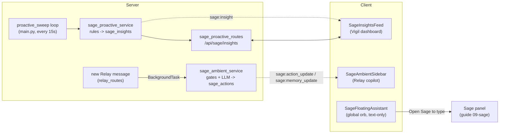
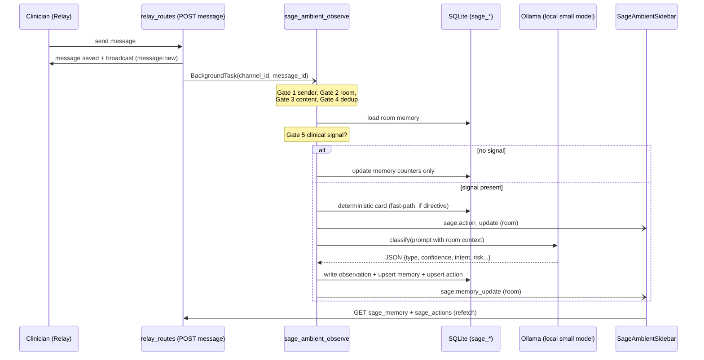

# Sage Proactive and Ambient: insights surveillance and the floating Sage orb

Orb's "Sage" brand covers three different AI surfaces that all *watch* rather than *wait to be asked*. This guide covers the three ambient/proactive ones (the fourth, the interactive text/voice agent you type or speak to, lives in **guide 09-sage**). **Sage Proactive** is a server-side surveillance loop: every 15 seconds it re-scans every admitted patient with cheap deterministic rules and emits prioritized *insights* ("Sage noticed X") to the attending clinician's dashboard. **Sage Ambient** is a silent observer of Relay case-room chat: for each new message it runs a five-gate cheap filter, optionally asks a local small language model to classify the message, keeps a bounded per-room memory, and surfaces suggested *action cards* and *risk flags* in a copilot sidebar. **The Floating Assistant** is the always-present orb in the bottom-right corner. It is text-only: it never listens, and clicking it explains that voice is not available there and offers an "Open Sage to type" button. (Until 4 October 2026 it ran a hands-free voice loop on the browser's built-in speech recognition, which streams audio to the browser vendor's cloud; that was removed when Orb was ruled strictly offline.) None of these three replace clinical judgment: rules and models only *draft*; a human always confirms.

---

## Purpose and neighbors

**The problem.** A busy ward generates a firehose of data, vitals every few minutes, risk scores, medications, chat between doctors and nurses. A clinician cannot stare at all of it. Three gaps follow:

1. **Nobody is watching the trend lines.** SpO2 (blood-oxygen saturation, a percentage) creeping down over three readings is invisible in a single glance. → **Sage Proactive** watches server-side, continuously, and pushes the finding.
2. **Decisions get made in chat, then lost.** A doctor types "transfer him to theatre now" in a case room; that directive never becomes a tracked action. → **Sage Ambient** reads the chat passively and turns unambiguous directives into confirmable cards.
3. **Hands are busy / eyes are on the patient.** Hunting for the Sage tab is friction. → **The Floating Assistant** is a one-click, text-only way into Sage from any screen. Voice lives in the Sage panel's voice mode, on the local speech engine (guide 09-sage).

Everything here is **defensive by design**: surveillance must never crash the app, ambient observation must never block or appear in the chat UI, and the orb must never open the microphone. That defensiveness (blanket `try/except`, "never raises" contracts) is the dominant style in the code and is called out repeatedly below.

Neighboring guides referenced throughout: **06-realtime** (socket.io rooms and the `sio` emitter), **08-relay** (case rooms, messages, the `sage_actions` transition/confirm endpoints), **09-sage** (the interactive voice/text agent behind `/sage/voice`), **03-auth-rbac** (`require_permission`), **04-database-schema** (the `sage_*` tables).

---

## File map

| File | Lines (approx) | Role |
|---|---|---|
| `server/services/sage_proactive_service.py` | 345 | The surveillance engine: 4 deterministic rules that scan one patient's vitals/risk/meds and insert deduplicated `sage_insights`; read/transition helpers. |
| `server/routes/sage_proactive_routes.py` | 156 | REST surface under `/api/sage`: list insights, dismiss/act a single insight, one-click "draft this into Relay", manual sweep trigger. |
| `server/services/sage_ambient_service.py` | 1987 | The passive chat observer: 5 gates, deterministic + LLM extraction, bounded room memory, observation log, action-card creation. Called as a fire-and-forget background task per message. |
| `src/components/sage/SageInsightsFeed.tsx` | 154 | React component on the Vigil dashboard that renders the live insight feed and the dismiss / "draft action" buttons. |
| `src/components/sage/SageInsightsFeed.css` | 169 | Styling for the insight feed (severity color rails, glass card, act/dismiss buttons). Presentation only. |
| `src/components/sage/SageFloatingAssistant.tsx` | rewritten 2026-10-04 | The global orb, text-only: clicking it opens a small card saying voice is not available there, with an "Open Sage to type" button. No microphone, no speech recognition, no speech synthesis. |
| `src/components/sage/SageFloatingAssistant.css` | 171 | Styling for the orb and its text-only card (one slide-up keyframe). Presentation only. |
| `src/components/relay/SageAmbientSidebar.tsx` | 251 | The Relay copilot sidebar: renders ambient room memory (concern + summary), risk flags, and suggested/handled action cards with acknowledge/dismiss/confirm buttons. |
| `src/components/relay/SageAmbientSidebar.module.css` | 315 | Scoped (CSS-module) styling for the copilot sidebar. Presentation only. |

*Jargon note.* A **React component** is a function returning UI; a **React hook** (`useState`, `useEffect`, `useCallback`, `useRef`) is a function that lets a component hold state or run side effects. A **CSS module** (`*.module.css`) auto-namespaces class names so styles can't leak between components; a plain `*.css` is global. A **socket event** is a named realtime message pushed over a persistent connection (see guide 06-realtime).

---

## How it works

### Flow A: Proactive surveillance (server-only, every 15 s)

1. **Startup.** `main.py` schedules `proactive_sweep()` as an asyncio background task during app startup (`server/main.py:229`). It sleeps 8 s to let startup settle (`server/main.py:67`), then loops forever.
2. **Sweep.** Each iteration calls `evaluate_all_admitted` in a worker thread via `asyncio.to_thread` (`server/main.py:70`), important because the service uses **blocking** SQLite calls, and running them on the event loop would stall every socket. See guide 06-realtime for why blocking work must leave the loop.
3. **Per patient.** `evaluate_all_admitted` selects all `status = 'admitted'` patients and calls `evaluate_patient` on each (`sage_proactive_service.py:200`). That function reads the last 4 vitals, the Rule 1 reference row and active meds in one read-only session, scores the latest vitals row with the session closed (the CfC overlay opens its own connection), then runs 4 rules (deterioration, trajectory, sepsis, stewardship) in a write session. It no longer reads `risk_scores` (2026-10-03).
4. **Insert with atomic dedup.** Every candidate insight goes through `_insert_insight`, a single `INSERT … SELECT … WHERE NOT EXISTS` so two concurrent sweeps can't both create the same insight (`sage_proactive_service.py:69`). A `dedup_key` plus a 30-minute cooldown prevents re-nagging.
5. **Notify.** If the sweep created any insights, the server emits a global `sage:insight` socket event with a count (`server/main.py:72`). It carries **no patient data**, just a "something changed, refetch" nudge.
6. **Client refetch.** Every mounted `SageInsightsFeed` hears `sage:insight` and calls `GET /api/sage/insights` (`SageInsightsFeed.tsx:39`). The server scopes the result to *this* clinician's patients (`get_active_insights`), so the broadcast leaks nothing.
7. **Act / dismiss.** The clinician clicks "Draft …" (→ `POST /api/sage/insights/{id}/act`, which creates a `sage_actions` card in the patient's Relay room and marks the insight `acted`) or "Dismiss" (→ `POST /api/sage/insights/{id}/transition` with `state=dismissed`).

### Flow B: Ambient observation (per Relay message)

Key properties, all enforced in `sage_ambient_observe` (`server/services/sage_ambient_service.py:1869`):

- **Never blocks Relay.** It runs as a FastAPI `BackgroundTask` added *after* the message is saved and broadcast (`relay_routes.py:227`). The sender's request has already returned.
- **Never raises.** An outer `try/except` wraps the whole body (`sage_ambient_service.py:753`); every helper also swallows its own errors.
- **Never appears in chat.** It writes to `sage_room_memory`, `sage_observations`, and `sage_actions`, separate tables, and only the copilot sidebar reads them. The chat transcript is untouched.
- **Cheap first, expensive last.** The five gates reject the overwhelming majority of messages (bots, acknowledgments, duplicates, non-clinical chat) *before* the LLM is ever called.

### Flow C: The floating orb (text-only)

The orb has one job: get the clinician into Sage from any screen. Clicking it opens a small card, "Voice is not available here. Type your question in Sage instead.", with an **Open Sage to type** button that switches to the Sage tab (`gotoTab('sage')`), where the clinician types, or uses voice mode, which runs on the local speech engine on the appliance (guide 09-sage). The orb never opens the microphone, never runs speech recognition and never speaks.

Until 4 October 2026 the orb was a 4-state hands-free voice machine (`dormant → listening → processing → speaking`) on the browser's `webkitSpeechRecognition`, with a "Sage" wake word, interrupt-by-saying-"Sage" while it spoke, a 5 s follow-up window and streamed answers read aloud. `webkitSpeechRecognition` streams microphone audio to the browser vendor's cloud ASR, so the whole loop was removed when Orb was ruled strictly offline, together with the wake-word toggle and its `useSageHotword` hook. Browser speech is not supported anywhere in Orb and cannot be switched on.

---

## Function-by-function

### File: `server/services/sage_proactive_service.py`

Module constants: `INSIGHT_COOLDOWN_MIN = 30` (minutes before the same `dedup_key` may re-fire, `:18`) and `_LEVELS = {"stable":0,"elevated":1,"critical":2}` (a rank table so risk levels can be compared numerically, `:19`).

#### _now: `server/services/sage_proactive_service.py:53`
**Signature:** `() -> str`
**Does:** Returns the current UTC time as an ISO-8601 string.
**How it works:** `datetime.now(timezone.utc).isoformat()`.
**Why it exists:** Every timestamp written by this module must be timezone-aware UTC so the cooldown math and the `created_at > cutoff` comparisons are apples-to-apples.
**Data in/out:** out: e.g. `"2026-07-07T12:00:00+00:00"`.
**Talks to:** used by `_insert_insight`, `transition_insight`.
**Change guide:** To store local time instead, change here, but then every `_hours_since`/cooldown comparison silently breaks, so don't; keep everything UTC.
**Gotchas:** none noteworthy.

#### _level_rank: `server/services/sage_proactive_service.py:57`
**Signature:** `(level) -> int`
**Does:** Maps a risk-level string to its numeric rank (unknown → 0).
**How it works:** Lower-cases the input, looks it up in `_LEVELS`, defaults to 0 for `None`/junk.
**Why it exists:** Rule 1's "escalation" test needs to ask *did the level go up?* numerically.
**Data in/out:** in `"critical"` → out `2`; in `None` → out `0`.
**Talks to:** `evaluate_patient` Rule 1.
**Gotchas:** An unrecognized level ranks as 0 (same as "stable"), so a typo'd level would never look like an escalation. Acceptable given levels come from a controlled enum in guide 07-vigil.

#### _num: `server/services/sage_proactive_service.py:61`
**Signature:** `(v) -> float | None`
**Does:** Coerces anything to a float, or `None` if it can't.
**Why it exists:** Vitals may arrive as strings, `None`, or garbage; the rules must tolerate all of it without raising (the "surveillance must not take down the app" contract).
**Talks to:** all vitals-reading rules.
**Gotchas:** Returns `None` (not 0) on failure, and every rule explicitly checks `is not None` before comparing, critical, because `0.0` is a valid (alarming) vital but `None` means "no data."

#### _hours_since: `server/services/sage_proactive_service.py:81`
**Signature:** `(ts) -> float`
**Does:** Returns hours elapsed since an ISO timestamp; 0.0 on any parse failure.
**How it works:** Normalizes a trailing `Z` to `+00:00`, parses with `fromisoformat`, assumes UTC if naive, subtracts from `now`.
**Why it exists:** Rule 4 (antibiotic stewardship) needs "has this drug been running >72 h?"
**Gotchas:** On parse failure it returns **0.0**, which means "just started", so a medication with a broken `started_at` will *never* trip the 72 h stewardship rule (fails safe toward silence, not false alarms).

#### _insert_insight: `server/services/sage_proactive_service.py:100`
**Signature:** `(db, patient_id, itype, severity, title, detail, target_user, dedup_key, action_type=None, action_target=None) -> str | None`
**Does:** Atomically inserts one insight *only if* no duplicate is active or within the 30-min cooldown; returns the new id, or `None` if deduped away.
**How it works:**
1. Generates a UUID and a `cutoff = now - 30min`.
2. Runs a single `INSERT INTO sage_insights (...) SELECT ?,?,… WHERE NOT EXISTS (SELECT 1 FROM sage_insights WHERE dedup_key = ? AND (state='active' OR created_at > ?))`.
3. Truncates `title` to 200 chars and `detail` to 600.
4. Returns the id if `cur.rowcount > 0`, else `None`.
**Why it exists:** The docstring is explicit: the previous check-then-insert **raced**, 50 parallel evaluations produced duplicate active insights. Because SQLite serializes writes, embedding `NOT EXISTS` in the same statement makes dedup atomic.
**Data in/out:** writes a `sage_insights` row (see schema in Cross-subsystem contracts); returns `str` id or `None`.
**Talks to:** called by every rule in `evaluate_patient`.
**Change guide:** To make an insight re-fire more often, lower `INSIGHT_COOLDOWN_MIN` (`:18`); knock-on: more socket churn and more feed noise. To add a new insight *type*, call `_insert_insight` from a new rule with a unique `dedup_key` prefix (e.g. `f"{patient_id}:hypotension"`), the key **is** the dedup identity, so two rules sharing a key would suppress each other.
**Gotchas:** The dedup key must be stable *and* unique per logical alert. Rule 1's critical branch uses `…:deterioration:critical` while its escalation branch uses `…:deterioration:{level}`, deliberately different so both can coexist.

#### evaluate_patient: `server/services/sage_proactive_service.py:134`
**Signature:** `(patient_id) -> list[str]`
**Does:** Runs all 4 surveillance rules for one patient; returns ids of newly-created insights. Never raises.
**How it works:**
1. Guard: empty `patient_id` → `[]`.
2. Load the patient; if not found or `status != 'admitted'` → `[]` (discharged patients don't get surveilled).
3. Compute `target = attending_doctor_id`, a location label `ward-bed`, and the display name.
4. Load (`_read_moment`, SELECTs only) the **last 4 vitals** (newest by `timestamp`, `id` as the tie-breaker), the **reference row** (the newest vitals row observed at least 15 minutes, `RISE_REFERENCE_MIN`, before the latest) and **active medications**. Then score the latest row with `vigil_service.score_vitals_row` (overlay on, the patient's own SpO2 scale) and again with the overlay off, plus the reference row with the overlay off, all with no session open.
5. **Rule 1, Deterioration**: banded from the SAME moment as the Vigil board and the ward brief (ruled 2026-10-03; it used to read `risk_scores`, which the simulator and the Scribe lane never write, so the feed said "is critical" over a stable board row). No vitals, no card. If the latest band is `critical`, insert a `critical` "is critical" insight: "NEWS2 9 (critical) · a single parameter scores 3. <Relay reason line>. Recommend immediate senior review." Else if it is `elevated` and the reference row's band was lower, insert a `warning` "is deteriorating" insight: "Rose from NEWS2 2 (stable) to NEWS2 3 (elevated) · …". Every label is `news2_text.news2_description` (test_news2_prompt_label forbids hand-rolled ones), the reason line is `vigil_service.news2_reason_line` (wrapped: on a failure it is left out and the card still raises), and a band the CfC overlay moved says so ("NEWS2 3 (stable), raised to critical by the CfC overlay. CfC: …"). Neither ever carries a suggested action. **Recovery** (`_stand_down`): when the latest band is below a card's band, the card is stood down once: retitled ("was critical", "was deteriorating"), severity `info` (`STOOD_DOWN_SEVERITY`, a blue dot, out of the active-alert count), its detail says what the latest observation scored, and it auto-resolves 10 minutes later. Going back up refreshes the same card and restores its title and severity, and the sweep reports it in `raised_again` so `main.proactive_sweep` (and `POST /api/sage/insights/evaluate`) push `sage:insight` at once rather than leaving it to the feed's 20 s poll. An INCOMPLETE set stands a card down only when `_worst_case_level` (each unmeasured vital at a value scoring 3, ACVPU unresponsive, an unrecorded O2 tried both ways because Scale 2 rescores SpO2 on oxygen, through the real scorer) is still below the card's band; the detail then ends "not measured: …, which could not bring it to critical." Otherwise the card keeps its title and reads "Not confirmed recovered: NEWS2 4 (stable) · incomplete set, minimum; not measured: Respiratory rate." until a set settles it or a clinician clears it. (Narrowed 2026-10-03: before, a monitor-only patient with no ACVPU or O2 could never clear.)
6. **Rule 2, Trajectory** (`:149`): needs ≥3 vitals (index 0 = latest). If all 3 SpO2 readings are non-null, **monotonically non-increasing** (`spo2[0] <= spo2[1] <= spo2[2]`) and the total drop ≥3 points → "SpO2 falling" warning. If all 3 RR readings are non-null, monotonically non-decreasing, and rose ≥4 → "respiratory rate rising" warning.
7. **Rule 3, Sepsis**: on the latest vitals (newest by `timestamp`, `id` only as the tie-breaker, the same set NEWS2 scores), scored as charted (`vital_charting.as_charted`), if **any 2** of temp >38.0 or <36.0, HR >90, RR >20 are met (strict limbs; 38.0, 90 and 20 do not count) → "possible sepsis" warning naming the limbs met, with no suggested action. SIRS's fourth limb (white cell count, or PaCO2) is not recorded in Orb, and the detail says so. Ruled 2026-10-03; before that it required all three vital limbs.
8. **Rule 4, Stewardship** (`:184`): for each active med whose name contains a broad-spectrum antibiotic keyword, if it's been running ≥72 h → "antibiotic review due" info insight.
9. Everything is wrapped in `try/except` that just prints and returns whatever was collected.
**Why it exists:** These are *cheap, grounded, explainable* heuristics. The docstring's philosophy: "the rules do the scanning (cheap + reliable); the message is templated from the real numbers (grounded, it cannot hallucinate a patient or a value)." No LLM is involved in Proactive, that's a deliberate safety choice for an always-on loop.
**Data in/out:** in: a patient id. out: list of new insight ids. Side effect: rows in `sage_insights`.
**Talks to:** `_insert_insight`, `_num`, `_hours_since`, `_level_rank`; called by `evaluate_all_admitted` and by the manual `/insights/evaluate` route.
**Change guide (worked example).** *To add a "hypotension" rule:* after Rule 3, read systolic BP from the latest vitals via `_num`, and if `< 90`, call `_insert_insight(db, patient_id, "hypotension", "warning", f"{name} ({loc}): hypotension", f"Systolic {sbp:.0f} mmHg…", target, f"{patient_id}:hypotension")`. Knock-on: the client already renders any severity via `SEV_DOT`, so no frontend change is needed; watch out, vitals here don't currently `SELECT` a BP column, so you'd extend the vitals query at `:115` too.
**Gotchas:**
- The trajectory rule's ordering assumption (index 0 = latest) depends entirely on `ORDER BY id DESC` at `:117`. If someone changes that ordering, the trend direction inverts silently.
- No rule suggests a drug (ruled 2026-10-02). `NON_ACTIONABLE_ACTION_TYPES` (`start_medication`, `stop_medication`) covers rows stored before then: `get_active_insights` hides their suggestion and `POST /insights/{id}/act` refuses them with a 400. See Discrepancies.

#### evaluate_all_admitted: `server/services/sage_proactive_service.py:271`
**Signature:** `(raised_again=None, user=None) -> list[str]`
**Does:** Sweeps admitted patients and returns all new insight ids. The scheduled system caller has hospital-wide scope; a manual caller supplies its authenticated user and is limited to that user's chart scope.
**How it works:** Selects admitted patient ids through `scope_patient_ids_sql`, then loops calling `evaluate_patient`, extending the id list. Discharged insights are auto-resolved within the same caller scope. Wrapped in `try/except`.
**Why it exists:** The single entry point the 15 s background loop calls.
**Talks to:** called from `main.py:70` (via `asyncio.to_thread`) and from the `/insights/evaluate` route with no `patient_id`.
**Gotchas:** It's a **serial** loop, every patient is evaluated one at a time in one thread. Fine for a demo ward; at hospital scale you'd batch or parallelize. It opens a fresh `db_session()` per patient (inside `evaluate_patient`), plus one for the patient list, many short connections rather than one long one.

#### get_active_insights: `server/services/sage_proactive_service.py:293`
**Signature:** `(user_id, role) -> list[dict]`
**Does:** Returns up to 50 active insights within the clinician's patient scope, most-severe-then-newest first. Admins can see all recipients within their established scope.
**How it works:** Loads the active user's stored role/department and derives department/facility patient scope before sorting and applying the limit. A non-admin additionally sees only their own or unassigned recipients. Builds a `CASE`-based severity sort key (`critical`=0, `warning`=1, else 2), and joins patients to attach `patient_name`. A missing/inactive user gets an empty list; passing an elevated role argument cannot override the stored account.
**Why it exists:** The scoping is the security boundary, the socket broadcast is global, so this query is what stops one doctor seeing another's insights.
**Data in/out:** out: list of dicts matching the `SageInsight` TypeScript interface (`client.ts:469`).
**Talks to:** the `GET /api/sage/insights` route; consumed by `SageInsightsFeed`.
**Gotchas:** Recipient assignment never grants chart access. A `NULL` attending makes an insight unassigned, but it still cannot cross the caller's department/facility boundary. The existing hospital-wide policy for accounts without a department remains in force, as does the default multi-facility fence on unswept HTTP routes.

#### transition_insight: `server/services/sage_proactive_service.py:315`
**Signature:** `(insight_id, new_state, user_id, role) -> dict`
**Does:** Moves an insight to `dismissed` or `acted` within the stored caller's chart scope and recipient assignment.
**How it works:**
1. Rejects any `new_state` not in `("dismissed","acted")` with `ValueError`.
2. Loads the row; missing → `{}`.
3. Load the active stored caller; missing caller or inaccessible department/facility patient → `{}`. Then check assignment: non-admin whose id isn't the target (and target isn't `NULL`) → `PermissionError`.
4. **Idempotent:** if already non-active, returns the row unchanged.
5. Otherwise `UPDATE state`, returns the fresh row.
**Why it exists:** Enforces the dismiss/act lifecycle and ownership at the service layer, so the route stays thin.
**Data in/out:** returns the updated insight dict, or `{}` if not found.
**Talks to:** the `POST /insights/{id}/transition` route (which maps `ValueError`→400, `PermissionError`→403, `{}`→404).
**Gotchas:** The valid states are `dismissed`/`acted`, note there is **no `acknowledged`** state for insights (that word belongs to *ambient actions*, a different table). The insight lifecycle is strictly `active → dismissed | acted`.

---

### File: `server/routes/sage_proactive_routes.py`

Router prefix `/api/sage` (`:11`), registered in `main.py:301`. Every route depends on `require_permission("sage.query")` (guide 03-auth-rbac), which both authenticates the JWT and checks the caller's role has the `sage.query` permission (granted to admin, doctor, nurse, and pharmacist, plus the `clinician` alias of doctor, per `permissions.py`).

#### list_insights: `server/routes/sage_proactive_routes.py:15`
**Signature:** `GET /api/sage/insights → {"insights": [...]}`
**Does:** Returns the caller's active insights.
**How it works:** Delegates to `get_active_insights(user["id"], user["role"])`.
**Talks to:** `SageInsightsFeed.load` (`getSageInsights`, `client.ts:483`).
**Gotchas:** none noteworthy, all scoping lives in the service.

#### transition: `server/routes/sage_proactive_routes.py:37`
**Signature:** `POST /api/sage/insights/{insight_id}/transition` body `{state}` → updated insight
**Does:** Dismiss (or mark acted) a single insight, then broadcast a `sage:insight` nudge.
**How it works:** Reads `state` from the JSON body, calls `transition_insight`, maps `PermissionError`→403 / `ValueError`→400 / falsy result→404, then `sio.emit("sage:insight", {"event":"transition","id":…})` (global, no room).
**Talks to:** `SageInsightsFeed.handleDismiss` (`transitionInsight`, `client.ts:487`).
**Gotchas:** The emitted event is **global** and carries only an id, every feed refetches and re-scopes. That's intentional (cheap fan-out, no data leak) but means N clients each issue a `GET /insights` per transition.

#### act_on_insight: `server/routes/sage_proactive_routes.py:128`
**Signature:** `POST /api/sage/insights/{insight_id}/act → {status, action_id, channel_id}`
**Does:** Turns an insight's suggested action into a real Sage **action card** in the patient's Relay case room, then marks the insight `acted`. This is the bridge from Proactive into the agentic Relay loop (guide 08-relay).
**How it works:**
1. Load the insight; 404 if missing.
2. Department/facility patient guard → 404, before examining the action or state. Recipient guard (non-admin must be the target or the insight must be unassigned) → 403.
3. 400 if the insight has no `suggested_action_type`; 409 if it's not `active`.
4. Find the patient's `case_room` channel; 404 if none.
5. Insert a `sage_actions` row (state `suggested`, confidence `0.7`, rationale "Drafted from Sage insight: {title}") **plus** a `sage_action_events` audit row (actor = the clicking clinician).
6. `UPDATE sage_insights SET state='acted'`.
7. Emit `sage:action_update` **to the room** (so the copilot sidebar refreshes) and a global `sage:insight` `acted` nudge.
**Why it exists:** One click converts "Sage noticed sepsis" into a confirmable order sitting in the right case room, but it's still only *suggested*; a human presses Confirm in Relay to actually execute (guide 08-relay owns that confirm/agentic path).
**Data in/out:** out: `{status:"ok", action_id, channel_id}`. Side effects: one `sage_actions` + one `sage_action_events` row; insight → `acted`.
**Talks to:** `SageInsightsFeed.handleAct` (`actOnInsight`, `client.ts:494`); the created card is rendered by `SageAmbientSidebar` and executed by relay's confirm endpoints.
**Change guide (worked example).** *To make drafted cards higher-confidence:* change `0.7` at `:62`. Knock-on: `SageAmbientSidebar` uses confidence only for ambient *risk-flag* display filtering, not for action cards, so this mostly affects downstream logic in guide 08; watch out, the `sage_actions.state` CHECK constraint only allows the six enum values, so never invent a new state string here.
**Gotchas:** This route writes `sage_actions` **directly** (not via the ambient service), duplicating the insert/audit pattern from `_insert_deterministic_action`. If the card schema changes, three insert sites must change in lock-step (this route, and two in the ambient service).

#### evaluate: `server/routes/sage_proactive_routes.py:140`
**Signature:** `POST /api/sage/insights/evaluate` body `{patient_id?}` → `{created, ids, raised_again}`
**Does:** Manually triggers a sweep for one authorized patient or all admitted patients within the caller's chart scope.
**How it works:** Requires a JSON object; a supplied `patient_id` must be a non-empty string. An inaccessible or missing patient returns 404 before running rules. An empty object calls `evaluate_all_admitted` with the authenticated user. New or raised-again insights emit a global count-only nudge.
**Why it exists:** Lets a clinician refresh surveillance after charting instead of waiting for the 15 s loop.
**Gotchas:** It creates or changes real insight rows. Invalid JSON cannot become a whole-hospital sweep. Only the scheduled system caller retains hospital-wide evaluation and discharged-insight cleanup.

---

### File: `server/services/sage_ambient_service.py`

This file is the passive chat observer. It imports config toggles (`SAGE_AMBIENT_*`), the shared `sio` emitter (guide 06-realtime), and `httpx` for the local LLM call. Module-level regexes are the cheap heart of it.

**Module-level patterns and state:**
- `_ACK_PATTERN` (`:38`), matches pure acknowledgments ("ok", "thanks", "👍", "will do", …). Gate 3 uses it to skip chit-chat.
- `_SIGNAL_PATTERNS` (`:46`), a big alternation of clinical stems (`wors`, `deteriorat`, `desat`, `sepsis`, `intubat`, `start`, `stop`, `mg`, `bolus`, …). Gate 5 uses it to decide whether a message is worth an LLM call.
- `_DET_SURGERY` / `_DET_PROCEDURE` / `_DET_MEDICATION` (`:66`, `:76`, `:82`), the deterministic fast-path extractors (see `_deterministic_extract`).
- `_DET_MED_STOPWORDS` (`:89`), words that look like a drug but aren't ("fluids", "oxygen", "discharge", …), to stop false medication cards.
- `_RECENT_HASHES` (`:148`), an in-memory `dict[room_id, deque]` ring buffer (max 10) of recent message hashes, for cross-message dedup.
- `_CLASSIFY_SYSTEM` (`:152`), the system prompt telling the model to emit strict JSON with a `type` from a fixed enum.

#### _deterministic_extract: `server/services/sage_ambient_service.py:117`
**Signature:** `(text) -> dict | None`
**Does:** Returns a high-confidence action intent for an *unambiguous* clinical directive (surgery transfer or a medication with a route/dose), else `None`.
**How it works:**
1. If `_DET_SURGERY` matches, try to name the specific procedure via `_DET_PROCEDURE`, default "Emergency surgery" → `{"action":"transfer_to_surgery","target":…,"confidence":0.6}`.
2. Else if `_DET_MEDICATION` matches, extract (route, drug, dose). Only accept if there's a **route OR a dose** *and* the drug isn't a stopword → `{"action":"start_medication","target":drug.title()}`.
**Why it exists:** The small (4B-parameter) model "reliably catches medications but frequently misses surgery transfers" (docstring). This rule-based net guarantees a card for the highest-stakes directives even when the model whiffs.
**Data in/out:** in: raw message text. out: an intent dict (with `rationale` = first 160 chars) or `None`.
**Talks to:** called twice, the instant fast-path in `sage_ambient_observe` (`:717`) and the fallback in `_update_memory` (`:547`).
**Gotchas:** The medication regex requires a route/dose specifically so "start thinking about discharge" can't become a med card, but it means a bare "start amoxicillin" (no route, no dose) will *not* fire deterministically (it relies on the LLM). The `confidence` is a flat `0.6` regardless of match quality.

#### _insert_deterministic_action: `server/services/sage_ambient_service.py:192`
**Signature:** `(channel_id, patient_id, intent, message_id) -> bool`
**Does:** Immediately inserts a `sage_actions` card (fast-path), idempotent per source message **and** per `(action_type, normalized target)`; returns `True` only if a *new* card was created.
**How it works:** Checks for an existing `suggested`/`acknowledged` card matching either the same `source_msg_id` or the same `(action_type, LOWER(TRIM(target)))`; if found, returns `False`. Otherwise inserts the card plus a `sage_action_events` audit row (actor "Orb Sage", role "AI", source "system").
**Why it exists:** So the demo is snappy, an unambiguous directive surfaces a card *before* the slow LLM round-trip.
**Talks to:** `_deterministic_extract`; called only from the fast-path in `sage_ambient_observe` (`:718`), which then emits `sage:action_update`.
**Gotchas:** The double dedup (`source_msg_id` OR `action_type+target`) is what stops the fast-path and the later LLM path from creating two cards for one directive. If you loosen either clause you'll get duplicate cards.

#### _normalize / _content_hash: `server/services/sage_ambient_service.py:1186` / `:1191`
**Signature:** `(text) -> str`
**Does:** `_normalize` strips punctuation and lower-cases; `_content_hash` returns the first 16 hex chars of the SHA-256 of the normalized text.
**Why it exists:** A stable content fingerprint for the dedup ring buffer, so "OK." and "ok" (and re-sends) collapse to one hash.
**Gotchas:** 16 hex chars = 64 bits; collision risk is negligible at ward scale.

#### _is_duplicate: `server/services/sage_ambient_service.py:1196`
**Signature:** `(room_id, content_hash, sender_id, now) -> bool`
**Does:** Three-layer dedup against the in-memory ring buffer: same hash + same sender within **60 s**, or same hash from *any* sender within **10 s**.
**Why it exists:** Kills accidental double-sends and echo, without an extra DB round-trip.
**Talks to:** `_gate_dedup`.
**Gotchas:** State is **in-memory only** (`_RECENT_HASHES`), so it resets on server restart and isn't shared across processes/workers. Fine for a single-process demo; a multi-worker deployment would dedup independently per worker. Note the hard-coded 60 s/10 s windows ignore the `SAGE_AMBIENT_DEBOUNCE_SECONDS` config (see Discrepancies).

#### _record_hash: `server/services/sage_ambient_service.py:1215`
**Signature:** `(room_id, content_hash, sender_id, now) -> None`
**Does:** Appends `(hash, sender, timestamp)` to the room's ring buffer (creating a `deque(maxlen=10)` if needed).
**Gotchas:** Only the last 10 messages per room are remembered, a duplicate 11 messages later would not be caught.

#### The five gate functions: `_gate_sender` `:209`, `_gate_room` `:218`, `_gate_content` `:232`, `_gate_dedup` `:241`, `_gate_signal` `:251`
These are the cheap filter cascade. Each returns a simple bool (or `_gate_room` returns the patient id / `None`):

| Gate | Function | Rejects | Rationale |
|---|---|---|---|
| 1 Sender | `_gate_sender` | `bot_*`/`system_*` ids, or role `system`/`intelligence` | Don't observe Sage's own or bot output (avoids feedback loops). |
| 2 Room | `_gate_room` | anything not a `case_room` with a `patient_id` | Only patient-linked rooms have clinical meaning; returns the `patient_id` to key memory. |
| 3 Content | `_gate_content` | messages `< 8` chars, or pure acknowledgments | "ok"/"👍" carry no clinical signal. |
| 4 Dedup | `_gate_dedup` | duplicates (via `_is_duplicate`), and records the hash | Prevents re-processing the same text. |
| 5 Signal | `_gate_signal` | *(inverse)* returns `True` only if `_SIGNAL_PATTERNS` matches, i.e. gates *into* the LLM | The expensive LLM only runs on clinically-loaded messages. |

**Change guide (worked example).** *To make Sage observe direct-message rooms too:* relax `_gate_room` at `:225` to also accept `row["type"] == "dm"`. Knock-on: memory/observation rows get created for non-patient rooms (schema requires `patient_id NOT NULL`, so you'd need a sentinel or a schema change); watch out, DMs are often non-clinical, so the LLM cost/noise rises.
**Gotchas:** Gate 5 is *inverted* relative to the others (True = proceed, not True = skip). The `sage_ambient_observe` caller reads it as `has_signal = _gate_signal(content)` to make that readable.

#### _load_room_memory: `server/services/sage_ambient_service.py:1285`
**Signature:** `(room_id) -> dict | None`
**Does:** Loads the single `sage_room_memory` row for a room (or `None`).
**Talks to:** `sage_ambient_observe`; the dict's JSON columns are parsed later by `_cap_json_array`.

#### _fetch_patient_context: `server/services/sage_ambient_service.py:1299`
**Signature:** `(patient_id) -> dict`
**Does:** Fetches a **bounded** minimal patient snapshot (name, dx, age, sex, up to 10 active meds, latest risk level) for the LLM prompt.
**Why it exists:** Grounds the classifier in who the patient is, so "start it" can be interpreted against real meds, without dumping the whole chart into the prompt.
**Gotchas:** Everything is length-limited (meds ≤10, later ≤5 in the prompt) to keep the prompt small. All-`try/except` → returns the default skeleton on any DB error.

#### _fetch_recent_messages: `server/services/sage_ambient_service.py:1333`
**Signature:** `(channel_id, limit) -> list[dict]`
**Does:** Returns the last `limit` messages (config `SAGE_AMBIENT_CONTEXT_WINDOW`, default 15), re-ordered oldest→newest.
**How it works:** `ORDER BY timestamp DESC LIMIT ?` then `reversed()` so the prompt reads chronologically.
**Talks to:** `_build_prompt` (which further trims to the last 5).

#### _fetch_message: `server/services/sage_ambient_service.py:1348`
**Signature:** `(message_id) -> dict | None`
**Does:** Loads the full triggering message row.
**Talks to:** the first thing `sage_ambient_observe` does.
**Gotchas:** If the message was deleted between save and background execution, this returns `None` and observation is skipped, correct.

#### _build_prompt: `server/services/sage_ambient_service.py:1371`
**Signature:** `(message, memory, patient_ctx, recent_msgs) -> str`
**Does:** Assembles the user prompt: a ROOM CONTEXT block (patient, risk, meds, current concern, discussion-so-far capped at 500 chars), a RECENT MESSAGES block (last 5 text/alert messages, each content-capped at 150 chars), then the NEW MESSAGE, then "Classify this message."
**Why it exists:** Gives the model enough context to classify *in situ* (e.g. distinguish a fresh concern from a topic shift) while staying token-frugal.
**Data in/out:** out: a plain string prompt paired with the `_CLASSIFY_SYSTEM` system prompt.
**Gotchas:** Only `message_type in ("text","alert")` messages are included in the recent block, system/action messages are filtered out of context.

#### _classify_with_llm: `server/services/sage_ambient_service.py:1448`
**Signature:** `async (prompt) -> dict | None`
**Does:** Calls the local Ollama server's `/api/generate` (model `LLM_MODEL`, temp 0.1, `num_predict` 300, `num_ctx` 4096, non-streaming) and parses strict JSON.
**How it works:** POSTs with an `httpx.AsyncClient` (timeout `SAGE_AMBIENT_TIMEOUT_SECONDS`, default 30). Strips a leading/trailing markdown fence if present, `json.loads`, and returns the dict only if it has a `"type"` key. Timeouts/JSON errors/anything → `None` (logged at WARNING).
**Why it exists:** The *only* expensive step, deliberately last and deliberately optional, a `None` result never breaks the pipeline (memory counters still advance).
**Data in/out:** out: the classification dict (`type`, `confidence`, `signal`, `extracted_intent?`, `risk_detail?`, `summary_delta?`, `concern_update?`) or `None`.
**Talks to:** Ollama (local, `OLLAMA_BASE_URL`); config in guide 09-sage / config.py.
**Gotchas:** Low temperature (0.1) is chosen for classification determinism. The model is small (4B), which is *why* the deterministic fast-path exists to backstop it. There is no retry, one shot, then `None`.

#### _cap_json_array: `server/services/sage_ambient_service.py:1492`
**Signature:** `(json_str, max_items) -> list`
**Does:** Parses a JSON-array column string and keeps only the **last** `max_items`.
**Why it exists:** Room memory columns (`participants`, `risk_flags`, `active_intents`, …) are stored as JSON text; this bounds them so memory can't grow unbounded.
**Gotchas:** Slices from the *end* (`[-max_items:]`), newest kept, oldest dropped.

#### _merge_intent: `server/services/sage_ambient_service.py:1548`
**Signature:** `(existing_intents, new_intent) -> (list, bool)`
**Does:** Merges a new action intent into the list: if an intent with the same `(action, target)` exists, bump its confidence to the max and stamp `updated_at` (returns `was_merged=True`); else append with a `created_at`, capped to `SAGE_AMBIENT_MAX_INTENTS`.
**Status:** This maintains the memory's `active_intents` JSON, explicitly labeled **"Stage 2 legacy"** in the caller (`:532`). The *displayed* action cards now come from the separate `sage_actions` table, not from `active_intents`. Kept for backward compatibility.

#### _merge_risk: `server/services/sage_ambient_service.py:1569`
**Signature:** `(existing_flags, new_detail, confidence, rationale="") -> (list, bool)`
**Does:** Merges a risk flag: if an existing flag's detail is a substring of the new one (or vice-versa), bump confidence/rationale/`updated_at`; else append `{detail, rationale, confidence, created_at}`, capped at 5.
**Why it exists:** Deduplicates near-identical risk flags so the copilot sidebar doesn't stack five versions of the same warning.
**Talks to:** written into `risk_flags`, which `SageAmbientSidebar` reads and filters by `confidence >= 0.80`.
**Gotchas:** The substring dedup is crude, "bleeding" and "post-op bleeding" merge, but "bleeding" and "hemorrhage" don't.

#### _update_memory: `server/services/sage_ambient_service.py:1603`
**Signature:** `(room_id, patient_id, message, classification, memory) -> str | None`
**Does:** The workhorse upsert: advances counters, folds the classification into bounded memory fields, applies the deterministic action fallback, `INSERT OR REPLACE`s the memory row, and upserts any new `sage_actions` cards. Returns the `updated_at` timestamp (or `None` on error).
**How it works:**
1. Start from existing memory or blanks; increment `message_count`; track `llm_call_count`.
2. Add the sender to `participants` (cap 20).
3. Load bounded copies of every memory field via `_cap_json_array`.
4. If a `classification` exists:
   - `llm_count += 1`.
   - `summary_update` → append `summary_delta` (≤300 chars) to `discussion`, then **rolling-truncate** to `SAGE_AMBIENT_MAX_SUMMARY_CHARS` (default 1500) at a nearby sentence boundary.
   - `possible_action` → take `extracted_intent`, set its confidence, add to `new_actions`, and *also* merge into legacy `active_intents`.
   - `risk_flag` → `_merge_risk`.
   - `concern_update` → set `current_concern` (≤200); else fall back to `signal` if no concern yet.
5. **Deterministic fallback:** if `new_actions` is still empty, try `_deterministic_extract` on the message and add it.
6. `INSERT OR REPLACE INTO sage_room_memory (...)`, preserving the original `created_at` via a correlated `COALESCE(SELECT created_at …)`.
7. For each intent in `new_actions`, upsert `sage_actions` with the same double-dedup as the fast-path; a brand-new card also writes a `sage_action_events` audit row.
**Why it exists:** One atomic place that keeps memory bounded *and* materializes action cards, whether the signal came from the LLM or the deterministic net.
**Data in/out:** writes one `sage_room_memory` row + 0..N `sage_actions`/`sage_action_events` rows; returns ISO timestamp.
**Talks to:** called by `sage_ambient_observe` in three places (no-signal path, sampled-out path, and the full path). The returned `ts` triggers the `sage:memory_update` emit.
**Change guide (worked example).** *To lengthen Sage's running summary:* raise `SAGE_AMBIENT_MAX_SUMMARY_CHARS` (config, default 1500). Knock-on: bigger prompts (the summary feeds back into `_build_prompt` capped at 500 anyway) and a longer sidebar block; watch out, the rolling-truncation boundary search only looks 200 chars past the cut, so with a much larger cap you may keep slightly more than intended.
**Gotchas:**
- `INSERT OR REPLACE` on a single-row-per-room table means a concurrent double-process for the same room could clobber each other's counter, acceptable because gate 4 dedups near-simultaneous messages.
- The `active_intents` field is written but **not displayed** anywhere (the sidebar reads `sage_actions` instead), legacy carry-over.

#### _write_observation: `server/services/sage_ambient_service.py:1825`
**Signature:** `(room_id, patient_id, message_id, classification) -> None`
**Does:** Appends a structured `sage_observations` row (an append-only audit of what Sage "saw"), skipping empty/`ignore` types.
**How it works:** Stores `observation_type` plus a JSON `content` blob of `{signal, extracted_intent, risk_detail, summary_delta}` and the confidence.
**Why it exists:** A durable, machine-readable trail of every high-value classification, useful for later analytics/eval, invisible to users.
**Gotchas:** The `"ignore"` skip is effectively dead, the prompt's enum never includes `ignore`, so only an empty type is actually filtered. Harmless.

#### sage_ambient_observe: `server/services/sage_ambient_service.py:1869`
**Signature:** `async (channel_id, message_id) -> None`
**Does:** The single entry point, run as a Relay `BackgroundTask`. Orchestrates the whole Flow B pipeline. Must never raise, never block Relay, never produce UI output.
**How it works:**
1. Early return if `SAGE_AMBIENT_ENABLED` is false.
2. `_fetch_message`; bail if gone.
3. **Gate 1** sender → bail if bot/system.
4. **Gate 2** room → get `patient_id` or bail.
5. *Voice-prewarm sniff:* if the content contains "hey sage"/"ask sage"/etc., attempt to publish a `relay.intent.voice_prewarm` event on the event bus (**note: this path is currently broken, see Discrepancies**).
6. **Gate 3** content, **Gate 4** dedup → bail on either.
7. `_load_room_memory`.
8. **Gate 5** signal. If no signal → `_update_memory(..., None, ...)` (counters only) and return.
9. **Fast-path:** `_deterministic_extract` + `_insert_deterministic_action`; on a new card, emit `sage:action_update` to the room.
10. **Sampling gate:** if `SAGE_AMBIENT_SAMPLE_RATE < 1.0` and `random() > rate`, update memory with no classification and return (phased-rollout throttle).
11. Fetch context, `_build_prompt`, `_classify_with_llm`.
12. If classified, `_write_observation`.
13. Always `_update_memory` (even if the LLM failed); if it returns a timestamp, emit `sage:memory_update` to the room.
14. Outer `try/except` logs any unhandled error and swallows it.
**Why it exists:** The choreography that makes ambient observation cheap, safe, and non-blocking.
**Talks to:** called from `relay_routes.py:227`; emits `sage:action_update` and `sage:memory_update` consumed by `SageAmbientSidebar`.
**Gotchas:** The deterministic card fires *before* the sampling gate, so high-stakes directives surface even when sampling would otherwise skip the LLM. The whole function is `async` but calls **blocking** DB helpers directly (not via `to_thread`), acceptable only because it's a background task, not on a request's hot path.

---

### File: `src/hooks/useSageHotword.ts` (removed 2026-10-04)

Removed with the wake word. It stored "is the 'Sage' hotword enabled?" in `localStorage` under `orb_sage_hotword`. A browser that ran an older build may still hold that key; nothing reads it.

---

### File: `src/components/sage/SageInsightsFeed.tsx`

Module helpers: `SEV_DOT` (`:5`) maps severity→dot color; `actLabel(i)` (`:11`) returns `"Draft {target}"` for `start_medication`, else `"Draft action"`.

#### SageInsightsFeed: `src/components/sage/SageInsightsFeed.tsx:51`
**Signature:** `() -> JSX | null`
**Does:** Renders the live "Sage, needs your attention" card on the Vigil dashboard (guide 07-vigil); lets the clinician dismiss an insight or one-click-draft its suggested action.
**How it works:**
1. State: `insights`, `expanded` (show all vs top 4), `busy` (id being mutated), `toast` (transient confirmation), `toastTimer` ref.
2. `load` (`:28`), `getSageInsights()` → `setInsights`; **swallows errors** ("the surveillance feed must never break the dashboard").
3. `useEffect` (`:37`), initial `load()`, subscribe to `socket.on('sage:insight', load)`, and a **20 s poll fallback** (`setInterval(load, 20000)`) in case a socket event is missed. Cleans up all three on unmount.
4. `flash` (`:49`), shows a toast for 4.5 s.
5. `handleDismiss` (`:55`), **optimistically** removes the insight from state, calls `transitionInsight(id,'dismissed')`, reloads on failure.
6. `handleAct` (`:62`), calls `actOnInsight(id)`, removes it, and flashes "Drafted … open Relay to confirm."
7. Render: returns `null` if there are no insights and no toast (the card vanishes entirely). Otherwise a glass card with a header + count, optional toast, the visible insights (top 4 or all), each showing a severity dot, title, detail, an optional ⚡ act button, and a dismiss button; a "Show N more" toggle when >4.
**Why it exists:** The clinician-facing surface of Proactive, the only place insights become visible and actionable.
**Data in/out:** consumes `SageInsight[]`; calls three client functions; listens to the `sage:insight` socket event.
**Talks to:** `getSageInsights`/`transitionInsight`/`actOnInsight` (`client.ts:856-870`); rendered in `VigilPanel.tsx:272`.
**Change guide (worked example).** *To show more than 4 insights before "Show more":* change `insights.slice(0, 4)` at `:77` and the `> 4`/`- 4` at `:116–118`. Knock-on: purely visual; watch out, three literals must stay in sync or the "Show N more" count will be wrong.
**Gotchas:**
- **Optimistic removal** in `handleDismiss` runs *before* the network call; if the call fails, `load()` restores the true state, but for a moment the item is gone. Acceptable for a low-stakes dismiss.
- The socket listener and the 20 s poll both call `load`, so a burst of insights can trigger several overlapping fetches. Harmless (idempotent GET) but worth knowing.
- The whole component silently no-renders when empty, there's no "all clear" state, by design.

---

### File: `src/components/relay/SageAmbientSidebar.tsx`

Module constants: `CONFIDENCE_THRESHOLD_SUGGESTION = 0.75`, `CONFIDENCE_THRESHOLD_RISK = 0.80`, `STALE_THRESHOLD_MS = 30 min`.

#### SageAmbientSidebar: `src/components/relay/SageAmbientSidebar.tsx:13`
**Signature:** `({ channelId }) -> JSX | null`
**Does:** Renders the "Sage Copilot" panel beside a Relay case room: the room's concern + running summary, high-confidence risk flags, and the suggested/handled action cards, with acknowledge/dismiss/confirm controls.
**How it works:**
1. State: `memory`, `actions`, `loading`, `loadingActionId`.
2. `fetchMemory` (`:19`), `Promise.all([getSageMemory, getSageActions])` → set both; logs on error.
3. `useEffect` (`:34`), initial fetch, then subscribe to two socket events **scoped by `channelId`**: `sage:memory_update` (refetch everything) and `sage:action_update` (refetch just actions). Cleans up both.
4. `handleTransition` (`:60`), calls `transitionSageAction(channelId, actionId, state, version)` with an **optimistic** state+version bump; on error, alerts and re-fetches actions to resync.
5. **Visibility:** while loading with no memory → a "Connecting to Sage…" placeholder; if there's no memory *and* no summary/actions/risks → returns `null` (the copilot stays hidden until it has something to say).
6. Render: header; a summary block (`current_concern` + `discussion_summary`); **Risk Flags** filtered to `confidence >= 0.80`, each badged Active/Stale (>30 min old → dimmed); **Suggested Actions** (`state` in `suggested`/`acknowledged`) with Acknowledge/Dismiss/Confirm buttons; **Handled Actions** (`dismissed`/`confirmed`) showing a handoff badge ("Sent to Helix/Transfer/Scribe", pending/failed/unsupported) when present.
**Why it exists:** The only clinician-visible surface of Ambient, turns silent observation into confirmable actions inside the case room.
**Data in/out:** consumes `SageAmbientMemory` and `SageAction[]`; the transition endpoints and the confirm/agentic execution are **owned by Relay** (guide 08-relay), not by this subsystem.
**Talks to:** `getSageMemory`/`getSageActions`/`transitionSageAction` (`client.ts:453–466`, backed by relay routes `GET/POST /api/relay/channels/{id}/sage_memory|sage_actions|…`); listens to `sage:memory_update` and `sage:action_update`; rendered in `RelayPanel.tsx:469`.
**Change guide (worked example).** *To surface lower-confidence risk flags:* lower `CONFIDENCE_THRESHOLD_RISK` at `:10`. Knock-on: more (noisier) flags; watch out, `CONFIDENCE_THRESHOLD_SUGGESTION` (0.75) is declared but currently **unused** (action cards are shown by state, not confidence), so changing *it* does nothing today (see Discrepancies).
**Gotchas:**
- The `version` field is an **optimistic-concurrency token**: `transitionSageAction` sends the version the client last saw, and the relay route only updates `WHERE version = ?`, so a stale click fails and triggers a resync. Don't strip it.
- Both socket handlers guard on `channelId`, so an event for another room is ignored, necessary because these events are room-scoped but the component may be one of several mounted.
- `memory.active_intents` exists on the type but is *not* rendered here; cards come from `getSageActions`.

---

### File: `src/components/sage/SageFloatingAssistant.tsx`

Rewritten on 4 October 2026 as a text-only orb. Line citations for the new component are left out until the next citation sweep.

#### SageFloatingAssistant
**Does:** The always-mounted orb on every clinician screen. Clicking it toggles a small card, "Voice is not available here. Type your question in Sage instead.", whose one button, **Open Sage to type**, closes the card and calls `gotoTab('sage')` (`src/lib/orbBus.ts`). The button takes focus when the card opens; Escape closes the card and returns focus to the orb. Sage still gets the on-screen context through `ActiveViewContext`, so "summarise this chart" works on whatever patient is open.
**Why it exists:** One-click access to Sage from anywhere in the app, without hunting for the tab.
**Data in/out:** no audio in or out. It never calls `getUserMedia`, never constructs a speech recogniser and never calls `speechSynthesis`.
**Talks to:** the Sage tab (guide 09-sage). Rendered once in `ClinicianShell`.
**What it used to be:** a 4-state hands-free voice assistant (`dormant/listening/processing/speaking`) built on `webkitSpeechRecognition`, with a "Sage" wake word toggled by `useSageHotword`, interrupt-by-voice while it spoke, a 1.2 s silence auto-submit, a 5 s follow-up window, streamed answers read aloud through `speechSynthesis`, and an audio-reactive glow from a Web Audio `AnalyserNode`. The privacy problem was flagged in its own code: in Chrome, `webkitSpeechRecognition` streams captured audio to Google's cloud ASR, and the hotword once defaulted ON, which meant ambient ward audio. A posture flag (`cloud_speech_allowed`) later gated it off by default. The 4 October 2026 offline ruling removed the loop, the toggle, the hook and the flag.
**Gotcha:** do not add voice back to the orb through any browser API. Voice belongs to the Sage panel's voice mode, Scribe and Ward Round dictation, which record with `MediaRecorder`, send the audio to the local speech engine, and refuse up front with a clear message when the engine is not installed. Spoken answers there use only voices that run on the device.

---

### CSS files (presentation only)

`SageInsightsFeed.css`, `SageFloatingAssistant.css`, and `SageAmbientSidebar.module.css` carry no logic. Notes worth keeping:
- All three lean on the shared **design tokens** (`--accent-gold`, `--glass-sheen`, `--text-primary`, `--radius-*`, `--elev-*`) with hard-coded fallbacks, so they degrade gracefully if the token stylesheet is missing (see the design-system guide).
- `SageFloatingAssistant.css` honors `prefers-reduced-motion` (`:167`) by killing animations. Its old `--audio-level` rules, set from JS by the orb's listening loop, were removed with that loop.
- `SageAmbientSidebar.module.css` is a **CSS module** (class names are locally hashed), so its `.card`, `.badge`, etc. can't collide with global styles. It loads no external font or stylesheet; Orb's fonts are bundled (`@fontsource`), so nothing is fetched from the internet.

---

## Cross-subsystem contracts

### REST routes owned by this subsystem (prefix `/api/sage`, `server/main.py:301`)

| Method | Path | Auth | Purpose |
|---|---|---|---|
| GET | `/api/sage/insights` | `sage.query` | List the caller's active insights (admin: all). |
| POST | `/api/sage/insights/{insight_id}/transition` | `sage.query` | Dismiss/act an insight (`{state}` in body). Emits global `sage:insight`. |
| POST | `/api/sage/insights/{insight_id}/act` | `sage.query` | Draft the insight's suggested action into the patient's Relay case room; mark `acted`. Emits `sage:action_update` (room) + `sage:insight`. |
| POST | `/api/sage/insights/evaluate` | `sage.query` | Manual sweep (`{patient_id?}`); returns `{created, ids}`. |

### Routes this subsystem *consumes* but does not own
- `POST /sage/voice`, the streaming voice agent (guide 09-sage), called by the Sage panel's voice mode. The floating orb no longer calls it.
- `GET /api/relay/channels/{id}/sage_memory`, `GET …/sage_actions`, `POST …/sage_actions/{id}/transition` (and `…/confirm_agentic`), owned by **Relay** (guide 08-relay), consumed by `SageAmbientSidebar`.

### Socket events (guide 06-realtime)

| Event | Emitter | Scope | Payload | Consumer |
|---|---|---|---|---|
| `sage:insight` | `proactive_sweep` (`main.py:123`), proactive routes (`:54,135,155`) | **global** | `{event, ...}` (id/count only, no PHI) | `SageInsightsFeed` (refetches) |
| `sage:action_update` | `sage_ambient_observe` (`:720`), `act_on_insight` (`:70`) | room `channel_id` | `{channel_id}` | `SageAmbientSidebar` (refetches actions) |
| `sage:memory_update` | `sage_ambient_observe` (`:751`) | room `channel_id` | `{room_id, updated_at}` | `SageAmbientSidebar` (refetches all) |

### DB tables (guide 04-database-schema)

| Table | Written by | Read by | Notes |
|---|---|---|---|
| `sage_insights` | `sage_proactive_service` (`_insert_insight`, `transition_insight`, `act`) | `get_active_insights`, `act` route | Proactive lifecycle `active→dismissed\|acted`; `dedup_key` + 30 min cooldown. |
| `sage_room_memory` | `_update_memory` (`INSERT OR REPLACE`) | `_load_room_memory`, relay `sage_memory` route | One row per room; JSON columns bounded via `_cap_json_array`. |
| `sage_observations` | `_write_observation` | (analytics; append-only) | Audit of high-value classifications. |
| `sage_actions` | ambient service, `act` route | relay `sage_actions` route → `SageAmbientSidebar` | Cards; state enum `suggested/acknowledged/dismissed/confirmed/failed/superseded`; `version` for optimistic concurrency. |
| `sage_action_events` | ambient service, `act` route, relay transitions | audit | Append-only action audit log. |

### Exported functions other code relies on
- `evaluate_all_admitted()` / `evaluate_patient(pid)`, called by the `main.py` sweep and the manual route.
- `get_active_insights` / `transition_insight`, the service API behind the routes.
- `sage_ambient_observe(channel_id, message_id)`, imported by `relay_routes` as a background task.

---

## Rebuild notes

**Prerequisites (build these first):**
1. **Database** (guide 04), the five `sage_*` tables above, plus `patients`, `vitals`, `risk_scores`, `medications`, `channels`, `messages`.
2. **Realtime** (guide 06), the `sio` socket server and the room-join convention, so emits reach clients.
3. **Auth/RBAC** (guide 03), `require_permission` and the `sage.query` permission.
4. **Relay** (guide 08), case rooms, message POST (to hang the ambient background task off), and the `sage_actions` transition/confirm endpoints the sidebar calls.
5. **Sage panel** (guide 09), which the floating orb opens.
6. A local **Ollama** server + `LLM_MODEL` for ambient classification (config in guide 09).

**Build order within this subsystem:**
1. `sage_proactive_service.py`, the pure helpers first (`_num`, `_hours_since`, `_insert_insight`), then the 4 rules in `evaluate_patient`, then `evaluate_all_admitted`, `get_active_insights`, `transition_insight`.
2. `sage_proactive_routes.py`, wire the four endpoints; register with prefix `/api/sage` in `main.py`.
3. The `proactive_sweep` background task in `main.py` (8 s warmup, 15 s loop, `asyncio.to_thread`, emit `sage:insight`).
4. `SageInsightsFeed.tsx` + CSS, socket-subscribe + 20 s poll; dismiss/act.
5. `sage_ambient_service.py`, regexes and gates first, then dedup ring, then context fetchers, then `_classify_with_llm`, then `_update_memory`/`_write_observation`, then the `sage_ambient_observe` orchestrator; hook it into Relay's message POST as a `BackgroundTask`.
6. `SageAmbientSidebar.tsx` + module CSS, consume the relay `sage_memory`/`sage_actions` routes; subscribe to the two room events.
7. `SageFloatingAssistant.tsx` + CSS last: a text-only orb that opens the Sage tab.

**Acceptance checks, you can now:**
- Admit a patient, feed vitals with temp >38.0, HR >90, RR >20, wait ≤15 s, and see a "possible sepsis" card appear on the Vigil dashboard **without a page refresh**, with only a Dismiss button (no rule drafts an order).
- Type "transfer him to theatre now" in a patient case room and, within a moment, see a `transfer_to_surgery` card in the Sage Copilot sidebar, created by the deterministic fast-path even if the LLM is down.
- Click the orb on any screen and see the card saying voice is not available there; press **Open Sage to type** and land on the Sage tab; the browser never asks for microphone permission.

---

## Discrepancies and open questions

1. **The old missing-`asyncio` import discrepancy is resolved.** The current ambient service imports it; the historical missing-import diagnosis no longer describes this checkout. Model prewarming still depends on the configured local engines.
2. **Unused proactive helpers removed in the October audit.** `_recent_dedup_exists` was superseded by the atomic `_insert_insight` predicate. `_parse_drivers` had no remaining callers after the latest-vitals scoring path replaced stored risk-driver parsing. Neither is a current deduplication or scoring entry point.
3. **`SAGE_AMBIENT_DEBOUNCE_SECONDS` is imported but unused** (`sage_ambient_service.py:26`, config `:191`). The dedup windows are hard-coded (60 s / 10 s in `_is_duplicate`), so this config knob does nothing. Either wire it up or drop it.
4. **The old unused `CONFIDENCE_THRESHOLD_SUGGESTION` discrepancy is resolved.** The current sidebar no longer declares that constant. Do not infer a clinical approval threshold from the removed UI value.
5. **`active_intents` is written but never displayed.** `_merge_intent`/`_update_memory` maintain `sage_room_memory.active_intents` (labeled "Stage 2 legacy"), and the `SageAmbientMemory` TS type includes it, but `SageAmbientSidebar` renders action cards from the separate `sage_actions` table instead. Dead-but-persisted data; safe to ignore, confusing to inherit.
6. **Hard-coded antibiotic in Proactive suggestions (fixed 2026-10-02).** Rules 1 (critical) and 3 (sepsis) used to suggest the literal `IV ceftriaxone 2g` regardless of the patient's allergies, cultures, or existing meds, and a doctor confirming the drafted card charted it for a patient with a documented penicillin anaphylaxis. Both rules now carry no action; stored rows are hidden and refused server-side (see Rule 3 notes). Tests: `server/tests/test_handoff_blocked.py`.
7. **Privacy contradiction in the hotword path: resolved 4 October 2026.** Browser `webkitSpeechRecognition` shipped audio to Google's cloud, at odds with an on-prem PHI posture. The hotword path and browser speech were removed when Orb was ruled strictly offline; the orb is text-only and no audio can reach an outside service.
8. **Unassigned insight scope fixed in the October audit.** Listing applies the stored caller's department/facility chart scope before its 50-row limit. Transition, including an already-handled response, and action-card creation check patient scope before returning details or writing. Manual evaluation uses the same chart boundary and rejects malformed bodies. Recipient assignment remains an additional restriction. This closes the old `NULL`-target leak without changing the configured hospital-wide account policy or enabling multi-facility routes.
