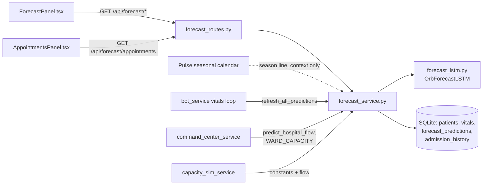
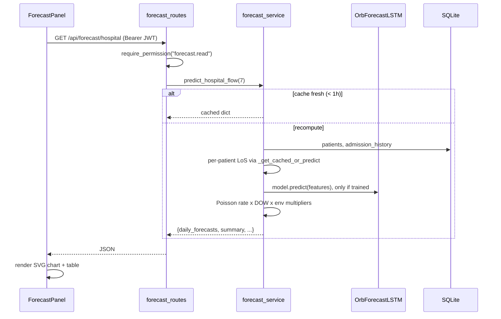

# Forecast: census/demand prediction with the LSTM

Orb Forecast is the platform's crystal ball: it predicts how full the hospital will be over the next week, which patients are likely to go home soon, and how each ward's beds will look in 48 hours. Under the hood it combines a small multi-task neural network (a bidirectional LSTM defined in `server/models/forecast_lstm.py`) that scores individual patients, a set of transparent statistical rules (day-of-week admission rates; since 6 October 2026 no weather or seasonal adjustment, only a one-line season context from Pulse), and, critically, a **fail-closed honesty layer**: because the shipped network is not trained on real clinical data, the service refuses to present neural outputs as clinical predictions and instead routes to a clearly labeled rule-based heuristic, with tests locking that behavior in (`server/tests/test_forecast_service.py`). The results are served over six REST endpoints under `/api/forecast/*` and rendered by `ForecastPanel.tsx` as a hand-drawn SVG occupancy chart, a bed grid, a discharge-readiness board, and an admission-pattern dashboard.

Three terms you need before anything else:

- **Time-series forecasting**, predicting future values of a quantity from its past values sampled over time (here: a patient's vital signs every few minutes, or the hospital's daily admission counts). The core assumption is that the past contains signal about the future, a patient whose heart rate has been trending down toward normal is probably closer to discharge.
- **LSTM (Long Short-Term Memory)**, a type of recurrent neural network built for sequences. A plain neural network sees one input at a time; an LSTM walks through a sequence step by step and carries a memory cell forward, with learned "gates" that decide what to remember, what to forget, and what to output at each step. This lets it capture patterns like "fever spiked two days ago but has been falling since," which a snapshot model cannot see. "Bidirectional" (BiLSTM) means two LSTMs read the sequence, one forward, one backward, and their outputs are concatenated, so every timestep's representation knows about both its past and its future within the window.
- **Confidence interval (CI)**, a range around a prediction that quantifies uncertainty, e.g. "LoS 4.2 days, 95% CI [3.1, 5.6]." Be aware: **Orb Forecast does not produce confidence intervals.** The `confidence` field it returns is a single scalar, the softmax probability of the winning acuity class (`server/models/forecast_lstm.py:142`) or a fixed constant in the heuristic path (`server/services/forecast_service.py:525`). It measures how sure the acuity classifier is, not a statistical interval around the LoS number. Keep that distinction in mind when reading the UI.

## Purpose and neighbors

**Problem it solves.** A hospital operations team constantly asks: "Will we have a bed tomorrow? Who can go home? Which day will be the crunch?" Answering that manually means eyeballing every chart. Forecast automates it in two layers: a **per-patient layer** (predict each admitted patient's remaining length-of-stay, "LoS," the number of days a patient stays in hospital, plus their probability of discharge and whether their acuity is improving/stable/worsening) and a **hospital layer** (aggregate those per-patient numbers, add a statistical admission model, and produce a 7-day census projection, "census" is the count of patients currently occupying beds).

**Why the two-model design.** Per-patient trajectories are genuinely sequential (vitals over time), so an LSTM is the right shape of tool. Hospital-level admissions, by contrast, are well modeled by simple, auditable statistics: a 30-day historical average daily admission rate treated as a Poisson process (a standard statistical model for counting independent random arrivals per unit time), scaled by day-of-week multipliers. (Until 6 October 2026 it was also scaled by hand-picked environmental factors from Pulse's internet feeds; those are gone, see `_get_environmental_multipliers` below.) Mixing a neural model where sequence matters with transparent arithmetic where it does not keeps the system both capable and explainable.

**Neighbors.** Forecast sits at the center of Orb's operational pillars:

- **Auth/RBAC** (see guide 03-auth-rbac): every endpoint is gated on the `forecast.read` permission via FastAPI dependency injection.
- **Database** (see guide 04-database-schema): reads `patients`, `vitals`, `risk_scores`, `medications`, `admission_history`, `discharge_summaries`; reads/writes `forecast_predictions`.
- **Pulse** (the seasonal calendar, guide 18): since 6 October 2026 (ruling R030 in `docs/RULINGS_NEEDED_2026-10.md`) Forecast applies no weather or seasonal adjustment. It shows the current season as one line of context, for example "Season: South-west monsoon (peak), Dengue season", and no number depends on it. Before that, Forecast read Pulse's in-memory caches of internet weather, AQI and flu data and multiplied admissions by hand-picked factors.
- **Bot/simulation loop** (covered with the realtime/simulation guides): the vitals bot calls `refresh_all_predictions()` roughly every 10 minutes (`server/services/bot_service.py:327-330`).
- **Command Center and Capacity Simulator** (their own guides): both import Forecast's ward-capacity constants and call `predict_hospital_flow()` so the whole platform reports one consistent census (`server/services/command_center_service.py:31-35`, `server/services/capacity_sim_service.py:41`).
- **Model governance**: the panel's `ProvenanceChip` displays the `forecast_lstm` registry entry ("synthetic-v1" or "untrained", never "validated") from `server/services/model_governance_service.py:64-74`.

## File map

| File | Lines (approx) | Role |
|---|---|---|
| `server/services/forecast_service.py` | 1103 | Runtime brain: feature extraction, per-patient prediction with fail-closed guard, hospital flow aggregation, capacity/discharge/pattern views, appointment generator, caching. |
| `server/routes/forecast_routes.py` | 145 | Six thin FastAPI GET endpoints under `/api/forecast`, all gated on `forecast.read`. |
| `server/models/forecast_lstm.py` | 202 | The `OrbForecastLSTM` network (BiLSTM + temporal attention + 4 task heads), `predict()` inference wrapper, and `load_model()` checkpoint loader with untrained fallback. |
| `server/scripts/train_forecast.py` | 561 | Original training pipeline: Indian-calibrated synthetic patient generator, multi-task training loop, plus a 30-day `admission_history` seeder. Writes `models/forecast_checkpoint.pt` and mutates `orb.db`. |
| `server/scripts/train_forecast_synth.py` | 332 | Narrower, deterministic re-implementation of the trainer: no DB writes, seeded RNG, exports a versioned checkpoint (`forecast_lstm_synth_v1.pt`) with honest provenance metadata. |
| `src/pages/panels/ForecastPanel.tsx` | 671 | React panel with four sections (census chart, ward capacity, discharge board, admission patterns), hand-rolled SVG chart, 5-minute polling. |
| `server/tests/test_forecast_service.py` | 53 | Locks the fail-closed contract: untrained model must route to the labeled heuristic. |

## How it works

### Flow 1: panel load (the main request path)

1. A clinician with the `forecast` tab (doctors, nurses, admins, `src/shellConfig.tsx:828-884`) opens Forecast; `ClinicianShell` lazy-loads the panel (`src/pages/ClinicianShell.tsx:128`) and mounts it inside an error boundary (`src/pages/ClinicianShell.tsx:562`).
2. On mount, `fetchAll` fires four API calls in parallel with `Promise.all` (`src/pages/panels/ForecastPanel.tsx:142-159`): `/api/forecast/hospital`, `/discharge-board`, `/capacity`, `/admission-patterns`. Each request carries the JWT (JSON Web Token, the signed credential issued at login, see guide 03-auth-rbac) read from `localStorage` as a `Bearer` header (`src/pages/panels/ForecastPanel.tsx:24-32`).
3. Each route handler's `Depends(require_permission("forecast.read"))` verifies the token and the role's permission set before the handler body runs (`server/routes/forecast_routes.py:29`, `server/permissions.py:377`). This is FastAPI **dependency injection**: instead of the handler fetching the user itself, it declares "I need a user who passed this check" and the framework supplies it (or returns 403 first).
4. The handlers call the corresponding service functions. `/hospital` hits an in-process cache with a 1-hour TTL (`server/services/forecast_service.py:37`, `390-391`); on a miss, `predict_hospital_flow()` recomputes the full 7-day projection.
5. The panel stores the four JSON payloads in React state (state variables that trigger re-render when set, see guide 01-app-shell for React hooks) and renders whichever of the four sections is active. A `setInterval` re-fetches every 5 minutes (`src/pages/panels/ForecastPanel.tsx:163`).

### Flow 2: one patient's prediction (fail-closed)

1. `predict_patient_los(pid)` lazily loads the singleton model (`server/services/forecast_service.py:40-52`, `267`).
2. **Gate 1, untrained network.** If `model.trained` is `False` (no checkpoint was loaded), the service *never* runs the network. It returns `_heuristic_prediction()` tagged `prediction_source: "heuristic"`, `model_trained: False` (`server/services/forecast_service.py:454-459`). Rationale: an untrained network is random-initialized; its outputs are noise, and presenting noise as a "neural prediction" to clinicians is a safety defect. This is the "fail closed" contract the tests enforce.
3. **Gate 2, insufficient data.** Even with a trained model, if the patient has fewer than 3 vitals rows, `extract_patient_features()` returns `None` and the heuristic is used (`server/services/forecast_service.py:364-365`, `284-289`).
4. Otherwise a `(1, 48, 19)` feature tensor is built from the DB and pushed through `model.predict()` inside `vram_guard("Forecast LSTM")`, a context manager from the GPU coordinator that flushes GPU caches after inference so the shared Apple-Silicon GPU doesn't fragment (`server/services/forecast_service.py:471-474`, `server/services/gpu_coordinator.py:38`).
5. The result (LoS days, discharge probability, acuity label, confidence) gets an `estimated_discharge_date` and is persisted to the `forecast_predictions` table (`server/services/forecast_service.py:478-483`).

### Flow 3: the hospital-level 7-day forecast

For each of the next `days_ahead` days (`server/services/forecast_service.py:625-678`):

1. **Admissions** = 30-day average daily admission rate from `admission_history` (default 4.5/day if empty) × a day-of-week multiplier (Mondays surge to 1.35×, Sundays dip to 0.65×, `server/services/forecast_service.py:65`) (no environmental or seasonal multiplier since 6 October 2026; the old one from Pulse's internet feeds, for example storm +20% and flu ILI > 5% +35%, is gone). The code deliberately reports the Poisson *mean* rather than a random draw so the number doesn't jump every time the cache expires (`server/services/forecast_service.py:633-637`).
2. **Discharges** = count of patients whose predicted remaining LoS lands in that day's window, clamped by two admitted demo-smoothing bounds (cap at `n_patients // 3`, floor of ~8% per day after day 0, flagged in-code as placeholders, `server/services/forecast_service.py:646-652`).
3. **Occupancy** = running census + admissions − discharges, clamped to `[0, capacity + 5]`; a per-ward breakdown is projected proportionally to the current ward distribution (`server/services/forecast_service.py:655-664`).
4. A summary block computes peak day, 7-day totals, and "beds available in 48h" (`server/services/forecast_service.py:680-698`). The whole dict is cached for 1 hour.

### Flow 4: background refresh

The vitals simulation bot runs every 5 seconds (`server/config.py:342`, `server/main.py:197-204`); every 120th cycle (~10 minutes) it calls `refresh_all_predictions()` (`server/services/bot_service.py:327-330`), which re-predicts every admitted patient and prunes `forecast_predictions` to the latest 5 rows per patient (`server/services/forecast_service.py:908-940`). This keeps `_get_cached_or_predict()` fast for the aggregate endpoints.

### Flow 5: training (overview)

Two scripts, same architecture, different philosophies:

- `train_forecast.py`, the original, richer pipeline. Generates ~1,500 synthetic patient windows from Indian-calibrated diagnosis profiles, trains 50 epochs with a weighted multi-task loss, saves the best-validation checkpoint to `models/forecast_checkpoint.pt` (the path `load_model()` reads by default), **and** repopulates the `admission_history` table with 30 days of synthetic admissions.
- `train_forecast_synth.py`, the honest, reproducible harness. Fully deterministic (seeded `numpy.default_rng` + `torch.manual_seed`), never touches the DB, and exports to a *versioned* file (`models/checkpoints/forecast_lstm_synth_v1.pt`) whose metadata declares `data_source: "synthetic_v1"` and `icu_head_trained: False`. Its docstring is explicit that the checkpoint exists to exercise the neural plumbing, not to make clinical claims (`server/scripts/train_forecast_synth.py:3-14`).

Both train only three of the four heads (LoS, discharge, acuity); neither supplies an ICU-transfer label, so that head stays gated off at inference (see `icu_head_trained` below).

## Function-by-function

### server/models/forecast_lstm.py

### Module constants: `server/models/forecast_lstm.py:41`
**Signature:** `INPUT_DIM = 19`, `HIDDEN_DIM = 64`, `NUM_LAYERS = 2`, `ICU_TRANSFER_WINDOW_H = 3`, `ACUITY_LABELS = {0: "improving", 1: "stable", 2: "worsening"}`, `_CHECKPOINT_PATH = models/forecast_checkpoint.pt`
**Does:** Defines the feature-schema and architecture contract shared by the service and both training scripts.
**How it works:** 19 input channels = 6 vitals + 3 demographics + 4 one-hot ward flags + 3 one-hot severity flags + 3 operational markers (days-since-admission, medication count, risk score). The exact channel order is documented in `server/scripts/train_forecast_synth.py:84-92`.
**Why it exists:** Training and inference must build byte-identical feature layouts or the network reads garbage; centralizing the dimension in one importable constant makes drift a compile-time-ish error rather than silent corruption.
**Data in/out:** plain Python ints/dicts/Path.
**Talks to:** imported by `server/services/forecast_service.py:29`, `server/scripts/train_forecast.py:36`, `server/scripts/train_forecast_synth.py:56-61`.
**Change guide:** To add a feature channel (e.g. lab values), bump `input_dim` at construction time rather than editing `INPUT_DIM`, `load_model()` already honors a checkpoint's own `input_dim` (`server/models/forecast_lstm.py:169-176`), but you must then extend `extract_patient_features()` to fill the new columns in the same order used in training.
**Gotchas:** none noteworthy.

### OrbForecastLSTM.__init__: `server/models/forecast_lstm.py:52`
**Signature:** `(input_dim=19, hidden_dim=64, num_layers=2, dropout=0.3) → None`
**Does:** Builds the network: LayerNorm → 2-layer bidirectional LSTM → temporal attention → four linear task heads.
**How it works:**
1. Sets two provenance flags to `False`: `self.trained` (`server/models/forecast_lstm.py:67`) and `self.icu_head_trained` (`server/models/forecast_lstm.py:73`). These are plain Python attributes, not weights, `load_model()` flips them based on checkpoint metadata.
2. `self.input_norm = nn.LayerNorm(input_dim)` (`server/models/forecast_lstm.py:76`), normalizes each 19-dim input vector so raw clinical units (heart rate ~80, age ~60, one-hot 0/1) land on comparable scales; the layer's scale/shift are learned during training.
3. `self.lstm` (`server/models/forecast_lstm.py:78-85`): `batch_first=True` (tensors shaped `(batch, seq, features)`), `bidirectional=True`, inter-layer dropout 0.3 (dropout randomly zeroes activations during training to prevent overfitting; it is applied only when `num_layers > 1` because PyTorch's LSTM dropout sits *between* layers).
4. `self.attn` (`server/models/forecast_lstm.py:90-94`): a tiny scorer `Linear(128→128) → Tanh → Linear(128→1)` producing one relevance score per timestep. "Temporal attention" means the model learns *which timesteps matter* (e.g. the crisis spike 6 hours ago) instead of only using the last hidden state.
5. Four heads (`server/models/forecast_lstm.py:97-100`), each a single `Linear` from the 128-dim context: LoS, discharge probability, 3-class acuity, ICU transfer.
**Why it exists:** Multi-task learning, one shared encoder feeding several heads, lets scarce clinical signal be reused across related targets and keeps the model tiny enough for CPU inference.
**Data in/out:** constructor takes hyperparameters; the module owns ~160k parameters.
**Talks to:** constructed by `load_model()` and both trainers.
**Change guide:** To add a fifth prediction head (e.g. readmission risk), add `self.readmit_head = nn.Linear(ctx_dim, 1)` here, emit it in `forward()` (`server/models/forecast_lstm.py:113-118`), surface it in `predict()` behind a `readmit_head_trained` flag like the ICU head, add a labeled target + loss term in the trainer, and store the flag in the checkpoint dict; knock-on effects: old checkpoints will fail `load_state_dict` unless you load with `strict=False` or version the checkpoint. Watch out for the fail-closed pattern, never surface a head the checkpoint didn't train.
**Gotchas:** `dropout` is silently disabled when `num_layers == 1` (`server/models/forecast_lstm.py:84`), which is correct PyTorch behavior but surprises people tuning regularization.

### OrbForecastLSTM.forward: `server/models/forecast_lstm.py:102`
**Signature:** `(x: Tensor (B, seq, input_dim)) → dict{los, discharge_prob, acuity_logits, icu_transfer_prob}`
**Does:** Runs the full encoder + heads and returns raw (activated) head outputs.
**How it works:**
1. Unsqueezes a 2-D input to a batch of one (`server/models/forecast_lstm.py:104-105`).
2. LayerNorm, then the BiLSTM produces `(B, seq, 128)` (64 hidden × 2 directions).
3. Attention scores → `softmax` over the *time* dimension (`dim=1`) → weighted sum collapses the sequence into a single 128-dim context vector (`server/models/forecast_lstm.py:110-111`).
4. Head activations: `softplus` on LoS (a smooth "always ≥ 0" function, a stay can't be negative days), `sigmoid` on the two probabilities (squashes to 0..1), raw logits for acuity (the 3-class scores that `softmax` later turns into probabilities) (`server/models/forecast_lstm.py:113-118`).
**Why it exists:** Standard `nn.Module` contract, training scripts call it directly to compute losses against labels.
**Data in/out:** float tensor in; dict of tensors out (`los`/`discharge_prob`/`icu_transfer_prob` are `(B,1)`, `acuity_logits` is `(B,3)`).
**Talks to:** called by `predict()` and by both training loops (`server/scripts/train_forecast.py:370`, `server/scripts/train_forecast_synth.py:262`).
**Change guide:** none beyond the head-addition example above.
**Gotchas:** the attention softmax is over timesteps, not features, swapping `dim=1` for `dim=-1` would silently normalize across the 1-wide score axis and make attention a no-op.

### OrbForecastLSTM.predict: `server/models/forecast_lstm.py:121`
**Signature:** `(features: Tensor|array (seq,19) or (1,seq,19)) → dict{predicted_los_days, discharge_probability, acuity_trajectory, confidence, model_trained[, icu_transfer_risk_3h]}`
**Does:** Single-patient inference wrapper: eval mode, no gradients, tensor coercion, device placement, and JSON-friendly rounding.
**How it works:**
1. `@torch.no_grad()` and `self.eval()` disable gradient tracking and dropout (`server/models/forecast_lstm.py:120-123`).
2. Coerces lists/arrays to a float32 tensor, batches a 2-D input, and moves it to whatever device the model's parameters live on (`server/models/forecast_lstm.py:124-132`).
3. Runs `forward`, softmaxes the acuity logits, argmaxes the winner (`server/models/forecast_lstm.py:134-136`).
4. Builds the result dict: LoS rounded to 1 dp, probabilities to 4 dp, `acuity_trajectory` mapped through `ACUITY_LABELS`, `confidence` = the winning acuity class's softmax probability, `model_trained` echoing the flag (`server/models/forecast_lstm.py:138-144`).
5. **Fail-closed ICU head:** `icu_transfer_risk_3h` is included *only* when `self.icu_head_trained` is true; otherwise the key is omitted entirely so no caller can mistake `sigmoid(random weights)` for a 3-hour transfer probability (`server/models/forecast_lstm.py:145-151`).
**Why it exists:** Keeps tensor plumbing out of the service layer and centralizes the safety gating of the untrained head.
**Data in/out:** see signature; all values are plain Python floats/strings, safe to `json.dumps`.
**Talks to:** called by `forecast_service.predict_patient_los()` (`server/services/forecast_service.py:474`) and the smoke test in `server/scripts/train_forecast.py:548`.
**Change guide:** To expose ICU-transfer risk for real, you must (a) train `icu_head` against a genuine labeled target with a BCE loss term, (b) write `"icu_head_trained": True` into the checkpoint dict, and (c) change nothing here, `load_model()` (`server/models/forecast_lstm.py:182`) and this gate already do the right thing. Footgun: setting the flag by hand without real training re-creates the exact safety defect the gate exists to prevent.
**Gotchas:** `confidence` describes only the acuity classification, it says nothing about how accurate the LoS regression is, yet the service reuses it as the overall prediction confidence.

### load_model: `server/models/forecast_lstm.py:155`
**Signature:** `(checkpoint_path=None, device=None) → OrbForecastLSTM`
**Does:** Builds the network and loads the trained checkpoint if one exists; otherwise returns an *untrained* model with a warning so the backend still boots.
**How it works:**
1. Picks the device: Apple-Silicon `mps` if available, else CPU (`server/models/forecast_lstm.py:162-163`).
2. Resolves the path (default `server/models/forecast_checkpoint.pt`, `server/models/forecast_lstm.py:48,165`).
3. If the file exists: `torch.load(..., weights_only=True)`, this restricts deserialization to tensors and simple scalars, refusing arbitrary pickle code execution from a file on disk (a real supply-chain concern for `.pt` files) (`server/models/forecast_lstm.py:174`). Reads `input_dim` from the checkpoint so extended-schema checkpoints construct a matching network, loads the `state_dict` (the flat name→tensor map PyTorch uses to persist weights), sets `trained = True`, and copies `icu_head_trained` from checkpoint metadata (default `False`) (`server/models/forecast_lstm.py:176-182`).
4. If the file is missing or loading throws, constructs a fresh model with `trained = False` and logs a warning/error (`server/models/forecast_lstm.py:189-198`).
5. Moves to device, `eval()`, returns.
**Why it exists:** This *is* the "missing weights" fallback the whole subsystem is built around: no checkpoint → boot anyway → service routes every prediction to the labeled heuristic. Note the fallback covers absent **weights**, not absent **torch**, `forecast_service.py` imports `torch` unconditionally at module load (`server/services/forecast_service.py:24`), and `server/requirements-dev.txt:8` documents that torch is a hard dependency even for the test suite. If torch is not installed, the server does not start; there is no torch-free mode.
**Data in/out:** checkpoint dict keys consumed: `model_state_dict` (required), `input_dim`, `icu_head_trained`, `epoch`, `data_source` (logged), the exact contract `server/scripts/train_forecast_synth.py:24-31` documents and both trainers write.
**Talks to:** called by `forecast_service.get_model()` (`server/services/forecast_service.py:51`) and directly by `test_model_ships_untrained` (`server/tests/test_forecast_service.py:26`).
**Change guide:** Worked example, to run the synthetic checkpoint in dev: `python server/scripts/train_forecast_synth.py` writes `server/models/checkpoints/forecast_lstm_synth_v1.pt`; either copy it to `server/models/forecast_checkpoint.pt` or call `load_model(checkpoint_path=...)` explicitly (the script prints both options, `server/scripts/train_forecast_synth.py:312-314`). Knock-on effects: `model.trained` becomes `True`, so `predict_patient_los` starts using the LSTM path, and the model-governance registry starts reporting `checkpoint_present=1` (`server/services/model_governance_service.py:35-38`); the test `test_model_ships_untrained` will then fail because it asserts no checkpoint exists.
**Gotchas:** any load failure is swallowed into "untrained model" (`server/models/forecast_lstm.py:196-198`), a corrupted checkpoint degrades silently to heuristics with only an error log to tell you.

### server/services/forecast_service.py

### get_model: `server/services/forecast_service.py:40`
**Signature:** `() → OrbForecastLSTM`
**Does:** Lazily loads and memoizes the process-wide singleton model.
**How it works:** checks the module global `_model` (`server/services/forecast_service.py:32`); on first call, populates it via `load_model()`.
**Why it exists:** Model construction + checkpoint load is expensive; every request must share one instance.
**Data in/out:** none → model.
**Talks to:** `predict_patient_los()`.
**Change guide:** To hot-reload a newly trained checkpoint without restarting, set `forecast_service._model = None` (or add a `reload_model()` helper); footgun: no locking, so two first-requests racing can both load (harmless but wasteful).
**Gotchas:** none noteworthy.

### WARD_CAPACITY / TOTAL_CAPACITY / DOW_MULTIPLIERS: `server/services/forecast_service.py:56`
**Signature:** module constants: `{"ICU": 8, "W1": 8, "W2": 8, "W3": 8}`, `32`, `{0: 1.35 … 6: 0.65}` (`server/services/forecast_service.py:56-65`)
**Does:** Hardcodes the hospital's bed capacity and the weekly admission seasonality.
**Why it exists:** This 32-bed model hospital has no facilities database; these constants are the platform-wide source of truth, Command Center imports them verbatim so its occupancy math always agrees with Forecast (`server/services/command_center_service.py:29-35`), and the Capacity Simulator does the same (`server/services/capacity_sim_service.py:85-86`).
**Change guide:** To resize a ward, change the number here, knock-on effects ripple to `/api/forecast/hospital` percentages, the Command Center board, the Capacity Simulator baseline, and the panel's bed grid (which draws `data.total` bed icons, `src/pages/panels/ForecastPanel.tsx:478`). Watch out: `server/tests/test_command_center.py:11` imports these constants, so tests track the change automatically, but any *hardcoded* `32` elsewhere will not.
**Gotchas:** `DOW_MULTIPLIERS` is duplicated (not imported) in `server/scripts/train_forecast.py:132-140`; if you retune one, the training data and the runtime forecast silently disagree.

### _get_environmental_multipliers: removed 6 October 2026
**What it was:** read Pulse's in-memory caches of internet weather, AQI and CDC flu data and turned them into a per-day admission multiplier, compounding hand-picked factors: thunderstorm ×1.20, extreme heat ≥ 42 °C ×1.20 ("cardiac"), AQI > 200 ×1.20, ILI > 5% ×1.35, and others. None was fitted to data, and it silently became 1.0 whenever no Pulse endpoint had been hit since boot.
**Why it went:** Orb is strictly offline (4 October 2026), so the feeds are gone, and the ruling of 6 October 2026 (R030) turned down replacing them with seasonal guesses.
**What replaced it:** nothing in the arithmetic. Forecast reads the current season from Pulse's calendar for one line of context. A seasonal factor fitted from the hospital's own admission history may come later; do not put a hand-picked multiplier back.

### extract_patient_features: `server/services/forecast_service.py:406`
**Signature:** `(patient_id: str, seq_len=48) → torch.Tensor (1, 48, 19) | None`
**Does:** Builds the LSTM input window for one patient from four DB queries, matching the training feature schema channel-for-channel.
**How it works:**
1. Fetches the patient row; returns `None` if missing (`server/services/forecast_service.py:349-353`).
2. Fetches up to 48 most-recent vitals rows (DESC); requires at least 3 or returns `None` (`server/services/forecast_service.py:356-365`).
3. Fetches the latest risk score and the active-medication count (`server/services/forecast_service.py:368-377`).
4. Reverses vitals to chronological order (LSTMs read oldest→newest) (`server/services/forecast_service.py:382-383`).
5. Fills a `(48, 19)` array: channels 0-5 from vitals with per-field defaults for NULLs (HR 80, SBP 120, DBP 75, SpO2 97, temp 37, RR 16); when fewer than 48 vitals exist, later timesteps repeat the newest reading (forward-fill via `v_idx = min(t, n_vitals-1)`, `server/services/forecast_service.py:388-398`). Channels 6-8: age and one-hot sex; 9-12: one-hot ward (accepting both `"W1"` and `"WARD 1"` spellings); 13-15: one-hot risk level; 16: days since admission parsed from ISO-8601 with a `Z→+00:00` fix-up and a 3.0-day fallback on parse failure; 17: med count; 18: risk score, default 0.5 (`server/services/forecast_service.py:401-432`).
6. Returns as float32 with a batch dimension.
**Why it exists:** The training/inference feature contract is the whole ballgame in ML systems; this function is the inference half of that contract (the training halves are `SyntheticPatientTrajectory.generate_sequence` and `_make_patient_window`).
**Data in/out:** reads `patients`, `vitals`, `risk_scores`, `medications`; emits a tensor.
**Talks to:** called by `predict_patient_los()`.
**Change guide:** Worked example, to add SpO2 *trend* as channel 19: bump the constructed model's `input_dim` to 20 in the trainer, add the channel at the same index in **all three** feature builders (here, `server/scripts/train_forecast.py:196-248`, `server/scripts/train_forecast_synth.py:146-169`), retrain, and let `load_model()` pick up `input_dim=20` from the checkpoint. Footgun: get the channel *order* wrong in any one place and the model silently reads (say) temperature where it learned age, no error, just garbage predictions.
**Gotchas:** static features (age, ward, severity) are copied into every one of the 48 timesteps, wasteful but intentional, since a vanilla LSTM has no separate static-input path. Timezone handling: `admission_date` values without timezone info make the subtraction against `datetime.now(timezone.utc)` raise `TypeError`, which is caught and silently replaced by the 3.0-day default (`server/services/forecast_service.py:418-425`).

### predict_patient_los: `server/services/forecast_service.py:506`
**Signature:** `(patient_id: str) → dict{predicted_los_days, discharge_probability, acuity_trajectory, confidence, estimated_discharge_date, model_trained, prediction_source}`
**Does:** The per-patient entry point: fail-closed gate → feature extraction → LSTM (or heuristic) → cache write.
**How it works:**
1. Gets the singleton model.
2. **Fail-closed guard** (`server/services/forecast_service.py:454-459`): if `model.trained` is falsy, returns the heuristic tagged `model_trained: False`, `prediction_source: "heuristic"`, and still caches it.
3. Extracts features; if `None`, returns the heuristic tagged `model_trained: True` (a trained model exists) but `prediction_source: "heuristic"` (this particular number is rule-based) (`server/services/forecast_service.py:463-468`).
4. LSTM path: runs `model.predict(features)` inside `vram_guard("Forecast LSTM")` (imported lazily, `server/services/forecast_service.py:471-474`), tags `prediction_source: "lstm"`, computes `estimated_discharge_date = now + predicted_los_days`, caches, returns.
**Why it exists:** Single choke point where the honesty policy is enforced, no other code path can reach `model.predict` for patient data.
**Data in/out:** see signature; the dict is exactly what `GET /api/forecast/patient/{id}` returns.
**Talks to:** called by `forecast_routes.patient_forecast` (`server/routes/forecast_routes.py:46`), `refresh_all_predictions` (`server/services/forecast_service.py:922`), and `_get_cached_or_predict` (`server/services/forecast_service.py:987`).
**Change guide:** To surface the ICU-transfer risk in this payload once a real checkpoint trains it, nothing changes here, `model.predict` will start including `icu_transfer_risk_3h` and it will pass through; you would only need to render it in the UI.
**Gotchas:** read `model_trained` and `prediction_source` *together*: `model_trained: True` + `prediction_source: "heuristic"` means "we have a model but this patient lacked data," which trips up consumers that treat `model_trained` as "this number is neural."

### _heuristic_prediction: `server/services/forecast_service.py:553`
**Signature:** `(patient_id: str) → dict` (same shape as the LSTM result, minus source tags)
**Does:** Transparent rule-based fallback: ward-typical LoS minus days already admitted.
**How it works:**
1. Unknown patient → fixed conservative answer (3.0 days remaining, 15% discharge probability, confidence 0.3) (`server/services/forecast_service.py:496-503`).
2. Otherwise base LoS by ward, ICU 7.0, W1 4.0, W2 3.0, W3 3.5, default 4.0 days (`server/services/forecast_service.py:505-506`).
3. `remaining = max(0.5, base − days_in)`; `discharge_prob = min(0.9, 1/(remaining+0.5))`, the closer to the typical stay's end, the higher the probability (`server/services/forecast_service.py:518-519`).
4. Always `acuity_trajectory: "stable"`, `confidence: 0.45`, deliberately ≤ 0.5 so the UI can distinguish rule-based numbers (the test asserts this bound, `server/tests/test_forecast_service.py:52`).
**Why it exists:** The system must produce *some* planning number for every patient even with no model and no vitals; a legible rule beats a random network.
**Data in/out:** reads `patients.ward/admission_date` only.
**Talks to:** `predict_patient_los()`; imported directly by the tests.
**Change guide:** The ward base-LoS map here is also documented as the Capacity Simulator's assumption source (`server/services/capacity_sim_service.py:50,71`); changing it changes that simulator's disclosed assumptions text too.
**Gotchas:** same naive-datetime `TypeError` fallback pattern as feature extraction (`server/services/forecast_service.py:509-516`).

### _cache_prediction: `server/services/forecast_service.py:530`
**Signature:** `(patient_id: str, result: dict) → None`
**Does:** Inserts the prediction into `forecast_predictions` with a JSON `feature_snapshot` carrying the discharge date and timestamp.
**How it works:** one parameterized `INSERT` (placeholders `?` keep it SQL-injection-safe); any exception is logged and swallowed, caching must never break a prediction (`server/services/forecast_service.py:532-552`).
**Why it exists:** The aggregate endpoints (`/hospital`, `/capacity`, `/discharge-board`) need dozens of per-patient numbers per request; reading the latest cached row is far cheaper than re-running inference.
**Data in/out:** writes `forecast_predictions(patient_id, predicted_los_days, discharge_probability, acuity_trajectory, confidence, feature_snapshot)` (schema at `server/database.py:261-270`, index at `server/database.py:472`).
**Talks to:** `predict_patient_los()` writes; `_get_cached_or_predict()` reads.
**Gotchas:** the table has a CHECK constraint on `acuity_trajectory ∈ {improving, stable, worsening}` (`server/database.py:266`), a new acuity label added to `ACUITY_LABELS` without a schema migration makes every cache write fail silently (logged only).

### predict_hospital_flow: `server/services/forecast_service.py:624`
**Signature:** `(days_ahead=7) → dict{current_occupancy, total_capacity, current_occupancy_pct, daily_forecasts: [...], summary: {...}}`
**Does:** Builds the N-day hospital census forecast (Flow 3 above) and caches it for an hour.
**How it works:**
1. Cache check against module globals `_hospital_flow_cache`/`_hospital_flow_cache_time` with `HOSPITAL_FLOW_CACHE_TTL = 3600` (`server/services/forecast_service.py:566-570`).
2. Loads all admitted patients; counts current occupancy per ward with an *inline* normalizer (unknown wards fall back to `"General"` and are counted under a key that matches no capacity bucket, see Discrepancies) (`server/services/forecast_service.py:575-593`).
3. Fits the average daily admission rate from the last 30 days of `admission_history` (default 4.5 if empty) (`server/services/forecast_service.py:596-610`).
4. Collects a per-patient LoS prediction for everyone via `_get_cached_or_predict` (`server/services/forecast_service.py:613-616`). (It used to collect the environmental multipliers here too; removed 6 October 2026.)
5. Day loop (`server/services/forecast_service.py:625-678`): admissions = rate × DOW (expected value, not a Poisson draw, the comment at `server/services/forecast_service.py:633-636` explains a single random draw made the number jump discontinuously at each cache expiry); discharges = patients whose remaining LoS falls inside `(day, day+1]`, then the admitted demo bounds (cap `n_patients // 3`, ~8% floor after day 0, flagged as `DEMO PLACEHOLDER` at `server/services/forecast_service.py:646-652`); occupancy accumulates and clamps to `[0, 37]`; ward breakdown scales the current ward ratio, clamped to `cap + 1`.
6. Summary block: avg/peak occupancy, 7-day totals, `beds_available_in_48h` from day index 1 (`server/services/forecast_service.py:680-698`).
7. Stores in the cache and returns.
**Why it exists:** This is the payload behind the panel's headline chart and KPI cards, and the shared census source for Command Center and the Capacity Simulator.
**Data in/out:** each `daily_forecasts[i]` = `{date, day_label, predicted_admissions (int), predicted_discharges (int), predicted_occupancy (int), occupancy_pct, ward_breakdown}` (`server/services/forecast_service.py:666-678`; the `env_multiplier`, `env_factors` and `env_icons` fields were removed on 6 October 2026, and the season line is context only).
**Talks to:** called by the `/hospital` route (`server/routes/forecast_routes.py:33`), `command_center_service._forecast()` with `days_ahead=1` (`server/services/command_center_service.py:218`), and `capacity_sim_service` with `days_ahead=7` (`server/services/capacity_sim_service.py:108`).
**Change guide:** Worked example, to extend the panel to a 14-day view: the route already clamps `days` to 1–14 (`server/routes/forecast_routes.py:40`), so change the panel's fetch to `/api/forecast/hospital?days=14`; knock-on effects: the SVG x-axis density doubles (labels may collide at `chartWidth=700`), and, footgun, the shared 1-hour cache ignores `days_ahead`, so whichever caller populates it first dictates the horizon everyone gets for the next hour (see Discrepancies #2).
**Gotchas:** `running_occupancy` accumulates the *unrounded* float admissions while the payload shows `round(...)`, so the displayed columns may not sum exactly to the displayed census; the occupancy clamp allows up to capacity + 5, i.e. the chart can legitimately show an over-capacity forecast.

### get_bed_capacity_forecast: `server/services/forecast_service.py:772`
**Signature:** `() → dict{current: {ward: {total, occupied, available, utilization_pct}}, projected_48h: {ward: {...}}, total: {...}}`
**Does:** Current per-ward bed utilization plus a 48-hour projection that subtracts patients predicted to leave within 2 days.
**How it works:**
1. Counts admitted patients per ward using `_normalize_ward` (`server/services/forecast_service.py:715-726`).
2. For each patient, if the cached/computed `predicted_los_days ≤ 2.0`, counts one projected discharge for their ward (`server/services/forecast_service.py:732-736`).
3. Projected occupancy = current − discharges, floored at 0; adds availability and percentages; note the projection ignores *incoming admissions*, so it is an optimistic "beds freeing up" view, not a net census (`server/services/forecast_service.py:738-746`).
**Why it exists:** Bed managers think in "which ward has a free bed", not hospital totals.
**Talks to:** `/capacity` route; rendered as the panel's per-ward cards and bed-icon grid.
**Change guide:** To make the 48h projection net of admissions, distribute `predict_hospital_flow()`'s day-1/2 admissions across wards by the same ratio logic, but then reconcile with the 1-hour cache staleness.
**Gotchas:** the two normalizers disagree on unknown wards (this one buckets them into W1 via `_normalize_ward`; `/hospital` drops them), see Discrepancies #5.

### get_discharge_board: `server/services/forecast_service.py:829`
**Signature:** `() → list[dict]` sorted by `discharge_probability` desc
**Does:** Builds the Discharge Readiness Board: every admitted patient with demographics, days admitted, and their prediction fields.
**How it works:** one query for all admitted patients (`server/services/forecast_service.py:764-769`); per patient computes `days_admitted` from `admission_date` (same Z-fixup/3.0-fallback pattern) and merges the cached prediction (`server/services/forecast_service.py:774-806`); sorts by discharge probability (`server/services/forecast_service.py:809`).
**Why it exists:** Discharge planning is the highest-leverage lever on capacity; ranking patients by predicted readiness turns the model into a to-do list.
**Data in/out:** rows shaped exactly like the panel's `DischargeRow` interface (`src/pages/panels/ForecastPanel.tsx:59-73`).
**Talks to:** `/discharge-board` route.
**Gotchas:** with the untrained model, every heuristic row has `acuity_trajectory: "stable"` and confidence 0.45, so the board degenerates into "who has been here longest relative to their ward's typical stay", correct given the honesty policy, but worth knowing when reading it.

### get_admission_patterns: `server/services/forecast_service.py:889`
**Signature:** `() → dict{daily_summary: [7 x {day, avg_admissions, total}], total_30d, avg_daily, avg_los, severity_distribution, ward_distribution, discharge_rate}`
**Does:** Descriptive statistics over the entire `admission_history` table for the "Admission Patterns" section.
**How it works:** returns an all-zeros shape when the table is empty (`server/services/forecast_service.py:827-836`); otherwise tallies per-date counts, severity and ward distributions (via `_normalize_ward`), and mean LoS (`server/services/forecast_service.py:838-859`); groups the per-date counts by weekday to produce Mon–Sun averages (`server/services/forecast_service.py:871-891`); computes `discharge_rate` as the share of history rows flagged discharged.
**Why it exists:** Shows the raw seasonality the forecast's DOW multipliers encode, so users can sanity-check the model against history.
**Talks to:** `/admission-patterns` route.
**Gotchas:** despite the docstring saying "7×24 heatmap data" and the field name `total_30d` (`server/services/forecast_service.py:817,702`), it returns no heatmap and it counts *all* history rows, not a 30-day window, `avg_daily` divides by a hardcoded 30 regardless of the table's actual span (see Discrepancies #6).

### refresh_all_predictions: `server/services/forecast_service.py:973`
**Signature:** `() → None`
**Does:** Recomputes predictions for every admitted patient and prunes the cache table to 5 rows per patient.
**How it works:** loops `predict_patient_los` over admitted patients, logging per-patient failures without stopping (`server/services/forecast_service.py:914-925`); prunes with a `ROW_NUMBER() OVER (PARTITION BY patient_id ORDER BY created_at DESC)` window function keeping `rn <= 5` (`server/services/forecast_service.py:928-937`); the outer try/except means a refresh failure can never crash the bot loop.
**Why it exists:** Keeps `_get_cached_or_predict` warm so the aggregate endpoints answer fast, and stops the cache table from growing without bound.
**Talks to:** called by the vitals bot every 120th 5-second cycle ≈ every 10 minutes (`server/services/bot_service.py:327-330`).
**Change guide:** To change refresh cadence, edit the `% 120` cycle check in `server/services/bot_service.py:327` (each unit = `VITALS_INTERVAL_SECONDS` = 5 s, `server/config.py:342`); footgun: the module docstring's "refreshed by bot every 60s" (`server/services/forecast_service.py:10`) is already stale, update it too.
**Gotchas:** the window-function prune requires SQLite ≥ 3.25.

### _normalize_ward: `server/services/forecast_service.py:1012`
**Signature:** `(ward: str) → "ICU" | "W1" | "W2" | "W3"`
**Does:** Maps free-text ward names ("Ward 1", "w2", None) to the four canonical keys; anything unrecognized becomes `"W1"`.
**Why it exists:** Ward names arrive in several spellings from seeds/ingestion; capacity math needs canonical buckets.
**Talks to:** used here by `get_bed_capacity_forecast` and `get_admission_patterns`, and imported by `command_center_service` (`server/services/command_center_service.py:34`) so the whole platform buckets wards identically.
**Gotchas:** the substring checks (`"1" in w`) mean "Ward 12" → W1 and "ICU-2" → W2; and `predict_hospital_flow` does *not* use this helper (Discrepancies #5).

### _get_cached_or_predict: `server/services/forecast_service.py:1046`
**Signature:** `(patient_id: str) → dict`
**Does:** Returns the newest `forecast_predictions` row for a patient, or computes a fresh prediction if none exists (or the read fails).
**How it works:** SELECT latest row; if found, re-hydrates `estimated_discharge_date` from the JSON `feature_snapshot` (`server/services/forecast_service.py:964-982`); any exception falls through (`except Exception: pass`) to `predict_patient_los`.
**Why it exists:** The aggregate endpoints call this once per patient; without it, every `/hospital` request would run up to ~32 LSTM inferences.
**Gotchas:** there is **no freshness check**, a week-old cached row is served as-is; freshness is only maintained by the bot's 10-minute refresh loop. If the bot is disabled (`INGESTION_MODE='ingestion'`, `server/main.py:197-199`), cached predictions go stale indefinitely.

### get_appointments: `server/services/forecast_service.py:1103`
**Signature:** `(days_ahead=7) → list[dict]` sorted by (date, time)
**Does:** Fabricates a plausible outpatient-appointment schedule from real admitted + recently discharged patients, deterministically per date.
**How it works:**
1. Loads admitted patients, the 10 most recent discharge summaries, plus each patient's latest risk level and active-med count (`server/services/forecast_service.py:1026-1061`).
2. For each non-Sunday day (`server/services/forecast_service.py:1068-1069`), seeds `random.Random(int(YYYYMMDD))` (`server/services/forecast_service.py:1075-1076`) so the same date always yields the same schedule, no flicker across refreshes.
3. Samples 3–5 admitted patients, maybe (40%) one discharged patient for a "Post-Discharge Review" (`server/services/forecast_service.py:1079-1097`), assigns shuffled time slots from a fixed clinic grid (`server/services/forecast_service.py:994-995`), an appointment type, and a visit reason.
**Why it exists:** The Appointments panel needs believable demo content tied to real patient rows; date-seeding is the trick that makes generated data feel persistent.
**Data in/out:** each row: `{date, day_label, time, patient_id, patient_name, age, sex, ward, bed, diagnosis, type, reason, acuity, days_admitted, active_medications, is_discharged}` (`server/services/forecast_service.py:1128-1145`).
**Talks to:** `/appointments` route; consumed by `src/pages/panels/AppointmentsPanel.tsx:62` (a different panel, see its guide).
**Gotchas:** this is synthesized scheduling data, not a bookings system, nothing persists, and re-running on the *same date* is stable but the cast changes at midnight. It is somewhat oddly homed in the forecast service (it forecasts nothing).

### server/routes/forecast_routes.py

All six handlers require the `forecast.read` permission (see guide 03-auth-rbac, RBAC = role-based access control, where permissions attach to roles like doctor/nurse/admin, `server/permissions.py:105-165`), and four of the six are still the original thin shape: `Depends(require_permission("forecast.read"))`, a one-line delegation to the service, and a try/except that turns any exception into HTTP 500 with the error text. **Two are no longer thin, and the difference is the point:**

- `patient_forecast` guards with `require_patient_access("forecast.read", audit_action="patient_forecast_viewed")` (`server/routes/forecast_routes.py:48-50`), which adds a ward-scope check on the path's `patient_id` and writes a `phi_access` audit row. Out-of-scope patients get **404, not 403**, a 403 would confirm the patient exists (`server/permissions.py:454-456`).
- `discharge_board` filters the service's output down to the caller's own department and logs a PHI read (`server/routes/forecast_routes.py:98-118`).

The router is created with `prefix="/api/forecast"` (`server/routes/forecast_routes.py:30`) and registered in `server/main.py:689`.

### hospital_forecast: `server/routes/forecast_routes.py:34`
**Signature:** `GET /api/forecast/hospital?days=7 → HospitalForecast JSON`
**Does:** Returns the N-day flow forecast, clamping `days` to 1–14 (`server/routes/forecast_routes.py:40`).
**Talks to:** `predict_hospital_flow`; called by `ForecastPanel` (`src/pages/panels/ForecastPanel.tsx:144`) and exercised by the RBAC tests (`server/tests/test_rbac.py:158,183`).
**Gotchas:** the `days` clamp is defeated by the service-side cache ignoring `days_ahead` (Discrepancies #2).

### patient_forecast: `server/routes/forecast_routes.py:46`
**Signature:** `GET /api/forecast/patient/{patient_id} → per-patient prediction JSON`
**Does:** Returns `predict_patient_los(patient_id)` verbatim, behind `require_patient_access` (`server/routes/forecast_routes.py:48-50`) rather than the plain permission guard the other five use, so the patient must be on the caller's ward, and a `phi_access` row is written on every successful read.
**Gotchas:** for a caller with **no** department on record (`department_scope` returns `None`, `server/permissions.py:193`) the scope check is skipped entirely and an unknown patient still returns 200, the heuristic's "unknown patient" branch produces a generic 3-day prediction (`server/services/forecast_service.py:496-503`). A *scoped* caller asking for an unknown id gets 404, the same answer they get for a real patient on another ward; that ambiguity is deliberate (`server/permissions.py:454-456`).

### capacity_forecast: `server/routes/forecast_routes.py:61`
**Signature:** `GET /api/forecast/capacity → CapacityData JSON`
**Does:** Returns `get_bed_capacity_forecast()`.
**Gotchas:** none noteworthy.

### discharge_board: `server/routes/forecast_routes.py:72`
**Signature:** `GET /api/forecast/discharge-board → DischargeRow[]`
**Does:** Calls `get_discharge_board()`, then **filters the rows down to the caller's own department** before returning them, and writes one `discharge_board_viewed` PHI-read audit entry naming every `patient_id` disclosed (`server/routes/forecast_routes.py:98-118`).
**Why the filter is here and not in the service:** the route's own docstring explains it (`server/routes/forecast_routes.py:76-92`). This board used to bind `user` and never use it, `get_discharge_board()` takes no argument and its query has no department predicate, so any `forecast.read` holder, including a ward nurse, could read name, ward, bed, diagnosis, age and sex for every admitted patient in the hospital (found in the 2026-08-05 audit). The scope is applied over the service's output because that service belongs to another surface area; the docstring flags that `department` should become an explicit argument the next time the signature is touched.
**Gotchas:** `department_scope(user)` returning `None` means *no* filter, a user with no department on record still sees the whole hospital (`server/routes/forecast_routes.py:98-99`). The audit line spells that case out as `"(all, user has no department on record)"`.

### admission_patterns: `server/routes/forecast_routes.py:124`
**Signature:** `GET /api/forecast/admission-patterns → AdmissionPatterns JSON`
**Does:** Returns `get_admission_patterns()`.
**Gotchas:** none noteworthy.

### appointments_schedule: `server/routes/forecast_routes.py:135`
**Signature:** `GET /api/forecast/appointments?days=7 → appointment[]`
**Does:** Returns `get_appointments(days_ahead=min(days, 14))`; uniquely, it also prints a traceback on failure (`server/routes/forecast_routes.py:143-144`).
**Gotchas:** `min(days, 14)` has no lower bound, `days=0` or negative yields an empty list (harmless, but inconsistent with `/hospital`'s `max(1, …)` clamp).

### server/scripts/train_forecast.py (overview depth)

### Data-profile constants: `server/scripts/train_forecast.py:45`
**Signature:** `INDIAN_DIAGNOSES` (36 diagnosis profiles across critical/elevated/stable, each with log-normal LoS parameters and baseline HR/SBP, `server/scripts/train_forecast.py:46-89`), name pools (`92-108`), `sample_indian_age()` (`112-121`), `WARD_MAP` (`125-129`), `DOW_MULTIPLIERS` (`132-140`)
**Does:** Encodes the synthetic population: what people are sick with, how long each condition keeps them in hospital (log-normal = a distribution whose logarithm is normal, right-skewed, matching real LoS data where most stays are short but a few are very long), how old they are, and which ward each severity lands in.
**Why it exists:** With no real dataset available, a *calibrated* generator (the docstring cites ICMR/AIIMS/Census sources, `server/scripts/train_forecast.py:5-9`) at least gives the network realistic ranges and correlations to learn.
**Gotchas:** the citations are provenance for the *parameter choices*, not for the data, the samples are still synthetic; do not read the docstring as "trained on AIIMS data."

### SyntheticPatientTrajectory: `server/scripts/train_forecast.py:145`
**Signature:** `(seq_len=48)`; `.generate_sequence(current_day=None) → (Tensor (48,19), {los, discharge_prob, acuity})`
**Does:** One synthetic patient: samples severity (25/30/45%), a diagnosis profile, a true LoS, demographics, and a ward; `generate_sequence` renders a 48-step vitals window observed at a random point inside the stay, plus training labels.
**How it works:** vitals drift from the diagnosis's acute baseline toward normal proportionally to an `improvement_factor` (fraction of the stay elapsed; frozen at 0 for critical patients), with Gaussian noise and 5%-per-step "crisis spikes" for critical patients (`server/scripts/train_forecast.py:196-248`). Labels: `los` = remaining days; `discharge_prob` = `1/(remaining+0.5)` damped ×0.3 for deteriorating critical patients plus independent noise, clipped to [0, 0.95]; `acuity` from improvement thresholds (`server/scripts/train_forecast.py:262-282`).
**Why it exists:** Supplies (features, labels) pairs whose statistical relationships mimic recovery arcs.
**Gotchas:** the long in-code NOTE (`server/scripts/train_forecast.py:251-261`) is unusually honest: the whole generator is a smoke test, every label is a function of the same latent variables as the features, so the network can only re-learn the generator's algebra. The noise/competing-risk terms exist purely to stop the discharge head from being an exact algebraic transform of the LoS head.

### ClinicalDataset: `server/scripts/train_forecast.py:286`
**Signature:** `(n_patients=500, seq_len=48, augment=True)` → PyTorch `Dataset`
**Does:** Materializes 3 observation windows per patient (1 if `augment=False`) into a flat sample list; `__getitem__` returns `(features, los, discharge, acuity)` tensors (`server/scripts/train_forecast.py:307-314`).
**Why it exists:** The `Dataset`/`DataLoader` pair is PyTorch's standard batching machinery; multiple windows per patient is cheap data augmentation.
**Gotchas:** none noteworthy.

### train_model: `server/scripts/train_forecast.py:320`
**Signature:** `(epochs=50, lr=1e-3, batch_size=32) → OrbForecastLSTM`
**Does:** The training loop: 500-patient train set + 100-patient validation set, weighted multi-task loss, best-validation checkpointing.
**How it works:** loss = `1.0·MSE(los) + 0.5·BCE(discharge) + 0.3·CrossEntropy(acuity)` (`server/scripts/train_forecast.py:342-349,373-377`), MSE penalizes squared regression error, BCE (binary cross-entropy) fits probabilities, cross-entropy fits the 3-class head; AdamW optimizer with weight decay, cosine-annealing LR schedule, gradient clipping at norm 1.0 (`server/scripts/train_forecast.py:352-353,380`). After each epoch, validation loss is computed; whenever it improves, the checkpoint dict (`model_state_dict`, dims, epoch, `data_source: "indian_synthetic_clinical_v1"`) is saved to `models/forecast_checkpoint.pt` (`server/scripts/train_forecast.py:410-421`).
**Why it exists:** Standard supervised training; the multi-task weights bias capacity toward the LoS head, the primary product.
**Change guide:** Worked example, to rebalance toward discharge accuracy, raise `beta` at `server/scripts/train_forecast.py:348`; knock-on effects: LoS MAE will typically worsen slightly; watch the per-task loss breakdown the loop prints every 5 epochs (`server/scripts/train_forecast.py:404-407`).
**Gotchas:** it does **not** write `icu_head_trained` into the checkpoint, `load_model()` therefore defaults it to `False`, correctly keeping the untrained fourth head gated off (`server/models/forecast_lstm.py:182`). It also does not seed RNGs, so runs are not reproducible (that is `train_forecast_synth.py`'s job).

### generate_admission_history: `server/scripts/train_forecast.py:433`
**Signature:** `() → None` (writes to `server/orb.db` directly via `sqlite3.connect`)
**Does:** Wipes and repopulates `admission_history` with 30 days of synthetic admissions: Poisson-sampled daily counts (base 4.5 × DOW multiplier), severity/diagnosis/demographics from the same profiles, LoS-derived discharge flags (`server/scripts/train_forecast.py:469-524`).
**Why it exists:** `predict_hospital_flow` and `get_admission_patterns` need history to fit rates from; a fresh database has none.
**Gotchas:** it opens the DB by raw path (`server/scripts/train_forecast.py:446-447`), bypassing `database.get_db()`'s PRAGMAs and any encryption driver, and it `DELETE`s all existing history, do not run it against a database holding real data.

### `__main__` block: `server/scripts/train_forecast.py:541`
**Does:** Runs `train_model(epochs=50)` → a random-tensor smoke inference via `model.predict` → `generate_admission_history()` (`server/scripts/train_forecast.py:543-555`).
**Gotchas:** because it writes the default checkpoint path, running this script flips the live service from heuristic mode to LSTM mode on next restart, deliberate, but know that you are pulling that trigger.

### server/scripts/train_forecast_synth.py (overview depth)

### Module constants: `server/scripts/train_forecast_synth.py:66`
**Signature:** `DEFAULT_CKPT = models/checkpoints/forecast_lstm_synth_v1.pt`, `DATA_SOURCE = "synthetic_v1"`, `SEQ_LEN = 48`, `_LOS_PARAMS`/`_WARD_WEIGHTS`/`_MED_RANGE`/`_RISK_SCORE` (`101-114`)
**Does:** Compressed per-severity versions of the other script's profiles (3 severity buckets instead of 36 diagnoses), plus the versioned export path.
**Why it exists:** The header (`server/scripts/train_forecast_synth.py:17-22`) explains the split: `train_forecast.py` writes the *live* checkpoint path and mutates the DB; this harness is deliberately narrower, deterministic, DB-free, exporting to a named, versioned file so provenance is legible from the filename. The checkpoint dir and `*.pt` are gitignored: "the HARNESS is the deliverable, not the .pt file" (`server/scripts/train_forecast_synth.py:63-65`).
**Gotchas:** none noteworthy.

### _sample_age: `server/scripts/train_forecast_synth.py:117`
**Signature:** `(rng: np.random.Generator) → float`
**Does:** Mixture of two clipped normals (65% centered at 62 to 35% at 40) skewing toward older inpatients.
**Gotchas:** none noteworthy.

### _make_patient_window: `server/scripts/train_forecast_synth.py:124`
**Signature:** `(rng) → (np.ndarray (48,19), {los, discharge_prob, acuity})`
**Does:** The deterministic-RNG equivalent of `SyntheticPatientTrajectory.generate_sequence`, filling the identical 19-channel schema (documented channel-by-channel at `server/scripts/train_forecast_synth.py:83-93`) with the same vitals-drift, crisis-spike, and label logic (`146-193`).
**Why it exists:** Same generator, but every random call flows through one seeded `np.random.Generator`, so a given `--seed` reproduces the byte-identical dataset.
**Gotchas:** subtle divergence from the other script: here `improvement` for critical patients is damped (×0.4) rather than zeroed (`server/scripts/train_forecast_synth.py:136-139` vs `server/scripts/train_forecast.py:200`), so the two "synthetic populations" are not identical.

### build_dataset: `server/scripts/train_forecast_synth.py:196`
**Signature:** `(rng, n_patients, n_obs) → (X (N,48,19), los (N,1), discharge (N,1), acuity (N))`
**Does:** Stacks all windows into whole-dataset tensors, no `Dataset`/`DataLoader`, just in-memory index slicing, which keeps batching order under the seeded RNG's control.
**Gotchas:** none noteworthy.

### train: `server/scripts/train_forecast_synth.py:217`
**Signature:** `(args) → float` (final average train loss)
**Does:** CPU-pinned, seeded training (default 8 epochs, 400 patients × 3 windows) with the same loss weights (1.0/0.5/0.3) and optimizer setup as the big script, then exports the checkpoint.
**How it works:** seeds NumPy and torch (`server/scripts/train_forecast_synth.py:219-220`); per epoch draws a deterministic permutation for mini-batches (`254-259`); after training writes the checkpoint dict in "the EXACT format load_model() consumes", `model_state_dict`, dims, `epoch`, `final_train_loss`, `data_source: "synthetic_v1"`, **`icu_head_trained: False` explicitly**, `seed`, `training_date`, and a long `provenance` string stating the checkpoint is not for clinical use (`server/scripts/train_forecast_synth.py:288-307`); prints how to activate it (`312-314`).
**Why it exists:** (a) unblock the neural plumbing end-to-end (`load_model()` reports `trained=True`); (b) be the reproducible harness later re-pointed at MIMIC-IV/eICU (real de-identified ICU datasets), spelled out in the honesty notice (`server/scripts/train_forecast_synth.py:3-14`).
**Change guide:** Worked example, to retrain on real data later, replace `build_dataset` with a loader over the real corpus, keep the checkpoint-dict keys identical (that is the `load_model()` contract), change `DATA_SOURCE`, and set `icu_head_trained: True` only if you add a real ICU-transfer label + BCE term; the model-governance registry entry (`server/services/model_governance_service.py:64-74`) should then be updated so the ProvenanceChip stops saying "SYNTHETIC v1."
**Gotchas:** no validation set, with only "final train loss" reported you cannot detect overfitting; acceptable for a plumbing checkpoint, unacceptable for a real one.

### parse_args: `server/scripts/train_forecast_synth.py:318`
**Signature:** `() → argparse.Namespace` (`--seed 1234 --epochs 8 --patients 400 --obs-per-patient 3 --batch-size 32 --lr 1e-3 --out <path>`)
**Does:** CLI surface; defaults reproduce the canonical synth-v1 checkpoint.
**Gotchas:** none noteworthy.

### src/pages/panels/ForecastPanel.tsx

### apiFetch (local): `src/pages/panels/ForecastPanel.tsx:24`
**Signature:** `apiFetch(path: string): Promise<any>`
**Does:** Minimal fetch helper: sends `credentials: 'include'` so the session cookie rides along, and takes its headers from the shared `buildHeaders('GET')`, which adds a `Bearer` token *only* if one has been persisted; throws `Error("API <status>")` on non-2xx (`src/pages/panels/ForecastPanel.tsx:24-32`).
**Why it exists:** Historical, this panel predates or bypasses the shared client. **There is no local `getToken` any more**: the panel imports `buildHeaders` from `src/api/client.ts` (`src/pages/panels/ForecastPanel.tsx:3`) but still hand-rolls the `fetch` call, so it misses whatever refresh/error handling the shared client's own `apiFetch` provides (see guide 02-api-client).
**Talks to:** all four forecast endpoints.
**Change guide:** To unify, replace these with `import { apiFetch } from '../../api/client'`; footgun: the shared client may prepend a base path, verify the `/api/forecast/...` paths still resolve.
**Gotchas:** an expired token surfaces only as the generic "API 401" error string in the panel's error state.

### TypeScript interfaces: `src/pages/panels/ForecastPanel.tsx:34`
**Signature:** `DailyForecast` (34), `HospitalForecast` (44), `DischargeRow` (59), `CapacityData` (75), `AdmissionPatterns` (81)
**Does:** Frontend mirrors of the four endpoint payloads.
**Gotchas:** the `env_multiplier`/`env_factors`/`env_icons` fields this type never mirrored were removed from the backend on 6 October 2026 (Discrepancies #7).

### MiniBar: `src/pages/panels/ForecastPanel.tsx:96`
**Signature:** `({ value, max, color }) → JSX`
**Does:** A 6-px horizontal progress bar: fill width = `min(100, value/max·100)%` with a gradient toward transparency and a 0.6 s width transition.
**Why it exists:** Reused ~6 times (occupancy %, discharge probability, severity/ward distributions), the panel's atomic data-vis unit.
**Gotchas:** `max=0` produces `Infinity`, clamped to 100 by the `Math.min`, displays "full" rather than crashing.

### MetricCard: `src/pages/panels/ForecastPanel.tsx:117`
**Signature:** `({ label, value, unit?, accent, subtitle? }) → JSX`
**Does:** KPI tile with an accent color injected as a CSS custom property (`--accent`) so the stylesheet can theme borders/glows per card (`src/pages/panels/ForecastPanel.tsx:119`).
**Gotchas:** none noteworthy.

### ForecastPanel: `src/pages/panels/ForecastPanel.tsx:132`
**Signature:** `() → JSX` (default export)
**Does:** The whole Forecast tab: fetch orchestration, section switching, and four visualizations.
**How it works:**
1. **State** (`src/pages/panels/ForecastPanel.tsx:133-139`): the four payloads, `loading`, `error`, and `activeSection` (`'census' | 'capacity' | 'discharge' | 'patterns'`).
2. **fetchAll** (`134-152`): `useCallback`-memoized parallel fetch of all four endpoints; one failure rejects the whole `Promise.all` and sets the error state (all-or-nothing rendering).
3. **Polling** (`154-158`): `useEffect` runs `fetchAll` on mount and every 300,000 ms; the comment notes the backend caches for 1 h, so 5-minute polling is cheap. The cleanup function clears the interval on unmount, the standard guard against leaked timers.
4. **Chart geometry** (`160-181`): fixed logical canvas 700×140. `occupancyPath` (`useMemo`, recomputed only when `hospitalData` changes) maps each day to an `x,y` pair, x spread evenly, y scaled against `maxOcc = max(capacity+2, …occupancies)` with 20 px headroom, joined into an SVG `polyline` points string. `capacityLine` computes the dashed red capacity line's y, **using a different denominator (`capacity+5`), so it does not share the occupancy scale** (Discrepancies #4).
5. **Loading/error states** (`183-205`): pulse animation, or the error text with a Retry button wired back to `fetchAll`.
6. **Hero** (`213-228`): title with an inline `ProvenanceChip modelKey="forecast_lstm"` (`221`), the honesty layer's visible badge, showing "Untrained"/"Unvalidated" from the governance registry, and a descriptive subtitle.
7. **Section pills** (`230-260`): four buttons toggling `activeSection`; the active pill gets the gold "liquid-glass" treatment (amber background/outline/inner glow, `250-253`).
8. **Census section** (`263-434`): four `MetricCard`s (current census, beds-in-48h, red-accented when ≤ 2, 7-day discharges, peak day); then the SVG chart: dashed grid lines at 25/50/75/100% (`309-316`), the dashed red capacity line, a gradient-filled area polygon under the amber occupancy polyline (`329-349`), paired green/amber mini-bars per day for admissions/discharges scaled to 40 px against the max of both series (`351-368`), white-cored data dots with numeric labels (`370-383`), and weekday x-labels (`385-396`). Above the chart, in the card's own header row, a static legend strip naming the four series, Occupancy / Admissions / Discharges / Capacity (`296-304`); below, a per-day table where rows over 90% occupancy get a red left border and tint (`403-430`), with `MiniBar` occupancy meters color-stepped at 70/90%.
9. **Capacity section** (`437-540`): a card per ward showing a status badge (FULL ≥ 90%, HIGH > 70%, else OK), a grid of bed icons, one SVG bed per physical bed, amber if occupied, green if free (`469-486`), and "Now" vs "48h" occupancy with a green ↓ when beds will free up; then a totals strip.
10. **Discharge section** (`542-592`): the ranked board; the top 5 rows get a "likely" highlight class; each row shows truncated diagnosis, days in, remaining days (green when ≤ 2), a probability `MiniBar`, and a trajectory arrow colored via a per-row CSS custom property (`564`).
11. **Patterns section** (`595-657`): three KPI cards; a Mon–Sun bar chart of average admissions (weekend bars visually muted, `612-621`); severity and ward distribution `MiniBar` lists.
12. **Footer** (`663-668`): a permanent disclaimer, figures are rule-based planning projections, not validated neural predictions, mirroring the backend's fail-closed stance in UI copy.
**Why it exists:** Turns four JSON payloads into an operations dashboard; the sections match the four operational questions (how full? which ward? who leaves? what is normal?).
**Data in/out:** consumes the four endpoint payloads typed above; renders only.
**Talks to:** mounted by `ClinicianShell` (`src/pages/ClinicianShell.tsx:562`) for roles whose tab list includes `forecast` (`src/shellConfig.tsx:828-884`); `ProvenanceChip` fetches `/admin/models/provenance` once, process-wide (`src/components/ProvenanceChip.tsx:32-49`).
**Change guide:** the season line (6 October 2026) is context only. Do not turn it into a number on the chart or the table.
**Gotchas:** (1) The chart's x mapping divides by `forecasts.length - 1` (`170,352,372,386`), a single-day forecast (possible if the cache was populated with `days_ahead=1`) divides by zero, producing `NaN` coordinates and a blank chart. (2) The panel styles live partly in `src/index.css` (a comment there notes ForecastPanel has no dedicated stylesheet, `src/index.css:250`). (3) Several colors are hardcoded hex (`#eab308`, `#10b981`) rather than theme tokens, so theme changes will not reach them.

### server/tests/test_forecast_service.py

### test_model_ships_untrained: `server/tests/test_forecast_service.py:23`
**Signature:** `() → None` (pytest)
**Does:** Asserts `load_model().trained is False`, the precondition that no validated checkpoint exists in the test environment.
**Why it exists:** If this fails, the other tests' premise is void; it also stops a checkpoint from being committed unnoticed.
**Gotchas:** environment-dependent by design, it *will* fail on a machine where someone ran `train_forecast.py` (which writes the default checkpoint path). That is the intended tripwire, but it surprises people running the suite after training locally.

### test_untrained_model_routes_to_labelled_heuristic: `server/tests/test_forecast_service.py:30`
**Signature:** `() → None`
**Does:** Calls `predict_patient_los("PAT_DOES_NOT_EXIST")` and asserts `prediction_source == "heuristic"` and `model_trained is False`, the fail-closed contract itself, pinned so a future "wire up the model" change cannot silently start emitting random-init predictions (`server/tests/test_forecast_service.py:1-13`).
**Gotchas:** note this exercises the *untrained-model* gate; there is no test for the *trained-model-but-insufficient-features* path.

### test_heuristic_shape_for_unknown_patient: `server/tests/test_forecast_service.py:39`
**Signature:** `() → None`
**Does:** Asserts `_heuristic_prediction` returns all five keys with a positive LoS and confidence in (0, 0.5] even for a missing patient, the "always answer, but humbly" contract.
**Gotchas:** none noteworthy.

## Cross-subsystem contracts

**REST endpoints** (router prefix `/api/forecast` at `server/routes/forecast_routes.py:30`, registered `server/main.py:689`; all require a valid JWT plus the `forecast.read` permission, held by doctor, nurse, clinician, and admin roles, `server/permissions.py:105-165`):

| Method | Path | Query | Returns |
|---|---|---|---|
| GET | `/api/forecast/hospital` | `days` (clamped 1–14) | N-day flow forecast + summary |
| GET | `/api/forecast/patient/{patient_id}` | n/a | per-patient LoS/discharge/acuity prediction |
| GET | `/api/forecast/capacity` | n/a | per-ward current + 48h bed utilization |
| GET | `/api/forecast/discharge-board` | n/a | patients ranked by discharge probability |
| GET | `/api/forecast/admission-patterns` | n/a | historical admission statistics |
| GET | `/api/forecast/appointments` | `days` (max 14) | generated appointment schedule |

**Socket events:** none, Forecast is pure request/response; freshness comes from the panel's 5-minute poll and the backend's caches (contrast with guide 06-realtime subsystems).

**Python exports other subsystems import:**
- `WARD_CAPACITY`, `TOTAL_CAPACITY`, `_normalize_ward` → `command_center_service` (`server/services/command_center_service.py:31-35`) and tests (`server/tests/test_command_center.py:13`).
- `predict_hospital_flow()` → `command_center_service._forecast()` (`server/services/command_center_service.py:218`) and `capacity_sim_service` (`server/services/capacity_sim_service.py:108`); `DOW_MULTIPLIERS` and the heuristic's ward base-LoS are also cited as the simulator's assumption sources (`server/services/capacity_sim_service.py:17,50`).
- `refresh_all_predictions()` → vitals bot (`server/services/bot_service.py:329-330`).
- `OrbForecastLSTM`, `load_model`, `INPUT_DIM`, `HIDDEN_DIM`, `NUM_LAYERS` → service + both trainers + the CoreML converter (`server/scripts/convert_to_coreml.py:102`).

**DB tables:** reads `patients`, `vitals`, `risk_scores`, `medications`, `admission_history`, `discharge_summaries`; reads/writes `forecast_predictions` (`server/database.py:261-270`); `train_forecast.py` writes `admission_history` (`server/database.py:285-298`). `hospital_forecasts` (`server/database.py:273-282`) is defined but unused (see below).

**Model artifacts:** default checkpoint path `server/models/forecast_checkpoint.pt` (`server/models/forecast_lstm.py:48`); versioned synth checkpoint `server/models/checkpoints/forecast_lstm_synth_v1.pt`; both paths are what the governance registry probes to decide `checkpoint_present` (`server/services/model_governance_service.py:35-38`).

**Frontend consumers:** `ForecastPanel` (tab `forecast`, `src/pages/ClinicianShell.tsx:560-562`) and `AppointmentsPanel` (`src/pages/panels/AppointmentsPanel.tsx:62`).

## Rebuild notes

**Prerequisites (build these first):**
1. Database layer with `db_session()` and the `patients`/`vitals`/`risk_scores`/`medications`/`forecast_predictions`/`admission_history` tables (guide 04-database-schema).
2. Auth + RBAC: JWT issuance, `get_current_user`, `require_permission`, and the `forecast.read` permission in the role map (guide 03-auth-rbac).
3. The app shell with tab routing and lazy panel loading (guide 01-app-shell).
4. PyTorch installed server-side (hard dependency, `server/requirements-dev.txt:8`).
5. Optional but recommended: Pulse's seasonal calendar (for the one-line season context), the GPU coordinator's `vram_guard`, the vitals bot loop, and the model-governance registry (for the ProvenanceChip).

**Build order:**
1. `models/forecast_lstm.py`, the network, `predict()`, and `load_model()` with the untrained fallback and both provenance flags. This file is the contract everything else compiles against.
2. `services/forecast_service.py`, feature extraction, `_heuristic_prediction`, then `predict_patient_los` with the fail-closed guard, then the cache table plumbing, then the aggregate functions (`predict_hospital_flow` last; it depends on everything).
3. `routes/forecast_routes.py` + `include_router` in `main.py`.
4. `tests/test_forecast_service.py`, write these *before* ever training, so the fail-closed contract is pinned from day one.
5. `ForecastPanel.tsx` + the ClinicianShell tab entry.
6. The training scripts (either is sufficient to produce a plumbing checkpoint; prefer the deterministic `train_forecast_synth.py` and keep its checkpoint-dict keys identical to what `load_model()` reads).
7. Wire `refresh_all_predictions` into the bot loop.

**Acceptance check:** with no checkpoint present, `pytest server/tests/test_forecast_service.py` passes (3 tests); logging in as a doctor and opening the Forecast tab renders all four sections with non-crashing numbers, the footer disclaimer, and an "Untrained" ProvenanceChip; `GET /api/forecast/patient/<any-id>` returns `prediction_source: "heuristic"` and `model_trained: false`; a `patient` role gets 403 on `/api/forecast/hospital` (`server/tests/test_rbac.py:159`). Then run `python server/scripts/train_forecast_synth.py`, copy the checkpoint to `server/models/forecast_checkpoint.pt`, restart, and verify `/api/forecast/patient/<id-with-3+-vitals>` now returns `prediction_source: "lstm"` with `model_trained: true` and no `icu_transfer_risk_3h` key.

## Discrepancies and open questions

1. **The panel does not use recharts.** Despite `recharts` being a project dependency (`package.json:31`) used by `src/pages/panels/VigilPanel.tsx:19` and `src/components/capacity/CapacitySimulator.tsx:15`, `ForecastPanel.tsx` draws its census chart entirely with hand-written inline SVG (`src/pages/panels/ForecastPanel.tsx:302-405`). Any documentation describing "the recharts visualization in ForecastPanel" is inaccurate as of this reading.
2. **`predict_hospital_flow`'s cache ignores `days_ahead`** (`server/services/forecast_service.py:566-570`). The Command Center calls it with `days_ahead=1` (`server/services/command_center_service.py:218`) and the panel/simulator with 7. Whoever populates the 1-hour cache first wins: if the Command Center board is opened first, `/api/forecast/hospital` returns a **1-day** forecast for up to an hour, `daily_forecasts` has one entry, `beds_available_in_48h` becomes 0 (the `len > 1` guard at `server/services/forecast_service.py:696`), and the panel's chart divides by `forecasts.length - 1 = 0`, yielding NaN coordinates (`src/pages/panels/ForecastPanel.tsx:177`). The `days` query parameter is likewise ineffective within the TTL.
3. **Stale docstring on refresh cadence.** `server/services/forecast_service.py:10` says predictions are "refreshed by bot every 60s"; the actual cadence is every 120 cycles × 5 s ≈ 10 minutes (`server/services/bot_service.py:327-330`, `server/config.py:342`).
4. **Chart capacity line is on a different y-scale than the occupancy line.** `capacityLine` normalizes by `capacity + 5` (`src/pages/panels/ForecastPanel.tsx:186`) while occupancy points normalize by `max(capacity + 2, …)` (`167-171`). With capacity 32, the dashed "capacity" line sits at 32/37 of the plot while an occupancy of exactly 32 plots at 32/34, visually *above* the capacity line. The chart can therefore show the census "breaching capacity" before it actually does.
5. **Two inconsistent ward normalizers.** `predict_hospital_flow` inlines its own mapping where unrecognized wards become `"GENERAL"` and match no capacity bucket (they vanish from `ward_breakdown`) (`server/services/forecast_service.py:582-593`), while `_normalize_ward` buckets unknowns into `"W1"` (`server/services/forecast_service.py:947-958`). The same patient can count toward W1 in `/capacity` but toward no ward in `/hospital`.
6. **`get_admission_patterns` mislabels its window.** The docstring promises "7×24 heatmap data" that is never produced (`server/services/forecast_service.py:816-817`), the query reads *all* history (no 30-day filter, `server/services/forecast_service.py:820-825`), yet the result names the total `total_30d` and computes `avg_daily = len(history)/30` (`server/services/forecast_service.py:895-897`), wrong whenever the table spans more or less than 30 days.
7. **Resolved 6 October 2026: the environmental fields were removed with the multipliers.** **Environmental fields are computed but never rendered.** `env_multiplier`/`env_factors`/`env_icons` are in every daily forecast (`server/services/forecast_service.py:675-677`) but no frontend file references them (grep over `src/` returns nothing) and `DailyForecast` omits them (`src/pages/panels/ForecastPanel.tsx:34-43`).
8. **`hospital_forecasts` table is dead schema.** Defined with an index (`server/database.py:273-282,469`) but no code inserts into or selects from it; only the reset script and test cleanup lists mention it.
9. **Dead imports.** `server/routes/forecast_routes.py:12` imports `get_current_user` and `require_role` but uses neither; `server/services/forecast_service.py:16` imports `math` and line 27 imports `get_db`, both unused (verified by grep).
10. **Route module docstring omits `/appointments`.** The header lists five endpoints (`server/routes/forecast_routes.py:3-8`) but six are defined; and `get_appointments`, which forecasts nothing, arguably belongs to the appointments feature, not this service.
11. **"Confidence" is not what it sounds like.** The single `confidence` value attached to a whole prediction is only the acuity head's winning softmax probability (`server/models/forecast_lstm.py:135-143`); it carries no information about the LoS regression's uncertainty, and no confidence intervals are computed anywhere in the subsystem.
12. **`model_trained: True` on heuristic outputs.** When a trained checkpoint is loaded but a patient has < 3 vitals, the heuristic result is tagged `model_trained: True` with `prediction_source: "heuristic"` (`server/services/forecast_service.py:463-468`), defensible ("the model *is* trained"), but consumers must check `prediction_source`, not `model_trained`, to know a number's origin.
13. **`_get_cached_or_predict` has no staleness bound** (`server/services/forecast_service.py:961-987`): it serves the latest cached row regardless of age, so with the simulation bots disabled (`INGESTION_MODE='ingestion'`, `server/main.py:197-199`) aggregate views can rest on arbitrarily old predictions.
