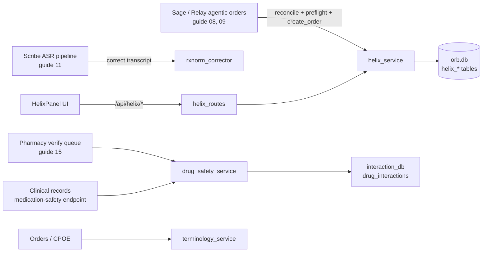

# Helix: the medication brain: formulary, interactions, drug safety

Helix is Orb's pharmacy subsystem: the master list of medications the hospital stocks (the **formulary**), the inventory lots behind it, a strict state machine that walks every medication order from `pending` to `delivered`, and the clinical safety brain that screens each drug against a patient's allergies and current medications before anyone dispenses it. Around that core sit three supporting services: a phonetic drug-name corrector that fixes speech-to-text misspellings against an RxNorm dictionary, a fuzzy reconciler that maps free-text drug names onto formulary IDs, and a terminology validator (LOINC/SNOMED/ICD-10) used by the ordering workflow. The backend is plain FastAPI route handlers over raw SQLite; the frontend is a single lazy-loaded React panel with three tabs and a review modal.

## Purpose and neighbors

A hospital cannot let "give the patient amoxcilin" flow straight from a doctor's mouth to a nurse's hand. Between intent and administration sit four problems Helix solves:

1. **Naming.** Doctors say brand names, generics, and misspellings. **RxNorm** is the US National Library of Medicine's standard vocabulary of drug names, where every concept has a numeric ID called an **RxCUI** (RxNorm Concept Unique Identifier). Helix keys its formulary on RxCUIs when loaded from RxNorm (`server/scripts/load_rxnorm_formulary.py:22`) and uses phonetic matching to map noisy names onto catalog rows.
2. **Safety.** A **drug–drug interaction (DDI)** is when two medications taken together cause harm (e.g. warfarin + ibuprofen → bleeding). A **contraindication** is a reason a drug must not be given at all, in Orb the practical case is a documented allergy, including **cross-reactivity** (an allergy to one drug class implying risk from a chemically related class, e.g. penicillins ↔ cephalosporins, `server/services/drug_safety_service.py:139-143`). The safety gate screens both at order time.
3. **Process.** Pharmacy law and safety practice require a pharmacist to verify orders before dispensing. Helix encodes that as a legal-transition state machine with an idempotent, audited transition log (`server/services/helix_service.py:14-23`).
4. **Stock.** Orders must not be dispensed from empty shelves. Helix tracks per-lot inventory, decrements atomically on dispense, and suggests therapeutic alternatives on stockout (`server/services/helix_service.py:281-536`).

The terminology service rides along in this guide because it is the same pattern applied to lab/diagnosis codes: **LOINC** (Logical Observation Identifiers Names and Codes, standard codes for lab tests), **SNOMED CT** (Systematized Nomenclature of Medicine, Clinical Terms, codes for findings/procedures), and **ICD-10** (International Classification of Diseases, 10th revision, diagnosis codes). The Orders (CPOE) workflow validates codes against a local `terminology` table via this service (`server/services/orders_service.py:109`). **CPOE** = Computerized Provider Order Entry, the electronic ordering of tests and treatments.



## File map

| File | ~Lines | Role |
|---|---|---|
| `server/services/helix_service.py` | 389 | Order state machine, catalog/inventory reads, atomic dispense, stockout alternatives |
| `server/services/helix_db.py` | 170 | Helix table schema (`helix_*`) + additive migrations inside the main `orb.db` |
| `server/services/interaction_db.py` | 240 | Data-backed DDI store: 55 curated pairs, symmetric lookup over `drug_interactions` |
| `server/services/drug_safety_service.py` | 1579 | Order-time safety gate: drug classification, allergy + interaction checks |
| `server/services/rxnorm_corrector.py` | 317 | Phonetic autocorrector for ASR drug-name misspellings, backed by its own SQLite file |
| `server/services/rxnorm_reconciler.py` | 75 | Fuzzy-match free-text drug names to `helix_medication_master` rows |
| `server/services/terminology_service.py` | 184 | LOINC/SNOMED/ICD-10 code validation + curated seed |
| `server/routes/helix_routes.py` | 167 | REST surface `/api/helix/*` (6 reads, 2 writes), RBAC-guarded |
| `server/scripts/load_rxnorm_formulary.py` | 100 | Bulk-load an RxNorm-style CSV into the formulary (idempotent upsert) |
| `server/scripts/load_interactions.py` | 103 | Bulk-load DDInter-format CSVs into `drug_interactions` |
| `server/scripts/seed_helix.py` | 104 | Demo seeder: 14 drugs + 14 lots, with deliberate stockouts for substitution demos |
| `server/scripts/add_indian_drugs.py` | 105 | Append 20 Indian brand names to the corrector's RxNorm dictionary |
| `server/tests/test_interaction_db.py` | 134 | Pytest coverage: seeding, symmetric lookup, both loaders, end-to-end safety gate |
| `src/pages/panels/HelixPanel.tsx` | 117 | Panel shell: loads orders/inventory/catalog, tab switcher, opens review modal |
| `src/components/helix/HelixDashboard.tsx` | 197 | Overview tab: metric cards + pharmacist work queue + fulfillment pipeline |
| `src/components/helix/HelixFormulary.tsx` | 92 | Formulary tab: catalog joined with lot totals, stock badges |
| `src/components/helix/HelixOrderReviewModal.tsx` | 237 | Review modal: status badges, allowed next actions, transition POSTs |
| `src/components/helix/HelixPatientBoard.tsx` | 147 | Patient tab: orders grouped per patient with fulfillment + stock summary |
| `src/components/helix/Helix.module.css` | 752 | Scoped styles: dark bento grid, status badges, modal, buttons |

Neighboring files touched for contracts (owned by other guides): `server/main.py` (startup wiring), `server/database.py` (shared schema, guide 04), `server/permissions.py` (RBAC, guide 03), `server/routes/relay_routes.py` (agentic order flow, guide 08), `server/services/scribe_service.py` + `server/ws/scribe_stream.py` (ASR, guide 11), `server/services/pharmacy_verification_service.py` + `server/routes/pharmacy_routes.py` + `src/components/helix/PharmacyVerifyQueue.tsx` (guide 15), `src/api/client.ts` (guide 02).

### One database, plus one deliberate exception

Helix's clinical tables (`helix_medication_master`, `helix_inventory_lots`, `helix_patient_med_orders`, `helix_stock_movements`, `helix_transitions`, `helix_pharmacy_verifications`) live inside the **main** `orb.db`, `helix_db.py` imports the shared `db_session` from `database.py` (`server/services/helix_db.py:3`), the context manager that opens the app's single SQLite database with `PRAGMA foreign_keys=ON` and WAL mode (`server/database.py:994-1004`; see guide 04). They must: orders join `patients` and `users` (`server/services/helix_service.py:54-59`) and a verified order writes into the Relay `messages` table (`server/services/helix_service.py:263-266`), which is only possible transactionally inside one file.

The **RxNorm dictionary is the exception**: `RxNormCorrector` opens its own standalone SQLite file at `server/datasets/rxnorm/rxnorm_drugs.db` via a raw `sqlite3.connect` (`server/services/rxnorm_corrector.py:187`), path configured at `server/config.py:460-461`. Why isolate it? It is a large, read-only reference dataset (tens of thousands of names when fully loaded), rebuilt wholesale from a CSV rather than migrated, license-adjacent (the full RxNorm release sits behind the free-but-registration-gated UMLS license, `server/scripts/load_rxnorm_formulary.py:9-11`), needed by out-of-process scripts (`benchmark_wer.py`, `test_indian_drugs.py`), and it never joins clinical rows, the corrector loads it entirely into Python dicts at startup anyway (`server/services/rxnorm_corrector.py:184-198`). Keeping it out of `orb.db` keeps patient data backups small and lets you regenerate the dictionary without touching PHI.

## How it works

### Flow 1: the pharmacist order lifecycle (main flow)

Every medication order is a row in `helix_patient_med_orders` with a `status` column constrained by a CHECK to eight values (`server/services/helix_db.py:31`). Only the transitions in `LEGAL_TRANSITIONS` are allowed (`server/services/helix_service.py:14-23`):

```
pending → reviewing → { verified | rejected | substitute_suggested }
substitute_suggested → reviewing        (loop back after choosing a substitute)
verified → scheduled → dispensed → delivered
rejected, delivered = terminal
```

1. A doctor (or the Sage agentic path, flow 2) creates an order → status `pending` (`server/services/helix_service.py:124-140`).
2. A pharmacist opens the Helix panel; `HelixPanel` fetches `/api/helix/orders`, `/inventory`, `/catalog` in parallel (`src/pages/panels/HelixPanel.tsx:21-25`).
3. Clicking a queue row opens `HelixOrderReviewModal`, which derives the allowed buttons from the current status (`src/components/helix/HelixOrderReviewModal.tsx:69-90`, a client-side mirror of the server state machine).
4. Each button POSTs `/api/helix/orders/{id}/transition` (`src/api/client.ts:1895-1906`), guarded by the `helix.write` permission (`server/routes/helix_routes.py:195`). **RBAC** (Role-Based Access Control) means each role owns a fixed permission set; `pharmacist` gets exactly `sage.query`, `helix.read`, `helix.write` (`server/permissions.py:136-140`, guide 03).
5. `transition_order_status` checks the **idempotency key** (a caller-chosen unique string; replaying the same key returns the recorded result instead of re-applying, `server/services/helix_service.py:164-175`), validates legality, decrements stock atomically if the target is `dispensed`, updates the order, and appends an immutable row to `helix_transitions`.
6. On `verified`, the service drops a system message into the patient's Relay case room so the care team sees "Pharmacy has verified the order..." (`server/services/helix_service.py:246-266`; the `channels`/`messages` tables are guide 08's).
7. The modal calls `onTransition`, wired to `handleTransitionComplete`, which closes it and refetches everything (`src/pages/panels/HelixPanel.tsx:47-50`, passed as the prop at `:112`).

```mermaid
sequenceDiagram
  participant P as Pharmacist (HelixPanel)
  participant M as HelixOrderReviewModal
  participant R as helix_routes (FastAPI)
  participant S as helix_service
  participant DB as orb.db

  P->>M: click order row (status=scheduled)
  M->>R: POST /api/helix/orders/{id}/transition {target_status:"dispensed"}
  R->>R: require_permission("helix.write"), 403 if not pharmacist/admin
  R->>S: transition_order_status(...)
  S->>DB: SELECT helix_transitions WHERE idempotency_key=? (replay check)
  S->>S: _is_legal_transition("scheduled","dispensed") ✓
  S->>DB: SELECT oldest lot with quantity>0, UPDATE quantity-1
  S->>DB: INSERT helix_stock_movements (-1, "mock_dispense")
  S->>DB: UPDATE order SET status='dispensed'; INSERT helix_transitions
  S-->>R: {ok, order, transition, already_applied:false}
  R-->>M: 200 JSON
  M->>P: onTransition() → close modal, refetch orders
```

### Flow 2: agentic orders (Sage → Relay → Helix)

When Sage (the LLM assistant, guide 09) proposes a medication in a Relay case room, the clinician's confirm flow calls into Helix twice (guide 08 owns the endpoints):

1. **Pre-flight** (`server/routes/relay_routes.py:1096-1153`): `reconcile_medication` fuzzy-matches the proposed drug name to a formulary row; `pre_flight_inventory_check` sums lot quantities; on stockout `pre_flight_alternative_suggestion` proposes an in-stock alternative; a hardcoded name list flags high-risk drugs (epinephrine, heparin, insulin, potassium, opioids, `server/routes/relay_routes.py:1141`).
2. **Confirm** (`server/routes/relay_routes.py:1312-1630`): after PIN verification the same reconcile + stock check runs again. The order is always for the drug the clinician confirmed: on stockout with no override reason it answers **409** `out_of_stock`, orders nothing, and names an in-stock exact equivalent (same molecule, strength and form), if one exists, as a suggestion to prescribe as its own order (`server/routes/relay_routes.py:1483-1521`); confirming again with an override reason orders the drug as written for pharmacy to source. (It used to switch the order silently to the alternative and carry the original dose across.) A dose confirmation and the universal drug-safety screen follow; finally `helix_service.create_order` inserts the `pending` order, landing it in the pharmacist queue of flow 1. `server/services/sage_handoff_service.py:15` also imports `create_order` for its handoff adapters.

### Flow 3: the safety gate (allergies + interactions)

Triggered from three places: the order-time pre-check endpoint `GET /api/patients/{id}/medication-safety?drug=...` (`server/routes/clinical_records_routes.py:105-112`), every pharmacist verify/reject in the verification queue (`server/services/pharmacy_verification_service.py:36`, guide 15), and the Sage handoff path (`server/services/sage_handoff_service.py:147-148`).

1. `check_medication_safety(patient_id, drug)` fans out to `check_allergies` and `check_interactions` (`server/services/drug_safety_service.py:442-443`).
2. `classify_drug` maps the drug name to zero or more of the 12 drug classes in `_DRUG_CLASS_PATTERNS`, lowercased substring match first, then anchored token-prefix rules (`server/services/drug_safety_service.py:159-180`).
3. Allergy check: direct substance-name overlap, shared class, or documented cross-reactivity against the patient's `patient_allergies` rows (`server/services/drug_safety_service.py:292-380`).
4. Interaction check: for each active row in `medications`, look up class pairs in the `drug_interactions` table (`server/services/drug_safety_service.py:392-428`); the table lazy-seeds its 55 curated pairs on first use (`server/services/interaction_db.py:201-204`) and is also seeded at boot (`server/main.py:271-274`).
5. **Severity levels** are `mild < moderate < severe` (`server/services/drug_safety_service.py:156`, DB CHECK at `server/database.py:848`). The single worst severity is returned; `severe` sets `blocking: true` (`server/services/drug_safety_service.py:455`), callers use that to block automatic ordering while still letting a human override.

Worked example: patient has active `warfarin`; a clinician pre-checks `ibuprofen`. `classify_drug("ibuprofen")` → `{"nsaids"}`; `classify_drug("warfarin")` → `{"anticoagulants"}`; `lookup_interactions({"nsaids"}, {"anticoagulants"})` hits the class row `("anticoagulants","nsaids","class","severe")` (`server/services/interaction_db.py:39-40`) → `max_severity: "severe"`, `blocking: true`, exactly what `test_check_medication_safety_blocks_warfarin_nsaid` asserts (`server/tests/test_interaction_db.py:119-125`).

### Flow 4: ASR drug-name correction (RxNorm corrector)

**ASR** (Automatic Speech Recognition) mangles drug names ("amoxcilin", "metopro lol"). The Scribe pipeline runs every transcript through `_apply_rxnorm_correction` (`server/services/scribe_service.py:118,220-238`; also on the live streaming path, `server/ws/scribe_stream.py:108,135`), which instantiates `RxNormCorrector` against the standalone dictionary DB. Correction = tokenize → exact lookup → phonetic-bucket lookup (simplified metaphone key) → **Levenshtein distance** tie-break (the minimum number of single-character insertions/deletions/substitutions to turn one string into another), capped at edit distance 2 (`server/services/rxnorm_corrector.py:200-233`). A large English-word stoplist prevents "order" from becoming a drug (`server/services/rxnorm_corrector.py:78-117`).

### Flow 5: data loading and provenance

| Source | Loader | Target | Provenance notes |
|---|---|---|---|
| Curated 55-pair DDI set | `interaction_db.seed_builtin_interactions` (boot + lazy) | `drug_interactions` (`source='builtin'`) | Each pair cites BNF / Stockley's / FDA / CredibleMeds in a trailing comment (`server/services/interaction_db.py:37-169`) |
| DDInter (open DDI database, ddinter.scbdd.com) | `scripts/load_interactions.py` | `drug_interactions` (`source='ddinter'`) | Major→severe, Moderate→moderate, Minor→mild, Unknown→moderate (`server/scripts/load_interactions.py:39-44`) |
| RxNorm monthly release (RXNCONSO.RRF) or RxNav API | `scripts/load_rxnorm_formulary.py` | `helix_medication_master` (ids `RX-<rxcui>`) | Full release is UMLS-license-gated, so only a 6-row sample CSV ships (`server/scripts/fixtures/rxnorm_sample.csv`) |
| Hand-written demo formulary | `scripts/seed_helix.py` | `helix_medication_master` + `helix_inventory_lots` | Destructive reseed; stockouts staged on purpose (`server/scripts/seed_helix.py:42-51`) |
| Indian brand names | `scripts/add_indian_drugs.py` | corrector CSV + `rxnorm_drugs.db` | RxNorm is US-centric; Indian brands (Dolo, Crocin, Monocef, Calpol...) don't exist in it, so the ASR corrector would "fix" them into wrong US names. This script adds 20 brands with synthetic `IND_xxxx` ids so dictation in an Indian hospital survives correction (`server/scripts/add_indian_drugs.py:13-34`) |
| LOINC/SNOMED/ICD-10 starter codes | `terminology_service.seed_terminology` (boot) | `terminology` | 33 LOINC + 21 SNOMED + 22 ICD-10 real codes; full releases are meant to load via `scripts/load_terminology.py` (LOINC/ICD-10 freely redistributable, SNOMED license-gated, `server/services/terminology_service.py:7-18`), but that script does not exist in the repo (see Discrepancies) |

Startup order in `main.py`'s lifespan: `init_db()` → `init_helix_db()` → `seed_terminology()` → `interaction_db.ensure_seeded()`, each wrapped in a non-fatal try/except (`server/main.py:243-274`).

## Function-by-function

### server/services/helix_db.py

### HELIX_SCHEMA: `server/services/helix_db.py:7`
**Signature:** module-level SQL string constant.
**Does:** Defines the six Helix-owned tables and four indexes, all `CREATE TABLE IF NOT EXISTS`.
**How it works:** 1) `helix_medication_master` (id, name, generic_name, form, strength) is the formulary (`:9-15`). 2) `helix_inventory_lots` tracks physical stock per lot with quantity and expiration (`:18-24`). 3) `helix_patient_med_orders` is the order row, with the 8-status CHECK, substitute/notes/review columns, `last_transition_id`, and an `is_mock_event` flag marking simulated dispense/delivery (`:27-44`). 4) `helix_pharmacy_verifications` (`:47-53`), created but never read or written anywhere (see Discrepancies). 5) `helix_stock_movements` is the inventory audit trail (`:56-65`). 6) `helix_transitions` is the state-machine log with `idempotency_key TEXT UNIQUE` (`:68-77`), the UNIQUE constraint is what makes replays detectable. Indexes on patient, status, order, and idempotency key (`:79-82`).
**Why it exists:** A pharmacy audit must answer "who moved this order/stock, when, and why", hence separate append-only transition and movement tables rather than mutating the order row alone.
**Data in/out:** SQL DDL; all ids are TEXT UUIDs/slugs, timestamps default to `CURRENT_TIMESTAMP` (naive UTC strings, see Gotchas).
**Talks to:** Executed by `init_helix_db`; every `helix_service` query reads/writes these tables.
**Change guide:** To add a column (e.g. `priority` on orders), add it to `HELIX_SCHEMA` **and** write an additive `ALTER TABLE` migration modeled on `_migrate_stock_movements` (`:150-170`), `CREATE TABLE IF NOT EXISTS` does nothing for existing DBs; knock-on: `get_all_orders`'s `SELECT o.*` will surface it automatically, but Pydantic request models in `helix_routes.py` will not.
**Gotchas:** SQLite CHECK constraints are frozen at CREATE time; adding a ninth status requires a rename-rebuild migration like `_migrate_helix_orders`, not an ALTER.

### init_helix_db: `server/services/helix_db.py:85`
**Signature:** `() → None`
**Does:** Applies the Helix schema and runs three in-place migrations against the main DB at startup.
**How it works:** 1) Probes whether the `users` CHECK constraint accepts role `'pharmacist'` by inserting and deleting a throwaway user (`:89-94`). 2) If the insert throws, rebuilds `users` via rename→create→copy→drop with `PRAGMA foreign_keys = OFF` (`:96-112`). 3) Runs `_migrate_helix_orders` and `_migrate_stock_movements`. 4) Executes `HELIX_SCHEMA` (`:118`).
**Why it exists:** Helix arrived after the core schema; a **migration** (a scripted, ordered change to a live database's structure) lets old `orb.db` files gain the pharmacist role and new order columns without wiping data.
**Data in/out:** None → side effects on `users`, `helix_*` tables.
**Talks to:** Called from `main.py`'s lifespan (`server/main.py:245-246`) and from test setups (`server/tests/test_interaction_db.py:90-91`, `server/tests/test_optimized_agentic_orders.py:65-66`, `server/tests/test_handoff.py:53-54`).
**Change guide:** To add a new role (e.g. `'lab_tech'`), this probe-and-rebuild pattern must be repeated or generalized; watch out: the rebuilt `users` table here (`:100-108`) omits the `pin_hash` column that the shipped schema has (`server/database.py:46`), so on a legacy DB the `INSERT INTO users SELECT *` column counts can mismatch and abort the migration mid-flight (see Discrepancies).
**Gotchas:** `PRAGMA foreign_keys` is a no-op inside an open transaction in SQLite, the same trap that bit the messages migration (`server/database.py:1357-1360`); the throwaway-INSERT probe style used here was explicitly abandoned in `database.py` for that reason.

### _migrate_helix_orders: `server/services/helix_db.py:121`
**Signature:** `(conn) → None`
**Does:** Upgrades a pre-workflow `helix_patient_med_orders` table (no `substitute_medication_id` column) to the full schema, remapping old statuses (`cancelled`→`rejected`, unknown→`pending`).
**How it works:** 1) Introspects columns via `PRAGMA table_info` (`:125`). 2) If outdated: rename old table, re-run `HELIX_SCHEMA`, `INSERT OR IGNORE ... SELECT` with a CASE mapping statuses (`:129-142`), drop the old table. 3) Any failure is logged loudly with a stack trace but swallowed (`:145-147`).
**Why it exists:** The order table originally had a 4-status lifecycle; the pharmacist workflow expanded it to 8 and added review columns.
**Data in/out:** conn → mutated table.
**Talks to:** Only `init_helix_db`.
**Change guide:** To evolve the status set again, copy this rename-rebuild shape and extend the CASE mapping; watch out for the swallow-and-log: a half-applied migration leaves `_helix_orders_old` behind and the caller none the wiser.
**Gotchas:** `INSERT OR IGNORE` silently drops rows whose old ids collide, acceptable here (fresh rename) but not a general pattern.

### _migrate_stock_movements: `server/services/helix_db.py:150`
**Signature:** `(conn) → None`
**Does:** Adds `medication_id`, `order_id`, `is_mock` columns to an old `helix_stock_movements` via individually try-wrapped `ALTER TABLE ADD COLUMN`s.
**How it works:** Introspect columns; if `medication_id` missing, attempt each ALTER independently so a partially migrated table still converges (`:154-168`).
**Why it exists:** Additive column migration, the cheap, safe kind, contrasted with the rebuild in `_migrate_helix_orders`.
**Data in/out:** conn → mutated table.
**Talks to:** Only `init_helix_db`.
**Change guide:** New nullable audit columns belong here as another guarded ALTER.
**Gotchas:** none noteworthy.

### server/services/helix_service.py

### LEGAL_TRANSITIONS / _is_legal_transition: `server/services/helix_service.py:14`, `:26`
**Signature:** `dict[str, list[str]]`; `(from_status, to_status) → bool`
**Does:** The single source of truth for which order-status moves are allowed.
**How it works:** Plain dict lookup with `.get(from, [])` so unknown statuses allow nothing (`:27`).
**Why it exists:** A **state machine** (a fixed set of states with an explicit list of legal moves between them) makes "you can't dispense an unverified order" a data-shape guarantee instead of scattered `if`s.
**Data in/out:** status strings → bool.
**Talks to:** `transition_order_status`; mirrored client-side by `getNextActions` (`src/components/helix/HelixOrderReviewModal.tsx:69`).
**Change guide:** Worked example, to let pharmacists reject an already-`verified` order: change `"verified": ["scheduled"]` to `"verified": ["scheduled", "rejected"]` at `server/services/helix_service.py:18`, add a matching `{ target: 'rejected', ... }` entry to the `'verified'` case in `getNextActions` (`src/components/helix/HelixOrderReviewModal.tsx:82`), and confirm the status is already in the DB CHECK (`server/services/helix_db.py:31`, it is). Knock-on: the route docstring listing the legal transitions (`server/routes/helix_routes.py:197-207`) becomes stale; watch out for the client/server duplication, forgetting the UI side silently hides the new action.
**Gotchas:** Terminal states are empty lists, not absent keys, both behave the same but read differently.

### get_medication_catalog: `server/services/helix_service.py:34`
**Signature:** `() → list[dict]`
**Does:** Returns every formulary row.
**How it works:** `SELECT * FROM helix_medication_master`, rows → dicts.
**Why it exists:** Feeds the Formulary tab and the substitute dropdown.
**Data in/out:** → `[{id, name, generic_name, form, strength}]`.
**Talks to:** `GET /api/helix/catalog`.
**Change guide:** For big formularies (full RxNorm load) add pagination here and in the route; the UI currently assumes the whole list fits in memory.
**Gotchas:** none noteworthy.

### get_inventory: `server/services/helix_service.py:40`
**Signature:** `() → list[dict]`
**Does:** Returns all lots joined with medication name/strength.
**How it works:** INNER JOIN `helix_inventory_lots` × `helix_medication_master` (`:43-47`).
**Why it exists:** Lots are meaningless to a human without the drug name; joining server-side saves a client-side lookup.
**Data in/out:** → `[{id, medication_id, lot_number, quantity, expiration_date, name, strength}]`, exactly the `InventoryItem` interface at `src/components/helix/HelixFormulary.tsx:11-19`.
**Talks to:** `GET /api/helix/inventory`.
**Gotchas:** INNER JOIN drops orphan lots whose medication was deleted (seed_helix deletes meds and lots together, so consistent in practice).
**Change guide:** none beyond pagination as above.

### get_pending_orders: `server/services/helix_service.py:50`
**Signature:** `() → list[dict]`
**Does:** Returns only `status='pending'` orders with patient/prescriber context.
**How it works:** Joins `patients` (name/ward/bed) and LEFT JOINs `users` for prescriber name; newest first (`:53-62`).
**Why it exists:** The pharmacist queue endpoint, LEFT JOIN on users tolerates system-created orders with no human prescriber.
**Data in/out:** → order dicts plus `medication_name, patient_name, prescribed_by_name, ward, bed`.
**Talks to:** `GET /api/helix/orders/pending`.
**Gotchas:** The `patients` join is INNER, an order whose `patient_id` doesn't resolve vanishes from every list (relevant to the `"UNKNOWN"` fallback bug, see Discrepancies).
**Change guide:** none noteworthy.

### get_all_orders: `server/services/helix_service.py:79`
**Signature:** `() → list[dict]`
**Does:** Same as above without the status filter, plus the substitute medication's name via a second LEFT JOIN aliased `sm` (`:76`).
**How it works / Why / Talks to:** As `get_pending_orders`; feeds `GET /api/helix/orders`, the panel's primary data source.
**Data in/out:** adds `substitute_name`, used by the UI to display the swapped drug (`src/components/helix/HelixDashboard.tsx:157`).
**Gotchas / Change guide:** as `get_pending_orders`.

### get_stock_movements: `server/services/helix_service.py:95`
**Signature:** `() → list[dict]`
**Does:** Full inventory audit log, newest first, with medication name and lot number.
**How it works:** LEFT JOINs so movements survive deleted meds/lots (`:84-90`).
**Why it exists:** Regulators ask "where did unit X go"; this is the answer surface.
**Data in/out:** → `[{..., quantity_change, reason, is_mock, timestamp, medication_name, lot_number}]`.
**Talks to:** `GET /api/helix/stock-movements`; client helper `getHelixStockMovements` (`src/api/client.ts:1908`), note no current UI component calls it.
**Gotchas / Change guide:** none noteworthy.

### get_order_transitions: `server/services/helix_service.py:107`
**Signature:** `(order_id: str) → list[dict]`
**Does:** Chronological transition history for one order with actor names.
**How it works:** Parameterized WHERE on `order_id`, LEFT JOIN `users` (`:96-102`).
**Why it exists:** Per-order audit trail for the (currently unused) timeline UI, the `.timeline*` CSS classes exist (`src/components/helix/Helix.module.css:589-651`) but no component renders them.
**Talks to:** `GET /api/helix/orders/{id}/transitions`; client helper at `src/api/client.ts:1912`.
**Data in/out:** → `[{id, order_id, from_status, to_status, idempotency_key, actor_id, payload, created_at, actor_name}]`.
**Gotchas / Change guide:** none noteworthy.

### create_order: `server/services/helix_service.py:124`
**Signature:** `(patient_id, medication_name, dose, route, frequency, prescribed_by) → dict`
**Does:** Resolves a free-text medication name to a formulary row and inserts a `pending` order.
**How it works:** 1) `SELECT ... WHERE name LIKE ? OR generic_name LIKE ?` with `%name%` wildcards, taking the **first** match (`:113-116`). 2) Raises `ValueError` if nothing matches (`:117-118`). 3) Inserts with a fresh UUID, status `'pending'` (`:120-124`). 4) Returns the inserted row.
**Why it exists:** Single entry point for order creation from any pathway (Sage confirm, handoff adapters, `/orders/approve`).
**Data in/out:** free-text name in; full order row dict out.
**Talks to:** Called by `helix_routes.approve_helix_order` (`server/routes/helix_routes.py:230`), `relay_routes.confirm_agentic_action` (`server/routes/relay_routes.py:1586-1594`), `sage_handoff_service` (`server/services/sage_handoff_service.py:322`). All SQL is **parameterized** (values passed as `?` placeholders so user input can never rewrite the SQL, the defense against SQL injection).
**Change guide:** To make resolution deterministic, add `ORDER BY length(name) ASC` or route callers through `reconcile_medication` first (the Relay path already does, it passes an exact catalog `name` back in, so the LIKE is effectively exact there).
**Gotchas:** `LIKE '%amox%'` matches both "Amoxicillin 500mg" and "Amoxicillin 250mg" with no ordering guarantee, which strength you get is up to SQLite row order. FK enforcement is ON (`server/database.py:1002`), so a bad `patient_id` raises `sqlite3.IntegrityError`, **not** `ValueError`, callers that only catch `ValueError` (the route at `server/routes/helix_routes.py:184-185`) turn that into an HTTP 500.

### transition_order_status: `server/services/helix_service.py:143`
**Signature:** `(order_id, target_status, actor_id, idempotency_key=None, pharmacist_notes="", substitute_medication_id=None, scheduled_at=None) → dict`
**Does:** The guarded, idempotent transition engine, the heart of Helix.
**How it works:** 1) If no idempotency key given, fabricate one with a random suffix (`:144-146`), which makes the call **non**-idempotent for keyless callers (see Gotchas). 2) Replay check: if a `helix_transitions` row already carries this key, return it with `already_applied: True` and do nothing (`:150-161`). 3) Load the order, 404 as `ValueError` (`:164-166`). 4) Reject illegal moves with an error message listing what *is* allowed (`:171-175`). 5) If target is `dispensed`, run `_atomic_dispense` first, using the substitute medication if one was set (`:179-181`). 6) Build the UPDATE dynamically: review statuses stamp `reviewed_by/reviewed_at` (`:191-193`), notes/substitute/schedule fields only when supplied, and `dispensed`/`delivered` set `is_mock_event=1` (`:207-208`). 7) Insert the `helix_transitions` row with a JSON payload capturing notes/substitute/schedule/stock-movement id (`:216-226`). 8) On `verified`, find the patient's `case_room` channel and insert the "Pharmacy has verified..." system message (`:229-249`). 9) Commit once; return fresh order + transition (`:251-261`).
**Why it exists:** Networked clients retry; without idempotency a retried "dispense" would decrement stock twice. Recording the transition and mutating the order in a single transaction keeps audit and state consistent.
**Data in/out:** in: the `TransitionRequest` fields; out: `{"ok": True, "order": {...}, "transition": {...}, "already_applied": bool}`.
**Talks to:** Called only by the route (`server/routes/helix_routes.py:196`); writes `helix_patient_med_orders`, `helix_transitions`, `helix_inventory_lots`, `helix_stock_movements`, `messages`.
**Change guide:** Worked example, to notify the ward on **delivery** as well as verification: duplicate the block at `server/services/helix_service.py:246-266` under a `target_status == "delivered"` condition with new copy; knock-on: nothing else, the message rides the existing Relay fetch. To make it appear in *real time*, you would additionally need a socket emit, this function is synchronous and has no access to the async `sio` server (guide 06), which is why the current message only appears on the next Relay refresh.
**Gotchas:** (a) The UI never sends an idempotency key (`src/components/helix/HelixOrderReviewModal.tsx:113-120`), so a double-clicked "Dispense" that races the disabled-button state could decrement stock twice, the idempotency guarantee is opt-in. (b) `datetime.utcnow()` (`:185`) produces a naive timestamp; combined with SQLite's naive `CURRENT_TIMESTAMP` the frontend must regex-sniff whether `created_at` has a timezone suffix before parsing (`src/components/helix/HelixDashboard.tsx:109`). (c) Everything shares one transaction, good, but the system-message INSERT references sender `'system'`, which exists only because `init_db` seeds that user (`server/database.py:1893`).

### _atomic_dispense: `server/services/helix_service.py:281`
**Signature:** `(conn, order_id, medication_id, actor_id) → str` (stock_movement_id)
**Does:** Decrements one unit from the earliest-expiring lot and records the movement, inside the caller's transaction.
**How it works:** 1) `SELECT` the lot with `quantity > 0` ordered by `expiration_date ASC LIMIT 1` (`:274-279`). 2) `ValueError` if none, which aborts the whole transition (`:281-285`). 3) `UPDATE quantity = quantity - 1` (computed in Python, `:288-292`). 4) INSERT a `-1` movement with reason `mock_dispense`, `is_mock=1` (`:295-299`).
**Why it exists:** Expiry-first picking minimizes waste (the docstring calls it FIFO; strictly it is FEFO, first-*expiry*-first-out).
**Data in/out:** conn + ids → movement id string.
**Talks to:** Only `transition_order_status` (dispense branch).
**Change guide:** To dispense N units per order, replace the constant `-1`/`new_qty` logic and loop lots until N is satisfied; watch out: quantity is read then written as two statements, safe only because SQLite serializes writers and this runs inside one transaction; a port to Postgres would need `UPDATE ... SET quantity = quantity - 1 WHERE quantity > 0 RETURNING`.
**Gotchas:** `actor_id` is accepted but never stored on the movement row, the audit trail attributes the movement to the order, not the person.

### pre_flight_inventory_check: `server/services/helix_service.py:944`
**Signature:** `(medication_id) → {"medication_id", "in_stock": bool, "total_quantity": int}`
**Does:** Sums the in-date lot quantities for one medication.
**How it works:** `_in_date_stock` (`:711`) sums `quantity` over lots that pass the same in-date filter `_atomic_dispense` applies, with a NULL-safe fallback to 0, so a pre-flight never promises stock the dispense would then refuse.
**Why it exists:** Lets the agentic confirm flow fail fast ("out of stock, need override") *before* creating an order that could never dispense.
**Talks to:** `relay_routes.pre_flight_sage_action` (`server/routes/relay_routes.py:1134`) and `confirm_agentic_action` (`:1481`).
**Data in/out:** id in, dict out.
**Change guide / Gotchas:** none noteworthy; change the in-date rule in one place (`_IN_DATE_LOT_SQL`) so the pre-flight and the dispense keep agreeing.

### pre_flight_alternative_suggestion: `server/services/helix_service.py:965`
**Signature:** `(medication_id) → Optional[dict]`
**Does:** Finds an in-stock **equivalent** of a stocked-out drug: the same molecule, strength and form under another brand or pack, nothing else.
**How it works:** 1) Load the drug's `generic_name`, `strength` and `form`; with any of the three missing there is no basis to call anything equivalent, so it returns None. 2) Walk every other catalog row in name order and return the first whose normalised (lower-case, whitespace-free) molecule, strength and form all match and which has in-date stock, with `stock_status` and `equivalence: "Same molecule, strength and form"` attached. 3) Otherwise None.
**Why it exists:** Stockouts are routine; naming a true equivalent lets the prescriber choose it as its own order. It is a **suggestion only**: no caller may switch an order to it (the confirm route answers 409 and orders nothing; see Flow 2).
**Data in/out:** id in → catalog row + `{"stock_status": {"in_stock": True, "total_quantity": n}, "equivalence": ...}` or None.
**Talks to:** Both Relay endpoints above.
**Change guide:** A hospital-approved interchange list (a different molecule) is a pharmacy and therapeutics committee decision, not code; the docstring says so. If a site wants one, it needs its own reviewed data source and must still only suggest.
**Gotchas:** It used to fall back to a hard-coded class map that offered warfarin for heparin and sodium chloride for potassium, and the confirm route switched the order to it silently (docstring at `:809-814`). The old body still sits **after** the final `return None` (`:843`) and references a `SOP_SUBSTITUTIONS` map that no longer exists; it is unreachable dead code.

### server/services/interaction_db.py

### _BUILTIN: `server/services/interaction_db.py:37`
**Signature:** `list[tuple[term_a, term_b, match_type, severity, mechanism]]`, 55 tuples.
**Does:** The curated seed knowledge base: anticoagulant bleeding pairs, hyperkalemia (ACE inhibitors + potassium), statin myopathy, serotonin syndrome (SSRI+MAOI), digoxin/lithium/methotrexate/theophylline narrow-therapeutic-index pairs, QT prolongation, opioid+benzodiazepine respiratory depression, and one-off high-consequence pairs (nitrates+sildenafil, allopurinol+azathioprine).
**Why it exists:** A demonstrably real starter set with cited sources (BNF, Stockley's, FDA labels, CredibleMeds, `:39-168` trailing comments), explicitly not comprehensive (`:22-24`).
**Data in/out:** `match_type` is `'class'` (pairs drug classes) or `'ingredient'` (pairs specific actives); severity `severe|moderate`.
**Talks to:** Consumed by `seed_builtin_interactions`.
**Change guide:** Add a tuple; re-run seeding (idempotent). Keep terms lowercase and remember they must be *producible* by the caller's classification for the gate to ever match them (see Discrepancies, many currently are not).
**Gotchas:** The docstring claims class terms are "as produced by `drug_safety_service.classify_drug`" (`:15-16`), false for `ssri`, `maoi`, `benzodiazepines`, `qt_prolonging`, and others; those rows are unreachable through the safety gate today.

### seed_builtin_interactions: `server/services/interaction_db.py:172`
**Signature:** `() → int` (rows processed)
**Does:** Idempotently upserts the 55 curated pairs with `source='builtin'`.
**How it works:** One `INSERT ... ON CONFLICT(term_a, term_b, match_type) DO UPDATE` per tuple (an **upsert**: insert-or-refresh keyed on the UNIQUE constraint at `server/database.py:851`), lowercasing terms (`:179-190`).
**Why it exists:** Safe to run on every boot; re-seeding refreshes severity/mechanism without duplicating (proved by `test_seed_is_idempotent_and_large`, `server/tests/test_interaction_db.py:38-44`).
**Talks to:** `ensure_seeded`, `main.py` boot, tests.
**Data in/out:** → 55.
**Change guide / Gotchas:** none beyond `_BUILTIN`'s.

### interaction_count: `server/services/interaction_db.py:195`
**Signature:** `() → int`
**Does:** `SELECT COUNT(*)` over all sources. Used as the emptiness probe and in tests.
**Everything else:** trivial; none noteworthy.

### ensure_seeded: `server/services/interaction_db.py:201`
**Signature:** `() → None`
**Does:** Lazily seeds the builtin set iff the table is empty.
**Why it exists:** Belt-and-braces: even if boot seeding failed, the first safety check self-heals (`server/services/drug_safety_service.py:404` calls it; `test_lazy_seed_via_check_interactions` proves it, `server/tests/test_interaction_db.py:111-116`).
**Gotchas:** Count-then-seed is not concurrency-safe, but the upsert makes a double-seed harmless.

### lookup_interactions: `server/services/interaction_db.py:207`
**Signature:** `(classes_a: set, classes_b: set) → list[{"severity","mechanism","term_a","term_b"}]`
**Does:** Symmetric pair lookup: returns rows where one term is in set A and the other in set B, in either column order.
**How it works:** 1) Lowercase/strip both sets; empty either → `[]` (`:216-219`). 2) Build `IN (...)` placeholder lists sized to each set (`:221-223`), placeholders, not string interpolation, so terms cannot inject SQL. 3) One `SELECT DISTINCT` with the OR of both orderings; params are `a+b+b+a` to mirror the four IN-lists (`:224-229`).
**Why it exists:** Storage keeps one row per pair; symmetry is the *query's* job (the schema comment says exactly this, `server/database.py:842`), so a cephalosporin-allergic-style ordering asymmetry can never silently miss.
**Data in/out:** term sets in; deduplicated hit dicts out.
**Talks to:** `drug_safety_service.check_interactions`; tests call it directly with ingredient names as "classes" (`server/tests/test_interaction_db.py:80`).
**Change guide:** To add directional interactions (A affects B but not vice versa), you would need a `directional` column and to drop the second OR arm conditionally, today's contract is strictly undirected.
**Gotchas:** none noteworthy.

### server/services/drug_safety_service.py

### _DRUG_CLASS_PATTERNS: `server/services/drug_safety_service.py:66`
**Signature:** `dict[class_name, list[substring]]`, 12 classes.
**Does:** Maps lowercase substrings to drug classes: penicillins, cephalosporins, carbapenems, sulfonamides, nsaids, opioids (including combination brands like co-codamol whose names don't contain an opioid string, `:37-41`), macrolides, anticoagulants, statins, ace_inhibitors, potassium, aminoglycosides.
**Why it exists:** Substring matching catches brand/generic/strength variants ("Amoxicillin 500mg" → penicillins) without a full ontology.
**Change guide:** Worked example, to make benzodiazepine interactions live: add `"benzodiazepines": ["diazepam", "lorazepam", "midazolam", "temazepam", "alprazolam", "clonazepam"]` at `server/services/drug_safety_service.py:66-122`; knock-on: the already-seeded `("opioids","benzodiazepines","class","severe")` row (`server/services/interaction_db.py:137-138`) instantly becomes reachable through `check_interactions`, and allergy class-matching gains the class too; watch out for over-broad substrings (e.g. `"kcl"` inside other words).
**Gotchas:** This list is the bottleneck of the whole interaction pipeline, anything it cannot classify is invisible to the gate (Discrepancies #1).

### _CROSS_REACTIVITY_PAIRS / _CROSS_REACTIVITY: `server/services/drug_safety_service.py:139`, `:144`
**Signature:** undirected `(class_a, class_b, severity)` pairs, expanded at import time into a symmetric dict.
**Does:** Declares penicillins↔cephalosporins and penicillins↔carbapenems cross-reactivity, both `moderate`.
**Why it exists:** The comment spells it out (`:51-54`): the alert must fire regardless of which side the documented allergy is on, so the pair list is expanded into both directions once, at module load.
**Talks to:** `check_allergies` step (c).
**Change guide / Gotchas:** add pairs to `_CROSS_REACTIVITY_PAIRS` only, never to the expanded dict directly, or you'll create a one-way rule.

### classify_drug: `server/services/drug_safety_service.py:159`
**Signature:** `(drug_name: str) → list[str]`
**Does:** Returns every class the lowercased name belongs to (possibly several, possibly none). Two mechanisms, in order: substring match against `_DRUG_CLASS_PATTERNS`, then the anchored token-prefix rules in `_DRUG_CLASS_TOKEN_PREFIXES` (`server/services/drug_safety_service.py:170-179`), the second exists because a bare substring like `"cef"` would fire on unrelated words, so prefix rules are matched against whole tokens.
**Talks to:** `check_allergies`, `check_interactions`, and `clinical_records_service` (which stores the class on allergy rows at write time, `server/services/clinical_records_service.py:34`).
**Data in/out:** `"Amoxicillin 500mg"` → `["penicillins"]`; `"some-random-herbal"` → `[]` (asserted in `server/tests/test_clinical_safety.py:50-54`).
**Everything else:** covered under `_DRUG_CLASS_PATTERNS`.

### _norm: `server/services/drug_safety_service.py:240`
**Signature:** `(s) → str`, trim, lowercase, collapse whitespace. Trivial; none noteworthy.

### _active_allergies: `server/services/drug_safety_service.py:283`
**Signature:** `(db, patient_id) → list[dict]`
**Does:** Fetches `status='active'` rows from `patient_allergies` (schema at `server/database.py:704-717`, owned by the clinical-records subsystem).
**Everything else:** trivial helper for `check_allergies`; none noteworthy.

### check_allergies: `server/services/drug_safety_service.py:382`
**Signature:** `(patient_id, drug_name) → list[alert dict]`
**Does:** Produces allergy alerts by three escalating strategies per documented allergy.
**How it works:** For each active allergy: (a) **direct** substring overlap either way between normalized substance and drug name (`:120-129`); (b) **class** overlap between `classify_drug(drug)` and `classify_drug(substance) ∪ substance_class` column (`:132-143`); (c) **cross-reactivity** via the expanded dict (`:146-157`). Severity: documented severity, except `severe`/`unknown` both escalate to `severe` for direct and class matches (`:123`), unknown reactions are treated as worst-case.
**Why it exists:** An allergy alert that misses "patient allergic to penicillin, prescribing Augmentin" is worse than none; strategy (b) catches brand-name traps and (c) catches chemically related classes.
**Data in/out:** → `[{type:"allergy", severity, substance, reaction, message, match: "direct"|"class"|"cross_reactivity"}]`.
**Talks to:** `check_medication_safety`; exercised heavily by `server/tests/test_clinical_safety.py`.
**Change guide:** Cross-reactivity severities come from the pair tuple (`xsev`), not the documented allergy severity, to make anaphylaxis-documented allergies escalate cross-reactive alerts too, incorporate `sev` at `:149-157`.
**Gotchas:** `continue` after (a) and (b) means one allergy yields at most one alert, the *first* matching strategy wins, so a direct match suppresses a would-be class message.

### check_interactions: `server/services/drug_safety_service.py:392`
**Signature:** `(patient_id, drug_name) → list[alert dict]`
**Does:** Screens the candidate drug against every `status='active'` row in the patient's `medications` table using the interaction table.
**How it works:** 1) Classify the new drug; bail early if unclassifiable (`:170-172`). 2) `ensure_seeded()` (`:173`). 3) For each active med: classify it, skip if unclassifiable (`:181-183`), call `lookup_interactions(new_classes, existing_classes)`, dedupe hits per med by `(term_a, term_b)` (`:184-189`), and emit `{type:"interaction", severity, with: <existing drug>, message: "<new> + <existing>: <mechanism>", classes: [...]}` (`:190-196`).
**Why it exists:** The order-time DDI screen; swapping the old hardcoded list for a table means production can bulk-load a licensed source with zero code change (`:5-14` of the module docstring), in principle.
**Data in/out:** as above.
**Talks to:** `check_medication_safety`; reads `medications` (guide 04 schema at `server/database.py:220-231`).
**Change guide:** Worked example, to make ingredient-level rows (including all DDInter loads) reachable: at `server/services/drug_safety_service.py:401` build `new_terms = set(classify_drug(drug_name)) | {_norm(drug_name)}` and similarly add `_norm(existing)` to `existing_classes` at `:412`, then drop the early-return-on-empty guards; knock-on: `lookup_interactions` already matches arbitrary lowercase terms so no schema change; watch out that full drug strings like "warfarin sodium 5 mg oral tablet" won't equal the stored ingredient "warfarin", you would also want token-level terms.
**Gotchas:** This is the seat of Discrepancy #1: both sides must be classifiable into the 12 pattern classes, so most of the 55-row KB and *all* DDInter ingredient rows can never fire through this function today.

### check_medication_safety: `server/services/drug_safety_service.py:431`
**Signature:** `(patient_id, drug_name) → dict`
**Does:** The full order-time screen: runs both checks, computes the max severity via `_SEVERITY_RANK` (`server/services/drug_safety_service.py:156`), flags `blocking` iff `severe`, and, critically, reports whether the interaction check could run at all.
**Data in/out:** → `{drug, allergy_alerts, interaction_alerts, max_severity, blocking, safe, interaction_screened, coverage_note}` (`server/services/drug_safety_service.py:450-462`). `interaction_screened` is `False` when `classify_drug` returned nothing, the interaction check then had nothing to compare, which is **not** the same as "screened and clean", and `coverage_note` carries the sentence a caller should show the clinician. Allergy matching still runs either way, because a direct name match needs no class.
**Talks to:** `GET /api/patients/{id}/medication-safety` (`server/routes/clinical_records_routes.py:105-112`, permission `medication.write`), `pharmacy_verification_service._safety_alerts` (`server/services/pharmacy_verification_service.py:36`, guide 15), `sage_handoff_service` (`server/services/sage_handoff_service.py:147-148`).
**Why it exists:** One canonical verdict shape so every consumer (human UI, agentic gate) interprets severity identically.
**Change guide:** `blocking` policy is a single comparison at `server/services/drug_safety_service.py:455`; to block on `moderate` for specific contexts, do it in the *caller*, this function should stay policy-light.
**Gotchas:** `safe: not all_alerts` is independent of blocking, an order can be `safe: false, blocking: false` (moderate alerts warn but pass, asserted at `server/tests/test_interaction_db.py:128-134`). And `safe: true` with `interaction_screened: false` means "no allergy hit, interactions never checked", a caller that renders only `safe` shows a green tick for a drug nobody screened.

### server/services/rxnorm_corrector.py

### levenshtein: `server/services/rxnorm_corrector.py:22`
**Signature:** `(s1, s2) → int`
**Does:** Classic two-row dynamic-programming edit distance, dependency-free.
**How it works:** Ensures s1 is the longer (`:25-26`), then iterates building `curr_row` from `prev_row` with insert/delete/substitute costs (`:29-38`).
**Why it exists:** No third-party fuzzy-matching dependency; distances here are between short tokens, so O(len²) is fine.
**Talks to:** `_find_match`, `correct`, and re-exported to `rxnorm_reconciler` (`server/services/rxnorm_reconciler.py:9`).
**Change guide / Gotchas:** none noteworthy.

### metaphone_key: `server/services/rxnorm_corrector.py:43`
**Signature:** `(word) → str` (max 8 chars)
**Does:** A simplified phonetic key: uppercase, apply 16 digraph normalizations (PH→F, X→KS, ...), collapse repeated letters, strip non-leading vowels.
**Why it exists:** ASR errors are *phonetic*, "amoxcilin" and "Amoxicillin" reduce to the same key (`AMKSCLN`), so candidates can be bucketed by key and only the small bucket pays the Levenshtein cost. The docstring is explicit that this is a practical approximation, not real Double Metaphone (`:45-49`).
**Data in/out:** `"Amoxicillin"` → `"AMKSCLN"`.
**Talks to:** `_build_db`, `_find_match`, `rxnorm_reconciler.calculate_metaphone_similarity`, `server/scripts/add_indian_drugs.py:90`.
**Change guide:** New confusion rules go into the `replacements` list (`:55-60`); rebuilding the DB is required afterwards because keys are stored (`:169`).
**Gotchas:** The 8-char cap means long names sharing a prefix collide, acceptable for bucketing, wrong for equality tests.

### _ENGLISH_STOPWORDS: `server/services/rxnorm_corrector.py:78`
**Signature:** `frozenset[str]` (~300 words).
**Does:** Common clinical-English words that phonetically resemble drug names ("order", "serum", "renal") plus medical non-drugs ("insulin"?!, see Gotchas), excluded from correction.
**Why it exists:** Without it, "ordered" might correct to a drug two edits away, a false positive with clinical consequences.
**Gotchas:** `"insulin"` is in the stoplist (`:114`) with the comment "NOT drug names", insulin obviously *is* a drug; the effect is that the literal token "insulin" is never *fuzzily corrected* (exact match at `:204-205` still works since exact lookup precedes the stoplist), but a misspelling like "insuline" can still fuzz to something. Quirky but mostly harmless; listed in Discrepancies.

### RxNormCorrector (class): `server/services/rxnorm_corrector.py:120`
**Signature:** `RxNormCorrector(db_path, csv_path=None, max_edit_distance=2)`
**Does:** Loads (or builds) the standalone drug-name SQLite dictionary and exposes `correct(text)`.

- **`__init__`, `:123`**: if the DB file is missing, builds it from `csv_path` when provided, else prints a warning and stays inert (`:130-137`), corrections then no-op rather than crash the transcription pipeline.
- **`_build_db`, `:139`**: creates the `drugs(rxcui, name, name_lower, tty, metaphone)` table + two indexes (`:145-155`), streams the CSV skipping names shorter than 3 chars, precomputes metaphone keys, bulk `INSERT OR IGNORE` (`:157-176`). `tty` is RxNorm's Term Type (e.g. `BN` = Brand Name, `SCD` = Semantic Clinical Drug).
- **`_load_index`, `:184`**: reads the whole table into two in-memory dicts: `name_lower → canonical` and `metaphone → [names]` (`:189-193`). All matching after startup is pure Python, this is where the "<2ms per pass" claim comes from.
- **`_find_match`, `:200`**: exact case-insensitive hit → done (`:204-205`); tokens under 5 chars or in the stoplist → None (`:208-214`); otherwise fetch the phonetic bucket, filter candidates within ±2 length, pick minimum Levenshtein ≤ `max_edit_distance` (`:216-233`).
- **`correct`, `:235`**: tokenizes preserving whitespace/punctuation (`re.findall(r'\b\w+\b|\s+|[^\w\s]', text)`, `:251`), skips non-alphabetic or <4-char tokens (`:255-257`), replaces matched tokens, and returns `(corrected_text, corrections_log)` where each log entry is `{original, corrected, distance}` (`:259-277`).

**Why it exists:** Whisper-style ASR is excellent at English and poor at pharmacology; a domain dictionary pass costs milliseconds and fixes the words that matter most clinically.
**Talks to:** `scribe_service._apply_rxnorm_correction` (`server/services/scribe_service.py:221-239`) with config from `server/config.py:459-464` (`ORB_CORRECTOR_ENABLED`, `ORB_CORRECTOR_MAX_EDIT`); the streaming path `server/ws/scribe_stream.py:108,135`; benchmark scripts.
**Change guide:** Worked example, to accept sloppier dictation, set `ORB_CORRECTOR_MAX_EDIT=3` (read at `server/config.py:462`); knock-on: more false positives, mitigated only by the stoplist and the ±2 length filter (`:226`), consider widening that filter to ±3 in `_find_match` at the same time; watch out that each `_apply_rxnorm_correction` call constructs a fresh corrector and reloads the whole index (`server/services/scribe_service.py:230-234`), with a full RxNorm load that becomes the dominant per-transcript cost; caching one instance would be the first optimization.
**Gotchas:** The class docstring says "SQLite FTS5 index" (`:3`), there is no FTS5 anywhere; matching is in-memory dicts over plain B-tree indexed tables (Discrepancies). Multi-word corruptions ("metopro lol") are *not* fixed despite the module example at `:8`, tokenization treats them as two tokens, "metopro" (no bucket hit at distance ≤2 to "metoprolol" is possible, distance is 3) and "lol" (<4 chars, skipped).

### build_rxnorm_db: `server/services/rxnorm_corrector.py:282`
**Signature:** `() → None` (also the `__main__` entry, `:316`)
**Does:** Builds `server/datasets/rxnorm/rxnorm_drugs.db` from `rxnorm_drugs.csv` and runs five smoke-test phrases.
**Why it exists:** Developer convenience for regenerating the dictionary.
**Gotchas:** Tells you to "Run fetch_rxnorm.py first" (`:290`), no such script exists in the repo (Discrepancies), and `server/datasets/rxnorm/` is not checked in.

### server/services/rxnorm_reconciler.py

### calculate_similarity: `server/services/rxnorm_reconciler.py:11`
**Signature:** `(s1, s2) → float` in [0,1]
**Does:** Normalized Levenshtein similarity: `1 - distance/max_len` on trimmed lowercase strings.
**Everything else:** helper for `reconcile_medication`; none noteworthy.

### calculate_metaphone_similarity: `server/services/rxnorm_reconciler.py:21`
**Signature:** `(s1, s2) → float`
**Does:** Token-level phonetic overlap: metaphone-keys every word longer than 2 chars on each side, returns `|intersection| / max(|a|,|b|)`.
**Why it exists:** Handles multi-word catalog names ("Amoxicillin 500mg Oral Capsule") where whole-string Levenshtein against a single dictated word would score terribly.
**Gotchas:** Duplicate keys collapse via `set()`, so repeated words don't boost the score.

### reconcile_medication: `server/services/rxnorm_reconciler.py:30`
**Signature:** `(name: str) → (Optional[dict], float)`
**Does:** Maps a raw drug string to the best `helix_medication_master` row, or `(None, best_score)` below the 0.8 threshold.
**How it works:** 1) Reject inputs under 3 chars (`:36-37`). 2) Scan the **entire** catalog (`:43`). 3) For each row, compute lexical similarity vs name and generic, phonetic similarity vs both, then `hybrid = 0.7·lex + 0.3·meta` (`:51-62`). 4) Exact-substring containment floors the score at 0.85 (`:65-66`). 5) Track the max; accept only ≥ 0.8 (`:72-75`).
**Why it exists:** This is the "fuzzy matching drug names to codes" step: the agentic pipeline gets LLM- or speech-derived names, and orders must reference real catalog IDs.
**Worked example:** `reconcile_medication("amoxcilin")` vs the seeded "Amoxicillin 500mg Oral Capsule" (generic "Amoxicillin"): lexical vs generic = 1 − 2/11 ≈ 0.818; metaphone keys are identical (`AMKSCLN`) → 1.0; hybrid = 0.7·0.818 + 0.3·1.0 ≈ **0.87** ≥ 0.8 → matched, exactly what `test_formulary_reconciliation` asserts (`server/tests/test_optimized_agentic_orders.py:172-186`).
**Data in/out:** string → (catalog row dict, score).
**Talks to:** Both Relay agentic endpoints (`server/routes/relay_routes.py:1120-1121`, `:1463-1464`).
**Change guide:** To tune precision, adjust the 0.8 threshold (`:72`) or the 0.7/0.3 weights (`:62`); knock-on: `confirm_agentic_action` 400s when reconciliation fails (`server/routes/relay_routes.py:1466-1467`), so a stricter threshold surfaces as more "could not be reconciled" errors to clinicians.
**Gotchas:** O(catalog size) Python loop per call with fresh DB read, fine at 14 seeded drugs, hot at a full RxNorm formulary. No caching.

### server/services/terminology_service.py

### validate_code: `server/services/terminology_service.py:32`
**Signature:** `(code_system, code) → bool`
**Does:** True iff the pair exists in `terminology` with `is_active=1`; code system is uppercased so `"loinc"` works (`:39-41`, asserted at `server/tests/test_orders_service.py:46`).
**Why it exists:** CPOE orders must not accept invented codes; unknown codes are *rejected*, not silently stored (`server/services/orders_service.py:109`).
**Talks to:** `orders_service`, `coding_service` (`server/services/coding_service.py:298`), route `GET /api/orders/validate-code` (`server/routes/orders_routes.py:211`), all owned by other guides.
**Change guide / Gotchas:** none noteworthy.

### get_display: `server/services/terminology_service.py:44`
**Signature:** `(code_system, code) → str | None`
**Does:** Returns the human-readable display for an active code. Mirror of `validate_code`; none noteworthy.

### _LOINC_SEED / _SNOMED_SEED / _ICD10_SEED / STARTER_TERMINOLOGY: `server/services/terminology_service.py:61`, `:97`, `:121`, `:146`
**Signature:** lists of `(code_system, code, display)`; 33 + 21 + 22 = 76 rows.
**Does:** Real codes with real displays (CBC panels, troponin, common findings, common ICD-10 diagnoses) so validation works out of the box.
**Why it exists:** The header warning (`:7-18`) is the design statement: curated seed now, bulk-load full releases later into the *same* table so `validate_code` transparently scales to millions of codes.
**Gotchas:** none noteworthy.

### seed_terminology: `server/services/terminology_service.py:149`
**Signature:** `() → {"seeded": int, "counts": {system: n}, "timestamp": iso}`
**Does:** `INSERT OR IGNORE` the 76 starter rows against `UNIQUE(code_system, code)` (`server/database.py:835`), then returns per-system counts.
**Why it exists:** Idempotent boot seeding (`server/main.py:265-266`) and a standalone `python -m services.terminology_service` entry (`:175-187`).
**Change guide:** Additions to the seed lists are picked up on next boot; deletions are *not* (OR IGNORE never removes), deactivate by flipping `is_active` instead.
**Gotchas:** none noteworthy.

### server/routes/helix_routes.py

FastAPI concepts used on every handler here, defined once: an **APIRouter** is a mountable group of routes sharing a prefix, this one is `APIRouter(prefix="/api/helix", tags=["Helix Pharmacy"])` (`server/routes/helix_routes.py:10`), mounted without extra prefix at `server/main.py:695`, so paths below are complete. `Depends(require_permission("helix.read"))` is **dependency injection**, FastAPI runs the permission check (which decodes the **JWT**, a signed JSON Web Token carried in the `Authorization: Bearer` header, guide 03) before the handler and passes the authenticated user in; failures return 403 and write an audit event (`server/permissions.py:377-439`). A **Pydantic model** (`BaseModel` subclass) declares and validates the JSON request body shape.

### Read endpoints (six GET handlers): `server/routes/helix_routes.py:16-44`
**Signature:** each `(user=Depends(require_permission("helix.read"))) → dict`; the transitions route also takes `order_id: str` from the path.
**Does:** One-line wrappers: `/catalog` → `{"catalog": [...]}` (`:15-18`), `/inventory` → `{"inventory": [...]}` (`:20-23`), `/orders/pending` → `{"orders": [...]}` (`:25-28`), `/orders` → `{"orders": [...]}` (`:30-33`), `/stock-movements` → `{"movements": [...]}` (`:35-38`), `/orders/{order_id}/transitions` → `{"transitions": [...]}` (`:40-43`).
**Why it exists:** Thin HTTP skin over `helix_service` so business logic stays testable without HTTP.
**Data in/out:** wrappers put the list under a named key, the client unwraps accordingly (`src/pages/panels/HelixPanel.tsx:26-28`).
**Talks to:** `helix_service` read functions; called by `HelixPanel` and the `client.ts` helpers.
**Change guide:** Route ordering matters in FastAPI: `/orders/pending` is declared *before* `/orders/{order_id}/transitions`, and neither collides with `/orders`, keep literal segments above parameterized ones when adding routes here.
**Gotchas:** none noteworthy.

### approve_helix_order: `server/routes/helix_routes.py:161`
**Signature:** `POST /api/helix/orders/approve`, body `OrderApproveRequest {patient_name, medication, dose?, route?, frequency?}` (`:49-54`), permission `helix.write` → `{"status": "success", "order": {...}}`
**Does:** Approves a Sage-drafted medication request: resolves the patient by name-LIKE, then `create_order`.
**How it works:** 1) `SELECT id FROM patients WHERE name LIKE '%<patient_name>%' LIMIT 1` (`:62`). 2) Falls back to the literal string `"UNKNOWN"` if no patient matches (`:63`). 3) Delegates to `create_order` with the caller as prescriber (`:65-72`). 4) Maps `ValueError` → HTTP 400 (`:74-75`).
**Why it exists:** The Sage chat surface's "Approve & Send to Helix" button posts here (`src/components/sage/SageMessage.tsx:186-200` via `approveHelixOrder`, `src/api/client.ts:1884-1889`).
**Data in/out:** as above.
**Talks to:** `patients` table, `helix_service.create_order`.
**Change guide:** Replace the name-LIKE with a patient id in the request body, Sage already knows the patient context; knock-on: `SageMessage.tsx` must send `patient_id`.
**Gotchas:** The `"UNKNOWN"` fallback hits the `patient_id REFERENCES patients(id)` FK with enforcement ON → `sqlite3.IntegrityError`, which is not caught → HTTP 500 instead of a clean 400 (Discrepancies). Name-LIKE matching is also ambiguous across similarly named patients.

### transition_order: `server/routes/helix_routes.py:196`
**Signature:** `POST /api/helix/orders/{order_id}/transition`, body `TransitionRequest {target_status, idempotency_key?, pharmacist_notes?, substitute_medication_id?, scheduled_at?}` (`:78-83`), permission `helix.write` → the `transition_order_status` result dict.
**Does:** The transition endpoint; docstring restates the legal map (`:90-96`).
**How it works:** Delegates wholesale; `ValueError` (illegal transition, missing order, insufficient stock) → HTTP 400 with the explanatory message (`:98-110`).
**Talks to:** `transitionHelixOrder` client helper; `helix_service.transition_order_status`.
**Change guide / Gotchas:** covered on the service function; the route adds nothing but auth and error mapping.

### server/scripts/load_rxnorm_formulary.py

### _pick: `server/scripts/load_rxnorm_formulary.py:45`
**Signature:** `(row: dict, *names) → str`
**Does:** Case-insensitive CSV column fetch with fallback aliases (`rxcui|RXCUI|id`, `name|str|STR`...), returning `""` when absent.
**Why it exists:** RxNorm-derived CSVs vary in header casing/naming; the loader shouldn't care.
**Gotchas:** none noteworthy.

### load_file (formulary): `server/scripts/load_rxnorm_formulary.py:53`
**Signature:** `(path: Path) → (rows_read, rows_upserted)`
**Does:** Streams a CSV with columns `rxcui, name, generic_name, form, strength` into `helix_medication_master`, id = `RX-<rxcui>` (`:64`), upserting on id so re-runs refresh instead of duplicate (`:65-78`).
**Why it exists:** The bridge from RxNorm's licensed bulk release (filter RXNCONSO.RRF to TTY ∈ {SCD, SBD}, dispensable products, and reshape, per the header `:5-16`) or the free RxNav REST API into Orb's formulary.
**Data in/out:** CSV file → table rows; proven by `test_rxnorm_formulary_loader_upserts` (id `RX-855332` = Warfarin, idempotent, `server/tests/test_interaction_db.py:89-107`).
**Talks to:** `db_session`; run via `python scripts/load_rxnorm_formulary.py --file scripts/fixtures/rxnorm_sample.csv`.
**Change guide:** Rows missing rxcui or name are skipped silently (`:61-62`), add a skipped-counter if you need load QA.
**Gotchas:** Ids already starting with `RX-` are not double-prefixed (`:64`), so re-exporting from the table round-trips.

### main (formulary loader CLI): `server/scripts/load_rxnorm_formulary.py:83`
**Signature:** argparse CLI, `--file` required; relative paths resolve against `server/` (`:88-92`).
**Does:** Parses args, loads, prints counts. none noteworthy otherwise.

### server/scripts/load_interactions.py

### _LEVEL_TO_SEVERITY: `server/scripts/load_interactions.py:39`
**Signature:** `dict`: major→severe, moderate→moderate, minor→mild, unknown→moderate.
**Does/Why:** Maps DDInter's four levels onto Orb's three-severity CHECK; "unknown" deliberately maps to `moderate` (warn, don't block) rather than mild.
**Gotchas:** none noteworthy.

### _pick: `server/scripts/load_interactions.py:47`
Same pattern as the formulary loader's `_pick`, for `Drug_A/Drug_B/Level` header variants. none noteworthy.

### load_file (interactions): `server/scripts/load_interactions.py:56`
**Signature:** `(path, source="ddinter") → (rows_read, rows_upserted)`
**Does:** Streams DDInter-format CSVs (`DDInterID_A, Drug_A, DDInterID_B, Drug_B, Level`) into `drug_interactions` as lowercase `match_type='ingredient'` rows with mechanism text "DDInter <level> interaction." and a configurable `source` tag (`:62-80`).
**Why it exists:** DDInter (ddinter.scbdd.com) is the open, comprehensive DDI database the module docstrings keep pointing to as the production-scale complement to the curated seed.
**Data in/out:** proven by `test_ddinter_loader_adds_rows` on the 8-row fixture (`server/tests/test_interaction_db.py:73-86`).
**Talks to:** `db_session`; CLI `python scripts/load_interactions.py --file ... --source ddinter`.
**Change guide:** Worked example, a hospital licensing a different source: write its CSV adapter mirroring this file, pass `--source lexicomp`; the `source` column keeps provenance queryable (`SELECT COUNT(*) ... WHERE source='ddinter'` in the test at `:83-85`).
**Gotchas:** Rows load as *ingredient* pairs, which the current safety gate never matches (Discrepancies #1); loading DDInter today enriches the table but not the alerts.

### main (interactions loader CLI): `server/scripts/load_interactions.py:84`
argparse CLI with `--file` and `--source`. none noteworthy.

### server/scripts/seed_helix.py

### DRUGS / INVENTORY: `server/scripts/seed_helix.py:13`, `:37`
**Signature:** module tuples: 14 drugs, 14 lots.
**Does:** A demo formulary staged for specific demos: four high-risk injectables; amoxicillin at two strengths *both out of stock* so the in-stock "Cefadin" substitution fires (`:45-47`); metoprolol out of stock with atenolol in stock (`:50-51`); Indian-market staples (Dolo 650, Monocef, Augmentin 625 DUO) matching the corrector's Indian brands.
**Why it exists:** The stockout/substitution flow (Flow 2) needs data engineered to hit every branch.
**Gotchas:** Cefadin's `generic_name` is set to "Amoxicillin" (`:23`) and Atenolol's to "Metoprolol" (`:27`), clinically false (Cefadin/cefradine is a cephalosporin; atenolol is a different beta-blocker), done *because* `pre_flight_alternative_suggestion` step 1 matches on exact shared `generic_name`. A pharmacology-correct dataset would break the demo unless the SOP map (step 2) covers it, which it does for both, see Discrepancies.

### seed_helix: `server/scripts/seed_helix.py:61`
**Signature:** `() → None`; `__main__` entry (`:96`).
**Does:** Opens `DB_PATH` directly with raw `sqlite3` (not `db_session`), **deletes all** rows from `helix_inventory_lots` and `helix_medication_master` (`:68-69`), bulk-inserts the constants, commits; rolls back and logs on error.
**Why it exists:** Deterministic demo resets.
**Talks to:** `config.DB_PATH`; also reused by `reset_db_and_seed.py`-style workflows.
**Change guide:** Add drugs+lots as new tuples; keep ids stable because `helix_patient_med_orders.medication_id` rows in an existing DB will dangle if you remove ids (the DELETE here does not cascade, orders referencing deleted meds survive and then vanish from lists via the INNER JOIN).
**Gotchas:** Raw connection means no `PRAGMA foreign_keys=ON`, that is *why* the destructive DELETE succeeds even when orders reference the meds.

### server/scripts/add_indian_drugs.py

### INDIAN_DRUGS: `server/scripts/add_indian_drugs.py:13`
**Signature:** 20 dicts `{rxcui: "IND_00xx", name, tty: "BN"}`.
**Does:** Indian brand names (Dolo, Crocin, Monocef, Pantocid, Augmentin, Combiflam, Omez, Montek, Calpol, Ceftum, Taxim, Zifi, Becosules, Shelcal, Ascoril, Avil, Pan-D, Montek-LC, Pantocid-D, Dolo-650) with synthetic ids since real RxNorm has no RxCUI for them.
**Why it exists:** Orb targets Indian hospital deployments; without these, the ASR corrector either misses the brands entirely or "corrects" them into phonetically close US names. `tty: "BN"` marks them Brand Names in RxNorm's term-type vocabulary.
**Gotchas:** none noteworthy.

### add_indian_drugs: `server/scripts/add_indian_drugs.py:36`
**Signature:** `() → None`; `__main__` entry (`:101`).
**Does:** Appends the 20 brands to `datasets/rxnorm/rxnorm_drugs.csv` (deduped by rxcui, `:44-63`) and upserts them into `rxnorm_drugs.db` with precomputed metaphone keys (`:66-94`).
**How it works:** Read existing CSV if present → union → rewrite CSV → `CREATE TABLE IF NOT EXISTS drugs` (same shape as `_build_db`) → `INSERT OR IGNORE` batch → print final count.
**Why it exists:** Idempotent enrichment of the corrector dictionary without a full rebuild.
**Talks to:** `metaphone_key` import (`:11`); verified manually by `scripts/test_indian_drugs.py`.
**Change guide:** New regional brand lists follow this exact template, new id namespace (e.g. `BR_xxxx`), same CSV/DB writes.
**Gotchas:** If the CSV is absent it writes one containing *only* the 20 Indian brands (`:44-63`), a fresh clone that runs this before fetching RxNorm gets a 20-word "dictionary" that will happily fuzz clinical words toward Indian brands. It only inserts `INDIAN_DRUGS` into the DB, never the CSV remainder, so CSV and DB can drift.

### server/tests/test_interaction_db.py

### Test suite: `server/tests/test_interaction_db.py:1`
**Signature:** pytest module; `patient` fixture inserts a throwaway patient (`:17-25`), `_add_active_med` inserts an active `medications` row (`:28-34`).
**Does:** Locks the interaction-store contracts: seeding is ≥40 rows and idempotent (`:38-44`); lookup finds anticoagulants↔nsaids as severe in both class and reversed-ingredient orderings (`:48-55`); lookup is symmetric (`:58-63`) and empty for unrelated/empty sets (`:66-69`); the DDInter loader reads/upserts exactly the 8 fixture rows and its pairs become queryable (`:73-86`); the formulary loader upserts 6 rows idempotently with `RX-` prefixing (`:89-107`); the gate lazy-seeds on first use (`:111-116`); warfarin+ibuprofen blocks (`:119-125`) while ramipril+ibuprofen warns without blocking (`:128-134`).
**Why it exists:** The severity/blocking semantics are the clinical contract; these tests are the executable spec.
**Talks to:** `interaction_db`, `drug_safety_service`, both loader scripts, fixtures in `server/scripts/fixtures/`.
**Change guide:** New interaction seed rows should come with a reachability test through `check_interactions` (not just direct `lookup_interactions`), the current suite's direct-lookup style is what let Discrepancy #1 slip through.
**Gotchas:** `test_lookup_is_symmetric` uses `{"opioids"}, {"benzodiazepines"}`, a pair the *gate* can never produce (benzodiazepines is not a `classify_drug` class), demonstrating the gap it doesn't test.

### src/pages/panels/HelixPanel.tsx

### HelixPanel: `src/pages/panels/HelixPanel.tsx:11`
**Signature:** `() → JSX` (default export; no props)
**Does:** The pharmacy panel shell: header + three tab buttons, tab-body switch, and the review-modal mount.
**How it works:** 1) State: `activeView` (`'dashboard'|'patients'|'formulary'`), `loading`, `orders`, `inventory`, `catalog`, `selectedOrder` (`:12-17`), React **state** via the `useState` hook (a **hook** is a function starting with `use` that lets a function component hold state or side effects). 2) `loadData` is a `useCallback`-memoized async that fires the three GETs in parallel with `Promise.all` (`:19-34`); `apiFetch` is the shared JWT-attaching fetch wrapper (guide 02). 3) A `useEffect` runs it once on mount (`:36-38`). 4) `handleTransitionComplete` closes the modal and refetches (`:40-43`), the panel's only "realtime" mechanism is refetch-on-action; there is no socket subscription. 5) Renders the active tab component with the fetched arrays as props; renders `HelixOrderReviewModal` only while `selectedOrder` is set (`:91-98`).
**Why it exists:** One data-owner component so all three tabs share the same snapshot and one reload path. It is **lazy-loaded** (code-split so its JS downloads only when the tab opens) in the shell: `const HelixPanel = lazy(...)` (`src/pages/ClinicianShell.tsx:277`), and the `pharmacist` role's tab set is exactly `['helix', 'pharmacy-verify', 'sage']` (`src/pages/ClinicianShell.tsx:202`).
**Data in/out:** consumes the three GET response shapes; passes arrays down untyped (`any[]`, see Gotchas).
**Talks to:** `apiFetch` (guide 02), the four child components.
**Change guide:** To make the queue live-update when doctors create orders, subscribe to a socket event in a `useEffect` and call `loadData()`, but note the server currently emits no Helix socket events, so the server side must be built first (see Cross-subsystem contracts).
**Gotchas:** State arrays are `any[]` (`:14-16`) while the children declare proper interfaces, TypeScript checks the child props structurally against `any`, i.e. not at all at this boundary. A failed load only logs to console (`:30`) and leaves empty tables with no error UI.

### src/components/helix/HelixDashboard.tsx

### HelixDashboard: `src/components/helix/HelixDashboard.tsx:24`
**Signature:** `({ orders: Order[], onSelectOrder: (o) => void }) → JSX`
**Does:** The Overview tab: status metric cards, the "Pharmacist Work Queue" (pending + reviewing + substitute_suggested), and the "Fulfillment Pipeline" (verified + scheduled + dispensed).
**How it works:** 1) Eight `filter` passes bucket orders by status (`:25-32`); `activeQueue` and `inFlight` are concatenations (`:34-35`). 2) Metric cards (`:41-48`); Rejected renders only when nonzero and styled critical. 3) Queue table rows are clickable → `onSelectOrder(order)` (`:83`), showing patient/ward/bed, medication with dose·frequency·route, prescriber (falling back to "System"), time, and a status badge from the shared `getStatusBadge` (`:81`). 4) The time cell regex-tests `created_at` for a timezone suffix and appends `'Z'` when absent before `new Date(...)` (`:97`), compensating for SQLite's naive UTC strings. 5) In-flight table prefers `substitute_name` over the original medication (`:136`).
**Why it exists:** A pharmacist triages by "what needs my action now" vs "what's moving", two lists, not one.
**Data in/out:** `Order` interface at `:4-17` mirrors `get_all_orders` output.
**Talks to:** `getStatusBadge` from the modal module; parent callback.
**Change guide:** New statuses need: a filter line here, a `STATUS_CONFIG` entry, a badge CSS class, and inclusion in one of the two lists, four touch points for one enum value.
**Gotchas:** The `'Z'`-appending hack (`:97`) will double-adjust if the backend ever starts emitting timezone-aware ISO strings with offsets other than Z, it already guards `[+-]hh:mm`, so it is safe, but remove it when the backend goes timezone-aware.

### MetricCard: `src/components/helix/HelixDashboard.tsx:175`
**Signature:** `({ icon: string, label, value: number, sub, critical? }) → JSX`
**Does:** A bento-grid stat card: inline SVG icon chosen from a six-key lookup (`:155-162`), big number, subtext; `critical` swaps in the red-tinted variant (`styles.bentoCardCritical`).
**Why it exists:** Local presentational helper; not exported.
**Gotchas:** Unknown `icon` keys render an empty SVG silently.

### src/components/helix/HelixFormulary.tsx

### HelixFormulary: `src/components/helix/HelixFormulary.tsx:21`
**Signature:** `({ catalog: CatalogItem[], inventory: InventoryItem[] }) → JSX`
**Does:** The Formulary tab: one row per catalog drug with its lots, total units, and an In/Low/Out badge.
**How it works:** Client-side join, for each catalog item, filter inventory by `medication_id`, sum quantities, mark `isLow` when `0 < total < 30` (threshold sized to the seeded scale, per the comment at `:26-27`) and `isOut` at zero (`:23-37`); render lot numbers comma-joined (`:72`).
**Why it exists:** Pharmacists need the stock picture per *drug*, not per lot; the join is cheap at catalog scale.
**Data in/out:** interfaces at `:3-19` match `/catalog` and `/inventory` rows.
**Talks to:** props only; badge classes from `Helix.module.css`.
**Change guide:** Worked example, to align the low-stock threshold hospital-wide: extract `const LOW_STOCK_THRESHOLD = 30` and import it in `HelixPatientBoard` (which currently uses `< 100` at `src/components/helix/HelixPatientBoard.tsx:127`), today the same drug can read "Low" on one tab and plain-number on another.
**Gotchas:** the threshold inconsistency above (also in Discrepancies).

### src/components/helix/HelixOrderReviewModal.tsx

### STATUS_CONFIG / getStatusBadge: `src/components/helix/HelixOrderReviewModal.tsx:48`, `:63`
**Signature:** record of `{label, class}` per status; `(status) → {label, className}`.
**Does:** Maps each of the eight statuses to a display label and a CSS-module badge class, defaulting unknown statuses to a neutral badge (`:44`).
**Why it exists:** Exported and shared by Dashboard and PatientBoard so badges look identical everywhere.
**Data in/out:** `styles[cfg.class]` resolves the **CSS Module** class, CSS Modules scope class names per file at build time, so `badgePending` becomes a hashed unique name and can't collide with other components' CSS.
**Change guide:** Add status → add entry here + a `.badgeXxx` rule in `src/components/helix/Helix.module.css:254-288`.
**Gotchas:** `styles[cfg.class]` is an index into the module object, a typo in `STATUS_CONFIG` silently yields `undefined` and falls back to `badgeNeutral` (`:45`), no build error.

### getNextActions: `src/components/helix/HelixOrderReviewModal.tsx:69`
**Signature:** `(status) → [{target, label, btnClass}]`
**Does:** Client-side mirror of `LEGAL_TRANSITIONS`: pending→Begin Review; reviewing→Verify/Reject/Suggest Substitute; substitute_suggested→Return to Review; verified→Schedule; scheduled→Dispense; **dispensed→`[]`** (the ward, not pharmacy, closes this step: see `helix_routes.py` `POST /orders/{id}/receive` under `helix.receive`, and `src/pages/panels/nurse/DeliveriesSheet.tsx`); terminals → `[]`.
**Why it exists:** Renders only legal buttons so users rarely see a 400; the server remains the enforcer.
**Change guide:** Must be edited in lockstep with `server/services/helix_service.py:14-23` (worked example under `LEGAL_TRANSITIONS`).
**Gotchas:** The duplication is the gotcha, drift here shows stale/missing buttons, never a security hole.

### HelixOrderReviewModal: `src/components/helix/HelixOrderReviewModal.tsx:99`
**Signature:** `({ order, catalog, onClose, onTransition }) → JSX`
**Does:** The modal where every transition happens: order details, optional substitute picker, notes textarea, action buttons, inline error.
**How it works:** 1) Local state: `notes`, `substituteId`, `loading`, `error` (`:80-83`). 2) `useFocusTrap(onClose)` returns a ref attached to the panel, an accessibility **focus trap** that keeps Tab cycling inside the dialog, closes on Escape, and restores focus to the trigger on unmount (`src/hooks/useFocusTrap.ts:28-92`). 3) `handleTransition` builds the payload, notes if present, `substitute_medication_id` only for `substitute_suggested`, `scheduled_at = new Date().toISOString()` for `scheduled` (schedule-now semantics), then `transitionHelixOrder` and `onTransition()` on success, error message into local state on failure (`:89-108`). 4) Overlay click closes; panel click stops propagation (`:111-112`). 5) Substitute `<select>` appears only in `reviewing`, listing the catalog minus the current medication (`:179-196`); notes appear for pending/reviewing/substitute_suggested (`:199-212`). 6) The Suggest Substitute button is disabled until a substitute is chosen (`:227`).
**Why it exists:** Concentrates all mutation UI in one audited path; every other Helix component is read-only.
**Data in/out:** sends `TransitionRequest` JSON; receives the transition result (unused beyond success/failure).
**Talks to:** `transitionHelixOrder` (`src/api/client.ts:1895-1906`), `useFocusTrap`.
**Change guide:** To supply real idempotency, generate `crypto.randomUUID()` once per modal-open (e.g. `useState(() => crypto.randomUUID())`) and send it as `idempotency_key`, retries of the same click then become true replays server-side.
**Gotchas:** `loading` disables all buttons during flight, but there is no idempotency key, so the server-side replay protection is inert for this UI (see the service's Gotchas). The purple substitute accent (`#A855F7`) and the error red are inline styles, bypassing the CSS module (`:167`, `:215`).

### src/components/helix/HelixPatientBoard.tsx

### HelixPatientBoard: `src/components/helix/HelixPatientBoard.tsx:29`
**Signature:** `({ orders: Order[], inventory: InventoryItem[] }) → JSX`
**Does:** The Patient Board tab: one row per patient with all their orders, a delivered/active fulfillment fraction, and per-order stock badges.
**How it works:** 1) `reduce` groups orders by `patient_name`, capturing ward/bed from the first order (`:31-37`). 2) `checkStock(medName)` sums inventory rows whose joined `name` equals the order's `medication_name` (`:39-42`). 3) `getFulfillmentSummary` counts delivered/dispensed/rejected; `active = total - rejected` (`:45-52`). 4) Renders medication lines preferring `substitute_name` (`:100`), "X/Y delivered", and stock badges: Out at 0, `Low (n)` under 100, plain units otherwise (`:125-131`).
**Why it exists:** Ward-round view: "is Mrs. Rao's medication set complete?" is a per-patient question the status-bucketed dashboard can't answer.
**Data in/out:** props only; no fetching.
**Talks to:** `getStatusBadge`.
**Change guide:** Group by a patient *id* rather than name if two patients can share a name, the backend rows carry `patient_id` but the `Order` interface here omits it (`:4-17`); add it there and to the reduce key.
**Gotchas:** Stock is checked against the *original* `medication_name` even when a substitute was chosen and displayed (`:100` vs `:122`), the badge can say "Out of Stock" for a line whose substitute is plentiful. Threshold 100 disagrees with the Formulary tab's 30.

### src/components/helix/Helix.module.css

### Helix.module.css (style groups): `src/components/helix/Helix.module.css:1`
**Signature:** CSS Module; ~40 classes.
**Does:** The panel's entire visual system: full-black container with white text (`:1-11`), pill tab bar (`:43-72`), auto-fill bento metric grid (`:83-137`) with the gold accent `#D4AF37` on icons (`:115`), the "liquid-glass" gold over translucent-white-on-black look; table chrome with sticky headers on solid `#0f1117` (`:178-190`); eight status badges + legacy Success/Critical/Warning/Neutral aliases (`:225-309`); modal overlay with `backdrop-filter: blur(4px)` at `z-index:1000` (`:312-332`); button variants, gold `btnPrimary` (`:419-438`), red-tinted `btnDanger`, neutral `btnSecondary`, green `btnMock` for simulated steps (`:473-486`); an unused timeline component set (`:530-592`); pulse/fadeIn keyframes (`:616-625`); responsive tightening at 768px and 600px, including capping the modal at `calc(100vw - 24px)` (`:652-661`).
**Why it exists:** CSS Modules keep these names local, five components import the same file, so shared visual vocabulary without global leakage.
**Talks to:** every Helix component via `import styles from './Helix.module.css'`.
**Change guide:** The row-hover gold tint uses `!important` (`:212`) to beat the generic `tr:hover td` rule (`:203-205`), if you restyle hovers, resolve that specificity war properly instead of stacking more `!important`.
**Gotchas:** The panel hardcodes dark colors rather than consuming app-level theme tokens, a future light theme will need this file rewritten, not re-tokened. `.tableScrollArea`'s `max-height: calc(100vh - 290px)` (`:151`) encodes the header height as a magic number; taller headers clip the table.

## Cross-subsystem contracts

**REST endpoints owned by this subsystem** (prefix verified: `APIRouter(prefix="/api/helix")` at `server/routes/helix_routes.py:10`, mounted bare at `server/main.py:695`):

| Method | Path | Auth (permission) | Request | Response |
|---|---|---|---|---|
| GET | `/api/helix/catalog` | `helix.read` | n/a | `{catalog: MedRow[]}` |
| GET | `/api/helix/inventory` | `helix.read` | n/a | `{inventory: LotRow[]}` |
| GET | `/api/helix/orders/pending` | `helix.read` | n/a | `{orders: OrderRow[]}` |
| GET | `/api/helix/orders` | `helix.read` | n/a | `{orders: OrderRow[]}` (incl. `substitute_name`) |
| GET | `/api/helix/stock-movements` | `helix.read` | n/a | `{movements: MovementRow[]}` |
| GET | `/api/helix/orders/{order_id}/transitions` | `helix.read` | n/a | `{transitions: TransitionRow[]}` |
| POST | `/api/helix/orders/approve` | `helix.write` | `{patient_name, medication, dose?, route?, frequency?}` | `{status:"success", order}` / 400 |
| POST | `/api/helix/orders/{order_id}/transition` | `helix.write` | `{target_status, idempotency_key?, pharmacist_notes?, substitute_medication_id?, scheduled_at?}` | `{ok, order, transition, already_applied}` / 400 |

**Exported Python functions other subsystems import:**

| Function | Consumers |
|---|---|
| `helix_service.create_order` | `server/routes/relay_routes.py:1587` (imported `:1480`), `server/services/sage_handoff_service.py:322` (imported `:15`), `server/routes/helix_routes.py:230` |
| `helix_service.pre_flight_inventory_check` / `pre_flight_alternative_suggestion` | `server/routes/relay_routes.py:1134,1138,1481,1494` |
| `drug_safety_service.check_medication_safety` | `server/routes/clinical_records_routes.py:12`, `server/services/pharmacy_verification_service.py:24` (guide 15), `server/services/sage_handoff_service.py:147` |
| `drug_safety_service.classify_drug` | `server/services/clinical_records_service.py:14` |
| `rxnorm_reconciler.reconcile_medication` | `server/routes/relay_routes.py:1121,1464` |
| `rxnorm_corrector.RxNormCorrector` / `metaphone_key` / `levenshtein` | `server/services/scribe_service.py:230`, `server/ws/scribe_stream.py:108`, benchmark scripts, `server/scripts/add_indian_drugs.py:11` |
| `terminology_service.validate_code` / `get_display` / `seed_terminology` | `server/services/orders_service.py:110`, `server/routes/orders_routes.py:211-218`, `server/services/coding_service.py:298-300`, `server/main.py:265` |
| `interaction_db.lookup_interactions` / `ensure_seeded` / `seed_builtin_interactions` | `server/services/drug_safety_service.py:404,416`, `server/main.py:273` |
| `helix_db.init_helix_db` | `server/main.py:245`, three test modules |

**DB tables**, owns `helix_medication_master`, `helix_inventory_lots`, `helix_patient_med_orders`, `helix_pharmacy_verifications` (unused), `helix_stock_movements`, `helix_transitions` (all in `server/services/helix_db.py:7-83`); is the primary writer of `drug_interactions` and `terminology` (defined in the shared schema, `server/database.py:829-854`); reads `patients`, `users`, `medications`, `patient_allergies`, `channels`; writes one `messages` row per verified order. The corrector additionally owns the `drugs` table in the standalone `server/datasets/rxnorm/rxnorm_drugs.db`.

**Socket events:** none. Helix neither emits nor subscribes to socket.io events; its only realtime-adjacent behavior is the system message written into the Relay `messages` table on `verified` (`server/services/helix_service.py:261-266`), which surfaces when Relay next loads that channel (guides 06/08). The UI is refetch-on-action only.

**Frontend contract:** `src/api/client.ts:1884-1914` (`approveHelixOrder`, `getHelixOrders`, `transitionHelixOrder`, `getHelixStockMovements`, `getHelixOrderTransitions`) and the pharmacist tab set in `src/pages/ClinicianShell.tsx:202`. The **PharmacyVerifyQueue** (`src/components/helix/PharmacyVerifyQueue.tsx`, `/api/pharmacy/*` routes, `pharmacy_verification_service.py`) reuses Helix's `helix.read`/`helix.write` permissions and the safety gate but is a separate workflow over the `medications` table, see guide 15.

## Rebuild notes

**Prerequisites:** the shared SQLite layer with `db_session`, FK enforcement, and the base tables `users`, `patients`, `medications`, `patient_allergies`, `channels`, `messages`, `terminology`, `drug_interactions` (guide 04); JWT auth + `require_permission` with the `pharmacist` role and `HELIX_READ`/`HELIX_WRITE` constants (guide 03); the `apiFetch` client and shell tab routing (guides 01–02). Relay/Sage (guides 08–09) consume Helix but are not needed to build it.

**Build order:**
1. `helix_db.py`, schema + `init_helix_db` wired into startup; verify tables exist.
2. `helix_service.py` reads, then `create_order`, then the transition engine + `_atomic_dispense` (test illegal transitions and stock exhaustion directly).
3. `helix_routes.py` + permission guards; smoke-test with a pharmacist JWT.
4. `interaction_db.py` (table seed + `lookup_interactions`) → `drug_safety_service.py` (classify → allergies → interactions → composite) → the `medication-safety` endpoint.
5. Loaders (`load_rxnorm_formulary.py`, `load_interactions.py`) against the shipped fixtures; `seed_helix.py` for demo data.
6. `rxnorm_corrector.py` (+ dictionary build + `add_indian_drugs.py`), then `rxnorm_reconciler.py`, then the Relay pre-flight integration.
7. `terminology_service.py` seed + validators.
8. Frontend: `HelixPanel` shell → `HelixOrderReviewModal` (badges + actions are shared from here) → Dashboard → Formulary → PatientBoard → CSS module.

**Acceptance check:** run `server/tests/test_interaction_db.py` (all 9 tests green), then: seed with `python scripts/seed_helix.py`; as a doctor approve "Paracetamol" for a seeded patient via `POST /api/helix/orders/approve`; log in as a pharmacist, walk the order pending→reviewing→verified→scheduled→dispensed→delivered in the modal; confirm a `helix_stock_movements` row with `quantity_change=-1` on the earliest-expiring Paracetamol lot, a `helix_transitions` row per step, the "Pharmacy has verified..." message in the patient's case room, and that replaying a transition POST with the same `idempotency_key` returns `already_applied: true` without a second stock decrement. Finally, `GET /api/patients/{id}/medication-safety?drug=ibuprofen` for a patient on warfarin must return `blocking: true`.

## Discrepancies and open questions

1. **Most of the interaction knowledge base is unreachable through the safety gate.** `check_interactions` matches only terms produced by `classify_drug` (`server/services/drug_safety_service.py:401,412`), which emits solely the 12 class names in `_DRUG_CLASS_PATTERNS` (`:28-48`), never raw ingredient names, and never classes like `ssri`, `maoi`, `benzodiazepines`, `qt_prolonging`, `thiazides`, `fibrates`, `beta_blockers`. Of the 55 curated pairs in `server/services/interaction_db.py:37-169`, only 7 have both terms producible (anticoagulants/nsaids, anticoagulants/anticoagulants, ace_inhibitors/potassium, ace_inhibitors/nsaids, statins/macrolides, opioids/opioids, nsaids/nsaids); every `ingredient` row, including the FDA-black-box opioid+benzodiazepine pair via the gate, all warfarin/digoxin/lithium/methotrexate rows, and **everything loaded by `scripts/load_interactions.py`**, can never fire in `check_medication_safety`. The `interaction_db` docstring's claim that class terms are "as produced by `drug_safety_service.classify_drug`" (`server/services/interaction_db.py:15-16`) is false for most rows, and tests only exercise unreachable pairs via direct `lookup_interactions` calls (`server/tests/test_interaction_db.py:60,80`), masking the gap. **Partly mitigated since this was written:** `check_medication_safety` no longer pretends the gap does not exist, it returns `interaction_screened: false` plus a `coverage_note` naming the drug as outside the knowledge base (`server/services/drug_safety_service.py:449,458-462`), so an unscreened drug is at least distinguishable from a clean screen. The coverage itself is unchanged; only the honesty is.
2. **`init_helix_db`'s users-table rebuild drops `pin_hash`.** The rebuilt `users` schema (`server/services/helix_db.py:100-108`) omits the `pin_hash` column present in the shipped schema (`server/database.py:46`); on a legacy DB whose `users` had 8 columns, `INSERT INTO users SELECT * FROM users_old` fails on column count, aborting mid-migration with `users` already renamed, `server/main.py:245-247` merely logs a warning. It also uses the trial-INSERT-under-`PRAGMA foreign_keys OFF` probe pattern that `server/database.py:1527-1531` documents as broken (the PRAGMA is a no-op inside a transaction).
3. **The corrector's data pipeline references a script that does not exist.** `build_rxnorm_db` says "Run fetch_rxnorm.py first" (`server/services/rxnorm_corrector.py:289`) but no `fetch_rxnorm.py` exists anywhere in the repo, and `server/datasets/rxnorm/` is not checked in, on a fresh clone the corrector warns and no-ops (`:134`), and running `add_indian_drugs.py` first creates a 20-brand-only dictionary (`server/scripts/add_indian_drugs.py:44-63`).
4. **~~`approve_helix_order`'s `"UNKNOWN"` patient fallback~~, FIXED, kept here because the fix is the interesting part.** This entry used to read: with no matching patient the route inserted `patient_id="UNKNOWN"`, which FK enforcement (`server/database.py:1002`) turned into a `sqlite3.IntegrityError` that the route's `except ValueError` never caught, a guaranteed 500, and an order invisible to the queue even if it had succeeded (`get_all_orders` INNER-JOINs `patients`, `server/services/helix_service.py:88`). Patient resolution now lives in `_resolve_approve_patient` (`server/routes/helix_routes.py:113`) and its contract is spelled out in the docstring (`server/routes/helix_routes.py:114-120`): an explicit `patient_id` wins and 404s if unknown; a bare `patient_name` must match **exactly one** patient by case-insensitive equality, and zero or several matches fail 422 carrying the candidate count (`server/routes/helix_routes.py:129-156`). No LIKE scan, no `"UNKNOWN"`, "a medication order must not be chartable to the wrong patient." The route now also runs every approval through `enforce_medication_safety` before creating the order (`server/routes/helix_routes.py:166-172`), which returns 428 on an unacknowledged severe alert.
5. **Seed data lies about generics to power the substitution demo.** `seed_helix.py` labels Cefadin (a cephalosporin) with `generic_name="Amoxicillin"` (`server/scripts/seed_helix.py:23`) and Atenolol with `"Metoprolol"` (`:27`) so `pre_flight_alternative_suggestion`'s exact-generic-match step finds them. Clinically wrong, and safety-relevant, since a penicillin-allergic patient's substitution to "Cefadin-labeled-as-amoxicillin" would be classified by name (correctly, as cephalosporin) but the catalog metadata misleads humans.
6. **Idempotency is opt-in and the UI opts out.** `transition_order_status` fabricates a random key when none is supplied (`server/services/helix_service.py:158-160`) and `HelixOrderReviewModal` never sends one (`src/components/helix/HelixOrderReviewModal.tsx:113-120`), so the documented replay protection protects no current caller.
7. **Naive timestamps.** `datetime.utcnow()` (`server/services/helix_service.py:199`) and SQLite `CURRENT_TIMESTAMP` produce timezone-less strings; the frontend compensates with a regex-and-append-`Z` hack (`src/components/helix/HelixDashboard.tsx:109`).
8. **Dead artifacts:** `helix_pharmacy_verifications` is created (`server/services/helix_db.py:47-53`) and never referenced elsewhere (the actual verification workflow lives in `pharmacy_verification_service` over `medications`); the timeline CSS (`src/components/helix/Helix.module.css:589-651`) and the `getHelixStockMovements`/`getHelixOrderTransitions` client helpers (`src/api/client.ts:1908-1914`) have no consuming UI; `_atomic_dispense` accepts an `actor_id` it never stores (`server/services/helix_service.py:281-419`).
9. **Minor doc/code mismatches:** `RxNormCorrector`'s docstring claims an "FTS5 index" (`server/services/rxnorm_corrector.py:3`), no FTS5 exists, matching is in-memory; `_atomic_dispense` calls expiry-first picking "FIFO" (`server/services/helix_service.py:284`) where FEFO is meant; the module example "metopro lol" (`server/services/rxnorm_corrector.py:8`) is not actually correctable by the tokenizer; `"insulin"` sits in the not-a-drug stoplist (`server/services/rxnorm_corrector.py:114`); `pre_flight_inventory_check` counts expired lots as stock (`server/services/helix_service.py:428-433`); the terminology module docstring and the `terminology` schema comment both point at `scripts/load_terminology.py` as the bulk-load path (`server/services/terminology_service.py:11`, `server/database.py:827`), but that script does not exist anywhere in the repo, the same shape of dangling reference as `fetch_rxnorm.py` (#3).
10. **UI inconsistencies:** low-stock thresholds differ (30 in `src/components/helix/HelixFormulary.tsx:27` vs 100 in `src/components/helix/HelixPatientBoard.tsx:127`); the patient board checks stock for the original drug even when a substitute is displayed (`src/components/helix/HelixPatientBoard.tsx:100` vs `:122`); patients are grouped by display name, not id (`src/components/helix/HelixPatientBoard.tsx:31-37`).
