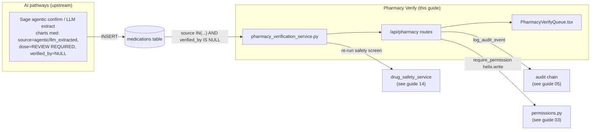
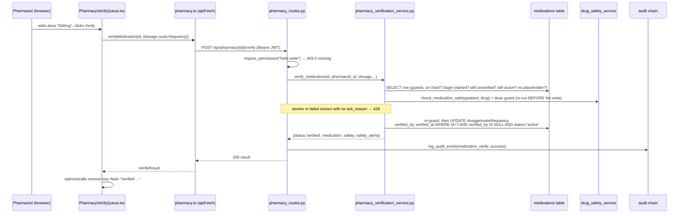
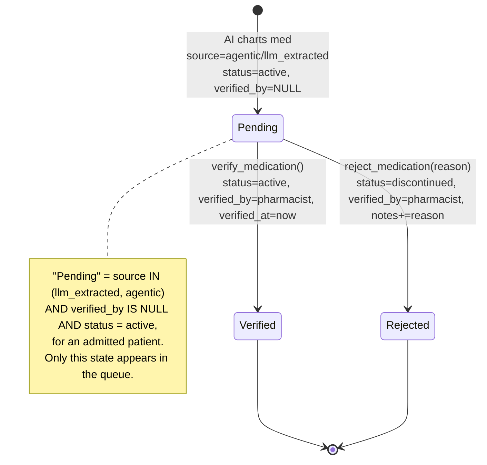

# Pharmacy Verify: the pharmacist medication verification queue

When Orb's AI charts a medication on a patient's drug chart, that drug is **on the chart but explicitly untrusted**, dose reads `REVIEW REQUIRED`, provenance is `llm_extracted` or `agentic`, and the `verified_by` column is `NULL`. Pharmacy Verify is the human-in-the-loop that closes that loop: a pharmacist opens a queue of every unverified AI/agentic med, sees the order-time drug-safety alerts (allergy + interaction) rendered inline, corrects the dose/route/frequency, and then either **Verifies** it (the med becomes an active, human-verified order) or **Rejects** it (the med is discontinued and the reason is recorded). Every decision is audited. This guide covers the whole subsystem: one FastAPI service, three REST routes, one React component, its typed API client, and the tests that pin the behaviour down.

---

## Purpose and neighbours

**The problem.** Orb lets AI pathways (Sage's agentic order confirmation, LLM extraction from documents) put medications onto a patient's chart. Letting an LLM write an *active, trusted* prescription with a real dose is unacceptable in a clinical system, a hallucinated dose or an allergy the model didn't check could reach a patient. So Orb deliberately charts AI meds in a **quarantined** state: they carry a provenance tag (`source`) marking them as machine-generated, a placeholder dose of `REVIEW REQUIRED`, and a `verified_by IS NULL` flag meaning "no human has signed off on this." Pharmacy Verify is the surface where a qualified pharmacist reviews that quarantine and either promotes or discards each drug.

**Jargon, defined once:**

- **Provenance / `source`**, a text column on the `medications` row recording *who or what* created the med: `clinician` (a human typed it), `llm_extracted` (an LLM pulled it out of a document), or `agentic` (an autonomous AI agent charted it). Only the last two require verification.
- **Verification**, a pharmacist reads the AI-charted med and takes responsibility for it; the act stamps `verified_by` (the pharmacist's user id) and `verified_at` (a timestamp).
- **Drug-safety screen**, an automated check that compares the drug against the patient's documented allergies and their other active meds (drug-drug interactions), returning a list of alerts and a worst-case severity. Owned by the drug-safety service (see guide 14-helix, which shares that service).
- **RBAC (Role-Based Access Control)**, the server decides *who may do what* by mapping a user's **role** (e.g. `pharmacist`) to a set of **permissions** (e.g. `helix.write`). A route declares which permission it needs; the framework rejects anyone lacking it with HTTP 403.
- **Route handler**, a Python function wired to an HTTP method + path (e.g. `POST /api/pharmacy/5/verify`) by a **router**.
- **Service**, a plain-Python module holding the business logic and SQL, deliberately kept separate from the HTTP layer so it can be unit-tested without a web server.
- **Audit event**, an immutable log row recording that something clinically or security-significant happened (who, what, when, outcome). See guide 05-audit-chain.



**Neighbours:**

| Neighbour | Relationship | Guide |
|---|---|---|
| Helix (pharmacy/orders) | Shares the `drug_safety_service` safety screen and the `helix.read`/`helix.write` permissions that gate this queue; Helix is the *other* pharmacist surface (ordering + stock) | 14-helix |
| Orders / COPE | The broader medication-ordering context; a verified med is an active order | 16-orders |
| Sage (agentic) | The upstream that charts `agentic`/`llm_extracted` meds this queue consumes | 09-sage, 10-sage-proactive-ambient |
| Audit chain | Every verify/reject writes a `clinical_record` audit event | 05-audit-chain |
| Auth / RBAC | `require_permission`, `get_current_user`, JWT | 03-auth-rbac |
| Database | The `medications` table, `db_session`, the provenance/verification migration | 04-database-schema |
| API client | `apiFetch` transport used by `src/api/pharmacy.ts` | 02-api-client |

---

## File map

| File | Lines (approx) | Role |
|---|---|---|
| `server/services/pharmacy_verification_service.py` | 433 | The business logic: list pending, verify, reject, and the safety-alert flattening. All SQL lives here. |
| `server/routes/pharmacy_routes.py` | 149 | Four HTTP routes (`/pending`, `/interaction-coverage`, `/{id}/verify`, `/{id}/reject`) under `/api/pharmacy`, each behind an RBAC permission; verify and reject each write an audit event. |
| `src/components/helix/PharmacyVerifyQueue.tsx` | 541 | The pharmacist-facing React table: fetches pending meds, lets the pharmacist edit dose/route/frequency, and fires Verify/Reject. Self-contained (no props). |
| `src/api/pharmacy.ts` | 151 | The typed frontend API: TypeScript interfaces for the payloads plus three fetch wrappers. |
| `server/tests/test_pharmacy_verification.py` | 424 | Pytest coverage of the service (pending/verify/reject/safety) and the routes (with pharmacist auth and a 403 negative case). |
| `e2e/04-pharmacy-verify.spec.ts` | 47 | One Playwright "golden journey": a pharmacist logs in, opens the Verify Queue tab, and the surface renders (empty or populated). |

---

## How it works

### Core flow 1: the queue loads

1. A pharmacist logs in. The frontend shell reads which tabs the role may see from `shellConfig`; `pharmacist` gets `helix`, `pharmacy-verify` and `sage` (`src/shellConfig.tsx:894`).
2. Clicking the **Verify Queue** tab lazy-loads and mounts `<PharmacyVerifyQueue/>` (`src/pages/ClinicianShell.tsx:130`, rendered at `:774-776`).
3. On mount the component calls `load()` (`src/components/helix/PharmacyVerifyQueue.tsx:197`), which calls `getPendingVerifications()` → `GET /api/pharmacy/pending`.
4. The route handler calls `pharmacy.list_pending_verification()`, which SQL-selects every still-active med with `source IN ('llm_extracted','agentic') AND verified_by IS NULL` on the chart of an admitted patient, joins the patient (name, ward, bed) and the prescriber's name, and for each row **re-runs the drug-safety screen** so allergy/interaction alerts and screening gaps render inline.
5. The component seeds an editable field-set per row, blanking any `REVIEW REQUIRED` placeholder so the pharmacist types a real value into an empty box.

### Core flow 2: verify (the main flow)



### Core flow 3: reject

Identical shape to verify, but the pharmacist types a **reason** into an inline panel under the row ("Confirm rejection" stays disabled until it is non-blank), the service sets `status='discontinued'`, appends `[REJECTED by <pharmacist name> @ <ts>] <reason>` to the med's `notes`, and the route logs a `medication_reject` audit event. A blank reason is refused both client-side (`onReject` bails) and server-side (`reject_medication` raises `ValueError` → HTTP 400).

### The verification state machine

The "state" is not a dedicated enum column, it is the combination of `source`, `verified_by`, and `status`:



Subtle but important: an AI-charted med is inserted with `status='active'` *while still unverified* (see the test helper `_chart_ai_med`, `server/tests/test_pharmacy_verification.py:43`). So `status='active'` alone does **not** mean "trusted", the queue keys off `verified_by IS NULL` (and shows only meds still active). Verification does not change status (it stays `active`); it fills in `verified_by`/`verified_at`. Rejection is the only transition that changes status (to `discontinued`).

---

## Function-by-function

### `server/services/pharmacy_verification_service.py`

Module constant: `_UNVERIFIED_SOURCES = ("llm_extracted", "agentic")` (`server/services/pharmacy_verification_service.py:29`), the two provenance values that mean "AI charted this; a human must verify." Every guard and query in the file keys off this tuple.

---

#### `_now`: `server/services/pharmacy_verification_service.py:72`
**Signature:** `() -> str`
**Does:** Returns the current UTC time as an ISO-8601 string.
**How it works:** `datetime.now(timezone.utc).isoformat()`.
**Why it exists:** A single, timezone-aware timestamp source so every `verified_at`/rejection stamp is UTC and comparable. Using `now(timezone.utc)` (not naive `now()`) avoids the classic bug where local-time stamps sort or diff incorrectly across DST or servers in different zones.
**Data in/out:** none → e.g. `"2026-07-07T09:15:42.123456+00:00"`.
**Talks to:** Called by `verify_medication` and `reject_medication`.
**Change guide:** To store epoch millis instead, change this one function; knock-on: the `verified_at` column is `TIMESTAMP` (added by the medications migration, `server/database.py:1873`) and the frontend prints it as a string, so a numeric change would ripple into any consumer that formats the value.
**Gotchas:** none noteworthy.

---

#### `_safety_alerts`: `server/services/pharmacy_verification_service.py:76`
**Signature:** `(patient_id: str, drug_name: str, med_id: int | None = None) -> dict`
**Does:** Runs the order-time drug-safety screen for one drug on one patient and returns the full safety dict plus a flattened `alerts` list. It never raises, but when the screen fails it reports that failure loudly rather than returning silence.
**How it works:**
1. Calls `check_medication_safety(patient_id, drug_name, exclude_med_id=med_id)` (`:79`; the shared drug-safety service, `server/services/drug_safety_service.py:723`). `med_id` is the row under review: unverified AI meds are charted `active`, so without excluding it the drug is screened against itself and every anticoagulant raises a false severe duplicate-therapy alert.
2. If that raises for *any* reason, it logs a warning and returns a **fail-CLOSED** shape (`server/services/pharmacy_verification_service.py:82-86`) instead of propagating: `screen_failed: true`, `max_severity: "unknown"`, `blocking: true`, `safe: false`, and a `coverage_note` reading "Drug-safety screening unavailable: verify manually.".
3. On success it adds a convenience key `alerts` = `allergy_alerts + interaction_alerts` concatenated (`:87`), and stamps `screen_failed: false` (`:88`), so callers have one flat list to render.
**Why it exists:** Two reasons. (a) **Uniform shape**, callers want one `alerts` array, but the underlying screen returns allergy and interaction alerts in separate keys. (b) **Never blank the queue, never fake a clean bill of health.** An exception must not stop the pharmacist *seeing* the queue, so the function does not propagate; but the row it returns is marked `screen_failed: true` with `max_severity: "unknown"` and `blocking: true`. The docstring states the rule: "an unscreened med must never look identical to a clean one" (`server/services/pharmacy_verification_service.py:66-77`).
**Data in/out:** in: patient id, drug name, optional med id. out: `{drug, allergy_alerts, interaction_alerts, max_severity, blocking, safe, alerts, screen_failed, interaction_screened, coverage_note}` where `alerts` is the flattened list. The last three are the coverage-honesty fields: `screen_failed` means the screen threw, `interaction_screened: false` means the drug maps to no known class so interactions were never compared, and `coverage_note` is the sentence to show the clinician in either case. Each alert element looks like `{type, severity, message, substance?/with?/match?, ...}` (see the alert dicts built inside `drug_safety_service.check_allergies`, defined at `server/services/drug_safety_service.py:615`).
**Talks to:** Calls `check_medication_safety`. Called by `list_pending_verification`, `verify_medication`, `reject_medication`.
**Change guide:** To surface a third alert class, extend `check_medication_safety` to add a key, then extend the concatenation at `:87`. Knock-on: the frontend `SafetyAlert` type (`src/api/pharmacy.ts:18`) types `type` as `'allergy' | 'interaction'`, so a new type needs its label handled too. (The verify path already appends `type: "dose check"` alerts through `_with_dose_check`, below.)
**Gotchas:** The blanket `except Exception` (`:80`) swallows *any* error, including a genuine bug in the safety service, and downgrades it to a warning log. It does not degrade to "safe", though: the returned dict carries `blocking: true`, so a broken screen stops verification instead of waving it through (see `verify_medication`). The warning log is still the only signal that the screen itself is broken, worth alarming on in production.

---

#### `_is_placeholder` / `_corrected` / `_actor_role` / `_with_dose_check`: `server/services/pharmacy_verification_service.py:52` / `:55` / `:92` / `:105`
**Does:** The small helpers behind verify. `_is_placeholder` is true for a blank value or one containing "review" (the charting placeholders `REVIEW REQUIRED` and route `Review`). `_corrected(value, stored)` is the pharmacist's entry if non-blank, else the stored value. `_actor_role` reads the acting account's role from `users` (the route passes only the id). `_with_dose_check` runs the pharmacist's corrected dose through the shared dose guard (`medication_safety_gate.screen_order_dose`) and appends any findings to `alerts` as `type: "dose check"` rows (severe for a block, moderate otherwise, plus a moderate "could not run" row when the guard is unavailable), sets `blocking` on a block, and attaches a `dose_check` summary.
**Why they exist:** verifying used to keep the stored value when the pharmacist left a field empty, so `REVIEW REQUIRED` became the verified dose of an active order (`:48-49`); and the corrected dose used to be stored unchecked (the comment at `:272-277`).

---

#### `_serialize_med`: `server/services/pharmacy_verification_service.py:184`
**Signature:** `(row) -> dict`
**Does:** Maps a raw `medications` DB row (joined with `patient_name`) into the pharmacist-facing JSON shape.
**How it works:** Wraps the sqlite row in `dict(row)` then hand-picks/renames fields, note the column renames: DB `dosage` → JSON `dose`, DB `patient_name` → JSON `patient`, DB `prescriber_name` → JSON `prescriber` (`:144`, `:142`, `:157`).
**Why it exists:** Decouples the wire shape from the table shape. The frontend speaks `dose`/`patient`; the DB stores `dosage`/(joined)`patient_name`. Centralising the mapping means the SQL column names can change without touching the API contract.
**Data in/out:** in: a sqlite `Row`. out: dict with keys `id, patient_id, patient, drug_name, dose, route, frequency, source, status, verified_by, verified_at, notes, ward, bed, prescriber, started_at`. The last four (`:155-158`) tell the pharmacist where the patient is, who wrote the order and when it was charted. On the `_fetch_med` path, which selects `m.*` plus the patient's name and nothing else, `ward`, `bed` and `prescriber` are `None`; `started_at` is still populated, because it is a column on `medications` itself.
**Talks to:** Called by `list_pending_verification`, `verify_medication`, `reject_medication`. Its output shape is mirrored by the TS `PendingMedication`/`VerifiedMedication` interfaces (`src/api/pharmacy.ts:43`, `:60`); the queue widens `PendingMedication` with the four location fields as its local `QueueRow` type.
**Change guide:** To expose a new column on the queue, add it here and to the explicit column list in `list_pending_verification` (`:174-177`), and to the TS interface.
**Gotchas:** `_serialize_med` reads `patient_name`, which `list_pending_verification`'s SELECT aliases `AS patient_name` (`:176`) and `_fetch_med` also aliases (`:207`); the two code paths must keep that alias, or `patient` silently becomes `None`.

---

#### `list_pending_verification`: `server/services/pharmacy_verification_service.py:221`
**Signature:** `() -> list[dict]`
**Does:** Returns every AI/agentic med still awaiting verification, each annotated with its drug-safety alerts, worst severity and screening coverage.
**How it works:**
1. Opens a `db_session()` (a context manager yielding a sqlite connection; commits on clean exit, rolls back on exception, `server/database.py:1099`).
2. Runs one SELECT (`:173-188`): `medications m JOIN patients p ON p.id = m.patient_id AND p.status = 'admitted'` (`:179`) `LEFT JOIN users u ON u.id = m.prescribed_by` (`:180`), filtered `WHERE m.source IN (?,?) AND m.verified_by IS NULL AND m.status = 'active'` (`:181-183`), ordered newest-first by `started_at DESC, id DESC`. A drug a doctor has stopped, or one for a patient who has gone home, is not an order awaiting review. The `IN (...)` placeholders are generated from the length of `_UNVERIFIED_SOURCES` (`:184-186`) and the tuple is passed as bound parameters, **parameterised SQL, not string interpolation of values**.
3. For each row: serialise it, call `_safety_alerts` with the row's own id, and attach `safety_alerts`, `max_severity`, `interaction_screened`, `coverage_note` and `screen_failed` (`:190-202`).
**Why it exists:** This is the queue itself, the single source of "what needs a pharmacist right now." Running the safety screen per-row here means the queue shows the danger *before* the pharmacist acts, not only after.
**Data in/out:** none → `list[PendingMedication-shaped dict]`, each with `safety_alerts: [...]`, `max_severity: 'none'|'mild'|'moderate'|'severe'|'unknown'` and the three coverage fields.
**Talks to:** Calls `db_session`, `_serialize_med`, `_safety_alerts`. Called by the `GET /api/pharmacy/pending` route (`server/routes/pharmacy_routes.py:53`). Ultimately consumed by `getPendingVerifications` on the frontend.
**Change guide:** To show verified meds too (an audit view), relax the `verified_by IS NULL` clause. Watch out: dropping it would flood the queue with every historical AI med. To page the queue, add `LIMIT/OFFSET` here and thread params from the route.
**Gotchas:** (1) The safety screen runs **once per row** on every list call, an N-row queue does N screens, each hitting the DB for allergies/interactions. A candidate for batching if the queue grows. (2) The `{placeholders}` format-string (`:184`) interpolates only the `?` marks (structure), never user data, this is safe. Do not "simplify" it into interpolating `_UNVERIFIED_SOURCES` values directly, which would reintroduce an injection vector. (3) The inner `JOIN` (not `LEFT JOIN`) on `patients` drops a med whose patient row is missing as well as a discharged one.

---

#### `_fetch_med`: `server/services/pharmacy_verification_service.py:315`
**Signature:** `(db, med_id: int) -> Row | None`
**Does:** Reads a single med by id (with `m.*` and the joined `patient_name`) on a caller-supplied connection.
**How it works:** One parameterised SELECT `WHERE m.id = ?`, returns `fetchone()` (a row or `None`).
**Why it exists:** Both verify and reject need to read-then-write within the *same* transaction, so this takes an existing `db` rather than opening its own session. It is also reused to re-read the post-update row so the caller returns fresh data.
**Data in/out:** in: open connection + med id. out: a full med row (all columns) or `None`.
**Talks to:** Called inside `verify_medication` (pre-guard read, the re-guard inside the write session, post-update re-read) and `reject_medication` (guard read, post-update re-read).
**Change guide:** none typically needed; if you add columns to `medications`, `m.*` picks them up automatically here (but `list_pending_verification`'s explicit column list will not).
**Gotchas:** Takes `db` as its first param, do **not** call it outside a `with db_session()` block or you'll operate on a closed/uncommitted connection.

---

#### `verify_medication`: `server/services/pharmacy_verification_service.py:375`
**Signature:** `(med_id: int, pharmacist_id: str, dosage: str|None=None, route: str|None=None, frequency: str|None=None, ack_reason: str|None=None) -> dict`
**Does:** A pharmacist verifies an AI/agentic med, optionally correcting dose/route/frequency, and stamps who/when, **behind fail-closed safety gates**: the corrected dose goes through the dose guard, and a severe alert, or a screen that failed to run, blocks verification until the pharmacist supplies an `ack_reason`.
**How it works:**
1. Open a session, `_fetch_med`. **Five guards** (`:402-416`), each raising a `ValueError` whose message is written for the pharmacist (the route turns it into HTTP 400, except the last):
   - row is `None` → `NOT_ON_CHART_MESSAGE`, "This medication is no longer on the chart. Refresh the queue." (`:35`).
   - `source` not in `_UNVERIFIED_SOURCES` → `NOT_SAGE_CHARTED_MESSAGE`, it refuses to "verify" a clinician-entered med (`:36`).
   - `verified_by is not None` → `ALREADY_DECIDED_MESSAGE`, another pharmacist got there first (`:37`).
   - `status != 'active'` → `STOPPED_ON_CHART_MESSAGE` (`:32`): verifying never revives a drug a doctor stopped.
   - any of the effective dose/route/frequency (`_corrected`: the pharmacist's entry, else the stored value) is blank or a placeholder → `IncompleteOrderError` (`:40`), "Enter a dose, route and frequency before verifying", which the route answers with **422**.
2. Re-run the screen *outside* the session and **before** verification (`_safety_alerts`, `:265`), then add the dose guard's verdict on the corrected dose (`_with_dose_check`, `:267-268`).
3. **Dose gate** (`:270-301`), decided before the allergy branch so a refused dose never leaves an allergy-override audit row for a verification that did not happen: if the dose guard blocks, `_dose_ack_refusal` decides whether this actor may override. A pharmacist holds no `medication.prescribe`, so the way on is a corrected dose or a rejection; the refusal is audited as `pharmacy_verify_dose_block` / `denied` and raised as a `severe_ack_required:` `ValueError`.
4. **Severity gate:** `needs_ack = max_severity == "severe" or screen_failed` (`:302`). With no `ack_reason`, it raises a `ValueError` whose message begins with the machine-readable prefix `severe_ack_required:` and whose `.safety` attribute carries the whole screen (`:306-312`). The route turns exactly that into **HTTP 428 Precondition Required** (`server/routes/pharmacy_routes.py:122-133`). With an `ack_reason`, the override is written to the tamper-evident audit chain as `pharmacy_verify_override` / `outcome="partial_success"`, carrying the severity, the alerts and the reason (`:302-321`), and the returned screen gains `override: {by, reason}` (`:322`). A dose override (only an actor holding `medication.prescribe`) is audited separately as `pharmacy_verify_dose_override` (`:324-344`).
5. **Re-guard inside the write session** (`:346-362`): not on chart, already decided, stopped, and the placeholder check run again, because another pharmacist may have verified the med (or a doctor stopped it) while the screen or the acknowledgement round-trip was in flight.
6. `UPDATE medications SET dosage, route, frequency, verified_by, verified_at WHERE id=? AND verified_by IS NULL AND status='active'` (`:585-590`). Status is **not** written: the med stays `active`. The trailing predicates are a **concurrency guard**, even if two requests both pass the read-time check, only the first UPDATE matches. When that UPDATE matched and the ward row is linked to a medication order (`medications.med_order_id`), `_mirror_into_order_store` (`server/services/pharmacy_verification_service.py:298`) moves the order in the same transaction through `chart_lane.mirror_legacy_decision_in_txn` (wave 5, W5-E), whatever the store switches say. A refusal from the store is raised as a `ValueError`, so the route answers 400 and the verification is undone with it. An unlinked row is untouched.
7. Re-read with `_fetch_med`, serialise, log, and return (`:395-402`).
**Why it exists:** This is the promotion step, the moment an AI suggestion becomes a human-owned active order. Re-running the safety screen *at decision time* means the returned payload shows the pharmacist the allergy/interaction picture as it stands right now, even if the patient's allergies changed since the med was charted.
**Data in/out:** in: med id, pharmacist id, optional corrections, optional acknowledgement. out:
```json
{ "status": "verified",
  "medication": { "id":.., "dose":"500mg", "status":"active", "verified_by":"PH..", ... },
  "safety": { "max_severity":"severe", "blocking":true, "safe":false, "override": {"by":"PH..","reason":"..."}, ... },
  "safety_alerts": [ { "type":"allergy", "severity":"severe", "message":"..." } ] }
```
**Talks to:** Calls `db_session`, `_fetch_med`, `_now`, `_safety_alerts`, `_with_dose_check`, `_actor_role`, `medication_safety_gate._dose_ack_refusal`, `log_audit_event`. Called by the `POST /{med_id}/verify` route (`server/routes/pharmacy_routes.py:101`).
**Change guide (worked example):** *"I want verification blocked on a **moderate** alert too."* The gate is one boolean at `:291`; widen it to `safety["max_severity"] in ("moderate", "severe") or safety.get("screen_failed")`. Knock-on: the 428 path and the audited override already exist, so nothing else server-side changes, but the queue's acknowledgement panel opens on every 428 (`src/api/pharmacy.ts:126`), so it will start appearing far more often, and an interlock that fires constantly is one staff learn to click through. Do not instead raise a plain `ValueError`: that maps to 400 and gives the pharmacist no override path, which is a dead end.
**Gotchas:** (1) A blank correction keeps the stored value, but if the stored value is the placeholder the verify is refused with 422, so a pharmacist cannot verify a `REVIEW REQUIRED` dose by leaving the field empty. (2) The 428 is raised by a `ValueError` whose **message prefix** is the contract (`severe_ack_required:`). Reword that string and the route silently degrades the 428 to a 400, taking the acknowledgement UI with it; it is a string-matched protocol between two files (`server/services/pharmacy_verification_service.py:308` and `server/routes/pharmacy_routes.py:123`). (3) A *failed* screen blocks just as hard as a severe alert, so an outage in the drug-safety service stops all verification until pharmacists start acknowledging, which is the intended trade, but worth knowing before the pager goes off.

---

#### `reject_medication`: `server/services/pharmacy_verification_service.py:605`
**Signature:** `(med_id: int, pharmacist_id: str, reason: str) -> dict`
**Does:** A pharmacist rejects an AI/agentic med: discontinue it and record who rejected it and why.
**How it works:**
1. `reason = (reason or "").strip()`; if empty, raise `ValueError("Give a reason for rejecting this medication.")` **before** touching the DB (`:415-417`). A reason is mandatory for auditability.
2. Open a session, `_fetch_med`, run the not-on-chart, not-Sage-charted and already-decided guards (`:419-426`). There is no `active` check: a pharmacist may still reject a med a doctor has since stopped.
3. Build the rejection note with the pharmacist's **name**, read from `users` on the same session (`:433-434`), falling back to the id: `f"[REJECTED by {who_name} @ {stamp}] {reason}"`, appended to any prior `notes` with a newline (`:428-436`), history is preserved, not overwritten. The time stays UTC ISO in the stored note; every screen that prints it renders it in local clinical form.
4. `UPDATE ... SET status='discontinued', verified_by, verified_at, notes WHERE id=? AND verified_by IS NULL` (`:438-443`). Note rejection also stamps `verified_by`/`verified_at`, "verified" here means "a pharmacist made the decision," not "approved." A linked ward row moves its medication order to rejected in the same transaction (`_mirror_into_order_store`, as in verify), and a store refusal undoes the rejection.
5. Re-read, serialise, re-run safety (`:447`), log, return.
**Why it exists:** The negative half of the loop. A rejected AI med must leave the active chart (`discontinued`) *and* leave a paper trail (the reason in `notes` plus the audit event) so a later reviewer can see why the AI's suggestion was thrown out.
**Data in/out:** in: med id, pharmacist id, non-empty reason. out: `{status:'rejected', medication:{status:'discontinued', ...}, reason, safety, safety_alerts}`.
**Talks to:** Calls `db_session`, `_fetch_med`, `_now`, `_safety_alerts`. Called by `POST /{med_id}/reject` (`server/routes/pharmacy_routes.py:165`).
**Change guide (worked example):** *"I want rejected meds kept in a separate `rejected` status, not `discontinued`."* Change `'discontinued'` at `:418`. Watch out: the `medications.status` column has a CHECK constraint allowing only `('active','discontinued','prn')` (`server/database.py:240`), so you must first ALTER the constraint (a table rebuild in SQLite) or the UPDATE fails. This is a good example of why the doc's Rebuild notes call out the schema as a prerequisite.
**Gotchas:** The rejection note stamps use the same `_now()` UTC ISO string embedded into free-text `notes`. Reusing `verified_by` for a rejection is a semantic overload, see Discrepancies.

---

### `server/routes/pharmacy_routes.py`

Router declared with `prefix="/api/pharmacy"` and tag `"Pharmacy Verification"` (`server/routes/pharmacy_routes.py:37`). Registered in `server/main.py` via `from routes.pharmacy_routes import router as pharmacy_router` (`server/main.py:74`) and `app.include_router(pharmacy_router)` (`server/main.py:1009`), no extra prefix at include time, so the full paths are exactly `/api/pharmacy/...`.

#### `VerifyRequest` / `RejectRequest`: `server/routes/pharmacy_routes.py:48`, `:49`
**Signature:** Pydantic models. `VerifyRequest{ dosage?: str, route?: str, frequency?: str, ack_reason?: str }`; `RejectRequest{ reason: str }`.
**Does:** Declare and validate the JSON request bodies.
**How it works:** FastAPI parses the request body into these models; all `VerifyRequest` fields are `Optional` (default `None`), so an empty `{}` is a valid verify body, and the service keeps each stored value it was not given (then refuses with 422 if any of them is still a placeholder). `ack_reason` is the pharmacist's reason for verifying across a severe or failed screen. `RejectRequest.reason` is required, a missing `reason` yields FastAPI's own 422 before the handler runs.
**Why it exists:** Type-safe body parsing and auto-generated OpenAPI docs; the `Optional` design directly enables "verify without corrections."
**Data in/out:** JSON in, typed object to the handler.
**Talks to:** Consumed by `verify`/`reject` handlers.
**Gotchas:** Empty-string vs missing, `{"dosage":""}` passes validation and reaches the service, where `""` is treated as "keep existing" (`_corrected`, `server/services/pharmacy_verification_service.py:55`). The queue always sends all three fields, trimmed, and keeps Verify disabled until each is a real value (`src/components/helix/PharmacyVerifyQueue.tsx:241-247`).

---

#### `get_pending`: `server/routes/pharmacy_routes.py:96`
**Signature:** `GET /api/pharmacy/pending`, dep `require_permission("helix.read")` → `{ "pending": [...] }`
**Does:** Returns the verification queue.
**How it works:** The `Depends(require_permission("helix.read"))` runs first: it resolves the JWT to a user, checks the user's role grants `helix.read`, and 403s otherwise (`server/permissions.py:856-864`). On success it returns the authenticated `user` dict, and the handler returns `{"pending": pharmacy.list_pending_verification()}`.
**Why it exists:** The read endpoint behind the queue. Uses `helix.read` (not a dedicated `pharmacy.read`) because pharmacy verification is scoped as part of the Helix pharmacist permission family.
**Data in/out:** none → `{"pending": PendingMedication[]}`.
**Talks to:** Calls `list_pending_verification`. Called by `getPendingVerifications` (`src/api/pharmacy.ts:99`).
**Change guide:** To let admins read the queue, they already have `HELIX_READ` (`server/permissions.py:306`) so no change needed server-side; the *UI* tab is what hides it from them, `pharmacy-verify` appears only in the pharmacist's tab list, not the admin's (`src/shellConfig.tsx:894`).
**Gotchas:** Read-only route does **not** write an audit event (only verify/reject do). If you need "who looked at the queue" auditing, add a `log_audit_event` here. A sibling read, `GET /api/pharmacy/interaction-coverage` (`server/routes/pharmacy_routes.py:59`), returns which formulary items the interaction knowledge base can screen.

---

#### `verify`: `server/routes/pharmacy_routes.py:151`
**Signature:** `POST /api/pharmacy/{med_id}/verify`, body `VerifyRequest`, dep `require_permission("helix.write")` → `VerifyResult`
**Does:** Verifies a med and audits the action.
**How it works:**
1. RBAC: `helix.write` required (`:103`).
2. Call `pharmacy.verify_medication(med_id, pharmacist_id=user["id"], dosage=..., route=..., frequency=..., ack_reason=...)` inside a `try` (`:111-134`) that maps `IncompleteOrderError` → **422** (`:120-121`), a `ValueError` starting `severe_ack_required:` → **428** with `{error, message, safety}` (`:122-133`; the prefix is stripped so the queue can print `message` as it is), and any other `ValueError` → **400** (`:134`). This is how the service's "not on chart / not Sage-charted / already decided / stopped" guards become client-visible 400s.
3. `log_audit_event(...)` with `event_category="clinical_record"`, `action_type="medication_verify"`, `outcome="success"`, the actor (from the JWT user), `target_type="medication"`, `patient_id`, `request_path`, `http_method`, and metadata carrying the final dose/route/frequency plus `max_severity`, `safety_alert_count`, `interaction_screened`, `screen_failed` and `acknowledged` (`:137-160`). A fresh `correlation_id` (a UUID grouping related audit rows) is minted per call.
4. Return the service result verbatim.
**Why it exists:** The HTTP verb + auth + audit wrapper around the service. Keeping audit *in the route* (not the service) means the service stays unit-testable without an audit dependency, and the audit captures request-level facts (path, method, actor role) the service doesn't see.
**Data in/out:** in: `{dosage?, route?, frequency?, ack_reason?}` + `med_id` path param + Bearer JWT. out: `VerifyResult` (see `src/api/pharmacy.ts:75`), or the 428 payload the client types as `SevereAckRequired` (`src/api/pharmacy.ts:92`).
**Talks to:** `require_permission` (guide 03), `verify_medication`, `log_audit_event` (guide 05). Called by `verifyMedication` (`src/api/pharmacy.ts:113`).
**Change guide (worked example):** *"Notify the charting doctor when their AI med is verified."* After the audit call, look up the med's `prescribed_by` and emit a Relay/notification. Watch out: there is currently **no socket emit** here (see Discrepancies), so other open Verify Queues won't refresh live, if live refresh matters, this handler is where you'd `await sio.emit(...)` to a pharmacy room.
**Gotchas:** The audit metadata reads `med.get("dose")` (the serialised key), not `dosage`, correct, because `_serialize_med` renamed it. The route trusts `user["id"]` as the pharmacist id; that comes from the verified JWT, so it cannot be spoofed by the request body.

---

#### `reject`: `server/routes/pharmacy_routes.py:222`
**Signature:** `POST /api/pharmacy/{med_id}/reject`, body `RejectRequest`, dep `require_permission("helix.write")` → `RejectResult`
**Does:** Rejects a med and audits it.
**How it works:** Mirror of `verify`: RBAC `helix.write`, call `reject_medication(med_id, pharmacist_id, reason)` with `ValueError`→400, then `log_audit_event(action_type="medication_reject", ...)` whose metadata carries the `reason`, `max_severity`, `safety_alert_count` (`:179-197`).
**Why it exists:** The audited HTTP wrapper for the reject transition.
**Data in/out:** in: `{reason}` + `med_id` + JWT. out: `RejectResult`.
**Talks to:** `reject_medication`, `log_audit_event`. Called by `rejectMedication` (`src/api/pharmacy.ts:153`).
**Gotchas:** A blank/whitespace reason produces a 400 from the service's guard (`server/services/pharmacy_verification_service.py:415-417`), *not* a 422 from Pydantic, because `reason` is a present-but-empty string, which satisfies the `str` type. The frontend also guards against this before calling (`src/components/helix/PharmacyVerifyQueue.tsx:286-287`).

---

### `src/components/helix/PharmacyVerifyQueue.tsx`

A **React component** (a function returning UI; React re-runs it whenever its **state** changes). It takes no props and fetches its own data. **A React hook** is a function starting with `use` that lets a component hold state (`useState`) or run side effects (`useEffect`).

Surfaces, inputs and buttons use the Helix classes in `Helix.module.css` (`verifyPage`, `verifyTable`, `verifyInput`, `btnPrimary`, `btnDanger`, `reasonPanel`, ...), so the disabled-button tokens and the 44px coarse-pointer floor come from one stylesheet. Module helpers: `wardBed` (`:35`, "Ward 3, bed 12"), `orderedLine` (`:44`, "Ordered by Dr Mehta, 3 Oct 2026, 10:15 AM" through `formatClinicalDateTime`) and `isPlaceholder` (`:59`, blank or containing "REVIEW", the client mirror of the server's 422 rule).

#### `severityColor`: `src/components/helix/PharmacyVerifyQueue.tsx:93`
**Signature:** `(sev: string) -> string`
**Does:** Maps an alert severity to a text colour token.
**How it works:** `severe` → `--status-danger-text`, `moderate` → `--status-warn-text`, anything else (incl. `mild`) → `--text-muted`. The `-text` tokens, not the fill tokens, because these are 11-12px labels and the fill tokens fall short of contrast at that size.
**Why it exists:** So a severe allergy reads red and a mild interaction is quiet, visual triage.
**Gotchas:** `mild` and `none` both fall to the muted branch; there's no distinct mild colour. Matches the design intent (only moderate/severe should draw the eye).

#### `SafetyAlerts` / `SafetyCell` / `ScreeningBadge`: `src/components/helix/PharmacyVerifyQueue.tsx:123` / `:137` / `:85`
**Signature:** `SafetyAlerts({ alerts })`, `SafetyCell({ row })`, `ScreeningBadge({ label, color })` → JSX
**Does:** `SafetyAlerts` renders the alert list, or a green "No alerts" when it is empty (`:108-110`); each alert shows `TYPE · SEVERITY` (uppercased) then the message, bold if `severe`. `SafetyCell` is the whole safety column: it adds an outlined coverage badge first, "Screening unavailable" for a failed screen, "Not screened" when the drug is outside the interaction knowledge base, "Partly screened" when other drugs on the chart are, with the `coverage_note` under it.
**Why it exists:** The inline danger display that makes the queue a safety tool, not just a to-do list. A coverage gap must never render as a green "No alerts": with a failed screen the cell shows only the badge, and an unscreened drug lists only the allergy alerts it did get (`:156-162`).
**Data in/out:** in: `SafetyAlert[]` / a `PendingMedication` row. out: JSX.
**Talks to:** `SafetyCell` is rendered per row in the "Safety alerts" column; `SafetyAlerts` is reused inside the acknowledgement panel.
**Gotchas:** `SafetyAlerts` uses the array index as the React `key` (`:115`). Safe here because the list is static per render (never reordered/filtered in place), but it would misbehave if alerts became individually editable.

#### `SourceBadge`: `src/components/helix/PharmacyVerifyQueue.tsx:182`
**Signature:** `({ source: string }) -> JSX`
**Does:** Renders a pill badge for the provenance.
**How it works:** `llm_extracted` → "Sage, from notes", `agentic` → "Sage action", else the raw string (`:182`).
**Why it exists:** Tells the pharmacist at a glance whether Sage read the drug out of a note or a clinician confirmed a Sage action card.
**Gotchas:** none noteworthy.

#### `PharmacyVerifyQueue` (default export): `src/components/helix/PharmacyVerifyQueue.tsx:203`
**Signature:** `() -> JSX`
**Does:** The whole queue screen: fetch, edit, verify (with an inline acknowledgement when the server answers 428), reject (with an inline reason).
**State (`:188-195`):** `rows` (pending meds), `edits` (per-id `{dosage,route,frequency}` draft), `acks` (per-id acknowledgement panel: reason typed so far, the 428 safety screen and message), `rejects` (per-id reject reason typed so far), `loading`, `error`, `busyId` (the row currently mid-action, for disabling its buttons), `flash` (a transient success line).

Nested functions:

- **`load` (`:197`)**, sets loading, calls `getPendingVerifications()`, stores rows, then **seeds `edits`**: each value that `isPlaceholder` flags is blanked (`:207`), so `REVIEW REQUIRED` placeholders become empty inputs the pharmacist fills in, while real values pre-populate. Errors set `error`. `finally` clears loading.
- **`useEffect(() => load(), [])` (`:218`)**, runs `load` once on mount (empty dependency array). The `eslint-disable` comments acknowledge the deliberate fire-once trigger.
- **`setField(id, field, value)` (`:224`)**, immutably updates one field of one row's draft.
- **`onVerify(row, ackReason?)` (`:236`)**, sets `busyId`, sends all three fields trimmed plus any acknowledgement reason. A 428 result opens the row's acknowledgement panel with the returned screen and message; success **optimistically removes the row** from `rows`, closes the panel and flashes "Verified ...". Errors set `error`; `finally` clears `busyId`.
- **`openReject(id)` / `onReject(row)` (`:271`, `:285`)**, Reject opens an inline reason panel under the row and focuses its text box; "Confirm rejection" is disabled until the reason is non-blank, and `onReject` bails on a blank reason (`:286-287`). Otherwise it calls `rejectMedication(row.id, reason)`, removes the row and flashes "Rejected ...".

**Render (`:302-540`):** header with a manual **Refresh** button (calls `load`), the `flash`/`error` banners, then one of three states: loading, empty state ("Queue clear" / "No medicines from Sage are waiting to be checked."), or the table. Each table row shows the patient with ward and bed, the drug with who ordered it and when, editable dose/route/frequency inputs, a `SourceBadge`, a `SafetyCell`, and Verify/Reject buttons. Verify is disabled while the row is busy or while any field is blank or a placeholder, with the hint "Enter a dose, route and frequency before verifying". Under the row sit the reject panel and the acknowledgement panel ("Severe safety alerts: acknowledgement required", or "Drug-safety screening unavailable: acknowledgement required"), whose "Acknowledge & verify" button needs a non-blank reason.

**Why it exists:** The single pharmacist-facing surface. The optimistic row removal + local `edits` state make it feel instant without a full reload after each action.
**Data in/out:** consumes `PendingMedication[]`; sends `{dosage,route,frequency}` (+ `ack_reason`) / `{reason}`.
**Talks to:** `getPendingVerifications`, `verifyMedication`, `rejectMedication` (`src/api/pharmacy.ts`). Mounted lazily by `ClinicianShell` (`src/pages/ClinicianShell.tsx:130`, `:822-824`) inside a `PanelErrorBoundary`.
**Change guide (worked example):** *"Refresh the queue automatically every 30s."* Add a second `useEffect` with `setInterval(load, 30000)` and clear it on unmount. Watch out: `load` sets `loading=true` each time, which would swap the table for the loading state; guard with a "silent reload" flag so background refreshes don't blank the list, and do not reseed `edits` over a pharmacist's half-typed correction.
**Gotchas:** (1) The placeholder test is a substring match on the *uppercased* value, so a legitimate value literally containing "review" would be treated as blank; the server applies the same rule, so the two agree. (2) Optimistic removal means if the server call *actually* succeeds but the network response is lost, the row vanishes locally while remaining pending server-side until a Refresh, mildly confusing but self-healing.

---

### `src/api/pharmacy.ts`

The typed client. All calls go through `apiFetch` (`src/api/client.ts:195`), which prepends `/api`, attaches the `Authorization: Bearer <JWT>` header, and centralises 401 (session expiry → reload) and 403 (structured permission error) handling, so these wrappers stay tiny.

Interfaces:
- **`SafetyAlert` (`src/api/pharmacy.ts:18`)**, `{type:'allergy'|'interaction', severity:'mild'|'moderate'|'severe', message, substance?, reaction?, with?, match?}`. Mirrors the alert dicts from `drug_safety_service`.
- **`SafetyScreen` (`:25`)**, the screen as the 428 payload and the verify result carry it: `max_severity, blocking, safe, alerts[]`, plus `interaction_screened?`, `coverage_note?`, `screen_failed?` and `override?`.
- **`PendingMedication` (`:36`)**, the queue row shape: `id, patient_id, patient|null, drug_name, dose, route, frequency, source, status, safety_alerts[], max_severity, interaction_screened, coverage_note|null, screen_failed`. (The server also sends `ward`, `bed`, `prescriber`, `started_at`, which the component reads through its local `QueueRow` type.)
- **`VerifiedMedication` (`:53`)**, the post-action med: adds `verified_by|null, verified_at|null, notes|null`; drops `safety_alerts`/`max_severity`.
- **`VerifyResult` (`:68`)** / **`RejectResult` (`:75`)**, the verify/reject response envelopes; `RejectResult` additionally carries `reason`.
- **`SevereAckRequired` (`:85`)**, `{code: 'severe_ack_required', message, safety|null}`, the typed 428 outcome of a verify attempt.

#### `getPendingVerifications`: `src/api/pharmacy.ts:107`
**Signature:** `() -> Promise<PendingMedication[]>`
**Does:** GETs `/pharmacy/pending` and unwraps `.pending`.
**Talks to:** `apiFetch`; called by `load`.
**Gotchas:** Unwraps the `{pending: [...]}` envelope so callers get a bare array, keep the envelope key in sync with the route (`server/routes/pharmacy_routes.py:56`).

#### `verifyMedication`: `src/api/pharmacy.ts:121`
**Signature:** `(medId: number, corrections?: {dosage?,route?,frequency?}, ackReason?: string) -> Promise<VerifyResult | SevereAckRequired>`
**Does:** POSTs the corrections (and `ack_reason` when given) to `/api/pharmacy/{medId}/verify`.
**How it works:** a raw `fetch` with the cookie session and `buildHeaders('POST')` (which adds the CSRF token), not `apiFetch`, because the shared wrapper flattens error bodies to a message string and would drop the 428 safety payload. A **428** is returned as a typed `SevereAckRequired` result, not thrown (`:119-127`), so the caller opens its acknowledgement panel; a 401 fires `orb:session-expired` like `apiFetch` does; any other error throws with the server's message.
**Talks to:** `fetch`, `buildHeaders`; called by `onVerify`.

#### `rejectMedication`: `src/api/pharmacy.ts:169`
**Signature:** `(medId: number, reason: string) -> Promise<RejectResult>`
**Does:** POSTs `{reason}` to `/pharmacy/{medId}/reject`.
**Talks to:** `apiFetch`; called by `onReject`.
**Gotchas:** Sends `reason` verbatim; the server does the empty-string validation.

---

### `server/tests/test_pharmacy_verification.py`

**Fixtures & helpers:**
- `patient` (`:22`), inserts a throwaway patient, returns its id.
- `pharmacist` (`:33`), inserts a `role='pharmacist'` user, returns its id.
- `_chart_ai_med(...)` (`:43`), inserts an AI med with `verified_by` NULL (default `source='llm_extracted'`, dose `REVIEW REQUIRED`); returns `lastrowid`. This *is* the upstream simulation of what Sage/LLM extraction does.
- `client` (`:250`), builds a bare `FastAPI()` app including only `pharmacy_router`, wrapped in a `TestClient`.
- `_auth(uid, role)` (`:256`), mints a real JWT via `create_token` and returns the Bearer header.

**Service tests:**

| Test | Line | Pins down |
|---|---|---|
| `test_ai_med_appears_in_pending` | `:61` | An `llm_extracted` med shows up in pending with dose `REVIEW REQUIRED`, source, and joined patient name. |
| `test_clinician_med_not_in_pending` | `:72` | A `source='clinician'` med is **excluded** from the queue. |
| `test_verify_activates_and_corrects_dose` | `:85` | Verify overwrites dose→`500mg`, freq→`QDS`, leaves `status='active'`, stamps `verified_by`/`verified_at`, and the med leaves pending. |
| `test_verify_without_corrections_keeps_existing` | `:108` | Verify with no args on a med charted with real values preserves the existing `1g` dose. |
| `test_double_verify_rejected` | `:116` | A second verify raises `ValueError` (the already-decided guard). |
| `test_reject_discontinues` | `:124` | Reject sets `status='discontinued'`, stamps the pharmacist, writes the reason into `notes`, leaves pending. |
| `test_reject_requires_reason` | `:141` | A whitespace-only reason raises `ValueError`. |
| `test_pending_surfaces_allergy_alert` | `:148` | After `add_allergy(...severe)`, the pending row carries an allergy alert and `max_severity='severe'`. |
| `test_pending_surfaces_unscreened_drug` | `:159` | A drug outside the interaction knowledge base reports `interaction_screened=False` plus a coverage note, so an unscreened drug never looks like a clean screen. |
| `test_pending_screen_failure_fails_closed` | `:168` | When the safety screen itself raises, the row comes back `screen_failed=True`, `max_severity='unknown'`, empty alerts, it fails closed rather than reporting "no alerts". |
| `test_verify_severe_requires_acknowledgement` / `..._screen_failure_requires_acknowledgement` / `..._severe_with_reason_verifies_and_audits` / `..._sub_severe_needs_no_acknowledgement` | `:184-241` | The severity gate: severe or failed screen with no reason raises `severe_ack_required`, a reason verifies and writes the override audit, a sub-severe screen needs none. |
| `test_verify_refuses_blank_or_placeholder_fields` | `:330` | Every blank, whitespace or placeholder combination raises `IncompleteOrderError` and leaves the med pending. |
| `test_single_unverified_anticoagulant_is_not_screened_against_itself` / `test_second_anticoagulant_still_flags_the_duplicate` | `:352`, `:365` | The row under review is excluded from its own screen, and a real duplicate still flags. |
| `test_stopped_med_is_not_pending_and_cannot_be_verified` / `test_med_stopped_during_the_screen_is_not_revived` / `test_discharged_patient_meds_leave_the_queue` | `:379`, `:394`, `:412` | A stopped or discharged patient's med is not an order awaiting review, and a stop that lands mid-screen is not undone. |

**Route tests:**

| Test | Line | Pins down |
|---|---|---|
| `test_route_pending_verify_reject_flow` | `:260` | End-to-end over HTTP with pharmacist auth: pending lists both meds; verify returns `dose=500mg`, `status=active`, an allergy alert; reject returns `discontinued`; both then gone from pending. |
| `test_route_verify_forbidden_for_patient` | `:307` | A `patient`-role JWT hitting verify gets **403**, the RBAC gate holds. |
| `test_route_verify_blank_dose_is_422_and_unverified` | `:341` | A blank dose over HTTP is **422** with the pharmacist-facing message, and nothing is verified. |
| `test_route_interaction_coverage_report` | `:419` | `GET /api/pharmacy/interaction-coverage` answers for a pharmacist. |

**Why these exist:** They lock the state machine (pending → verified/rejected), the placeholder-preservation semantics, the safety-alert surfacing, and the permission gate, the exact contract other subsystems depend on.

---

### `e2e/04-pharmacy-verify.spec.ts`

One Playwright test, **"pharmacist opens the Verify Queue and it renders"** (`:13`):
1. `login(page, 'pharmacist')` (helper).
2. `openTab(page, 'pharmacy-verify')`.
3. Asserts the heading "Pharmacist Verification Queue" is visible (`:20-22`).
4. Waits out the loading state, then asserts the surface landed on **either** the empty state **or** ≥1 pending row, both valid, because the seed doesn't guarantee a pending AI med (`:26-39`).
5. If empty, asserts the exact `"Queue clear"` text (noting another background panel renders a *similar* longer string, so it matches exactly, `:41-46`).

**Why it exists:** A smoke test that the pharmacist-only surface mounts and loads without error under a real login. It deliberately does **not** assert queue contents, to stay robust to seed variation.
**Gotchas:** The comment at `:42-44` documents a real collision, "Queue clear" appears in more than one panel, hence the `{ exact: true }` match. A future rename of either empty-state string could break or falsely pass this.

---

## Cross-subsystem contracts

**REST routes owned (full paths, prefix verified in `server/main.py:1009`):**

| Method | Path | Auth (permission) | Body | Returns |
|---|---|---|---|---|
| GET | `/api/pharmacy/pending` | `helix.read` | n/a | `{ pending: PendingMedication[] }` |
| GET | `/api/pharmacy/interaction-coverage` | `helix.read` | n/a | which formulary items the interaction knowledge base can screen |
| POST | `/api/pharmacy/{med_id}/verify` | `helix.write` | `{ dosage?, route?, frequency?, ack_reason? }` | `VerifyResult`; 422 for a blank or placeholder field; 428 `{error, message, safety}` for a severe or failed screen with no reason |
| POST | `/api/pharmacy/{med_id}/reject` | `helix.write` | `{ reason }` (non-empty) | `RejectResult` |

**Permissions consumed** (from `server/permissions.py`): `helix.read` + `helix.write`. Roles granted `helix.write`: `pharmacist` (`:274`) and `admin` (`:296`). So the API gate is a *permission* gate, not literally a "pharmacist-only" gate, admin also passes it (the UI, not the API, is what restricts admins).

**Socket events:** **none.** This subsystem does not emit or listen on any socket.io channel. Queue freshness is driven only by the mount-time fetch, the manual Refresh button, and optimistic local row removal. (Contrast the agentic upstream in `server/routes/relay_routes.py:1620`, which *does* emit `patient:timeline_updated` when an agentic order is confirmed, but that is Sage/Relay, not Pharmacy Verify.)

**DB tables read/written:** `medications` (read + UPDATE), `patients` (read: the queue's `JOIN` keeps admitted patients and supplies name, ward and bed; `_fetch_med` uses a `LEFT JOIN` for the name), `users` (read: the prescriber's name for the queue, the pharmacist's name for a rejection note, the actor's role for the dose gate). Reads via the drug-safety service also touch `patient_allergies` and (for interactions) other active `medications` / the `drug_interactions` table (owned by the drug-safety layer, guide 14).

**Columns this subsystem depends on** (`medications`): `source`, `verified_by`, `verified_at`, all three added by the provenance/verification migration (`server/database.py:1863-1873`), plus the base columns `dosage, route, frequency, status, notes, started_at`.

**Exported functions other code could call:** the service functions `list_pending_verification`, `verify_medication`, `reject_medication` are importable, but in practice only the routes call them.

---

## Rebuild notes

**Prerequisites (must already exist):**
1. The `medications` table **with the migration columns** `source`, `verified_by`, `verified_at` (guide 04-database-schema; `server/database.py:233` + migration `:1859-1869`).
2. `db_session()` (transactional sqlite context manager, `server/database.py:1099`).
3. The drug-safety service exposing `check_medication_safety(patient_id, drug_name, exclude_med_id=...)` and the dose guard in `medication_safety_gate` (guide 14-helix; `server/services/drug_safety_service.py:723`).
4. Auth + RBAC: `require_permission`, `get_current_user`, `create_token`, and a `permissions.py` where `pharmacist` is granted `helix.read`/`helix.write` (guide 03-auth-rbac).
5. The audit chain's `log_audit_event` (guide 05).
6. Frontend: `apiFetch` (guide 02) and a shell that maps roles to tabs (`ClinicianShell`).
7. Some upstream that charts AI meds with `source IN ('llm_extracted','agentic')` and `verified_by NULL` (Sage agentic / LLM extraction, guide 09), without it the queue is always empty (which the e2e test explicitly tolerates).

**Build order:**
1. Service (`pharmacy_verification_service.py`): constants → `_now`/`_safety_alerts`/`_serialize_med`/`_fetch_med` → `list_pending_verification` → `verify_medication` → `reject_medication`. Unit-test against a seeded AI med.
2. Routes (`pharmacy_routes.py`): the two Pydantic models, then the handlers with `require_permission`, the `IncompleteOrderError`→422 / `severe_ack_required`→428 / `ValueError`→400 mapping, and audit. Register in `main.py`.
3. Frontend API (`src/api/pharmacy.ts`): interfaces + three wrappers (verify uses a raw `fetch` so the 428 payload survives).
4. Component (`PharmacyVerifyQueue.tsx`): state, `load`+seeding, `onVerify` with the acknowledgement panel, the inline reject panel, table render. Wire the `pharmacy-verify` tab into the shell for the `pharmacist` role.

**Acceptance check:** Seed a patient, an allergy to `amoxicillin (severe)`, and an `llm_extracted` med `Amoxicillin` with dose `REVIEW REQUIRED`. Then, as a `pharmacist`: `GET /api/pharmacy/pending` returns that med with a severe allergy alert; `POST /api/pharmacy/{id}/verify {"dosage":"500mg","route":"Oral","frequency":"TDS"}` returns **428** `severe_ack_required` with the screen; the same call with an `ack_reason` returns `status:verified`, `dose:500mg`, `medication.status:active`, and echoes the allergy alert; the med disappears from a second `GET /pending`; and the same verify called by a `patient`-role token returns **403**. (These are exactly the assertions in `test_route_pending_verify_reject_flow` and `test_route_verify_forbidden_for_patient`.)

---

## Discrepancies and open questions

1. **"Realtime queue updates" do not exist in this subsystem.** Despite the queue being a shared, multi-pharmacist surface, there is **no socket.io emission** on verify/reject and the component subscribes to no socket events (confirmed by grep across `pharmacy_verification_service.py` and `pharmacy_routes.py`). Freshness relies on the mount-time fetch, the manual **Refresh** button, and optimistic local removal. If two pharmacists have the queue open, one verifying a med does **not** live-update the other's screen; the second only discovers it on their next Refresh (where the med is gone from the server result), or gets a 400 "Another pharmacist has already checked this medication. Refresh the queue." if they act on the stale row. A live-refresh design (emit to a `pharmacy` room from the verify/reject handlers) is the obvious future improvement.

2. **The "pharmacist role gate" is really a `helix.write` permission gate, and `admin` also holds it.** `verify`/`reject` require `helix.write`, which `admin` is granted (`server/permissions.py:306`). So an admin's JWT can verify/reject meds via the API even though the UI never shows admins the `pharmacy-verify` tab (`src/shellConfig.tsx:894`). Not necessarily a bug, but "only pharmacists can verify" is enforced by UI convention, not by the API, for admins.

3. **TOCTOU nuance in verify/reject.** The UPDATE carries `AND verified_by IS NULL` (`server/services/pharmacy_verification_service.py:390`, `:441`) to stop a double-write across concurrent requests, good, and verify re-runs its guards inside the write session first (`:368-384`). But neither function checks the UPDATE's affected-row count; each re-reads with `_fetch_med` and returns its status regardless. In a genuine race (two connections both pass the in-session guard before either commits), the loser's UPDATE matches 0 rows, yet the loser still returns a payload showing the *winner's* `verified_by`. Low-severity (SQLite serialises writers and the common path is the read-time guard at `:253`), but worth a rowcount check for correctness.

4. **`verified_by` is semantically overloaded on rejection.** Rejecting a med stamps `verified_by` (`server/services/pharmacy_verification_service.py:440`) even though "verified" implies approval. The code comment acknowledges this ("the decision was made by this pharmacist"). It works because `verified_by IS NULL` is only ever the "still pending" predicate, but a reader scanning the DB would misread a discontinued+`verified_by` row as "approved then stopped."

5. **The placeholder test is a broad substring match.** `isPlaceholder` (`src/components/helix/PharmacyVerifyQueue.tsx:59`) treats any value whose uppercase contains `"REVIEW"` as blank, not just the exact `REVIEW REQUIRED` / `Review` placeholders, and the server's `_is_placeholder` (`server/services/pharmacy_verification_service.py:45`) applies the same rule and refuses the verify with 422. A legitimate field containing that word could not be verified. Contrived, and the two sides agree, but a sharper match would be safer.

6. **Per-row safety screens on every list call.** `list_pending_verification` runs a full allergy+interaction screen for each pending row on every fetch (`server/services/pharmacy_verification_service.py:193`). Correct, but O(N) DB round-trips per queue load; a scaling concern, not a correctness one.
