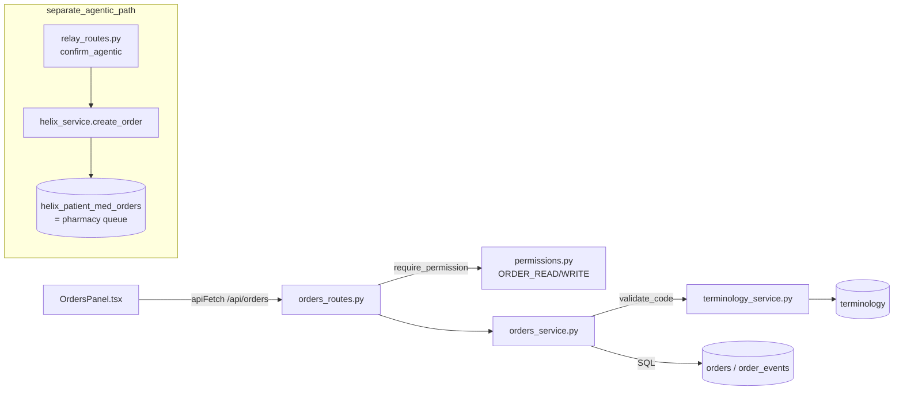
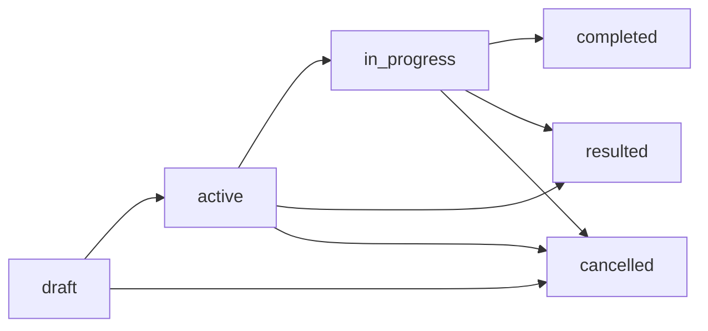
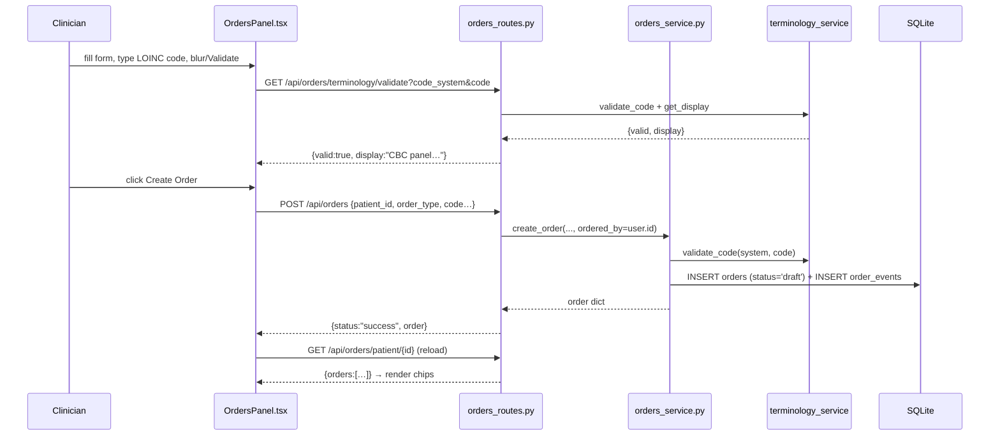

# Orders / CPOE: computerized provider order entry

**CPOE** stands for *Computerized Provider Order Entry*, the part of a hospital system where a clinician types an order ("draw a serum lactate", "start amoxicillin", "ambulate the patient three times a day") into software instead of scribbling it on paper. Orb's Orders subsystem is a deliberately small ("CPOE-lite") but disciplined implementation: a single `orders` table, a **guarded state machine** (a set of rules about which status an order may legally move to next), terminology validation on every coded order (you cannot order a lab against a code that does not exist), and a per-transition audit trail in `order_events`. This guide covers the service (`orders_service.py`), the HTTP routes (`orders_routes.py`), the React panel (`OrdersPanel.tsx`) and its styles, the two backend test suites, and the end-to-end (e2e) browser test. It also explains a *second, separate* order pathway, the "agentic" medication-order flow that `test_optimized_agentic_orders.py` pins, which does **not** touch the CPOE `orders` table at all and is the only path that actually reaches the pharmacy queue.

---

## Purpose and neighbors

**The problem.** A clinician needs to request work on a patient, a lab, an X-ray, a drug, a procedure, or a nursing task, and the request must be (a) unambiguous (coded against a standard vocabulary so downstream systems know exactly what "CBC" means), (b) auditable (who ordered it, when, and every status change since), and (c) safe against nonsense (you cannot invent a lab code, and you cannot forge an order into a "resulted" or "completed" state without passing through the states in between). This subsystem provides exactly that, and nothing more, it is intentionally *lite*: no scheduling, no billing, no drug-interaction engine.

**Jargon you need up front:**

| Term | Meaning in Orb |
|---|---|
| **CPOE** | Computerized Provider Order Entry, clinicians enter orders into software. |
| **LOINC** | *Logical Observation Identifiers Names and Codes*, the standard code system for lab tests and observations (e.g. `2524-7` = serum lactate). Orb validates lab/observation codes against a LOINC subset. |
| **SNOMED CT** | A large clinical terminology for procedures, findings and body structures (e.g. `76601001` = an intramuscular injection). Used for `procedure` orders. |
| **ICD-10** | *International Classification of Diseases, 10th revision*, diagnosis codes. Available as a code system but rarely the primary code on an order. |
| **Order set** | (Industry term.) A pre-bundled group of orders applied together, e.g. an "admit for pneumonia" set that fires a CBC + chest X-ray + antibiotic at once. **Orb does NOT implement order sets**, every order is created singly. The term is defined here only so you know what is *absent*. |
| **State machine** | A fixed table of "from status → allowed next statuses". Any transition not in the table is rejected. |
| **RBAC** | Role-Based Access Control, permissions are attached to roles (doctor, nurse, …), and each route demands a permission. See guide 03-auth-rbac. |
| **Terminology validation** | Before an order is stored, its `(code_system, code)` pair is looked up in the local `terminology` table; unknown codes are rejected. See guide 14-helix (terminology_service). |
| **Pharmacy queue** | Rows in `helix_patient_med_orders` with `status='pending'`, awaiting a pharmacist. Fed **only** by the agentic flow, not by CPOE. See guide 14-helix. |

Neighbors: **guide 02-api-client** (`apiFetch`), **guide 03-auth-rbac** (`get_current_user`, `require_permission`), **guide 14-helix** (`terminology_service`, `helix_service`, `rxnorm_reconciler`, the pharmacy queue), **guide 08-relay** (the `sage_actions` / `confirm_agentic` handlers), **guide 30-flight-recorder** (which reads `order_events` for the audit scrub view).

---

## File map

| File | Lines (approx) | Role |
|---|---|---|
| `server/services/orders_service.py` | 266 | The CPOE core: state-machine constants, `create_order`, `transition_order`, `add_result`, read helpers, and the `order_events` writer. All business rules live here. |
| `server/routes/orders_routes.py` | 400 | FastAPI router mounted at `/api/orders`; thin RBAC-guarded wrappers over the service, plus a terminology-validate endpoint for the create form. |
| `src/components/orders/OrdersPanel.tsx` | 581 | React panel: lists a patient's orders with status chips + forward/cancel/result buttons, and an inline create form with live code validation. |
| `src/components/orders/Orders.module.css` | 431 | Scoped ("CSS module") styling, dark "liquid-glass" cards, status-chip colour palette, responsive breakpoints for ward tablets. |
| `server/tests/test_orders_service.py` | 198 | Unit tests that pin the CPOE service: terminology validation, the legal/illegal/idempotent state machine, the result flow, and reads. |
| `server/tests/test_optimized_agentic_orders.py` | 482 | Integration tests for the **separate** agentic medication-order flow (reconciler + pre-flight + PIN confirm → Helix pharmacy queue). Does **not** exercise `orders_service`. |
| `e2e/03-orders-cpoe.spec.ts` | 80 | Playwright golden-journey test: a doctor logs in, opens Orders, validates a real LOINC code, submits, and sees the order appear as a `draft` chip. |

---

## How it works

### Flow A: the CPOE order lifecycle (the main flow)

This is the flow the panel, routes, service, `test_orders_service.py`, and the e2e spec all describe.

The **status machine** (`server/services/orders_service.py:32-40`):

- `resulted` is a terminal status reachable **only** from `active`/`in_progress` and **only** for `lab`/`imaging` order types (`server/services/orders_service.py:43,187-191,230-234`).
- `completed`, `resulted`, `cancelled` are terminal, no transition leaves them (`server/services/orders_service.py:36-40`).
- Every successful transition writes one `order_events` row; transitioning to the *current* status is an idempotent no-op that writes nothing (`server/services/orders_service.py:176-177`).

Numbered walkthrough (create → advance → result):

1. **Create.** The clinician fills the form in `OrdersPanel`. For coded order types (lab/imaging/medication/procedure) the form first calls `GET /api/orders/terminology/validate` and refuses to enable "Create Order" until the code returns `valid: true`, `validateCode` sets the `valid` flag (`src/components/orders/OrdersPanel.tsx:658-671`) and `canSubmit` gates the button on it (`:581-585`, button at `:730-732`). On submit it `POST`s to `/api/orders`.
2. **Server validates.** `create_order` checks the `order_type`, `priority`, and initial `status` are in their allowed sets, requires a non-empty description, and re-validates the code against `terminology` server-side (never trusting the client) (`server/services/orders_service.py:97-127`). The order is inserted at `draft` (default) and a `"order created"` event row is written.
3. **Advance.** The panel shows a `→ next` button whose target comes from `nextStatus()` (`src/components/orders/OrdersPanel.tsx:101-108`): draft→active→in_progress→completed. Clicking it `POST`s `/api/orders/{id}/transition` with `{to_status}`. The server checks legality against `LEGAL_TRANSITIONS` and writes an event.
4. **Result (labs/imaging only).** When a lab/imaging order is `active` or `in_progress`, a `+ Result` button appears. It opens a result box on the order's card and `POST`s `/api/orders/{id}/result`; the server attaches the text, stamps `result_at`, and moves the order to `resulted`. A result is written once: a different second result is refused with 409.
5. **Cancel.** Any non-terminal order shows a `Cancel` button → transition to `cancelled`.

### Flow B: the agentic medication order (separate system, feeds pharmacy)

`test_optimized_agentic_orders.py` does **not** test `orders_service`. It tests a distinct pipeline that lives in `relay_routes.py` and `helix_service.py` and writes to a *different* table. The intern must not conflate the two. Summary of Flow B (details cross-referenced to guides 08-relay and 14-helix):

1. Sage (the ambient AI, guide 09/10) proposes a medication as a `sage_actions` row with a free-text `target` like `"amoxcilin"`.
2. `GET /api/relay/channels/{chan}/sage_actions/{id}/pre_flight` (`server/routes/relay_routes.py:1096`) runs `reconcile_medication` (`server/services/rxnorm_reconciler.py:30`) to map the misspelled/ASR text to a `helix_medication_master` row using **Double Metaphone** (a phonetic hashing algorithm, words that *sound* alike get the same key) blended with **Levenshtein** edit distance, then checks stock and flags high-risk drugs.
3. `POST …/confirm_agentic` (`server/routes/relay_routes.py:1312`, body in `_confirm_agentic_action` at `:1324`) verifies the clinician's **PIN** through `pin_security.verify_pin` (`server/services/pin_security.py:62`, salted bcrypt, with constant-time verification of legacy unsalted SHA-256 hashes that are upgraded on first success). On stockout it orders nothing and answers 409 with any exact equivalent as a suggestion, unless the clinician confirms again with an override reason (`:1483-1521`). It then calls `helix_service.create_order` (`server/services/helix_service.py:246`) which `INSERT`s into `helix_patient_med_orders` with `status='pending'`, **that pending row IS the pharmacy queue**, and writes a cryptographic `delegation_hash` (`:1599-1607`) into `audit_logs`.

The only way an order reaches the pharmacy in this codebase is Flow B. The CPOE `orders` table (Flow A) has a `medication` order type and even an `'agentic'` value in its `source` column (`server/database.py:819`), but **no code path copies a CPOE order into `helix_patient_med_orders`**. See Discrepancies.

---

## Function-by-function

### File: `server/services/orders_service.py`

#### Module constants: `server/services/orders_service.py:32-46`
**Signature:** module-level dicts/sets → n/a
**Does:** Encodes the entire order rulebook as data.
**How it works:**
1. `LEGAL_TRANSITIONS` (`:32`) maps each status to the list of statuses it may move to; terminal statuses map to `[]`.
2. `TERMINAL_STATUSES` (`:40`) = `{completed, resulted, cancelled}`.
3. `RESULTABLE_ORDER_TYPES` (`:43`) = `{lab, imaging}`, only these can be `resulted`.
4. `CODELESS_ORDER_TYPES` (`:46`) = `{nursing, other}`, the only types allowed without a code.
**Why it exists:** Keeping the machine as a lookup table (not scattered `if`s) means every rule is auditable in one place and the same table drives both `transition_order` and the error messages it raises.
**Data in/out:** pure constants.
**Talks to:** read by `_is_legal_transition`, `transition_order`, `add_result`, `create_order`.
**Change guide:** To add a status like `on_hold`, add it as a key with its allowed exits *and* add it to the `LEGAL_TRANSITIONS` value list of every status that may reach it; knock-on: the DB `CHECK` constraint on `orders.status` (`server/database.py:817`) and the frontend `CHIP_CLASS` map (`src/components/orders/OrdersPanel.tsx:71-85`) and `nextStatus()` (`:89-96`) must be updated in lockstep or inserts will fail / chips will render blank.
**On screen:** these four constants are what the clinician sees as the buttons on each order card in the Orders tab, the `→ active` / `→ in progress` / `→ completed` forward button, the `+ Result` button (only for `lab`/`imaging`), and the `Cancel` button (hidden once the order is terminal). The card is rendered at `src/components/orders/OrdersPanel.tsx:343-434`.
**Gotchas:** The DB `CHECK (status IN (...))` is a *second* source of truth for the allowed status *values* (not transitions). The two can drift; keep them aligned.

#### `_now`: `server/services/orders_service.py:194`
**Signature:** `() -> str`
**Does:** Returns the current UTC time as an ISO-8601 string.
**How it works:** `datetime.now(timezone.utc).isoformat()`.
**Why it exists:** One timezone-correct timestamp helper so every write is UTC and comparable.
**Data in/out:** → e.g. `"2026-07-07T12:00:00+00:00"`.
**Talks to:** used by `_record_event`, `create_order`, `transition_order`, `add_result`.
**Gotchas:** These Python-side ISO strings are written into `created_at`/`updated_at`/`result_at`, but the DB columns also have `DEFAULT CURRENT_TIMESTAMP` (`server/database.py:823-824`) which SQLite renders as `"YYYY-MM-DD HH:MM:SS"` (space, no `+00:00`). So `order_events.created_at` (always set by `_now`) and any DB-defaulted column can differ in *format*. Not a bug today, but do not assume a single timestamp format across all order columns.

#### `_is_legal_transition`: `server/services/orders_service.py:235`
**Signature:** `(from_status, to_status) -> bool`
**Does:** True iff `to_status` is in the allowed-exit list for `from_status`.
**How it works:** `to_status in LEGAL_TRANSITIONS.get(from_status, [])`, unknown `from_status` yields `[]`, so it safely returns False.
**Why it exists:** Single predicate used by both `transition_order` and `add_result`.
**Talks to:** `LEGAL_TRANSITIONS`.
**Gotchas:** none noteworthy.

#### `_record_event`: `server/services/orders_service.py:239`
**Signature:** `(conn, order_id, prior_status, new_status, actor_id, reason) -> None`
**Does:** Inserts one audit row into `order_events`.
**How it works:** Parameterised `INSERT` (`?` placeholders, no string interpolation, so no SQL injection) with `_now()` as the timestamp.
**Why it exists:** Centralises the audit write so every state change is recorded identically. This table is what guide 30-flight-recorder reads to reconstruct an order's history.
**Data in/out:** writes `(order_id, prior_status, new_status, actor_id, reason, created_at)`.
**Talks to:** called by `create_order` (with `prior_status=None`), `transition_order`, `add_result`. Reuses the *caller's* `conn` so the event and the state change commit atomically in one `db_session()`.
**Gotchas:** It takes the open `conn` rather than opening its own, critical, because if it opened a second connection the event could commit while the status update rolled back. Do not "refactor" it to open its own session.

#### `create_order`: `server/services/orders_service.py:272`
**Signature:** `(patient_id, order_type, description, *, code=None, code_system=None, priority="routine", ordered_by=None, source="clinician", detail=None, status="draft", pre_persist_gate=None) -> dict`
**Does:** Validates and inserts a new order plus its first `order_events` row, returning the stored row as a dict.
**How it works:**
1. Reject `order_type` not in the six allowed types (`:97`) and `priority` not in `{stat, urgent, routine}` (`:99`).
2. **Reject creation into any status except `draft`/`active`** (`:106-110`). This is a deliberate safety interlock: allowing birth into `completed`/`resulted`/`in_progress`/`cancelled` would let a caller *forge the audit trail* (a lab could appear already "resulted" with no ordering event). The state machine is the only path onward. (Pinned by `test_create_order_rejects_terminal_status`, `server/tests/test_audit_fixes.py:97`.)
3. Require a non-blank `description` (`:111`).
4. **Terminology validation** (`:114-127`): if a `code` is supplied, `code_system` is mandatory and `terminology_service.validate_code` must return True, else `ValueError("Unknown …")`. If no code is supplied and the type is *not* codeless (nursing/other), reject with "requires a coded concept".
5. **Caller-supplied pre-persist gate** (`:129-133`): if the caller passed `pre_persist_gate`, it is called after every validation and immediately before the `INSERT`. The route uses this to run the medication drug-safety screen, so a blocked drug never persists and an invalid order never triggers a screen. This parameter is newer than the rest of the function; it is why the signature has a `pre_persist_gate=None` keyword.
6. Generate a UUID id, JSON-encode `detail`, `INSERT` into `orders` (uppercasing `code_system`), then `_record_event(..., prior=None, new=status, "order created")`, then re-`SELECT` and return the row.
**Why it exists:** It is the single guarded entry point for putting an order into existence; all the "can this even be an order" rules live here so no route can bypass them.
**Data in/out:** in = the kwargs above; out = a dict of the `orders` row (all columns, incl. `id`, `status`, `created_at`).
**Talks to:** `terminology_service.validate_code` (guide 14), `db_session` (guide 04-database), `_record_event`. Called by `orders_routes.create_order` and by tests.
**Change guide:** *Worked example, add a `medication` free-text option:* today `medication` is not in `CODELESS_ORDER_TYPES`, so a med order always needs a code. To allow free-text meds, add `"medication"` to `CODELESS_ORDER_TYPES` (`:46`); knock-on: the panel's `CODELESS` set (`src/components/orders/OrdersPanel.tsx:68`) must match or the form will still demand a code; watch out that you have now removed the safety guarantee that every med is coded. *Worked example, default new orders to `active`:* pass `status="active"` from the route, or change the default at `:88`; knock-on: the `order_events` "order created" row will record `new_status="active"` and the panel's first forward button will target `in_progress`.
**Gotchas:** `code_system` is stored uppercased (`:146`) but `code` is stored verbatim, LOINC codes like `2524-7` are case-neutral, but if you ever add a case-sensitive local code system, lookups will be case-sensitive on `code`. The `ValueError`s are caught by the route and turned into HTTP 400; nothing here logs, so a rejected create is silent server-side.

#### `transition_order`: `server/services/orders_service.py:421`
**Signature:** `(order_id, to_status, actor_id=None, detail=None) -> dict`
**Does:** Performs one guarded, idempotent status change and records the event.
**How it works:**
1. Reject an unknown `to_status` not in `LEGAL_TRANSITIONS` (`:245-246`).
2. Open an `IMMEDIATE` transaction (`db_session(immediate=True)`, `:248`) and load the order; `ValueError` if missing (`:249-251`).
3. **Laboratory guard (lis-7):** any move other than to `active` on an order the laboratory manages raises `OrderManagedByLab` (`:253-255`), which the route maps to 409. "Managed" means the order has `lab_order_items` rows (`is_lab_managed`, `:101`), keyed on the order and never on `ORB_LAB`. The guard runs before the idempotency rule, so a stale tab replaying the current status is refused too.
4. **Idempotency:** if already at `to_status`, return the row unchanged with no event (`:260-261`).
5. **Legality:** reject if `_is_legal_transition(current, to_status)` is False, with a message listing the allowed exits (`:264-268`).
6. **Resultable guard:** reject `to_status == "resulted"` for non-lab/imaging types (`:271-275`).
7. `UPDATE` status + `updated_at`, `_record_event`, re-select (`:277-282`). After the commit, a move to `active` hands a lab order to the laboratory through `_after_lab_activation` (`:284-285`), which does nothing unless `ORB_LAB` is on.
**Why it exists:** The one legal way to move an order forward or cancel it. Idempotency means a double-clicked button or a retried request is harmless.
**On screen:** this is the `→ active` / `→ in progress` / `→ completed` button and the `Cancel` button on an order card in the Orders tab. Pressing one calls the panel's `transition()` (`src/components/orders/OrdersPanel.tsx:181`), which re-fetches the list, so the status chip on the card changes colour a beat later.
**Data in/out:** in = ids + target status; out = updated order dict. Raises `ValueError` on unknown order / illegal transition / bad target.
**Talks to:** `db_session`, `_is_legal_transition`, `_record_event`. Called by `orders_routes.transition_order` and the panel's `transition()` (`src/components/orders/OrdersPanel.tsx:181`).
**Change guide:** To make cancellation require a reason, thread `detail` through as mandatory here and in `TransitionRequest` (`server/routes/orders_routes.py:36`); knock-on: the panel already collects an optional reason in the inline cancel-confirm row (`src/components/orders/OrdersPanel.tsx:383-411`) and passes it as `detail` via `confirmCancel` (`:162-167`), but it sends `undefined` when the field is left blank, so a mandatory `detail` would start rejecting blank-reason cancels.
**Gotchas:** The whole read-check-write sequence runs inside one `IMMEDIATE` transaction (`:248`), so the laboratory-guard read and the write cannot interleave with the laboratory taking the order in. That makes `transition_order` an outermost session: never call it from inside another write transaction. The laboratory moves its own orders with `transition_in_conn` (`:370`), which takes the caller's transaction and is called only from `lab_order_service` (pinned by `server/tests/test_lab_order_guard.py`).

#### `add_result`: `server/services/orders_service.py:509`
**Signature:** `(order_id, result_text, actor_id=None) -> dict`
**Does:** Attaches result text to a lab/imaging order and moves it to `resulted`. A result is written **once**.
**How it works:**
1. Require non-blank `result_text` (`:309-310`).
2. Open an `IMMEDIATE` transaction (`db_session(immediate=True)`, `:315`), so the "already resulted?" read and the write are one transaction and two concurrent results cannot both see `in_progress`. Load the order; `ValueError` if missing (`:316-318`).
3. **Laboratory guard (lis-7):** an order the laboratory manages refuses any free-text result with `OrderManagedByLab` (`:320-322`), whatever the text; its results arrive from the laboratory.
4. Reject non-resultable order types (`:324-328`).
5. If the order is already `resulted`: the same text again is an idempotent no-op returning the order untouched (an offline replay); different text raises `OrderAlreadyResulted` (`:73`, `:330-337`), "A result is never overwritten; chart a correction as a clinical note."
6. Otherwise, if the current status can't legally reach `resulted`, reject ("must be 'active' or 'in_progress' first") (`:338-342`).
7. `UPDATE result_text, result_at=now, status='resulted', updated_at` (`:344-348`) and write the `order_events` row (`:349`).
**Why it exists:** Results are a specialised transition that also carries a payload; bundling the payload write and the status move keeps them atomic. It used to accept an already-resulted order and overwrite the value with no event, so a stale tab could replace a lab value a clinician had already acted on (docstring at `:294-307`).
**On screen:** the `+ Result` button on a lab/imaging order card. It opens an inline result box on the card (`openResult` / `saveResult`, `src/components/orders/OrdersPanel.tsx:263`, `:269`); on success the card gains a `Result: …` line (`:419-420`) and its chip turns to `resulted`. On failure the typed text stays in the box and the reason shows above the list.
**Data in/out:** in = order id + text; out = updated order dict with `result_text`/`result_at` set.
**Talks to:** `db_session`, `_is_legal_transition`, `_record_event`. Called by `orders_routes.add_result`, which maps `OrderAlreadyResulted` and `OrderManagedByLab` to **409**.
**Gotchas:** `OrderAlreadyResulted` subclasses `ValueError`, so a caller that only catches `ValueError` still refuses (with 400 instead of 409). Orb has no amended-result workflow yet.

#### `list_orders`: `server/services/orders_service.py:792`
**Signature:** `(patient_id, status=None) -> list[dict]`
**Does:** Returns a patient's orders newest-first, optionally filtered by status.
**How it works:** Two parameterised `SELECT … ORDER BY created_at DESC` branches (with/without a `status` filter).
**Why it exists:** The list backing the panel and the `/patient/{id}` route.
**Data in/out:** out = list of order dicts.
**Talks to:** `db_session`. Called by `orders_routes.list_patient_orders`.
**Gotchas:** Ordering by `created_at DESC` relies on those timestamps being comparable strings; ISO-8601 UTC sorts lexicographically correctly, so this is fine as long as the format stays consistent.

#### `get_order`: `server/services/orders_service.py:819`
**Signature:** `(order_id) -> dict | None`
**Does:** Fetch one order or `None`.
**Talks to:** `db_session`. Called by `get_order`, `get_order_events` routes (as an existence check).
**Gotchas:** none noteworthy.

#### `get_order_events`: `server/services/orders_service.py:825`
**Signature:** `(order_id) -> list[dict]`
**Does:** Returns the order's audit trail oldest-first (`ORDER BY id ASC`).
**Why it exists:** Powers the events route and is read by guide 30-flight-recorder for the audit scrub.
**Talks to:** `db_session`.
**Gotchas:** Ordered by autoincrement `id`, not by `created_at`, correct, since `id` is monotonic and avoids ties when two events share a timestamp string.

---

### File: `server/routes/orders_routes.py`

Router prefix (`:32`): `APIRouter(prefix="/api/orders", tags=["Orders / CPOE"])`, imported at `server/main.py:75` and mounted at `server/main.py:1010` (`app.include_router(orders_router)`). So every path below is under **`/api/orders`**.

This file is bigger than this chapter's scope. Routes `:93-203` are the **order sets / protocols** surface (`/sets*`, five routes, backed by `server/services/order_sets_service.py`), which this chapter does not cover, see the Discrepancies section. Everything documented below lives at `:208` and after.

#### Request models: `server/routes/orders_routes.py:25-65`
**Does:** Pydantic (FastAPI's validation library) request bodies: `CreateOrderRequest` (`:25`), `TransitionRequest` (`:37`), `ResultRequest` (`:42`), plus the order-set bodies `OrderSetItemSelection` (`:46`) and `OrderSetApplyRequest` (`:63`).
**Why it exists:** FastAPI validates the JSON body shape/types before your handler runs; missing required fields → automatic 422.
**Data in/out:** `CreateOrderRequest` mirrors `create_order`'s public kwargs but **omits `status` and `ordered_by`**, the client cannot set either; `ordered_by` is forced to the authenticated user and `status` defaults to `draft` server-side.
**Gotchas:** Because the model omits `status`, the "cannot create into a terminal state" guard is defence-in-depth: the API can't even express it, but the service still checks (tests call the service directly).

#### `validate_terminology`: `server/routes/orders_routes.py:266` (decorator) / `:226` (`def`)
**Signature:** `GET /api/orders/terminology/validate?code_system=&code=` (perm `ORDER_READ`) → `{valid, code_system, code, display}`
**Does:** Server-side check of a `(code_system, code)` pair for the create form's live validation.
**How it works:** Calls `terminology_service.validate_code` (`:217`), and `get_display` only if valid; uppercases `code_system` in the response (`:218-223`).
**Why it exists:** Lets the form give instant ✓/✗ feedback *and* auto-fill the description with the official display name, without the user submitting first.
**On screen:** the **Validate** button and the ✓/✗ hint next to the Code field in the New Order form. A ✓ also silently fills the Description box with the official display name when it was empty.
**Talks to:** `terminology_service` (guide 14). Called by `CreateOrderForm.validateCode` (`src/components/orders/OrdersPanel.tsx:658`).
**Change guide:** This route is deliberately declared **before** `/{order_id}` (`:403`), see the comment at `:208-210`. FastAPI matches routes in declaration order; if `/{order_id}` came first, a request to `/terminology/validate` would be captured as `order_id="terminology"`. The `/sets*` routes at `:95-205` are ahead of it for exactly the same reason (comment at `:70-73`). If you reorder handlers, keep literal paths above the `{order_id}` catch-all.
**Gotchas:** Requires only `ORDER_READ`, so any read-capable role (incl. `admin`) can probe the terminology set. That is fine, it exposes no PHI.

#### `create_order` (route): `server/routes/orders_routes.py:308-263` (decorators) / `:264` (`def`)
**Signature:** `POST /api/orders` **and** `POST /api/orders/` (perm `ORDER_WRITE`) → `{status:"success", order, safety?}`
**Does:** Scopes the patient, injects `ordered_by=user["id"]`, runs the medication drug-safety screen, and calls the service.
**How it works:** Both `@router.post("")` and `@router.post("/")` decorate it (`:247-248`) so the endpoint works with or without a trailing slash. It first calls `enforce_patient_scope(user, req.patient_id)` (`:273`): the patient is named in the body, so without this a nurse on one ward could create an order on another ward's patient (probed 2026-08-07: HTTP 200, row persisted; the comment at `:258-272`); out of scope is a 404, never a 403. It reads a structured dose and route from `detail.medication` (`_structured_dose`, `:230`, `:281`) so the dose guard can run on CPOE orders that carry one. It defines a closure `_medication_safety_gate` (`:283-294`) that calls `enforce_medication_safety` (`server/services/medication_safety_gate.py`, entry point `orders.cpoe`, with the dose, route and the actor's role) and stashes the screen result in a `nonlocal safety`. That closure is handed to the service as `pre_persist_gate` **only when `order_type == "medication"`** (`:309`), so the screen runs after validation and before the row is written. `ValueError` → `HTTPException(400)` (`:316-317`). When the screen ran, its result is returned as `response["safety"]` (`:311-312`).
**Why it exists:** Keeps auth, ward scope, the drug-safety gate and error translation at the edge, and the order rulebook in the service.
**On screen:** the **Create Order** button in the New Order form. A severe allergy or interaction comes back as HTTP 428 and the panel opens `SafetyAlertModal` in blocking mode; a sub-severe screen result opens the same modal in info mode after the order was created.
**Data in/out:** in = `CreateOrderRequest`; out = `{status, order}` plus `safety` for medication orders.
**Talks to:** `require_permission(ORDER_WRITE)` (guide 03), `enforce_patient_scope`, `enforce_medication_safety`, `orders_service.create_order`, and `_shadow_clinical_action` (`:311`). Called from the panel's `CreateOrderForm`.
**Breaks if:** you move the safety closure out of `pre_persist_gate` and call it after `create_order`, a blocked medication would then already be in the `orders` table when the 428 is raised.
**Gotchas:** The user object comes from `require_permission`, which itself depends on `get_current_user`; `user["id"]` is trusted as the actor, the client never supplies the ordering clinician.

#### `_shadow_clinical_action`: `server/routes/orders_routes.py:569`
**Signature:** `(patient_id, order_type, order, user) -> None`
**Does:** Records "a clinician placed a real order through CPOE" into the shadow-mode event log, but only while a shadow episode is already open on that patient.
**How it works:** A medication order the order store manages (`managed_by_medication_order`, lifecycle on) returns at once (`:518-519`): it reaches nobody until a prescriber signs it, so `services/medorders/cpoe.after_signed` records it then, once, with the signer as the actor. Everything else is handed to the shared emitter `orders_service.record_clinical_action` (`:522-524`; `server/services/orders_service.py:640`). That emitter looks up the current episode (`shadow_service.current_episode`, `server/services/orders_service.py:655`) and returns immediately if there is none (`:656-657`). It finds the most recent `alert.fired` event on that episode and computes how many minutes after it this order landed (`:658-672`), then emits one `clinical.action` event with `action_class` of `add_medication` for medication orders and `order_<type>` otherwise (`:673-688`). Its whole body is wrapped in `except Exception: pass` (`:689-691`), **an order must never fail because the observational log did.** It takes plain values rather than the request, so an order-set item records identically to a hand-typed order.
**Why it exists:** It is the only shadow event that does not require the clinician to have touched a Sage card, so it is how "Sage proposed X and the doctor independently ordered X" becomes a measurable agreement.
**On screen:** nothing. This is instrumentation; its output surfaces in the admin Scorecard view, not in the Orders tab.
**Breaks if:** you make it open an episode when none exists. The comment at `server/routes/orders_routes.py:495-500` explains why it deliberately does not: a routine order on a quiet patient would mint an episode and flood the false-alert denominator with alert-free episodes.

#### `list_patient_orders`: `server/routes/orders_routes.py:604` (decorator) / `:526` (`def`)
**Signature:** `GET /api/orders/patient/{patient_id}?status=` → `{orders:[…]}`
**Guard:** `require_patient_access(ORDER_READ, audit_action="patient_orders_viewed")` (`:393-395`), **not** a bare `require_permission`. The dependency derives the caller's ward scope server-side, refuses a patient outside it, and writes a PHI-read audit row named `patient_orders_viewed`.
**Does:** Lists a patient's orders, optional `status` filter.
**On screen:** the order list in the Orders tab. The panel calls it from `loadOrders()` (`src/components/orders/OrdersPanel.tsx:195`) on mount and after every action.
**Talks to:** `orders_service.list_orders`.

#### `get_order` (route): `server/routes/orders_routes.py:638` (decorator) / `:559` (`def`)
**Signature:** `GET /api/orders/{order_id}` (perm `ORDER_READ`) → `{order}` or 404.
**How it works:** `_order_in_scope_or_404` (`:432`) loads the order and answers 404 "Order not found" both when it does not exist and when its patient sits outside the caller's ward (a 403 would confirm the order exists); then `log_phi_read` writes an `order_viewed` audit row (`:410-414`).
**Talks to:** `orders_service.get_order`, `department_scope`, `patient_in_scope`, `log_phi_read`.
**Gotchas:** The order id is a surrogate that hides the patient from the path guard, which is why the scope is resolved through the order. No UI caller in scope; it exists for direct API use.

#### `get_order_events` (route): `server/routes/orders_routes.py:664` (decorator) / `:578` (`def`)
**Signature:** `GET /api/orders/{order_id}/events` (perm `ORDER_READ`) → `{events:[…]}` or 404.
**How it works:** Same `_order_in_scope_or_404` check (`:421`), then returns the events and audits an `order_events_viewed` read with the event count (`:423-428`).
**Talks to:** `orders_service.get_order`, `get_order_events`, `log_phi_read`.

#### `transition_order` (route): `server/routes/orders_routes.py:796` (decorator) / `:686` (`def`)
**Signature:** `POST /api/orders/{order_id}/transition` (perm `ORDER_WRITE`) → `{status:"success", order}`
**Does:** Wrapper: ward-scopes the order (`_scope_by_order`, `:449`, `:479`), injects `actor_id=user["id"]`, calls the service, translates `ValueError`→400.
**On screen:** the `→ next` and `Cancel`/`Confirm cancel` buttons on an order card.
**Talks to:** `orders_service.transition_order`. Called by the panel's `transition()` (`src/components/orders/OrdersPanel.tsx:237`).
**Gotchas:** `_scope_by_order` is deliberately silent for an unknown order id, so that case keeps the service's existing 400; an out-of-ward order is a 404 "Order not found".

#### `add_result` (route): `server/routes/orders_routes.py:839` (decorator) / `:839` (`def`)
**Signature:** `POST /api/orders/{order_id}/result` (perm `ORDER_WRITE`) → `{status:"success", order}`
**Does:** Wrapper over `orders_service.add_result` with the same ward scope (`:495`), actor injection and error translation: `OrderAlreadyResulted` → **409** (`:503-506`; the request is well-formed, the order's state refuses it), any other `ValueError` → 400.
**On screen:** the `+ Result` button on a lab/imaging order card.
**Talks to:** `orders_service.add_result`. Called by the panel's `saveResult()` (`src/components/orders/OrdersPanel.tsx:269`).

---

### File: `src/components/orders/OrdersPanel.tsx`

Terms: a **React hook** is a function starting with `use…` that lets a component hold state (`useState`), run side effects (`useEffect`), or memoise values (`useMemo`/`useCallback`) across renders. A **prop** is an input passed to a component. **CSS module** (`styles.foo`) means class names are locally scoped so they can't clash with other components.

#### `OrdersViewSwitch`: `src/components/orders/OrdersPanel.tsx:34`
**Signature:** `({ view, onChange }) -> JSX`
**Does:** The two-button tablist at the very top of the Orders tab: **Individual orders** / **Order sets**.
**How it works:** A real `role="tablist"` with `role="tab"` buttons and `aria-selected` (`:21-36`), so a keyboard or screen-reader user can move between the two surfaces.
**On screen:** the pair of pill buttons above the "Orders" heading. Picking "Order sets" swaps the whole body for `OrderSetsPanel` (`:253-271`), which is lazily loaded (`:15`) and is **not** documented in this chapter. Coming back to "Individual orders" reloads the list (`switchView`, `:195`), so orders a protocol just placed appear.
**Breaks if:** you replace it with plain `<button>`s, the tab semantics are what make the two surfaces reachable without a mouse.

#### Module constants + `Order` interface: `src/components/orders/OrdersPanel.tsx:48-98`
**Does:** The `Order` TS interface (`:45`) mirrors the backend row; option arrays `ORDER_TYPES`/`CODE_SYSTEMS`/`PRIORITIES` (`:64-66`); `CODELESS`/`RESULTABLE` sets (`:67-68`) mirror the server's; `CHIP_CLASS` (`:70-77`) maps each status to a CSS-module chip class; `CANCEL_BTN_STYLE`/`CONFIRM_CANCEL_BTN_STYLE` (`:82-88`) give the cancel control its danger tint.
**Why it exists:** These frontend copies of server rules drive which form fields and buttons appear. They are a *duplicated source of truth*, see the change-guide warning on `create_order`.
**On screen:** `CHIP_CLASS` is the coloured status pill on the right of every order card, slate `draft`, blue `active`, amber `in progress`, green `completed`, purple `resulted`, red `cancelled`.
**Gotchas:** If the backend adds a status but `CHIP_CLASS` lacks it, the chip renders with no colour class (`|| ''` fallback at `:452`), i.e. an unstyled pill, a silent visual bug, not a crash.

#### `nextStatus`: `src/components/orders/OrdersPanel.tsx:188`
**Signature:** `(order) -> string | null`
**Does:** Returns the single "forward" status for the `→` button (draft→active→in_progress→completed), else `null`.
**How it works:** A `switch` on `order.status`; `resulted`/`cancelled`/`completed` fall through to `null` (no forward button).
**Why it exists:** Encodes the *happy-path* chain only; branching to `resulted`/`cancelled` is handled by separate buttons.
**Gotchas:** This is a **third** encoding of the transition graph (after `LEGAL_TRANSITIONS` and the DB `CHECK`). It intentionally omits `active→resulted` because that path is the `+ Result` button's job, not the forward button's.

#### `OrdersPanel` (default export): `src/components/orders/OrdersPanel.tsx:329`
**Signature:** `({ patientId?: string }) -> JSX`
**Does:** The whole panel, surface switch, patient selection, order list, action buttons, inline result entry, printing, and toggling the create form.
**How it works:**
1. State (`:106-131`): `view` (`orders` | `sets`), `patientId` (seeded from the optional prop), `orders`, `loading`, `loadError`, `showForm`, `printing`, `cancelTarget`/`cancelReason` for the inline cancel confirmation, `resultTarget`/`resultText`/`resultBusy` for the inline result box, `actionError` for a failed status change or result, and the scoped `patients` list so the form can name the patient.
2. Patient changes are adjusted **during render**, not in effects (`:142-156`): the panel follows a new `patientIdProp`, and a pending cancel confirmation, an open result box and an action error are dropped on a patient switch, so nothing on screen refers to the previous patient's order (an effect would have painted one frame of the previous patient's list under the new header).
3. `loadOrders` is a `useCallback` (`:158`), memoised so its identity only changes when `patientId` changes, that GETs `/orders/patient/{id}` via `apiFetch`, stores the result, and records `loadError` on failure. `useEffect(() => { loadOrders() }, [loadOrders])` (`:174`) refetches whenever `patientId` changes; `useDataChanged` (`:179`) refreshes the patient list after an admission elsewhere in the shell.
4. `transition` (`:200`), `askCancel`/`confirmCancel` (`:214-224`) and `openResult`/`saveResult` (`:226-251`) POST the respective endpoints then `loadOrders()` to refresh; a failure is shown in the dismissible `actionError` line above the list (`:347`), and a failed result keeps the typed text in the box so it can be saved again.
5. Render (`:276-527`): the view switch; a header with **Print** (only when the list is non-empty) and a "+ New Order" toggle; a `PatientPicker` shown only when no `patientIdProp` was passed (`:311`); the `CreateOrderForm` (keyed on the patient, so a half-written order does not survive a patient switch) when `showForm && patientId` (`:322`); then loading / load-failure / empty / list states. Each card (`:402-507`) shows description, meta (type, code, priority with `stat`/`urgent` colouring, non-clinician source), the medication notice for a medication order (`:417`, below), optional result text, the inline result box, a status chip, and context buttons (`→ next`, `+ Result` when resultable & active/in_progress, `Cancel` when non-terminal).
6. Printing renders `OrdersPrintView` into a `createPortal` on `document.body` (`:510-525`) so the print stylesheet can hide the app shell.
**Why it exists:** It is the CPOE UI. Mounted lazily at `src/pages/ClinicianShell.tsx:129` and rendered at `:809` as `<OrdersPanel />` inside a `PanelErrorBoundary`, with **no** `patientId` prop, so in the app it always renders its own patient picker.
**On screen:** three states are deliberately distinguishable and easy to confuse if you change them. "Loading orders…" (`:361`); the red **"Orders could not be loaded"** alert (`:366`), which exists so a failed fetch is never read as an empty chart; and the neutral **"No orders yet"** empty state (`:386`). A failed *refresh* on top of an already-loaded list keeps the list but adds a "showing the last successful load" banner with a Retry link (`:336`). Every medication order card, and the form when the type is medication, carries `MED_NOT_SENT` ("Not sent to the ward or pharmacy. Prescribe from the patient chart (Medications) so nurses can give it.", `src/components/orders/medicationRouting.ts:11`), because these orders never reach the drug chart, the pharmacy queue or billing (see Discrepancy 1).
**Data in/out:** in = optional `patientId`; talks HTTP via `apiFetch<{orders:Order[]}>`.
**Talks to:** `apiFetch`, `createOrder` and `getPatients` (guide 02); the backend order routes; `PatientPicker` (`src/components/common/PatientPicker.tsx`); `SafetyAlertModal`; rendered inside `ClinicianShell` at panel id `#panel-orders` (which the e2e scopes all queries to).
**Change guide:** *Worked example, auto-refresh after a colleague orders:* today the list only refreshes on your own actions. To live-update, subscribe to a socket event in a `useEffect` and call `loadOrders()` on receipt; knock-on: the backend does not currently emit any order socket event (see guide 06-realtime), so you'd add one in the service/route first.
**Breaks if:** you collapse the load-failure branch back into the empty state. The copy is explicit that a display failure is not an empty chart, merging them invites a clinician to re-enter orders that already exist.
**Gotchas:** There is **no optimistic update**, every action round-trips then refetches, so the UI is a beat behind on slow networks. Result entry used to be a browser `prompt()` that named no patient and lost the text on any slip, and errors used `alert()`; both are gone (the comments at `:120-128`).

#### `CreateOrderForm`: `src/components/orders/OrdersPanel.tsx:1074`
**Signature:** `({ patientId, patient, onCreated, onCancel }) -> JSX`
**Does:** The inline create form with live terminology validation and the medication drug-safety modal.
**How it works:**
1. Local state for `orderType`, `description`, `codeSystem`, `code`, `priority`, plus a `valid` enum (`idle|checking|valid|invalid`), `display`, `error`, `submitting`, `safetyModal` (with the id of an order already placed, for info mode) and `cancelling`/`cancelError` (`:543-559`).
2. `needsCode = !CODELESS.has(orderType)` (`:561`), hides the code fields for nursing/other.
3. `validateCode` (`:566-579`) GETs `/orders/terminology/validate`, sets `valid`, and **auto-fills `description` from the display name** if the description is empty and the code is valid (`:575`). Runs on the input's `onBlur` (`:692`) and the explicit "Validate" button (`:696`).
4. `canSubmit` is a `useMemo` (`:581-585`): needs a non-empty description, and if `needsCode`, `valid === 'valid'`.
5. `submit` (`:587`) calls `createOrder` with the collected fields (sending `code`/`code_system` as `null` when codeless). Three outcomes: a **428** means severe alerts, caught by `isSafetyAckRequired` (`:612`) and shown as a blocking `SafetyAlertModal` whose acknowledgement re-submits with a `safetyAck` (`:741`); a **200 with sub-severe alerts, or an unscreened drug,** opens the same modal in info mode *after* the order exists (`:603-606`), offering to cancel that draft through the normal transition (`cancelPlacedOrder`, `:625`); anything else closes the form via `onCreated()`.
6. Render (`:644-760`): an "Ordering for <name>, bed, ward" line so the clinician sees whose chart they are writing to (`:646-650`); order-type + priority selects; conditional code-system + code row with a Validate button and a ✓/✗ hint; description input; the medication notice; error text; Cancel/Create buttons (Create disabled until `canSubmit`); the safety modal.
**Why it exists:** Encapsulates the "don't let a clinician submit an uncoded/invalid coded order" rule at the UI edge, matching the server's guarantee.
**On screen:** the ✓ hint reads `✓ <display name>` and the ✗ hint reads `✗ unknown code` (`:702`). The Create button reads "Creating…" while `submitting`. The info-mode modal says "This order has been placed as a draft. Cancel it if you did not intend it."
**Breaks if:** you drop the `wasInfo` branch at `:751-754`. Info mode means the order was already written, so closing that modal must finish the create flow; blocking mode must leave the form up.
**Data in/out:** POST body `{patient_id, order_type, description, code, code_system, priority}` (+ `safety_ack` on an acknowledged re-submit).
**Talks to:** `apiFetch` for validate and the info-mode cancel; `createOrder` for create.
**Change guide:** *Worked example, support a `detail` payload (e.g. specimen type):* add a state field, include it in the `submit` body, and thread `detail` through `CreateOrderRequest` (`server/routes/orders_routes.py:25-35`) → `create_order`; knock-on: the route already reads a structured dose from `detail.medication` for the dose guard, and nothing else displays `detail_json` yet.
**Gotchas:** `canSubmit`'s dependency array lists `[description, needsCode, valid]` but the memo body doesn't use `code`, correct, because whether the code is valid is captured by `valid`. Changing `orderType`/`codeSystem`/`code` all reset `valid` to `'idle'` (`:658,679,691`) so a stale ✓ can't survive an edit, important, otherwise you could validate `2524-7`, change the code to garbage, and still submit.

---

### File: `src/components/orders/Orders.module.css`

**Does:** Scoped styling for the panel, 431 lines, container (`:6`), header/title/subtitle (`:19-48`), the "+ New Order" button (`:50`), the three list-placeholder states (`:74-137`), order cards with hover (`:146-201`), monospace accent code chips (`:183`), the status-chip palette, the create form (`:268-380`), and the Orders / Order sets view tabs (`:400-431`).
**Status-chip palette (`:204-246`):** each status has its own tint, `draft`=neutral glass, `active`=info blue, `in_progress`=warn amber, `completed`=ok green, `resulted`=accent, `cancelled`=danger red. Priority accents: `stat`=danger, `urgent`=warn (`:248-249`).
**The three empty-ish states are styled apart on purpose (`:74-137`):** `.loading` and `.emptyState` share a dashed neutral border, while `.errorState` (`:95-99`) is a solid danger-tinted box. A failed fetch must not look like an empty chart, see the panel's `loadError` branch.
**Responsive (`:382-398`):** at ≤768px (ward tablet) padding tightens and the header wraps; at ≤600px fields stack full-width and form actions wrap, so the panel is usable on a bedside tablet without horizontal overflow.
**Why it exists:** Gives the panel the house design-system look without a global stylesheet (CSS-module scoping prevents class collisions with e.g. the Revenue Integrity panel, which the e2e comment at `e2e/03-orders-cpoe.spec.ts:23-25` warns reuses similar labels).
**Breaks if:** you reintroduce a literal colour. Every colour in this file is now a design token (`var(--status-danger)`, `var(--text-muted)`, `color-mix(...)` over a token), that is what lets the panel follow the light/dark theme and what the contrast checker gate can reason about. An earlier version of this chapter described a hard-coded gold-on-black panel; that is no longer true of the code.

---

### File: `server/tests/test_orders_service.py`

**Role:** Pins the CPOE service contract. It is the executable spec for Flow A.

| Test | Line | What it locks in |
|---|---|---|
| `_seed` fixture | `:16` | Seeds curated terminology once per module (idempotent). |
| `patient` fixture | `:22` | Inserts a throwaway patient per test. |
| `test_seed_is_idempotent_and_counts` | `:34` | Seeding twice yields equal counts; ≥30 LOINC, ≥20 SNOMED, ≥20 ICD10. |
| `test_validate_and_display` | `:43` | `validate_code` is case-insensitive on system; `get_display` returns the real display; unknown → False/None. |
| `test_create_with_valid_code_succeeds` | `:54` | Valid code → `draft`, code stored, exactly 1 event (`new_status="draft"`). |
| `test_create_with_unknown_code_rejected` | `:71` | Unknown code raises `ValueError("Unknown")`. |
| `test_create_nursing_without_code_allowed` | `:83` | Nursing order needs no code; `code is None`. |
| `test_create_coded_type_requires_code` | `:94` | Codeless attempt on a `lab` raises "requires a coded concept". |
| `test_legal_transition_chain` | `:112` | draft→active→in_progress→completed; events list matches exactly. |
| `test_illegal_transition_rejected` | `:126` | draft→completed raises "Illegal transition". |
| `test_transition_from_terminal_rejected` | `:132` | cancelled→active raises "Illegal transition". |
| `test_idempotent_transition_is_noop` | `:139` | Re-transition to current status adds no event. |
| `test_resulted_only_for_lab_imaging` | `:149` | `procedure`→resulted raises. |
| `test_add_result_flow` | `:160` | Result attaches text + `result_at`, moves to `resulted`, last event is `resulted`. |
| `test_add_result_rejected_for_nursing` | `:172` | `add_result` on nursing raises "Cannot result". |
| `test_list_and_get` | `:182` | List all vs status-filtered; `get_order` by id; missing id → None. |

**Gotchas:** The module-scoped `_seed` fixture assumes the curated set is loadable in the test DB; these tests hit the *real* `db_session`, so they depend on `database.init_db` having created the `orders`/`order_events`/`terminology` tables.

---

### File: `server/tests/test_optimized_agentic_orders.py`

**Role, READ THIS CAREFULLY:** despite living next to the CPOE tests, this suite exercises the **agentic medication-order flow (Flow B)**, which is owned by guide 08-relay and guide 14-helix, **not** `orders_service`. It is in this guide's scope so you understand what "agentic order optimization" means and what is pinned.

Setup (`:62-178`, the `setup_agentic_order_data` autouse fixture): boots the FastAPI `TestClient`, wipes the relevant tables, seeds two doctors with PINs (`1234`, `5678`), a patient, a case-room channel, `helix_medication_master` drugs (Epinephrine=high-risk, Amoxicillin, Cefadin, a 250mg Amoxicillin left out of stock and an in-stock exact equivalent of it) and their `helix_inventory_lots`.

| Test | Line | What it pins |
|---|---|---|
| `test_formulary_reconciliation` | `:185` | `reconcile_medication` (`server/services/rxnorm_reconciler.py:30`) maps `"Amoxicillin 500mg Oral Capsule"`→`MED-AMOX` (score ≥0.95) and the phonetic misspelling `"amoxcilin"`→`MED-AMOX` (score ≥0.8). This is the **"agentic order optimization"**: cleaning up a raw/dictated drug string to a real catalog item using **Double Metaphone + Levenshtein**. |
| `test_pre_flight_checks` | `:202` | `GET …/pre_flight` resolves the med, reports `in_stock:true`, `total_quantity:20`, `is_high_risk:false`. |
| `test_pre_flight_out_of_stock_substitute` | `:227` | On stockout, pre-flight flags `in_stock:false` and offers only an exact equivalent (`MED-MOX-250`, "Same molecule, strength and form") as `alternative_suggestion`. |
| `test_pre_flight_never_suggests_a_different_molecule` | `:256` | With only a cephalosporin in stock, pre-flight suggests nothing: a different molecule is the prescriber's decision. |
| `test_stockout_confirm_suggests_and_never_changes_the_drug` / `test_stockout_confirm_with_a_reason_orders_the_drug_as_written` | `:275`, `:295` | Confirming an out-of-stock drug answers 409 `out_of_stock` with the suggestion and orders nothing; with an override reason it orders the drug confirmed and records `out_of_stock_override`. |
| `test_confirm_standard_medication_success` | `:335` | `POST …/confirm_agentic` with the right PIN returns `order_id`, `correlation_id`, `delegation_hash`; the `sage_actions` row flips to `confirmed`; an order lands in `helix_patient_med_orders` (`medication_id=MED-AMOX`); and an immutable `audit_logs` row (`event_category='clinical_safety'`, `action_type='agentic_med_confirm'`) contains the delegation hash. |
| `test_confirm_high_risk_medication_requires_and_accepts_safety_ack` | `:389` | A high-alert drug (Epinephrine) is **refused with HTTP 428** (`error: "drug_safety_acknowledgement_required"`) until an acknowledged reason is supplied; with the ack it dispatches on a **single** doctor PIN, no co-signer required. |
| `test_tbd_dose_without_dose_confirmation_is_422` | `:413` | An agentic order carries no machine-resolved dose; dispatching without `dose_confirmation` is a 422. |
| `test_wrong_pin_five_times_locks_out` | `:436` | PIN rate limiting via `pin_security`. |
| `test_null_pin_hash_fails_closed_with_distinct_error` | `:454` | A user with no PIN set cannot dispatch, and the error is distinguishable from a wrong PIN. |
| `test_pin_provisioning_endpoint_enables_confirmation` | `:470` | The admin PIN-provisioning route makes a previously PIN-less doctor able to confirm. |
| `test_legacy_sha256_pin_upgraded_to_bcrypt_on_success` | `:521` | A legacy unsalted SHA-256 PIN hash still verifies and is silently upgraded to bcrypt. |

**Safety interlocks this suite pins (agentic path only):**
- **PIN gating**, `pin_security.verify_pin` (`server/services/pin_security.py:62`): salted bcrypt, constant-time, rate-limited by `is_pin_locked`/`record_pin_failure`, called from `_confirm_agentic_action` at `server/routes/relay_routes.py:1346-1402`.
- **Optional co-signature**, when `co_signer_id` is supplied it must prove possession of its own PIN (`server/routes/relay_routes.py:1404-1450`), so a co-signer recorded in the audit chain is always an attestation that actually happened. It is never *required*.
- **Stock check, never a silent switch**, the order is always for the drug the clinician confirmed: out of stock with no override reason is a 409 that orders nothing and names any in-stock exact equivalent as a suggestion; with a reason the drug is ordered as written for pharmacy to source (`server/routes/relay_routes.py:1483-1521`).
- **High-risk gate**, a hard-coded set `{epinephrine, heparin, insulin, potassium, tpa, morphine, fentanyl, oxycodone, hydromorphone, opioid}` (`server/routes/relay_routes.py:1474-1477`, and again in pre-flight at `:1141`) marks the order high-risk. Since the drug-safety gate landed, high-risk **does block**: `if is_high_risk and not ack_ok` raises 428 at `server/routes/relay_routes.py:1573-1582`, requiring an acknowledged reason on top of the PIN.
- **Universal drug-safety screen**, every agentic dispatch runs `enforce_medication_safety` (`server/routes/relay_routes.py:1559-1570`), the same allergy + interaction screen the CPOE create route uses.
- **Cryptographic delegation hash**, `sha256(source_msg_id : llm_prompt_signature : sha256(actor:pin_hash_at_signing))` chains the LLM suggestion to the human sign-off in `audit_logs` (`server/routes/relay_routes.py:1599-1607`).

**Note on the module docstring.** `:1-9` still advertises "High-risk double-doctor sign-off". The code does not require a second doctor, it requires a single doctor's PIN plus an explicit safety acknowledgement, which is what the test at `:389` asserts and what the handler docstring at `server/routes/relay_routes.py:1333-1336` states. The test-module docstring is the stale one. See Discrepancies.

---

### File: `e2e/03-orders-cpoe.spec.ts`

**Role:** The Playwright golden-journey for Flow A, run against a live frontend+backend.
**Walkthrough:**
1. `login(page, 'doctor')` then `openTab(page, 'orders')` (`:20-21`, helpers in guide 21-e2e).
2. Scope **all** queries to `#panel-orders` (`:26`) because every panel is mounted at once with `display` toggled (`src/pages/ClinicianShell.tsx:784`), so unscoped queries would hit hidden panels' identical placeholders (Playwright "strict mode" would then throw).
3. Assert the "Orders" heading is visible (`:29`).
4. Fetch a real patient id by calling `GET /api/vigil/patients` through `page.request` (`:37-41`). Auth is the **HttpOnly `orb_session` cookie** set at login, the JWT is deliberately no longer in `localStorage` (XSS-exfiltration hardening), and `page.request` shares the browser context's cookie jar, so no `Authorization` header is needed. Seed ids are random (`PAT-*`) so they can't be hard-coded.
5. Fill the Patient ID input, open the form, type the real LOINC code `58410-2` (`:17`), click **Validate** (`:55`), and wait for a ✓ (`:59`), driving the *real* terminology validation, not a mock.
6. Ensure a description exists, submit (`:70`), and assert the new order appears with its description, a `draft` chip, and the rendered `LOINC 58410-2` code (`:73-79`).
**Why it exists:** Proves the full stack, auth, RBAC, terminology validation, create, list render, works together in a browser.
**Gotchas:** The `✓` assertion has a 15s timeout because it waits on a real backend round-trip. The test depends on `terminology_service.seed_terminology()` having run at backend startup (`server/main.py:265-266`) so `58410-2` exists.
**Known drift, verify before relying on this spec.** The spec still selects the patient field with `getByPlaceholder('e.g. PAT001')` (`:44`). The panel replaced that free-text input with `PatientPicker`, whose search box is placeholdered `Search by name, bed or MRN` (`src/components/common/PatientPicker.tsx:105`). The spec and the component disagree; the spec was not updated when the picker landed.

---

## Cross-subsystem contracts

**REST routes owned by this subsystem** (prefix `/api/orders`, imported `server/main.py:75`, mounted `server/main.py:704`):

| Method | Path | Guard | Handler | Request | Response |
|---|---|---|---|---|---|
| GET | `/api/orders/sets` | `require_permission("order.read")` | `:94` | n/a | order-set catalogue *(not covered in this chapter)* |
| GET | `/api/orders/sets/{set_id}` | `require_permission("order.read")` | `:109` | n/a | one order set |
| POST | `/api/orders/sets/{set_id}/preview` | `require_permission("order.read")` | `:119` | `OrderSetApplyRequest` | dry-run of the protocol |
| POST | `/api/orders/sets/{set_id}/apply` | `require_permission("order.write")` | `:151` | `OrderSetApplyRequest` | orders created from the protocol |
| GET | `/api/orders/sets/applications/{patient_id}` | `require_patient_access("order.read")` | `:196` | n/a | `{applications:[…]}` |
| GET | `/api/orders/terminology/validate` | `require_permission("order.read")` | `:211` | query `code_system`, `code` | `{valid, code_system, code, display}` |
| POST | `/api/orders` (and `/api/orders/`) | `require_permission("order.write")` | `:231` | `CreateOrderRequest` | `{status:"success", order, safety?}` / 400 / 428 |
| GET | `/api/orders/patient/{patient_id}` | `require_patient_access("order.read", audit_action="patient_orders_viewed")` | `:347` | query `status?` | `{orders:[…]}` |
| GET | `/api/orders/{order_id}` | `require_permission("order.read")` | `:359` | n/a | `{order}` / 404 |
| GET | `/api/orders/{order_id}/events` | `require_permission("order.read")` | `:367` | n/a | `{events:[…]}` / 404 |
| POST | `/api/orders/{order_id}/transition` | `require_permission("order.write")` | `:374` | `{to_status, detail?}` | `{status:"success", order}` / 400 |
| POST | `/api/orders/{order_id}/result` | `require_permission("order.write")` | `:389` | `{result_text}` | `{status:"success", order}` / 400 |

Handler line numbers are the `@router.…` decorator line in `server/routes/orders_routes.py`, which is where the method and path are declared.

**DB tables owned:** `orders` (`server/database.py:795`) and `order_events` (`server/database.py:814`). Reads `terminology` (owned by guide 14-helix). **Does not** own or write `helix_patient_med_orders`.

**Exported service functions other code relies on:** `orders_service.create_order / transition_order / add_result / list_orders / get_order / get_order_events`. `get_order_events` and the `order_events` table are consumed by `flight_recorder_service` (guide 30) as a non-hash-chained event source (`server/services/flight_recorder_service.py:270-305`, where `chain_ok` is set to `None` at `:305` precisely because `order_events` is not hash-chained).

**Socket events:** none. This subsystem emits and listens to **no** socket.io events; the panel refreshes by re-fetching after each action.

**RBAC contract:** `doctor` and `nurse` have both `ORDER_READ` and `ORDER_WRITE` (`server/permissions.py:113`, `:128`); `admin` has `ORDER_READ` only (`:149`); `clinician` is aliased to `doctor` at `server/permissions.py:166`; `pharmacist` and `patient` have neither. The permission strings themselves are defined at `server/permissions.py:80-81`. Pinned by `test_orders_routes_reject_patient_role` (`server/tests/test_audit_fixes.py:64`): patient role → 403, doctor → 200.

**Agentic-path contract (NOT owned here, cross-referenced):** `GET/POST /api/relay/channels/{chan}/sage_actions/{id}/pre_flight|confirm_agentic` (guide 08-relay), `helix_service.create_order` → `helix_patient_med_orders(status='pending')` = the pharmacy queue (guide 14-helix), `rxnorm_reconciler.reconcile_medication` (guide 14-helix).

---

## Rebuild notes

**Prerequisites (must already exist):**
1. The database layer with `db_session()` and `init_db()` creating `patients`, `users`, `orders`, `order_events`, `terminology` (guide 04-database).
2. Auth + RBAC: `get_current_user`, `require_permission`, and the `ORDER_READ`/`ORDER_WRITE` permissions on the clinical roles (guide 03-auth-rbac).
3. `terminology_service` with `validate_code`, `get_display`, `seed_terminology`, and the curated seed, called at startup (guide 14-helix; `server/main.py:265-266`).
4. The frontend `apiFetch` client and a shell to mount the panel into (guides 02, 20).

**Build order:**
1. **Schema**, `orders` + `order_events` tables with the `CHECK` constraints on `order_type`/`priority`/`status`.
2. **Service**, port the state-machine constants, then `create_order` (with terminology validation + the "draft/active only" birth guard), `transition_order`, `add_result`, and the read helpers. Write `_record_event` to reuse the caller's connection.
3. **Routes**, the `/api/orders` router, declaring `/terminology/validate` **before** `/{order_id}`, each guarded by `require_permission`, injecting `user["id"]` as actor, translating `ValueError`→400.
4. **Panel**, `OrdersPanel` (list + actions) and `CreateOrderForm` (live validation gating submit), styled via the CSS module; mount it in the clinician shell at `#panel-orders`.
5. **Tests**, port `test_orders_service.py` and the e2e spec.

**Acceptance check:** With the backend seeded, you can: log in as a doctor, open Orders, type a patient id, create a `lab` order coded `LOINC 58410-2` (the form shows ✓ and auto-fills "CBC panel…"), see it appear as a **draft** chip, click `→ active` then `→ in_progress`, click `+ Result`, enter text, and watch the chip turn **resulted**, while `GET /api/orders/{id}/events` returns four rows (`draft, active, in_progress, resulted`). Attempting `draft → completed` returns HTTP 400 "Illegal transition", and creating a lab with code `9999-9` returns HTTP 400 "Unknown LOINC code". `pytest server/tests/test_orders_service.py` passes.

---

## Discrepancies and open questions

1. **CPOE orders never reach the pharmacy.** The `orders` table supports `order_type='medication'` and even a `source='agentic'` value (`server/database.py:819`), but **no code path copies a CPOE order into `helix_patient_med_orders`** (the pharmacy queue). The pharmacy queue is populated *only* by the agentic/relay flow via `helix_service.create_order`. So a medication ordered through `OrdersPanel` is recorded and audited but is invisible to the pharmacist workflow. Either this is intentional separation (CPOE = general order tracking, Helix = dispensing) or an integration gap; the code does not bridge them.

2. **The agentic test module's docstring still claims "double-doctor sign-off"; the code requires something else.** `server/tests/test_optimized_agentic_orders.py:1-9` lists "High-risk double-doctor sign-off". What the code actually enforces for a high-alert drug is a *single* doctor's PIN **plus** an explicit `safety_ack` with a reason, 428 otherwise (`server/routes/relay_routes.py:1571-1582`), asserted by `test_confirm_high_risk_medication_requires_and_accepts_safety_ack` (`server/tests/test_optimized_agentic_orders.py:389`). A co-signer is genuinely optional, but when one is supplied it is now really verified against its own PIN (`server/routes/relay_routes.py:1404-1450`), so the `co_signer_id` sealed into the audit chain is an attestation that happened. The remaining defect is the stale test-module docstring, not the behaviour. *(An earlier edition of this chapter said the co-sign fields were "recorded but not required and never checked", that was true before the drug-safety gate landed and is no longer true.)*

3. **Re-resulting no longer overwrites; there is still no amended-result workflow.** `add_result` used to run its `UPDATE` unconditionally and write an `order_events` row only when the status moved, so a second call replaced `result_text`/`result_at` with no trace. It now writes a result once: the same text again is a no-op and different text raises `OrderAlreadyResulted`, a 409 at the route (`server/services/orders_service.py:236-243`, `server/routes/orders_routes.py:503-506`). The open question is the clinical one: a corrected result can only be charted as a note, and an amended result arguably should be a first-class, audited event.

4. **Per-patient authorization is now in place on every CPOE route.** `GET /api/orders/patient/{patient_id}` uses `require_patient_access(ORDER_READ, audit_action="patient_orders_viewed")` (`server/routes/orders_routes.py:393-395`), as does `GET /api/orders/sets/applications/{patient_id}` (`:198-200`). `POST /api/orders` scopes the body-named patient (`enforce_patient_scope`, `:273`). The **order-id** routes resolve the order's patient first: `GET /api/orders/{order_id}` (`:401`) and `GET /api/orders/{order_id}/events` (`:418`) go through `_order_in_scope_or_404` (`:432`) and audit the read, and `POST …/transition` (`:476`) and `POST …/result` (`:492`) go through `_scope_by_order` (`:449`); out of ward is a 404 "Order not found" in every case. The RBAC test (`server/tests/test_audit_fixes.py:91`) covers role-level denial. *(Earlier editions of this chapter said the order-id routes were unscoped; that was true before these guards landed.)*

5. **Rule of three, the transition graph is encoded three times.** `LEGAL_TRANSITIONS` (`server/services/orders_service.py:32`), the DB `CHECK (status IN …)` (`server/database.py:817`), and the frontend `nextStatus`/`CHIP_CLASS` (`src/components/orders/OrdersPanel.tsx:99`, `:71`) must be edited together. There is no shared source; drift here produces silent failures (unstyled chips) or 500s (constraint violations).

6. **`_now()` ISO strings vs SQLite `CURRENT_TIMESTAMP`.** Columns written by Python get `+00:00` ISO strings; columns filled by the DB default get space-separated timestamps (`server/services/orders_service.py:57` vs `server/database.py:823-824`). No current bug, but timestamp formats are not uniform across order columns, a trap for any future code that parses them assuming one format.

7. **Order sets are undocumented here.** Five live routes (`/api/orders/sets*`, `server/routes/orders_routes.py:93-203`), a 1,182-line service (`server/services/order_sets_service.py`), a catalogue file (`server/site_config/order_sets.json`), a migration-created table (`order_set_applications`) and a whole second UI surface (`src/components/orders/OrderSetsPanel.tsx`, reachable from the "Order sets" tab at the top of the Orders panel) sit inside this subsystem's router and are not covered by this chapter.
