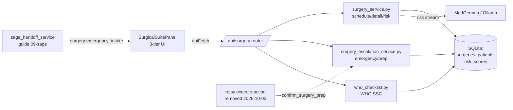

# Surgical Suite: theatre scheduling, WHO checklist, escalation

The Surgical Suite is Orb's operating-theatre cockpit. It answers three questions for a surgeon or OR (operating room) nurse: *what am I operating on this week*, *what does this specific case need* (patient context, risk, checklist, instruments, team), and *is there an emergency barging into the schedule right now*. It is built as a **three-tier drill-down** on the frontend (Week → Day → Case) plus a parallel **Active Cases / emergency** workflow, backed by a small FastAPI router (`/api/surgery`) over three service files: a read/query service (`surgery_service.py`), an emergency-escalation service (`surgery_escalation_service.py`), and the canonical **WHO Surgical Safety Checklist** (`who_checklist.py`). This guide teaches every unit in that subsystem, warns you where the demo shortcuts diverge from the honest clinical story, and lists the exact contracts other subsystems depend on.

---

## Purpose and neighbors

A hospital's surgical list is a scheduling problem wrapped around a safety problem. Orb's Surgical Suite exists to:

1. **Render the theatre board**, surgeries grouped by day, each tagged with the patient's latest AI risk level, so a surgeon sees their week at a glance.
2. **Assemble a per-case "package"**, the patient's clinical handoff context (medications, vitals, labs, scribe notes imported from the Medicine side), a streamed **MedGemma** (Orb's local medical LLM) risk assessment, possible complications, the surgical checklist, instruments, and the assigned team.
3. **Drive the WHO Surgical Safety Checklist**, the 2009 global standard (Sign In / Time Out / Sign Out) that measurably reduces surgical deaths. Orb persists per-item completion with *who* checked it and *when*, as an audit trail.
4. **Absorb emergencies**, when a case is escalated (e.g. from a Relay chat or a patient transfer), it appears as an *emergency intake*, gets an AI-generated prep package, and flows through team-alerting → confirmation → start → complete.

Jargon you need up front:
- **RBAC** (Role-Based Access Control): every route is gated by a permission string like `surgery.read` / `surgery.write`; the role→permission map lives in the auth subsystem (see guide 03-auth-rbac).
- **SSE** (Server-Sent Events): a one-way HTTP stream where the server pushes `data: …` lines; Orb uses it to stream the risk assessment token-by-token.
- **Socket room**: a named group of socket.io connections; a global emit (no room) reaches every authenticated browser (see guide 06-realtime).
- **Raw SQL / SQLite**: there is no ORM. Every query is hand-written SQL executed through a `db_session()` context manager (see guide 04-database-schema).



Neighbors: **02-api-client** (the `apiFetch`/SSE plumbing the panel calls), **03-auth-rbac** (`require_permission`), **04-database-schema** (the `surgeries` and related tables), **06-realtime** (the `surgery:emergency_intake` socket event and `message:new` team alerts), **08-relay** (the ambient action card that *confirms* a prep and the `dept-surgery` channel alerts), **09-sage** (the handoff service that actually emits emergency intakes and fabricates the transfer package), **11-scribe** (`save_scribe_note`, used by "complete surgery").

---

## File map

| File | Lines (approx) | Role |
|---|---|---|
| `server/services/surgery_service.py` | 366 | Read queries (weekly schedule, full case detail), the streamed MedGemma risk assessment, and the "prep for surgery" Relay-alert orchestrator. |
| `server/services/surgery_escalation_service.py` | 360 | Emergency workflow: draft a prep request, idempotently confirm it into an emergency surgery row, generate the (demo-hardcoded) prep package, list & acknowledge the emergency queue. |
| `server/services/who_checklist.py` | 177 | The canonical WHO Surgical Safety Checklist template + concurrency-safe per-item check/uncheck persistence. |
| `server/routes/surgery_routes.py` | 688 | The `/api/surgery` FastAPI router: schedule, cases, detail, checklist, team alert/response, start/complete, prep, emergency acknowledge, risk SSE. |
| `src/pages/panels/SurgicalSuitePanel.tsx` | 1267 | The whole client: 3-tier drill-down, Active Cases view, emergency banner, Tier-3 case detail with progressive hydration, prep button, risk rendering. |
| `src/pages/panels/SurgicalSuitePanel.css` | 1246 | All styling for the panel (liquid-glass cards, tiers, risk section, gauges, light-mode overrides). |
| `src/pages/SurgicalSuite.css` | 12 | Tiny leftover: forces the header back-button SVG to a fixed size. Almost vestigial. |
| `src/components/surgery/EmergencyIntakePopup.tsx` | 74 | Modal shown when an emergency intake socket event arrives: Acknowledge / Open Case. |
| `src/components/surgery/EmergencyIntakePopup.module.css` | 165 | Styling for that popup (red-urgency glass modal). |
| ~~`SurgeryActionCard.tsx/.module.css`, `SurgeryReviewSheet.tsx/.module.css`~~ | n/a | **Removed in the 2026-07-10 consolidation.** These were the orphaned chat-driven escalation cards described in Discrepancy #1 below, never imported anywhere. The server half of that path (`surgery_prep_requests`, `create_surgery_prep_request`) still exists; see Discrepancy #1. |

---

## How it works

### Flow A: the everyday schedule drill-down (client-only tier state)

1. `SurgicalSuitePanel` mounts and fires three loads: `loadSchedule()` (14 days), `loadEmergencyQueue()`, `loadCases()` (`src/pages/panels/SurgicalSuitePanel.tsx:160-163`).
2. **Tier 1 (Week):** `getSurgerySchedule(14)` → `GET /api/surgery/schedule?days=14` → `get_surgery_schedule` returns one object per calendar day (including empty days) with the day's surgeries and each surgery's latest `risk_level`. Cards render in a horizontally-scrolling week strip.
3. Clicking a day sets `tier=2` after a 450 ms expand animation (`handleDayClick`, `:217`). **Tier 2 (Day)** is a vertical timeline of that day's surgeries; no new fetch, it reuses the schedule already in memory.
4. Clicking a surgery calls `handleSurgeryClick` (`:266`) → `getSurgeryDetail(id)` → `GET /api/surgery/{id}` → the full case object. If the case's `ai_package_status` is a failure sentinel, a "Feature under development" popup shows instead; otherwise `tier=3`.
5. **Tier 3 (Case)** renders the dense detail grid: patient bar with comorbidities + allergies, clinical handoff context, streamed risk assessment, complications, team, checklist, instruments. On entering Tier 3, if the case is still `emergency_context_generating` / `emergency_pending`, a 3-second poll re-fetches until the package is ready (`:135`).

### Flow B: emergency intake and the escalation lifecycle (spans client + server + Sage)

The **escalation service** in this guide owns the *middle* of the lifecycle. The *trigger* (drafting) and the *socket broadcast* live in neighboring subsystems, which is important to understand precisely because the wiring is partial.

```mermaid
sequenceDiagram
    participant Sage as Sage/handoff (guide 09)
    participant Relay as Relay execute-action (guide 08)
    participant Esc as surgery_escalation_service
    participant DB as SQLite (surgeries)
    participant WS as socket.io
    participant Panel as SurgicalSuitePanel

    Note over Relay,Esc: Path 1, action-card confirm (no caller since the execute route was removed, 2026-10-03)
    Relay->>Esc: confirm_surgery_prep(prep_id, idemp_key)
    Esc->>DB: INSERT surgeries (status=emergency_pending)
    Esc->>DB: mark prep_request resolved
    Relay->>Esc: generate_surgical_prep_package_async(surgery_id, prep_id)  (background)
    Esc->>DB: status=emergency_context_generating → emergency_ready (shared PREP_PACKAGE template)

    Note over Sage,Panel: Path 2, handoff/transfer (the one that actually notifies the UI)
    Sage->>DB: create emergency surgery
    Sage->>WS: emit surgery:emergency_intake {surgery_id}  (global)
    WS-->>Panel: surgery:emergency_intake
    Panel->>Panel: loadEmergencyQueue(); open EmergencyIntakePopup
    Panel->>Esc: acknowledgeEmergency → status=emergency_acknowledged
```

Key subtlety: **`surgery_escalation_service.generate_surgical_prep_package_async` never emits a socket event.** The only code that emits `surgery:emergency_intake` is `sage_handoff_service` (`server/services/sage_handoff_service.py:700`, `:730`). So a case created purely through the escalation service's confirm path becomes ready silently, and the panel only discovers it via its 10-second fallback poll or the Tier-3 hydration poll, not push. The two "emergency package generators" (`generate_surgical_prep_package_async` here, and `generate_transfer_surgery_package_async` in Sage) now write the same honest template (`PREP_PACKAGE`, `server/services/surgery_escalation_service.py:187`) but still differ in notification behavior. Path 1 itself has had no production caller since `POST /api/relay/actions/{message_id}/execute` was removed on 2026-10-03 (`server/routes/relay_routes.py:949-954`); only tests call `confirm_surgery_prep` now. See Discrepancies.

### Flow C: Active Cases: alert → confirm → start → complete

1. In Tier 1, the **Active Cases** tab calls `getSurgeryCases()` → `GET /api/surgery/cases`, which returns non-terminal surgeries each with a `team` array from `surgery_team_assignments`.
2. **Alert Team** button → `alertSurgicalTeam(id, [...])` → `POST /api/surgery/{id}/alert-team`: writes assignment rows (status `alerted`), posts `surgical_alert` messages into the patient's case room, live-emits them to the case channel and each target user's personal room, and flips the surgery to `emergency_ready`.
3. Each targeted member confirms/declines via `POST /api/surgery/{id}/team-response`. A decline triggers a hardcoded Sage "re-route" suggestion for the anaesthetist demo.
4. **Start Surgery** is gated: `POST /api/surgery/{id}/start` only succeeds when there are zero `alerted` and at least one `confirmed` assignment; sets `in_progress`.
5. **Complete Surgery** → `POST /api/surgery/{id}/complete`: idempotent, writes a post-op Scribe note (illustrative in demo mode, factual stub otherwise), sets `completed` (which removes it from `/cases`).

---

## Function-by-function

### File: `server/services/surgery_service.py`

#### get_weekly_schedule: `server/services/surgery_service.py:10`
**Signature:** `(surgeon_id: str, days: int = 14) -> list`
**Does:** Returns a surgeon's upcoming surgeries grouped by date, each enriched with the patient's latest risk score.
**How it works:**
1. Computes `today` (UTC date) and `end_date = today + days` (`:12`).
2. Runs one SQL join: `surgeries s` → `patients p`, plus a `LEFT JOIN risk_scores rs` correlated to the *latest* risk row per patient (`rs.timestamp = (SELECT MAX(...))`), filtered by `surgeon_id` and the date window, ordered by date then time (`:16`).
3. Groups rows into a dict keyed by `scheduled_date`, building a `day_label` from Python's `weekday()` and an `is_today` flag (`:36`).
4. Appends a trimmed surgery dict per row, defaulting `risk_level` to `"stable"` when there is no risk row (`:60`).
**Why it exists:** The panel's Tier 1/2 needs a compact, risk-tagged board without the heavy per-case fields.
**Data in/out:** In: a surgeon id. Out: `[{date, day_label, is_today, surgeries: [{id, patient_name, procedure_name, risk_level, success_probability, ...}]}]`.
**Talks to:** Reads `surgeries`, `patients`, `risk_scores`. **Note:** this function is *not* what the HTTP `/schedule` route calls, the route has its own inline query (see `get_surgery_schedule` route below). So `get_weekly_schedule` is effectively unused by the live path; treat it as legacy.
**Change guide:** To widen the board window, callers pass `days`; but the *route* ignores this function, so changing it here has no UI effect, change `get_surgery_schedule` in `server/routes/surgery_routes.py:68` instead.
**Gotchas:** The correlated-subquery "latest risk" pattern repeats verbatim in three places; if you change the risk-scoring table you must fix all of them. Date comparison is string-based on ISO dates (`today.isoformat()`), which only works because `YYYY-MM-DD` sorts lexicographically.

#### get_surgery_detail: `server/services/surgery_service.py:68`
**Signature:** `(surgery_id: str) -> dict | None`
**Does:** Returns the full clinical package for one surgery, including imported Medicine-side context.
**How it works:**
1. Single joined SELECT (surgery + patient + latest risk) by id (`:71`); returns `None` if missing.
2. `_parse_json` inner helper (`:89`) safely decodes the JSON-in-TEXT columns (`co_morbidities`, `surgical_checklist`, `instruments_required`, `staff_required`, `possible_complications`, `risk_drivers`), returning `[]` on any decode error.
3. Calls `_assemble_patient_context(db, patient_id)` from `sage_service` (`:97`) to build the cross-department **handoff context** (meds/vitals/labs/scribe notes).
4. Returns a flat dict merging surgery fields, patient demographics, parsed JSON arrays, and `imported_context`.
**Why it exists:** Tier 3 needs everything in one call.
**Data in/out:** Out: the `SurgeryFull` shape mirrored in the panel's TypeScript interface (`src/pages/panels/SurgicalSuitePanel.tsx:35`).
**Talks to:** `services.sage_service._assemble_patient_context` (guide 09-sage). Called by `generate_risk_assessment` and `trigger_surgery_prep` in this file. **Not** the function the `/{surgery_id}` route uses, the route re-implements detail with a slightly different query (comorbidities from `patient_profiles`, allergies). So there are *two* detail assemblers with divergent field logic.
**Change guide:** To add a field to Tier 3, you must add it in the *route* handler (`server/routes/surgery_routes.py:162`), not here, because the route is what the client hits.
**Gotchas:** Importing `_assemble_patient_context` inside the function (not at top) is deliberate to avoid a circular import with `sage_service`. The parsed `co_morbidities` here can differ from the route's, which prefers the `surgeries.co_morbidities` snapshot then falls back to `patient_profiles.comorbidities`.

#### generate_risk_assessment: `server/services/surgery_service.py:140`
**Signature:** `async (surgery_id: str, detail: dict | None = None) -> async generator of SSE strings`
**Does:** Streams a structured pre-operative risk assessment from MedGemma as SSE `data:` chunks; falls back to a static assessment if the LLM is unreachable.
**How it works:**
1. Uses the caller's `detail` if supplied, else loads it; if still missing, yields one `{'error': ...}` SSE frame and returns (`:154`). The optional `detail` argument exists so the route can load the case off the event loop and hand it in, rather than making this generator do blocking DB work.
2. Builds a fixed clinical prompt (ASA class, surgical risk score, anaesthetic considerations, etc.) from the patient's data (`:158`).
3. Acquires a slot on the shared `llm_queue` at `priority=2` (`:191`) so risk assessments yield to higher-priority LLM work, then streams `POST {OLLAMA_BASE_URL}/api/chat` (`:196`) with `stream: True` and `keep_alive` from config (`:202`).
4. For each JSON line from Ollama, extracts `message.content` and yields it as `data: {"content": text}` (`:212`).
5. On **any** exception (`:218`), yields a hand-written fallback assessment string (ASA III, computed risk from `success_probability`) (`:222-231`).
6. Always yields a final `data: [DONE]` (`:233`).
**Why it exists:** This is the *real* AI path in the subsystem, genuine local-LLM inference, unlike the hardcoded package generators.
**On screen:** the Risk Assessment pane in the Tier-3 case detail. Text arrives token by token; the panel renders numbered `N.` lines and `key:` headings specially.
**Data in/out:** Out: SSE frames consumed by `getSurgeryRiskAssessment` (`src/api/client.ts:1699`), which concatenates `content` deltas into the growing risk text.
**Talks to:** `config.OLLAMA_BASE_URL`, `config.OLLAMA_KEEP_ALIVE`, `services.llm_queue_service.llm_queue` (the global LLM concurrency gate, see guide 09-sage / LLM plumbing). Called by the `/{surgery_id}/risk` route.
**Change guide:** To change what the risk panel asks for, edit the prompt block at `:158`; keep the numbered/`key:` structure or the panel's formatting breaks. To make risk assessments preempt other LLM jobs, lower the `priority` number at `:191`.
**Gotchas:** `llm_queue.release()` (`:216`) sits in a `finally` after a successful `acquire`, so a failure to acquire won't double-release. The fallback branch swallows the real exception (no logging), so an offline Ollama looks identical to a genuine bug. `success_probability` is referenced **only inside the fallback branch** (`:222`, `:228`), not the happy LLM path. `.get('success_probability', 95)` returns its default only when the key is *absent*, a stored `None` value is returned as-is, so `None < 85` (`:222`) would raise `TypeError` while building the fallback string, and that error is *not* re-caught (the `except` is already executing). Likewise `.get('success_probability', 'N/A')` (`:228`) renders a stored `None` as `None%`, not `N/A`.

#### trigger_surgery_prep: `server/services/surgery_service.py:255`
**Signature:** `(surgery_id, sender_id, sender_name, sender_role) -> dict`
**Does:** Fires a structured "PREP FOR SURGERY" alert to the assigned team via Relay, de-duplicated within a 4-hour window.
**How it works:**
1. Loads detail; raises `ValueError` if missing.
2. Resolves recipients: first from explicit `surgery_team_assignments` rows, else from `staff_required[].id`, else a narrow role fallback (`:269` and following).
3. Builds a structured alert payload with `"type": "surgery_prep"` (`:299`), procedure, OR, time, risk, targets, `urgency: "critical"` (`:314`), title, action.
4. Dedup check (`:319-331`): scans the last 4 hours of `alert` messages in `dept-surgery`; if a `surgery_prep` alert for this surgery already exists, returns `{"status": "duplicate"}`.
5. Sends the alert to `dept-surgery` (departmental visibility, `:336`) and best-effort to the patient's case room (`:346-355`).
**Why it exists:** Wires the Tier-3 "Prep for Surgery" button (previously a 404) to the existing Relay messaging service.
**On screen:** a red critical alert card in the Surgery department channel in Messages (Relay), and the same card in the patient's case room.
**Data in/out:** Out: the `send_message` result for the dept channel, or a `duplicate` marker.
**Talks to:** `services.relay_service.send_message` (guide 08-relay). Reads `surgery_team_assignments`, `messages`. Called by the `/{surgery_id}/prep` route.
**Change guide:** To broaden who gets alerted, change the target resolution at `:269`; watch out that the role fallback is intentionally narrow (`get_user_alerts` only matches when role *and* department match) to avoid a hospital-wide broadcast. To change the dedup window, edit the `'-4 hours'` literal at `:324`.
**Gotchas:** Two separate `db_session()` blocks (assignments lookup, then dedup), a race between them is harmless here. The case-room send looks the channel id up rather than deriving it (`:346`) and is wrapped in a bare `except: pass` because the case channel may not exist.

---

### File: `server/services/surgery_escalation_service.py`

#### create_surgery_prep_request: `server/services/surgery_escalation_service.py:27`
**Signature:** `(patient_id, channel_id, requested_by, requested_by_name, procedure_name, indication, urgency, clinical_context) -> {id, idempotency_key}`
**Does:** Inserts a `drafted` prep-request row (the audit origin of an escalation) and returns its id + a time-based idempotency key.
**How it works:** Builds the `idempotency_key` (`:43`), inserts one row with `state='drafted'` (`:49`), reads back `last_insert_rowid()` (`:54`).
**Why it exists:** It is meant to be the *first* step of an escalation, Sage/Relay drafts a prep request, a clinician later confirms it. It writes the row that `confirm_surgery_prep` and `generate_surgical_prep_package_async` later read.
**Data in/out:** Out: `{id, idempotency_key}` intended to be embedded in a `SurgeryActionCard` payload's `params`.
**Talks to:** Writes `surgery_prep_requests`. **Nothing calls it**, see Discrepancies. This is the only `INSERT` into that table anywhere in the server, so if it's never invoked, `confirm_surgery_prep` has no row to confirm.
**Change guide:** If you wire the drafting UI, call this from the Sage code that emits the "prep_surgery" action card, and stash `id`/`idempotency_key` into the card params the frontend later posts back.
**Gotchas:** `idempotency_key` uses second-granularity timestamps; two drafts in the same channel within one second collide on the `UNIQUE` constraint and the second INSERT throws.

#### _resolve_emergency_surgeon: `server/services/surgery_escalation_service.py:64`
**Signature:** `(db, patient_id: str, confirmed_by: str) -> str`
**Does:** Picks which doctor owns a new emergency case, in descending order of correctness: the patient's attending doctor, then the clinician who confirmed the prep, then any doctor on the system.
**How it works:** Reads `patients.attending_doctor_id` (`:75`), checks each candidate really exists in `users` with a doctor role (`:82`), and falls back to the lowest-id doctor with a logged warning (`:89-97`). If there is no doctor account at all it raises `ValueError` (`:99-102`).
**Why it exists:** Every candidate is checked against `users` so the value can satisfy the `surgeries.surgeon_id` foreign key. Raising `ValueError` turns a missing-surgeon situation into a clean 4xx at the route instead of letting an `IntegrityError` escape as a 500.
**Breaks if:** you skip the existence check. This function replaced a hardcoded `"DOC004"` literal, that literal produced FK violations on any deployment that did not happen to have a user with that id.

#### confirm_surgery_prep: `server/services/surgery_escalation_service.py:106`
**Signature:** `(prep_id: int, confirmed_by, confirmed_by_name, idempotency_key) -> {surgery_id, status}`
**Does:** Idempotently turns a drafted prep request into an emergency surgery row.
**How it works:**
1. Idempotency check: if a row with this `idempotency_key` is already `resolved` and has a `surgery_id`, returns it with `status="already_created"` (`:119-125`).
2. Loads the prep row (raises if missing) and the patient (`:128-132`).
3. Chooses a `surgery_id`: **only when `DEMO_MODE` is on** and the patient is `PAT007`, reuses the seeded `SURG-ALEX-EM` if present (`:142-145`); otherwise always a random `surg_<hex>`.
4. Dates the case on the hospital calendar (`hospital_now`, `:151-154`), assigns the surgeon via `_resolve_emergency_surgeon` (`:161`), then for non-seeded ids inserts a `surgeries` row with `status='emergency_pending'`, OR `'OR-E (Emergency)'`, 120-min duration (`:163-169`).
5. Marks the prep request `resolved` with `surgery_id`, `resolved_by`, `resolved_at` (`:171-177`).
**Why it exists:** Separates "someone suggested surgery" from "a real OR case now exists", with replay-safety so a double-click can't create two cases.
**On screen:** a new red card in the emergency banner at the top of the Surgical Suite panel, in `emergency_pending` state.
**Data in/out:** Out: `{surgery_id, status: "created" | "already_created"}`.
**Talks to:** Reads/writes `surgery_prep_requests`, `patients`, `surgeries`. It was called by the Relay execute-action handler's `prep_surgery` branch; that route was removed on 2026-10-03, so only tests call it now.
**Change guide:** To route emergencies to a dedicated theatre, change `"OR-E (Emergency)"` at `:168`, the Tier-1 "Active Rooms" stat counts distinct `operating_room` values, so this changes analytics too.
**Gotchas:** The `PAT007`/`SURG-ALEX-EM` special-case is demo scaffolding. It is now gated on `DEMO_MODE` (`:142`), the comment at `:137-140` explains why: ungated, a real hospital that happened to mint the patient id `PAT007` would have its emergency case silently redirected into a seeded demo row. `resolved_at` is set via SQL `CURRENT_TIMESTAMP` (naive UTC, `YYYY-MM-DD HH:MM:SS`, no timezone marker), unlike the timezone-aware ISO8601 timestamps elsewhere, a format inconsistency.

#### _finalize_surgery: `server/services/surgery_escalation_service.py:214`
**Signature:** `(surgery_id: str, data: dict, ai_status: str, reason: str = "") -> None`
**Does:** Writes the whole prep package onto the surgery row and flips its status to `emergency_ready`.
**How it works:** Builds `notes_payload = {"ai_package_status": ai_status}` (`:225`) then one `UPDATE surgeries SET …` (`:232`) covering every package column.
**Why it exists:** Blocking DB work, kept at module scope rather than nested inside the async task so it can be handed to `run_db` and never run on the event loop (docstring at `:217`).
**Breaks if:** you call it directly from async code. It must go through `run_db`.

#### _mark_generating: `server/services/surgery_escalation_service.py:257`
**Signature:** `(surgery_id: str, prep_id: int) -> row`
**Does:** Sets the case to `emergency_context_generating` and reads back the prep request's clinical context in the same transaction (`:266-268`).
**Breaks if:** you split the `UPDATE` and the `SELECT` into two sessions, the docstring at `:260` is explicit that they stay in one.

#### generate_surgical_prep_package_async: `server/services/surgery_escalation_service.py:274`
**Signature:** `async (surgery_id: str, prep_id: int) -> None`
**Does:** Background task that writes the prep package and moves the case to `emergency_ready`, always within 60 s.
**How it works:**
1. The inner `_do_generation` (`:285`) calls `run_db(_mark_generating, …)` (`:290`) to set `emergency_context_generating`, then `run_db(_finalize_surgery, surgery_id, PREP_PACKAGE, "template")` (`:291`). No model is called and there is no simulated wait.
2. `PREP_PACKAGE` (`:187-204`) is generic prep content that makes no claim about this patient: risk text "Pre-operative risk assessment pending clinical review.", standard complications, a six-step checklist, a standard tray, `success_probability` `None`, and staff rows reading "Assigned on arrival". Until 2026-10-02 this path stored a fixed "ASA IV, septic shock, 72.5% success" package with invented clinicians on every real case (comment at `:181-186`).
3. The whole `_do_generation` runs under `asyncio.wait_for(..., timeout=60)` (`:296`); on any exception it finalizes with `FALLBACK_DATA` (`:208-211`, the same content with "Assessment unavailable" as the risk text) and `ai_status="failed"` (`:299`).
**Why it exists:** Guarantees the Tier-3 case never shows blank panels: the checklist and prep list are there the moment the case opens.
**On screen:** the emergency card moves from "pending" to a "generating" state and then to `emergency_ready`, at which point the risk/checklist/instruments/team panes fill in.
**Data in/out:** Writes `risk_assessment`, `possible_complications`, `success_probability`, `surgical_checklist`, `instruments_required`, `staff_required`, `notes` (with `ai_package_status`), `status` on the surgery row.
**Talks to:** `run_db` for every DB touch. It was scheduled via `background_tasks.add_task(...)` from the Relay execute-action handler, removed on 2026-10-03; it has no production caller now.
**Change guide:** If MedGemma enrichment returns, the comment at `:286-289` says it belongs on the ambient tier, not the model serving interactive Sage, and its output must be marked as such; keep the `_finalize_surgery` contract so the UI's `ai_package_status` logic still works.
**Gotchas:** It writes `ai_status="template"`, which the panel badges "Standard template" (`src/pages/panels/SurgicalSuitePanel.tsx:992`, which treats the older `generated` value the same way), never "AI Generated". It **does not emit any socket event**, so the panel is not pushed the completion, it relies on polling.

#### get_emergency_queue: `server/services/surgery_escalation_service.py:302`
**Signature:** `() -> list`
**Does:** Returns all surgeries whose status starts with `emergency_`, with patient joins and parsed JSON fields.
**How it works:** `SELECT ... WHERE s.status LIKE 'emergency_%' ORDER BY created_at DESC` (`:305-310`), then per-row parses the JSON columns (logging a warning on bad JSON).
**Why it exists:** A service-level emergency listing.
**Data in/out:** Out: list of surgery dicts.
**Talks to:** Reads `surgeries`, `patients`. **Not used by the live route**, the `/emergency-queue` route has its own inline query with a *different* filter (`status IN ('emergency_pending','emergency_ready','emergency_context_generating')`, excluding `emergency_acknowledged`). So `LIKE 'emergency_%'` here would still show acknowledged cases; the route would not. This function is effectively dead.
**Change guide:** If you unify queue logic, delete this and call the route's query, or vice-versa, but pick one, because they disagree on acknowledged cases.
**Gotchas:** The two disagreeing definitions are a real bug surface: acknowledging an emergency removes it from the *route* queue but not from this function's.

#### acknowledge_emergency: `server/services/surgery_escalation_service.py:329`
**Signature:** `(surgery_id: str) -> None`
**Does:** Sets a surgery's status to `emergency_acknowledged`.
**How it works:** One `UPDATE surgeries SET status='emergency_acknowledged'` (`:331`).
**Why it exists:** Lets a clinician mark "I've seen this emergency" from the intake popup.
**On screen:** the red emergency card disappears from the banner at the top of the Surgical Suite panel.
**Talks to:** Writes `surgeries`. Called by the `/emergency/{id}/acknowledge` route.
**Change guide:** To keep acknowledged cases in the emergency banner, add `emergency_acknowledged` to the route's `IN (...)` filter inside `get_emergency_queue` (`server/routes/surgery_routes.py:268`).
**Gotchas:** Because the route's queue filter excludes `emergency_acknowledged`, acknowledging makes the case vanish from the emergency banner, which may or may not be the intended UX.

---

### File: `server/services/who_checklist.py`

Background you must define once: the **WHO Surgical Safety Checklist (2009)** is a 19-item, three-phase verbal checklist proven to cut surgical mortality. The phases are **Sign In** (before anaesthesia induction, identity, site marking, allergy, airway, pulse oximeter), **Time Out** (before skin incision, team introductions, antibiotic prophylaxis, critical-event review), and **Sign Out** (before leaving the OR, instrument/sponge/needle counts, specimen labelling, recovery concerns). Orb ships the canonical template and records each tick with the actor and timestamp.

#### WHO_CHECKLIST (constant): `server/services/who_checklist.py:25`
**Does:** The canonical template: `{version, phases:[{id, label, when, items:[{id, text}]}]}` with the three phases and their items. `TEMPLATE_VERSION = "who-ssc-2009"` (`:22`) stamps the version so a completed checklist records which template it was filled against.
**Data in/out:** Static dict. `_ALL_ITEM_IDS` (`:71`) is the flattened set of every item id, used to validate incoming ids and compute `total`.
**Change guide:** To add/retire an item, edit `WHO_CHECKLIST` *and bump* `TEMPLATE_VERSION`; because completion state is keyed by item id and matched against `TEMPLATE_VERSION`, an old completed row will be treated as empty WHO state after a version bump (additive, non-destructive).
**Gotchas:** There is a **template-key mismatch**: the stored payload uses the key `template` (`set_item` writes `{"template": TEMPLATE_VERSION, ...}`), but the returned template dict uses the key `version`. `get_checklist_state` correctly reads `parsed.get("template")`, so persistence is internally consistent, just don't confuse the two keys.

#### get_template: `server/services/who_checklist.py:78`
**Signature:** `() -> dict`, returns `WHO_CHECKLIST`. Served verbatim by `GET /api/surgery/checklist/template`.

#### get_checklist_state: `server/services/who_checklist.py:87`
**Signature:** `(surgery_id: str) -> dict`
**Does:** Returns persisted completion for a surgery: `{version, state:{item_id:{checked,by,at}}, progress:{checked,total}, completed}`.
**How it works:** Reads `surgeries.surgical_checklist`; if it parses to a dict whose `template == TEMPLATE_VERSION`, uses its `state`, else treats it as empty (legacy/non-WHO data is ignored, not destroyed) (`:100`). Counts checked items vs `len(_ALL_ITEM_IDS)`.
**Data in/out:** Out includes `completed = (checked == total)` and returns `{"error":"not_found"}` if the surgery row is missing.
**Talks to:** Reads `surgeries`. Called by `set_item` (to return fresh state) and the `GET /{id}/checklist` route.
**Gotchas:** `total` is the count of *all* items across all phases (19), so `completed` requires every phase ticked. A legacy plain-list checklist (older code stored `surgical_checklist` as a plain array of strings) reports `progress: {checked:0, total:19}`, it is not migrated, just shown as empty.

#### set_item: `server/services/who_checklist.py:119`
**Signature:** `(surgery_id, item_id, checked: bool, actor_id) -> dict`
**Does:** Checks/unchecks one WHO item and persists it, concurrency-safely; returns the fresh state.
**How it works:**
1. Rejects unknown `item_id` with `ValueError` (`:132`).
2. Opens a **raw connection** (`get_db()`), disables autocommit (`isolation_level = None`), and runs `BEGIN IMMEDIATE` so the read-modify-write is serialized against other writers (`:138`).
3. Reads current `surgical_checklist`; builds `payload={template, state}`, preserving any prior WHO payload or carrying legacy non-WHO data under `payload['legacy']` (`:148`).
4. If `checked`, writes `state[item_id]={checked:True, by:actor_id, at:_now()}`; if unchecked, pops the key (`:160`).
5. `UPDATE` and `COMMIT`; on any error, `ROLLBACK`; always `conn.close()` (`:164`).
**Why it exists:** The previous version read on one connection and wrote on another, so two team members ticking different items concurrently lost one update. `BEGIN IMMEDIATE` acquires the write lock at transaction start, preventing the lost-update race.
**Data in/out:** In: item id + bool + actor. Out: the same shape as `get_checklist_state`.
**Talks to:** Reads/writes `surgeries.surgical_checklist`. Called by `POST /{id}/checklist`.
**Change guide:** To record a free-text note per tick, extend the `{checked, by, at}` object at `:161`; `get_checklist_state` passes `state` through untouched so the extra field survives. Worked example: to enforce phase order (no Time Out ticks before Sign In complete), add a guard here that inspects `payload['state']` before allowing the write.
**Gotchas:** It uses `_now()` = UTC ISO8601, consistent with the rest of the file. The manual transaction bypasses the `db_session()` helper, so if you add triggers/hooks to `db_session`, they won't fire here. `unchecked` removes the record entirely (no "unchecked by" audit), only *positive* checks are audited.

---

### File: `server/routes/surgery_routes.py`

The router is mounted with `prefix="/api/surgery"` (`:17`), imported at `server/main.py:60` and included at `server/main.py:690` (`app.include_router(surgery_router)`), so every path below is prefixed with `/api/surgery`. Read routes require `surgery.read`; mutations require `surgery.write`. **Every route in this file is now permission-gated**, an earlier edition of this chapter said `team-response` only needed a logged-in user; it now requires `surgery.read` (`:405`).

Two module-level constants set the state machine at the edge: `_STARTABLE_STATUSES` (`:24`) and the completable set (`:28`).

#### _audit_surgery: `server/routes/surgery_routes.py:36`
**Signature:** `(request, user, action_type, surgery_id, summary, patient_id, metadata) -> None`
**Does:** One audit helper every surgical mutation calls, so a case's start / complete / team-alert / prep history lands on the hash-chained audit trail with a consistent shape.
**On screen:** these rows are what the admin Flight Recorder (guide 25) shows when you scrub a surgical case.
**Breaks if:** you add a new mutation route and forget to call it, the action happens with no audit row, and Flight Recorder shows a gap.

#### get_surgery_schedule: `server/routes/surgery_routes.py:67` (decorator) / `:68` (`def`)
**Signature:** `GET /api/surgery/schedule?days=7` (perm `surgery.read`) → `list[{date, day_label, surgeries[]}]`
**Does:** The board query the panel actually uses. Joins surgery+patient+surgeon+latest-risk over `scheduled_date BETWEEN today AND today+days`, groups by date, and emits one entry per day **including empty days** (`:104-114`).
**Why it exists:** Tier 1/2 need a dense, gap-filled week even for days with no surgeries.
**On screen:** the week strip at the top of the Surgical Suite, one column per day, empty days included so the week never collapses.
**Data in/out:** Out: `dict(r)` per surgery with `risk_level` defaulted to `"stable"` (`:101`).
**Talks to:** Reads `surgeries`, `patients`, `users`, `risk_scores`. Called by `getSurgerySchedule` in `src/api/client.ts`.
**Gotchas:** Uses `BETWEEN today AND end_date` (inclusive both ends) whereas the service-level `get_weekly_schedule` uses `< end_date`, an off-by-one day difference between the two board queries.

#### get_emergency_queue (route): `server/routes/surgery_routes.py:267` (decorator) / `:268` (`def`)
**Signature:** `GET /api/surgery/emergency-queue` (perm `surgery.read`) → `list[surgery dict]`
**Does:** Returns surgeries in `('emergency_pending','emergency_ready','emergency_context_generating')` (`:278`). Drives the red emergency banner.
**Gotchas:** Deliberately excludes `emergency_acknowledged` (so acknowledging clears the banner), diverges from the service-level `get_emergency_queue`'s `LIKE 'emergency_%'`.

#### get_surgery_cases: `server/routes/surgery_routes.py:131` (decorator) / `:132` (`def`)
**Signature:** `GET /api/surgery/cases` (perm `surgery.read`) → `list[surgery dict + team[]]`
**Does:** All non-terminal cases (`status NOT IN ('completed','cancelled')`), each augmented with its `surgery_team_assignments` rows under `team`.
**How it works:** One query for cases, one batched `IN (...)` query for all their assignments (`:144-151`), then stitches `team` per case in Python (`:153-158`).
**On screen:** the Active Cases tab. Each card's team avatars come from the stitched `team` array.
**Talks to:** Reads `surgeries`, `patients`, `surgery_team_assignments`. Called by `getSurgeryCases` in `src/api/client.ts`.
**Gotchas:** The `IN (?, ?, …)` placeholder list is built from case ids (safe, parameterized). If there are zero cases it skips the assignments query.

#### get_surgery_detail (route): `server/routes/surgery_routes.py:161` (decorator) / `:162` (`def`)
**Signature:** `GET /api/surgery/{surgery_id}` (perm `surgery.read`) → full case dict (404 if missing)
**Does:** The Tier-3 detail the client uses. Joins surgery+patient+`patient_profiles`+surgeon+latest-risk (`:167`).
**How it works:**
1. 404 if not found (`:181`).
2. **Comorbidities** (`:188-201`): prefers the `surgeries.co_morbidities` snapshot, skipping empties and the placeholder literal `"Reviewing context..."` (`:190`), falling back to `patient_profiles.comorbidities`; parses JSON or comma-splits.
3. **Allergies** (`:203-213`): parses `patient_profiles.allergies` into a list for the pre-op safety banner.
4. Parses the four JSON array columns; parses `notes` for an embedded `imported_context` (`:221`).
**Why it exists:** The panel's `SurgeryFull` shape; the allergy surfacing is an explicit safety requirement, the comment at `:204` says surgeons must see drug allergies before an emergency case.
**On screen:** the whole Tier-3 case detail, including the amber allergy banner above the procedure.
**Talks to:** Reads `surgeries`, `patients`, `patient_profiles`, `users`, `risk_scores`. Called by `getSurgeryDetail` in `src/api/client.ts`.
**Change guide:** To add a Tier-3 field, add it to this SELECT and the parsing block, then to the `SurgeryFull` TS interface in `src/pages/panels/SurgicalSuitePanel.tsx`.
**Gotchas:** This is the second, divergent detail assembler (the service `get_surgery_detail` is the other). They must be kept in sync manually. `imported_context` here comes from `notes` JSON, whereas the service version computes it live via `_assemble_patient_context`, different sources.

#### who_checklist_template: `server/routes/surgery_routes.py:236` (decorator) / `:237` (`def`)
`GET /api/surgery/checklist/template` (perm `surgery.read`) → the WHO template dict (`get_template`).

#### get_who_checklist: `server/routes/surgery_routes.py:243` (decorator) / `:244` (`def`)
`GET /api/surgery/{surgery_id}/checklist` (perm `surgery.read`) → `get_checklist_state`, 404 on `not_found`.

#### set_who_checklist_item: `server/routes/surgery_routes.py:253` (decorator) / `:254` (`def`)
**Signature:** `POST /api/surgery/{surgery_id}/checklist` (perm `surgery.write`) body `{item_id, checked}` → fresh state
**Does:** Validates `item_id` present (422 if not), calls `set_item(surgery_id, item_id, checked, user["id"])`, maps `ValueError` → 400.
**On screen:** each tick box in the Sign In / Time Out / Sign Out checklist. The progress counter above the list re-renders from the returned `progress`.
**Gotchas:** `checked` defaults to `True` if omitted (`bool(payload.get("checked", True))`), a body with only `item_id` *checks* the item.

#### _persist_alerts: `server/routes/surgery_routes.py:280`
**Signature:** `(surgery_id, team) -> rows`
**Does:** The blocking half of `alert_surgical_team`, split out so the async handler can run it off the event loop and then do the awaited socket emits.
**How it works:** Deletes existing assignments for this surgery (`:333`), re-inserts the new set, writes one `surgical_alert` message per member (`:355`), and sets the surgery to `emergency_ready` (`:364`).

#### alert_surgical_team: `server/routes/surgery_routes.py:368` (decorator) / `:369` (`def`)
**Signature:** `POST /api/surgery/{surgery_id}/alert-team` (perm `surgery.write`) body `{team:[{user_id, role}]}` → `{status:"success"}`
**Does:** Assigns a team and live-alerts each member.
**How it works:** Validates the payload, runs `_persist_alerts` for all the DB work, then emits `message:new` to the case-room channel (`:398`) **and** to each `user:{target_user_id}` personal room (`:400`), targeted, not department-wide.
**Why it exists:** Turns "these people are on this case" into real-time targeted notifications.
**On screen:** each alerted clinician sees a `surgical_alert` card appear in Messages without refreshing, with Confirm / Decline buttons.
**Talks to:** Writes `surgery_team_assignments`, `messages`; reads `channels`; emits via `ws.realtime.sio` (guide 06-realtime). Called by `alertSurgicalTeam` in `src/api/client.ts`.
**Change guide:** To alert without wiping prior confirmations, remove the `DELETE` at `:333` and upsert instead; watch out, re-alerting currently resets everyone to `alerted`, which is why the Start gate re-blocks.
**Breaks if:** you move the DB writes back inline into the `async def`. They are in `_persist_alerts` specifically so the event loop is not blocked while the roster is written.

#### surgical_team_response: `server/routes/surgery_routes.py:403` (decorator) / `:404` (`def`)
**Signature:** `POST /api/surgery/{surgery_id}/team-response` (perm `surgery.read`) body `{action:"confirm"|"decline"}` → `{status:"success"}`
**Does:** Records a member's confirm/decline; on decline in demo mode, injects a scripted Sage re-route suggestion.
**How it works:** Finds the caller's assignment (400 if not assigned), sets status `confirmed`/`declined`, posts a system message to the case room. The `anesthetist_1 → anesthetist_2` fallback (`:450-456`) inserts a fresh `alerted` assignment plus a "SAGE SUGGESTION" `surgical_alert` message (`:477`).
**Why it exists:** Closes the alert loop and demonstrates AI-assisted staffing recovery.
**On screen:** the Confirm / Decline buttons on a `surgical_alert` card in Messages.
**Talks to:** `require_permission("surgery.read")`. Writes `surgery_team_assignments`, `messages`. Called by `surgicalTeamResponse` in `src/api/client.ts`.
**Gotchas:** The `anesthetist_1 → anesthetist_2` fallback is scripted demo logic, not a real availability lookup, which is why it is now gated on `DEMO_MODE` (`:455-456`), with the comment at `:450` saying a live ward never sees it. Beyond the permission gate, the assignment lookup is what stops a non-assigned clinician acting.

#### start_surgery: `server/routes/surgery_routes.py:488` (decorator) / `:489` (`def`)
**Signature:** `POST /api/surgery/{surgery_id}/start` (perm `surgery.write`) → `{status:"success"}` / `already_in_progress` / 400 / 404 / 409
**Does:** Moves to `in_progress` only if every assigned member has responded and at least one confirmed.
**How it works:**
1. Reads the surgery row; 404 if missing (`:497-499`). The comment at `:492-495` explains why: a blind `UPDATE` on an unknown id changed zero rows and still returned success, and it could also drag a `completed` case back to `in_progress`.
2. `already_in_progress` short-circuit (`:500-501`); 409 if the status is not in `_STARTABLE_STATUSES` (`:502-506`).
3. Counts `outstanding = status in ("alerted", "pending")` and `confirmed` (`:514-515`), then blocks if `len(outstanding) > 0 or len(confirmed) == 0` (`:517-518`).
4. Sets `in_progress` and writes an audit row (`:520-527`).
**On screen:** the **Start Surgery** button in the Tier-3 case detail. Blocked attempts surface the message "Cannot start surgery until all assigned team members have confirmed."
**Breaks if:** you drop `"pending"` from the `outstanding` set. `pending` is the schema DEFAULT for `surgery_team_assignments`, so a roster written with the default status would let a case start with nobody having actually confirmed, the comment at `:510-513` records exactly this bug.
**Gotchas:** A team that all declined (0 outstanding, 0 confirmed) is blocked. But one confirmed + one declined is allowed to start, even if the declined role was critical, no per-role requirement is enforced.

#### complete_surgery: `server/routes/surgery_routes.py:530` (decorator) / `:531` (`def`)
**Signature:** `POST /api/surgery/{surgery_id}/complete` (perm `surgery.write`) → `{status, note_id}`
**Does:** Marks completed (idempotent) and writes a post-op Scribe note.
**How it works:** 404 if missing; returns `already_completed` if already done, with no second note (`:541`); sets `completed`; builds a note, an illustrative operative narrative in `DEMO_MODE`, else a factual "pending" stub (`:548-549`), and calls `save_scribe_note(...)` (`:571`) **after** the `db_session` block has closed.
**Why it exists:** Removes the case from the active queue (which filters out `completed`) and leaves a documentation trail.
**On screen:** the case leaves the Active Cases tab, and a new post-op note appears under Scribe for that patient.
**Talks to:** `services.scribe_service.save_scribe_note` (guide 11-scribe). Reads/writes `surgeries`; `config.DEMO_MODE`. Called by `completeSurgery` in `src/api/client.ts`.
**Breaks if:** you move the `save_scribe_note` call back inside the `db_session` block. The comments at `:558` and `:566` explain the trap: `save_scribe_note` opens its own session, and because the route returns `already_completed` on every retry, a failure there would mean the note could never be written.
**Gotchas:** In demo mode it fabricates operative details (blood loss, "no complications"), the code comment explicitly warns a real deployment must not do this. `ai_generated=DEMO_MODE` (`:577`) tags the note truthfully.

#### prep_for_surgery: `server/routes/surgery_routes.py:605` (decorator) / `:606` (`def`)
`POST /api/surgery/{surgery_id}/prep` → calls `trigger_surgery_prep(...)`; returns `{status:"success", ...}`. Requires `surgery.write` (**not** the `surgery.prep` permission, which is defined but unused, see Discrepancies).

#### acknowledge_emergency_surgery: `server/routes/surgery_routes.py:631` (decorator) / `:632` (`def`)
`POST /api/surgery/emergency/{surgery_id}/acknowledge` (perm `surgery.write`) → `acknowledge_emergency(...)`; `{status:"success", surgery_id}`.

#### surgery_risk_assessment: `server/routes/surgery_routes.py:665` (decorator) / `:666` (`def`)
**Signature:** `GET /api/surgery/{surgery_id}/risk` (perm `surgery.read`) → `StreamingResponse` (SSE)
**Does:** Loads the case detail off the event loop via `_load_risk_detail` (`:685`), hands it to `generate_risk_assessment`, and streams the result as `text/event-stream` with `Cache-Control: no-cache` and `X-Accel-Buffering: no` (`:681`) so a reverse proxy cannot buffer the tokens.
**On screen:** the Risk Assessment pane filling in word by word.
**Talks to:** `generate_risk_assessment` (this guide). Called by `getSurgeryRiskAssessment` (`src/api/client.ts:1699`).
**Breaks if:** you drop `X-Accel-Buffering: no`. Behind nginx the whole assessment arrives at once at the end, and the pane looks frozen.

---

### File: `src/pages/panels/SurgicalSuitePanel.tsx`

This one file is the entire client. It is lazy-loaded and error-boundaried in the clinician shell (`src/pages/ClinicianShell.tsx:290`, rendered at `:792`).

**Pure helpers (module scope):** `formatTime` (`:69`, 24h→12h AM/PM), `formatDuration` (`:76`, mins→"1h 30m"), `riskColor` (`:82`, maps `critical`/`elevated`/else to danger/warn/ok CSS vars), `formatDate` (`:88`, `en-IN` month-short + day, e.g. "7 Jul"). None noteworthy except `formatDate` parses `dateStr + 'T00:00:00'` as **local** time to avoid the UTC-midnight-rolls-back-a-day trap.

#### SurgicalSuitePanel: `src/pages/panels/SurgicalSuitePanel.tsx:94`
**Signature:** `() -> JSX` (default export, no props)
**Does:** Holds all state and renders the three tiers + Active Cases + emergency overlays.
**State map (`:95`–`:123`):** `schedule`, `emergencyQueue`, `intakePopupData`, `activeView` (`'schedule'|'cases'`), `activeCases`, `tier` (1|2|3), `selectedDayIdx`, `selectedSurgery`, risk streaming (`riskText`, `riskLoading`, `riskExpanded`), prep (`prepLoading`, `prepSuccess`), `showDevPopup`, and `animState` for the drill animations.
**Key nested logic:**

- **getAiPackageStatus** (`:126`): parses `surgery.notes` JSON and returns `ai_package_status`. This single value branches: `'generated'` → green "AI Generated" badge; `'fallback'|'failed'|'timeout'` → shows the "Feature under development" popup on click and a "Fallback" badge.
- **Tier-3 hydration effect** (`:135`): while `tier===3` and the case is `emergency_context_generating`/`emergency_pending`, polls `getSurgeryDetail` every 3 s and stops when the status settles. This is how the async package appears without a socket push.
- **Mount effect** (`:156`): initial loads; subscribes to `socket.on('surgery:emergency_intake', …)` which re-loads the queue/cases and opens the intake popup; installs a 10 s fallback poll; cleans up both on unmount. **This is the subsystem's realtime entry point** (event defined in guide 06-realtime, emitted by Sage handoff).
- **loadCases / loadEmergencyQueue / loadSchedule** (`:182`,`:194`,`:204`): thin fetch wrappers with loading/error state.
- **handleDayClick** (`:217`) / **handleBackToWeek** (`:227`): tier 1↔2 with timed animation classes.
- **loadRiskAssessment** (`:239`): aborts any in-flight stream via an `AbortController` ref, then calls `getSurgeryRiskAssessment(id, chunk => setRiskText(chunk), signal)` so each SSE delta replaces the growing text; ignores `AbortError`.
- **handleSurgeryClick** (`:266`): fetches detail; if `ai_package_status` is a failure sentinel → dev popup; else set `selectedSurgery` + `tier=3`.
- **handleBackToDay** (`:291`): returns to Tier 2 if we came from a day, else Tier 1 (emergency banner path), because emergencies open Tier 3 directly with `selectedDayIdx===null`.
- **handlePrepForSurgery** (`:306`): `POST …/prep`, shows a 5 s "Alert Sent" success state.

**Render structure:** view tabs (`:348`); Active Cases cards with per-member status badges and Alert/Start/Complete buttons (`:388`); Tier-1 week strip with the red emergency banner (`:589`); Tier-2 timeline (`:709`); Tier-3 dense detail, patient bar with comorbidity/allergy pills (NKDA fallback), clinical handoff context, the click-to-expand MedGemma risk section with bespoke line parsing (numbered items, bullets, headings), complications, team, checklist with a micro success-gauge, instruments (`:772`); the surgery-loading overlay; the `EmergencyIntakePopup` (`:1104`); and the "Feature under development" dev popup (`:1122`).

**Change guide:** To make the emergency package appear via push instead of poll, have the *escalation* service emit `surgery:emergency_intake` (it currently doesn't), the panel already listens. To surface a new package field, add it to `SurgeryFull` (`:35`) and a render block in Tier 3.
**On screen (safety-critical):** the allergy render block (`:835-866`) re-normalizes allergies defensively because they can arrive as an array *or* a raw JSON string depending on which endpoint filled them, the comment at `:843` says a missed allergy is a safety hazard, hence the belt-and-braces. It renders two visually distinct pills: `⚠ <allergen>` in danger red for each known allergy (`:853`), and a separate `suite__pill--allergy-unknown` pill when the list is empty (`:863`). That second pill exists because an empty list means *no allergy history is on file*, which is not the same claim as "no allergies", its `title` (`:864`) spells that out for the anaesthetist before induction.
**Gotchas:** The Active Cases "Alert Team" button hardcodes `DOC004` + `anesthetist_1` (`:517-518`), demo staffing, not a real on-call lookup.
**Note, the stale-closure bug described in earlier editions of this chapter is fixed.** The 10 s poll no longer reads a captured `activeView`; the component keeps `activeViewRef` (`:105`) in sync with a one-line effect (`:106`) and the poll reads `activeViewRef.current` (`:177`), so switching to Active Cases now takes effect on the next tick.

---

### File: `src/components/surgery/EmergencyIntakePopup.tsx`

#### EmergencyIntakePopup: `src/components/surgery/EmergencyIntakePopup.tsx:14`
**Signature:** `({surgeryId, patientName, procedure, indication, onClose, onOpenCase}) -> JSX`
**Does:** A red-urgency modal announcing an escalated emergency, with Acknowledge and Open Case.
**How it works:** `handleAcknowledge` (`:17`) calls `acknowledgeEmergency(surgeryId)` then `onClose()`. "Open Case" acknowledges *and* opens the Tier-3 case (`:61`).
**Data in/out:** Props are hydrated by the panel from the emergency queue entry matching `intakePopupData.surgeryId` (`src/pages/panels/SurgicalSuitePanel.tsx:1150-1155`).
**Talks to:** `acknowledgeEmergency` (`src/api/client.ts:1739`). Rendered by the panel.
**Gotchas:** Imports `useEffect` but never uses it. "Open Case" fires `handleAcknowledge()` (async, not awaited) and `onOpenCase()` back-to-back, a benign fire-and-forget.

---

### Deleted files: `SurgeryActionCard.tsx` and `SurgeryReviewSheet.tsx`

**These two files no longer exist.** `src/components/surgery/` now contains exactly two files:
`EmergencyIntakePopup.tsx` and `EmergencyIntakePopup.module.css`. Do not cite
`SurgeryActionCard.tsx` or `SurgeryReviewSheet.tsx` at any line, they were removed in the
2026-07-10 consolidation. This section is kept only because **the server half of that path is
still live**, and a reader who finds it in the backend needs to know the UI is gone.

What they were: `SurgeryActionCard` rendered an ambient "Suggested Action: Prep for Surgery" chat
card with Review / Dismiss / Confirm & Prep, and `SurgeryReviewSheet` was the drawer behind its
Review button. Together they were the intended front-end for the escalation *draft*, the card a
clinician confirms in order to fire `confirm_surgery_prep` through the Relay execute-action
`prep_surgery` branch, a route removed on 2026-10-03 (`server/routes/relay_routes.py:949-954`). The `params.prep_id` /
`idempotency_key` the card would have posted back are exactly what `create_surgery_prep_request`
(`server/services/surgery_escalation_service.py:27`) produces.

**What this means today:** `create_surgery_prep_request` has no caller and
`surgery_prep_requests` has no writer, so `confirm_surgery_prep` has nothing to confirm unless a
row is inserted by hand. See Discrepancies.

---

### CSS files (summary)

- **`SurgicalSuitePanel.css`** (1283 lines): the liquid-glass design system for the panel, week/day/detail tier animations, `.suite__day-card` glassmorphism, the risk section's `--limited`/`--expanded` max-height toggle and gradient `--risk-mask`, the SVG success gauge, the danger-red `.suite__pill--allergy` vs green `.suite__pill--nkda` (safety-coded), and `[data-theme="light"]` overrides. Gotcha: risk color and status colors come from CSS custom properties (`--status-danger`, `--accent-gold`) defined by the global theme (see guide 01-app-shell); the panel never hardcodes the gold except in inline emergency styles.
- **`SurgicalSuite.css`** (12 lines): only pins the header back-button SVG to 18px with `!important`. Nearly vestigial; the class `suite__header-back` isn't used by the current panel markup.
- **`EmergencyIntakePopup.module.css`**: CSS-module scoped styles (class names are locally hashed) for the intake popup, red-urgency palette, slide/scale entrance animation, disabled/loading states. It is the only module stylesheet left in `src/components/surgery/`; `SurgeryActionCard.module.css` and `SurgeryReviewSheet.module.css` went with their components.

---

## Cross-subsystem contracts

### REST routes (all under `/api/surgery`; router imported `server/main.py:60`, mounted `server/main.py:690`)

| Method | Path | Auth | Purpose |
|---|---|---|---|
| GET | `/api/surgery/schedule?days=N` | surgery.read | Week board, grouped by day, risk-tagged |
| GET | `/api/surgery/emergency-queue` | surgery.read | Pending/generating/ready emergencies |
| GET | `/api/surgery/cases` | surgery.read | Non-terminal cases + team assignments |
| GET | `/api/surgery/{surgery_id}` | surgery.read | Full Tier-3 case detail |
| GET | `/api/surgery/checklist/template` | surgery.read | Canonical WHO SSC template |
| GET | `/api/surgery/{surgery_id}/checklist` | surgery.read | WHO completion state |
| POST | `/api/surgery/{surgery_id}/checklist` | surgery.write | Check/uncheck one WHO item `{item_id, checked}` |
| POST | `/api/surgery/{surgery_id}/alert-team` | surgery.write | Assign+alert team `{team:[{user_id,role}]}` |
| POST | `/api/surgery/{surgery_id}/team-response` | surgery.read | Confirm/decline `{action}` |
| POST | `/api/surgery/{surgery_id}/start` | surgery.write | Gate → `in_progress` |
| POST | `/api/surgery/{surgery_id}/complete` | surgery.write | → `completed` + post-op note |
| POST | `/api/surgery/{surgery_id}/prep` | surgery.write | Fire Relay prep alert |
| POST | `/api/surgery/emergency/{surgery_id}/acknowledge` | surgery.write | → `emergency_acknowledged` |
| GET | `/api/surgery/{surgery_id}/risk` | surgery.read | SSE MedGemma risk stream |

### Socket events (guide 06-realtime)
- **Consumes** `surgery:emergency_intake` `{surgery_id}` (global), the panel's only push trigger; emitted by `server/services/sage_handoff_service.py:700` and `:730`, **not** by this subsystem's services.
- **Produces** `message:new` to the case-room channel and `user:{target_user_id}` rooms from `alert-team` (`server/routes/surgery_routes.py:398`, `:400`) and from `team-response` (surgical_alert messages).

### DB tables (guide 04-database-schema)
- **`surgeries`** (owner), `server/database.py:297`. Status enum includes `scheduled, in_progress, completed, cancelled, emergency_pending, emergency_context_generating, emergency_ready, emergency_acknowledged, emergency_staged`. JSON-in-TEXT columns: `co_morbidities, surgical_checklist, instruments_required, staff_required, possible_complications, notes`.
- **`surgery_team_assignments`** (owner), `server/database.py:320`. Status `pending|alerted|confirmed|declined`.
- **`surgery_prep_requests`** (owner), `server/database.py:344`. State `drafted|resolved`, `idempotency_key UNIQUE`.
- Reads: `patients`, `patient_profiles`, `risk_scores`, `users`, `channels`, `messages`.

### Exported service functions other code calls
- `confirm_surgery_prep`, `generate_surgical_prep_package_async` ← no production caller since the Relay execute-action route (its `prep_surgery` branch) was removed on 2026-10-03 (`server/routes/relay_routes.py:949-954`); tests call them directly.
- `acknowledge_emergency`, `trigger_surgery_prep`, `generate_risk_assessment` ← this router.
- `who_checklist.get_template/get_checklist_state/set_item` ← this router.

---

## Rebuild notes

**Prerequisites (build these first):**
1. **Database schema** (guide 04): `surgeries`, `surgery_team_assignments`, `surgery_prep_requests`, plus `patients`, `patient_profiles`, `risk_scores`, `users`, `channels`, `messages`.
2. **Auth/RBAC** (guide 03): `require_permission` and the `surgery.read`/`surgery.write` permissions mapped onto surgeon/nurse roles.
3. **DB layer** (guide 04): the `db_session()` context manager and `get_db()` raw-connection accessor (the checklist needs the latter for `BEGIN IMMEDIATE`).
4. **Realtime** (guide 06): the `sio` server + per-user/`case-*` rooms.
5. **API client** (guide 02): `apiFetch`, `getToken`, and the SSE reader (`readSSEEvents`/`parseSSEData`).
6. **Neighbors for full flow:** `sage_service._assemble_patient_context` (handoff context), `relay_service.send_message` (prep alerts), `scribe_service.save_scribe_note` (complete), and an Ollama/MedGemma endpoint + `llm_queue` for the risk stream.

**Build order within this subsystem:**
1. `who_checklist.py` (self-contained; only needs `surgeries` + `get_db`).
2. `surgery_service.py` read queries (`get_surgery_detail`, schedule), pure DB.
3. The router's read routes (`/schedule`, `/cases`, `/{id}`, checklist), gives a browsable board.
4. `generate_risk_assessment` + the `/risk` SSE route (needs Ollama + `llm_queue`).
5. `surgery_escalation_service` (draft → confirm → package → acknowledge) + the emergency/team-alert/start/complete routes.
6. `SurgicalSuitePanel.tsx` three tiers, then the emergency banner + `EmergencyIntakePopup`, then Active Cases.
7. (If wiring the chat-draft path) `SurgeryActionCard`/`SurgeryReviewSheet` + the Relay `prep_surgery` action and `create_surgery_prep_request`.

**Acceptance check:** You can (a) open the Surgical Suite, drill Week→Day→Case, and see a patient's comorbidities, allergies, and a streamed MedGemma risk assessment; (b) tick a WHO Sign-In item and re-fetch the checklist to see `{checked:true, by, at}` with `progress` incrementing; (c) alert a team, have a member confirm, and successfully Start then Complete the surgery (which drops it from `/cases` and writes a post-op note); (d) receive a `surgery:emergency_intake` socket event and see the intake popup, then Acknowledge it out of the emergency banner.

---

## Discrepancies and open questions

1. **The escalation "draft" origin is not wired.** `create_surgery_prep_request` (`server/services/surgery_escalation_service.py:27`) is the *only* code that INSERTs into `surgery_prep_requests`, yet nothing calls it (verified across the server, excluding docs). The UI that would post back the resulting `prep_id`/`idempotency_key`, `SurgeryActionCard`, **has been deleted from the repo**. The Relay `prep_surgery` confirm path that consumed such a row was removed with the execute-action route on 2026-10-03 (`server/routes/relay_routes.py:949-954`), so `create_surgery_prep_request`, `confirm_surgery_prep` and `generate_surgical_prep_package_async` are now reachable only from tests. The chat-driven escalation's server end survives as dead code; the client end is gone.

2. **Resolved 2026-10-02: the prep package no longer passes as AI output.** `_do_generation` (`server/services/surgery_escalation_service.py:285`) used to sleep and write a hardcoded Hartmann's package finalised as `ai_package_status="generated"`, which the UI badged "AI Generated". It now writes the shared `PREP_PACKAGE` template as `"template"` (`:291`), and the panel badges both values "Standard template".

3. **Two emergency package generators, only one notifies the UI.** This service's generator emits no socket event; the near-duplicate `generate_transfer_surgery_package_async` in `server/services/sage_handoff_service.py:690` does emit `surgery:emergency_intake` (at `:700` and `:730`). Cases created via the escalation-confirm path therefore reach `emergency_ready` silently and only surface through the panel's polls.

4. **Two disagreeing emergency-queue definitions.** The route (`server/routes/surgery_routes.py:268`) filters `status IN ('emergency_pending','emergency_ready','emergency_context_generating')` (`:278`); the service `get_emergency_queue` (`server/services/surgery_escalation_service.py:302`) uses `LIKE 'emergency_%'` (`:309`), which also matches `emergency_acknowledged`/`emergency_staged`. The service function appears unused; the disagreement matters if it ever is.

5. **Two divergent case-detail assemblers.** `surgery_service.get_surgery_detail` (`server/services/surgery_service.py:68`) and the route handler (`server/routes/surgery_routes.py:162`) both build the Tier-3 object but from different sources (live `_assemble_patient_context` vs `notes`-embedded `imported_context`; comorbidities from the surgery snapshot vs `patient_profiles`). Only the route is live. Keeping them in sync is manual and error-prone.

6. **`get_weekly_schedule` is dead** (`server/services/surgery_service.py:10`) relative to the live board (the `get_surgery_schedule` route reimplements it), and the two use different date bounds (`< end_date` vs inclusive `BETWEEN`).

7. **`surgery.prep` permission is granted but never enforced.** `server/permissions.py:98` defines `SURGERY_PREP`, and it is granted to two roles (`:233`, `:256`), but the `/prep` route gates on `surgery.write` (`server/routes/surgery_routes.py:960-962`). Nothing anywhere checks `surgery.prep`. Either wire it or drop it, as it stands, an administrator who removes `surgery.prep` from a role changes nothing, which is exactly the kind of silent no-op that erodes trust in the permission model.

8. **`start_surgery` enforces no per-role requirement.** A case with one confirmed and one declined member (and none still outstanding) can start even if the declined role was the anaesthetist. The gate only checks "≥1 confirmed and 0 outstanding" (`server/routes/surgery_routes.py:517`).

**Two discrepancies listed in earlier editions of this chapter are now fixed; they are recorded here so a reader who remembers them does not go looking.**

- *`alert-team` inline `CREATE TABLE` drift*, the runtime `CREATE TABLE IF NOT EXISTS surgery_team_assignments` has been removed from `server/routes/surgery_routes.py` entirely. The canonical schema at `server/database.py:320` is now the only definition.
- *Stale-closure in the fallback poll*, `SurgicalSuitePanel.tsx` now mirrors `activeView` into `activeViewRef` (`:105-106`) and the 10 s poll reads the ref (`:177`), so Active Cases refreshes after a tab switch.
