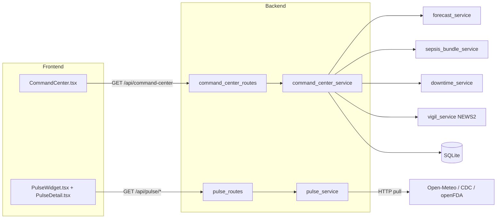
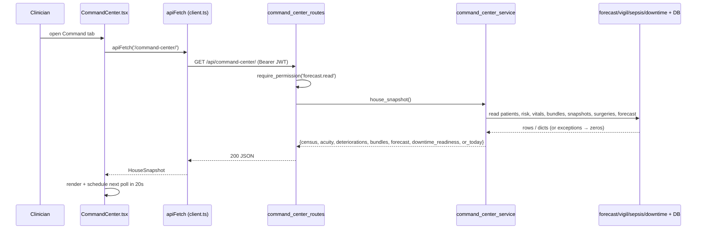

# 18: Command Center and Pulse: the hospital-wide operational picture

Orb has two "step back and look at the whole house" surfaces, and they are the subject of this guide. **Command Center** is a full-screen executive board, a single pane of glass for a CMO/COO (Chief Medical Officer / Chief Operating Officer) that shows live bed census, a ward acuity heatmap, active patient deteriorations, sepsis-bundle compliance, a 24-hour capacity forecast, downtime readiness, and today's operating-room load, all read-only and re-fetched on a 20-second timer. **Pulse** is a small ambient widget that lives in the app header and pulls the *outside world* in, weather, air quality, flu surveillance, and FDA drug recalls, turning those into clinical risk flags. The two share a design language and a permission gate but are otherwise independent: Command Center aggregates Orb's *own* database, while Pulse ingests *external* public APIs and never sends any patient data out.

---

## Purpose and neighbors

**The problem Command Center solves.** Orb's clinical pillars (Vigil for vitals, Forecast for capacity, the sepsis-bundle tracker, the OR schedule) each own a slice of reality. A hospital administrator needs *one* screen that fuses those slices into an operational picture without drilling into each pillar. Command Center is a **pure read aggregator**: it never mutates state, so it is safe to poll frequently, and it composes read-only views over the existing services and the SQLite database (`server/services/command_center_service.py:8-18`).

**The problem Pulse solves.** Clinical risk is not only internal. A 42 °C heat wave, an air-quality spike, a national flu surge, or a drug recall all change how a ward should be run today. Pulse ingests free public feeds and converts them into actionable "clinical flags," under a strict one-directional contract: *the world's data flows IN, patient data NEVER flows out* (`server/services/pulse_service.py:1-18`).

**Key design choices to remember.**

- **Consistent numbers.** Command Center reuses the *same* hardcoded bed capacities (`WARD_CAPACITY`) and ward-normalization helper (`_normalize_ward`) that the Forecast pillar uses, so occupancy math never disagrees across the platform (`server/services/command_center_service.py:29-35`).
- **Degrade, never crash.** Every board section is wrapped in its own `try/except`; a failing subsystem returns zeros plus an `error` note and the rest of the board still renders (`server/services/command_center_service.py:8-14`).
- **Poll, not push.** Neither surface uses sockets. Command Center polls every 20 s (`src/components/command/CommandCenter.tsx:22`); Pulse polls every 15 min while open (`src/components/PulseWidget.tsx:138`) and the server caches each feed for 30 min–24 h.

Neighbor guides referenced below: **Auth & RBAC** (the `require_permission` gate and role→permission map), **Forecast** (owns `WARD_CAPACITY`, `_normalize_ward`, `predict_hospital_flow`), **Vigil** (owns `compute_news2`), **Sepsis bundles** (owns `get_active_bundles`), **Downtime** (owns `get_latest_snapshot`), **Database schema** (the `patients`, `risk_scores`, `vitals`, `surgeries` tables), and the **API client / shell** (owns `apiFetch` and the tab gating).

---

## File map

| File | Lines (approx) | Role |
|---|---|---|
| `server/services/command_center_service.py` | 406 | Pure-read aggregator; builds the whole house snapshot from the DB + neighbor services. |
| `server/routes/command_center_routes.py` | 83 | One GET route exposing `house_snapshot()`, gated on `forecast.read`. |
| `server/services/pulse_service.py` | 634 | Fetches + caches external feeds (weather, AQI, flu, FDA), derives clinical flags, keeps an ingestion audit log. |
| `server/routes/pulse_routes.py` | 98 | Six GET routes over the Pulse service; five gated on `forecast.read`, audit-log on `audit.read`. |
| `src/components/command/CommandCenter.tsx` | 308 | React board component: polls the snapshot every 20 s and renders KPIs, heatmap, deteriorations, forecast, OR table. |
| `src/components/command/CommandCenter.css` | 286 | Glassmorphic board styling; theme-aware via CSS variables; heatmap intensity via `--heat`. |
| `src/components/PulseWidget.tsx` | 410 | Header widget: geolocation, fetches `/pulse/dashboard`, renders alerts/weather/AQI/flu/recalls, opens detail views. |
| `src/components/PulseWidget.css` | 848 | Floating glass panel + detail-overlay styling; light/dark theme forks. |
| `src/components/PulseDetail.tsx` | 236 | Slide-in detail overlay for each Pulse section, with source attribution. |
| `server/tests/test_command_center.py` | 183 | Unit tests for census/acuity aggregation, deterioration ordering, section presence, and the empty-DB zeros path. |

---

## How it works

### Flow 1: Command Center board render (client + server)

1. The clinician opens the **Command** tab. The shell only renders it if the user's role is allowed the tab (`doctor` or `admin`; see role gating below) (`src/shellConfig.tsx:671`, role configs at `src/shellConfig.tsx:826-882`).
2. `CommandCenter` mounts, calls `load()` once, then sets a 20-second `setInterval` (`src/components/command/CommandCenter.tsx:80-85`).
3. `load()` calls `apiFetch<HouseSnapshot>('/command-center/')` (`src/components/command/CommandCenter.tsx:67-69`). `apiFetch` prefixes `/api`, attaches the JWT bearer header, and throws typed errors on non-2xx (`src/api/client.ts:195-260`).
4. The route handler `get_house_snapshot` runs the `require_permission("forecast.read")` dependency first; if the role lacks it, a 403 is raised and audited *before* any work (`server/routes/command_center_routes.py:27`, `server/permissions.py:376-438`).
5. `house_snapshot()` reads the admitted-patient list once, then builds seven sections, each guarded by its own `try/except`, and returns a plain dict (`server/services/command_center_service.py:314-391`).
6. The component stores the snapshot, stamps `lastUpdated`, and renders. On a fetch error it keeps the *last* snapshot and shows a small "reconnecting…" note; it only shows the full error screen when there is no snapshot yet (`src/components/command/CommandCenter.tsx:67-86`).

### Flow 2: Pulse widget open + refresh

1. The Pulse trigger button lives in the header and is rendered for *every* logged-in user (`src/pages/ClinicianShell.tsx:452`), there is **no** frontend role gate on the button itself.
2. On first open the widget requests browser geolocation; on success it reverse-geocodes the coordinates to a city name by calling `nominatim.openstreetmap.org` *directly from the browser* (not through Orb's backend) and persists the location to `localStorage` (`src/components/PulseWidget.tsx:65-103`).
3. `fetchPulse()` calls `apiFetch('/pulse/dashboard?lat=…&lon=…')` (`src/components/PulseWidget.tsx:113-126`).
4. `pulse_dashboard` runs `require_permission("forecast.read")`, then `get_pulse_dashboard(lat, lon)` fires all four feeds concurrently with `asyncio.gather(..., return_exceptions=True)` (`server/routes/pulse_routes.py:30-40`, `server/services/pulse_service.py:592-597`).
5. Each feed returns from its in-memory cache if fresh (weather 30 min, AQI 1 h, flu 24 h, FDA 1 h), else it does one outbound `httpx` GET, logs the pull to the audit log, and repopulates the cache (TTL constants at `server/services/pulse_service.py:115-118`; the weather feed's cache-hit / fetch / log cycle at `:167-260`).
6. The dashboard merges every feed's `clinical_flags` into one `active_alerts` list sorted by severity, and returns it. The widget renders alerts + each section; clicking a section opens `PulseDetail` (`server/services/pulse_service.py:610-627`, `src/components/PulseWidget.tsx:236-383`).
7. While open, a 15-minute interval re-runs `fetchPulse` (`src/components/PulseWidget.tsx:136-140`).

---

## Function-by-function

### command_center_service.py

Module constants: `WARD_CAPACITY`, `TOTAL_CAPACITY`, `_normalize_ward` are **imported** from `forecast_service` (`server/services/command_center_service.py:31-35`) so numbers stay consistent. `DOWNTIME_RECENT_WINDOW_MIN = 24*60` defines "fresh" for downtime snapshots (`:38`). `WARD_CAPACITY` itself is `{"ICU":8,"W1":8,"W2":8,"W3":8}` → `TOTAL_CAPACITY = 32` (`server/services/forecast_service.py:55-64`).

#### _now / _now_iso: `server/services/command_center_service.py:41` / `:45`
**Signature:** `() → datetime` / `() → str`
**Does:** Return the current UTC time (as a tz-aware `datetime`, or its ISO-8601 string).
**How it works:** `datetime.now(timezone.utc)`; `_now_iso` calls `.isoformat()`.
**Why it exists:** One UTC clock for the whole module, so `generated_at` and all age math agree and are timezone-safe.
**Data in/out:** none → `datetime` / ISO string like `2026-07-07T10:15:00+00:00`.
**Talks to:** used by `house_snapshot`, `_downtime_readiness`, `_or_today`.
**Change guide:** To display local time instead of UTC, do NOT change these, keep the server in UTC and convert in the client (`CommandCenter.tsx` already calls `toLocaleTimeString`). Changing the server clock would desync age comparisons against DB timestamps (which are UTC).
**Gotchas:** none noteworthy.

#### _parse_ts: `server/services/command_center_service.py:64`
**Signature:** `(ts) → datetime | None`
**Does:** Parse a stored timestamp string into a tz-aware UTC `datetime`, tolerating a trailing `Z` and naive values.
**How it works:** 1) falsy → `None`; 2) `datetime.fromisoformat` after replacing `Z` with `+00:00`; 3) if the parsed value is naive, stamp it UTC; 4) on `ValueError`/`TypeError` return `None`.
**Why it exists:** SQLite stores timestamps as text of varying shape; downtime-readiness needs a robust parse that never throws.
**Data in/out:** string/None → `datetime`/None.
**Talks to:** `_downtime_readiness`.
**Gotchas:** A naive DB timestamp is *assumed* UTC. If any writer stored local time, ages would be wrong, but Orb writes UTC everywhere.

#### _admitted_with_acuity: `server/services/command_center_service.py:76`
**Signature:** `() → list[dict]`
**Does:** Return every admitted patient with their latest risk level, in one SQL query.
**How it works:** 1) `SELECT p.id,name,ward,bed` plus a correlated subquery for the latest `risk_scores.level` ordered by `timestamp DESC, id DESC LIMIT 1`, filtered on `status='admitted'`, ordered by ward/bed; 2) for each row, default a missing level to `"stable"` so acuity buckets always sum to the census; 3) attach `norm_ward = _normalize_ward(ward)`.
**Why it exists:** This single list feeds four sections (census, acuity, deteriorations, downtime), so it is read once and passed down.
**Data in/out:** none → `[{id,name,ward,bed,level,norm_ward}]`.
**Talks to:** reads `patients` + `risk_scores`; imports `_normalize_ward` (Forecast). Called by `house_snapshot`.
**Change guide:** To include *discharged* patients on the board, change the `WHERE p.status='admitted'` clause (`:70`); knock-on: census/occupancy would exceed capacity and every downstream percentage would inflate. To rank acuity by a different field, change the subquery's `ORDER BY` (`:68`).
**Gotchas:** The subquery ties by `timestamp` then `id`; if two risk rows share a timestamp the higher `id` wins. Parameterized query, no injection risk.

#### _census_and_acuity: `server/services/command_center_service.py:102`
**Signature:** `(patients: list[dict]) → tuple[dict, dict]`
**Does:** Build both the census (occupancy vs capacity) and acuity (counts + heatmap) sections in one pass.
**How it works:** 1) initialise per-ward occupancy and per-ward acuity tallies keyed by the canonical `WARD_CAPACITY` wards, plus a totals bucket; 2) for each patient, coerce an unknown level to `"stable"`, increment the total for that level, and if the ward is canonical increment ward occupancy + ward acuity; 3) build `by_ward` with `occupancy_pct = occupied/capacity*100`; 4) build `heatmap` (per-ward critical/elevated/stable counts); 5) build the `census` dict (`total_admitted`, `total_capacity`, `occupancy_pct`, `by_ward`) and `acuity` dict (totals + heatmap).
**Why it exists:** Census and acuity share the same per-ward walk; computing them together avoids two passes and guarantees the heatmap and census agree.
**Data in/out:** patient list → `(census, acuity)` (shapes mirrored in the TS `HouseSnapshot` interface, `src/components/command/CommandCenter.tsx:11-20`).
**Talks to:** uses `WARD_CAPACITY`/`TOTAL_CAPACITY`. Called by `house_snapshot`; verified by `test_snapshot_census_and_acuity_aggregate` and `test_empty_db_path_returns_zeros_without_crashing`.
**Change guide:** To add a fifth ward "W4", add it to `WARD_CAPACITY` in `server/services/forecast_service.py:55`, the heatmap, census, empty fallbacks and Forecast pillar all pick it up automatically (they iterate `WARD_CAPACITY`). Worked example: adding `"W4":10` makes `TOTAL_CAPACITY=42`, adds a heatmap cell, and `_normalize_ward` must also learn to map "Ward 4" → "W4" or those patients fall through to `W1`.
**Gotchas:** `totals[lvl]` is incremented for *all* patients but `ward_acuity[w][lvl]` only when `w in ward_occ`. Because `_normalize_ward` always returns a canonical ward, the two always agree; if that guarantee ever broke, the top-line acuity totals could exceed the heatmap sum. `occupancy_pct` can exceed 100 % if a ward is over-bedded, the frontend bar clamps to 100 % but the number is shown raw.

#### _deteriorations: `server/services/command_center_service.py:151`
**Signature:** `(patients: list[dict]) → list[dict]`
**Does:** Build the active-deterioration list: every critical/elevated patient, annotated with a live NEWS2 from their latest vitals, sorted critical-first then NEWS2-descending.
**How it works:** 1) filter to `level in ("critical","elevated")`; empty → `[]`; 2) for each, read the latest `vitals` row and the patient's `on_scale_2` flag, then call `compute_news2(...)` (Vigil) to get `raw_news2`; 3) a per-patient `try/except` logs and skips a bad row so one patient can't blank the list; 4) sort by `rank{critical:0, elevated:1}` then by `-news2` (None sorts last).
**Why it exists:** Surfaces the sickest patients house-wide with a comparable early-warning number, matching Vigil's scoring so the two never disagree.
**Data in/out:** patient list → `[{patient_id,name,ward,bed,level,news2}]`.
**Talks to:** reads `vitals`, `patients`; imports `compute_news2` (Vigil, `server/services/vigil_service.py:234`). Called by `house_snapshot`; tested by `test_deteriorations_lists_critical_patient`.
**Change guide:** To also show "stable" patients trending up, widen the filter at `:141`, but then the list stops being a *deterioration* list and the KPI card's meaning changes. To change tie-breaking, edit the sort key at `:184`.
**Gotchas:** NEWS2 is `None` when a patient has no vitals yet; the sort treats `None` as `-1` so those sink to the bottom of their level group. The `consciousness` default is `"alert"` and `on_oxygen`/`on_scale_2` are coerced to bool, a missing vitals column silently scores as the healthy default.

#### _bundles: `server/services/command_center_service.py:203`
**Signature:** `() → dict`
**Does:** Summarise active sepsis/deterioration care bundles and their 1-hour compliance.
**How it works:** 1) `get_active_bundles()` (sepsis service) returns active bundles, each already decorated with `on_track`; 2) `active = len`; `compliant = count(on_track)`; 3) `compliance_pct = round(100*compliant/active)` or `100` when there are no bundles.
**Why it exists:** One headline "are we meeting the sepsis 1-hour bundle?" number for the KPI row.
**Data in/out:** none → `{active, compliant, compliance_pct}`.
**Talks to:** `sepsis_bundle_service.get_active_bundles` (`server/services/sepsis_bundle_service.py:97`), which reads `care_bundles`. `on_track` there means *zero elements breached their target minutes* (`:162`).
**Change guide:** To make compliance stricter, change what `on_track` means in the sepsis service, not here. Worked example: today an empty board reports 100 % compliance (green); if you'd rather show "n/a", special-case `active==0` here at `:196`.
**Gotchas:** With no active bundles the metric is a *vacuous* 100 %, the frontend `complianceTone` paints that green (`src/components/command/CommandCenter.tsx:30-34`), which can read as "great" when it actually means "nothing happening."

#### _forecast: `server/services/command_center_service.py:219`
**Signature:** `() → dict`
**Does:** Produce the next-24h admission + occupancy projection by delegating to the Forecast pillar.
**How it works:** 1) `predict_hospital_flow(days_ahead=1)`; 2) take `daily_forecasts[0]`; 3) map its `predicted_admissions`/`predicted_occupancy`/`occupancy_pct` into `projected_admissions_24h`/`projected_occupancy`/`projected_occupancy_pct`, with `current_occupancy`/`total_capacity` fallbacks from the flow summary.
**Why it exists:** Reuses the validated hospital-flow model so the board's forecast strip matches the Forecast pillar exactly.
**Data in/out:** none → `{projected_admissions_24h, projected_occupancy, projected_occupancy_pct, current_occupancy, total_capacity}`.
**Talks to:** `forecast_service.predict_hospital_flow` (`server/services/forecast_service.py:387`), whose `daily_forecasts` entries carry those keys (`:494-506`).
**Change guide:** To show a 48-hour outlook, call `predict_hospital_flow(days_ahead=2)` and read `daily_forecasts[1]`; watch out, the Forecast model applies demo-placeholder discharge smoothing (`server/services/forecast_service.py:474-480`), so multi-day numbers are heuristic, not model-grade.
**Gotchas:** If `daily_forecasts` is empty, `first={}` and every field falls back to `0`/summary values rather than raising.

#### _downtime_readiness: `server/services/command_center_service.py:240`
**Signature:** `(patients: list[dict]) → dict`
**Does:** Count how many admitted patients have a *fresh* (≤24 h) local downtime snapshot, and report the staleness of the oldest.
**How it works:** for each patient, `get_latest_snapshot(id)`; parse its `created_at`; if age ≤ `DOWNTIME_RECENT_WINDOW_MIN` count it "recent"; track the maximum age; return `{patients_with_recent_snapshot, total, pct, oldest_snapshot_age_min}`.
**Why it exists:** A downtime snapshot is the ward's safety net when the EHR/network/LLM is down; the board answers "if we lost systems now, how many patients are covered?"
**Data in/out:** patient list → readiness dict.
**Talks to:** `downtime_service.get_latest_snapshot` (`server/services/downtime_service.py:683`, reads `patient_snapshots`); uses `_parse_ts`.
**Change guide:** To tighten "fresh" to 12 hours, change `DOWNTIME_RECENT_WINDOW_MIN` at `:38`; knock-on: `readinessTone` thresholds in the client (`src/components/command/CommandCenter.tsx:36-40`) may need retuning so the KPI colour still reads sensibly.
**Gotchas:** A per-patient snapshot lookup means N queries for N patients (no batch), fine for a 32-bed demo, a hotspot at real scale. `oldest_snapshot_age_min` is `None` when no patient has any snapshot.

#### _or_today: `server/services/command_center_service.py:275`
**Signature:** `() → dict`
**Does:** List today's operating-room cases (UTC calendar day).
**How it works:** compute today's `date().isoformat()`; `SELECT` from `surgeries` left-joined to `patients` where `scheduled_date = today`, ordered by `scheduled_time`; shape each row; return `{count, cases}`.
**Why it exists:** Shows the day's surgical load next to bed pressure so an administrator sees OR throughput in context.
**Data in/out:** none → `{count, cases:[{id,procedure_name,operating_room,scheduled_time,status,estimated_duration_min,patient_name,ward}]}`.
**Talks to:** reads `surgeries` + `patients`. Rendered as a table in `src/components/command/CommandCenter.tsx:276-303`.
**Change guide:** "Today" is a **UTC** calendar day. For a hospital in IST (+5:30), late-evening cases can land on the wrong board day, to fix, compute the day in the deployment's local timezone here at `:262`.
**Gotchas:** LEFT JOIN means a surgery with an unknown `patient_id` still shows (patient_name null → ", " in the UI). Parameterized query.

#### _empty_census / _empty_acuity: `server/services/command_center_service.py:292` / `:304`
**Signature:** `() → dict`
**Does:** Return the all-zeros census/acuity shapes (one row per canonical ward) used when a builder raises.
**Why it exists:** Guarantees the board renders a full, correctly-shaped skeleton even on total failure, the "degrade, never crash" contract.
**Talks to:** used in `house_snapshot`'s census/acuity `except` branch; asserted by `test_empty_db_path_returns_zeros_without_crashing:116-117`.
**Gotchas:** none noteworthy.

#### house_snapshot: `server/services/command_center_service.py:329`
**Signature:** `() → dict`
**Does:** Assemble the full house-wide snapshot; never raises.
**How it works:** 1) start `{"generated_at": _now_iso()}`; 2) read the admitted-patient list (on failure → `[]` + `patients_error`); 3) build census+acuity, deteriorations, bundles, forecast, downtime_readiness, or_today, **each in its own try/except** that logs and substitutes that section's zero shape plus an `error` key; 4) return the dict.
**Why it exists:** The single public entry point; the route is a one-liner over it. Independent guards mean one dead subsystem (e.g. a torch model that won't load) degrades one card, not the board.
**Data in/out:** none → the full `HouseSnapshot` (shape mirrored at `src/components/command/CommandCenter.tsx:11-20`).
**Talks to:** every builder above; called by `get_house_snapshot`. Tested by `test_all_board_sections_present`.
**Change guide:** To add a new card (say "ED wait times"), add a builder, then a guarded block here following the existing pattern, and add a matching field + render in `CommandCenter.tsx`. Worked example: an `ed` section would be `try: snapshot["ed"] = _ed(); except … snapshot["ed"] = {…zeros…, "error": str(e)}`.
**Gotchas:** The forecast `except` branch reads `census.get("total_admitted",0)`, it relies on `census` already being assigned (it is, earlier in the function). Error notes ride *inside* the section (e.g. `snapshot["bundles"]["error"]`), so a 200 response can still carry partial failures; the client does not currently surface these per-section errors.

---

### command_center_routes.py

Router prefix `/api/command-center`, tag "Command Center" (`server/routes/command_center_routes.py:22`), registered in `server/main.py`.

#### get_house_snapshot: `server/routes/command_center_routes.py:25` (decorators) / `:27` (`def`)
**Signature:** `(user=Depends(require_permission(FORECAST_READ))) → dict`
**Does:** Return `command_center_service.house_snapshot()`.
**How it works:** FastAPI resolves the `require_permission("forecast.read")` dependency (401 if unauthenticated, 403 if the role lacks the permission, audited on denial), then calls the service. Decorated with both `@router.get("")` (`:25`) and `@router.get("/")` (`:26`) so `/api/command-center` and `/api/command-center/` both work.
**Why it exists:** Thin HTTP surface over the aggregator; the service already never raises, so no extra error handling is needed here.
**On screen:** everything on the **Command** tab. One GET fills every tile on that board.
**Data in/out:** none (auth via the session cookie) → `HouseSnapshot` JSON.
**Talks to:** `house_snapshot`; `require_permission` (`server/permissions.py:376`) and `FORECAST_READ` (`server/permissions.py:65`). Called from `src/components/command/CommandCenter.tsx`.
**Change guide:** To restrict the board to admins only, swap `FORECAST_READ` for an `ADMIN_OVERVIEW`-style permission here; knock-on: nurses/doctors lose API access even though the frontend tab logic is separate (see Discrepancies).
**Gotchas:** JWT (JSON Web Token) = the signed bearer token proving who the caller is; `require_permission` maps `user["role"]` → its permission set. There is no per-patient scoping here, the board is house-wide by design.

---

### pulse_service.py

Module constants: default location Mumbai (`DEFAULT_LAT/LON/CITY`, `:107-109`); cache TTLs weather 1800 s, AQI 3600 s, CDC 86400 s, FDA 3600 s, plus `PULSE_REFRESH_INTERVAL=900` (`:115-119`); module-level caches and a `_pulse_log` audit list (`:121-135`). `OPENWEATHERMAP_API_KEY` (`:112`) and `_alerts_cache` (`:134`) are declared but unused (see Discrepancies).

Above all of that sits `_external_transport_kwargs` (`:64`), which builds the proxy/TLS settings every outbound `httpx` call uses. It is the one place that decides how this appliance is allowed to reach the public internet, a hospital that routes egress through a corporate proxy configures it here and nowhere else.

#### _log_ingestion: `server/services/pulse_service.py:142`
**Signature:** `(source, url, status, data_hash="") → None`
**Does:** Append one compliance-audit record for an external pull.
**How it works:** build `{timestamp, source, url, status, data_hash, direction:"INBOUND_ONLY"}`, append to `_pulse_log`, and pop the oldest if the list exceeds 500.
**Why it exists:** Proves the one-directional contract, every outbound pull is logged, and each entry is explicitly stamped inbound-only.
**Data in/out:** call args → in-memory log entry.
**Talks to:** called by every fetcher; surfaced via `get_ingestion_audit_log` → `/api/pulse/audit-log`.
**Gotchas:** In-memory only, the log resets on server restart and is not shared across workers. Not durable audit storage.

#### _hash_response: `server/services/pulse_service.py:158`
**Signature:** `(data: str) → str`
**Does:** Return the first 16 hex chars of the SHA-256 of a response body.
**Why it exists:** A short integrity fingerprint for the audit trail without storing the payload.
**Gotchas:** Truncated to 16 chars, a fingerprint, not a cryptographic commitment.

#### fetch_weather: `server/services/pulse_service.py:167`
**Signature:** `async (lat=DEFAULT_LAT, lon=DEFAULT_LON) → dict`
**Does:** Fetch current conditions + a 7-day forecast from Open-Meteo, with clinical flags.
**How it works:** 1) return the module cache if younger than 30 min; 2) build the Open-Meteo URL (no API key needed); 3) `httpx` GET (10 s timeout), `raise_for_status`, log the pull; 4) map WMO weather codes to descriptions; 5) build a 7-day `forecast` list; 6) `_generate_weather_clinical_flags`; 7) assemble `{current, forecast, clinical_flags, location, last_updated}`, cache, return; 8) on any error, log it and return the stale cache if present, else an empty shape with `error`.
**Why it exists:** Open-Meteo is free, keyless, and global, a zero-cost universal weather source.
**Data in/out:** lat/lon → weather dict consumed by `PulseWidget` and `PulseDetail`.
**Talks to:** `api.open-meteo.com`; `_log_ingestion`, `_hash_response`, `_generate_weather_clinical_flags`.
**Change guide:** To change the city default, edit `DEFAULT_LAT/LON` (`:107-108`), but the client passes explicit lat/lon so this only affects direct API calls with no params. To fetch 14 days, change `forecast_days=7` in the URL (`:186`) and the client forecast strip will render more days.
**Gotchas:** The module docstring claims NWS/OpenWeatherMap; the code actually uses Open-Meteo (see Discrepancies). Cache is process-global, all users share one weather reading regardless of their own location once cached (see Discrepancies).

#### _generate_weather_clinical_flags: `server/services/pulse_service.py:263`
**Signature:** `(current: dict, forecast: list) → list`
**Does:** Derive weather-driven clinical risk flags (heat advisory, cold advisory, storm warning, heat-index danger).
**How it works:** thresholds on temperature (≥38 → heat, ≥42 → high; ≤5 → cold), a scan of the next 3 forecast days for weather codes ≥80 (storm; ≥95 → high), and a combined temp≥32 & humidity≥70 heat-index rule. Each flag carries `type/severity/icon/title/message/affected_conditions/recommended_actions`.
**Why it exists:** Turns raw meteorology into ward-actionable guidance (which patient cohorts to watch, what to pre-position).
**Data in/out:** current+forecast → list of flag dicts.
**Talks to:** called by `fetch_weather`; flags flow into `active_alerts` and `PulseDetail`'s recommendation list.
**Change guide:** To localise thresholds (e.g. a tropical hospital), edit the numeric cutoffs: heat `temp >= 38` with high at `>= 42` (`:270`, `:273`), cold `temp <= 5` (`:286`), storm `code >= 80` with high at `>= 95` (`:303`, `:306`), heat index `temp >= 32 and humidity >= 70` (`:320`). Worked example: lowering the heat threshold to 35 °C makes more days trip the advisory and raises `alert_count`, which changes the header badge colour.
**Gotchas:** Defaults temp 25/humidity 50 when missing, so absent data never *raises* a false alarm. Storm scan `break`s after the first storm day, so only the nearest storm is flagged.

#### fetch_aqi: `server/services/pulse_service.py:341`
**Signature:** `async (lat, lon) → dict`
**Does:** Fetch the US AQI + pollutants from Open-Meteo's air-quality API and derive a respiratory flag.
**How it works:** cache (1 h) → GET → bucket the AQI into category+color (Good/Moderate/…/Hazardous) → if AQI>100 add an `AQI_ALERT` clinical flag → assemble `{aqi, category, color, pollutants, clinical_flags, last_updated}` → cache/return; error path returns stale cache or `{aqi:None, category:"Unavailable", …}`.
**Why it exists:** Poor air quality directly raises risk for asthma/COPD/cardiac patients; this makes that visible.
**Data in/out:** lat/lon → AQI dict (color drives the widget's value colour via `getAqiColorClass`, `src/components/PulseWidget.tsx:160-170`).
**Talks to:** `air-quality-api.open-meteo.com`; audit log.
**Gotchas:** `color` is a *semantic* name (green/yellow/orange/red/purple/maroon) mapped to CSS classes on the client, not a raw hex, keep the two maps in sync.

#### fetch_fda_recalls: `server/services/pulse_service.py:429`
**Signature:** `async (limit=10) → list`
**Does:** Fetch recent FDA drug enforcement/recall actions from openFDA.
**How it works:** cache (1 h) → GET `drug/enforcement.json?sort=report_date:desc&limit=…` → map each result to a trimmed record (product/reason truncated to 200 chars, classification, status, dates, firm, city/state) → cache/return; error → stale cache or `[]`.
**Why it exists:** Surfaces drug safety actions that may affect the formulary.
**Data in/out:** limit → list of recall dicts (rendered in the widget and `PulseDetail`'s `recall-*` view).
**Talks to:** `api.fda.gov`; audit log.
**Gotchas:** The docstring elsewhere claims recalls are "cross-referenced with patient medications", they are **not**; this is a plain recent-recalls feed with zero patient data involved (see Discrepancies).

#### fetch_cdc_flu_data: `server/services/pulse_service.py:482`
**Signature:** `async () → dict`
**Does:** Fetch CDC influenza-like-illness (ILI) surveillance, falling back to a seasonal estimate.
**How it works:** cache (24 h) → GET the CDC Socrata resource → if 200 with data, read the latest row's `weighted_ili`/`total_patients`, classify the activity level, and add a `FLU_SURGE` flag when ILI>3 % (>5 % → high) → cache/return; on non-200/exception/empty, fall through to `_seasonal_flu_estimate`.
**Why it exists:** National flu pressure predicts local respiratory admissions; the fallback guarantees a sensible number even when CDC is unreachable.
**Data in/out:** none → flu dict (`source, week, year, ili_percentage, total_patients, activity_level, clinical_flags, last_updated`).
**Talks to:** `data.cdc.gov`; `_classify_ili_level`, `_seasonal_flu_estimate`; audit log.
**Gotchas:** The success path returns *inside* the `if data:` block; an HTTP 200 with an empty array silently drops to the seasonal fallback. The widget shows "(seasonal estimate)" whenever `source` contains "Estimate" (`src/components/PulseWidget.tsx:358`).

#### _classify_ili_level: `server/services/pulse_service.py:548`
**Signature:** `(ili_pct: float) → str`
**Does:** Bucket an ILI percentage into `minimal/low/moderate/high/very_high`.
**Talks to:** used by both the live and fallback flu paths; the level string drives the flu colour class on the client (`src/components/PulseWidget.css:490-500`).
**Gotchas:** none noteworthy.

#### _seasonal_flu_estimate: `server/services/pulse_service.py:561`
**Signature:** `() → dict`
**Does:** Produce a plausible ILI figure from the current month (Northern-Hemisphere Dec–Feb peak).
**How it works:** look up a per-month ILI table, classify it, and return the same shape as the live path but with `source="Seasonal Estimate (CDC API unavailable)"`.
**Why it exists:** The board must never show a blank flu tile; a seasonal prior is better than nothing.
**Gotchas:** Uses `datetime.now()` (naive/local) for the month, fine for a coarse monthly bucket, but note it is not the UTC clock used elsewhere. Hardcoded to the Northern Hemisphere; a Southern-Hemisphere deployment would see inverted seasonality.

#### get_pulse_dashboard: `server/services/pulse_service.py:586`
**Signature:** `async (lat, lon) → dict`
**Does:** Aggregate all four feeds into the single payload the widget consumes.
**How it works:** 1) `asyncio.gather(fetch_weather, fetch_aqi, fetch_cdc_flu_data, fetch_fda_recalls(5), return_exceptions=True)`, concurrent; 2) replace any feed that returned an `Exception` with its empty shape; 3) merge every feed's `clinical_flags` into `active_alerts` sorted by severity (high→moderate→low); 4) return `{weather, air_quality, flu_surveillance, drug_recalls, active_alerts, alert_count, last_refresh, data_direction}`.
**Why it exists:** One round-trip for the whole widget; concurrency keeps the p95 latency near the slowest single feed, not their sum.
**Data in/out:** lat/lon → the `PulseData` shape (`src/components/PulseWidget.tsx:17-25`).
**Talks to:** all four fetchers; called by `pulse_dashboard` route.
**Change guide:** To add a fifth feed (e.g. pollen), write its fetcher, add it to the `gather`, and extend the merge; the client renders any flags automatically since it just maps `active_alerts`.
**Gotchas:** `return_exceptions=True` means a crashed feed never takes down the dashboard, but a feed that *returns* its own `{error:…}` shape (not an exception) still counts as "present" with empty flags.

#### get_ingestion_audit_log: `server/services/pulse_service.py:632`
**Signature:** `(limit=50) → list`
**Does:** Return the last `limit` ingestion-audit entries.
**Talks to:** `/api/pulse/audit-log` route (gated on `audit.read`).
**Gotchas:** Returns a slice of the in-memory list; not persisted (see `_log_ingestion`).

---

### pulse_routes.py

Router prefix `/api/pulse`, tag "pulse" (`server/routes/pulse_routes.py:27`), registered at `server/main.py:696`. All five data routes gate on `require_permission("forecast.read")`; `/audit-log` gates on `audit.read`. Each data route wraps its service call in `try/except` and re-raises as HTTP 500 on failure.

| Handler | Line | Method + path | Auth | Returns |
|---|---|---|---|---|
| `pulse_dashboard` | 31 | GET `/api/pulse/dashboard?lat&lon` | forecast.read | full dashboard |
| `weather` | 44 | GET `/api/pulse/weather?lat&lon` | forecast.read | weather + 7-day |
| `air_quality` | 57 | GET `/api/pulse/aqi?lat&lon` | forecast.read | AQI + pollutants |
| `flu_surveillance` | 70 | GET `/api/pulse/flu` | forecast.read | CDC/seasonal ILI |
| `drug_recalls` | 81 | GET `/api/pulse/drug-recalls?limit≤50` | forecast.read | recall list |
| `audit_log` | 93 | GET `/api/pulse/audit-log?limit≤200` | audit.read | ingestion log |

**How they work:** each async handler declares its query params with FastAPI `Query` defaults (lat 19.076, lon 72.8777), resolves the permission dependency, awaits the service function, and on exception raises `HTTPException(500, detail=…)`. `drug_recalls` caps `limit` at 50 and `audit_log` at 200 via `Query(le=…)`.
**Why they exist:** A thin, individually-cacheable REST surface, the widget uses `/dashboard`, but the per-feed routes let other callers (or tests) pull one feed.
**Talks to:** the matching `pulse_service` functions; `require_permission` (Auth/RBAC). `pulse_dashboard` is the only one the frontend currently calls (`src/components/PulseWidget.tsx:114-121`).
**Gotchas:** The dashboard already swallows feed errors internally, so the route's 500 path is essentially unreachable for `/dashboard`; the per-feed routes can still 500 if their fetcher itself raises (it usually doesn't, fetchers return `error` shapes).

---

### CommandCenter.tsx

Interfaces `WardCensus`/`HeatCell`/`Deterioration`/`ORCase`/`HouseSnapshot` (`:6-20`) mirror the server snapshot exactly, the single source of shape-truth on the client.

#### pctTone / complianceTone / readinessTone: `src/components/command/CommandCenter.tsx:24` / `:30` / `:36`
**Signature:** `(pct: number) → 'ok'|'warn'|'danger'`
**Does:** Map a percentage to a status tone, with direction-appropriate thresholds.
**How it works:** occupancy is *bad when high* (≥90 danger, ≥75 warn); compliance and readiness are *good when high* (compliance ≥90 ok / ≥70 warn; readiness ≥80 ok / ≥50 warn).
**Why it exists:** Centralises the colour policy so KPI cards, the forecast tile and CSS accent variables stay consistent.
**Data in/out:** number → tone string that becomes a CSS class suffix (`cmd-kpi--danger`, etc.).
**Change guide:** To make occupancy turn red at 95 % instead of 90 %, edit `:25`. Because the same tone drives the left accent bar (`.cmd-kpi--danger { --kpi-accent: … }`, `src/components/command/CommandCenter.css:75-77`), the whole card recolours.
**Gotchas:** Occupancy tone is inverted relative to the other two, do not copy-paste one for another.

#### heatIntensity: `src/components/command/CommandCenter.tsx:43`
**Signature:** `(cell: HeatCell) → number` (0..1)
**Does:** Compute a single "how hot is this ward" scalar weighted by acuity.
**How it works:** `load = critical*3 + elevated*1.5 + stable*0.4`, then clamp `load/12` to `[0,1]`.
**Why it exists:** Drives the CSS `--heat` custom property so the heatmap cell's red/amber gradient scales with severity, not just headcount.
**Data in/out:** a heat cell → a 0..1 number injected as `style={{ '--heat': intensity }}` (`:164`).
**Change guide:** To make critical patients dominate more, raise the `*3` weight or lower the `/12` ceiling (`:44-46`); watch out that an over-low ceiling saturates every busy ward to full red and loses contrast.
**Gotchas:** The `/12` ceiling is a "plausible busy ward" guess, not derived from `WARD_CAPACITY`; a ward of 8 beds can still exceed intensity 1 if very sick.

#### ageLabel: `src/components/command/CommandCenter.tsx:49`
**Signature:** `(min: number | null) → string`
**Does:** Humanise a minutes value into `, `/`Nm`/`N.Nh`/`N.Nd`.
**Talks to:** renders the downtime KPI's "oldest snapshot" foot (`:140`).
**Gotchas:** none noteworthy.

#### CommandCenter (default export): `src/components/command/CommandCenter.tsx:56`
**Signature:** `() → JSX.Element`
**Does:** The board component, fetches the snapshot on a 20 s poll and renders KPIs + four cards.
**How it works:** 1) state for `snap/error/loading/lastUpdated` and a `timerRef`; 2) `load` (a `useCallback`) fetches `/command-center/`, updates state, and on error *keeps the old snapshot* while setting `error`; 3) a `useEffect` runs `load` once and starts `setInterval(load, 20000)`, clearing it on unmount; 4) loading/error early-returns only when there is no snapshot yet; 5) destructure the snapshot and render the header (LIVE dot, "Updated HH:MM:SS", a "reconnecting…" note when a poll fails but data exists), the KPI row, the acuity heatmap (per-ward gradient + stacked severity bars), the deterioration list, the forecast strip, and the OR table.
**Why it exists:** A React "hook" (`useState`/`useEffect`/`useCallback`, functions that let a function component hold state and run side effects) driven poller: simple, no socket infrastructure, and resilient because a failed refresh doesn't blank the board.
**Data in/out:** none → renders `HouseSnapshot`. Fetches via `apiFetch` (`src/api/client.ts:195`).
**Talks to:** `GET /api/command-center/`. Mounted lazily by the shell inside a `PanelErrorBoundary` only when the `command` tab is accessible (`src/pages/ClinicianShell.tsx:280`, rendered at `:745-747`).
**Change guide:** To change the refresh cadence, edit `REFRESH_MS` at `:22`. Worked example: setting it to `5000` quadruples backend load (each poll rebuilds the whole snapshot with N downtime queries), prefer 20 s unless you add server-side caching. To make Command Center *push* instead of poll, you would subscribe to a socket room (see the Realtime guide) and drop the interval; the server would need to emit on relevant mutations.
**Gotchas:** **Stale-closure safety**, `load` is wrapped in `useCallback([])` and the interval is created once, so it always calls the stable `load`; no stale state is captured because `load` uses the functional setters. The interval keeps polling even while the panel is hidden (the shell mounts panels in `display:none` divs), so an inactive Command tab still hits the API every 20 s.

---

### PulseWidget.tsx

`weatherEmoji` (`:33`) maps WMO codes to emoji; `DEFAULT_LOCATION` is Mumbai (`:43`).

#### PulseWidget (default export): `src/components/PulseWidget.tsx:46`
**Signature:** `() → JSX.Element`
**Does:** The header widget, trigger button + a floating glass panel showing environmental intelligence.
**How it works (key pieces):**
- **State:** `isOpen`, `pulseData`, `loading`, `error`, `location` (lazy-initialised from `localStorage`), `geoStatus`, `detailView`, `selectedAlert`.
- **`requestLocation`** (`:65`), a `useCallback` that checks `navigator.geolocation`, requests coordinates, reverse-geocodes via `nominatim.openstreetmap.org` for a city label, persists to `localStorage`, and sets `geoStatus`.
- **Auto-locate** on first open (`:106-110`); **`fetchPulse`** (`:113`) calls `/pulse/dashboard?lat&lon`; **fetch on open/location change** (`:129-133`); **15-min auto-refresh while open** (`:136-140`); **Escape closes** detail then panel (`:143-154`).
- **`getAqiColorClass`** (`:159`) maps the server's `color` name to a CSS class.
- **Render:** trigger button with an alert badge (red default, amber when highest severity is "moderate"); on open, a backdrop + panel with active alerts, weather (+7-day strip), AQI, flu, and up to three FDA recalls; a footer reiterating "Inbound only · Zero patient data transmitted"; and a `PulseDetail` overlay when `detailView` is set.
**Why it exists:** An ambient, always-available "outside world" panel that is cheap (cached feeds), private (no patient egress), and location-aware.
**Data in/out:** `PulseData` (`:16-24`) → rendered panel. Persists `orb_pulse_location` in `localStorage`.
**Talks to:** `GET /api/pulse/dashboard`; `nominatim.openstreetmap.org` (direct browser call); child `PulseDetail`. Rendered unconditionally in the header (`src/pages/ClinicianShell.tsx:452`).
**Change guide:** To change the default city, edit `DEFAULT_LOCATION` at `:43` (and align the server default). To disable geolocation and always use the default, remove the auto-locate effect at `:106-110`. Worked example: a kiosk deployment might hardcode the hospital's coordinates and skip the `navigator.geolocation` prompt entirely.
**Gotchas:** **Stale closure**, the Escape handler effect lists `[isOpen, detailView]` but calls `closePanel`/setters defined in the component body; because those setters are stable and it re-subscribes when `detailView` changes, it stays correct. The **`localStorage.getItem` initializer** runs `JSON.parse` with no try/catch, a corrupt stored value would throw at mount (see Discrepancies). The reverse-geocode call goes straight from the browser to OpenStreetMap, bypassing the backend's inbound-only audit log, it sends only coordinates, never patient data, but it is worth knowing the "all ingestion is logged" story has this client-side gap.

---

### PulseDetail.tsx

Small presentational helpers, then a `view`-switch component.

#### SourceBadge / ActionItem / BackBtn / Row: `src/components/PulseDetail.tsx:13` / `:24` / `:33` / `:41`
**Does:** Reusable bits, a "Source: <link>" attribution, a green-check recommendation row, a back-chevron button, and a label/value row (rendering `, ` for nullish values).
**Why they exist:** Keep the five detail views terse and visually consistent.
**Gotchas:** `Row` coalesces `undefined`→`, ` but not empty string; an empty string prints blank.

#### PulseDetail (default export): `src/components/PulseDetail.tsx:48`
**Signature:** `({ view, data, onBack }) → JSX.Element | null`
**Does:** Render the expanded detail overlay for whichever section the user clicked.
**How it works:** branches on `view`: `weather` (hero temp + humidity/wind/pressure/coords + 7-day rows + clinical recommendations), `aqi` (AQI hero + pollutant rows), `flu` (ILI hero + source/week/year), `alert` (the `_selectedAlert` passed in via `data`), and `recall-<idx>` (parses the index and shows the full recall record). Unknown `view` → `null`.
**Why it exists:** Progressive disclosure, the compact widget stays scannable; details live one tap away with source links for provenance.
**Data in/out:** `view` string + the `pulseData` object (with an injected `_selectedAlert`) → overlay JSX.
**Talks to:** rendered by `PulseWidget` when `detailView` is set (`src/components/PulseWidget.tsx:397-404`); shares `PulseWidget.css`.
**Change guide:** To add a detail view for a new feed, add a `if (view === 'pollen')` branch and a corresponding `openDetail('pollen')` trigger in the widget.
**Gotchas:** `recall-<idx>` does `parseInt(view.split('-')[1])` and indexes `data.drug_recalls[idx]`; if the recalls array changed between opening the widget and clicking, the index could be stale, it guards with `if (!r) return null`.

---

### CSS files (summary)

- **CommandCenter.css** (239 lines), the board's glassmorphic look, keyed entirely off app CSS variables (`--bg-glass`, `--status-ok/warn/danger`, `--accent-gold`) so it is theme-aware. Notable: KPI cards use a `--kpi-accent` variable set by the tone class (`:74-76`); the heatmap cell background is a `linear-gradient` scaled by the `--heat` custom property injected from JS (`:146-150`); wide regions (heatmap, OR table) scroll inside their own `overflow-x:auto` containers so the page body never scrolls sideways (`:133,199`); a `@media (max-width:1000px)` block collapses the two-column grid to one (`:230-238`).
- **PulseWidget.css** (923 lines), the floating panel (`position:fixed; top:64px; right:24px; width:380px`), glass blur, entry animations, and per-section styling, plus a full **detail-overlay** stylesheet (`.pulse-detail*`). Both light and dark are styled explicitly via `[data-theme="light"]` forks. AQI/flu colour classes are semantic (good/moderate/…); the alert badge has a glow keyframe.

**Gotcha (both):** these lean on the design-token variables defined by the app shell/theme; if a token is missing the fallbacks (e.g. `rgba(255,255,255,0.04)`) assume a dark background, so a broken light theme could render low-contrast text.

---

### test_command_center.py

| Test | Line | Asserts |
|---|---|---|
| `_mk_patient` (helper) | 14 | Seeds one admitted patient + a latest `risk_scores` row of a given level. |
| `test_snapshot_census_and_acuity_aggregate` | 30 | Census total equals the true admitted count; `total_capacity==TOTAL_CAPACITY`; `by_ward` keys == `WARD_CAPACITY` with matching capacities; acuity buckets partition the census; ICU heatmap cell shows the critical patient. |
| `test_deteriorations_lists_critical_patient` | 62 | The seeded critical patient appears with `level=="critical"`, the `news2` key is always present, and critical sorts ahead of elevated. |
| `test_all_board_sections_present` | 79 | All seven sections plus `generated_at` exist, with the expected sub-keys on bundles/downtime/forecast/or_today. |
| `test_empty_db_path_returns_zeros_without_crashing` | 93 | `_census_and_acuity([])`, `_deteriorations([])`, `_downtime_readiness([])`, `_empty_census()`, `_empty_acuity()` all return correctly-shaped zeros without raising. |

**What they lock in:** the census/capacity consistency contract with Forecast, the acuity-partitions-census invariant, deterioration ordering, and the degrade-to-zeros guarantee. There is **no** test file for `pulse_service` in scope.

---

## Cross-subsystem contracts

**REST routes owned here** (prefixes verified in `server/main.py:696,717`):

| Method | Full path | Auth permission | Purpose |
|---|---|---|---|
| GET | `/api/command-center` and `/api/command-center/` | `forecast.read` | Full house snapshot. |
| GET | `/api/pulse/dashboard` | `forecast.read` | Combined environmental dashboard. |
| GET | `/api/pulse/weather` | `forecast.read` | Weather + 7-day + flags. |
| GET | `/api/pulse/aqi` | `forecast.read` | Air quality + pollutants. |
| GET | `/api/pulse/flu` | `forecast.read` | CDC/seasonal ILI. |
| GET | `/api/pulse/drug-recalls` | `forecast.read` | FDA recalls (limit ≤50). |
| GET | `/api/pulse/audit-log` | `audit.read` | Ingestion audit trail (limit ≤200). |

**Socket events:** none. Both surfaces are HTTP poll only.

**DB tables read** (never written by this subsystem): `patients`, `risk_scores`, `vitals`, `surgeries` (directly), plus `care_bundles` (via `sepsis_bundle_service`) and `patient_snapshots` (via `downtime_service`). Pulse touches **no** database tables, its "audit log" is in-memory.

**Exported functions other code relies on:** `command_center_service.house_snapshot()` (used by the route and imported directly by the tests); `pulse_service.get_pulse_dashboard / fetch_weather / fetch_aqi / fetch_cdc_flu_data / fetch_fda_recalls / get_ingestion_audit_log` (imported by `pulse_routes`).

**Contracts this subsystem consumes (owned elsewhere):**

| Symbol | Owner file | Contract used |
|---|---|---|
| `WARD_CAPACITY`, `TOTAL_CAPACITY`, `_normalize_ward` | `server/services/forecast_service.py:55,61,760` | Bed capacities + ward canonicalisation. |
| `predict_hospital_flow(days_ahead)` | `server/services/forecast_service.py:387` | `daily_forecasts[i]` with `predicted_admissions/predicted_occupancy/occupancy_pct`. |
| `compute_news2(...)` | `server/services/vigil_service.py:234` | Returns `{raw_news2, …}` for a set of vitals. |
| `get_active_bundles()` | `server/services/sepsis_bundle_service.py:97` | Active bundles decorated with `on_track`. |
| `get_latest_snapshot(pid)` | `server/services/downtime_service.py:683` | Latest snapshot envelope with `created_at`. |
| `require_permission(*perms)`, `FORECAST_READ`, `AUDIT_READ` | `server/permissions.py:376,65,92` | RBAC dependency + permission constants. |
| `apiFetch<T>(path)` | `src/api/client.ts:195` | Adds `/api` + JWT, throws typed errors. |

**Role gating (who can see it).** Backend: `forecast.read` is granted to `doctor`, `nurse`, `admin` (and `clinician`, aliased to `doctor`); `pharmacist` and `patient` are **not** (`server/permissions.py:104-164`). Frontend: the **Command** tab is only accessible to `doctor` and `admin` (`src/shellConfig.tsx:671`, role configs at `src/shellConfig.tsx:826-882`), nurses have the API permission but no tab. The **Pulse** trigger button renders for everyone (`src/pages/ClinicianShell.tsx:452`), but opening it calls `forecast.read`-gated APIs, so `pharmacist`/`patient` get a 403-driven error inside the panel.

---

## Rebuild notes

**Prerequisites (must already exist):**

1. **Auth & RBAC**, `get_current_user`, `require_permission`, and the role→permission map with `forecast.read` and `audit.read` defined (Auth/RBAC guide).
2. **Database + schema**, a `db_session()` context manager and the `patients`, `risk_scores`, `vitals`, `surgeries`, `care_bundles`, `patient_snapshots` tables (Database guide).
3. **Forecast pillar**, `WARD_CAPACITY`, `TOTAL_CAPACITY`, `_normalize_ward`, `predict_hospital_flow` (Forecast guide). Command Center is *defined* to reuse these; build them first.
4. **Vigil, Sepsis-bundle, Downtime services**, `compute_news2`, `get_active_bundles` (with `on_track`), `get_latest_snapshot` (with `created_at`).
5. **Frontend shell + `apiFetch`**, the tabbed `ClinicianShell` with per-role `getAccessibleTabs`, `PanelErrorBoundary`, and the `apiFetch` client that injects `/api` + JWT.

**Build order:**

1. `command_center_service.py`, helpers (`_now`, `_parse_ts`, `_admitted_with_acuity`), then the section builders, then `house_snapshot` with per-section guards. Write `test_command_center.py` alongside.
2. `command_center_routes.py`, one GET gated on `forecast.read`; register it in `main.py`.
3. `CommandCenter.tsx` + `.css`, the poller and board; wire the `command` tab into the shell for `doctor`/`admin`.
4. `pulse_service.py`, the four fetchers with in-memory caches + audit log, `_generate_weather_clinical_flags`, and `get_pulse_dashboard`.
5. `pulse_routes.py`, six GETs; register in `main.py`.
6. `PulseWidget.tsx` + `PulseDetail.tsx` + `.css`, the header widget and detail overlays; mount the widget in the header.

**Acceptance checks:**

- Seed one admitted ICU patient with a `critical` risk score, call `house_snapshot()`, and confirm `census.total_admitted==1`, `total_capacity==32`, the ICU heatmap cell shows `critical>=1`, and the patient appears in `deteriorations` (this is exactly what `test_command_center.py` asserts). On an empty DB the snapshot returns all-zeros with no exception.
- As a `doctor`, `GET /api/command-center/` returns 200 with all seven sections; as a `pharmacist` it returns 403. The board renders and updates its "Updated HH:MM:SS" every 20 s.
- `GET /api/pulse/dashboard?lat=19.076&lon=72.8777` returns weather/air_quality/flu_surveillance/drug_recalls/active_alerts with `data_direction` = "INBOUND_ONLY …", and a subsequent `GET /api/pulse/audit-log` (as `admin`) lists the pulls just made.

---

## Discrepancies and open questions

1. **Pulse docstring vs. implementation.** The module docstring advertises "NWS / OpenWeatherMap", "AirNow EPA", "NTP-synced timestamps", and "FDA drug recall alerts cross-referenced with patient medications" (`server/services/pulse_service.py:1-18`). In reality: weather and AQI both use **Open-Meteo** (`:178`, `:351`); timestamps are plain `datetime.now(timezone.utc)` with **no NTP sync**; and FDA recalls are **not** cross-referenced with any patient medications, the feed never touches patient data. The docstring is stale/aspirational.
2. **Dead code in Pulse.** `OPENWEATHERMAP_API_KEY` (`:37`) and `_alerts_cache` (`:59`) are declared but never used.
3. **Nurse can hit Command Center's API but has no tab.** `nurse` holds `forecast.read` (`server/permissions.py:117-133`) so `GET /api/command-center/` succeeds, yet the `command` tab is absent from a nurse's `getAccessibleTabs` (`src/pages/ClinicianShell.tsx:200`). Not a bug per se, but the backend gate is looser than the frontend intent, if Command Center is meant to be executive-only, the route should use a stricter permission than `forecast.read`.
4. **Pulse button shows for roles that can't use it.** The trigger renders for every role (`src/pages/ClinicianShell.tsx:452`), but `pharmacist`/`patient` lack `forecast.read`, so opening it yields an error inside the panel rather than the button being hidden.
5. **Client-side geocode bypasses the "all ingestion logged" story.** `PulseWidget` calls `nominatim.openstreetmap.org` directly from the browser (`src/components/PulseWidget.tsx:83-85`); that outbound request is not captured by the server's `_pulse_log`. Only coordinates are sent (no patient data), so the privacy contract holds, but the audit-log claim of covering *every* external pull has this gap.
6. **Unguarded `JSON.parse` of `localStorage`.** The `location` state initializer parses `orb_pulse_location` with no try/catch (`src/components/PulseWidget.tsx:51-54`); a corrupted value would throw during render.
7. **Process-global Pulse caches ignore per-user location.** The weather/AQI caches are module-level singletons keyed by nothing (`:47-51`); once user A caches Mumbai weather, user B requesting London within the TTL receives Mumbai's cached reading until it expires. Fine for a single-site deployment, wrong for multi-location use.
8. **Vacuous 100 % sepsis compliance.** With no active bundles, `_bundles` reports `compliance_pct=100` (`server/services/command_center_service.py:196`), which the KPI paints green, this reads as "excellent" when it actually means "nothing is being tracked."
9. **UTC "today" for the OR board.** `_or_today` uses the UTC calendar day (`:262`); for a hospital in a non-UTC timezone, late-evening cases can appear on the wrong board day.
