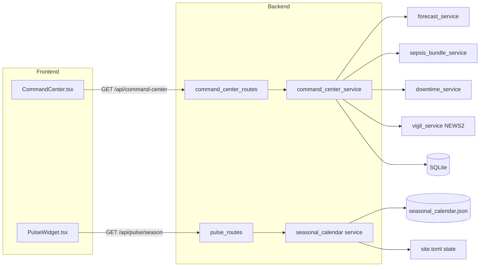
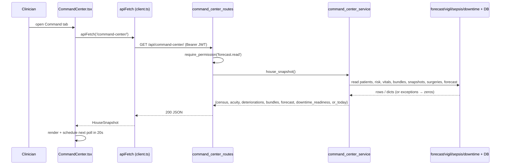

# 18: Command Center and Pulse: the hospital-wide operational picture

Orb has two "step back and look at the whole house" surfaces, and they are the subject of this guide. **Command Center** is a full-screen executive board, a single pane of glass for a CMO/COO (Chief Medical Officer / Chief Operating Officer) that shows live bed census, a ward acuity heatmap, active patient deteriorations, sepsis-bundle compliance, a 24-hour capacity forecast, downtime readiness, and today's operating-room load, all read-only and re-fetched on a 20-second timer. **Pulse** is a small panel in the app header that shows the season for the hospital's state: what usually rises at this time of year and what is coming up in the next 60 days, from a seasonal calendar that ships with Orb. The two share a design language and a permission gate but are otherwise independent: Command Center aggregates Orb's *own* database, while Pulse reads a calendar file. Neither makes any internet connection.

Pulse was rebuilt on 6 October 2026 (ruling R030 in `docs/RULINGS_NEEDED_2026-10.md`), and the Pulse parts of this guide describe the new contract at file level. Line citations for the rebuilt Pulse files are not filled in yet.

---

## Purpose and neighbors

**The problem Command Center solves.** Orb's clinical pillars (Vigil for vitals, Forecast for capacity, the sepsis-bundle tracker, the OR schedule) each own a slice of reality. A hospital administrator needs *one* screen that fuses those slices into an operational picture without drilling into each pillar. Command Center is a **pure read aggregator**: it never mutates state, so it is safe to poll frequently, and it composes read-only views over the existing services and the SQLite database (`server/services/command_center_service.py:8-18`).

**The problem Pulse solves.** Clinical load follows the seasons. Dengue, malaria and leptospirosis rise in the monsoon; heat illness rises in summer. Pulse shows the hospital what usually rises in its state now and in the next 60 days, from `server/site_config/seasonal_calendar.json`, for the state set as `[site] state` in `site.toml`. Until 6 October 2026 it pulled four live internet feeds (Open-Meteo weather and air quality, openFDA recalls, CDC FluView), located the user through browser geolocation and OpenStreetMap, and turned fixed weather thresholds into "clinical flags". The strictly-offline rule of 4 October 2026 and the ruling of 6 October removed all of that.

**Key design choices to remember.**

- **Consistent numbers.** Command Center reuses the *same* hardcoded bed capacities (`WARD_CAPACITY`) and ward-normalization helper (`_normalize_ward`) that the Forecast pillar uses, so occupancy math never disagrees across the platform (`server/services/command_center_service.py:39-47`).
- **Degrade, never crash.** Every board section is wrapped in its own `try/except`; a failing subsystem returns zeros plus an `error` note and the rest of the board still renders (`server/services/command_center_service.py:8-14`).
- **Poll, not push.** Neither surface uses sockets. Command Center polls every 20 s (`src/components/command/CommandCenter.tsx:42`). Pulse has no live feed to poll: it reads `GET /api/pulse/season`, which answers from the calendar on the appliance.

Neighbor guides referenced below: **Auth & RBAC** (the `require_permission` gate and role→permission map), **Forecast** (owns `WARD_CAPACITY`, `_normalize_ward`, `predict_hospital_flow`), **Vigil** (owns `compute_news2`), **Sepsis bundles** (owns `get_active_bundles`), **Downtime** (owns `get_latest_snapshot`), **Database schema** (the `patients`, `risk_scores`, `vitals`, `surgeries` tables), and the **API client / shell** (owns `apiFetch` and the tab gating).

---

## File map

| File | Lines (approx) | Role |
|---|---|---|
| `server/services/command_center_service.py` | 406 | Pure-read aggregator; builds the whole house snapshot from the DB + neighbor services. |
| `server/routes/command_center_routes.py` | 83 | One GET route exposing `house_snapshot()`, gated on `forecast.read`. |
| `server/site_config/seasonal_calendar.json` | new 6 Oct | The built-in seasonal calendar: zones covering every state and union territory, their entries, and the calendar's clinician review status. |
| `server/services/seasonal_calendar.py` | new 6 Oct | Reads the calendar for the configured state's zone: what is in effect today, what starts in the next 60 days. |
| `server/services/india_states.py` | new 6 Oct | The one list of the 36 state and union-territory codes, shared by `site.toml` validation and the calendar. |
| `server/routes/pulse_routes.py` | rebuilt 6 Oct | One GET route, `/api/pulse/season`, gated on `forecast.read`. |
| `src/components/command/CommandCenter.tsx` | 308 | React board component: polls the snapshot every 20 s and renders KPIs, heatmap, deteriorations, forecast, OR table. |
| `src/components/command/CommandCenter.css` | 286 | Glassmorphic board styling; theme-aware via CSS variables; heatmap intensity via `--heat`. |
| `src/api/pulse.ts` | new 6 Oct | `fetchPulseSeason()` and the `PulseSeason` response types. |
| `src/components/PulseWidget.tsx` (+ `.css`) | rebuilt 6 Oct | Header panel: "This season" cards, "Coming up", the review status, or a request for the state. |
| `server/tests/test_command_center.py` | 183 | Unit tests for census/acuity aggregation, deterioration ordering, section presence, and the empty-DB zeros path. |

---

## How it works

### Flow 1: Command Center board render (client + server)

1. The clinician opens the **Command** tab. The shell only renders it if the user's role is allowed the tab (`doctor` or `admin`; see role gating below) (`src/shellConfig.tsx:681`, role configs at `src/shellConfig.tsx:836-892`).
2. `CommandCenter` mounts, calls `load()` once, then sets a 20-second `setInterval` (`src/components/command/CommandCenter.tsx:110-116`).
3. `load()` calls `apiFetch<HouseSnapshot>('/command-center/')` (`src/components/command/CommandCenter.tsx:95-97`). `apiFetch` prefixes `/api`, attaches the JWT bearer header, and throws typed errors on non-2xx (`src/api/client.ts:195-260`).
4. The route handler `get_house_snapshot` runs the `require_permission("forecast.read")` dependency first; if the role lacks it, a 403 is raised and audited *before* any work (`server/routes/command_center_routes.py:68`, `server/permissions.py:386-448`).
5. `house_snapshot()` reads the admitted-patient list once, then builds seven sections, each guarded by its own `try/except`, and returns a plain dict (`server/services/command_center_service.py:469-585`).
6. The component stores the snapshot, stamps `lastUpdated`, and renders. On a fetch error it keeps the *last* snapshot and shows a small "reconnecting…" note; it only shows the full error screen when there is no snapshot yet (`src/components/command/CommandCenter.tsx:95-117`).

### Flow 2: Pulse panel open

1. The Pulse trigger button lives in the header and is rendered for every logged-in user; there is no frontend role gate on the button itself.
2. Opening the panel calls `fetchPulseSeason()` (`src/api/pulse.ts`), which is `apiFetch('/pulse/season')`. The browser makes no other request: no geolocation, no map lookup.
3. The route runs `require_permission("forecast.read")`, then reads the calendar for the zone of the configured `[site] state`.
4. The response carries `active` (entries in effect today, each with `in_peak`), `upcoming` (entries starting in the next 60 days, with `starts_on` and `days_away`) and `calendar` (the review status). The panel renders "This season", "Coming up" and either "Draft: not yet reviewed by a clinician" or "Reviewed by [name] on [date]".
5. If no state is set, `setup_needed` is true and the panel shows `setup_message`, asking for the state, instead of a guess.
6. If the calendar file is missing or was refused at startup, the route answers 503 with `CalendarError.public_message`, and the panel shows "The seasonal calendar could not be loaded." with that sentence and a **Try again** button. Orb itself keeps running.

---

## Function-by-function

### command_center_service.py

Module constants: `WARD_CAPACITY`, `TOTAL_CAPACITY`, `_normalize_ward` are **imported** from `forecast_service` (`server/services/command_center_service.py:42-47`) so numbers stay consistent. `DOWNTIME_RECENT_WINDOW_MIN = 24*60` defines "fresh" for downtime snapshots (`:50`). `WARD_CAPACITY` itself is `{"ICU":8,"W1":8,"W2":8,"W3":8}` → `TOTAL_CAPACITY = 32` (`server/services/forecast_service.py:58-67`).

#### _now / _now_iso: `server/services/command_center_service.py:53` / `:58`
**Signature:** `() → datetime` / `() → str`
**Does:** Return the current UTC time (as a tz-aware `datetime`, or its ISO-8601 string).
**How it works:** `datetime.now(timezone.utc)`; `_now_iso` calls `.isoformat()`.
**Why it exists:** One UTC clock for the whole module, so `generated_at` and all age math agree and are timezone-safe.
**Data in/out:** none → `datetime` / ISO string like `2026-07-07T10:15:00+00:00`.
**Talks to:** used by `house_snapshot`, `_downtime_readiness`, `_or_today`.
**Change guide:** To display local time instead of UTC, do NOT change these, keep the server in UTC and convert in the client (`CommandCenter.tsx` already calls `toLocaleTimeString`). Changing the server clock would desync age comparisons against DB timestamps (which are UTC).
**Gotchas:** none noteworthy.

#### _parse_ts: `server/services/command_center_service.py:78`
**Signature:** `(ts) → datetime | None`
**Does:** Parse a stored timestamp string into a tz-aware UTC `datetime`, tolerating a trailing `Z` and naive values.
**How it works:** 1) falsy → `None`; 2) `datetime.fromisoformat` after replacing `Z` with `+00:00`; 3) if the parsed value is naive, stamp it UTC; 4) on `ValueError`/`TypeError` return `None`.
**Why it exists:** SQLite stores timestamps as text of varying shape; downtime-readiness needs a robust parse that never throws.
**Data in/out:** string/None → `datetime`/None.
**Talks to:** `_downtime_readiness`.
**Gotchas:** A naive DB timestamp is *assumed* UTC. If any writer stored local time, ages would be wrong, but Orb writes UTC everywhere.

#### _admitted_with_acuity: `server/services/command_center_service.py:90`
**Signature:** `() → list[dict]`
**Does:** Return every admitted patient with their latest risk level, in one SQL query.
**How it works:** 1) `SELECT p.id,name,ward,bed` plus a correlated subquery for the latest `risk_scores.level` ordered by `timestamp DESC, id DESC LIMIT 1`, filtered on `status='admitted'`, ordered by ward/bed; 2) for each row, default a missing level to `"stable"` so acuity buckets always sum to the census; 3) attach `norm_ward = _normalize_ward(ward)`.
**Why it exists:** This single list feeds four sections (census, acuity, deteriorations, downtime), so it is read once and passed down.
**Data in/out:** none → `[{id,name,ward,bed,level,norm_ward}]`.
**Talks to:** reads `patients` + `risk_scores`; imports `_normalize_ward` (Forecast). Called by `house_snapshot`.
**Change guide:** To include *discharged* patients on the board, change the `WHERE p.status='admitted'` clause (`:83`); knock-on: census/occupancy would exceed capacity and every downstream percentage would inflate. To rank acuity by a different field, change the subquery's `ORDER BY` (`:81`).
**Gotchas:** The subquery ties by `timestamp` then `id`; if two risk rows share a timestamp the higher `id` wins. Parameterized query, no injection risk.

#### _census_and_acuity: `server/services/command_center_service.py:127`
**Signature:** `(patients: list[dict]) → tuple[dict, dict]`
**Does:** Build both the census (occupancy vs capacity) and acuity (counts + heatmap) sections in one pass.
**How it works:** 1) initialise per-ward occupancy and per-ward acuity tallies keyed by the canonical `WARD_CAPACITY` wards, plus a totals bucket; 2) for each patient, coerce an unknown level to `"stable"`, increment the total for that level, and if the ward is canonical increment ward occupancy + ward acuity; 3) build `by_ward` with `occupancy_pct = occupied/capacity*100`; 4) build `heatmap` (per-ward critical/elevated/stable counts); 5) build the `census` dict (`total_admitted`, `total_capacity`, `occupancy_pct`, `by_ward`) and `acuity` dict (totals + heatmap).
**Why it exists:** Census and acuity share the same per-ward walk; computing them together avoids two passes and guarantees the heatmap and census agree.
**Data in/out:** patient list → `(census, acuity)` (shapes mirrored in the TS `HouseSnapshot` interface, `src/components/command/CommandCenter.tsx:36-62`).
**Talks to:** uses `WARD_CAPACITY`/`TOTAL_CAPACITY`. Called by `house_snapshot`; verified by `test_snapshot_census_and_acuity_aggregate` and `test_empty_db_path_returns_zeros_without_crashing`.
**Change guide:** To add a fifth ward "W4", add it to `WARD_CAPACITY` in `server/services/forecast_service.py:58`, the heatmap, census, empty fallbacks and Forecast pillar all pick it up automatically (they iterate `WARD_CAPACITY`). Worked example: adding `"W4":10` makes `TOTAL_CAPACITY=42`, adds a heatmap cell, and `_normalize_ward` must also learn to map "Ward 4" → "W4" or those patients fall through to `W1`.
**Gotchas:** `totals[lvl]` is incremented for *all* patients but `ward_acuity[w][lvl]` only when `w in ward_occ`. Because `_normalize_ward` always returns a canonical ward, the two always agree; if that guarantee ever broke, the top-line acuity totals could exceed the heatmap sum. `occupancy_pct` can exceed 100 % if a ward is over-bedded, the frontend bar clamps to 100 % but the number is shown raw.

#### _deteriorations: `server/services/command_center_service.py:178`
**Signature:** `(patients: list[dict]) → list[dict]`
**Does:** Build the active-deterioration list: every critical/elevated patient, annotated with a live NEWS2 from their latest vitals, sorted critical-first then NEWS2-descending.
**How it works:** 1) filter to `level in ("critical","elevated")`; empty → `[]`; 2) for each, read the latest `vitals` row and the patient's `on_scale_2` flag, then call `compute_news2(...)` (Vigil) to get `raw_news2`; 3) a per-patient `try/except` logs and skips a bad row so one patient can't blank the list; 4) sort by `rank{critical:0, elevated:1}` then by `-news2` (None sorts last).
**Why it exists:** Surfaces the sickest patients house-wide with a comparable early-warning number, matching Vigil's scoring so the two never disagree.
**Data in/out:** patient list → `[{patient_id,name,ward,bed,level,news2}]`.
**Talks to:** reads `vitals`, `patients`; imports `compute_news2` (Vigil, `server/services/vigil_service.py:236`). Called by `house_snapshot`; tested by `test_deteriorations_lists_critical_patient`.
**Change guide:** To also show "stable" patients trending up, widen the filter at `:141`, but then the list stops being a *deterioration* list and the KPI card's meaning changes. To change tie-breaking, edit the sort key at `:184`.
**Gotchas:** NEWS2 is `None` when a patient has no vitals yet; the sort treats `None` as `-1` so those sink to the bottom of their level group. The `consciousness` default is `"alert"` and `on_oxygen`/`on_scale_2` are coerced to bool, a missing vitals column silently scores as the healthy default.

#### _bundles: `server/services/command_center_service.py:294`
**Signature:** `() → dict`
**Does:** Summarise active sepsis/deterioration care bundles and their 1-hour compliance.
**How it works:** 1) `get_active_bundles()` (sepsis service) returns active bundles, each already decorated with `on_track`; 2) `active = len`; `compliant = count(on_track)`; 3) `compliance_pct = round(100*compliant/active)` or `100` when there are no bundles.
**Why it exists:** One headline "are we meeting the sepsis 1-hour bundle?" number for the KPI row.
**Data in/out:** none → `{active, compliant, compliance_pct}`.
**Talks to:** `sepsis_bundle_service.get_active_bundles` (`server/services/sepsis_bundle_service.py:104`), which reads `care_bundles`. `on_track` there means *zero elements breached their target minutes* (`:162`).
**Change guide:** To make compliance stricter, change what `on_track` means in the sepsis service, not here. Worked example: today an empty board reports 100 % compliance (green); if you'd rather show "n/a", special-case `active==0` here at `:196`.
**Gotchas:** With no active bundles the metric is a *vacuous* 100 %, the frontend `complianceTone` paints that green (`src/components/command/CommandCenter.tsx:72-76`), which can read as "great" when it actually means "nothing happening."

#### _forecast: `server/services/command_center_service.py:256`
**Signature:** `() → dict`
**Does:** Produce the next-24h admission + occupancy projection by delegating to the Forecast pillar.
**How it works:** 1) `predict_hospital_flow(days_ahead=1)`; 2) take `daily_forecasts[0]`; 3) map its `predicted_admissions`/`predicted_occupancy`/`occupancy_pct` into `projected_admissions_24h`/`projected_occupancy`/`projected_occupancy_pct`, with `current_occupancy`/`total_capacity` fallbacks from the flow summary.
**Why it exists:** Reuses the validated hospital-flow model so the board's forecast strip matches the Forecast pillar exactly.
**Data in/out:** none → `{projected_admissions_24h, projected_occupancy, projected_occupancy_pct, current_occupancy, total_capacity}`.
**Talks to:** `forecast_service.predict_hospital_flow` (`server/services/forecast_service.py:647`), whose `daily_forecasts` entries carry those keys (`:582-594`).
**Change guide:** To show a 48-hour outlook, call `predict_hospital_flow(days_ahead=2)` and read `daily_forecasts[1]`; watch out, the Forecast model applies demo-placeholder discharge smoothing (`server/services/forecast_service.py:760-766`), so multi-day numbers are heuristic, not model-grade.
**Gotchas:** If `daily_forecasts` is empty, `first={}` and every field falls back to `0`/summary values rather than raising.

#### _downtime_readiness: `server/services/command_center_service.py:277`
**Signature:** `(patients: list[dict]) → dict`
**Does:** Count how many admitted patients have a *fresh* (≤24 h) local downtime snapshot, and report the staleness of the oldest.
**How it works:** for each patient, `get_latest_snapshot(id)`; parse its `created_at`; if age ≤ `DOWNTIME_RECENT_WINDOW_MIN` count it "recent"; track the maximum age; return `{patients_with_recent_snapshot, total, pct, oldest_snapshot_age_min}`.
**Why it exists:** A downtime snapshot is the ward's safety net when the EHR/network/LLM is down; the board answers "if we lost systems now, how many patients are covered?"
**Data in/out:** patient list → readiness dict.
**Talks to:** `downtime_service.get_latest_snapshot` (`server/services/downtime_service.py:784`, reads `patient_snapshots`); uses `_parse_ts`.
**Change guide:** To tighten "fresh" to 12 hours, change `DOWNTIME_RECENT_WINDOW_MIN` at `:38`; knock-on: `readinessTone` thresholds in the client (`src/components/command/CommandCenter.tsx:64-68`) may need retuning so the KPI colour still reads sensibly.
**Gotchas:** A per-patient snapshot lookup means N queries for N patients (no batch), fine for a 32-bed demo, a hotspot at real scale. `oldest_snapshot_age_min` is `None` when no patient has any snapshot.

#### _or_today: `server/services/command_center_service.py:374`
**Signature:** `() → dict`
**Does:** List today's operating-room cases (UTC calendar day).
**How it works:** compute today's `date().isoformat()`; `SELECT` from `surgeries` left-joined to `patients` where `scheduled_date = today`, ordered by `scheduled_time`; shape each row; return `{count, cases}`.
**Why it exists:** Shows the day's surgical load next to bed pressure so an administrator sees OR throughput in context.
**Data in/out:** none → `{count, cases:[{id,procedure_name,operating_room,scheduled_time,status,estimated_duration_min,patient_name,ward}]}`.
**Talks to:** reads `surgeries` + `patients`. Rendered as a table in `src/components/command/CommandCenter.tsx:365-392`.
**Change guide:** "Today" is a **UTC** calendar day. For a hospital in IST (+5:30), late-evening cases can land on the wrong board day, to fix, compute the day in the deployment's local timezone here at `:262`.
**Gotchas:** LEFT JOIN means a surgery with an unknown `patient_id` still shows (patient_name null → ", " in the UI). Parameterized query.

#### _empty_census / _empty_acuity: `server/services/command_center_service.py:339` / `:351`
**Signature:** `() → dict`
**Does:** Return the all-zeros census/acuity shapes (one row per canonical ward) used when a builder raises.
**Why it exists:** Guarantees the board renders a full, correctly-shaped skeleton even on total failure, the "degrade, never crash" contract.
**Talks to:** used in `house_snapshot`'s census/acuity `except` branch; asserted by `test_empty_db_path_returns_zeros_without_crashing:116-117`.
**Gotchas:** none noteworthy.

#### house_snapshot: `server/services/command_center_service.py:377`
**Signature:** `() → dict`
**Does:** Assemble the full house-wide snapshot; never raises.
**How it works:** 1) start `{"generated_at": _now_iso()}`; 2) read the admitted-patient list (on failure → `[]` + `patients_error`); 3) build census+acuity, deteriorations, bundles, forecast, downtime_readiness, or_today, **each in its own try/except** that logs and substitutes that section's zero shape plus an `error` key; 4) return the dict.
**Why it exists:** The single public entry point; the route is a one-liner over it. Independent guards mean one dead subsystem (e.g. a torch model that won't load) degrades one card, not the board.
**Data in/out:** none → the full `HouseSnapshot` (shape mirrored at `src/components/command/CommandCenter.tsx:36-62`).
**Talks to:** every builder above; called by `get_house_snapshot`. Tested by `test_all_board_sections_present`.
**Change guide:** To add a new card (say "ED wait times"), add a builder, then a guarded block here following the existing pattern, and add a matching field + render in `CommandCenter.tsx`. Worked example: an `ed` section would be `try: snapshot["ed"] = _ed(); except … snapshot["ed"] = {…zeros…, "error": str(e)}`.
**Gotchas:** The forecast `except` branch reads `census.get("total_admitted",0)`, it relies on `census` already being assigned (it is, earlier in the function). Error notes ride *inside* the section (e.g. `snapshot["bundles"]["error"]`), so a 200 response can still carry partial failures; the client does not currently surface these per-section errors.

---

### command_center_routes.py

Router prefix `/api/command-center`, tag "Command Center" (`server/routes/command_center_routes.py:37`), registered in `server/main.py`.

#### get_house_snapshot: `server/routes/command_center_routes.py:70` (decorators) / `:72` (`def`)
**Signature:** `(user=Depends(require_permission(FORECAST_READ))) → dict`
**Does:** Return `command_center_service.house_snapshot()`.
**How it works:** FastAPI resolves the `require_permission("forecast.read")` dependency (401 if unauthenticated, 403 if the role lacks the permission, audited on denial), then calls the service. Decorated with both `@router.get("")` (`:70`) and `@router.get("/")` (`:71`) so `/api/command-center` and `/api/command-center/` both work.
**Why it exists:** Thin HTTP surface over the aggregator; the service already never raises, so no extra error handling is needed here.
**On screen:** everything on the **Command** tab. One GET fills every tile on that board.
**Data in/out:** none (auth via the session cookie) → `HouseSnapshot` JSON.
**Talks to:** `house_snapshot`; `require_permission` (`server/permissions.py:386`) and `FORECAST_READ` (`server/permissions.py:66`). Called from `src/components/command/CommandCenter.tsx`.
**Change guide:** To restrict the board to admins only, swap `FORECAST_READ` for an `ADMIN_OVERVIEW`-style permission here; knock-on: nurses/doctors lose API access even though the frontend tab logic is separate (see Discrepancies).
**Gotchas:** JWT (JSON Web Token) = the signed bearer token proving who the caller is; `require_permission` maps `user["role"]` → its permission set. There is no per-patient scoping here, the board is house-wide by design.

---

### Pulse server side (rebuilt 6 October 2026)

The old `pulse_service.py` functions (`fetch_weather`, `_generate_weather_clinical_flags`, `fetch_aqi`, `fetch_fda_recalls`, `fetch_cdc_flu_data`, `_classify_ili_level`, `_seasonal_flu_estimate`, `get_pulse_dashboard`, `_log_ingestion`, `_hash_response`, `get_ingestion_audit_log`), the outbound `_external_transport_kwargs`, and the routes `/api/pulse/dashboard`, `/weather`, `/aqi`, `/flu`, `/drug-recalls` and `/audit-log` are gone. What replaced them:

- **`server/site_config/seasonal_calendar.json`**, the data. Zones that between them name every code in `services/india_states.py` exactly once; per zone, entries of kind `season`, `disease` or `environment`, each with `title`, `start`/`end` (`MM-DD`, may cross the new year), a peak, `summary`, `typically_rises` and `sources` (name, address, date read). The file carries its own review record: `status` `draft` until the pilot hospital's clinical lead reviews it, then `reviewed`, with `reviewed_by` and `reviewed_on`.
- **`server/services/seasonal_calendar.py`**, reads the calendar for the configured state's zone and works out what is in effect today and what starts in the next 60 days.
- **`server/routes/pulse_routes.py`**, one route: `GET /api/pulse/season`, gated on `forecast.read`.
- **`[site] state`** in `site.toml`, validated in `site_config_service._resolve_state` against `india_states.resolve_state`: a name or code in any case, never a nearest match. An unknown value stops Orb at startup with a "Did you mean" hint.

**Change guide:** a calendar edit is a clinical change. If the calendar has been reviewed, an edit means a new review; update the review record in the same change. Do not add a feed, a geolocation call or a lookup service here: Orb is strictly offline, and a separate internet-connected box that pushes data in was ruled out on 6 October as a bridge from the internet into Orb.

---

### CommandCenter.tsx

Interfaces `WardCensus`/`HeatCell`/`Deterioration`/`ORCase`/`HouseSnapshot` (`:8-62`) mirror the server snapshot exactly, the single source of shape-truth on the client.

#### pctTone / complianceTone / readinessTone: `src/components/command/CommandCenter.tsx:44` / `:50` / `:64`
**Signature:** `(pct: number) → 'ok'|'warn'|'danger'`
**Does:** Map a percentage to a status tone, with direction-appropriate thresholds.
**How it works:** occupancy is *bad when high* (≥90 danger, ≥75 warn); compliance and readiness are *good when high* (compliance ≥90 ok / ≥70 warn; readiness ≥80 ok / ≥50 warn).
**Why it exists:** Centralises the colour policy so KPI cards, the forecast tile and CSS accent variables stay consistent.
**Data in/out:** number → tone string that becomes a CSS class suffix (`cmd-kpi--danger`, etc.).
**Change guide:** To make occupancy turn red at 95 % instead of 90 %, edit `:45`. Because the same tone drives the left accent bar (`.cmd-kpi--danger { --kpi-accent: … }`, `src/components/command/CommandCenter.css:75-77`), the whole card recolours.
**Gotchas:** Occupancy tone is inverted relative to the other two, do not copy-paste one for another.

#### heatIntensity: `src/components/command/CommandCenter.tsx:71`
**Signature:** `(cell: HeatCell) → number` (0..1)
**Does:** Compute a single "how hot is this ward" scalar weighted by acuity.
**How it works:** `load = critical*3 + elevated*1.5 + stable*0.4`, then clamp `load/12` to `[0,1]`.
**Why it exists:** Drives the CSS `--heat` custom property so the heatmap cell's red/amber gradient scales with severity, not just headcount.
**Data in/out:** a heat cell → a 0..1 number injected as `style={{ '--heat': intensity }}` (`:224`).
**Change guide:** To make critical patients dominate more, raise the `*3` weight or lower the `/12` ceiling (`:72-74`); watch out that an over-low ceiling saturates every busy ward to full red and loses contrast.
**Gotchas:** The `/12` ceiling is a "plausible busy ward" guess, not derived from `WARD_CAPACITY`; a ward of 8 beds can still exceed intensity 1 if very sick.

#### ageLabel: `src/components/command/CommandCenter.tsx:77`
**Signature:** `(min: number | null) → string`
**Does:** Humanise a minutes value into `, `/`Nm`/`N.Nh`/`N.Nd`.
**Talks to:** renders the downtime KPI's "oldest snapshot" foot (`:171`).
**Gotchas:** none noteworthy.

#### CommandCenter (default export): `src/components/command/CommandCenter.tsx:84`
**Signature:** `() → JSX.Element`
**Does:** The board component, fetches the snapshot on a 20 s poll and renders KPIs + four cards.
**How it works:** 1) state for `snap/error/loading/lastUpdated` and a `timerRef`; 2) `load` (a `useCallback`) fetches `/command-center/`, updates state, and on error *keeps the old snapshot* while setting `error`; 3) a `useEffect` runs `load` once and starts `setInterval(load, 20000)`, clearing it on unmount; 4) loading/error early-returns only when there is no snapshot yet; 5) destructure the snapshot and render the header (LIVE dot, "Updated HH:MM:SS", a "reconnecting…" note when a poll fails but data exists), the KPI row, the acuity heatmap (per-ward gradient + stacked severity bars), the deterioration list, the forecast strip, and the OR table.
**Why it exists:** A React "hook" (`useState`/`useEffect`/`useCallback`, functions that let a function component hold state and run side effects) driven poller: simple, no socket infrastructure, and resilient because a failed refresh doesn't blank the board.
**Data in/out:** none → renders `HouseSnapshot`. Fetches via `apiFetch` (`src/api/client.ts:195`).
**Talks to:** `GET /api/command-center/`. Mounted lazily by the shell inside a `PanelErrorBoundary` only when the `command` tab is accessible (`src/pages/ClinicianShell.tsx:473`, rendered at `:996-998`).
**Change guide:** To change the refresh cadence, edit `REFRESH_MS` at `:22`. Worked example: setting it to `5000` quadruples backend load (each poll rebuilds the whole snapshot with N downtime queries), prefer 20 s unless you add server-side caching. To make Command Center *push* instead of poll, you would subscribe to a socket room (see the Realtime guide) and drop the interval; the server would need to emit on relevant mutations.
**Gotchas:** **Stale-closure safety**, `load` is wrapped in `useCallback([])` and the interval is created once, so it always calls the stable `load`; no stale state is captured because `load` uses the functional setters. The interval keeps polling even while the panel is hidden (the shell mounts panels in `display:none` divs), so an inactive Command tab still hits the API every 20 s.

---

### PulseWidget.tsx (rebuilt 6 October 2026)

The header trigger and panel. It calls `fetchPulseSeason()` and renders the "This season" cards (title, period, a **Peak now** tag, summary, "Typically rises: ...", sources named as plain text), "Coming up", and the review status; with no state set it shows the request for one. The old pieces are gone: the browser geolocation request, the `nominatim.openstreetmap.org` reverse-geocode, the `orb_pulse_location` key in `localStorage`, the Mumbai default, the 15-minute refresh, the alert badge, the AQI colour map and the weather, AQI, flu, recall and alert detail views.

---

### CSS files (summary)

- **CommandCenter.css** (239 lines), the board's glassmorphic look, keyed entirely off app CSS variables (`--bg-glass`, `--status-ok/warn/danger`, `--accent-gold`) so it is theme-aware. Notable: KPI cards use a `--kpi-accent` variable set by the tone class (`:74-76`); the heatmap cell background is a `linear-gradient` scaled by the `--heat` custom property injected from JS (`:146-150`); wide regions (heatmap, OR table) scroll inside their own `overflow-x:auto` containers so the page body never scrolls sideways (`:133,199`); a `@media (max-width:1000px)` block collapses the two-column grid to one (`:230-238`).
- **PulseWidget.css**, the floating panel and its season cards. Rebuilt with the panel on 6 October 2026; the AQI and flu colour classes and the alert-badge glow went with the feeds they styled.

**Gotcha (both):** these lean on the design-token variables defined by the app shell/theme; if a token is missing the fallbacks (e.g. `rgba(255,255,255,0.04)`) assume a dark background, so a broken light theme could render low-contrast text.

---

### test_command_center.py

| Test | Line | Asserts |
|---|---|---|
| `_mk_patient` (helper) | 14 | Seeds one admitted patient + a latest `risk_scores` row of a given level. |
| `test_snapshot_census_and_acuity_aggregate` | 30 | Census total equals the true admitted count; `total_capacity==TOTAL_CAPACITY`; `by_ward` keys == `WARD_CAPACITY` with matching capacities; acuity buckets partition the census; ICU heatmap cell shows the critical patient. |
| `test_deteriorations_lists_critical_patient` | 62 | The seeded critical patient appears with `level=="critical"`, the `news2` key is always present, and critical sorts ahead of elevated. |
| `test_all_board_sections_present` | 79 | All seven sections plus `generated_at` exist, with the expected sub-keys on bundles/downtime/forecast/or_today. |
| `test_empty_db_path_returns_zeros_without_crashing` | 93 | `_census_and_acuity([])`, `_deteriorations([])`, `_downtime_readiness([])`, `_empty_census()`, `_empty_acuity()` all return correctly-shaped zeros without raising. |

**What they lock in:** the census/capacity consistency contract with Forecast, the acuity-partitions-census invariant, deterioration ordering, and the degrade-to-zeros guarantee. Pulse has no test in this file; its tests came with the 6 October 2026 rebuild.

---

## Cross-subsystem contracts

**REST routes owned here** (prefixes verified in `server/main.py:696,717`):

| Method | Full path | Auth permission | Purpose |
|---|---|---|---|
| GET | `/api/command-center` and `/api/command-center/` | `forecast.read` | Full house snapshot. |
| GET | `/api/pulse/season` | `forecast.read` | The season for the hospital's state: in effect now, coming up in 60 days, review status. |

**Socket events:** none. Both surfaces are HTTP poll only.

**DB tables read** (never written by this subsystem): `patients`, `risk_scores`, `vitals`, `surgeries` (directly), plus `care_bundles` (via `sepsis_bundle_service`) and `patient_snapshots` (via `downtime_service`). Pulse touches **no** database tables: it reads the calendar file and the `[site] state` setting.

**Exported functions other code relies on:** `command_center_service.house_snapshot()` (used by the route and imported directly by the tests); the seasonal calendar reader in `services/seasonal_calendar.py` (used by `pulse_routes`, and by Forecast for its one-line season context).

**Contracts this subsystem consumes (owned elsewhere):**

| Symbol | Owner file | Contract used |
|---|---|---|
| `WARD_CAPACITY`, `TOTAL_CAPACITY`, `_normalize_ward` | `server/services/forecast_service.py:58,63,895` | Bed capacities + ward canonicalisation. |
| `predict_hospital_flow(days_ahead)` | `server/services/forecast_service.py:647` | `daily_forecasts[i]` with `predicted_admissions/predicted_occupancy/occupancy_pct`. |
| `compute_news2(...)` | `server/services/vigil_service.py:236` | Returns `{raw_news2, …}` for a set of vitals. |
| `get_active_bundles()` | `server/services/sepsis_bundle_service.py:104` | Active bundles decorated with `on_track`. |
| `get_latest_snapshot(pid)` | `server/services/downtime_service.py:784` | Latest snapshot envelope with `created_at`. |
| `require_permission(*perms)`, `FORECAST_READ`, `AUDIT_READ` | `server/permissions.py:386,65,92` | RBAC dependency + permission constants. |
| `apiFetch<T>(path)` | `src/api/client.ts:195` | Adds `/api` + JWT, throws typed errors. |

**Role gating (who can see it).** Backend: `forecast.read` is granted to `doctor`, `nurse`, `admin` (and `clinician`, aliased to `doctor`); `pharmacist` and `patient` are **not** (`server/permissions.py:105-165`). Frontend: the **Command** tab is only accessible to `doctor` and `admin` (`src/shellConfig.tsx:681`, role configs at `src/shellConfig.tsx:836-892`), nurses have the API permission but no tab. The **Pulse** trigger button renders for everyone (`src/pages/ClinicianShell.tsx:715`), but opening it calls `forecast.read`-gated APIs, so `pharmacist`/`patient` get a 403-driven error inside the panel.

---

## Rebuild notes

**Prerequisites (must already exist):**

1. **Auth & RBAC**, `get_current_user`, `require_permission`, and the role→permission map with `forecast.read` and `audit.read` defined (Auth/RBAC guide).
2. **Database + schema**, a `db_session()` context manager and the `patients`, `risk_scores`, `vitals`, `surgeries`, `care_bundles`, `patient_snapshots` tables (Database guide).
3. **Forecast pillar**, `WARD_CAPACITY`, `TOTAL_CAPACITY`, `_normalize_ward`, `predict_hospital_flow` (Forecast guide). Command Center is *defined* to reuse these; build them first.
4. **Vigil, Sepsis-bundle, Downtime services**, `compute_news2`, `get_active_bundles` (with `on_track`), `get_latest_snapshot` (with `created_at`).
5. **Frontend shell + `apiFetch`**, the tabbed `ClinicianShell` with per-role `getAccessibleTabs`, `PanelErrorBoundary`, and the `apiFetch` client that injects `/api` + JWT.

**Build order:**

1. `command_center_service.py`, helpers (`_now`, `_parse_ts`, `_admitted_with_acuity`), then the section builders, then `house_snapshot` with per-section guards. Write `test_command_center.py` alongside.
2. `command_center_routes.py`, one GET gated on `forecast.read`; register it in `main.py`.
3. `CommandCenter.tsx` + `.css`, the poller and board; wire the `command` tab into the shell for `doctor`/`admin`.
4. `india_states.py`, `seasonal_calendar.json` (shipped as a draft) and `seasonal_calendar.py`; add `state` to the `[site]` schema in `site_config_service.py`.
5. `pulse_routes.py`, one GET, `/api/pulse/season`; register in `main.py`.
6. `src/api/pulse.ts` and `PulseWidget.tsx` + `.css`; mount the widget in the header.

**Acceptance checks:**

- Seed one admitted ICU patient with a `critical` risk score, call `house_snapshot()`, and confirm `census.total_admitted==1`, `total_capacity==32`, the ICU heatmap cell shows `critical>=1`, and the patient appears in `deteriorations` (this is exactly what `test_command_center.py` asserts). On an empty DB the snapshot returns all-zeros with no exception.
- As a `doctor`, `GET /api/command-center/` returns 200 with all seven sections; as a `pharmacist` it returns 403. The board renders and updates its "Updated HH:MM:SS" every 20 s.
- With `state = "Maharashtra"` in `site.toml`, `GET /api/pulse/season` returns `active` and `upcoming` for Maharashtra's zone and `calendar.status` = `draft`. With no `state`, it returns `setup_needed: true`. With `state = "Maharastra"`, Orb refuses to start and suggests Maharashtra. With the network cable out, nothing changes.

---

## Discrepancies and open questions

1. **Resolved 6 October 2026 (Pulse rebuild): the feeds this item describes are gone.** **Pulse docstring vs. implementation.** The module docstring advertises "NWS / OpenWeatherMap", "AirNow EPA", "NTP-synced timestamps", and "FDA drug recall alerts cross-referenced with patient medications" (the docstring of `server/services/pulse_service.py`, removed with the module on 6 October 2026). In reality: weather and AQI both use **Open-Meteo** (`:178`, `:351`); timestamps are plain `datetime.now(timezone.utc)` with **no NTP sync**; and FDA recalls are **not** cross-referenced with any patient medications, the feed never touches patient data. The docstring is stale/aspirational.
2. **Resolved 6 October 2026 (Pulse rebuild), the module is gone.** **Dead code in Pulse.** `OPENWEATHERMAP_API_KEY` (`:37`) and `_alerts_cache` (`:59`) are declared but never used.
3. **Nurse can hit Command Center's API but has no tab.** `nurse` holds `forecast.read` (`server/permissions.py:118-134`) so `GET /api/command-center/` succeeds, yet the `command` tab is absent from a nurse's `getAccessibleTabs` (`src/pages/ClinicianShell.tsx:393`). Not a bug per se, but the backend gate is looser than the frontend intent, if Command Center is meant to be executive-only, the route should use a stricter permission than `forecast.read`.
4. **Pulse button shows for roles that can't use it.** The trigger renders for every role (`src/pages/ClinicianShell.tsx:715`), but `pharmacist`/`patient` lack `forecast.read`, so opening it yields an error inside the panel rather than the button being hidden.
5. **Resolved 6 October 2026 (Pulse rebuild): no geocode, no location of any kind.** **Client-side geocode bypasses the "all ingestion logged" story.** `PulseWidget` calls `nominatim.openstreetmap.org` directly from the browser (`src/components/PulseWidget.tsx:83-85`); that outbound request is not captured by the server's `_pulse_log`. Only coordinates are sent (no patient data), so the privacy contract holds, but the audit-log claim of covering *every* external pull has this gap.
6. **Resolved 6 October 2026 (Pulse rebuild): the stored location is gone.** **Unguarded `JSON.parse` of `localStorage`.** The `location` state initializer parses `orb_pulse_location` with no try/catch (`src/components/PulseWidget.tsx:51-54`); a corrupted value would throw during render.
7. **Resolved 6 October 2026 (Pulse rebuild): no caches, and the location is the hospital's, from `site.toml`.** **Process-global Pulse caches ignore per-user location.** The weather/AQI caches are module-level singletons keyed by nothing (`:47-51`); once user A caches Mumbai weather, user B requesting London within the TTL receives Mumbai's cached reading until it expires. Fine for a single-site deployment, wrong for multi-location use.
8. **Vacuous 100 % sepsis compliance.** With no active bundles, `_bundles` reports `compliance_pct=100` (`server/services/command_center_service.py:225`), which the KPI paints green, this reads as "excellent" when it actually means "nothing is being tracked."
9. **UTC "today" for the OR board.** `_or_today` uses the UTC calendar day (`:262`); for a hospital in a non-UTC timezone, late-evening cases can appear on the wrong board day.
