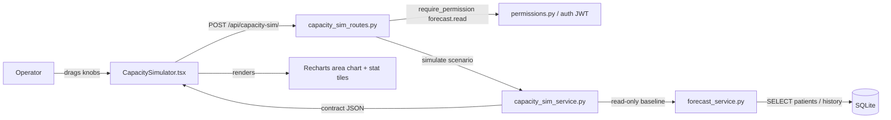
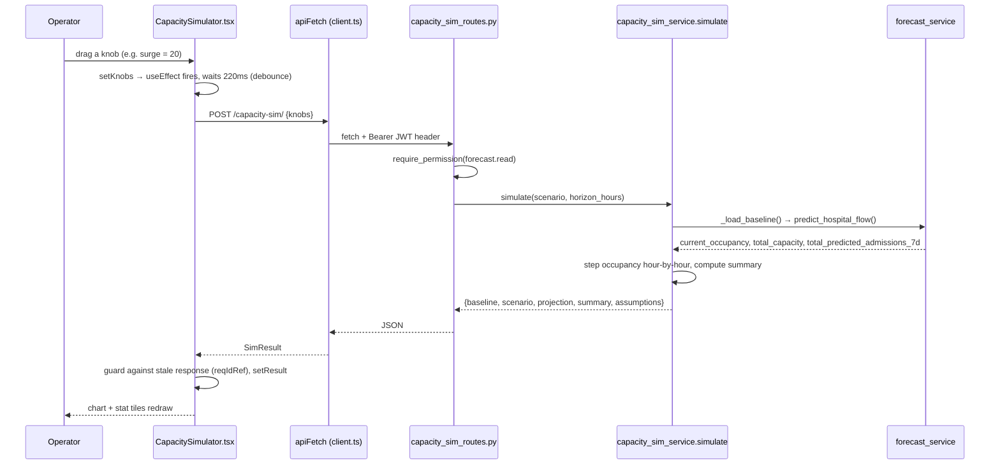

# The What-If Capacity Simulator

The What-If Capacity Simulator (internally "Orb Forecast, What-If Capacity & Surge Simulator", tab label **Simulator**) lets a hospital operations leader ask questions like *"if 20 patients arrive tonight and I close 8 beds, when do I run out of room and how many extra nurses do I need?"*, and see the answer redraw live as they drag sliders. It takes the hospital's **current** state (how many beds are filled, how many beds exist, how fast patients are arriving) straight from the existing Forecast subsystem so it can never contradict the numbers already on screen, then projects occupancy forward hour by hour under operator-chosen "knobs" using a small, fully **deterministic** flow model, no randomness, no queueing theory, just arithmetic you can teach in five minutes. The whole thing is one backend service function, one thin REST route, and one React panel.

---

## Purpose and neighbors

**The problem it solves.** A charge nurse or bed manager needs to make staffing and bed decisions *before* a surge hits: pull staff in, open an overflow ward, accelerate discharges. Raw forecasts tell you the likely future; they do not let you *play* with hypotheticals. This subsystem is the sandbox, vary the inputs, watch occupancy vs. capacity, hours-to-overflow, discharges-needed, and the nurse-staffing gap update in real time.

**Why it is built ON the forecast, not beside it.** If the simulator invented its own idea of "current census" or "how fast patients arrive," its numbers could drift away from what the Forecast pillar shows, and clinicians would stop trusting both. So the baseline (starting census, total beds, expected daily admission rate) is read **read-only** from `services.forecast_service`, and the simulator never mutates forecast state (`server/services/capacity_sim_service.py:1-31`).

Jargon used throughout, defined once here:

- **Census / occupancy**, the number of beds currently filled by admitted patients. "Census" is the starting count; "occupancy" is the projected count at a future hour.
- **Capacity**, the number of staffed beds available. "Effective capacity" = capacity after the scenario's open/close-beds knob is applied.
- **Length of stay (LOS)**, how long, on average, a patient occupies a bed before discharge. Longer LOS → beds free up more slowly.
- **RBAC (Role-Based Access Control)**, permissions attached to roles, checked on every request. Here the gate is the permission string `forecast.read`.
- **JWT (JSON Web Token)**, a signed token the browser stores after login and sends as `Authorization: Bearer <token>` on each request; the server verifies it to identify the user.
- **Dependency injection**, FastAPI's pattern of declaring `Depends(...)` in a handler's signature so the framework runs the dependency (here, the permission check) before the handler body.
- **Debounce**, waiting for a short quiet period after the last change before firing an action, so dragging a slider does not fire 200 requests.



Neighbors referenced in this guide: **Forecast** (the baseline source; owns `predict_hospital_flow`, `TOTAL_CAPACITY`, `DOW_MULTIPLIERS`), **Auth/RBAC** (`require_permission`, JWT, see the auth/RBAC guide), the **API client** (`apiFetch` in `src/api/client.ts`), and the **Clinician shell** (`ClinicianShell.tsx`, which mounts this panel as a lazy-loaded tab).

---

## File map

| File | Lines (approx) | Role |
|---|---|---|
| `server/services/capacity_sim_service.py` | 295 | The whole model: pulls the baseline from Forecast, steps occupancy forward hour-by-hour, computes summary metrics. The single source of truth. |
| `server/routes/capacity_sim_routes.py` | 47 | One POST route. Validates the request with a Pydantic model, enforces `forecast.read`, calls `simulate`, wraps errors as HTTP 500. |
| `src/components/capacity/CapacitySimulator.tsx` | 425 | The React panel: sliders/presets → debounced POST → stat tiles + Recharts occupancy chart + assumptions footnote. |
| `src/components/capacity/CapacitySimulator.css` | 331 | Flat "Quiet Clinical" theme-aware styling (gold accent, danger/warn/ok tones, range sliders, responsive two-column grid). |
| `server/tests/test_capacity_sim.py` | 161 | Service-level tests: contract shape, projection length, monotone response to surge/bed knobs, empty-DB safety, and strict determinism. |

---

## How it works

### The main flow (client ↔ server)



### The simulation model, taught precisely

This is **not** a queueing model (no M/M/c servers, no Erlang blocking formulas) and **not** a Monte Carlo simulation (no random draws). It is a **deterministic discrete-time flow model**, a "compartment" model with one compartment (the ward), integrated forward one hour at a time. Concretely it is forward-Euler integration of the ordinary differential equation

```
d(occupancy)/dt  =  A  −  occupancy / τ
```

where `A` is the hourly admission inflow and `τ` is the effective average length of stay in hours. Read the actual loop at `server/services/capacity_sim_service.py:234-250`. Written out, the recurrence is:

```
occupancy[0] = census0                              # the starting census (t0)

for each hour h = 1 … horizon_hours:
    admissions_h  = base_hourly_adm + extra_hourly_adm         # constant inflow
    discharges_h  = occupancy * discharge_rate_hourly          # proportional outflow
    occupancy     = max(0, occupancy + admissions_h − discharges_h)
```

The pieces (all per hour):

| Quantity | Formula | Source line |
|---|---|---|
| `base_hourly_adm` | `(admission_rate_daily / 24) * admission_rate_multiplier` | `capacity_sim_service.py:187` |
| `extra_hourly_adm` | `extra_admissions / horizon_hours` (one-off surge spread evenly) | `capacity_sim_service.py:188` |
| `eff_los_hours` (τ) | `BASE_AVG_LOS_DAYS(4.375) * 24 * los_multiplier` | `capacity_sim_service.py:193` |
| `discharge_rate_hourly` | `(1 / eff_los_hours) * (1 + discharge_boost)`, capped at 1.0 | `capacity_sim_service.py:194-195` |

**Why discharges are proportional, not fixed.** Discharging a *fraction* `1/τ` of the current census each hour is the discrete form of exponential decay, patients leave at a rate proportional to how many are in the building, which is what an average-LOS assumption implies. That gives the model a natural **steady state**: inflow equals outflow when `occupancy* = A · τ`. So a flu surge (bigger `A`) or a sicker cohort (bigger `τ` via `los_multiplier`) settles at a higher plateau; aggressive discharge (bigger `discharge_boost`, smaller effective `τ`) settles lower. This is why the projected curve bends toward a plateau instead of rising forever.

**Worked example (do the arithmetic).** Baseline census 20, capacity 32, admission rate 6/day, all knobs neutral, horizon 24h:
- `base_hourly_adm = (6/24)*1.0 = 0.25` patients/hr; `extra_hourly_adm = 0`.
- `eff_los_hours = 4.375*24*1.0 = 105` hr; `discharge_rate_hourly = 1/105 ≈ 0.00952`.
- Hour 1: discharges = `20 * 0.00952 ≈ 0.190`; occupancy = `20 + 0.25 − 0.190 = 20.06`.
- Steady state ≈ `A·τ = 0.25 * 105 = 26.25` beds, so this baseline slowly drifts up toward ~26/32 and never overflows. Add `extra_admissions=20` and `A` gains `20/24 ≈ 0.83/hr`, pushing the plateau to `(0.25+0.83)*105 ≈ 113`, far over 32 beds, hence overflow.

### Baseline resolution (where the starting numbers come from)

`_load_baseline()` (`capacity_sim_service.py:99-121`) calls `forecast_service.predict_hospital_flow(days_ahead=7)` and extracts three fields:

| Simulator field | Read from forecast | Forecast source line |
|---|---|---|
| `census` | `current_occupancy` (= count of `status='admitted'` patients) | `forecast_service.py:514` |
| `capacity` | `total_capacity` (= `TOTAL_CAPACITY` = sum of ward beds = 32) | `forecast_service.py:515`, `:61` |
| `admission_rate` (per day) | `summary.total_predicted_admissions_7d / 7` | `forecast_service.py:523` |

The `/7` trick is legitimate because the forecast's day-of-week multipliers `DOW_MULTIPLIERS = {Mon 1.35 … Sun 0.65}` sum to exactly 7.00 (`forecast_service.py:64`), so the 7-day total is independent of which weekday you start on, and dividing by 7 recovers the underlying flat daily rate. If the forecast call throws or the DB is empty, the baseline degrades to census 0, capacity 32, rate `FALLBACK_ADMISSION_RATE_DAILY = 4.5` and never raises (`capacity_sim_service.py:114-115`).

Callers may also **override** the baseline for hermetic testing or manual planning by passing `baseline_census`, `baseline_capacity`, `admission_rate_daily` (`capacity_sim_service.py:163-168`). Overrides win over the live pull.

---

## Function-by-function

### `capacity_sim_service.py`: module constants: `capacity_sim_service.py:54-92`
**Signature:** module-level constants and the `ASSUMPTIONS_META` dict → surfaced verbatim in the API response.
**Does:** declares the model's honest, cited assumptions.
**How it works:**
1. `BASE_AVG_LOS_DAYS = 4.375` (`:54`), the average length of stay, taken as the unweighted mean of the forecast heuristic's per-ward base LOS (ICU 7 / W1 4 / W2 3 / W3 3.5 days). Governs the discharge rate.
2. `DEFAULT_NURSE_PATIENT_RATIO = 4.0` (`:61`), patients per nurse; the 1:4 med-surg safe-staffing benchmark. Editable per scenario.
3. `FALLBACK_ADMISSION_RATE_DAILY = 4.5` (`:66`), used only when the forecast can supply no rate; matches the forecast's own empty-history default so the two never disagree.
4. `ASSUMPTIONS_META` (`:68-92`), a dict of `{value, source}` entries. It is returned in every response so the UI can render a "Model assumptions & citations" footnote (transparency: the clinician sees exactly what the numbers rest on).
**Why it exists:** to make the model's basis explicit and auditable rather than hiding magic numbers in the loop, and to keep the LOS and fallback-rate constants in step with the forecast heuristic.
**Data in/out:** none in; constants + a JSON-serializable dict out.
**Talks to:** `capacity_sim_service.py:85` reads `forecast_service.TOTAL_CAPACITY` at import time to populate the capacity assumption. The dict is echoed to the frontend at `capacity_sim_service.py:294`.
**Change guide:** To change the discharge assumption globally, edit `BASE_AVG_LOS_DAYS` at `:54`; knock-on effect, every projection's discharge rate and steady-state occupancy shift, and the assumptions footnote updates automatically. Watch out: this is the *baseline* LOS; the per-scenario `los_multiplier` scales it, so do not double-count.
**Gotchas:** none noteworthy, these are inert constants.

### `_load_baseline`: `capacity_sim_service.py:99`
**Signature:** `() -> dict` with keys `census`, `capacity`, `admission_rate`.
**Does:** reads the live baseline from the Forecast subsystem, degrading to safe defaults on any error.
**How it works:**
1. Seeds defaults: census 0, capacity `TOTAL_CAPACITY`, rate `FALLBACK_ADMISSION_RATE_DAILY` (`:103-105`).
2. Calls `forecast_service.predict_hospital_flow(days_ahead=7)` (`:108`).
3. Pulls `current_occupancy` → census, `total_capacity` → capacity (`:109-110`).
4. Reads `summary.total_predicted_admissions_7d`; if truthy, sets `admission_rate = total_7d / 7.0` (`:111-113`).
5. Wraps everything in a bare `try/except Exception` that logs a warning and keeps the defaults (`:114-115`), never raises.
6. Returns the three values clamped non-negative and rate rounded to 2 dp (`:117-121`).
**Why it exists:** to give `simulate` a starting point that is guaranteed consistent with the Forecast pillar, while never letting a forecast failure or empty database break the simulator.
**Data in/out:** in, nothing (reads forecast/DB); out, `{census:int, capacity:int, admission_rate:float}`.
**Talks to:** calls `forecast_service.predict_hospital_flow`. Called only by `simulate` (`:162`).
**Gotchas:** `predict_hospital_flow` reads the wall clock (`datetime.now`) and the DB, and caches for one hour. That means the *live* baseline is only as deterministic as the forecast: within the 1-hour cache window it is stable, but the underlying admission rate can drift as the forecast's environmental (Pulse) multipliers change. The strict determinism guarantee (see the docstring at `:23-30`) is airtight only when the caller injects `baseline_*` overrides. See Discrepancies.

### `_f`: `capacity_sim_service.py:128`
**Signature:** `(scenario: dict, key: str, default: float) -> float`
**Does:** safely coerces one scenario knob to a float, tolerating `None`, empty string, and garbage.
**How it works:** reads `scenario.get(key, default)`; if it is `None` or `""` returns `float(default)`; otherwise `float(v)`; on `TypeError`/`ValueError` returns `float(default)` (`:130-136`).
**Why it exists:** knobs arrive from JSON/HTTP and may be missing or malformed; this centralizes defensive parsing so the math below can assume clean floats.
**Data in/out:** dict + key + default → float.
**Talks to:** called throughout `simulate` for every knob.
**Gotchas:** always returns a float even for integer knobs, callers wrap with `int(...)` where they need an integer (e.g. `beds_delta` at `:173`).

### `simulate`: `capacity_sim_service.py:139`
**Signature:** `(scenario: dict | None = None, horizon_hours: int = 24) -> dict`
**Does:** the entire simulation, resolve baseline + knobs, step occupancy forward, compute the summary, return the full contract.
**How it works:**
1. **Copy the scenario** so the caller's dict is not mutated (`:159`).
2. **Resolve baseline** via `_load_baseline()`, then apply any `baseline_census` / `baseline_capacity` / `admission_rate_daily` overrides (overrides win) (`:162-168`).
3. **Resolve and clamp knobs** (`:171-179`):
   - `horizon_hours` clamped to `[1, 720]` (30 days), `:171`.
   - `extra_admissions ≥ 0`, `admission_rate_multiplier ≥ 0`, `los_multiplier ≥ 0.05`, `discharge_boost ≥ -0.99`, and `nurse_ratio` falls back to the default if ≤ 0 (`:172-179`). These clamps are the model's guardrails against nonsensical or divide-by-zero inputs.
4. **Effective capacity** = `max(0, baseline_capacity + beds_delta)` (`:182`).
5. **Compute the per-hour rates** (`:187-195`) exactly as tabulated in *How it works*.
6. **Optional labeling clock** (`:198-204`): if `scenario["now"]` is a parseable ISO timestamp, it is used *only* to stamp a `timestamp` on each step. It never touches occupancy/overflow/staffing.
7. **Step the model** (`:207-250`): initialize `occupancy = census0`, record step 0, then loop `h = 1…horizon` applying the recurrence and recording each step. Along the way it tracks `peak_occupancy`/`peak_step`, `max_overflow`, `hours_to_overflow` (first hour occupancy exceeds capacity), and running `total_admissions`/`total_discharges`.
8. **Summary metrics** (`:252-263`): peak %, beds short at peak, suggested discharges (= worst-case overflow rounded up), and the staffing gap (nurses needed at peak minus nurses the baseline census is already staffed for).
9. **Return the contract** (`:265-295`): `baseline`, resolved `scenario` (echoing the clamped knobs + `effective_capacity`), `projection` (list of per-hour steps), `summary`, and `assumptions`.
**Why it exists:** it is the subsystem. One pure function, easy to test and reason about, no I/O beyond the read-only baseline pull.
**Data in/out:**
- In: `scenario` dict (knobs + optional baseline overrides + optional `now`), `horizon_hours` int.
- Out: the contract JSON documented under *Cross-subsystem contracts*.
**Talks to:** calls `_load_baseline`, `_f`, and the nested `_record`. Called by the route handler `run_scenario` (`capacity_sim_routes.py:45`) and directly by every test in `test_capacity_sim.py`.
**Change guide (worked examples):**
- *To add a new knob* (say `icu_only` occupancy), parse it with `_f` near `:172`, fold it into `base_hourly_adm`/`discharge_rate_hourly`, and echo it in the returned `scenario` dict at `:271-280` so the frontend can display it. Knock-on: add it to the `ScenarioRequest` Pydantic model (`capacity_sim_routes.py:20-35`) and to the frontend `Knobs` interface + `DEFAULT_KNOBS` (`src/components/capacity/CapacitySimulator.tsx:49-67`) or it will be silently dropped by `exclude_none`.
- *To make surge admissions arrive front-loaded instead of evenly*, change `extra_hourly_adm` at `:188` from a constant to an hour-dependent term inside the loop at `:235`. Watch out: `projected_admissions` in the summary (`:238`, `:291`) must still integrate to the same total or the total-admissions readout will lie.
- *To raise the horizon cap above 30 days*, edit the `24*30` clamp at `:171`; knock-on, very long horizons mean more list entries in `projection` (one per hour) and a heavier JSON payload / chart.
**Gotchas:**
- `baseline.capacity` in the return (`:268`) is the **original** capacity, while `scenario.effective_capacity` (`:279`) and every projection step's `capacity` (`:221`) are the **post-`beds_delta`** capacity. Consumers must use `effective_capacity` for the "line to not cross", the frontend correctly does (`src/components/capacity/CapacitySimulator.tsx:309`).
- Occupancy is a continuous float, not whole patients, `20.06` beds is normal. Only the summary rounds up to whole beds/nurses via `math.ceil`.
- `hours_to_overflow` is set at t0 as well (`:231-232`), so a baseline already over capacity reports `0` ("Now").

### `_record` (nested in `simulate`): `capacity_sim_service.py:216`
**Signature:** `(step: int, hour_offset: int, occ: float) -> None`
**Does:** appends one projection step dict to the `projection` list.
**How it works:** builds `{step, hour_offset, projected_occupancy (1dp), capacity (effective), overflow = max(0, occ−capacity), occupancy_pct}` and, if a labeling `now` exists, adds an ISO `timestamp = now + hour_offset hours` (`:216-227`). `occupancy_pct` is `None` when capacity is 0 to avoid divide-by-zero (`:223`).
**Why it exists:** to keep the step-recording shape in one place, used both for t0 and inside the loop.
**Data in/out:** primitives in; mutates the enclosing `projection` list.
**Talks to:** closes over `capacity`, `now`, `projection` from `simulate`. Called at `:230` (t0) and `:241` (each hour).
**Gotchas:** it is a closure, it reads `capacity`/`now` from the enclosing scope, so those must be finalized before the first call (they are).

---

### `capacity_sim_routes.py`

### `ScenarioRequest` (Pydantic model): `capacity_sim_routes.py:20`
**Signature:** a `pydantic.BaseModel` with typed, defaulted fields.
**Does:** declares and validates the request body shape.
**How it works:** fields with defaults, `horizon_hours=24`, the six knobs (`extra_admissions`, `beds_delta`, `admission_rate_multiplier`, `los_multiplier`, `discharge_boost`, `nurse_patient_ratio`), and four `Optional` baseline/label fields (`baseline_census`, `baseline_capacity`, `admission_rate_daily`, `now`) (`:20-35`). Pydantic rejects wrong-typed input with HTTP 422 automatically.
**Why it exists:** to get free validation, defaults, and OpenAPI docs, and to separate the horizon (a function argument) from the scenario knobs (a dict).
**Data in/out:** JSON body → validated model.
**Talks to:** consumed by `run_scenario`.
**Gotchas:** the `Optional[...]` fields default to `None` and are stripped by `exclude_none=True` in the handler, so omitting them means "use the live baseline." `nurse_patient_ratio` is `Optional[float]=None`, so if the client omits it the service default (4.0) applies.

### `run_scenario`: `capacity_sim_routes.py:38`
**Signature:** `(req: ScenarioRequest, user=Depends(require_permission(FORECAST_READ))) -> dict`
**Does:** the one endpoint, permission-gate the request, run the simulation, return the contract.
**How it works:**
1. Registered on **both** `@router.post("")` and `@router.post("/")` (`:38-39`), i.e. `POST /api/capacity-sim` and `POST /api/capacity-sim/`, so a trailing slash does not trigger a 307 redirect.
2. `Depends(require_permission(FORECAST_READ))` runs first: it verifies the JWT (via `get_current_user`), checks the user's role includes `forecast.read`, and on failure logs a `permission_denied` audit event and returns HTTP 403 (`permissions.py:376-438`).
3. Serializes the request to a scenario dict with `req.model_dump(exclude={"horizon_hours"}, exclude_none=True)`, dropping the horizon (passed separately) and any unset optional fields (`:44`).
4. Calls `capacity_sim_service.simulate(scenario, horizon_hours=req.horizon_hours)` and returns its dict (`:45`).
5. Any exception becomes `HTTPException(500, "Simulation error: …")` (`:46-47`).
**Why it exists:** to expose the pure service over HTTP behind the same RBAC and auth as the rest of the Forecast pillar, with minimal logic of its own.
**Data in/out:** `ScenarioRequest` in; the `simulate` contract JSON out; 403 on missing permission; 500 on internal error.
**Talks to:** depends on `require_permission`/`FORECAST_READ` (`permissions.py`) and `capacity_sim_service.simulate`. Mounted in `server/main.py:91,718` via `app.include_router(capacity_sim_router)`, the router already carries `prefix="/api/capacity-sim"` (`:17`), so `main.py` adds no further prefix. Called by the frontend `runSim` (`src/components/capacity/CapacitySimulator.tsx:98`).
**Change guide:** To tighten access to a bespoke permission (e.g. `capacity.simulate`), define it in `permissions.py`, grant it to the right roles, and swap `FORECAST_READ` at `:40`; knock-on, the frontend tab gating in `ClinicianShell.tsx` (which currently keys off role, not this permission) would also need updating or users could see a tab that 403s. To surface validation errors instead of a blanket 500, catch specific exceptions before the broad `except` at `:46`.
**Gotchas:** the broad `except Exception` masks the real error type behind a 500; a malformed `now` string does *not* reach here (the service swallows it), but a programming error in `simulate` would surface only as a generic 500 message.

---

### `CapacitySimulator.tsx`

### `CapacitySimulator` (default export component): `src/components/capacity/CapacitySimulator.tsx:94`
**Signature:** `() -> JSX.Element`
**Does:** the whole panel, holds knob state, debounces re-simulation, and renders controls + results.
**How it works:**
1. **State** (`:87-92`): `knobs` (the seven slider values, seeded from `DEFAULT_KNOBS`), `result` (last `SimResult`), `error`, `busy`, plus two refs, `debounceRef` (the pending timer) and `reqIdRef` (a monotonically increasing request id used to discard stale responses).
2. **`runSim`** (`:94-112`, a `useCallback` so its identity is stable): increments `reqIdRef`, POSTs the knobs to `/capacity-sim/` via `apiFetch`, and, crucially, only commits the result/error/busy state **if its request id is still the latest** (`myReq === reqIdRef.current`). This defeats the race where a slow older request resolves after a newer one.
3. **Debounced effect** (`:115-119`): whenever `knobs` change, clear any pending timer and schedule `runSim(knobs)` 220 ms later; the cleanup clears the timer on unmount/re-run. So dragging a slider fires exactly one request after you stop.
4. **`setKnob` / `applyPreset`** (`:121-125`): update one knob, or replace all knobs with a preset merged over the defaults.
5. **`chartData`** (`:130-135`, memoized): maps each projection step to `{hour, occupancy, capacity, overflow}`, where `overflow` is the occupancy value *only when* the step is over capacity (else `null`), this drives the red overflow area.
6. **`willOverflow`** (`:137-138`): true when `hours_to_overflow` is a real number (including 0), false when `null`.
7. **Render** (`:140-362`): a header with a live **baseline chip** (census / beds / adm-per-day from `result.baseline`), an error banner, then a two-column grid, a controls card (presets, horizon buttons, six `Knob` sliders, reset) and a results column (five `Stat` tiles, the Recharts area chart with a dashed capacity `ReferenceLine`, and a collapsible assumptions footnote rendered from `result.assumptions`).
**Why it exists:** to make the model tangible, the value is in the *interactivity*, the instant redraw as you explore hypotheticals.
**Data in/out:** in, user slider events; out, `POST /capacity-sim/` bodies (the `Knobs` object) and rendered UI. Consumes the `SimResult` contract.
**Talks to:** `apiFetch` (`src/api/client.ts:195`), which attaches the Bearer JWT and handles 401/403. Mounted lazily by `ClinicianShell.tsx:281,752` inside a `PanelErrorBoundary`; the tab is gated by role in `getAccessibleTabs` (`ClinicianShell.tsx:182-205`, doctors and admins get `capacity`; nurses and pharmacists do not).
**Change guide (worked example):** To add a "close whole ICU" preset, push `{ label: '🧊 ICU offline', knobs: { beds_delta: -8 } }` into `PRESETS` (`:69-76`); it works immediately because `applyPreset` merges over `DEFAULT_KNOBS`. To change the debounce feel, edit the `220` at `:117`, lower is snappier but fires more requests. Watch out: the request body is the raw `knobs` object, so any new knob must exist on both the `Knobs` interface (`:49-57`) and the backend `ScenarioRequest`, or it is dropped.
**Gotchas:**
- The **stale-response guard** (`reqIdRef`) is load-bearing: without it, a laggy earlier simulation could overwrite a newer one and the chart would disagree with the sliders.
- `apiFetch` is called with path `/capacity-sim/` (trailing slash), it prepends `/api`, giving `/api/capacity-sim/`, which matches the `@router.post("/")` registration. Dropping the slash would hit `@router.post("")`, both exist, so either is fine here.
- The knob sliders clamp to narrower ranges than the backend (e.g. `discharge_boost` UI max 1.0 vs backend floor −0.99, `los_multiplier` UI 0.5–2 vs backend floor 0.05); the backend clamps are the real safety net for any non-UI caller.

### `Knob` (sub-component): `src/components/capacity/CapacitySimulator.tsx:374`
**Signature:** `({label, hint, value, display, min, max, step, onChange}) -> JSX.Element`
**Does:** renders one labeled range slider with a live value pill.
**How it works:** a header row (label + hint + formatted `display` value) over an `<input type="range">`; `onChange` converts the string event value to a `Number` before calling back (`:372-386`).
**Why it exists:** to DRY up the six near-identical sliders.
**Data in/out:** props in; numeric `onChange(v)` out.
**Talks to:** rendered six times by `CapacitySimulator`; each `onChange` calls `setKnob`.
**Gotchas:** `display` is passed pre-formatted (e.g. `+20`, `1:4`, `1.50×`), the component does no formatting itself, so the caller owns units.

### `Stat` (sub-component): `src/components/capacity/CapacitySimulator.tsx:399`
**Signature:** `({label, value, sub?, tone?}) -> JSX.Element`
**Does:** renders one summary tile with a colored left edge keyed to `tone` (`ok`/`warn`/`danger`/`neutral`).
**How it works:** appends a `capsim__stat--<tone>` modifier class unless the tone is `neutral`/absent (`:392-398`); the CSS colors the `::before` accent bar (`src/components/capacity/CapacitySimulator.css:228-237`) and the value text (`:253-255`) accordingly.
**Why it exists:** consistent, glanceable KPI tiles with severity coloring.
**Data in/out:** props in; JSX out.
**Talks to:** rendered five times; `tone` is computed by `peakTone` and inline ternaries at `:242-271`.
**Gotchas:** none noteworthy.

### `SimTooltip` (sub-component): `src/components/capacity/CapacitySimulator.tsx:412`
**Signature:** `({active, payload}: any) -> JSX.Element | null`
**Does:** the custom Recharts hover tooltip showing occupancy, capacity, and overflow at a given hour.
**How it works:** bails to `null` if not active or no payload; else reads `payload[0].payload`, computes whether occupancy exceeds capacity, and renders the rows, adding a red "Overflow +X" row only when over (`:402-417`).
**Why it exists:** the default Recharts tooltip cannot express the occupancy-vs-capacity-vs-overflow framing.
**Data in/out:** Recharts payload in; tooltip JSX out.
**Talks to:** passed to `<Tooltip content={<SimTooltip />}/>` at `:306`.
**Gotchas:** typed `any`, no compile-time guarantee the payload shape matches; it defensively guards `payload?.length`.

### `peakTone` (helper): `src/components/capacity/CapacitySimulator.tsx:430`
**Signature:** `(pct: number | null | undefined) -> 'ok' | 'warn' | 'danger' | 'neutral'`
**Does:** maps peak-occupancy percentage to a severity tone.
**How it works:** `null` → `neutral`; `≥100%` → `danger`; `≥85%` → `warn`; else `ok` (`:420-425`).
**Why it exists:** to color the "Peak occupancy" tile by how close to (or over) capacity the projection gets.
**Data in/out:** number|null → tone string.
**Talks to:** called at `:246`.
**Gotchas:** the 85 / 100 thresholds are hard-coded here, independent of any backend value.

---

### `CapacitySimulator.css`: `CapacitySimulator.css:1-331`
**Does:** styles the panel in Orb's flat "Quiet Clinical" system, opaque surfaces, hairline borders, no glass, theme-aware via CSS custom properties (see the file header, `:1-5`).
**How it works (the load-bearing bits):**
- **Theme tokens.** Every color pulls from CSS variables, `--accent-gold`, `--bg-surface`, `--border-subtle`, `--bg-glass`/`--border-glass` (chips and controls only), `--status-danger/warn/ok` plus their `--status-*-text` on-surface variants, `--text-primary/secondary/muted`. There are **no literal fallbacks** left: not one `var(--x, literal)` remains in the file, so a missing token renders as nothing rather than as a wrong colour. It defines none of these tokens itself.
- **Layout** (`:73-81`): `.capsim__grid` is a `320px 1fr` two-column grid that collapses to one column under 900 px (`:79-81`).
- **Flat cards** (`:83-88`, `:216-223`, `:261-266`): `var(--bg-surface)` fill plus a 1 px `var(--border-subtle)` hairline and a token radius. There is no `backdrop-filter` anywhere in the file, and exactly one shadow, `--elev-3` on the chart tooltip (`:287`).
- **Stat accent bar** (`:225-232`): a 3 px `::before` strip whose color is switched by the `--danger/warn/ok` modifier classes emitted by `Stat` (`:233-235`); the same modifiers recolour the tile's value text via the `--status-*-text` tokens (`:251-253`).
- **Range slider** (`:154-190`): custom-styled thumb for both WebKit and Firefox, gold on a `--bg-glass-hover` track.
- **Busy pulse** (`:318-331`): the "simulating" dot animates via `@keyframes capsim-pulse`.
**Why it exists:** to make the simulator visually consistent with the rest of Orb and readable in light/dark.
**Talks to:** consumes global theme tokens (owned by the design-system layer); class names are produced by the TSX.
**Gotchas:** because colors are token-driven and no fallbacks remain, changing or deleting a global token restyles, or blanks, this panel directly. Status *text* must use the `--status-*-text` tokens, never the `--status-*` fill tokens, or the contrast gate fails. `color-mix(in srgb, …)` (`:149`, `:312-313`) requires a reasonably modern browser.

---

### `test_capacity_sim.py`

### `_base` (test helper): `test_capacity_sim.py:10`
**Signature:** `(**overrides) -> dict`
**Does:** builds a hermetic baseline scenario (`census 20`, `capacity 32`, `rate 6.0`) that override the live DB, merging any extra knobs.
**Why it exists:** so most tests are deterministic and independent of DB contents.

### The test cases: `test_capacity_sim.py:21-161`
| Test | Asserts | Line |
|---|---|---|
| `test_baseline_projection_length_and_contract` | all five top-level keys present; `len(projection) == horizon+1`; step 0 is hour 0 and last is hour `horizon`; each step has occupancy/capacity/overflow; summary keys present; baseline echoes census 20 / capacity 32 | `:21` |
| `test_horizon_reflected_in_length` | projection length is `h+1` for h in {12,48,72} | `:52` |
| `test_extra_admissions_raises_peak_occupancy` | surge raises peak occupancy and peak % | `:59` |
| `test_admission_rate_multiplier_raises_peak` | 3× admission rate raises peak | `:68` |
| `test_closing_beds_reduces_capacity_and_causes_overflow` | `effective_capacity == 24`; step-0 capacity 24; `hours_to_overflow == 0`; `beds_short_at_peak ≥ 6`; `suggested_discharges ≥ 6` | `:77` |
| `test_opening_beds_raises_capacity` | `effective_capacity == 42` (32+10) | `:90` |
| `test_staffing_gap_grows_with_surge` | staffing gap under surge ≥ calm and > 0 | `:96` |
| `test_empty_scenario_uses_live_baseline_without_crashing` | `{}` scenario pulls the live baseline, returns 25 steps, non-negative census/capacity and occupancy | `:106` |
| `test_none_scenario_does_not_crash` | `None` scenario → 7 steps for horizon 6 | `:117` |
| `test_zero_capacity_baseline_does_not_divide_by_zero` | zero capacity → `peak_occupancy_pct` is `None` or numeric (no crash) | `:122` |
| `test_determinism_same_input_same_output` | two calls with a full knob set incl. `now` produce `a == b` | `:132` |
| `test_determinism_on_live_baseline` | two immediate live-baseline calls are equal | `:146` |
| `test_discharge_boost_lowers_peak` | discharge boost 0.8 lowers (≤) the peak vs no boost | `:154` |

**What the suite does not cover:** the `los_multiplier` knob is never independently asserted; the `suggested_discharges` vs `beds_short_at_peak` edge case (below) is not exercised because the surge/close-beds tests happen to round to equal values; the route layer, RBAC 403 path, and frontend are untested here.

---

## Cross-subsystem contracts

### REST endpoint (owned here)

| Method | Path | Auth | Request body | Response |
|---|---|---|---|---|
| POST | `/api/capacity-sim` and `/api/capacity-sim/` | `require_permission("forecast.read")` (Bearer JWT) | `ScenarioRequest` (below) | the simulation contract (below) |

Prefix verified: router declares `prefix="/api/capacity-sim"` (`capacity_sim_routes.py:17`) and `main.py:718` mounts it with no extra prefix.

**Request (`ScenarioRequest`)**, all optional with defaults:
```jsonc
{
  "horizon_hours": 24,              // clamped server-side to [1, 720]
  "extra_admissions": 0.0,          // one-off surge, spread evenly over horizon
  "beds_delta": 0,                  // open (+) / close (−) beds
  "admission_rate_multiplier": 1.0, // 1.5 ≈ flu, 2 ≈ epidemic
  "los_multiplier": 1.0,            // >1 = sicker/slower turnover
  "discharge_boost": 0.0,           // 0.3 = 30% faster discharging
  "nurse_patient_ratio": 4.0,       // patients per nurse; null → default 4
  "baseline_census": null,          // override live baseline (testing/planning)
  "baseline_capacity": null,
  "admission_rate_daily": null,
  "now": null                       // ISO string; labels steps only, never math
}
```

**Response contract** (returned by `simulate`, `capacity_sim_service.py:265-295`):
```jsonc
{
  "baseline":  { "census": 20, "capacity": 32, "admission_rate": 6.0 },  // capacity = ORIGINAL
  "scenario":  { "extra_admissions": 20, "beds_delta": -8, "admission_rate_multiplier": 1.5,
                 "los_multiplier": 1.0, "discharge_boost": 0.0, "nurse_patient_ratio": 4.0,
                 "horizon_hours": 24, "effective_capacity": 24 },        // capacity AFTER beds_delta
  "projection": [ { "step": 0, "hour_offset": 0, "projected_occupancy": 20.0,
                    "capacity": 24, "overflow": 0.0, "occupancy_pct": 83.3,
                    "timestamp": "…"  /* only if now given */ }, … ],    // length = horizon+1
  "summary":   { "peak_occupancy": 30.0, "peak_occupancy_pct": 125.0, "peak_hour_offset": 0,
                 "hours_to_overflow": 0, "beds_short_at_peak": 6, "suggested_discharges": 6,
                 "staffing_gap_nurses": 3, "nurses_required_at_peak": 8,
                 "projected_admissions": 6.0, "projected_discharges": 5.9 },
  "assumptions": { "base_avg_los_days": { "value": 4.375, "source": "…" }, … }
}
```

### Dependencies this subsystem consumes

| From | What | Where |
|---|---|---|
| `forecast_service.predict_hospital_flow()` | live `current_occupancy`, `total_capacity`, `summary.total_predicted_admissions_7d` | `capacity_sim_service.py:108-113` |
| `forecast_service.TOTAL_CAPACITY` | fallback capacity (32) + assumptions meta | `:104`, `:85` |
| `forecast_service.DOW_MULTIPLIERS` | *conceptual* dependency, the `/7` rate derivation relies on these summing to 7.0 | (`forecast_service.py:64`) |
| `permissions.require_permission`, `FORECAST_READ` | RBAC gate + JWT auth | `capacity_sim_routes.py:14,40` |
| `src/api/client.ts apiFetch` | Bearer auth, 401/403 handling | `src/components/capacity/CapacitySimulator.tsx:98` |
| `ClinicianShell.tsx` | mounts the panel as the `capacity` tab | `ClinicianShell.tsx:281,752` |

No socket events. No DB tables of its own, it only reads (transitively, via the forecast) `patients` and `admission_history` (`forecast_service.py:404-406,424-429`).

---

## Rebuild notes

**Prerequisites (must already exist):**
1. The **Forecast** subsystem exposing `predict_hospital_flow()` returning `current_occupancy`, `total_capacity`, and `summary.total_predicted_admissions_7d`, plus the `TOTAL_CAPACITY` constant. The simulator is meaningless without a baseline source. (It degrades gracefully if the call fails, but you want real numbers.)
2. **Auth + RBAC**: `require_permission` dependency factory and a `forecast.read` permission mapped to the roles that should see the tab.
3. The **API client** (`apiFetch`) that attaches the Bearer JWT and handles 401/403.
4. The **Clinician shell** with a tab framework to mount the panel, and the design-system theme tokens (`--accent-gold`, `--bg-glass`, `--status-*`, `--text-*`).

**Build order:**
1. Write `capacity_sim_service.py` first, it is pure and independently testable. Implement the constants/assumptions, `_load_baseline`, `_f`, then `simulate` with the hourly recurrence. Wire `_load_baseline` to your forecast.
2. Add `test_capacity_sim.py` and get determinism + contract + monotonicity tests green using injected `baseline_*` overrides.
3. Add `capacity_sim_routes.py`: the `ScenarioRequest` model and the `run_scenario` handler gated by `require_permission(FORECAST_READ)`, registered on both `""` and `"/"`. Mount it in `main.py`.
4. Build `CapacitySimulator.tsx`: `Knobs` state, debounced `runSim` with the stale-response guard, the `Knob`/`Stat`/`SimTooltip` sub-components, the Recharts area chart with the `effective_capacity` reference line, and the assumptions footnote. Add the CSS.
5. Mount it as a role-gated lazy tab in the shell.

**Acceptance check:** *You can now* log in as a doctor or admin, open the **Simulator** tab, click "🌙 20 admissions tonight," and watch the occupancy area climb, the dashed capacity line get crossed, "Hours to overflow" flip from "Clear" to a number, and "Extra nurses" rise, all redrawing within ~220 ms of each slider move, with the assumptions footnote citing a 4.375-day LOS and 1:4 nurse ratio. On the backend, `pytest server/tests/test_capacity_sim.py` passes, including both determinism tests.

---

## Discrepancies and open questions

1. **`suggested_discharges` ignores the t0 baseline step; `beds_short_at_peak` does not.** `peak_occupancy` is initialized from the t0 census (`capacity_sim_service.py:209`) and can be set at t0, but `max_overflow` is only updated inside the `h = 1…horizon` loop (`:246-248`), never for the t0 step. Since capacity is constant across a run, the two metrics are equal for any scenario whose peak occurs at h ≥ 1 (the normal surge case). But in a **declining-from-overloaded** scenario, baseline already above capacity and strictly falling every hour, `beds_short_at_peak` (from the t0 peak) can exceed `suggested_discharges` (from the largest *post-t0* overflow) by up to ~1 bed after `math.ceil`. The `test_closing_beds…` test (`:77`) sits exactly in this regime but happens to round both to 6, so it passes and never exposes the gap. It is a minor understatement of discharges-needed, not a crash.

2. **The "fully deterministic / no wall-clock" claim holds only for injected baselines.** The module docstring (`capacity_sim_service.py:23-30`) states the projection has "no `random` and no wall-clock reads." That is true of the *stepping math*, but `_load_baseline` calls `predict_hospital_flow`, which reads `datetime.now(timezone.utc)` (`forecast_service.py:400`), queries the DB, applies Pulse environmental multipliers, and caches for one hour. The live-baseline determinism tests (`:146-150`) pass only because both calls land within the same 1-hour forecast cache. Across cache expiry or changing environmental multipliers, a live-baseline (no `baseline_*` overrides) run can legitimately change. The docstring's own caveat at `:29` ("Callers/tests may also inject the baseline directly … to be fully hermetic") acknowledges this, but the blanket "no wall-clock reads" wording upfront slightly oversells it.

3. **Route-level errors collapse to a generic 500.** `run_scenario` wraps `simulate` in a broad `except Exception` (`capacity_sim_routes.py:46-47`), so any internal fault surfaces as `500 "Simulation error: …"` with no typing. Not a bug, but it makes client-side error handling coarse (the frontend just shows the message string).

4. **UI severity thresholds are duplicated, not shared.** The peak-occupancy color thresholds (85% warn / 100% danger) live only in the frontend `peakTone` (`src/components/capacity/CapacitySimulator.tsx:420-425`); the backend has no notion of them. If a future requirement wants server-driven severity, this would need consolidating. Cosmetic, noted for completeness.

No functional bugs found beyond item 1's edge-case rounding understatement.
