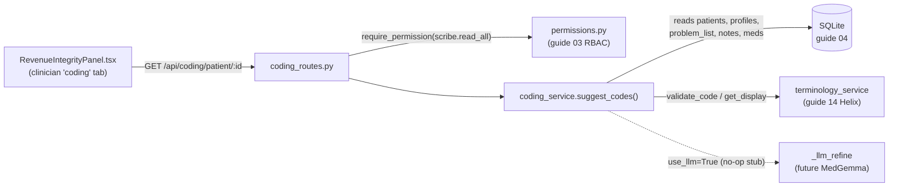
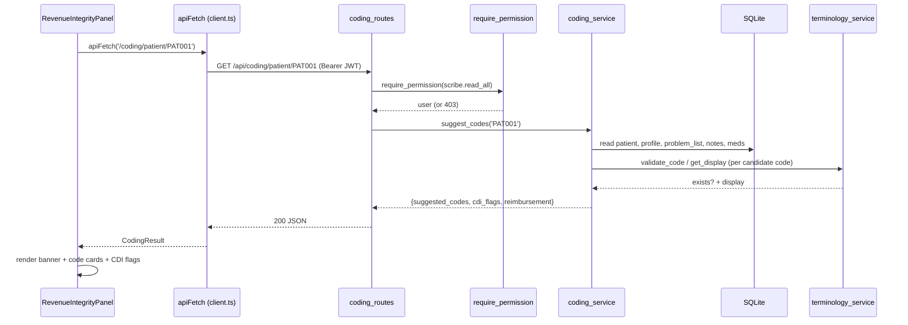

# Revenue Integrity: AI-assisted clinical coding

**Revenue integrity** is the hospital-finance discipline of making sure every service that was actually delivered and documented ends up correctly *coded* and therefore correctly *paid*, no more (which is fraud), no less (which is money left on the table). Orb's Revenue Integrity subsystem is a small, self-contained engine that reads a patient's existing clinical documentation, suggests the standard billing **codes** those notes support, flags places where documentation and coding disagree (**CDI**, Clinical Documentation Improvement), and prints an *illustrative* dollar figure for how much reimbursement is currently captured versus what could be captured if the gaps were closed. Crucially, it is **deterministic and rules-based, not an LLM**, a curated keyword dictionary plus a few arithmetic tables, with an optional (currently no-op) hook where a local medical LLM *could* later refine the results.

---

## Purpose and neighbors

A quick glossary, because this subsystem is dense with clinical-billing jargon:

- **ICD-10** (International Classification of Diseases, 10th revision): the worldwide standard alphanumeric code for a *diagnosis*, e.g. `A41.9` = "Sepsis, unspecified organism". A hospital bills from these. Orb suggests ICD-10 codes.
- **SNOMED CT**: a much larger clinical terminology used to code findings/observations (e.g. `233604007` = pneumonia). Orb suggests a few SNOMED codes alongside ICD-10 where the seed terminology has them, but SNOMED codes carry no reimbursement weight here.
- **DRG** (Diagnosis-Related Group) / **MS-DRG**: the US inpatient payment scheme where an entire admission is grouped into one payment bucket and reimbursed as `relative weight × hospital base rate`. Orb does **not** compute real DRGs. It *borrows the concept*: each ICD-10 code is given an illustrative "relative weight", multiplied by an illustrative base rate, to produce a planning-grade rupee figure (`server/services/coding_service.py:30-38`). The money model is **rupee-denominated** throughout, base rate, per-flag impact and the captured/potential/uplift totals are all `_inr` fields.
- **CC / MCC**: "Complication or Comorbidity" / "Major CC", secondary diagnoses that legitimately raise a DRG's payment. "Capturing a CC" is coder-speak for coding a comorbidity that was documented but omitted.
- **CDI** (Clinical Documentation Improvement): the practice of reviewing notes for gaps, a drug that implies an uncoded diagnosis, a documented comorbidity that never made the coded problem list, an "unspecified" code that could be sharpened, and querying the clinician to fix them. Orb generates these as "CDI flags".

**Why this exists in Orb:** the rest of Orb captures rich free-text clinical documentation (diagnoses, scribe notes, problem lists, medication lists). That text usually contains billable conditions that never got formally coded. This subsystem turns that latent documentation into concrete, reviewable coding/CDI suggestions with a money estimate attached, a "revenue integrity" view for clinicians and administrators. It is deliberately **read-only** (it never writes codes back); a human coder/CDI specialist remains the decision-maker (the human-review loop).

Neighbors: **guide 03 auth/RBAC** (the JWT + permission gate), **guide 04 database** (`db_session`, the tables read), **guide 14 Helix** (owns `terminology_service`, the code-validation layer), **guide 02 API client** (`apiFetch`), and the **ClinicianShell** page (the clinician workspace) that mounts the panel.

---

## File map

| File | Lines (approx) | Role |
| --- | --- | --- |
| `server/services/coding_service.py` | 526 | The whole engine: term→code dictionary, med→condition rules, illustrative rupee tables, whole-word lexical matcher, four-pass `suggest_codes` (suggestions → med inference → CDI flags → reimbursement math), and the LLM no-op stub. |
| `server/routes/coding_routes.py` | 68 | One authenticated FastAPI route, `GET /api/coding/patient/{patient_id}`, that authorises the caller, 404s an unknown patient, writes a `phi_access` audit row, and delegates to the service. |
| `src/components/coding/RevenueIntegrityPanel.tsx` | 244 | The React panel: a `PatientPicker`, `apiFetch`, and rendering of suggested codes / CDI flags / the reimbursement banner / an assumptions disclosure. |
| `src/components/coding/RevenueIntegrity.module.css` | 318 | Scoped, flat "Quiet Clinical" styles for the panel, built entirely on the shared token layer in `src/index.css`, no local theme overrides. |
| `server/tests/test_coding.py` | 166 | Pytest coverage: valid-terminology guarantee, med inference, CDI flags, reimbursement invariants, empty/unknown-patient safety, and LLM-noop equivalence. |

---

## How it works

### The main flow (client → server → back), in words

1. **User opens the "coding" tab** in the clinician workspace. `ClinicianShell` mounts `<RevenueIntegrityPanel />` with **no** `patientId` prop, so the panel shows a `PatientPicker`, a searchable patient chooser, *not* a raw id text box (`src/pages/ClinicianShell.tsx:818`, picker at `RevenueIntegrityPanel.tsx:111-116`). The old free-text `e.g. PAT001` placeholder 404'd on the very value it suggested, which is why the picker replaced it.
2. **User picks a patient and hits *Analyze*.** The panel commits the trimmed id into `patientId` state, which triggers its fetch effect (`src/components/coding/RevenueIntegrityPanel.tsx:93`).
3. **The panel calls `apiFetch`**, Orb's thin `fetch` wrapper that prefixes `/api`, attaches the `Authorization: Bearer <JWT>` header, and throws on non-2xx (`src/api/client.ts:195`). The request is `GET /api/coding/patient/<id>` (`RevenueIntegrityPanel.tsx:83`).
   - **JWT** = JSON Web Token, the signed login credential Orb stores in `localStorage` and sends on every request.
4. **The route authorises** via `Depends(require_patient_access(SCRIBE_READ_ALL))` (`server/routes/coding_routes.py:29`), a FastAPI *dependency* (a function FastAPI runs before the handler, whose return value is injected as `user`). It checks the caller's role holds `scribe.read_all` **and** that this patient is inside the caller's server-derived ward scope, returning 403 otherwise (RBAC in guide 03). The permission is defined at `server/permissions.py:45` and granted to doctors (`:107`), nurses (`:122`) and admins (`:143`); pharmacists do not hold it.
   - **RBAC** = Role-Based Access Control: permissions are attached to roles, roles to users.
5. **`suggest_codes` runs the deterministic pipeline** (`server/services/coding_service.py:309`) in four passes:
   - **Pass 1, lexical suggestions:** load all the patient's text (diagnosis, comorbidities, notes) and coded problem list; for every concept in `_CONCEPTS`, whole-word-match its synonyms against each source and emit the ICD-10/SNOMED code (validated against the `terminology` table) with an evidence string and a confidence tier.
   - **Pass 2, medication inference:** for every drug→condition rule, if the drug appears in the active medication list, emit the condition's code (confidence 0.5) and remember it drove a med signal.
   - **Pass 3, CDI flags:** (a) med present but its condition not coded; (b) a condition documented but not on the coded problem list; (c) an "unspecified" code that could be sharpened.
   - **Pass 4, reimbursement math:** `captured` = value of already-coded codes; `potential` = value of coded ∪ suggested; `uplift = max(potential − captured, 0)`, all as `weight × base rate`.
6. **The route 404s an unknown patient, writes its own audit row, then returns the dict** (`server/routes/coding_routes.py:39-68`). An unknown id used to return the same all-zero report a fully-documented patient returns, so a typo'd id read as "no capture gaps found" and a coder could close a review that never ran, hence the explicit 404 at `:40-41`. The `phi_access` audit row (`:48`) is fail-closed: this endpoint reads a named patient's diagnosis, problem list, medications and whole note corpus and returns a financial view of it, and the generic audit middleware only covers POST/PUT/PATCH/DELETE. Then the panel renders three regions, a green "Captured → Potential (+Uplift)" banner, a suggested-codes column, a CDI-flag column, plus a collapsible assumptions block.

---

## Function-by-function

### Module-level data tables: `coding_service.py`

These four tables *are* the "AI". They are curated by hand, not learned. Everything downstream reads from them.

- **`_CONCEPTS`, `server/services/coding_service.py:68`**, a list of ~27 dicts. Each maps a clinical concept to a list of surface `terms` (synonyms + abbreviations), an `icd10` code, an optional `snomed` code, and an optional `"symptom": True` marker. Reimbursement-relevant conditions (sepsis, pneumonia, diabetes, heart failure, …) come first; symptoms/findings (chest pain, fever, cough, …) are documented but carry zero weight. Example: `{"label": "Sepsis", "terms": ["sepsis","septic","septicaemia","septicemia","bacteremia","bacteraemia"], "icd10": "A41.9"}`.
- **`_MED_CONDITION_RULES`, `server/services/coding_service.py:136`**, 8 dicts mapping a list of `drugs` to the `icd10`/`label` of the condition they treat (metformin/insulin/… → diabetes `E11.9`; statins → hyperlipidemia `E78.5`; ACE-inhibitors/… → hypertension `I10`; etc.). This encodes the classic CDI signal "a drug is documented, so the diagnosis it treats probably exists but was never coded."
- **`BASE_RATE_INR = 50000.0`, `server/services/coding_service.py:163`**, the illustrative hospital base payment rate, sized for an Indian private-hospital inpatient case (PM-JAY package rates run lower). A placeholder, **not** a real payer number.
- **`DEFAULT_CODE_WEIGHTS`, `server/services/coding_service.py:169`**, `{icd10 code → relative weight}`. Higher acuity = higher weight (sepsis 1.80, acute MI 1.60, stroke 1.40, heart failure 1.20, pneumonia 1.00 … hypertension 0.15, hyperlipidemia/GERD 0.10, symptoms 0.0). A code absent from this dict defaults to weight 0.
- **`NONSPECIFIC_SPECIFICITY_UPLIFT_INR = 2000.0`, `server/services/coding_service.py:197`**, the flat illustrative rupee amount credited to sharpening one "unspecified" code.

**Why these live as editable module constants:** the module docstring is explicit that a deploying hospital must replace `BASE_RATE_INR` and `DEFAULT_CODE_WEIGHTS` with their own contracted case-mix / package rates (`server/services/coding_service.py:30-38`, `:168`). Keeping them as plain top-level dicts makes that a one-file edit.

---

### `_code_value_inr`: `server/services/coding_service.py:445`
**Signature:** `(code: str) → float`
**Does:** returns the illustrative rupee value of a single code.
**How it works:** `round(DEFAULT_CODE_WEIGHTS.get(code, 0.0) * BASE_RATE_INR, 2)` (`:202`), relative weight × base rate, rounded to paise; unknown codes → 0.
**Why it exists:** one arithmetic definition of "what a code is worth", reused by the sort order, every CDI rupee impact, and the reimbursement totals, so changing a weight moves every dependent number at once.
**Data in/out:** ICD-10 code string in; rupee float out.
**Talks to:** reads `DEFAULT_CODE_WEIGHTS`/`BASE_RATE_INR`; called by `suggest_codes`'s sort, the CDI passes, and the reimbursement math.
**Change guide:** To make sepsis worth more, edit its weight at `server/services/coding_service.py:171`, its CDI impact, its position in the sorted suggestions, and the `potential`/`uplift` totals all move together automatically.
**Gotchas:** SNOMED codes are never in `DEFAULT_CODE_WEIGHTS`, so any SNOMED code values at 0, reimbursement is an ICD-10-only story here.

---

### `_load_patient_context`: `server/services/coding_service.py:455`
**Signature:** `(patient_id: str) → dict`
**Does:** gathers, in one place, every free-text and coded source the engine scans for a patient.
**How it works:**
1. Opens a read connection via `db_session()` (a context manager that commits/rolls back and always closes, `server/database.py:1038`).
2. `SELECT id, diagnosis FROM patients`, if the row is missing, returns the empty context with `exists=False` (this is why unknown patients don't crash).
3. Reads `comorbidities` + `past_medical_history` from `patient_profiles`, joined with `" ; "`.
4. Reads the **coded problem list** (`problem_list` where `status='active'`) into `coded_problems` as `{code, system}` for both `icd10_code` and `snomed_code`, this is "what is *already* captured".
5. Reads narrative notes: latest 25 `clinical_documents.content`, then latest 25 `scribe_notes` (`raw_transcript` + `structured_note`), each tagged with a label.
6. Reads active medications (`medications` where `status != 'discontinued'`) into `medications`.
**Why it exists:** isolates all reads so `suggest_codes` is pure logic over a plain dict, easy to test and reason about.
**Data in/out:** patient id in; dict `{exists, diagnosis, comorbidities, notes:[(label,text)], coded_problems:[{code,system}], medications:[str]}` out.
**Talks to:** `database.db_session`; tables `patients`, `patient_profiles`, `problem_list`, `clinical_documents`, `scribe_notes`, `medications`. Called only by `suggest_codes`.
**Gotchas:** all SQL is parameterised (`?` placeholders), no injection risk. But the note reads are **capped at 25 each** (`:252`, `:258`); on a long admission an early note mentioning a codeable condition can be silently excluded from scanning.

---

### `_term_matches`: `server/services/coding_service.py:577`
**Signature:** `(term: str, text: str) → bool`
**Does:** whole-token, case-insensitive substring test.
**How it works:** builds the regex `(?<![A-Za-z0-9])` + `re.escape(term)` + `(?![A-Za-z0-9])` and searches case-insensitively. The look-behind/look-ahead assertions require the term not be flanked by an alphanumeric, so short abbreviations like "MI", "AKI", "AF" match as standalone words but not inside "MIchael" or "leAF".
**Why it exists:** naive `in` matching would fire on substrings; whole-word matching is what makes a curated abbreviation dictionary safe.
**Data in/out:** two strings in; bool out.
**Talks to:** called by the pass-1 concept scan and the pass-2 medication scan.
**Gotchas:** it is purely lexical, no negation handling. "no sepsis" or "rule out MI" still matches "sepsis"/"MI" and would suggest the code. This is exactly the kind of thing the human-review loop and a future LLM pass are meant to catch.

---

### `_emit_code`: `server/services/coding_service.py:620`
**Signature:** `(system: str, code: str, display_fallback: str) → dict | None`
**Does:** validates a candidate code against the loaded terminology and returns a normalised code dict, or `None` if the code is unknown.
**How it works:**
1. Empty code → `None`.
2. `terminology_service.validate_code(system, code)`, returns `False` unless `(code_system, code)` exists and `is_active=1` in the `terminology` table (`server/services/terminology_service.py:55`, called at `server/services/coding_service.py:299`). If invalid, return `None`.
3. Otherwise fetch the human display via `terminology_service.get_display(system, code)`, falling back to the passed label; return `{code, system: system.upper(), display}`.
**Why it exists:** this is the hard guarantee that **Orb never surfaces a code that doesn't exist in the deployment's terminology**. A partial terminology load just yields fewer suggestions, never bogus ones. That guarantee is pinned by `test_suggests_valid_terminology_code` (`server/tests/test_coding.py:84`, the per-code assertion at `:96-98`).
**Data in/out:** system/code/fallback in; `{code, system, display}` or `None`.
**Talks to:** `terminology_service` (owned by guide 14 Helix). Called by `_add_suggestion` and directly by CDI pass (a).
**Gotchas:** `system` is upper-cased on the way out but `validate_code` upper-cases internally too, so "icd10" and "ICD10" both work.

---

### `suggest_codes`: `server/services/coding_service.py:635`  *(the public entry point)*
**Signature:** `(patient_id: str, use_llm: bool = False) → dict`
**Does:** the whole feature, suggest codes, flag CDI gaps, estimate reimbursement, deterministically.
**How it works (the four passes):**
1. `ctx = _load_patient_context(patient_id)` (`:324`). Build an ordered `sources` list: `diagnosis` at confidence 0.9, `comorbidity list` at 0.75, then every note at 0.7 (`:326-332`). Build `coded_set` = the `(system, code)` pairs already coded (`:334`).
2. **Pass 1 (`:354-364`):** for each concept, walk `sources` in priority order; on the first source whose text whole-word-matches one of the concept's terms, emit its ICD-10 and/or SNOMED code with evidence `Matched "<term>" in <source>` and that source's confidence tier, then `break` (highest-priority source wins). `_add_suggestion` keeps only the highest-confidence hit per code.
3. **Pass 2 (`:366-377`):** join active meds into one string; for each med rule, if a drug matches, record `med_inferred_codes[icd10]=drug` and add the code as a suggestion at confidence 0.5 with evidence `Inferred from active medication "<drug>"`.
4. Sort suggestions by `(-rupee value, -confidence, code)` so the most valuable, most confident codes lead (`:379-382`).
5. **Pass 3, CDI flags (`:384-437`):**
   - **(a) `uncoded_condition_from_medication` (`:397`):** for each med-inferred code not already in `coded_set`, add a flag with `est_impact_inr = _code_value_inr(code)`; record it in `flagged_codes`.
   - **(b) `documented_not_coded` (`:420`):** for each suggested ICD-10 code that is not already flagged, not already coded, has value > 0 (excludes symptoms), and whose evidence is not a med inference, add a flag worth the code's full value.
   - **(c) `nonspecific_code` (`:432`):** for each suggested code whose display contains "unspecified"/"not specified", add a flat `NONSPECIFIC_SPECIFICITY_UPLIFT_INR` (₹2,000) flag.
6. **Pass 4, reimbursement (`:439-476`):** `captured` = Σ value of `coded_codes`; `potential` = Σ value of `coded ∪ suggested ICD`; `uplift = max(potential − captured, 0)` (`:451-453`). Bundle these with an `assumptions` block (model label, method sentence, base rate, per-code weights used, caveats, citations). Both sides of the money math are **ICD-10 only**, a SNOMED problem-list entry contributes 0 (`:442-449`).
7. Assemble `result` (`:478`), including the `patient_found` flag the route turns into a 404 (`:483`); if `use_llm`, pass it through `_llm_refine` (a no-op today).
**Why it exists:** the single reusable entry point for both the HTTP route and offline/batch callers; the route is a thin delegate.
**Data in/out:** patient id + `use_llm` in; `{patient_id, patient_found, suggested_codes[], cdi_flags[], reimbursement{}}` out (shapes in the docstring `:315-322`).
**Talks to:** `_load_patient_context`, `_add_suggestion`→`_emit_code`→`terminology_service`, `_term_matches`, `_code_value_inr`, `_llm_refine`. Called by `suggest_patient_codes` (`server/routes/coding_routes.py:24`) and by every test in `test_coding.py`.

**Worked example (single code):** sepsis matched in the diagnosis emits `A41.9`, weight 1.80 (`DEFAULT_CODE_WEIGHTS`, `:171`), so its value = `1.80 × 50,000 = ₹90,000` (`_code_value_inr`, `:200`). If nothing is coded yet, that ₹90,000 appears both as the code's contribution to `potential`/`uplift` and as a `documented_not_coded` CDI flag.

**Worked example (the `test_coding.py` sepsis patient):** diagnosis "Sepsis secondary to pneumonia" + comorbidity "Type 2 diabetes mellitus, hypertension" + med "Metformin", nothing on the coded problem list. Suggestions include `A41.9` (0.9), `J18.9` (0.9), `E11.9` (0.75, comorbidity, reinforced by metformin), `I10` (0.75). CDI flags include `uncoded_condition_from_medication` for `E11.9` (₹17,500 = 0.35×50,000, weight at `:184`) and `nonspecific_code` for the "unspecified" sepsis/pneumonia codes (₹2,000 each), both asserted by `test_cdi_flag_is_produced` (`server/tests/test_coding.py:111`). `captured=₹0`, `potential` = sum of the emitted ICD weights × 50,000, `uplift = potential`.

**Change guide:** To add a new codeable condition, append a dict to `_CONCEPTS` (`:68`) *and* give its code a weight in `DEFAULT_CODE_WEIGHTS` (`:169`), the code must also exist in the `terminology` table or `_emit_code` will drop it. To make med inference stricter, raise the 0.5 confidence at `:376`. Knock-on effects: sort order and every rupee total shift. Footgun: forgetting the terminology row means the code silently never appears with no error.
**Gotchas:** the `break` at `:364` means a concept is credited to its single highest-priority source only, you never get two evidence strings for the same concept. Symptom concepts still emit as *suggestions* (informational) but are excluded from CDI capture gaps because their value is 0.

---

### `_add_suggestion` (nested closure in `suggest_codes`): `server/services/coding_service.py:671`
**Signature:** `(system, code, display_fallback, evidence, confidence) → (system, code) | None`
**Does:** validate-and-dedupe a candidate into the `suggestions` dict, keeping the highest-confidence hit per `(system, code)`.
**How it works:** calls `_emit_code`; if valid, computes `key=(system,code)`; writes/overwrites the entry only when there's no existing hit or the new confidence is higher; stores `{**emitted, evidence, confidence: round(confidence,2)}`.
**Why it exists:** the same code can be matched from several sources; this collapses them to one card with the strongest evidence/confidence.
**Talks to:** `_emit_code`; mutates the enclosing `suggestions` dict.
**Gotchas:** it's a closure over `suggestions`, it has no meaning outside `suggest_codes`.

---

### `_llm_available`: `server/services/coding_service.py:864`
**Signature:** `() → bool`
**Does:** reports whether a local LLM (Ollama / MedGemma) is reachable.
**How it works:** unconditionally returns `False` today; the `try/except` is scaffolding for a future health probe.
**Why it exists:** a single switch that keeps the deterministic path authoritative and the module import dependency-free (importing never spins up a model).
**Gotchas:** because the `try` body just `return False`, the `except Exception` at `:508` is currently unreachable, intentional future scaffolding, not live error handling.

---

### `_llm_refine`: `server/services/coding_service.py:877`
**Signature:** `(patient_id, ctx, result) → dict`
**Does:** the optional LLM-refinement hook; a marked no-op unless an LLM is wired.
**How it works:** if `_llm_available()` is false (always, today), it sets `result["meta"]["llm"] = "unavailable, deterministic result returned unchanged"` and returns `result` untouched; the real re-rank/de-dupe/CDI-query-drafting code is a stub below.
**Why it exists:** so the architecture supports an LLM later (MedGemma would re-rank suggestions and draft CDI query language) while today's environment behaves identically with or without `use_llm=True`. Any future refinement must *still* only emit codes validated via `terminology_service.validate_code` (`:525`).
**Data in/out:** the deterministic `result` in; the same dict (plus a `meta.llm` note) out.
**Talks to:** `_llm_available`. Called by `suggest_codes` when `use_llm=True`.
**Gotchas:** it adds a `meta` key the plain path lacks, so `use_llm=True` and `use_llm=False` results are **not** byte-identical dicts (see Discrepancies).

---

### `router` + `suggest_patient_codes`: `server/routes/coding_routes.py:20` / `:23` (decorator) / `:24` (`def`)
**Signature:** `GET /api/coding/patient/{patient_id}?use_llm=false` → `dict`
**Does:** the subsystem's only HTTP endpoint; authorises the caller and returns `coding_service.suggest_codes(...)`.
**How it works:**
1. `router = APIRouter(prefix="/api/coding", ...)` (`:20`); registered at `server/main.py:716` via `app.include_router(coding_router)`, so the full path is `/api/coding/patient/{patient_id}`.
2. The handler declares `user=Depends(require_patient_access(SCRIBE_READ_ALL))` (`:29`), FastAPI runs the dependency first; a caller lacking `scribe.read_all`, or one whose ward scope excludes this patient, gets a structured 403 (and an audit event) before the handler body runs.
3. `use_llm` is an optional query param (default `False`) surfaced in the OpenAPI docs (`:27`).
4. Calls `coding_service.suggest_codes(patient_id, use_llm=use_llm)` (`:39`), raises 404 when `patient_found` is false (`:40-41`), writes a `phi_access` audit row (`:48-67`), and returns the dict (`:68`).
**Why it exists:** thin HTTP adapter over the service; keeps all logic testable without HTTP.
**Why `scribe.read_all`:** CDI is documentation-derived, so the endpoint reuses the same gate as reading scribe notes, the clinicians who can already read the notes it codes from (doctors, nurses, admins). Rationale is in the module docstring (`:7-10`).
**Data in/out:** path `patient_id` + query `use_llm` in; the `suggest_codes` dict out. An **unknown** patient id is a **404**, not an all-zero report, the earlier behaviour let a typo'd id read as "no capture gaps found" (docstring `:35-37`). A *known* patient with no clinical data still returns empty lists and zeroed reimbursement, which is the honest answer.
**Talks to:** `permissions.require_patient_access`/`SCRIBE_READ_ALL`; `coding_service.suggest_codes`; `audit_service.log_audit_event`. Called by the React panel through `apiFetch`.
**Gotchas:** read-only, there is no POST/PATCH; the subsystem never persists a chosen code. The human acts on the suggestions elsewhere.

---

### React panel: `RevenueIntegrityPanel.tsx`

Terms for a web newcomer: a **component** is a function returning UI; a **prop** is an input passed by the parent; a **hook** is a `use*` function that gives a component memory/behaviour, `useState` (a value that survives re-renders), `useEffect` (run code after render / on dependency change), `useCallback` (a stable function identity). A **CSS Module** (`styles`) gives class names that are locally scoped so they can't collide with other components' CSS.

The file first declares TypeScript `interface`s mirroring the server JSON exactly, `SuggestedCode`, `CdiFlag`, `Reimbursement`, `CodingResult` (`:17-52`), so the compiler enforces the contract with the backend, plus `Props { patientId?: string }` (`:54-56`).

### `inr`: `RevenueIntegrityPanel.tsx:61`
**Signature:** `(n: number) → string`
**Does:** formats a number as whole rupees with **Indian digit grouping**, `₹12,34,567` (lakh/crore), not `₹1,234,567`, via `toLocaleString('en-IN', { style: 'currency', currency: 'INR', maximumFractionDigits: 0 })`.
**Why it exists:** one place for money formatting across banner, flags, base rate. It must agree with the rupee-denominated `BASE_RATE_INR` / `DEFAULT_CODE_WEIGHTS` placeholders in `coding_service.py`, the comment at `:58-60` says so explicitly.
**Change guide:** to show paise, drop `maximumFractionDigits: 0` at `:62`.
**Gotchas:** the `en-IN` locale is what produces lakh/crore grouping; switching the locale silently changes the grouping while keeping the ₹ symbol.

### `prettyType`: `RevenueIntegrityPanel.tsx:86`
**Signature:** `(t: string) → string`
**Does:** turns a snake_case flag type (`uncoded_condition_from_medication`) into Title Case ("Uncoded Condition From Medication") for the flag chip.
**How it works:** replaces `_` with spaces, then upper-cases the first letter of each word via a regex.
**Gotchas:** none noteworthy.

### `RevenueIntegrityPanel` (default export): `RevenueIntegrityPanel.tsx:89`
**Signature:** `({ patientId?: string }) → JSX`
**Does:** the whole panel, patient selection, fetch, and rendering of codes / CDI flags / reimbursement.
**How it works:**
1. State: `patientId` (the committed id), `query` (the picker's current selection), `result`, `loading`, `error` (`:68-72`). Both id fields seed from the optional prop.
2. `useEffect` syncs state when `patientIdProp` changes (`:74-76`).
3. `load` (a `useCallback`, `:78-91`): guards empty id, sets loading, `apiFetch<CodingResult>('/coding/patient/<encoded id>')` (`:83`), stores result or the error message, always clears loading.
4. `useEffect` calls `load(patientId)` whenever `patientId` changes (`:93`), this is what actually fires the request.
5. `runQuery` (`:95`) commits `query.trim()` into `patientId` (used by the *Analyze* button).
6. Render (`:99-243`): a header (title + a `PatientPicker` and *Analyze* button, hidden when a `patientIdProp` is supplied, `:109` `!patientIdProp`); an error line (`:124`); loading / empty / results branches. Results render the reimbursement banner ("Captured today → Potential with CDI" at `:150-166` + a "Capture opportunity +₹uplift" pill at `:162-165`), an illustrative-estimate disclaimer line (`:168-173`), a two-column grid of suggested-code cards (code chip, system chip, display, evidence, a confidence bar computed as `confidence*100%`, `:186-201`) and CDI-flag cards (pretty type, +₹impact, message, rationale, `:216-223`), and a `
` disclosure listing the method, caveats and citations (`:235-236`).
**Why it exists:** the single UI surface. Lazily imported at `src/pages/ClinicianShell.tsx:475` and mounted at `:1008` as `<RevenueIntegrityPanel />` with no prop, so in the clinician workspace the picker is always shown.
**Data in/out:** optional `patientId` prop in; renders a `CodingResult`.
**Talks to:** `apiFetch` (`src/api/client.ts:195`) → `GET /api/coding/patient/:id`; `PatientPicker`; styles from the CSS Module. Rendered inside a `PanelErrorBoundary` by ClinicianShell.
**Change guide:** To embed this in a patient chart with the ID pre-filled, render `<RevenueIntegrityPanel patientId={chart.id} />`, the picker then hides and it auto-loads on mount. Knock-on: the manual *Analyze* affordance disappears, which is intended for an embedded context.
**Gotchas:** the CDI flags use the array index as their React `key` (`:216`), fine here because the list is replaced wholesale on each fetch and never reordered in place. The confidence bar assumes `confidence ∈ [0,1]` (the server guarantees it, pinned at `server/tests/test_coding.py:99`).

---

### `RevenueIntegrity.module.css`: styles
A scoped stylesheet in Orb's flat **"Quiet Clinical"** style. The panel-local `--ri-*` variable set and the hard-coded gold/glass palette it used to carry are **gone**: every colour now comes from the shared token layer in `src/index.css`, so there is no light-theme override block in this file at all (the header comment at `:1-2` states exactly that). Highlights and traps:

- **Theme comes from shared tokens, not local ones.** `.container` (`:5-16`) sets `color: var(--text-primary)` / `background: var(--bg-primary)` / `font-family: var(--font-family)` and nothing theme-specific. The theme toggle stamps `data-theme` on `:root` and the shared layer re-resolves the tokens; this file needs no `:root[data-theme="light"]` rules.
- **Semantic colour = meaning, via status tokens.** `--accent-gold`/`--accent-text` mark codes (`.codeChip` at `:225-231`); `--status-ok-text` marks money/potential/uplift (`.potential` at `:157`, `.upliftValue` at `:177`); `--status-warn` is the 3px left border on CDI flags (`.flag` at `:273-276`). This is why the "Capture opportunity" pill and the flag `+₹impact` share the green treatment.
- **Layout.** Two-column `.grid` (`:187-191`) that collapses to one column under 900px (`:314`), with further mobile tweaks under 600px (`:315-318`). The container is `overflow-y: auto` and `height: 100%` so it scrolls inside its tab; the page gutter is `.shell__body`'s job, so `.container` has `padding: 0` (`:4-6`).
- **Gotcha, do not reintroduce literal colours.** Because there is no light-mode override block any more, a hard-coded hex added to any rule here will be wrong in one of the two themes and nothing will catch it locally. Colours must go through the shared tokens (`--status-*`, `--accent-*`, `--text-*`), which are what the repo's contrast gate checks.

---

### `server/tests/test_coding.py`: tests

| Unit | Line | What it guarantees |
| --- | --- | --- |
| `_seed_terminology` (autouse module fixture) | 18 | Calls `terminology_service.seed_terminology()`, required because the service only emits codes present in `terminology`; conftest builds the schema but does not seed. |
| `_discharge_seeded_patients` (autouse fixture) | 31 | Test-isolation law: discharges every patient this module seeds on teardown. `patients.status` defaults to `'admitted'`, and the FHIR self-export in `downtime_service.py` sleeps per admitted patient, leftovers slow down unrelated modules. |
| `_new_patient` | 55 | Inserts a bare `patients` row with a random id, records it in `_SEEDED`, returns the id. |
| `sepsis_patient` fixture | 67 | A patient with diagnosis "Sepsis secondary to pneumonia", comorbidity "Type 2 diabetes mellitus, hypertension", and Metformin. |
| `test_suggests_valid_terminology_code` | 84 | `A41.9` is suggested from the diagnosis; **every** emitted code validates against `terminology`, has a display, confidence ∈ [0,1], and evidence. |
| `test_medication_infers_diabetes_code` | 103 | Metformin (+ the diabetes comorbidity) yields `E11.9`. |
| `test_cdi_flag_is_produced` | 111 | At least one flag; each has type/message/rationale/non-negative impact; both `nonspecific_code` and `uncoded_condition_from_medication` appear. |
| `test_reimbursement_fields_present_and_non_negative` | 129 | All three money fields present and ≥ 0; `potential ≥ captured`; `uplift == round(potential − captured, 2)`; assumptions carry a positive base rate and citations. |
| `test_empty_patient_no_crash` | 143 | An existing patient with no clinical data → empty lists, zeroed reimbursement. |
| `test_unknown_patient_no_crash` | 154 | A non-existent id → empty lists, zero potential, `patient_found=False` (no exception at the service layer; the *route* is what turns that into a 404). |
| `test_use_llm_hook_is_noop_without_llm` | 161 | `use_llm=True` and `use_llm=False` produce identical `suggested_codes` and `cdi_flags`. |

**What the tests pin down:** the terminology-validation guarantee, med inference, the two headline CDI flag types, the reimbursement invariant, graceful empty/unknown handling, and LLM-noop equivalence. They call `coding_service.suggest_codes` directly (not over HTTP), so the route's auth is **not** exercised here.

---

## Cross-subsystem contracts

**REST route (the only public surface this subsystem owns):**

| Method | Path (incl. prefix) | Auth | Query | Response |
| --- | --- | --- | --- | --- |
| GET | `/api/coding/patient/{patient_id}` | `require_patient_access(scribe.read_all)` | `use_llm: bool = false` | `{patient_id, patient_found, suggested_codes[], cdi_flags[], reimbursement{}}`, **404** if the patient id does not exist |

Response shapes (also mirrored as TS interfaces at `RevenueIntegrityPanel.tsx:17-52`):
- `suggested_codes[]`: `{code, system, display, evidence, confidence}`
- `cdi_flags[]`: `{type, message, rationale, est_impact_inr}` where `type ∈ {uncoded_condition_from_medication, documented_not_coded, nonspecific_code}`
- `reimbursement`: `{captured_inr, potential_inr, uplift_inr, assumptions{model, method, base_rate_inr, nonspecific_specificity_uplift_inr, code_weights, caveats[], citations[]}}`

**Exported service function (importable for batch/offline use):**
- `coding_service.suggest_codes(patient_id: str, use_llm: bool = False) -> dict` (`server/services/coding_service.py:309`).

**Socket events:** none, this subsystem is request/response only.

**DB tables read (never written):** `patients`, `patient_profiles`, `problem_list`, `clinical_documents`, `scribe_notes`, `medications` (`server/services/coding_service.py:209-279`), plus `terminology` indirectly through `terminology_service`.

**Depends on other subsystems:**
- `terminology_service.validate_code` / `get_display` (guide 14 Helix), the code-existence gate; without a seeded `terminology` table, suggestions come back empty.
- `permissions.require_patient_access` / `SCRIBE_READ_ALL` (guide 03 RBAC), permission **and** ward scope.
- `audit_service.log_audit_event` (guide 05), the fail-closed `phi_access` row this route writes itself.
- `database.db_session` (guide 04).
- Frontend: `apiFetch` (guide 02), and `ClinicianShell` for mounting.

---

## Rebuild notes

**Prerequisites (must already exist):**
1. The database layer with `db_session` and the tables above (guide 04), including `problem_list`, `patient_profiles`, `clinical_documents`, `scribe_notes`, `medications`.
2. `terminology_service` with `validate_code`, `get_display`, `seed_terminology`, and a seeded `terminology` table (guide 14), otherwise every code is rejected at emit time.
3. The auth/RBAC layer: JWT auth, `require_permission`, and a `scribe.read_all` permission mapped to the clinician roles (guide 03).
4. Frontend `apiFetch` (guide 02) and a host page/tab (ClinicianShell) to mount the panel.

**Build order:**
1. Write `coding_service.py`: the four data tables → `_code_value_inr` → `_load_patient_context` → `_term_matches`/`_emit_code` → `suggest_codes` (four passes, plus the `patient_found` flag) → the `_llm_*` stubs. Unit-test against `test_coding.py` before touching HTTP.
2. Add `coding_routes.py`: one `APIRouter(prefix="/api/coding")`, one `GET /patient/{patient_id}` guarded by `require_patient_access(SCRIBE_READ_ALL)`, a 404 on `patient_found=False`, and its own `phi_access` audit row; register it in `server/main.py` with `app.include_router(coding_router)`.
3. Build `RevenueIntegrityPanel.tsx` + its CSS Module: interfaces mirroring the JSON, a `PatientPicker` rather than a free-text id box, `apiFetch` on the committed patient id, three render regions (banner, code cards, CDI flags) plus the assumptions disclosure; style it purely off the shared tokens in `src/index.css`. Mount it in the clinician workspace.

**Acceptance check:** with terminology seeded, create a patient with diagnosis "Sepsis secondary to pneumonia", comorbidity "Type 2 diabetes mellitus, hypertension", and a Metformin med; call `GET /api/coding/patient/<id>` as a doctor. You should get `A41.9` and `E11.9` in `suggested_codes`, at least a `nonspecific_code` and an `uncoded_condition_from_medication` flag, and a `reimbursement` block with `captured_inr = 0`, `potential_inr > 0`, and `uplift_inr == potential_inr`. Calling it with a made-up id must return **404**, not an all-zero report. The full `test_coding.py` suite passes.

---

## Discrepancies and open questions

1. **CDI rupee impacts overlap and are not additive.** One code can raise both a `documented_not_coded` flag (its full value, e.g. `A41.9` = ₹90,000) and a `nonspecific_code` flag (₹2,000), passes (b) and (c) both scan the same suggestion list (`server/services/coding_service.py:420` vs `:432`) with no mutual exclusion. Summing every `est_impact_inr` across flags double-counts. The panel never totals the flags, so the UI is fine, but any downstream consumer that sums them would overstate the opportunity. An explicit "do not sum flags" note in the API would help.
2. **The specificity flag ignores whether the code is already coded.** Pass (c) (`server/services/coding_service.py:428-437`) never consults `coded_set`, so an already-coded "unspecified" condition still draws a ₹2,000 specificity flag. Defensible (it remains sharpenable) but inconsistent with passes (a) and (b), which both skip already-coded codes.
3. **`use_llm=True` returns a slightly different dict than `use_llm=False`.** `_llm_refine` adds `result["meta"]["llm"]` (inside `_llm_refine`, `server/services/coding_service.py:522`) that the plain path lacks. The equivalence test `test_use_llm_hook_is_noop_without_llm` only compares `suggested_codes` and `cdi_flags` (`server/tests/test_coding.py:161`), so it passes, but `assert base == llm` on the whole dict would fail. Not a runtime bug, a documentation caveat.
4. **Redundant guard in CDI pass (b).** The `if s["evidence"].startswith("Inferred from active medication"): continue` at `server/services/coding_service.py:417-418` is effectively unreachable in normal flow: any med-inferred code was already added to `flagged_codes` by pass (a) and caught by the earlier `if code in flagged_codes` check. Harmless belt-and-suspenders.
5. **Dead `except` in `_llm_available`.** The `try` body is an unconditional `return False`, so the `except Exception` at `server/services/coding_service.py:514` can never fire today. Intentional scaffolding for a future probe, not live error handling.
6. **Note scan is capped at 25 documents + 25 scribe notes.** `_load_patient_context` reads only the latest 25 of each (`server/services/coding_service.py:252`, `:258`). On a long admission, a condition mentioned only in an older note is silently excluded from lexical scanning and may be missed.
7. **No negation / uncertainty handling in matching.** `_term_matches` is purely lexical (`server/services/coding_service.py:286`), so "no evidence of sepsis" or "rule out MI" still matches and suggests the code. This is by design (deterministic, transparent) and is exactly what the human-review loop, and a future LLM refinement pass, are meant to correct.
