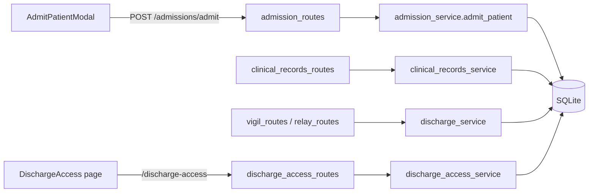
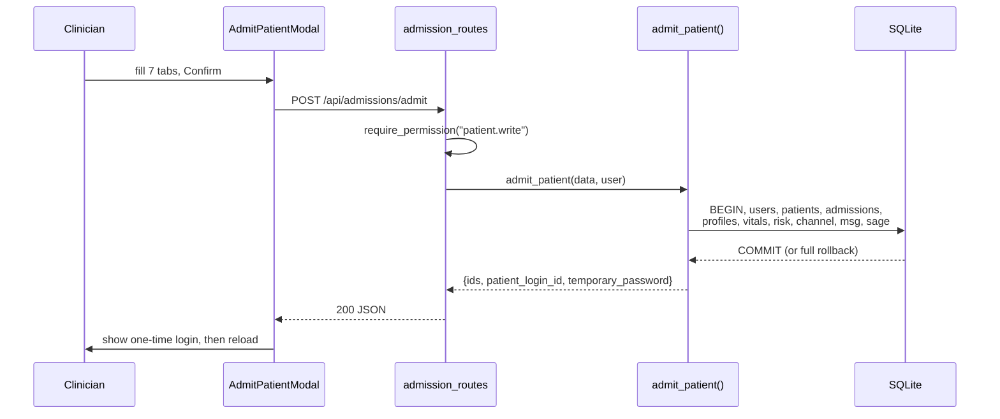

# Admissions, Clinical Records, Discharge, and Discharge Access

This guide covers the **patient lifecycle** in Orb: how a patient is admitted (one transactional call that seeds records across half a dozen modules), how their structured clinical core (allergies, problem list) is maintained, how a discharge summary is generated and frozen, and how a discharged patient is later given **time-limited, DOB-gated access to their own summary** through a public URL and QR code. If you rebuild Orb, this subsystem is the "front door and back door" of every patient record, everything else (Vigil monitoring, Relay chat, Sage reasoning) hangs off the rows this code writes at admission time.

Jargon note used throughout: a **service** is a plain Python module of functions that own the business logic; a **route** is a FastAPI (Python web framework) HTTP endpoint that validates input and delegates to a service; **RBAC** (Role-Based Access Control) means every endpoint is gated by a named permission the caller's role must hold; a **JWT** (JSON Web Token) is a signed, tamper-evident blob of claims used as a short-lived access pass; a **migration** is a schema change applied to an existing database. Raw-SQL means queries are hand-written strings executed against SQLite, always with `?` placeholders (never string-formatted) to prevent SQL injection. **Provenance**, recording *where* a piece of data came from (a clinician, a simulator bot, an AI extraction), recurs here, because Orb makes irreversible safety choices (pruning "simulated" data, refusing "unverified" meds) based on it.

## Purpose and neighbors

**The problem this solves.** A hospital record is not one row, it is an identity, an admission event, a longitudinal profile, a monitoring feed, a chat room, and an AI memory, all of which must appear *together or not at all*. Admission solves that with a single transaction. At the other end, discharge must (a) freeze an authoritative summary, (b) reconcile medications safely, and (c) let the patient read their record later without giving them a staff login, hence a separate, hardened, public access path with its own throttling and its own token trust domain.

Neighbors this subsystem depends on or feeds:

| Neighbor | Relationship | Guide |
|---|---|---|
| Auth / RBAC | `require_permission(...)` gates every route; `hash_password` mints the patient login; `JWT_SECRET`/`JWT_ALGORITHM` sign the discharge grant | see guide 03-auth-rbac |
| Database | every write goes through `db_session()` / `get_db()`; owns the tables below | see guide 04-database-schema |
| Vigil | reads `patients`, `vitals`, `risk_scores`; owns the discharge trigger route and `compute_news2` | see guide 07-vigil |
| Relay | admission opens a `case_room` channel + seeds the first message; ambient "discharge" action | see guide 08-relay |
| Sage | admission seeds `sage_room_memory` | see guide 09-sage |
| Drug safety | `add_allergy` classifies substances via `classify_drug`; med-safety route fronts `check_medication_safety` | see guide 12-drug-safety |
| LLM queue | `generate_discharge_summary` acquires a slot before calling Ollama | see guide 10-llm-and-scribe |
| Audit | every security/clinical event is logged via `log_audit_event` | see guide 20-audit |
| API client + routing | `client.ts` wrappers; `App.tsx` public route; design tokens + `print.css` | see guides 02-api-client, 27-design-system |

## File map

| File | Lines (approx) | Role |
|---|---|---|
| `server/services/admission_service.py` | 233 | The transactional admission orchestrator, one function writes patient identity, admission, profile, vitals, risk, chat room, and Sage memory |
| `server/services/clinical_records_service.py` | 110 | Structured allergies + problem list (the coded clinical core used for order-time safety checks) |
| `server/services/discharge_service.py` | 391 | Timeline builder, deterministic medication reconciliation, LLM summary generation, QR code, and the atomic discharge write |
| `server/services/discharge_access_service.py` | 279 | Patient-facing token verification: per-IP throttle, DOB second factor, lockout, JWT grant, summary fetch |
| `server/routes/admission_routes.py` | 70 | `POST /api/admissions/admit` + the `AdmissionRequest` schema |
| `server/routes/clinical_records_routes.py` | 112 | Allergy / problem-list CRUD + order-time medication-safety pre-check |
| `server/routes/discharge_access_routes.py` | 46 | Public `verify` + `summary` endpoints (no staff auth) |
| `src/components/AdmitPatientModal.tsx` | 583 | 7-tab admission wizard + one-time credential hand-off screen |
| `src/components/AdmitPatientModal.css` | 467 | Scoped gold "liquid-glass" styling for the admission modal |
| `src/components/DischargePrintView.tsx` | 186 | The printable discharge-summary layout (shared by clinician print + patient portal) |
| `src/pages/DischargeAccess.tsx` | 140 | Public patient page at `/discharge/:token`: DOB gate → summary render |
| `src/pages/DischargeAccess.css` | 352 | Light, hospital-branded styling for the patient portal (deliberately NOT dark) |
| `server/tests/test_admission_provenance.py` | 101 | Regression: admission mints a unique patient login and marks vitals `clinician` (not `simulated`) |
| `server/tests/test_discharge_access.py` | 138 | Regression: verify success / invalid DOB / lockout / expiry / forged token / legacy endpoint removed |

Also referenced (owned elsewhere, contracts described here): `src/print.css` (guide 27), `src/api/client.ts` (guide 02), `server/routes/vigil_routes.py` + `server/routes/relay_routes.py` (guides 07, 08).

## How it works

### Flow A: Admission (client → server, one transaction)

1. A clinician clicks the "Admit Patient" CTA in `ClinicianShell` (`src/pages/ClinicianShell.tsx:401`, `id="btn-admit-patient"`), which sets `isAdmittingPatient` and mounts `AdmitPatientModal` (`ClinicianShell.tsx:646`, imported at `:6`).
2. The clinician fills a 7-tab wizard (Identity → Admission → Clinical → History → Vitals → Notes → Review) and confirms. One `admitPatient(payload)` call fires `POST /api/admissions/admit`.
3. `process_admission` (`server/routes/admission_routes.py:59`) RBAC-gates on `patient.write`, then calls `admit_patient(data, user)`.
4. `admit_patient` opens **one `db_session()` transaction** (`admission_service.py:33`) and writes, in order: the patient's Bridge login user, the `patients` identity row, the `admissions` event row, the `patient_profiles` longitudinal row, optional initial `vitals` + a seeded `risk_scores` row, a Relay `case_room` channel + system message, and a `sage_room_memory` row. Either all succeed or all roll back, a patient is never half-admitted.
5. The service returns the new IDs plus a **one-time Bridge credential** (`patient_login_id` + `temporary_password`) that exists only in this response.
6. The modal shows a credential hand-off screen (the password is never retrievable again), then `onSuccess` reloads the page to refresh every panel.

### Flow B: Discharge (generate + freeze)

1. A clinician hits DISCHARGE in Vigil → `POST /api/vigil/patients/{id}/discharge` (`vigil_routes.py:742`, permission `discharge.generate`), or an ambient agent runs the `discharge` action in Relay (`relay_routes.py:977`).
2. `build_patient_timeline()` assembles a chronological event list (admission, notes, scribe notes, imaging, critical alerts).
3. `build_medication_reconciliation()` splits the **real charted medications** into continue / stopped / unverified, deterministically, never from the LLM.
4. `generate_discharge_summary()` builds an LLM prompt that embeds that reconciliation *verbatim* and asks the model for prose. If the LLM call raises, the **caller** substitutes a static fallback template (`vigil_routes.py:768-790`; Relay's equivalent is `relay_routes.py:1077-1079` composing its fallback in phase C).
5. `discharge_patient()` **atomically** flips `status → 'discharged'` (bailing if already discharged), saves the summary + timeline, and mints a secure access token + QR code.

### Flow C: Patient reads their summary later

1. The patient opens the QR/link `PUBLIC_APP_BASE_URL/discharge/{token_id}` → React route `/discharge/:token` renders `DischargeAccess`.
2. They enter their date of birth → `POST /api/discharge-access/verify`. The service throttles by IP, compares DOB in constant time, and on success returns a **1-hour JWT grant** with `aud="discharge"`.
3. The page immediately calls `GET /api/discharge-access/{token}/summary` with `Authorization: Bearer <grant>` → the service validates the grant's audience + token binding and returns the summary, timeline, patient header, and active meds, which render through `DischargePrintView`.

## Function-by-function

### admission_service.py

#### admit_patient: `server/services/admission_service.py:11`
**Signature:** `admit_patient(data: dict, user: dict) -> dict`
**Does:** Atomically creates every record a new patient needs across identity, admission, profile, monitoring, chat, and AI-memory tables, and returns a one-time patient login.
**How it works:**
1. Computes `now` as a UTC ISO-8601 string (`:16`) and reads the admitting user's id/name (`:17-18`).
2. Mints the patient's **Bridge portal login**: `patient_user_id = "P" + 6 hex chars` and `temp_password = secrets.token_urlsafe(9)`, a unique one-time password, never a shared default (`:22-25`).
3. Generates the other IDs: `patient_id = "PAT-" + 8 chars`, `mrn` (caller-supplied or `"MRN-" + 6 chars`), `admission_id = "ADM-…"`, `channel_id = "chan_…"` (`:28-31`).
4. Opens `with db_session() as db:`, the single transaction boundary (`:33`).
5. **Step 0** inserts a `users` row with `role='patient'`, `department = ward`, and the *hashed* one-time password (`:35-39`).
6. **Step 1** inserts the `patients` identity row linked to that login (`user_id`), copying `ward`/`bed`/`diagnosis` onto the row because Vigil, Sage, and the discharge summary read those from `patients`, not `admissions`; `diagnosis = initial_diagnosis or chief_complaint`; `status='admitted'` (`:41-68`).
7. **Step 2** inserts the `admissions` event row: source/type/department, referring clinician, chief complaint, triage severity, notes, `isolation_precautions` as JSON, `code_status` default `full_code`, optional `initial_vitals_json`, `status='active'` (`:71-100`).
8. **Step 3** inserts the `patient_profiles` longitudinal row with `comorbidities`/`allergies`/`current_medications` stored as JSON arrays (`:103-120`).
9. **Step 4** (conditional), if any of HR/BP-sys/SpO2 was provided, inserts a `vitals` row with `source='clinician'` and persisted `on_oxygen`, then computes a baseline NEWS2 via `compute_news2` and inserts a `risk_scores` row so the patient shows real risk in Vigil immediately. The whole block is wrapped in `try/except` and logs (not raises) on failure, a missing baseline score must not abort the admission (`:122-162`).
10. **Step 5** opens a Relay `case_room` channel and posts a structured system message summarizing the admission (`:164-190`).
11. **Step 6** seeds `sage_room_memory` with a patient summary, discussion summary, and initial risk flags (high-acuity if triage ≤ 2) (`:192-221`).
12. Returns `success`, the four IDs, `mrn`, and the one-time `patient_login_id` + `temporary_password`, returned exactly once because only the hash is stored (`:223-233`).

**Why it exists:** Orb's modules are only useful if they all "see" a patient at the same instant. Doing the inserts in one transaction guarantees no module ever holds a dangling reference to a patient another module doesn't know about. Seeding vitals+risk inline is what makes a freshly admitted patient appear on the Vigil board without waiting for the simulator.
**Data in/out:** In: the flattened `AdmissionRequest` dict + the authenticated `user` dict. Out: `{success, patient_id, admission_id, channel_id, mrn, patient_login_id, temporary_password}`.
**Talks to:** `db_session` (database), `hash_password` (auth), `secrets`/`uuid`, `compute_news2` (`services.vigil_service`). Callers: `process_admission` (`server/routes/admission_routes.py:71`) and the two provenance tests.
**Change guide:**
- *To capture the patient's date of birth at admission* (needed for discharge access, see Discrepancies), add a `date_of_birth` field to `AdmissionRequest` and a form field in the modal, then add `date_of_birth` to the `patients` INSERT column list at `:41-68`. Knock-on: the column already exists (`database.py:46`); without this, discharge-access DOB verification can never succeed for normally-admitted patients.
- *To notify other sessions in real time on admission*, use the already-imported `sio` (`:7`, currently unused) to emit **after** the `with` block commits, never inside the transaction.
- *Footgun:* every `db.execute` here shares one connection/transaction; adding an early `return` inside the `with` will silently skip later inserts and leave a partial record shape that downstream code assumes is complete.
**Gotchas:** The vitals+risk block swallows exceptions by design, a bug in `compute_news2` will not surface at admission, only in the log. Timestamps are UTC ISO strings; do not mix in naive `datetime.now()`. `diagnosis` falls back to `chief_complaint`, so an admission with only a complaint still has a non-null diagnosis everywhere downstream.

### clinical_records_service.py

Structured allergies and a problem list are the *coded* clinical core. The free-text `patient_profiles.allergies` narrative from admission is retained, but `patient_allergies` is the **source of truth** for order-time allergy checking (`drug_safety_service`). Module docstring at `:1-7`.

#### _now: `server/services/clinical_records_service.py:19`
**Signature:** `_now() -> str`, returns a UTC ISO-8601 timestamp. Single source of "now" for this module.

#### add_allergy: `server/services/clinical_records_service.py:24`
**Signature:** `add_allergy(patient_id, substance, *, reaction=None, severity="unknown", recorded_by=None, source="clinician") -> dict`
**Does:** Adds or reactivates a structured allergy; idempotent per `(patient, substance)`.
**How it works:**
1. Normalizes `substance` to trimmed lowercase; raises `ValueError` if empty (`:29-31`).
2. Coerces any out-of-range `severity` to `"unknown"` (`:32-33`).
3. Derives `substance_class` from `classify_drug(substance_norm)` (first class or `None`) so allergen-class checks work later (`:34-35`).
4. Performs an **upsert**: `INSERT … ON CONFLICT(patient_id, substance) DO UPDATE` refreshing reaction/severity, forcing `status='active'`, and updating class/source/recorder/timestamp (`:38-52`). This is why re-recording a previously-deactivated allergy reactivates it.
5. Re-reads and returns the row as a dict (`:53-57`).
**Why it exists:** Order-time drug-safety screening needs a normalized, deduplicated, class-tagged allergy list, free text can't be matched reliably.
**Data in/out:** Out: full `patient_allergies` row (id, substance, substance_class, reaction, severity, status, source, recorded_by, recorded_at).
**Talks to:** `classify_drug` (drug safety), `db_session`. Caller: `post_allergy` (`server/routes/clinical_records_routes.py:29`).
**Gotchas:** The UNIQUE constraint is on `(patient_id, substance_norm)`, two spellings ("Penicillin V" vs "penicillin") are different rows; normalization only lowercases/trims, it does not map synonyms.

#### list_allergies: `server/services/clinical_records_service.py:60`
**Signature:** `list_allergies(patient_id, include_inactive=False) -> list[dict]`, returns active allergies (or all), newest first. Used by the GET route and by drug safety.

#### deactivate_allergy: `server/services/clinical_records_service.py:69`
**Signature:** `deactivate_allergy(allergy_id) -> bool`, sets `status='inactive'`; returns whether a row matched. A soft delete: the row and its audit trail survive.

#### add_problem: `server/services/clinical_records_service.py:78`
**Signature:** `add_problem(patient_id, problem, *, icd10_code=None, snomed_code=None, onset_date=None, recorded_by=None, source="clinician") -> dict`
**Does:** Appends an active problem (optionally ICD-10 / SNOMED coded) to the problem list. Raises `ValueError` on empty problem. Returns the inserted row via `cur.lastrowid`. Unlike allergies this is **not** an upsert, duplicates are possible.

#### list_problems: `server/services/clinical_records_service.py:95`
**Signature:** `list_problems(patient_id, include_resolved=False) -> list[dict]`, active problems (or all), newest first.

#### resolve_problem: `server/services/clinical_records_service.py:104`
**Signature:** `resolve_problem(problem_id) -> bool`, sets `status='resolved'` and stamps `resolved_at`; returns whether a row matched.
**Change guide:** *To add an "inactive" (not-resolved) state*, the `problem_list.status` CHECK already permits `'inactive'` (`database.py:615`), add a service function mirroring `resolve_problem` that sets it. Watch out: `list_problems` only hides `resolved`, so `inactive` rows would still appear unless you widen the filter.

### discharge_service.py

#### build_patient_timeline: `server/services/discharge_service.py:23`
**Signature:** `build_patient_timeline(patient_id) -> list`
**Does:** Builds a chronological list of clinically meaningful events for the summary + patient portal.
**How it works:** Opens a raw connection with `get_db()`; appends an admission event from `patients` (`:29-36`); appends each `clinical_documents` note (content truncated to 200 chars) (`:39-49`); appends each `scribe_notes` entry (`:52-62`); appends each `lens_analyses` imaging interpretation (`:65-75`); appends **critical-only** `risk_scores` alerts with their drivers (`:78-89`); closes the connection (`:91`); sorts by `timestamp` with a null-safe key (`:94`).
**Why it exists:** A discharge summary and the patient portal both need a single ordered story of the stay, drawn from tables that never share a schema.
**Data in/out:** Out: `list[{timestamp, type, title, detail}]`, `type ∈ {admission, note, scribe, imaging, alert}`.
**Talks to:** `get_db`. Callers: `discharge_patient_route` (`vigil_routes.py:766`), Relay discharge action (`relay_routes.py:1075`, off-loop via `run_db`).
**Gotchas:** Manual `get_db()`/`db.close()` with no `try/finally`, an exception between open and close leaks the connection. Risk drivers are `json.loads`-ed and re-joined, so malformed JSON in `risk_scores.drivers` would raise here.

#### build_medication_reconciliation: `server/services/discharge_service.py:100`
**Signature:** `build_medication_reconciliation(patient_id) -> dict`
**Does:** Deterministically splits the patient's charted medications into continued / stopped / unverified, the #1 discharge safety step, computed from the real `medications` table, **never** from the LLM.
**How it works:**
1. Reads all `medications` rows for the patient, ordered case-insensitively by name (`:112-116`), in a `try/finally` that always closes the connection.
2. For each med builds an entry `{name, dosage, route, frequency, source}` (`:123-129`).
3. Flags any med whose `source ∈ {llm_extracted, agentic}` and that has no `verified_by` as `needs_verification` and adds it to `unverified`, so an AI-extracted drug is never silently carried onto a discharge script (`:131-134`).
4. Buckets by status: `active` → continued; `prn` → continued but tagged `prn` (an "as needed" med must appear on the script; a dropped PRN opioid is a real safety defect); `discontinued` → stopped (`:136-145`).
5. Returns `{continued, stopped, unverified, counts}` (`:146-155`).
**Why it exists:** Medication reconciliation is the single highest-value discharge intervention; making it deterministic and pharmacist-aware means the LLM can *describe* the meds but can never *invent* them.
**Data in/out:** Out: three lists of entry dicts + a counts object.
**Talks to:** `get_db`. Callers: `generate_discharge_summary` (`:224`) and the previewable route `GET /api/vigil/patients/{id}/medication-reconciliation` (`vigil_routes.py:720`, guarded by `require_patient_access("discharge.generate")` at `:700`). Exercised by `test_audit_fixes.py:190` and `test_tier1_small_closes.py:77`.
**Change guide:** *To add a "held" medication bucket*, add an `elif status == "held"` branch at `:136-145` and a corresponding line in `_render_med_rec_text`. Knock-on: the patient-portal meds list (`discharge_access_service.py:253-256`) does **not** use this function, so held meds would show there as active unless you also change that query.

#### _render_med_rec_text: `server/services/discharge_service.py:158`
**Signature:** `_render_med_rec_text(rec) -> str`
**Does:** Renders the reconciliation dict into authoritative plain text for injection into the LLM prompt, labelling `[PRN, as needed]` and `[UNVERIFIED, pharmacist review required]` and emitting a WARNING block for unverified meds (`:171-180`). Empty buckets render as `"- None"`. Called only by `generate_discharge_summary`.

#### generate_discharge_summary: `server/services/discharge_service.py:183`
**Signature:** `async generate_discharge_summary(patient_id) -> str`
**Does:** Produces the prose discharge summary via the local LLM, grounded on real data.
**How it works:**
1. Loads the `patients` row; returns `"Patient not found."` if missing (`:187-190`).
2. Gathers clinical notes, the latest vitals, and up to 5 recent risk scores (`:193-210`), then closes the connection.
3. Formats notes/vitals/risk into text (`:213-221`).
4. Builds the **authoritative** med-rec text via `build_medication_reconciliation` + `_render_med_rec_text` (`:223-225`).
5. Assembles a large prompt embedding patient header, vitals, risk, notes, and the med-rec block, with an explicit instruction to reproduce the reconciliation verbatim and not invent/omit meds (`:633-688`).
6. Acquires an LLM-queue slot at `priority=2` (`:694`), POSTs to `OLLAMA_BASE_URL/api/chat` with `stream=False` via `httpx` (`:697`), extracts `message.content` (`:719`), and **always** releases the slot in `finally` (`:720-721`).
**Why it exists:** The LLM writes readable narrative; grounding it on deterministic med-rec text is what keeps an AI-generated document clinically trustworthy.
**Data in/out:** In: `patient_id`. Out: the summary string (may be `""` on empty model output).
**Talks to:** `llm_queue` (`services.llm_queue_service`), `httpx`, `build_medication_reconciliation`. Callers wrap it in `try/except` and fall back to a static template.
**Gotchas:** On empty model output it returns `""`, which is **not** an exception, so the caller's `try/except` fallback does NOT trigger and an empty summary can be saved (see Discrepancies). It is `async` purely because of the awaited LLM call; the DB reads are synchronous.

#### generate_qr_code: `server/services/discharge_service.py:785`
**Signature:** `generate_qr_code(patient_id, summary_url) -> str`
**Does:** Renders a QR PNG pointing at the patient's summary URL and saves it under `UPLOAD_DIR`, returning the file path (or `""` if the optional `qrcode` package is absent, guarded by `HAS_QR` at `:16-20`, re-checked at `:787`). Called by `discharge_patient`.
**Gotchas:** Silent no-op when `qrcode` isn't installed, `discharge_patient` then stores an empty `qr_code_path`, and the QR-fetch endpoint has nothing to serve.

#### discharge_patient: `server/services/discharge_service.py:806`
**Signature:** `discharge_patient(patient_id, author_id, summary, timeline) -> dict`
**Does:** Commits the discharge: flips status, closes the encounter, persists the summary + timeline, and mints the secure access token + QR.
**How it works:**
1. Generates a **secret** `raw_token = secrets.token_urlsafe(32)`, then derives `token_hash = sha256(raw_token)` and sets `token_id = token_hash`, **only the hash is persisted**; the raw secret exists solely in the patient-facing link/QR (`:870-881`). Computes `expires_at = now + DISCHARGE_ACCESS_TTL_DAYS` (default 30) (`:877`).
2. Builds `summary_url = PUBLIC_APP_BASE_URL/discharge/{raw_token}` and generates the QR (`:882-885`).
3. In a `db_session()` transaction, **atomically claims** the discharge: `UPDATE patients SET status='discharged' WHERE id=? AND status='admitted'`. If `rowcount == 0` the patient was already discharged, it returns `{"status":"already_discharged"}` before writing any duplicate summary/token (`:922-929`). This is the idempotency guard.
4. Also closes the encounter, `UPDATE admissions SET status='discharged' WHERE patient_id=? AND status='active'` (`:924-927`). Without this, consumers that key off `admissions.status='active'` (admin `erase_patient`'s 409 guard, `sage_handoff_service`'s transfer resolution) treat every ever-admitted patient as a live inpatient forever, which makes GDPR erasure unreachable.
5. Inserts the `discharge_summaries` row (summary + `timeline_json` + `qr_code_path`) (`:934-941`) and the `discharge_access_tokens` row (`token_id`, `token_hash`, `patient_id`, `expires_at`, `created_by_user_id`) (`:949-955`).
6. Logs a `discharge_link_created` security audit event correlated by the **hash**, never the raw token (`:972-981`).
7. Returns `{"status":"success", "summary_url", "qr_path"}` (`:1002`).
**Why it exists:** Discharge must be exactly-once (double-clicking DISCHARGE must not mint two links) and must leave a durable, later-readable artifact.
**Data in/out:** In: patient id, author id, the generated summary, the timeline list. Out: status + URL + QR path.
**Talks to:** `generate_qr_code`, `log_audit_event`, config TTL / `PUBLIC_APP_BASE_URL`. Callers: `vigil_routes.py:792`, `relay_routes.py:987`.
**Change guide:** *To lengthen link validity*, set `ORB_DISCHARGE_ACCESS_TTL_DAYS` (config `:409`), no code change. Footgun: because the audit `correlation_id` is the hash, you cannot recover a lost patient link from the audit trail, reissue instead.
**Gotchas:** The secret is the `raw_token` in the URL and it is **never** written to disk; `discharge_access_service.get_token_record` (`:68`) hashes whatever it is given and matches on `token_hash`. Legacy rows that stored plaintext in `token_id` are scrubbed by an `init_db()` migration (`server/database.py:1882-1884`) that sets `token_id := token_hash`. The status flip happens first precisely so summary/token inserts can't race a second discharge.

### discharge_access_service.py

This module is the **security boundary** for patient self-service. It never trusts a staff session; it authenticates with (1) possession of the URL secret and (2) knowledge of the patient's DOB, then issues a short-lived JWT.

**Module-level per-IP throttle** (`:29-35`): an in-process, thread-safe sliding window (`_VERIFY_IP_ATTEMPTS` dict + `_VERIFY_IP_LOCK`) keyed on source IP **across all tokens**, ceiling `_VERIFY_IP_MAX_ATTEMPTS = max(MAX_ATTEMPTS*3, 15)` per `LOCK_MINUTES` window. It exists because per-token lockout is bypassable by an attacker holding many tokens; a single IP is now globally throttled. The docstring explicitly defers a durable/multi-worker version (Redis or a SQLite table), this state resets on restart and is single-process only.

#### _is_verify_ip_throttled: `server/services/discharge_access_service.py:38`
**Signature:** `_is_verify_ip_throttled(ip) -> bool`, trims expired timestamps under the lock and returns whether the IP is at/over the ceiling. Returns `False` for `None`/`"unknown"` IPs.

#### _record_verify_ip_attempt: `server/services/discharge_access_service.py:49`
**Signature:** `_record_verify_ip_attempt(ip) -> None`, appends `now` to the IP's window (under the lock). No-op for unknown IPs.

#### get_token_record: `server/services/discharge_access_service.py:68`
**Signature:** `get_token_record(db, token_id) -> Optional[dict]`, `SELECT * FROM discharge_access_tokens WHERE token_id = ?`. The single point where lookup would change to `token_hash` for hardening.

#### verify_discharge_access: `server/services/discharge_access_service.py:76`
**Signature:** `verify_discharge_access(token_id, dob, ip_address=None) -> dict`
**Does:** Verifies the DOB second factor and returns a 1-hour JWT grant, with throttling, lockout, and constant-time comparison.
**How it works:**
1. If the IP is throttled, audit + return `{"status":"error","reason":"rate_limited"}` **before any DB work** (so a throttled IP can't even probe token validity) (`:90-94`).
2. Record the attempt against the IP window (every attempt counts) (`:97`).
3. Open a session; load the token record; audit `discharge_access_attempted` (`:106`).
4. Guard rails, each returning a distinct error reason and auditing a failure: not found → `invalid_token` (`:123`); `revoked_at` set → `revoked` (`:127-129`); past `expires_at` → `expired` (`:133-134`); currently within `locked_until` → `locked` (`:136-140`), and if the lock has passed, clear it and reset `failed_attempts` (`:142`).
5. Load `patients.date_of_birth` and compare **constant-time** with `hmac.compare_digest(str(stored_dob), str(dob or ""))`, non-constant `!=` would leak timing on a low-entropy factor (`:149`).
6. On mismatch: **atomically** increment `failed_attempts` in SQL and read the authoritative new value back in the same transaction (avoids a read-then-write race); if `new_attempts >= DISCHARGE_ACCESS_MAX_ATTEMPTS` (default 5), set `locked_until = now + LOCK_MINUTES` (default 15) and audit a lock; audit the DOB mismatch; return `locked` or `invalid_dob`. It deliberately does **not** return an attempts-remaining count (leaking it aids brute force) (`:156-177`).
7. On success: set `verified_at`, reset counters, audit success, and mint a JWT with claims `sub="discharge_access"`, `aud="discharge"`, `token_id`, `patient_id`, `exp = now + 1h`, signed with `JWT_SECRET`/`JWT_ALGORITHM` (`:184-203`). The explicit `aud="discharge"` claim keeps this patient grant from being conflated with staff auth tokens even though they currently share the secret (a deferred item notes a fully separate signing secret would be better).
**Why it exists:** It lets a patient read one record without a staff account, while resisting the two real attacks: DOB brute force (per-token + per-IP lockout, constant-time compare, no count leakage) and token confusion (audience-scoped grant).
**Data in/out:** In: token id, DOB string, IP. Out on success: `{status:"success", access_grant, patient_id}`; otherwise `{status:"error", reason, [locked_until]}`.
**Talks to:** `db_session`, `log_audit_event`, `jwt`, `hmac`, config. Caller: the `verify_access` route (`server/routes/discharge_access_routes.py:14`).
**Gotchas:** DOB comparison is string-exact against `patients.date_of_birth`, the frontend `<input type="date">` yields `YYYY-MM-DD`, so the stored value must match that format exactly. Because normal admission never stores a DOB, this check fails for real patients (see Discrepancies). The IP throttle is process-local and lost on restart.

#### get_verified_discharge_summary: `server/services/discharge_access_service.py:211`
**Signature:** `get_verified_discharge_summary(token_id, access_grant, ip_address=None) -> dict`
**Does:** Exchanges a valid grant for the actual summary payload.
**How it works:**
1. `jwt.decode` the grant **requiring `audience="discharge"`**, an expired grant → `grant_expired`, any other invalid token → `invalid_grant` (`:218-227`). Requiring the audience means a staff token signed with the same secret can never be replayed here.
2. Cross-check `sub == "discharge_access"` and that the grant's `token_id` matches the path token, else `invalid_grant` (`:230`).
3. Re-load the token record; if missing or revoked → `revoked` (a grant does not survive revocation) (`:236-237`).
4. Load the latest `discharge_summaries` row for the patient (`:240-245`); load the patient header joined to the attending doctor's name (`:247-252`); load active medications (`:254-258`).
5. Stamp `last_accessed_at`, audit a `discharge_summary_viewed` clinical-access event, and return `{summary, timeline, patient, medications}` (`:260-270`).
**Why it exists:** Splitting verify (DOB) from fetch (grant) means the DOB is entered once, and the actual PHI (Protected Health Information) fetch is gated by a short-lived, audience-scoped token rather than by re-sending the DOB.
**Data in/out:** Out: summary text, parsed timeline, patient header dict, meds list.
**Talks to:** `jwt`, `db_session`, `log_audit_event`. Caller: the `get_summary` route (`server/routes/discharge_access_routes.py:29`).
**Gotchas:** The patient header selects `p.id as mrn` (`:248`), so the field the UI labels "MRN" is actually the internal `PAT-…` id, not the real `mrn`. The meds query here is a plain `status='active'` select, **not** `build_medication_reconciliation`, so PRN/unverified handling is absent on the patient's copy (see Discrepancies).

### admission_routes.py

#### AdmissionRequest: `server/routes/admission_routes.py:11`
**Signature:** Pydantic model. **Does:** Validates and types the admission payload. Required fields: `name`, `admission_source`, `admission_type`, `department`, `ward`, `bed`, `attending_doctor_id`, `chief_complaint`. Everything else (age, sex, contacts, history arrays, vitals dict, notes) is optional with defaults. Array fields default to `[]`; `code_status` defaults `"full_code"`; `vitals` is a free-form `Dict[str, Any]`.
**Gotchas:** `bed` is required here but the modal marks it optional, and there is **no `date_of_birth` field**, the schema is the reason DOB is never captured.

#### process_admission: `server/routes/admission_routes.py:59` (decorator) / `:54` (`def`)
**Signature:** `process_admission(payload: AdmissionRequest, background_tasks, user=Depends(require_permission("patient.write"))) -> dict`
**Does:** RBAC-gates admission and delegates to the service. **How it works:** requires `patient.write`; calls `admit_patient(payload.dict(), user)`; on any exception prints a traceback and raises `HTTP 500` with the raw error text (`:68-70`). **Route:** `POST /api/admissions/admit`. **Talks to:** `admit_patient`; frontend `admitPatient()` (`src/api/client.ts:712`). **Gotchas:** the injected `background_tasks` is never used; returning `str(e)` in the 500 `detail` leaks internal error text to the client.

### clinical_records_routes.py: prefix `/api/patients`

| Handler | Line | Method + path | Permission | Notes |
|---|---|---|---|---|
| `get_allergies` | `:19` / `:20` | GET `/{patient_id}/allergies` | `patient.read_all` | `?include_inactive` |
| `post_allergy` | `:28` / `:29` | POST `/{patient_id}/allergies` | `patient.write` | 422 if no `substance`; audits `allergy_recorded` |
| `delete_allergy` | `:50` / `:51` | DELETE `/{patient_id}/allergies/{allergy_id}` | `patient.write` | soft-deactivate; 404 if none; audits |
| `get_problems` | `:66` / `:67` | GET `/{patient_id}/problems` | `patient.read_all` | `?include_resolved` |
| `post_problem` | `:75` / `:76` | POST `/{patient_id}/problems` | `patient.write` | 422 if no `problem`; audits `problem_recorded` |
| `patch_resolve_problem` | `:96` / `:97` | PATCH `/{patient_id}/problems/{problem_id}/resolve` | `patient.write` | 404 if none |
| `medication_safety` | `:105` / `:106` | GET `/{patient_id}/medication-safety?drug=` | `medication.write` | fronts `check_medication_safety` (drug safety, guide 12) |

**Why the med-safety route lives here:** it screens a *candidate* drug against this patient's structured allergies + active meds **before** prescribing, so it belongs with the clinical-core module that owns the allergy source of truth.

### discharge_access_routes.py: prefix `/api/discharge-access` (public, no staff auth)

#### verify_access: `server/routes/discharge_access_routes.py:14`
**Signature:** `verify_access(req: VerifyRequest{token, dob}, request) -> dict`, extracts the client IP, calls `verify_discharge_access`, and on any error status raises **HTTP 401 with the full result dict as `detail`** (uniform 401 prevents distinguishing invalid-token from wrong-DOB) (`:17-27`). **Route:** `POST /api/discharge-access/verify`.

#### get_summary: `server/routes/discharge_access_routes.py:29`
**Signature:** `get_summary(token, request, authorization: Header) -> dict`, requires an `Authorization: Bearer <grant>` header (401 `missing_grant` otherwise); calls `get_verified_discharge_summary`; raises **403** for `revoked`/`invalid_grant`, else **401** (`:32-46`). **Route:** `GET /api/discharge-access/{token}/summary`.
**Gotchas:** These are the only patient-facing endpoints with no `require_permission`, their entire trust model is the token + DOB + grant chain above.

### AdmitPatientModal.tsx

#### AdmitPatientModal: `src/components/AdmitPatientModal.tsx:160`
**Signature:** `AdmitPatientModal({ onClose, onSuccess }) -> JSX`
**Does:** A 7-tab admission wizard that collects the whole `AdmissionRequest`, validates per-tab, submits, and then hands off the patient's one-time login.
**How it works:**
1. Reads the logged-in `user` via `useAuth()` (a React **hook**, a function that lets a component use React state/context) (`:57`) to prefill `department` and `attending_doctor_id`. React **context** is the mechanism that shares the auth user without prop-drilling.
2. Local state: `activeTab`, `isSubmitting`, `error`, and `credential` (the one-time login, shown once) (`:58-62`).
3. Installs a focus trap via `useFocusTrap` (`:220`), so keyboard focus can't escape the modal. Escape is routed through `closeRef` (`:67`): on the credential screen it calls `onSuccess()`, everywhere else `onClose()`, so a clinician cannot dismiss the credential hand-off in a way that silently discards the admission.
4. `formData` holds every field as a flat object (`:71`); arrays (comorbidities/allergies/current_medications/isolation_precautions) are managed by `handleChipAdd` (`:125`) / `handleChipRemove`, which dedupe via a `Set`.
5. Per-tab validity (`isIdentityValid` `:141`, `isAdmissionValid`, `isClinicalValid`) drives the tab completion dots (`:247-251`) and gates the "Review" button; `isFormValid` (`:145`) requires all three.
6. `handleSubmit` (`:147`) builds the payload, parsing `age`/`triage_severity` to ints (`:158-159`) and folding vitals into a nested `vitals` object only if any of HR/BP-sys/SpO2 was entered (`:440`), then calls `admitPatient(payload)` (`:172`). If the result carries a `temporary_password`, it sets `credential` (`:175-176`), showing the hand-off screen; otherwise `onSuccess`.
7. When `credential` is set, it renders the hand-off screen (`:634-718`): login id + one-time password (both `userSelect:'all'`), a copy-to-clipboard button, and Done → `onSuccess`.
8. Otherwise it renders the tabbed form + a live right-hand summary panel + footer with Cancel / "Review Admission" (`:571`) / "Confirm Admission" (`:575`), starting at `:227`.
**Why it exists:** Admission captures a lot of structured data; tabs + a live summary keep it navigable, and surfacing the one-time credential exactly once (never retrievable) is the only moment the clinician can hand the patient their portal login.
**On screen:** the modal that opens from "Admit Patient" in the clinician shell. The seven tabs are Identity, Admission, Clinical, History, Vitals, Notes, Review. The Vitals tab carries a line of copy (`:1027`) telling the clinician that entering initial vitals immediately computes risk scores and puts the patient on the Vigil board, that is the visible link between this modal and guide 07.
**Data in/out:** Props `{onClose, onSuccess}`. Emits the `admitPatient` payload; consumes `{patient_login_id, temporary_password, …}`.
**Talks to:** `admitPatient` (`src/api/client.ts:712`), `useAuth` (`src/App.tsx`), `useFocusTrap`. Rendered by `ClinicianShell` (`src/pages/ClinicianShell.tsx:646`, imported at `:6`), whose `onSuccess` does `window.location.reload()` to refresh all panels.
**Change guide:** *To capture DOB at admission* (fixing discharge access), add a `date_of_birth: ''` field to `formData` (`:71`), an `<input type="date">` in the Identity tab, include it in the payload built at `:158`, and add it server-side (see `admit_patient` change guide).
**Note, the `ChipInput` remount footgun described in earlier editions of this chapter is fixed.** `ChipInput` is now declared at **module scope** (`:25`), not inside `AdmitPatientModal`, so it keeps its React identity across renders and a chip input no longer loses focus while you type. The comment at `:15` records why. If you refactor it back inside the component, the focus bug returns.
**Gotchas:** `age`/`triage_severity` use `parseInt(...) || undefined` (`:158-159`), so a legitimate `0` becomes `undefined`, harmless for age, but be aware. The vitals object is only sent if HR/BP-sys/SpO2 is present (`:440`); temperature-only vitals are dropped.

### AdmitPatientModal.css: `src/components/AdmitPatientModal.css:1`
Scoped, BEM-style styling for the modal. The backdrop uses a 16px `backdrop-filter: blur` (`:5-19`); the modal is a `glass-card` using design tokens `--bg-surface`, `--border-glass`, `--radius-xl`, `--shadow-lg` (`:21-35`); tabs highlight in `--accent-gold` with a completion dot flipping to `--status-ok` (`:110-157`); the submit button is the gold primary (`:372-392`). All colors come from CSS variables (design tokens, guide 27) so light/dark theming is automatic. **Gotcha:** everything is prefixed `admit-`, there is no global leakage, but the summary sidebar (`:294-303`) is fixed-width `280px`, so on narrow viewports the two-column body can overflow (the modal itself is capped at `1000px`).

### DischargePrintView.tsx

#### DischargePrintView: `src/components/DischargePrintView.tsx:34`
**Signature:** `DischargePrintView({ patient, medications, aiAssessment?, hospitalCourse?, timeline? }) -> JSX`
**Does:** Renders a print-optimized, hospital-style discharge document with the `.discharge-print-layout` class contract that `print.css` targets.
**How it works:** local `formatDate` produces `DD/MM/YYYY` (or `--/--/----` for bad dates) (`:38-46`); derives admission/discharge date strings and a synthetic `IP NO` (`:48-50`); renders the title, a 3-column patient table (Name/Age-Sex/Ward, RegNo/IP-NO/DOD, DOA/DOS/Doctor), diagnosis, history/examination sections, a hospital-course block fed by `hospitalCourse`, an ordered discharge-medication list, an optional timeline table, and a signature block (`:52-184`).
**Why it exists:** Both the clinician "PRINT RECORD" flow and the patient portal need the *same* paper-like layout; this is the single shared component, and its stable class names are what `print.css` and `DischargeAccess.css` style.
**Data in/out:** In: `patient` header, `medications[]`, optional `aiAssessment`/`hospitalCourse`/`timeline`. Out: JSX.
**Talks to:** used by `VigilPanel` (portaled into `document.body`, `VigilPanel.tsx:1649`) and by `DischargeAccess` (`DischargeAccess.tsx:71`). Its `.discharge-print-layout` contract is styled by `src/print.css` and `DischargeAccess.css`.
**Gotchas, clinically important:** the component prints **fabricated defaults** when data is absent: hard-coded negatives "No H/o Diabetes Mellitus / Hypertension / CAD / TB / Asthma" (`:90-94`), a default doctor "Dr. Vikram Rathore" (`:74`) and a "Conservatively Managed by the clinical team" default (`:82`), a literal "FOR 5 DAYS" on every med (`:139`), and fixed normal exam findings (`:106-119`). None of these are gated on real data, so a summary can print statements that contradict the patient (see Discrepancies).

### DischargeAccess.tsx

#### DischargeAccess: `src/pages/DischargeAccess.tsx:7`
**Signature:** `DischargeAccess() -> JSX` (route component)
**Does:** The public patient page: reads the `:token` from the URL, gates on DOB, then renders the verified summary.
**How it works:**
1. `useParams` reads `token`; state holds `dob`, `loading`, `error`, `summaryData` (`:8-12`).
2. `handleSubmit` calls `verifyDischargeAccess(token, dob)` to get `access_grant`, then `getVerifiedDischargeSummary(token, accessGrant)`, and stores the payload (`:14-34`).
3. Error handling maps `err.detail.reason` to friendly messages: `invalid_dob`, `locked` (parses `locked_until`), `expired`, `revoked`, else a generic message (`:35-51`).
4. If `summaryData.patient` is non-empty, render the success view: a light portal header, a green "✓ Verified Identity" banner, and `DischargePrintView` fed with the summary as `hospitalCourse` (`:54-82`).
5. Else, if verified but the patient payload is empty, show "Record Unavailable" (`:85-96`); otherwise render the DOB verification form, disabled while loading or locked (`:98-139`).
**Why it exists:** It is the entire patient-facing surface, deliberately a standalone route with no app shell and its own light theme, because the person using it is a patient on their phone, not a clinician.
**Data in/out:** In: URL token + typed DOB. Out: rendered summary.
**Talks to:** `verifyDischargeAccess`, `getVerifiedDischargeSummary` (`client.ts`), `DischargePrintView`. Routed at `AppRoot.tsx:184` (`/discharge/:token`) with **no auth guard**.
**Gotchas:** The `invalid_dob` branch renders `detail.attempts_remaining` (`:38`), but the server deliberately stopped returning that field (`discharge_access_service.py:164-166`), so the message reads "You have undefined attempts remaining" (see Discrepancies). `verifyDischargeAccess` throws the *parsed body* (`{detail: {...}}`) on non-OK, which is why the handler reads `err?.detail`.

### DischargeAccess.css: `src/pages/DischargeAccess.css:1`
A deliberately **light**, self-contained stylesheet (system fonts, `#f4f6f8` background), it does not use the app's dark design tokens because the patient portal must look like a clean hospital document, not the clinical OS. It styles the verification card (`:11-103`), the success header/portal chrome (`:112-152`), and, critically, re-styles the shared `.discharge-print-layout` for on-screen viewing under `.discharge-access-success` (`:236-317`), forcing black-on-white so the portal preview matches the printed page.

### print.css (contract, owned by guide 27): `src/print.css:24`
`DischargePrintView` and `HandoffPrintView` are React **portals** (rendered into `document.body`, outside `#root`) so at print time they sit as siblings of the dark app shell. The `@media print` block (`:24-243`) sets A4/Letter margins, hides `.shell`/modals/widgets, then `visibility:hidden`s everything and re-reveals only `.discharge-print-layout` / `.handoff-print-layout`, anchoring it at the page origin with black-on-white, shadow-free styling. The two-pass hide-then-reveal also covers the `DischargeAccess` page where the layout is nested inside `#root` rather than portaled. **Trigger:** `VigilPanel`'s "PRINT RECORD" button sets `printType='discharge'` then `setTimeout(() => window.print(), 100)` (`VigilPanel.tsx:889`), the 100 ms delay lets the portal mount first (a mount race; see Discrepancies).

### Tests

#### test_admission_provenance.py: `server/tests/test_admission_provenance.py:20`, `:44`
Two regressions against `admit_patient`: (1) admission mints a **unique** patient login (role `patient`, linked via `patients.user_id`), the returned one-time password verifies against the stored hash, and a shared default like `"patient123"` does **not** (`:20-41`); (2) admission vitals are written with `source='clinician'` (not `'simulated'`, so the bot-prune can't delete them) and `on_oxygen=1` is persisted for NEWS2 (`:44-56`). `_clinician()` seeds a doctor user (`:10-17`).

#### test_discharge_access.py: `server/tests/test_discharge_access.py:75` onward
End-to-end via `TestClient`. Fixtures seed a patient with `date_of_birth='1990-01-01'` (`:29`) and a discharge summary + token whose `token_hash = sha256(token_id)`, the real hash the service computes, so the security column is exercised (`:37-73`). Cases: verify success → grant → summary 200 (`:75-88`); wrong DOB → 401 `invalid_dob` (`:90-95`); repeated wrong DOB reaches 401 `locked` (`:97-107`); manually-expired token → 401 `expired` (`:109-120`); a **forged** token → 401 (`:122-133`); the legacy `/api/vigil/.../discharge-summary/view` endpoint returns 404 (`:136-138`). **Note:** these tests only pass because the fixture *manually* inserts `date_of_birth`, the normal admission path never does (see Discrepancies).

## Cross-subsystem contracts

**REST endpoints owned here** (prefixes verified against `server/main.py:297-329` `include_router` calls, all mounted with no extra prefix):

| Method | Full path | Handler | Auth |
|---|---|---|---|
| POST | `/api/admissions/admit` | `process_admission` (`server/routes/admission_routes.py:59`) | `patient.write` |
| GET | `/api/patients/{patient_id}/allergies` | `get_allergies` (`server/routes/clinical_records_routes.py:19`) | `patient.read_all` |
| POST | `/api/patients/{patient_id}/allergies` | `post_allergy` (`:25`) | `patient.write` |
| DELETE | `/api/patients/{patient_id}/allergies/{allergy_id}` | `delete_allergy` (`:47`) | `patient.write` |
| GET | `/api/patients/{patient_id}/problems` | `get_problems` (`:63`) | `patient.read_all` |
| POST | `/api/patients/{patient_id}/problems` | `post_problem` (`:69`) | `patient.write` |
| PATCH | `/api/patients/{patient_id}/problems/{problem_id}/resolve` | `patch_resolve_problem` (`:90`) | `patient.write` |
| GET | `/api/patients/{patient_id}/medication-safety?drug=` | `medication_safety` (`:99`) | `medication.write` |
| POST | `/api/discharge-access/verify` | `verify_access` (`server/routes/discharge_access_routes.py:14`) | public (token+DOB) |
| GET | `/api/discharge-access/{token}/summary` | `get_summary` (`:29`) | public (Bearer grant) |

**Discharge trigger endpoints owned by Vigil/Relay but calling this subsystem's services:**

| Method | Full path | Delegates to |
|---|---|---|
| POST | `/api/vigil/patients/{patient_id}/discharge` | `build_patient_timeline` → `generate_discharge_summary` → `discharge_patient` (`vigil_routes.py:386`) |
| GET | `/api/vigil/patients/{patient_id}/medication-reconciliation` | `build_medication_reconciliation` (`vigil_routes.py:370`) |

**Exported service functions other subsystems import:** `admit_patient`; `add_allergy`/`list_allergies` (read by `drug_safety_service`); `build_patient_timeline`, `build_medication_reconciliation`, `generate_discharge_summary`, `discharge_patient` (Vigil + Relay); `verify_discharge_access`, `get_verified_discharge_summary` (public routes).

**Frontend API-client functions** (all in `src/api/client.ts`): `admitPatient` (`:647`), `dischargePatient` (`:1577`), `getDischargeQrObjectUrl` (`:1593`), `verifyDischargeAccess` (`:1860`), `getVerifiedDischargeSummary` (`:1873`). The two discharge-access functions use bare `fetch` (not the authenticated `apiFetch`) and **throw the parsed JSON body** on non-OK, hence `DischargeAccess.tsx` reads `err.detail`.

**DB tables read/written** (definitions in `server/database.py`): `users` (patient login), `patients` (`:31`), `admissions` (`:53`), `patient_profiles` (`:77`), `vitals` (`:90`), `risk_scores` (`:104`), `channels` (`:114`), `messages` (`:123`), `discharge_summaries` (`:171`), `discharge_access_tokens` (`:182`), `patient_allergies` (`:589`), `problem_list` (`:605`). Also reads `medications`, `clinical_documents`, `scribe_notes`, `lens_analyses` (owned elsewhere).

**No socket events** are owned here. Admission opens a Relay channel row but does not itself emit over socket.io; `sio` is imported (`admission_service.py:7`) but unused.

## Rebuild notes

**Prerequisites (must exist first):**
- The database layer and schema, the twelve tables above (guide 04), including the `date_of_birth` migration on `patients` (`database.py:1104-1108`).
- Auth/RBAC: `require_permission`, `hash_password`/`verify_password`, and `JWT_SECRET` (`ORB_JWT_SECRET`) + `JWT_ALGORITHM` (guide 03).
- Config values: `DISCHARGE_ACCESS_TTL_DAYS`, `DISCHARGE_ACCESS_MAX_ATTEMPTS`, `DISCHARGE_ACCESS_LOCK_MINUTES`, `PUBLIC_APP_BASE_URL` (`config.py:184-187`).
- Neighbor services referenced at runtime: `vigil_service.compute_news2`, `drug_safety_service.classify_drug`/`check_medication_safety`, `llm_queue_service.llm_queue`, `audit_service.log_audit_event`.

**Build order:**
1. `admission_service.admit_patient` + `AdmissionRequest` + `POST /api/admissions/admit`. Verify with `test_admission_provenance.py`.
2. `clinical_records_service` (allergies/problems) + its routes; wire `add_allergy` to `classify_drug`.
3. `discharge_service`: `build_patient_timeline` → `build_medication_reconciliation` → `_render_med_rec_text` → `generate_discharge_summary` → `generate_qr_code` → `discharge_patient`. Wire the Vigil/Relay trigger routes to call them with a static-template fallback around the LLM call.
4. `discharge_access_service` (per-IP throttle, DOB verify, JWT grant, summary fetch) + the two public routes. Verify with `test_discharge_access.py`.
5. Frontend: `AdmitPatientModal` (+CSS) mounted from `ClinicianShell`; `DischargePrintView` + `print.css`; `DischargeAccess` (+CSS) on the public `/discharge/:token` route; the `client.ts` wrappers.

**Acceptance check:** You can admit a patient through the modal and see one atomic set of rows appear (patient, admission, profile, vitals, risk, channel, message, sage memory) plus a one-time login shown once; then discharge that patient and receive a `summary_url` + QR whose token, when opened at `/discharge/:token` and unlocked with the patient's DOB, renders their summary, while a wrong DOB locks after `MAX_ATTEMPTS` and an expired/revoked token is refused. (To make the DOB gate pass for a modal-admitted patient today, you must first fix the DOB-capture gap below.)

## Discrepancies and open questions

1. **DOB is never captured at admission, so discharge access is unusable for real patients.** `admit_patient` (`admission_service.py:41-68`) does not write `date_of_birth`, and `AdmitPatientModal` has no DOB field, but `verify_discharge_access` compares the entered DOB against `patients.date_of_birth` (`discharge_access_service.py:130-135`). For a normally-admitted patient `stored_dob` is `NULL`, so `dob_ok` is always `False` and the patient can never unlock their summary. It only works for patients seeded with a DOB out-of-band (as `test_discharge_access.py:29` does). This is the most significant defect in the subsystem.
2. **The `invalid_dob` UI reads a field the server intentionally removed.** `DischargeAccess.tsx:38` renders `detail.attempts_remaining`, but the service deliberately stopped returning it as an anti-brute-force measure (`discharge_access_service.py:164-166`). The patient sees "You have undefined attempts remaining."
3. **The patient-facing summary mislabels the MRN and skips reconciliation.** `get_verified_discharge_summary` selects `p.id AS mrn` (`discharge_access_service.py:232`), so the "MRN" shown to the patient is the internal `PAT-…` id; and its meds query (`:237-241`) is a plain `status='active'` select, not `build_medication_reconciliation`, so PRN/unverified safety handling is absent on the patient's copy.
4. **`DischargePrintView` prints fabricated clinical defaults.** Hard-coded negatives "No H/o Diabetes Mellitus / Hypertension / CAD / TB / Asthma" (`DischargePrintView.tsx:90-94`), default doctor "Dr. Vikram Rathore" (`:74`; the MANAGEMENT line at `:82` defaults to "the clinical team"), literal "FOR 5 DAYS" per med (`:139`), and fixed normal exam findings (`:106-119`) render even with no real data, a summary for a diabetic can print "No H/o Diabetes Mellitus". Clinically misleading.
5. **The `token_hash` column is dead.** `discharge_patient` stores `sha256(token_id)` (`discharge_service.py:880`, schema `database.py:188`), but lookup uses the raw `token_id` (`discharge_access_service.py:60-63`). The comment in `test_discharge_access.py:44-50` calls hashing "the intended hardened lookup," so this is a known, unfinished hardening. Not directly exploitable (the `token_id` is a 32-byte urlsafe secret), but the hash column adds no protection as used, and the raw secret also lands in the audit `correlation_id` (`discharge_service.py:973-981`).
6. **`generate_discharge_summary` can return `""` without triggering the fallback.** On empty LLM output it returns `""` (`discharge_service.py:719-723`) rather than raising, so the caller's `try/except` template fallback (`vigil_routes.py:410-436`) does not fire and an empty summary can be persisted.
7. **Minor:** `admission_service` imports `sio` but never uses it (`server/services/admission_service.py:7`); `process_admission` injects an unused `background_tasks` (`server/routes/admission_routes.py:62`) and leaks raw exception text in its 500 `detail` (`:70`); `build_patient_timeline` (`server/services/discharge_service.py:23`) manages the connection without a `try/finally`, leaking it on error; the `window.print()` call in `VigilPanel` (`src/pages/panels/VigilPanel.tsx:534`) runs on a `setTimeout`, a mount race that could print before the portal exists on a slow render.
