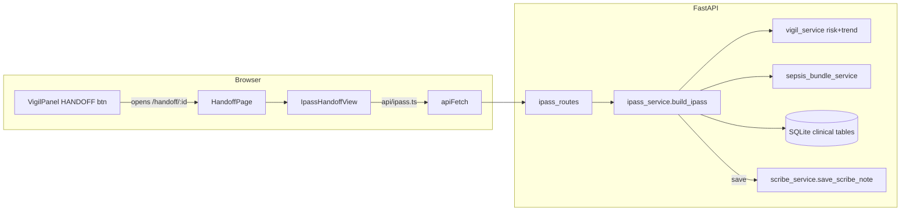
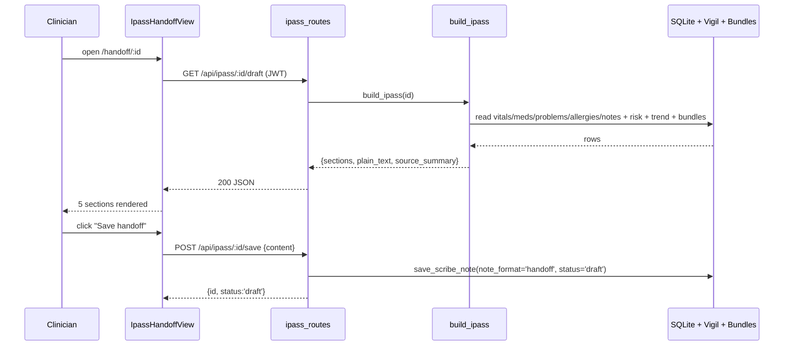

# I-PASS Handoff: shift-change patient handoffs

When a nurse or doctor finishes a shift, they must "hand over" every patient to the clinician taking over: who the patient is, how sick they are, what still needs doing, and what to watch for. Getting this wrong kills people, so hospitals use a fixed script. Orb's I-PASS subsystem **auto-drafts that script** from the patient's last ~12 hours of real database records, deterministically, with no AI text generation, renders it as five labelled sections on screen, lets the outgoing clinician save it as a draft note or print it, and hands the incoming shift a structured, read-back-ready document. This guide also covers a second, unrelated thing that shares the word "handoff": `sage_handoff_service.py`, which "hands off" a confirmed AI-suggested *action* to a downstream module (pharmacy, notes, surgery). The two are different subsystems that happen to share a noun; both are in scope here and both are explained, but keep them mentally separate.

> **Jargon up front.**
> - **I-PASS**, a standardised handoff mnemonic. **I**llness severity (how sick: Stable / Watcher / Unstable), **P**atient summary (who they are, diagnosis, problems, allergies), **A**ction list (meds, care-bundle tasks, outstanding jobs), **S**ituation awareness & contingency planning ("if X happens, do Y"), **S**ynthesis by receiver (the incoming clinician reads it back to confirm understanding). Orb fills the first four from data and leaves the fifth as a placeholder for the human to complete.
> - **Deterministic**, same input always yields the same output; here it means the draft is *assembled from DB fields*, never invented by a language model, so it can never hallucinate a fake drug or vital.
> - **NEWS2**, National Early Warning Score 2, a 0–20+ points score computed from vital signs; higher = sicker. Owned by the Vigil subsystem (see guide 07-vigil). I-PASS reads NEWS2 to decide illness severity.
> - **Route handler**, a Python function wired to an HTTP URL by FastAPI (the web framework). **RBAC**, Role-Based Access Control: each endpoint requires a named *permission* the caller's role must hold. **JWT**, a signed token proving who the caller is, checked on every request. **Socket / socket room**, a live server→browser push channel; a "room" is a named subset of connected clients.
> - **Care bundle**, a checklist of time-boxed tasks (e.g. the Sepsis Six) tracked per patient; the bundle service is documented alongside Vigil in guide 07-vigil.

---

## Purpose and neighbours

**The problem.** Verbal handovers are lossy and inconsistent. A structured, pre-populated I-PASS document (a) forces completeness, (b) saves the outgoing clinician the clerical work of retyping data that is already in the chart, and (c) gives the incoming clinician one predictable layout every time. Orb's angle: it can *draft the whole thing automatically* because it already holds the vitals, meds, problems, allergies, risk score and care bundles in its database. No AI text generation is required, so the draft is trustworthy even when the local LLM (Ollama) is down (`server/services/ipass_service.py:12`).

**Where it sits.** The I-PASS service is a pure *reader* of clinical-core tables plus two Vigil helpers and one bundle helper. It *writes* only by reusing the existing `scribe_notes` table with `note_format='handoff'`, it has no table of its own (`server/services/ipass_service.py:17`).

Neighbour guides referenced below: **07-vigil** (`get_patient_risk`, `get_vitals_trend`, and the `get_bundles_for_patient` sepsis-bundle service), **11-scribe** (`save_scribe_note`, `scribe_notes` schema), **03-auth-rbac** (`require_permission`), **05-audit-chain** (`log_audit_event`), **06-realtime** (socket rooms), **02-api-client** (`apiFetch`), **08-relay** / **09-sage** (the Sage action pipeline that invokes `sage_handoff_service`), **14-helix** / **15-pharmacy-verify** (drug ordering + safety), **17-surgical-suite** and **21-admissions-discharge** (transfer downstreams).

---

## File map

| File | Lines (approx) | Role |
|---|---|---|
| `server/services/ipass_service.py` | 1441 | Core: assembles the deterministic I-PASS draft from DB data; persists/lists handoff notes. |
| `server/routes/ipass_routes.py` | 183 | Three REST endpoints (`/draft`, `/save`, `/recent`) under prefix `/api/ipass`, RBAC-guarded. |
| `src/api/ipass.ts` | 276 | Typed browser client: `getIpassDraft`, `saveIpass`, `getRecentHandoffs` + all response interfaces. |
| `src/pages/HandoffPage.tsx` | 10 | Route wrapper: reads `:patientId` from the URL, renders `IpassHandoffView`. |
| `src/components/handoff/IpassHandoffView.tsx` | 431 | The on-screen I-PASS panel: fetch → render 5 sections → Save / Print. |
| `src/components/HandoffPrintView.tsx` | 247 | A *separate* print-only handoff layout fed by VigilPanel local state (not the I-PASS API). Currently unreachable in the UI, see Discrepancies. |
| `server/services/sage_handoff_service.py` | 732 | Unrelated: dispatches a confirmed Sage AI *action* to a downstream module (Helix/Scribe/Admissions+surgery). |
| `server/tests/test_ipass.py` | 381 | Tests for the deterministic I-PASS draft, persistence and listing. |
| `server/tests/test_handoff.py` | 538 | Tests for `sage_handoff_service` dispatch (prescribe/document/transfer/unsupported/exact-verb routing/idempotency). |
| `server/tests/test_handoff_blocked.py` | 379 | The `blocked` outcome: a severe alert or a failed screen charts nothing and is reported blocked, never sent; non-blocking alerts reach the confirming doctor. |

---

## How it works

### Flow A: the I-PASS shift handoff (the subsystem this guide is named for)

1. In the Vigil patient panel the clinician clicks **HANDOFF**, which does `window.open('/handoff/<patientId>', '_blank')` (`src/pages/panels/VigilPanel.tsx:871`), a new browser tab, not an in-app print.
2. The router matches `/handoff/:patientId`, gated so `role !== 'patient'` (`src/App.tsx:87`), and renders `HandoffPage` → `IpassHandoffView`.
3. On mount, `IpassHandoffView` calls `getIpassDraft(patientId)` → `GET /api/ipass/<id>/draft` (`src/components/handoff/IpassHandoffView.tsx:77`).
4. The route handler `get_draft` runs `build_ipass(patient_id)` (`server/routes/ipass_routes.py:31`).
5. `build_ipass` reads six clinical tables inside one DB session, then scores the vitals row it will print with Vigil's `risk_for_row`, calls `get_vitals_trend` and the bundle service, reads Sage's stored reasoned assessment if one is recent enough (`get_reasoned_assessment`, reused, never generated), then runs five section builders, renders a plain-text version, and returns one JSON object (`server/services/ipass_service.py:1294`, returned at `:1377`). **No LLM is called.**
6. The browser renders the five sections; the clinician optionally clicks **Save handoff** (`POST /api/ipass/<id>/save` → persists a `scribe_notes` row with `note_format='handoff'`, `status='draft'`) or **Print** (`window.print()`).

### Flow B: the Sage action "handoff" (`sage_handoff_service.py`)

This is the *other* handoff. When a doctor confirms an AI-suggested action in the Relay chat (see guides 08-relay / 09-sage), the transition endpoint confirms the card and dispatches it in ONE transaction (`_confirm_and_hand_off`, `server/routes/relay_routes.py:407`, which runs `dispatch_in_transaction` on the confirm's own connection). That creates a durable `sage_handoffs` audit row, then routes the action by its **exact** verb, looked up in `ACTION_ROUTES` (`server/services/sage_handoff_service.py:31`), to at most one downstream adapter. Spacing, hyphens and case are normalised first, so "Start medication" and `start_medication` are one verb; words inside a verb are never matched:

| Action verb (normalised) | Target module | Adapter | Effect |
|---|---|---|---|
| `transfer_to_surgery` / `book_or` / `book_surgery` | `admissions` | `_dispatch_to_transfer` | move admission dept + create/advance an emergency surgery + alert the team |
| `start_medication` / `add_medication` / `prescribe` | `helix` | `_dispatch_to_helix` | drug-safety gate, chart the med as `llm_extracted`, create a pharmacy order; a severe alert or a screen that could not run stores the handoff `blocked` and charts nothing |
| `document` / `draft_note` | `scribe` | `_dispatch_to_scribe` | create a SOAP draft note |
| anything else (including `stop_medication` and a bare `transfer`) | (none) | n/a | status `unsupported`, with an error summary that says it needs manual dispatch and nothing was sent or changed |

Every state change is written to `sage_handoff_events` for audit, and dispatch is idempotent per source action.

---

## Function-by-function

### server/services/ipass_service.py

#### Module constants & tiny helpers: `server/services/ipass_service.py:68`
**Signature:** `HANDOFF_WINDOW_HOURS = 12`; `_SEVERITY_MAP` dict; `_now()→datetime`; `_iso(dt)→str`; `_num(v, digits=0)→str`
**Does:** define the 12-hour look-back window, map a NEWS2 band to an I-PASS severity word, and provide UTC-now / ISO / safe-number formatting helpers.
**How it works:** `_SEVERITY_MAP` (`:80`) maps `critical→Unstable`, `elevated→Watcher`, `stable→Stable`. `_now` (`:87`) is timezone-aware UTC. `_num` (`:95`) formats a float to N decimals but returns `"--"` for `None` or non-numeric input, so a missing vital never crashes the render.
**Why it exists:** centralises the two "magic" pieces of policy (window length, severity vocabulary) and the null-tolerant formatting used throughout the plain-text render.
**Data in/out:** scalars in, scalars out.
**Talks to:** used by every builder below.
**Change guide:** to widen the look-back to 24h, change `HANDOFF_WINDOW_HOURS = 12` (`:68`), but note the endpoint calls `build_ipass(patient_id)` with the default, and `get_vitals_trend` is passed `window_hours // 2` (`:1328`), so both windows move together. To rename "Watcher" to "Guarded", edit `_SEVERITY_MAP` values *and* the frontend `SEVERITY_COLOR` map (`src/components/handoff/IpassHandoffView.tsx:20`) or the colour lookup falls back to grey.
**Gotchas:** `_SEVERITY_MAP.get(level, "Watcher")` (`:910`) defaults *unknown* levels to Watcher, not Stable, a garbage risk level presents as amber, not green (arguably the safer default, but non-obvious).

#### `_get_patient`: `server/services/ipass_service.py:271`
**Signature:** `(db, patient_id: str) → dict | None`
**Does:** fetch the whole `patients` row as a dict, or `None`.
**How it works:** `SELECT * FROM patients WHERE id = ?`, `dict(row)` if found.
**Why it exists:** single source for demographics; its `None` return is how `build_ipass` detects an unknown patient.
**Data in/out:** patient id → patient dict.
**Talks to:** called by `build_ipass`; feeds `_build_patient_summary` and `_compute_age`.
**Change guide:** none needed for normal use.
**Gotchas:** parameterised (`?`), no SQL injection risk. `SELECT *` means the returned dict's keys depend on the live `patients` schema.

#### `_compute_age`: `server/services/ipass_service.py:276`
**Signature:** `(patient: dict) → int | None`
**Does:** return the patient's age, preferring a stored `age` column, else computing from `date_of_birth`.
**How it works:** if `age` present, `int(age)`. Else parse `date_of_birth` (tolerating a trailing `Z`), and compute `today.year - born.year - ((today.month, today.day) < (born.month, born.day))`, the standard "have they had their birthday yet this year" correction.
**Why it exists:** demographics may store age directly *or* only a DOB; this normalises both.
**Data in/out:** patient dict → age or `None`.
**Talks to:** `_build_patient_summary`.
**Gotchas:** uses `date.today()` (local server date, not UTC) for the birthday comparison, a one-day edge case around midnight, immaterial clinically.

#### `_get_vitals_window`: `server/services/ipass_service.py:291`
**Signature:** `(db, patient_id, cutoff_iso) → list[dict]`
**Does:** return all vitals since the cutoff (chronological), or the single most-recent reading if none fall in the window.
**How it works:** `SELECT * … WHERE timestamp >= ? ORDER BY timestamp ASC, id ASC`; if empty, a fallback to the single latest reading. The `id ASC` tie-break means a correction charted at the same bedside time as the set it supersedes comes last, so `vitals[-1]` is the reading the handoff prints and scores.
**Why it exists:** guarantees the Situation-Awareness section always has *something* to show, even for a patient with no readings in the last 12h.
**Data in/out:** cutoff ISO string → list of vitals dicts (oldest→newest).
**Talks to:** `_build_situation_awareness` (uses `vitals[-1]` as "latest").
**Gotchas:** **string comparison of timestamps.** `timestamp >= cutoff_iso` is a raw lexical compare, which is correct *only if* stored `vitals.timestamp` is ISO-8601 in the same format as `cutoff_iso`. The neighbouring `_get_recent_notes` deliberately wraps both sides in `datetime()` to avoid exactly this trap, this function does not. See Discrepancies.

#### `_get_active_meds`: `server/services/ipass_service.py:312`
**Signature:** `(db, patient_id) → list[dict]`
**Does:** list `active` and `prn` (as-needed) medications, active first.
**How it works:** `WHERE status IN ('active','prn')` ordered by a `CASE` that puts active before prn, then newest `started_at`.
**Why it exists:** the Action-List section needs the live med list; discontinued/stopped meds must not appear.
**Data in/out:** → list of `{drug_name,dosage,route,frequency,notes,status}`.
**Talks to:** `_build_action_list`.
**Gotchas:** the test explicitly seeds a `discontinued` med and asserts it is absent (`server/tests/test_ipass.py:133`), do not broaden the status filter without updating that test.

#### `_get_active_problems` / `_get_active_allergies`: `server/services/ipass_service.py:322` / `:332`
**Signature:** `(db, patient_id) → list[dict]`
**Does:** list active problem-list entries (`problem`, `icd10_code`) and active allergies (`substance`, `reaction`, `severity`), newest first.
**Why they exist:** feed the Patient-Summary section's "active problems" and "allergies" lines.
**Data in/out:** → lists of dicts.
**Talks to:** `_build_patient_summary`.
**Gotchas:** none noteworthy; both are parameterised single-table reads.

#### `_get_recent_notes`: `server/services/ipass_service.py:342`
**Signature:** `(db, patient_id, cutoff_iso) → list[dict]`
**Does:** fetch up to 5 recent `scribe_notes` in the window.
**How it works:** `WHERE datetime(created_at) >= datetime(?)`, both sides normalised through SQLite's `datetime()` so a stored `'YYYY-MM-DD HH:MM:SS'` and an ISO `'…T…+00:00'` cutoff compare correctly. The inline comment (`:345-346`) explains that a raw string compare would always fail because a space (0x20) sorts before `T` (0x54) at position 10.
**Why it exists:** intended to enrich the handoff with recent documentation.
**Data in/out:** → up to 5 note dicts.
**Talks to:** `build_ipass`, but **only `len(recent_notes)` is ever used** (in `source_summary`, `:1361`). The note *contents* are fetched and then discarded. See Discrepancies.
**Gotchas:** the `datetime()` normalisation here is the *correct* pattern that `_get_vitals_window` omits, a good worked contrast if you are auditing timestamp handling.

#### `_build_illness_severity`: `server/services/ipass_service.py:908` (the "I")
**Signature:** `(risk: dict) → dict`
**Does:** turn Vigil's risk dict into the I-PASS Illness-Severity section.
**How it works:** lower-cases `risk['level']`, maps via `_SEVERITY_MAP` (default Watcher), pulls `raw_news2` (falling back to `raw_mews`), builds a one-line `text` like `"Unstable, NEWS2 9 (critical). Key drivers: …"`. Since 2026-10-03 the other `news2_text` qualifiers follow the band, separated by ` · ` (`news2_qualifiers(risk, scale=False)`): a single parameter scoring 3, and an incomplete set whose aggregate is only a minimum.
**Why it exists:** translates the numeric risk model into the clinician-facing severity word and a human sentence.
**Data in/out:** risk dict → `{severity, news2, news2_level, scoring_model, spo2_scale, drivers, text}`. For a patient on SpO2 Scale 2 (`spo2_scale == 2`) the text names it inside the band parenthesis, e.g. `"Stable: NEWS2 0 (stable band, SpO2 Scale 2, target 88-92%)"`, because a COPD patient's on-target SpO2 90 scoring 0 otherwise reads as a scoring error (2026-10-02, `server/tests/test_ipass_scale2.py`). A dict with no scale is Scale 1 and its text is unchanged.
**Talks to:** consumes `get_patient_risk` output (guide 07-vigil); output shape mirrored in `IpassSections.illness_severity` (`src/api/ipass.ts:141`).
**Change guide:** to show the MEWS score when NEWS2 is absent it already falls back to `raw_mews` (`:911`); to change the amber/red/green colours edit the frontend `SEVERITY_COLOR`, not here.
**Gotchas:** `drivers` may be `None` from the risk service; `risk.get("drivers", []) or []` (`:912`) guards that.

#### `_build_patient_summary`: `server/services/ipass_service.py:940` (the "P")
**Signature:** `(patient, problems, allergies) → dict`
**Does:** compose demographics + diagnosis + active problems + allergies.
**How it works:** computes age, builds `problem_labels` and `allergy_labels` (`"substance (reaction)"`), a demographic string, and a full-sentence `text`. With no allergy rows the sentence reads `NO_ALLERGIES_RECORDED`, "No allergies recorded. Confirm with the patient." (`:72`, `:956-957`), never "NKDA": NKDA is a clinician's assertion that the patient was asked, and an empty `patient_allergies` is also every patient nobody asked.
**Why it exists:** the "who is this patient" block every receiver needs first.
**Data in/out:** → `{name, mrn, age, sex, ward, bed, diagnosis, problems[], allergies[], text}`.
**Talks to:** rendered by both the plain-text renderer and the React P-section.
**Gotchas:** `allergies` **can be an empty list** downstream (it used to be `allergy_labels or ["NKDA"]`); an empty list means none recorded, and the UI words that state itself. Do not reintroduce a default.

#### `_build_action_list`: `server/services/ipass_service.py:980` (the "A")
**Signature:** `(meds, bundles, risk) → dict`
**Does:** assemble active meds + open care bundles + a derived "outstanding items" to-do list.
**How it works:**
1. Projects each med to `{drug_name,dosage,route,frequency,unverified}`; `unverified` is true for an `llm_extracted`/`agentic` med no pharmacist has verified (`:988`), so it is not handed over like a prescription it is not.
2. For each bundle, splits its `elements` into `overdue` and `pending` by `state`, records `compliance_pct`/`completion_pct`, and appends human strings like `"OVERDUE (sepsis): Lactate"` to `outstanding_items` (`:1009`).
3. **Severity safety net:** if risk level is `critical`, appends "Repeat a full set of observations now…"; if `elevated`, "Recheck observations within the hour…" (`:1015-1018`), so a sick patient's action list is never empty.
4. Final fallback: if there are no meds, bundles or items, appends "Continue routine observations; no outstanding actions handed over." (`:1019-1020`).
**Why it exists:** the single most important handoff section, the concrete jobs the next shift inherits.
**Data in/out:** → `{active_medications[], open_care_bundles[], outstanding_items[]}`.
**Talks to:** consumes `get_bundles_for_patient` element shape (`state`, `label`, `compliance_pct`; guide 07-vigil) and `get_patient_risk` level.
**Change guide:** to add a monitoring instruction for `stable` sick-ish patients, add an `elif level == "stable"` branch near `:1017`; knock-on: the empty-list fallback at `:1019` would then rarely fire. Watch out: bundle element `state` strings come from `_decorate` (`server/services/sepsis_bundle_service.py:137-142`), only `overdue`/`pending` are treated as outstanding; if you add a new element state there, update this filter too.
**Gotchas:** depends on the exact string values `"overdue"`/`"pending"`; a typo silently drops items.

#### `_contingencies`: `server/services/ipass_service.py:1093`
**Signature:** `(risk: dict) → list[str]`
**Does:** derive "if X then Y" escalation instructions, one line per vital that scored on the NEWS2 chart.
**How it works:** reads `risk['breakdown']` and keeps every row with points above 0 (`:1100-1101`), so a vital that scored gets its line whatever the drivers list kept. Oxygenation comes first: a scoring SpO2 row or a scoring "Supplemental O2" row adds the SpO2 line. Then systolic BP, heart rate and temperature, then ACVPU (`_ACVPU_LINE`, `:1080`), then respiratory rate. `_vital_line` (`:1084`) picks the low or high line by which side of the zero-scoring band (`_ZERO_BAND`, `:1055`) the charted value sits on, and `_VITAL_LINES` (`:1064`) holds the text: each number is the first charted value the RCP chart scores 3 on that side, so the sheet and the Vigil bar call the same reading red. The four directions with no line of their own give the RCP red-score response (`_URGENT_REVIEW`, `:1050`); temperature has no 3-point band above normal, so the fever line names no number. If nothing scored (or there is no breakdown), it emits a generic line keyed to the risk level (`:1131`). **SpO2 Scale 2 (2026-10-02):** when `risk['spo2_scale'] == 2` (`:1110`) the SpO2 line uses the patient's 88-92% target ("If SpO2 falls below 88% ... titrate O2 to this patient's 88-92% target") instead of the Scale 1 line, and a scoring SpO2 above 92 on oxygen adds "If SpO2 stays above this patient's 88-92% target on oxygen ..., reduce O2 to target" first. The comment block above the tables (`:1029-1049`, ruled 2026-10-03) records why the old driver keyword match was replaced: it lost the direction ("(hr" matched bradycardia, "sbp" matched hypertension) and could drop a vital the drivers list had cut.
**Why it exists:** turns *why* the patient is scoring high into *what to do about it*, the "contingency planning" heart of the second S.
**Data in/out:** risk dict → list of instruction strings, each starting `"If …"`.
**Talks to:** `_build_situation_awareness` (`:1171`).
**Change guide:** to add a contingency for a new breakdown parameter, add its zero-scoring band to `_ZERO_BAND` and its low/high lines to `_VITAL_LINES`, then add it to the parameter loop in `_contingencies`. Watch out: `test_ipass_news2_contingency.py` sweeps `compute_news2` and fails if a number in a line stops being where the 3 points start, and `test_build_ipass_...` asserts every contingency `startswith("if ")` (`server/tests/test_ipass.py:144`), keep the "If " prefix.
**Gotchas:** the lines depend on the exact breakdown `parameter` strings from the scorer ("Systolic BP", "Heart rate", "Consciousness (ACVPU)", "SpO2 (Scale 2)"); a renamed parameter silently drops its line. The generic fallback prevents an empty list.

#### `_build_situation_awareness`: `server/services/ipass_service.py:1141` (the first "S")
**Signature:** `(vitals, trend, risk) → dict`
**Does:** report latest vitals, the shift trend, whether the patient is actively deteriorating, and the contingency list.
**How it works:** takes `vitals[-1]` as latest; `active_deterioration` is true if level is critical/elevated *or* `trend=='deteriorating'` (`:1145`); builds `trend_detail` from `hr_delta`/`sbp_delta`/`spo2_delta` (`:1158-1163`); formats a vitals sentence via `_num`; calls `_contingencies`.
**Why it exists:** the "how are they trending and what am I watching" section.
**Data in/out:** → `{trend, trend_detail, active_deterioration, latest_vitals{…}, readings_count, contingencies[], text}`.
**Talks to:** consumes `get_vitals_trend` deltas (`server/services/vigil_service.py:932`).
**Gotchas:** if `get_vitals_trend` returned only `{"trend":"insufficient_data", "reason": ...}` (its no-data paths, `server/services/vigil_service.py:974`, `:978`), the delta keys are absent and `trend_detail` prints the trend service's own reason ("no earlier vitals to compare against"), or "insufficient recent data" when it gave none (`:1164-1169`): the reason tells the oncoming nurse this is a newly arrived patient rather than a broken feed.

#### `_build_synthesis`: `server/services/ipass_service.py:1200` (the second "S")
**Signature:** `(patient, severity: str) → dict`
**Does:** produce the receiver read-back placeholder.
**How it works:** returns a fixed sentence asking the receiver to read back the severity, the action list and the contingency plans, then record outstanding questions, their name and the time, plus `read_back_required=True`, `confirmed=False` and `prompts` = `READ_BACK_PROMPTS` ("Outstanding questions", "Confirmed by", "Time", `:77`). The plain-text render prints one labelled line per prompt, left open for the receiver's pen.
**Why it exists:** I-PASS requires the receiver to synthesise and read back; software can only *prompt* for it, not perform it, so this is a deliberate placeholder, not generated content.
**Data in/out:** → `{read_back_required, confirmed, prompts, text}`.
**Talks to:** `build_ipass` (passes in the already-computed severity).
**Gotchas:** despite the module docstring's claim that "an optional best-effort LLM synthesis line can be layered on top" (`:14`), **no LLM is ever invoked**, this section is 100% static. See Discrepancies.

#### `_render_plain_text`: `server/services/ipass_service.py:1218`
**Signature:** `(sections, patient, generated_at) → str`
**Does:** flatten the five section dicts into a monospace, printable/copy-pasteable text block.
**How it works:** appends header lines (title, patient, MRN, "Auto-drafted … Window: last 12h"), then one block per I-PASS letter, iterating meds (an unverified med carries `(AI-extracted, awaiting pharmacist verification)`, `UNVERIFIED_MED_LABEL`, `:976`), bundles, outstanding items and contingencies, and ends with the read-back prompts as open labelled lines.
**Why it exists:** a plain-text canonical form that survives copy/paste into any EHR (Electronic Health Record) and drives the "Plain-text handoff" `
` block and print.
**Data in/out:** sections dict → single `\n`-joined string.
**Talks to:** the string is returned as `plain_text` and rendered verbatim in `IpassHandoffView` (`src/components/handoff/IpassHandoffView.tsx:295`).
**Gotchas:** the section headers (`"ILLNESS SEVERITY"`, `"SYNTHESIS BY RECEIVER"`, …) are asserted by `test_plain_text_contains_all_section_headers` (`server/tests/test_ipass.py:150`), renaming a header breaks that test.

#### `build_ipass`: `server/services/ipass_service.py:1294` (public entry point)
**Signature:** `(patient_id: str, window_hours=12, *, include_assessment=True) → dict`
**Does:** orchestrate the whole draft assembly.
**How it works:**
1. Compute `cutoff = now - window_hours`.
2. In **one** DB session, read patient (raise `ValueError` if missing, `:1314`), vitals window, meds, problems, allergies, recent notes.
3. Outside the session, score the row the handoff prints, `risk_for_row(vitals[-1], ...)` (`:1325`; a separate "latest" read could score a set the handoff did not show), and call `get_vitals_trend(hours=window_hours//2)`, which is wrapped in try/except and degrades to `insufficient_data` (`:1328`).
4. Import and call `get_bundles_for_patient(active_only=True)`, also try/except-guarded to `[]` (`:1334-1339`).
5. Read Sage's reasoned assessment, if a recent enough one exists (`get_reasoned_assessment`, `:500`, called at `:1345`; skipped when `include_assessment=False`). It is **reused, never generated**: no model runs here.
6. Run the five builders, assemble `sections`, then `synthesis` (which needs the computed severity), and set `sections["ai_assessment"]` to the assessment or `None` (`:1347-1354`). The plain text renders it, when present, under the constant heading "SUPPLEMENT: AI-DRAFTED ASSESSMENT (NOT WRITTEN BY A CLINICIAN)" (`AI_SUPPLEMENT_HEADING`, `:405`), stamped with the NEWS2 it was written against and how long ago, so it can never be mistaken for something a clinician wrote.
7. Build `source_summary` (a one-paragraph provenance line counting each data source) and `plain_text`.
8. Return `{patient_id, generated_at, window_hours, source_summary, sections, plain_text}` (`:1377`).
**Why it exists:** the single deterministic function the route calls; keeps the endpoint thin.
**Data in/out:** patient id → the full `IpassDraft` JSON (`src/api/ipass.ts:192`).
**Talks to:** Vigil, bundles, and (transitively) `compute_news2`; called by `get_draft` and by `save_draft`'s caller flow via the frontend.
**Change guide:** *Worked example, add a "recent notes" section to the handoff.* Right now `recent_notes` is fetched but only counted. To surface it: (a) write a `_build_recent_documentation(recent_notes)` builder returning `{text, notes[]}`; (b) add it to the `sections` dict at `:1347`; (c) add a block in `_render_plain_text`; (d) add the field to `IpassSections` in `src/api/ipass.ts:140` and a `<Section>` in `IpassHandoffView`. Knock-on: `test_build_ipass_has_all_five_sections_populated` iterates a fixed 5-key list (`server/tests/test_ipass.py:109`), extend it. Footgun: keep the deterministic-only contract; do not call an LLM inside `build_ipass` or you reintroduce hallucination risk and the "safe when Ollama is down" guarantee breaks.
**Gotchas:** the two try/except blocks are the reason a partially-configured system (no CfC models, no bundles) still returns a usable draft rather than a 500.

#### `save_ipass_handoff`: `server/services/ipass_service.py:1387`
**Signature:** `(patient_id, author_id, content) → int`
**Does:** persist a handoff draft as a `scribe_notes` row.
**How it works:** accepts either the `build_ipass` dict *or* a plain string. From a dict it takes `source_summary`→`raw_transcript` and `plain_text`→`structured_note`, with JSON-of-sections and default-string fallbacks so the note is never empty (`:1400-1407`). Calls `save_scribe_note(note_format="handoff", status="draft", ai_generated=True)` and returns the new note id.
**Why it exists:** gives the auto-draft durability and audit lineage by reusing Scribe's storage rather than inventing a table.
**Data in/out:** dict|str → integer note id.
**Talks to:** `save_scribe_note` (`server/services/scribe_service.py:602`, guide 11-scribe); called by `save_draft` route.
**Change guide:** to store the structured JSON instead of plain text, swap what goes into `structured_note`, but the round-trip readers (`get_recent_handoffs`, and `test_save_..._persists` which asserts `"I-PASS" in structured_note`, `server/tests/test_ipass.py:176`) expect the rendered text.
**Gotchas:** raises `ValueError` for a non-dict/non-str `content`, which the route turns into HTTP 400 (`server/routes/ipass_routes.py:50`).

#### `get_recent_handoffs`: `server/services/ipass_service.py:1424`
**Signature:** `(patient_id, limit=10) → list[dict]`
**Does:** list saved handoff notes for a patient (`note_format='handoff'`, newest first).
**How it works:** one parameterised `SELECT … LEFT JOIN users … ORDER BY created_at DESC, id DESC LIMIT ?`, so each note carries `author_name` (the incoming nurse reads a name, not a user id) and `id` breaks a same-second tie.
**Why it exists:** backs the `/recent` endpoint.
**Data in/out:** → list of note dicts.
**Talks to:** `recent_handoffs` route; the matching frontend `getRecentHandoffs` is called by the nurse handover sheet (`src/pages/panels/nurse/HandoverSheet.tsx:142`).
**Gotchas:** none noteworthy.

### server/routes/ipass_routes.py

> Router prefix `APIRouter(prefix="/api/ipass", tags=["ipass"])` (`server/routes/ipass_routes.py:21`), registered by `app.include_router(ipass_router)` (`server/main.py:316`). So every path below is under `/api/ipass`.

#### `get_draft`: `server/routes/ipass_routes.py:44`
**Signature:** `GET /api/ipass/{patient_id}/draft`, `Depends(require_permission("vitals.read"))` → `IpassDraft`
**Does:** return a freshly assembled I-PASS draft.
**How it works:** calls `build_ipass(patient_id)`; a `ValueError` (unknown patient) becomes HTTP 404 (`:32`).
**Why it exists:** the read endpoint the panel loads on open.
**Data in/out:** path id → full draft JSON. No body.
**Talks to:** `build_ipass`; RBAC `require_permission` (guide 03-auth-rbac). Called by `getIpassDraft` (`src/api/ipass.ts:216`).
**Gotchas:** requires `vitals.read`, not a bespoke handoff permission, reusing an existing capability. A `patient`-role JWT would be rejected both here (no permission) and at the route guard in `App.tsx:87`.

#### `save_draft`: `server/routes/ipass_routes.py:63`
**Signature:** `POST /api/ipass/{patient_id}/save`, body `{content}`, `Depends(require_permission("scribe.create_draft"))` → `{id,status,note_format}`
**Does:** persist the draft and write an audit event.
**How it works:** rejects missing `content` with 400 (`:46`); calls `save_ipass_handoff(patient_id, user["id"], content)` (400 on `ValueError`); then `log_audit_event(...)` with category `scribe`, action `ipass_handoff_saved`, capturing actor, path, method, client IP (`:53`); returns `{id, status:"draft", note_format:"handoff"}`.
**Why it exists:** the write endpoint behind the **Save handoff** button, with a full audit trail because it mutates the medical record.
**Data in/out:** `{content: IpassDraft|string}` → `{id:number,status,note_format}`.
**Talks to:** `save_ipass_handoff`, `log_audit_event` (guide 05-audit-chain); called by `saveIpass` (`src/api/ipass.ts:221`).
**Change guide:** to require a distinct `handoff.create` permission, define it in `permissions.py` and swap the dependency here; knock-on: every role that should save handoffs must be granted it, or Save silently 403s in the panel.
**Gotchas:** it saves whatever `content` the client posts (`IpassHandoffView` posts the exact `draft` it received, `src/components/handoff/IpassHandoffView.tsx:95`), so a tampered client could persist arbitrary text. It is gated by `scribe.create_draft` and audited, which is the mitigating control.

#### `recent_handoffs`: `server/routes/ipass_routes.py:176`
**Signature:** `GET /api/ipass/{patient_id}/recent`, `Depends(require_permission("vitals.read"))` → `{handoffs: [...]}`
**Does:** list recent saved handoffs.
**How it works:** wraps `get_recent_handoffs(patient_id)` in `{"handoffs": …}`.
**Why it exists:** intended history view.
**Talks to:** `get_recent_handoffs`; frontend `getRecentHandoffs`, called by the nurse handover sheet.
**Gotchas:** returns the wrapper object `{handoffs: [...]}`, and the frontend client unwraps `.handoffs` (`src/api/ipass.ts:234`), keep them in sync.

### src/api/ipass.ts

#### Response interfaces: `src/api/ipass.ts:10-213`
**Does:** mirror the server JSON in TypeScript (`IpassMedication`, `IpassBundle`, `IpassLatestVitals`, `IpassSections`, `IpassDraft`, `IpassHandoffRecord`, plus the reasoned-assessment shapes `IpassReasonedAssessment`, `IpassReasonedAssessmentResponse` and `IpassPrepareResponse`).
**Why they exist:** compile-time safety so a section rename on the server surfaces as a TS error in the view.
**Data in/out:** these are the canonical client-side shapes of `build_ipass`'s output.
**Gotchas:** they are hand-maintained, they do **not** auto-derive from the Python. If you add a section field server-side, you must add it here or the view can't read it type-safely.

#### `getIpassDraft` / `saveIpass` / `getRecentHandoffs`: `src/api/ipass.ts:216` / `:221` / `:232`
**Signature:** `(patientId) → Promise<IpassDraft>`; `(patientId, content) → Promise<{id,status,note_format}>`; `(patientId) → Promise<IpassHandoffRecord[]>`
**Does:** thin wrappers over `apiFetch` for the three endpoints.
**How it works:** all route through `apiFetch` (`src/api/client.ts:339`), which prefixes `/api`, sends the HttpOnly session cookie (`credentials: 'include'`), tries one session refresh on a 401 before reporting the session expired, and unwraps structured 403s. `saveIpass` POSTs `{content}`; `getRecentHandoffs` unwraps `.handoffs`.
**Why they exist:** keep components free of URL/auth/error boilerplate.
**Data in/out:** see signatures.
**Talks to:** `IpassHandoffView` calls the first two; the nurse `HandoverSheet` calls all three (`src/pages/panels/nurse/HandoverSheet.tsx:142`, `:187`, `:237`).
**Gotchas:** `apiFetch` prepends `/api`, so the paths here are `/ipass/...` (no `/api`). `saveIpass` sends `{ content }` and the server reads `data.get("content")`, the nesting must match.

### src/pages/HandoffPage.tsx

#### `HandoffPage`: `src/pages/HandoffPage.tsx:5`
**Signature:** React component, no props → JSX
**Does:** read `:patientId` from the URL and render `IpassHandoffView`, or a "No patient specified" fallback.
**How it works:** `useParams()` (React Router hook that returns URL path params); guards missing id.
**Why it exists:** a route needs a component; this adapts URL→prop.
**Data in/out:** URL param → `<IpassHandoffView patientId=…/>`.
**Talks to:** mounted by the `/handoff/:patientId` route (`src/App.tsx:87`).
**Gotchas:** the route itself enforces `role !== 'patient'`; this component does no auth of its own.

### src/components/handoff/IpassHandoffView.tsx

#### `Section`: `src/components/handoff/IpassHandoffView.tsx:42`
**Signature:** `({tag, title, children}) → JSX`
**Does:** a reusable card with the I-PASS letter badge + title + body.
**How it works:** inline-styled `<section>` with a coloured letter chip (`tag`) and a slot for `children`.
**Why it exists:** the five sections share one visual shell; DRY.
**Data in/out:** presentational only.
**Talks to:** used five times in `IpassHandoffView`.
**Gotchas:** styling is inline (React `style` objects), not the gold design-system CSS, this panel opens in a bare new tab, so it deliberately avoids app chrome.

#### `IpassHandoffView`: `src/components/handoff/IpassHandoffView.tsx:81`
**Signature:** `({patientId, patientName?}) → JSX`
**Does:** fetch the draft, render the five I-PASS sections, and provide Save / Print / Retry.
**How it works:**
1. State: `draft`, `loading`, `error`, `saving`, `saveMsg`.
2. `load` (`useCallback`, dep `patientId`) calls `getIpassDraft`; `useEffect` runs it on mount/param change (`:86`). A **React hook** is a function like `useState`/`useEffect`/`useCallback` that lets a component hold state and run side-effects.
3. `handleSave` posts the current `draft` back via `saveIpass` and shows `"Handoff saved as draft note #<id>."` (`:96`).
4. `handlePrint` calls `window.print()`.
5. Loading/error/empty guards, then renders header + five `<Section>`s + a collapsible plain-text `
` showing `draft.plain_text` (`:295`).
6. The illness-severity chip colour comes from `SEVERITY_COLOR[severity]` with grey fallback (`:126`).
**Why it exists:** the actual clinician-facing I-PASS screen.
**Data in/out:** `IpassDraft` → rendered DOM; on Save, posts the same draft.
**Talks to:** `src/api/ipass.ts`; mounted by `HandoffPage`.
**Change guide:** *Worked example, add a "Copy to clipboard" button.* Add a handler `navigator.clipboard.writeText(draft.plain_text)` next to Print (`:153`); no server change needed since `plain_text` is already in the payload. Footgun: the panel opens via `window.open(..., '_blank')`, so it is a fresh document, global app state/theme is not present; keep styling self-contained.
**Gotchas:** it re-posts the client-held `draft` rather than asking the server to recompute at save time, so a stale tab left open for hours will save the *old* draft. Save shows a message but does not reload or lock the button beyond the in-flight `saving` flag.

### src/components/HandoffPrintView.tsx

#### `HandoffPrintView`: `src/components/HandoffPrintView.tsx:88`
**Signature:** `({patient, risk, latestVitals, notes, medications, aiAssessment?}) → JSX`
**Does:** render a print-optimised, single-page "Official Shift Handoff Report" (header, patient+NEWS2 box, latest vitals grid, optional MedGemma AI assessment, meds table, up to 3 recent notes, signature lines + mock QR).
**How it works:** pure presentational component using `handoff-*` CSS classes (see `src/print.css`); dates go through `formatClinicalDateTime`; vitals through `vitalWhole` / `vitalTemperature`; the risk box prints `news2Line(risk)` (`:41`, `:125`), the NEWS2 description from `news2Description`, or "NEWS2 not recorded", plus the coverage note when the set is incomplete.
**Why it exists:** a paper handoff artefact with signature blocks, a different deliverable from the on-screen I-PASS panel.
**Data in/out:** props shaped like VigilPanel's local state (`patient`, `risk`, `latest`, `notes`, `medications`, `aiNarrative`), **not** from `/api/ipass`.
**Talks to:** nothing in the app imports it any more; only its test (`src/components/HandoffPrintView.test.tsx`) renders it. The Vigil HANDOFF button opens the I-PASS tab instead (`src/pages/panels/VigilPanel.tsx:1679`).
**Change guide:** to make the real I-PASS data drive a printout, feed it from `getIpassDraft`, but first note it is currently unreachable (below).
**Gotchas:** the risk box used to print `risk.score * 100` as "45% - ELEVATED" for a NEWS2 of 9: the 0-1 index read as a probability of deterioration it never was, and a patient with no observations printed "0% - STABLE" (the comment at `:117-122`, fixed 2026-10-02). It now prints the aggregate the chart shows.

### server/services/sage_handoff_service.py  (the *other* handoff: Sage action dispatch)

#### One transaction: `TransactionLost` and `_savepoint`: `server/services/sage_handoff_service.py:116`, `:124`
**Does:** let one adapter step fail on its own without taking the confirm with it, inside the confirm's single transaction.
**How it works:** `_savepoint(db, name)` issues `SAVEPOINT name`; on an exception it rolls back to that savepoint and re-raises, so the caller can record a `failed` or `blocked` outcome with nothing half-written. If SQLite has already rolled back the WHOLE transaction (it does on `SQLITE_FULL`, `IOERR`, `BUSY`, `NOMEM`), `db.in_transaction` is false and it raises `TransactionLost` instead (`:136`), which no adapter handler swallows: Python's sqlite3 would otherwise open a new transaction for the next statement, and the handoff would commit without the confirm it belongs to.
**Why it exists:** until 2026-10-04 the confirm and every handoff step committed separately (guide 08-relay, `transition_sage_action`).
**Gotchas:** an adapter must write only on the `db` it is handed. A `db_session()` of its own escapes the transaction, and on an unpooled connection it would deadlock against the transaction's write lock. Pinned by `test_a_step_that_loses_the_whole_transaction_is_not_swallowed` (`server/tests/test_handoff_confirm_transaction.py`).

#### `prescreen_handoff`: `server/services/sage_handoff_service.py:145`
**Signature:** `(action: dict, actor_id: str) → dict | HandoffBlocked | None`
**Does:** run the one part of a dispatch that must happen BEFORE the write transaction opens: the drug-safety screen for a Helix-bound card.
**How it works:** returns `None` unless the verb routes to `helix`; otherwise runs `_screen_helix` and returns its payload, or the `HandoffBlocked` it raised (`:159`), for `dispatch_in_transaction` to act on.
**Why it exists:** the screen writes its own audit rows, which must stand whatever happens to the confirm, and on an unpooled connection those writes would deadlock against the transaction's write lock.

#### `create_and_dispatch_handoff`: `server/services/sage_handoff_service.py:163`
**Signature:** `(action: dict, actor_id: str) → dict`
**Does:** create a durable `sage_handoffs` record for an ALREADY confirmed action and dispatch it, in one transaction of its own.
**How it works:** `prescreen_handoff`, then one `db_session` around `dispatch_in_transaction`, then `schedule_prep_package` for a newly booked case once that has committed.
**Talks to:** direct callers and the tests (`server/tests/test_handoff.py`). The Relay transition endpoint does NOT come through here: it runs `dispatch_in_transaction` on the confirm's own transaction (`server/routes/relay_routes.py:407`, guide 08-relay).

#### `dispatch_in_transaction`: `server/services/sage_handoff_service.py:182`
**Signature:** `(db, action: dict, actor_id: str, screened) → (dict, str | None)`
**Does:** record and dispatch a confirmed action on the caller's transaction, idempotently. Never commits.
**How it works:**
1. Generate a UUID handoff id and UTC timestamp.
2. **Idempotency:** look up the newest existing handoff for `action['id']`; if its status is `pending`, `accepted` or `blocked`, return it unchanged (`:207`). `blocked` is terminal like `accepted`: a stopped order is not quietly re-run behind the clinician who confirmed it.
3. Otherwise `INSERT` a new `sage_handoffs` row (status `pending`, `target_module='unknown'`, full action JSON as payload) and a `sage_handoff_events` row (`NULL→pending`).
4. Call `_dispatch_handoff` and return `(handoff view, surgery_id)`: the record through `_handoff_view`, which parses the stored `safety_json` into a `safety` dict for the card, and the id of a newly booked emergency case whose prep package the caller starts after the commit (else `None`).
**Why it exists:** an auditable coordination layer so a confirmed AI action reliably reaches the right module without cluttering the Relay action table, and one that commits with the confirm or not at all.
**Data in/out:** action dict (`id, room_id, patient_id, action_type, target, rationale, …`) plus `screened` (from `prescreen_handoff`) → the handoff row as a dict, with `safety` (the drug-safety summary, or `None`).
**Change guide:** *Worked example, make failed dispatches retry-safe.* A first attempt that ends `unsupported`/`failed` is **not** short-circuited (only `pending`/`accepted`/`blocked` are), so a second dispatch creates a *new* handoff row and re-attempts, intentional. To also short-circuit `failed`, add it to the tuple at `:207`; footgun: you would then block manual retries.
**Gotchas:** on the transition endpoint the claim's version-guarded UPDATE (`server/routes/relay_routes.py:332-338`) runs first on the same transaction, so it already holds the write lock when the idempotency SELECT runs and two confirms cannot both insert. A direct caller of `create_and_dispatch_handoff` has no such claim in front of it.

#### `_dispatch_handoff`: `server/services/sage_handoff_service.py:228`
**Signature:** `(db, handoff_id, action, actor_id, screened) → (dict, str | None)`
**Does:** route the action to one adapter by its exact verb, then update status + write an event, all on `db`.
**How it works:** normalises `action_type` (`normalize_action_verb`, `:49`) and looks it up with `route_for_action` (`:54`) in `ACTION_ROUTES`; `admissions` → `_dispatch_to_transfer`, `helix` → `_write_helix`, `scribe` → `_dispatch_to_scribe`, each under `_savepoint(db, "handoff_adapter")` (`:249`, `:255`, `:261`). A verb not in the table is stored `unsupported` with the summary "Needs manual dispatch: Orb has no automatic route for ..., so nothing was sent or changed" (`:269`). `TransactionLost` is re-raised (`:273`). `HandoffBlocked` → status `blocked`, the reason as `error_summary` and the screen summary as `safety_json` (`:275`); any other adapter exception → status `failed` with the message, and the savepoint has already undone whatever the adapter wrote. Then `UPDATE sage_handoffs` and `INSERT sage_handoff_events` with prior/new status; returns the fresh row and the surgery to package.
**Why it exists:** the router. Exact verbs are the clinical safety: the old substring match sent "start monitoring" to pharmacy ("start"), and a stop card to the Helix adapter, which only ever starts a drug (the comment above `ACTION_ROUTES`, `:22-30`).
**Data in/out:** action → updated handoff dict with `target_module`, `status`, `downstream_ref_id`, `error_summary`, `safety`.
**Talks to:** `_dispatch_to_transfer`/`_write_helix`/`_dispatch_to_scribe`; `sage_ambient_service` reads the same `ACTION_ROUTES` table to drop a classifier verb before it can become a card.
**Change guide:** to add an "order lab" route, add its verbs to `ACTION_ROUTES` with a new module name, an `elif module == ...` branch under `_savepoint`, and a `_dispatch_to_labs(action, actor_id, db)` adapter that writes only on `db` and returns a ref id. Watch out: a verb that is not in the table is never routed, so a classifier phrasing you did not list falls to `unsupported` (the safe direction).
**Gotchas:** `stop_medication` is deliberately absent (no adapter discontinues a drug), and so is a bare `transfer` (it could mean the ICU or a ward). Pinned by `test_handoff.py`: `test_create_and_dispatch_handoff_unsupported_action` (`:358`), `test_a_verb_that_only_contains_a_medication_word_reaches_no_module` (`:428`), `test_a_stop_card_never_starts_the_drug` (`:440`), `test_a_bare_transfer_books_no_surgery` (`:451`).

#### `_dispatch_to_helix`: `server/services/sage_handoff_service.py:309` (with `_screen_helix`, `:344`, and `_write_helix`, `:404`)
**Signature:** `(action, actor_id) → tuple[str, dict, str | None]` (order id or `"charted-only"`, drug-safety summary, note)
**Does:** safely chart an AI-extracted medication and create a pharmacy order, or raise `HandoffBlocked` and chart nothing. `_dispatch_to_helix` is the standalone form (screen, then `_write_helix` in a session of its own); the transition endpoint screens through `prescreen_handoff` and writes through `_write_helix` on the confirm's transaction.
**How it works:**
1. Pull `target` med + `rationale`; **never fabricate a dose**, dose/route/frequency default to `"REVIEW REQUIRED"`/`"Review"` (`_helix_order_fields`, `:333`), with route upgraded to IV/IM/SC only if literally present in the rationale (`:338`).
2. **Drug-safety gate** (`_screen_helix`): `enforce_medication_safety(..., entry_point="sage.agentic_handoff", interactive=False)` (`:373`), the same gate every medication write path uses. There is nobody to type an acknowledgement, so a severe alert raises `MedicationSafetyBlocked` and the adapter raises `HandoffBlocked` with a clinician-facing reason ("Not charted: the drug-safety screen blocked ...", `:391`). A screen that could not run, or a gate that raised anything else, also raises `HandoffBlocked` ("could not run, so ... was not checked", `:397`): fail closed, nothing charted.
3. `_write_helix` re-raises a `HandoffBlocked` screen result, and refuses outright when no screen ran (`:412`). It charts the med into `medications` with `source='llm_extracted'` (visibly unverified) under its own savepoint (`:424`).
4. It finds the drug by name exactly as `helix_service.create_order` does and writes the order with `helix_service.insert_order` on the same transaction (`:440-447`), returning `(order_id, safety_summary, None)`; on failure the med is still charted and it returns `("charted-only", safety_summary, note)`, where the note says the order was not sent to pharmacy and to place it in Helix (`:465`).
**Why it exists:** enforces human-in-the-loop dosing and drug safety on any agentic order.
**Data in/out:** action → the tuple above; `_dispatch_handoff` stores the summary as `safety_json` and the note as `error_summary`. The summary (`_safety_summary`, `:76`) carries every alert, the non-blocking ones too, so a moderate alert that charted the drug still reaches the doctor who confirmed it.
**Talks to:** `medication_safety_gate.enforce_medication_safety`, `helix_service.insert_order` (guides 14-helix / 15-pharmacy-verify).
**Gotchas:** a non-formulary drug is *charted but not ordered*, the handoff is still `accepted` with ref `charted-only` (`test_create_and_dispatch_handoff_prescribe_noncatalog_still_charts`, `server/tests/test_handoff.py:314`). The charted med carries `source='llm_extracted'` so Vigil shows it as unverified. Until 2026-10-02 a severe allergy returned `"blocked-allergy"` as if it were an order id and the handoff was stored `accepted`, so the Relay card read "Sent to Helix" for an order that never left; `server/tests/test_handoff_blocked.py` pins the `blocked` outcome, the failed-screen case and the terminal status. Until 2026-10-04 the chart row and the order each committed on their own, before the handoff's final status; a failure there left a pending order behind a handoff stuck at `pending` (`server/tests/test_handoff_confirm_transaction.py`).

#### `_dispatch_to_scribe`: `server/services/sage_handoff_service.py:467`
**Signature:** `(action, actor_id, db) → str` (note id)
**Does:** create a SOAP draft note from the action's `target`+`rationale`, on `db`.
**How it works:** builds `raw_transcript = f"Sage Ambient Observation: {target}. {rationale}"`, calls `save_scribe_note(note_format="soap", structured_note=None, ai_generated=True, db=db)` so the note joins the confirm's transaction, returns the id; re-raises as `RuntimeError` on failure.
**Why it exists:** turns a "document" action into a real (unstructured) note for later structuring.
**Data in/out:** action → scribe note id (string).
**Talks to:** `save_scribe_note` (guide 11-scribe). Verified by `test_..._document_success` (`server/tests/test_handoff.py:194`).
**Gotchas:** note_format is hard-coded `"soap"`; the `target`'s hint ("… soap notes") is ignored.

#### `_resolve_surgeon_id`: `server/services/sage_handoff_service.py:492`
**Signature:** `(db, patient_id, actor_id) → str`
**Does:** pick the lead surgeon for an emergency transfer.
**How it works:** precedence: (1) the attending doctor *iff* they are a Surgery-dept doctor; (2) the on-call Surgery-dept doctor; (3) the attending doctor (any dept); (4) the confirming clinician.
**Why it exists:** a medical patient sent to theatre needs a *surgeon*, not their medical attending.
**Data in/out:** ids → a user id string.
**Talks to:** `_dispatch_to_transfer`.
**Gotchas:** `department LIKE '%Surg%'` is a substring match; a department literally named "SurgX" would qualify. `ORDER BY id LIMIT 1` is deterministic-but-arbitrary "on-call" selection.

#### `_dispatch_to_transfer`: `server/services/sage_handoff_service.py:543`
**Signature:** `(action, actor_id, db) → (surgery_id, needs_package)`
**Does:** move the active admission to the target department, post a Relay system message, and create/advance an emergency surgery, on `db` (never commits).
**How it works:**
1. Require an `active` admission (else `RuntimeError`). The card's `target` is accepted as the new department only if some user belongs to a department of that name; otherwise it is `"General Surgery"` (`:562`), because an LLM target often names the procedure ("Exploratory Laparotomy"), and writing that into `admissions.department` removed the patient from every department-filtered board. Then set the admission's `department` (`:571`).
2. Post a `SYSTEM:` transfer message into the case room (`:577`).
3. **Idempotent surgery:** if an `emergency_%` surgery already exists for the patient, flip it to `emergency_ready`, alert the team, return `(it, False)` (`:590`).
4. Else create a new `emergency_pending` surgery dated on the hospital calendar (`hospital_now`, `:601`), with `procedure_name` taken from the card by `_procedure_from_target` (`:530`, `:621`): the target if it names an operation, or `"To be confirmed"` when it names a department or a generic destination ("surgery", "theatre"). It pulls real comorbidities, resolves the surgeon, alerts the team, and returns `(surgery_id, True)` (`:642`). It does NOT start the prep package (see `schedule_prep_package`).
**Why it exists:** the surgical-escalation path of a confirmed transfer action.
**Data in/out:** action → surgery id and whether it needs a package.
**Talks to:** `admissions`, `messages`, `surgeries`, `patient_profiles`, `surgery_team_assignments`, `users` (department names).
**Gotchas:** `SELECT … WHERE patient_id = ? AND status LIKE 'emergency_%'` is scoped to the patient (the comment on `:582-583` wrongly says "regardless of patient id"). The procedure used to default to "Exploratory Laparotomy: Source Control" and read "hartmann" out of the rationale, so every transfer was booked as an operation nobody ordered (comment at `:617-620`). The two special tests (`server/tests/test_handoff.py:232,281`) pin `"To be confirmed"` as the procedure and the PAT007 pre-seeded-surgery advance. A failed final handoff write now rolls back the admission move, the message and the booking (`test_a_failed_final_status_leaves_no_transfer`).

#### `schedule_prep_package`: `server/services/sage_handoff_service.py:645`
**Signature:** `(surgery_id) → None`
**Does:** start `generate_transfer_surgery_package_async` for a newly booked emergency case.
**How it works:** `asyncio.get_running_loop().create_task(...)` (`:658`); with no running loop it logs a WARNING and the case stays at `emergency_pending`.
**Why it exists:** the adapter now runs inside the confirm's transaction, off the event loop, where `get_running_loop()` fails; and a task started before the commit could look for a case that is not there yet. The transition endpoint calls this after `run_db` returns, on the loop (`server/routes/relay_routes.py:466`); `create_and_dispatch_handoff` calls it after its own commit. Pinned by `test_transfer_confirm_still_schedules_the_prep_package`.

#### `_alert_assigned_team`: `server/services/sage_handoff_service.py:661`
**Signature:** `(db, surgery_id, patient_id) → None`
**Does:** persist targeted `surgical_alert` messages for the surgeon + one nurse + one anaesthetist.
**How it works:** finds the case-room channel; builds a roster (surgeon real id, first nurse, first anaes-department/name user); wipes and re-inserts `surgery_team_assignments` (idempotent) with status `alerted`; inserts one `surgical_alert` message per member carrying a JSON payload with `target_user_id`.
**Why it exists:** alert *only* the relevant staff, not the whole department, and make re-confirm idempotent.
**Data in/out:** ids → DB rows (no return).
**Talks to:** the Relay `surgical_alert` renderer; live delivery is done separately by `emit_team_alerts_live`.
**Gotchas:** persistence only, nothing is pushed live from here.

#### `emit_team_alerts_live`: `server/services/sage_handoff_service.py:745`
**Signature:** `async (surgery_id, patient_id) → None`
**Does:** push each `surgical_alert` for this surgery over sockets, both to the case-room room and to each target user's personal room `user:<id>`.
**How it works:** reads the recent `surgical_alert` messages off the loop (`_load_alert_rows`, `:727`), filters to this surgery, serialises each row with `relay_service._message_row_to_dict` (`:766`), the same serializer the history endpoint uses, so the live copy carries `is_bot` and `source`, and `sio.emit("message:new", …, room=…)` to the channel and the `user:<id>` room (`:768-771`). A **socket room** is a named group the server can broadcast to; `user:<id>` is a per-user room so an alert reaches that clinician on any device.
**Why it exists:** live delivery without polling; separated from persistence so it can run inside the request's event loop.
**Data in/out:** surgery+patient ids → socket emits.
**Talks to:** `ws.realtime.sio` (guide 06-realtime); called by the Relay transition handler *after* dispatch (`server/routes/relay_routes.py:472`).
**Gotchas:** emits `message:new` (the same event normal chat uses) so existing clients render it with no new handler. A failed emit is logged, never raised.

#### `generate_transfer_surgery_package_async`: `server/services/sage_handoff_service.py:824`
**Signature:** `async (surgery_id) → None`
**Does:** flip the surgery to `emergency_context_generating`, write the shared prep-package template (risk assessment, complications, checklist, instruments, staff) and set `emergency_ready`, emitting `surgery:emergency_intake` before and after.
**How it works:** `_mark_generating` (`:780`) flips the status in one transaction, then `_persist_package` (`:796`) writes `PREP_PACKAGE` from `surgery_escalation_service` with `notes.ai_package_status = "template"` (`:843`, `:848`). There is no wait and no model call. If the write fails, the case is finalised with `FALLBACK_DATA` and status `failed` (`:860`) rather than left behind a spinner.
**Why it exists:** gives the transferred case a WHO-style checklist and prep list the moment it lands in the Surgical Suite.
**Data in/out:** surgery id → DB updates + two socket emits.
**Talks to:** `surgeries` table, `ws.realtime.sio`, `surgery_escalation_service.PREP_PACKAGE` / `FALLBACK_DATA` / `_finalize_surgery`.
**Gotchas:** no model reads the patient on this path, so the template makes no patient claim: no ASA class, no sepsis claim, `success_probability` is `None`, and the staff rows read "Assigned on arrival". Until 2026-10-02 it wrote "ASA IV, septic shock", a 78.5% success figure and invented clinicians onto every real transfer (comment at `:838-841`).

### Tests (behavioural contract)

- **`server/tests/test_ipass.py`** seeds one ICU patient with an escalating 12h vitals trend, two active meds + one discontinued, an allergy and two problems, then asserts: all five sections populated and typed (`:100`), the discontinued med is excluded (`:133`), every contingency starts with "If " (`:141`), synthesis is a read-back placeholder (`:145`), the plain text contains all five headers (`:150`), save persists a `handoff` `draft` note whose `structured_note` contains "I-PASS" (`:160`), listing returns it (`:179`), and an unknown patient raises `ValueError` (`:188`).
- **`server/tests/test_handoff.py`** drives `create_and_dispatch_handoff` for prescribe→helix (dose `REVIEW REQUIRED`, route parsed IV, `source='llm_extracted'`, event log ≥2, `:137`), document→scribe (`:194`), transfer→admissions+surgery with procedure `"To be confirmed"` (`:232`), the PAT007 pre-seeded-surgery advance to `emergency_ready` (`:281`), non-formulary drug still charted → `charted-only` (`:314`), unsupported action (`:358`), exact-verb routing (a verb that only contains a medication word, a stop card, a bare transfer, a spelling variant, `:428-461`), idempotency (same record, only one note, `:468`), and the live Relay transition endpoint end-to-end (`:506`).
- **`server/tests/test_handoff_blocked.py`** pins the `blocked` outcome: a blocked order is reported blocked, not sent (`:189`), a failed screen is blocked (`:208`), a non-blocking alert reaches the confirming doctor (`:223`), a clean order carries no alerts (`:250`), `charted-only` says no pharmacy order exists (`:259`), and `blocked` is terminal (`:271`).

---

## Cross-subsystem contracts

**REST endpoints owned here (prefix `/api/ipass`, registered `server/main.py:316`):**

| Method | Path | Auth (permission) | Body → Response |
|---|---|---|---|
| GET | `/api/ipass/{patient_id}/draft` | `vitals.read` |, → `IpassDraft` |
| POST | `/api/ipass/{patient_id}/save` | `scribe.create_draft` | `{content: IpassDraft\|string}` → `{id,status:"draft",note_format:"handoff"}` |
| GET | `/api/ipass/{patient_id}/recent` | `vitals.read` |, → `{handoffs: HandoffNote[]}` |

**DB tables this subsystem touches (I-PASS):** reads `patients`, `vitals`, `medications`, `problem_list`, `patient_allergies`, `scribe_notes`, `care_bundles` (via bundle service); writes `scribe_notes` (`note_format='handoff'`). **No dedicated table.**

**DB tables (Sage handoff):** owns `sage_handoffs`, `sage_handoff_events`; writes `medications`, `admissions`, `messages`, `surgeries`, `surgery_team_assignments`; reads `patients`, `patient_profiles`, `users`, `channels`, `sage_actions`.

**Socket events emitted (Sage handoff):** `message:new` (to channel room and `user:<id>` rooms) via `emit_team_alerts_live`; `surgery:emergency_intake` via `generate_transfer_surgery_package_async`. (I-PASS emits none.)

**Exported functions other code depends on:** `build_ipass`, `save_ipass_handoff`, `get_recent_handoffs` (routes); `prescreen_handoff`, `dispatch_in_transaction`, `schedule_prep_package`, `emit_team_alerts_live` (Relay, `server/routes/relay_routes.py:427-439,466,472`); `create_and_dispatch_handoff` (direct callers and tests); `_dispatch_to_helix` (drug-safety tests). Frontend exports `getIpassDraft`, `saveIpass` (used by `IpassHandoffView`), `getRecentHandoffs` (used by the nurse `HandoverSheet`), `HandoffPrintView` (imported by VigilPanel).

**Inbound contracts consumed:** `get_patient_risk`→`{level,raw_news2,drivers,scoring_model,…}` and `get_vitals_trend`→`{trend,hr_delta,sbp_delta,spo2_delta}` (guide 07-vigil); `get_bundles_for_patient(active_only=True)` element `{state,label,…}` + `compliance_pct`/`completion_pct` (guide 07-vigil); `save_scribe_note(...)` (guide 11-scribe); `require_permission` (guide 03-auth-rbac); `apiFetch` (guide 02-api-client).

---

## Rebuild notes

**Must already exist first:**
1. The database with `patients`, `vitals`, `medications`, `problem_list`, `patient_allergies`, `scribe_notes` and a `db_session()` context manager (guide 04-database-schema).
2. The Vigil risk engine exposing `get_patient_risk` and `get_vitals_trend`, and the sepsis bundle service exposing `get_bundles_for_patient` (guide 07-vigil), both optional at runtime thanks to try/except degradation, but needed for full sections.
3. Scribe's `save_scribe_note` and the `scribe_notes` table (guide 11-scribe), the persistence substrate.
4. Auth/RBAC (`require_permission`, `vitals.read`, `scribe.create_draft`) (guide 03-auth-rbac) and the audit service (guide 05-audit-chain).
5. Frontend `apiFetch` (guide 02-api-client) + React Router + the app shell (guide 01-app-shell).

**Build order:**
1. `ipass_service.py`, helpers → section builders → `build_ipass` → `save_ipass_handoff` → `get_recent_handoffs`. Unit-test with `test_ipass.py` against a seeded patient; assert all five sections populate deterministically with no LLM.
2. `ipass_routes.py`, the three endpoints; wire `include_router(ipass_router)` in `main.py`.
3. `src/api/ipass.ts`, interfaces + three fetch wrappers.
4. `HandoffPage.tsx` + the `/handoff/:patientId` route (role-gated) + `IpassHandoffView.tsx`.
5. Wire the VigilPanel **HANDOFF** button to `window.open('/handoff/<id>')`.
6. Separately: `sage_handoff_service.py` (only after Helix, drug-safety, Scribe, admissions/surgeries and Relay exist), build the adapters (each writing only on the connection it is handed), then `dispatch_in_transaction`, then have the Relay transition endpoint run it on the confirm's own transaction and call `schedule_prep_package` and `emit_team_alerts_live` after the commit. Validate with `test_handoff.py`.

**Acceptance checks:**
- You can `GET /api/ipass/<id>/draft` for a seeded patient and receive five populated sections + `plain_text` containing all five headers, with the local LLM stopped, proving determinism.
- You can `POST /api/ipass/<id>/save` and find a new `scribe_notes` row with `note_format='handoff'`, `status='draft'`, and an audit event `ipass_handoff_saved`.
- Clicking HANDOFF in Vigil opens a new tab that renders the I-PASS panel and Save reports a note id.
- Confirming a `prescribe` Sage action produces an `accepted` `sage_handoffs` row, a charted `llm_extracted` med with dose `REVIEW REQUIRED`, and two `sage_handoff_events`.

---

## Discrepancies and open questions

1. **Docstring overstates LLM involvement.** `ipass_service.py:14` claims "An optional best-effort LLM synthesis line can be layered on top," but `build_ipass`/`_build_synthesis` never call any model, the synthesis is a static read-back template. The deterministic guarantee holds; the docstring is aspirational.
2. **`_get_vitals_window` uses raw string timestamp comparison** (`ipass_service.py:299`) while `_get_recent_notes` deliberately normalises via `datetime()` (`:344-346`) to survive `'YYYY-MM-DD HH:MM:SS'` vs ISO formats. If any writer stores `vitals.timestamp` in the space-separated form, the window filter silently returns nothing and falls back to the single latest reading. Inconsistent handling within one file; latent.
3. **Recent notes fetched but unused.** `_get_recent_notes` runs a query on every draft, yet only `len(recent_notes)` is used (in `source_summary`, `ipass_service.py:1361`); the contents never reach any section. Either wasted work or an unfinished "recent documentation" section.
4. **`HandoffPrintView` is unreachable.** No component in the app imports it any more (only its own test does); the Vigil HANDOFF button opens the I-PASS tab (`src/pages/panels/VigilPanel.tsx:1679`). The component and its `'handoff'` print type look like dead code.
5. **`HandoffPrintView` no longer prints a percentage.** It used to render `risk.score * 100` as "45% - ELEVATED" for a NEWS2 of 9, an index that read as a probability, and "0% - STABLE" for a patient with no observations. Since 2026-10-02 it prints the NEWS2 description or "NEWS2 not recorded" (`src/components/HandoffPrintView.tsx:41`, `:125`).
6. ~~**`getRecentHandoffs` / `GET /recent` are unused by the UI.**~~ Closed. The nurse handover sheet now calls `getRecentHandoffs` (`src/pages/panels/nurse/HandoverSheet.tsx:142`) alongside `getIpassDraft` and `saveIpass`; the endpoint stays tested server-side (`test_get_recent_handoffs_returns_saved_note`).
7. **Unused import.** `import uuid` in `ipass_routes.py:9` is never referenced (the correlation id is an f-string). Harmless dead import.
8. **`generate_transfer_surgery_package_async` writes a template, not AI output.** Resolved as a safety issue on 2026-10-02: it used to write a hard-coded "ASA IV, septic shock" risk text, `success_probability = 78.5` and invented staff names over the team `_alert_assigned_team` assigned. It now writes the shared `PREP_PACKAGE` (`server/services/surgery_escalation_service.py:187`), which makes no patient claim and stamps `ai_package_status = "template"`. The function name still says "generate"; nothing is generated.
9. **Misleading comment in `_dispatch_to_transfer`.** The comment at `sage_handoff_service.py:582-583` says the seeded-surgery reuse happens "regardless of patient id," but the query is scoped `WHERE patient_id = ?`. The code (patient-scoped) is the safe behaviour; the comment is wrong.
10. **Save persists client-supplied content.** `save_draft` stores whatever `content` the browser posts rather than re-deriving it server-side, so a tampered client could persist arbitrary handoff text. It is gated by `scribe.create_draft` and audited, but the server does not re-validate the draft.
