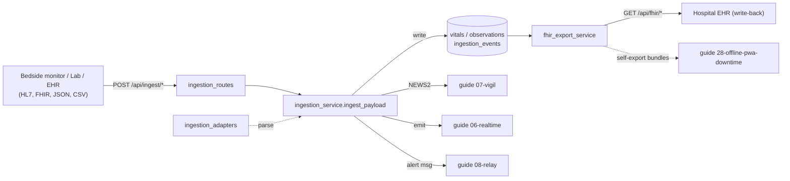
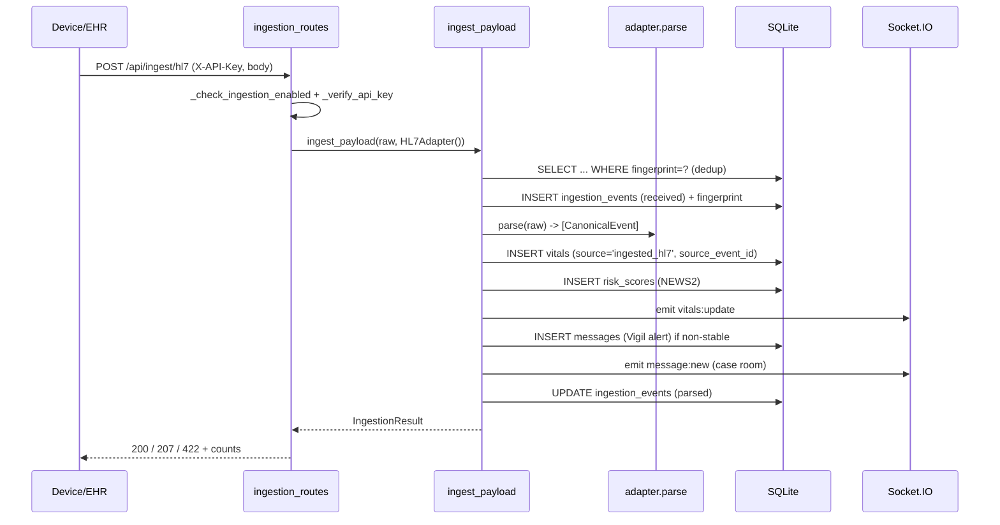

# 24: Ingestion and Interop: device/EHR adapters, provenance, FHIR export

Orb is a hospital operating system. In a real ward the vital signs, lab results and patient records do not come from Orb's own simulation bots, they arrive from bedside monitors, laboratory analysers and the hospital's Electronic Health Record (EHR, the system of record that stores every patient's chart). This subsystem is the **front door** for that external clinical data and the **back door** that writes Orb's data back out. It accepts four wire formats (HL7 v2, FHIR R4, plain JSON, CSV), normalises each into one internal shape, deduplicates, writes into the *same* `vitals` and `observations` tables the simulation bots use, re-scores the patient (NEWS2), and fires the same realtime and alert machinery. A `source` column on every row records **provenance**, where the datum came from, so an ingested reading is forever distinguishable from a fabricated one. In the opposite direction, a read-only FHIR R4 **export** service serialises Orb's own data back into standard resources so it can be written into the hospital EHR, tagging AI-derived content so it is never mistaken for a verified clinical order.

---

## Purpose and neighbors

**The problem.** Orb's simulation bots (see guide 07-vigil) invent plausible vitals so the product can be demoed with no live feed. But a hospital that deploys Orb for real must (a) receive the ward's actual telemetry and lab results, and (b) hand its own enrichments back to the EHR. Those two jobs need: format parsers that tolerate messy real-world input; a way to route parsed data into the existing tables without a schema fork; a rock-solid record of what is real vs simulated vs AI-generated; and a standards-compliant export. That is this subsystem.

**Jargon, defined once:**

| Term | Meaning |
|---|---|
| **HL7 v2** | *Health Level 7 version 2*, a 1980s-era pipe-and-hat text messaging standard hospitals still use everywhere. A message is lines ("segments") like `MSH\|...`, `PID\|...`, `OBX\|...`; fields separated by `\|`, sub-components by `^`. **ORU^R01** is the "observation result" message type (labs/vitals). |
| **FHIR** | *Fast Healthcare Interoperability Resources*, the modern JSON/REST standard from HL7. Data is modelled as typed **resources** (`Patient`, `Observation`, `MedicationRequest`, …). A **Bundle** is a container resource wrapping many resources in an `entry[]` array. **`$everything`** is a FHIR "operation" that returns everything known about one patient as a Bundle. **R4** is the version. |
| **LOINC / SNOMED / ICD-10 / UCUM** | Standard code systems: LOINC identifies *what was measured* (e.g. `8867-4` = heart rate), SNOMED and ICD-10 identify *diagnoses/problems*, UCUM identifies *units* (e.g. `mm[Hg]`). |
| **Ingestion adapter** | A pluggable class that knows one wire format: it answers "can I parse this?" and, if yes, turns raw bytes into a list of `CanonicalEvent` objects. Adding a new source = adding one adapter. |
| **Provenance** | The recorded origin of a datum: which system/feed/model produced it, and whether it is real, simulated, or AI-drafted. Orb tracks this on a `source` column and in the `ingestion_events` audit table. |
| **NEWS2** | UK National Early Warning Score 2, a deterioration score computed from vitals. Recomputed on every ingested vital (see guide 07-vigil for `compute_news2`). |
| **Socket.IO room** | A named realtime channel; clients subscribed to a patient's case room receive `message:new` events (see guide 06-realtime). |
| **RBAC** | Role-Based Access Control, permissions like `ingest.monitor` or `patient.read_all` gate an endpoint (see guide 03-auth-rbac). |

Neighbors: **04-database-schema** (owns `vitals`, `observations`, `ingestion_events`), **05-audit-chain** (`log_audit_event`), **06-realtime** (`sio` emitter), **07-vigil** (`compute_news2`), **08-relay** (case-room alert messages), **28-offline-pwa-downtime** (consumes `patient_bundle` for offline snapshots), **03-auth-rbac** (`require_permission`).

---

## File map

| File | Lines (approx) | Role |
|---|---|---|
| `server/services/ingestion_adapters.py` | ~1128 | The `CanonicalEvent` model + four format parsers (HL7, FHIR, JSON, CSV), code→vital mapping, unit normalisation, plausibility bounds, fingerprinting, adapter registry/selection. |
| `server/services/ingestion_service.py` | ~1070 | The orchestration pipeline: capture raw event → select adapter → dedup → parse → route into `vitals`/`observations` → recompute NEWS2 → emit socket update → fire Vigil/Relay alert. |
| `server/services/fhir_export_service.py` | ~487 | Read-only serialisers turning Orb rows into FHIR R4 `Patient`, `Observation`, `MedicationRequest`, `AllergyIntolerance`, `Condition`, plus the `$everything` collection Bundle. Applies provenance tags. |
| `server/routes/ingestion_routes.py` | ~346 | HTTP surface: `POST /json`, `/hl7`, `/fhir`, `/replay`; `GET /status`. API-key + mode gating; result→HTTP-status mapping. |
| `server/routes/fhir_export_routes.py` | ~137 | HTTP surface: `GET /Patient/{id}`, `/patient/{id}/$everything`, `/patient/{id}/MedicationRequest`. RBAC + PHI-access audit. |
| `server/scripts/replay_ingestion.py` | ~193 | Dev CLI that POSTs the fixture files to the ingest endpoints and prints results. |
| `server/scripts/download_physionet.py` | ~112 | Dev CLI that downloads the PhysioNet Sepsis-2019 vitals dataset (`.psv` files) for model training/replay. |
| `src/components/ProvenanceChip.tsx` | ~102 | React chip rendered on AI outputs showing *which model + version* produced them and whether it is validated. |
| `src/components/ProvenanceChip.css` | ~53 | Styling for the three chip states (validated / unvalidated / untrained). |
| `server/tests/test_ingestion.py` | ~363 | Unit tests for HL7/JSON/CSV adapters, mapping, fingerprint, adapter selection. |
| `server/tests/test_fhir_ingestion.py` | ~325 | Unit tests for the FHIR adapter (Bundle, single resource, mixed resources, plausibility, errors). |
| `server/tests/test_fhir_export.py` | ~240 | Tests for the export service incl. AI-draft provenance flags and an export→ingest round-trip. |

---

## How it works

### Flow A: Ingesting an external reading (the main flow)

1. A device/lab/EHR sends `POST /api/ingest/json` (or `/hl7`, `/fhir`) with an `X-API-Key` header.
2. The route rejects the call if `INGESTION_MODE == "simulation"` (`_check_ingestion_enabled`) or if the key fails a timing-safe comparison (`_verify_api_key`).
3. The route hands the raw body plus a **pre-selected adapter** to `ingest_payload`.
4. `ingest_payload` computes a SHA-256 **fingerprint**, short-circuits if that fingerprint was already processed (idempotent dedup), and otherwise records a raw `ingestion_events` row (provenance capture).
5. The adapter's `parse` turns the payload into a list of `CanonicalEvent`s. Each event that maps to a known vital (via LOINC/name) is flagged `VITAL`; the rest are `LAB`/other.
6. `_route_events` groups vitals per patient and calls `_insert_vitals`; everything else goes to `_insert_observation`.
7. `_insert_vitals` resolves the raw patient id → real `patients.id`, merges the individual vital values into **one** `vitals` row (carrying forward any missing field from the patient's most recent row), stamps `source = 'ingested_hl7'` etc. and `source_event_id`, then recomputes NEWS2, writes a `risk_scores` row, emits `vitals:update` over Socket.IO, and checks whether to raise a Vigil alert in the patient's Relay case room.
8. The `ingestion_events` row is updated to `parsed` / `partially_parsed` / `failed`, and the route maps that to HTTP `200` / `207` / `422`.

### Flow B: INGESTION_MODE, end to end

`INGESTION_MODE` (env `ORB_INGESTION_MODE`, default `"ingestion"`, `server/config.py:162`) has three values that decide whether *real* ingestion and/or the *simulation* bots run:

| Mode | Ingestion endpoints (`/api/ingest/*`) | Simulation bots (guide 07) | Intended use |
|---|---|---|---|
| `ingestion` (default) | **enabled** | disabled | Real deployment, only genuine feeds write data. |
| `simulation` | **disabled** (HTTP 503 from `_check_ingestion_enabled`) | enabled | Pure demo, synthetic vitals only, no external writes. |
| `hybrid` | **enabled** | enabled | Dev/demo where you want both. |

The route layer enforces the ingestion half: `_check_ingestion_enabled` (`ingestion_routes.py:42`) raises 503 whenever the mode is `simulation`. The bot half is enforced elsewhere (bot startup checks the same var, outside this guide's scope). Crucially, `/api/ingest/replay` does **not** call `_check_ingestion_enabled`, so the dev replay endpoint works in every mode (see its Gotchas).

### Flow C: Provenance: how ingested and simulated data are told apart

There is **no separate table** for ingested data. Both bots and adapters write the *same* `vitals` and `observations` rows. The distinction lives entirely in a `source` string column:

| Writer | `vitals.source` | `observations.source` |
|---|---|---|
| Simulation bot | `'simulated'` (column default, `database.py:1043`) | n/a (bots don't write observations) |
| HL7 ingest | `'ingested_hl7'` | `'ingested_hl7'` |
| JSON ingest | `'ingested_json'` | `'ingested_json'` |
| CSV replay | `'csv_replay'` | `'csv_replay'` |
| FHIR ingest | `'ingested_fhir'` (via the `ingested_{source_type}` fallback) | `'ingested_fhir'` |

Every ingested row also carries `source_event_id` → the `ingestion_events` row that captured the original raw payload, giving a full audit trail back to the exact bytes received. The label map is `_SOURCE_LABELS` (`ingestion_service.py:75`); unknown source types fall back to `f"ingested_{source_type}"` (`ingestion_service.py:404`). Bot pruning is careful to delete **only** `source='simulated'` rows so real clinical data is append-only (`bot_service.py:226-238`).

> **Two different "provenance" notions, do not conflate them.** The `source` column above is *ingestion* provenance (which feed). The `ProvenanceChip` React component is *model* provenance (which AI model produced a generated output), a completely separate concern, surfaced on Sage/Lens/Forecast/Scribe outputs, not on ingested vitals. Both are "honesty layers"; they are unrelated code paths.

### Flow D: Exporting Orb data back out as FHIR

`GET /api/fhir/patient/{id}/$everything` (RBAC `patient.read_all`) calls `patient_bundle`, which pulls the patient row + all vitals + meds + allergies + problems and serialises each into FHIR R4, wraps them in a `collection` Bundle, tags every resource `meta.tag = orb`, and downgrades any **AI-derived** medication/allergy/condition to a `draft`/`ai-draft`-tagged resource so an unverified AI suggestion never lands in the EHR as an active order. Every export writes a `phi_access` audit event because PHI is leaving the building.

---

## Function-by-function

### `server/services/ingestion_adapters.py`

#### ObservationType: `ingestion_adapters.py:32`
**Signature:** `str, Enum` with members VITAL/LAB/SCORE/DEVICE_METRIC/NOTE_STUB/UNKNOWN.
**Does:** classifies what kind of clinical datum a `CanonicalEvent` is.
**How it works:** a string enum, so `ObservationType.VITAL == "vital"`. `_route_events` only sends `VITAL` events to the `vitals` table.
**Why it exists:** the router needs a cheap, typed flag to decide vitals-vs-everything-else without re-inspecting codes.
**Data in/out:** enum values only.
**Talks to:** set by every adapter; read by `ingestion_service._route_events`.
**Change guide:** to route a new class (e.g. device waveforms) into a dedicated table, add a member here and branch on it in `_route_events` (`ingestion_service.py:410-414`).
**Gotchas:** only VITAL is special-cased downstream; SCORE/DEVICE_METRIC/NOTE_STUB exist but are currently all treated as generic observations.

#### ValueType: `ingestion_adapters.py:41`
**Signature:** `str, Enum` NUMERIC/TEXT/COMPOSITE.
**Does:** records whether a value parsed to a number.
**How it works:** adapters set `value_type = NUMERIC` only when `float()` succeeded.
**Why it exists:** distinguishes `"88"` (a number) from `"O positive"` (text) so NEWS2 never sees a non-number.
**Talks to:** consumed implicitly (numeric events carry `value_numeric`).
**Gotchas:** COMPOSITE is defined but never emitted by any adapter.

#### CanonicalEvent: `ingestion_adapters.py:47` (`to_dict` at `:76`)
**Signature:** `@dataclass` with ~25 fields (patient_identifier, observation_name, value, value_numeric, unit, mapped_vital_key, observed_at, source_type, raw_event_id, …).
**Does:** the single normalised shape every adapter emits and the whole service consumes.
**How it works:** a plain dataclass; `to_dict()` is `asdict(self)`. Vital-specific fields (`mapped_vital_key`) and provenance fields (`raw_event_id`, `source_type`) are filled in by adapters and the service respectively.
**Why it exists:** the "narrow waist", four wildly different wire formats collapse into one struct, so routing/insert logic is written once. This is the core interop idea.
**Data in/out:** produced by `parse`; `value` is *always* a string, `value_numeric` is the parsed float (or None).
**Talks to:** every adapter constructs it; `ingestion_service` reads every field.
**Change guide:** to carry a new field end-to-end (say `device_serial`), add it here, populate it in each adapter's constructor call, and add a column + insert param in `_insert_observation`/`_insert_vitals`.
**Gotchas:** `value` vs `value_numeric` are separate, `_insert_observation` stores `value` in `value_text` *only when* `value_numeric is None` (`ingestion_service.py:799`), so a numeric obs has NULL `value_text`.

#### _VITAL_CODE_MAP + map_to_vital_key: `ingestion_adapters.py:86` / `:120`
**Signature:** `map_to_vital_key(code, name) → Optional[str]`.
**Does:** maps a LOINC code *or* a free-text name to one of Orb's six internal vital keys (HR/SBP/DBP/RR/Temp/SpO2).
**How it works:** exact dict hit on `code` first (LOINC wins), else a case-insensitive hit on `name.strip().lower()`. Returns None if neither matches → the event is classified LAB.
**Why it exists:** every format labels heart rate differently (`8867-4`, `"Heart Rate"`, `"pulse"`); this collapses them to `"HR"`.
**Data in/out:** two optional strings in; one key or None out.
**Talks to:** called by all four adapters.
**Change guide:** to accept a monitor that sends `"cardiac frequency"`, add `"cardiac frequency": "HR"` to `_VITAL_CODE_MAP`. Worked example: a JSON obs `{"name":"Pulse Rate","value":80}` → `map_to_vital_key(None,"Pulse Rate")` → `"HR"` → classified VITAL. The export map `_VITAL_FHIR` is the exact inverse, so keep them in sync.
**Gotchas:** code match has priority over name (`test_code_priority_over_name`), so a wrong LOINC code with a right name still mis-maps.

#### normalize_temp_to_celsius: `ingestion_adapters.py:135`
**Signature:** `(value, unit) → float`.
**Does:** converts Fahrenheit to Celsius when the unit indicates °F.
**How it works:** if `unit.upper()` ∈ {`F`,`°F`,`DEG F`,`[DEGF]`} returns `round((value-32)*5/9, 1)`, else passes through.
**Why it exists:** NEWS2 temperature bands are Celsius; a US feed sends 98.6°F which must become 37.0°C.
**Talks to:** every adapter calls it when `mapped_vital_key == "Temp"`, then forces `unit = "°C"`.
**Gotchas:** relies on the unit string; a °F reading with a blank/wrong unit is treated as Celsius (garbage in).

#### _VITAL_PLAUSIBLE_RANGE + validate_vital_value: `ingestion_adapters.py:151` / `:161`
**Signature:** `validate_vital_value(vital_key, value) → Optional[float]`.
**Does:** nulls out a numerically implausible vital (e.g. SpO2 900, HR −5) so it never reaches NEWS2/alerts.
**How it works:** looks up `(lo, hi)` for the key; returns the value if within bounds, else None. Non-vitals and Nones pass through untouched.
**Why it exists:** a sensor glitch or parse error could otherwise *fabricate or suppress* a critical alert. Nulling the value lets `_insert_vitals` carry-forward the last good reading instead of poisoning the clinical picture.
**Talks to:** called by every adapter right before constructing the event.
**Change guide:** to tighten HR bounds, edit the tuple at `:152`. Worked example: FHIR obs SpO2=900 → `validate_vital_value("SpO2",900.0)` → None → event still emitted (for the audit trail) but `value_numeric=None` (`test_implausible_spo2_rejected`).
**Gotchas:** bounds are applied *after* Temp normalisation for temperature (so bounds are Celsius); order matters and every adapter follows it.

#### compute_fingerprint: `ingestion_adapters.py:197`
**Signature:** `(raw_payload) → str` (64-char hex).
**Does:** SHA-256 of the raw payload for deduplication.
**How it works:** `hashlib.sha256(raw.encode("utf-8", errors="replace")).hexdigest()`.
**Why it exists:** a monitor that retries a POST must not double-insert vitals; identical bytes → identical fingerprint → dedup.
**Talks to:** `ingest_payload` checks it against `ingestion_events.fingerprint` (indexed, `database.py:427`).
**Gotchas:** whole-payload hash, two messages differing only in a timestamp are *not* duplicates; a byte-identical resend *is*. `external_message_id` (sender's own dedup key) is recorded but **not** used in the dedup query.

#### parse_hl7_timestamp: `ingestion_adapters.py:206`
**Signature:** `(ts) → Optional[str]` (ISO 8601).
**Does:** parses HL7 `yyyyMMddHHmmss` (or shorter) into ISO 8601 UTC.
**How it works:** strips any `+`/`-` timezone suffix, then tries three `strptime` formats longest-first, stamping `tzinfo=utc`.
**Why it exists:** HL7 timestamps are compact digit strings; the rest of Orb wants ISO.
**Gotchas:** it **discards** the original offset then *labels the result UTC*, a local-time HL7 timestamp is silently relabelled UTC (timezone bug flagged in Discrepancies).

#### IngestionAdapter (ABC): `ingestion_adapters.py:209`
**Signature:** abstract base with `adapter_name`, `source_type` properties and `can_handle`, `parse` methods.
**Does:** the contract every format parser implements.
**How it works:** `can_handle(raw, content_type)` sniffs the payload; `parse(raw, …)` returns `list[CanonicalEvent]` and must **not raise on malformed input** (it should skip bad segments and only raise `ParseError` for a wholly-unparseable payload).
**Why it exists:** lets `select_adapter` iterate a registry and lets the service stay format-agnostic (the dependency inversion that makes adding a source a one-file change).
**Talks to:** subclassed by HL7/FHIR/JSON/CSV adapters; iterated by `select_adapter`.

#### ParseError: `ingestion_adapters.py:254`
A plain `Exception` subclass signalling an unparseable payload; caught by `ingest_payload` and turned into a `failed` event + HTTP 422.

#### HL7Adapter: `ingestion_adapters.py:263`
- **`can_handle`** (`:258`): true iff the stripped payload starts with `"MSH|"`.
- **`parse`** (`:262`): splits on `\r`/`\n`; requires an MSH first segment; reads field/component separators from MSH; extracts patient id from **PID-3** (first component before `^`), raises `ParseError` if absent; optional encounter from **PV1-19**; groups **OBR** panels each holding their **OBX** segments (an OBX with no preceding OBR gets an implicit "Unspecified" group); parses each OBX via `_parse_obx`, collecting per-segment errors. Raises only if there are errors *and* zero successful events (so a mostly-good message still ingests).
- **`_parse_obx`** (`:358`): reads OBX-2 (value type), OBX-3 (`code^name^system`), OBX-5 (value), OBX-6 (unit), OBX-7 (ref range), OBX-8 (abnormal flag), OBX-11 (status), OBX-14 (obs time). Parses numeric only for value types `NM`/`SN` (stripping `<>= ` first). Maps to a vital key, normalises Temp, validates plausibility, and picks the effective time as OBX-14 → OBR-7 → MSH-6.
- **`_field`** (`:434`, static): safe indexed field getter that returns `""` on out-of-range/None.

**Why it exists:** HL7 v2 ORU is the lingua franca of lab/vitals interfaces; this parser tolerates the real-world mess (missing fields, malformed segments, CR vs LF line endings).
**Data in/out:** raw HL7 string → list of events, one per OBX.
**Talks to:** instantiated directly by `ingest_hl7` and by the registry.
**Change guide:** to support a new segment (e.g. NTE notes), add a branch in `parse`'s segment loop. Worked example: the fixture `sample.hl7` yields 11 events = 6 vitals + 5 labs across 2 OBR groups (`test_ingestion.py:132-180`).
**Gotchas:** patient id is only PID-3's *first* component; assigning authority is dropped. HL7 field indices are format-specific, the code hard-codes the correct indices per segment.

#### JSONAdapter: `ingestion_adapters.py:461`
- **`can_handle`** (`:480`): true if content-type contains `json`, or the payload starts `{` and ends `}`.
- **`parse`** (`:486`): `json.loads`; requires `patient_id` and a non-empty `observations` list (else `ParseError`); for each obs, parses `value` numerically whether it arrives as a number or a numeric string; maps vital key, normalises Temp, validates plausibility.

**Why it exists:** the simplest possible integration for a modern device vendor, a plain webhook.
**Data in/out:** see the docstring at `:450` for the exact expected object.
**Talks to:** `ingest_json`.
**Change guide:** to accept a top-level `mrn` field as the patient key, read it in `parse` and pass to `patient_identifier`. Worked example: `sample.json` → 7 events (6 vitals + 1 Hemoglobin lab) (`test_ingestion.py:250`).
**Gotchas:** `patient_id` is required; a payload with only `observations` raises (`test_missing_patient_id`).

#### CSVAdapter: `ingestion_adapters.py:590`
- **`can_handle`** (`:595`): content-type contains `csv`, or ≥2 lines with `patient_id` in the header.
- **`parse`** (`:604`): `csv.DictReader`; per row reads `patient_id,name,code,value,unit,observed_at`; numeric parse, vital map, Temp normalise, plausibility; skips rows with no `patient_id`. Raises if zero rows parsed.

**Why it exists:** demo backfill and file-based replay without any device.
**Talks to:** reached via `/api/ingest/replay` auto-detect (never a dedicated route). `source_type == "csv_replay"`.
**Change guide:** add a column by reading `row.get("your_col")`. Worked example: `sample.csv` → 14 events (`test_ingestion.py:322`).
**Gotchas:** unlike JSON/HL7, one CSV **row = one observation** (not one patient message), so a full vitals set is several rows sharing a `patient_id`; `_insert_vitals` still merges them into one row by patient.

#### FHIRAdapter: `ingestion_adapters.py:682`
- **`_SUPPORTED_TYPES`** (`:684`): `{Bundle, Observation, Patient, Encounter, MedicationRequest, AllergyIntolerance}`.
- **`can_handle`** (`:698`): content-type contains `fhir`, OR the payload is a JSON object whose `resourceType` is in the supported set. This deliberately makes the FHIR adapter claim FHIR JSON *before* the plain `JSONAdapter` does (registry order puts FHIR ahead, `:1101`).
- **`parse`** (`:711`): loads JSON; if `resourceType == "Bundle"`, collects every `entry[].resource`; else treats the doc as one resource. Dispatches each resource to a per-type handler; a single malformed resource is swallowed (`continue`) so the batch survives. Handlers may return one event, a list, or None. Raises `ParseError` only if zero events result.
- **`_parse_observation`** (`:774`): the important one. Emits the top-level value *and* one event per `component[]` (so a Blood-Pressure panel `85354-9` yields separate systolic/diastolic events). Skips an Observation with no resolvable `subject` (an orphan vital must not enter the record). Applies the same vital-map/Temp/plausibility pipeline.
- **`_parse_patient`** (`:847`): id from `id` or first `identifier.value`; name via `_human_name`; `event_type="patient"`.
- **`_parse_encounter`** (`:870`): `event_type="encounter"`, patient from `subject`/`patient` ref.
- **`_parse_medication_request`** (`:890`): drug name from `medicationCodeableConcept` or `medicationReference.display`; `event_type="medication_request"`.
- **`_parse_allergy`** (`:917`): substance from `code`; reads `clinicalStatus` coding code (not just `.text`); `event_type="allergy"`; criticality → `abnormal_flag`.
- **Extraction helpers:** `_extract_code` (`:950`, prefers a LOINC coding, else first coding, honestly labels `code_system`), `_extract_value` (`:991`, handles `valueQuantity`/`valueString`/`valueInteger`/`valueCodeableConcept`/`valueBoolean`), `_extract_effective` (`:1023`), `_extract_reference_range` (`:1035`), `_extract_interpretation` (`:1052`), `_ref_to_id` (`:1064`, strips `Patient/` prefix, falls back to `identifier.value`), `_human_name` (`:1082`).

**Why it exists:** partner-hospital onboarding, modern EHRs (and Synthea test data) speak FHIR R4. This is also the *inverse* of the export service, so an Orb export round-trips back in (proven by `test_fhir_export.py:226`).
**Data in/out:** FHIR JSON (Bundle or single resource) → events. Vitals/labs become `Observation` events; Patient/Encounter/Med/Allergy become provenance events with `event_type` set.
**Talks to:** `ingest_fhir`; the registry.
**Change guide:** to ingest FHIR `Immunization`, add it to `_SUPPORTED_TYPES` and register a handler in the `handlers` dict (`:743`). Worked example: `_observation("8310-5","Body temperature",98.6,"°F")` → 37.0°C, unit `°C`, kept (`test_temp_fahrenheit_normalized`).
**Gotchas:** because non-Observation resources are emitted as generic events (not routed to `patients`/`medications`/etc.), **ingesting a FHIR MedicationRequest does not create a medication row**, it lands in `observations` (see Discrepancies). Only vitals/labs fully materialise into their tables.

#### ADAPTERS + select_adapter: `ingestion_adapters.py:1115` / `:1123`
**Signature:** `select_adapter(raw, content_type) → Optional[IngestionAdapter]`.
**Does:** returns the first registry adapter whose `can_handle` says yes.
**How it works:** iterates `[HL7Adapter, FHIRAdapter, JSONAdapter, CSVAdapter]` in order.
**Why order matters:** FHIR JSON is also `{...}` JSON, so FHIR **must** precede JSON or FHIR bundles would be mis-parsed by the plain JSON adapter.
**Talks to:** used by `ingest_payload` when no adapter is passed, and by `/api/ingest/replay`.
**Gotchas:** the dedicated routes pass an explicit adapter and bypass selection; only `/replay` auto-detects.

---

### `server/services/ingestion_service.py`

#### IngestionResult: `ingestion_service.py:42` (`to_dict` at `:58`)
**Signature:** `@dataclass` (event_id, correlation_id, parse_status, received, inserted_vitals, inserted_observations, duplicates, errors).
**Does:** the summary the pipeline returns to a route.
**How it works:** `__post_init__` initialises `errors` to `[]`; `to_dict` serialises for the JSON response.
**Talks to:** built by `ingest_payload`; read by `_build_response`/`_http_status_from_result`.

#### _resolve_patient_id: `ingestion_service.py:96`
**Signature:** `(db, raw_identifier) → Optional[str]`.
**Does:** matches an inbound patient id to a real `patients.id`.
**How it works:** tries exact `id`, then exact `mrn`, then case-insensitive `mrn`, all parameterised.
**Why it exists:** a feed identifies a patient by MRN or internal id; Orb must resolve to its own PK before inserting.
**Talks to:** `_insert_vitals`, `_insert_observation`.
**Gotchas:** if nothing matches, vitals **raise** (`_insert_vitals` → `"Patient not found"`) but observations still insert with `patient_id = NULL` (a deliberate "never drop clinical data" choice, logged as a warning).

#### ingest_payload: `ingestion_service.py:353`
**Signature:** `async (raw_payload, adapter=None, source_name=None, content_type=None, correlation_id=None, external_message_id=None, sio=None) → IngestionResult`.
**Does:** the whole pipeline, capture, dedup, parse, route, status, audit.
**How it works:** (1) select adapter if none given; audit the request; if still none, record a `failed` raw event and return. (2) fingerprint. (3) dedup query against `ingestion_events` (ignoring prior `failed` rows), on hit, record a `duplicate` event and return. (4) record the `received` raw event. (5) `adapter.parse` inside try/except (ParseError → `failed`; any other exception → `failed`). (6) stamp `raw_event_id` + `source_type` onto every event (provenance). (7) `_route_events`. (8) compute final status: `parsed` (no errors), `partially_parsed` (errors but some inserts), or `failed`; update the event row and audit.
**Why it exists:** one funnel so every format gets identical dedup/provenance/audit/routing.
**Data in/out:** raw string → `IngestionResult`.
**Talks to:** called by all four ingest routes; calls the adapter, `_record_raw_event`, `_route_events`, `log_audit_event` (guide 05).
**Change guide:** to dedup on `external_message_id` instead of payload bytes, change the dedup SELECT at `:177` (and populate that column in `_record_raw_event`). Knock-on: retries with a new timestamp but same message-id would then dedup.
**Gotchas:** the dedup SELECT and the subsequent INSERT are in **separate** `db_session()` blocks, a tiny TOCTOU window (harmless under single-writer SQLite). `parse` is called synchronously (adapters are CPU-only, no `await`).

#### _record_raw_event: `ingestion_service.py:577`
**Signature:** keyword-only `(raw_payload, source_type, source_name, correlation_id, external_message_id, fingerprint, parse_status, parse_error, adapter_name, patient_identifier_raw) → int` (new id).
**Does:** inserts the provenance/audit row into `ingestion_events` and returns its id.
**How it works:** one parameterised INSERT; caps `raw_payload` at 50 000 chars.
**Why it exists:** captures the *exact bytes received* before any parsing, so a failed/duplicate/partial ingest is still fully reconstructable.
**Talks to:** called by `ingest_payload`.
**Gotchas:** it passes `adapter_name` into **both** the `payload_format` and `adapter_name` columns (`:352,357`), so `payload_format` effectively duplicates `adapter_name`. `patient_identifier_raw`/`encounter_identifier_raw` are never populated (always NULL). The docstring flags a real PHI-retention concern: raw payloads (PHI) are stored indefinitely with no purge (GDPR storage-limitation issue, deferred).

#### _update_event_status: `ingestion_service.py:625`
**Signature:** `(event_id, status, *, parse_error=None, vitals_inserted=0, observations_inserted=0)`.
**Does:** stamps final status + counts + `processed_at` on the event row.
**Talks to:** `ingest_payload`.

#### _route_events: `ingestion_service.py:651`
**Signature:** `async (events, event_id, source_type, sio, correlation_id) → (vitals, obs, errors)`.
**Does:** splits events into per-patient vitals and everything-else, inserts each, tallies counts and per-item errors.
**How it works:** computes the `source_label` from `_SOURCE_LABELS`; buckets `VITAL`+mapped-key events by patient into `vitals_by_patient`, the rest into `non_vital_events`; calls `_insert_vitals` per patient and `_insert_observation` per other event, catching exceptions into the `errors` list (so one bad datum doesn't abort the batch).
**Why it exists:** the vitals table is one-row-per-timestamp-per-patient, so per-patient batching is required; labs are independent rows.
**Talks to:** `_insert_vitals`, `_insert_observation`.
**Gotchas:** the vital guard requires *both* `mapped_vital_key` and `observation_type == VITAL` (`:411`); anything else falls into observations.

#### _insert_vitals: `ingestion_service.py:710`
**Signature:** `async (patient_raw_id, vital_events, event_id, source_label, sio, correlation_id) → int`.
**Does:** merges several vital events into one `vitals` row, then runs the full downstream (NEWS2 + risk row + socket emit + alert).
**How it works:** resolves the patient (raise if unknown); seeds a `{HR,SBP,DBP,SpO2,Temp,RR}` map; fills it from the events (taking the first `observed_at`); if *all* values are None, returns 0 (nothing to write); **carry-forward**: reads the patient's most recent `vitals` row and backfills any missing field, plus carries `consciousness` and `on_oxygen` so NEWS2 scores all 7 parameters, but only while each value's measurement is within its age limit (HR/BP/SpO2/RR 4 h, temperature 8 h, ACVPU/O2 12 h; `services/vitals_carry.py`, measured time kept in `vitals.carried_from`), else it stays `None`; INSERTs the row with `source = source_label` and `source_event_id`; recomputes NEWS2 via `compute_news2(hr,sbp,rr,temp,spo2,consciousness,on_oxygen)`; writes a `risk_scores` row; builds the bot-identical `vitals:update` payload and emits it; calls `_check_ingested_alert`.
**Why it exists:** this is the join point where *ingested* data becomes indistinguishable (in behaviour) from *simulated* data, same table, same NEWS2, same socket event, same alerting, differing only by `source`.
**Data in/out:** list of vital events → one row + one risk score + one socket emit; returns 1 on insert, 0 if empty.
**Talks to:** `compute_news2` (guide 07), `sio.emit` (guide 06), `_check_ingested_alert`, `log_audit_event` (guide 05).
**Change guide:** to stop carry-forward (only score what actually arrived), remove the `latest`-fill block at `:492-508`; knock-on: partial vitals feeds would score a 5-param NEWS2 subset (the very thing the current code avoids).
**Gotchas:** the INSERT column list (`:512-514`) **omits `on_oxygen`**, so the carried-forward on-oxygen flag is used for *this* score but never persisted, the new row's `on_oxygen` defaults to 0, so the next carry-forward loses it (see Discrepancies). Also the docstring claims `on_oxygen` is "not yet in schema", stale; the column exists via migration (`database.py:1170`).

#### _check_ingested_alert: `ingestion_service.py:843`
**Signature:** `async (patient_id, vitals_payload, risk, sio, correlation_id)`.
**Does:** if NEWS2 level is non-stable, posts a Vigil alert message into the patient's Relay case room and emits realtime updates.
**How it works:** returns immediately if `risk.level == "stable"`; builds the reason line with `news2_reason_line` (shared by all three alert lanes since 2026-10-02), which is *wording only*: the NEWS2 level alone gates the alert, and if the helper raises the alert goes out with the band alone; upserts a `bot_vigil` user; finds the `case_room` channel for the patient; inserts an `alert` message (`is_bot=1`, `source='bot'`) and emits `message:new` to the channel room; emits a global `patient_status_update`; audits.
**Why it exists:** ingested deterioration must raise the same alarm a simulated one does, NEWS2 is the single source of truth, mirroring `bot_service.evaluate_and_dispatch_alerts`.
**Talks to:** `messages`/`channels`/`users`/`patients` tables; `sio` (guide 06); Relay (guide 08).
**Gotchas:** the `bot_vigil` user is inserted with role `'doctor'` but the message's `sender_role` is `'intelligence'`, cosmetic mismatch. No alert is raised if the patient has no `case_room` channel.

#### _insert_observation: `ingestion_service.py:998`
**Signature:** `(evt, event_id, source_label, correlation_id)`.
**Does:** inserts one non-vital observation (lab, or a FHIR patient/med/allergy provenance event) into `observations`.
**How it works:** resolves patient (may be None → inserts NULL patient_id, logs a warning); INSERTs all 17 columns including `source`, `source_event_id`, code system, panel/OBR grouping, and `raw_segment_ref`; stores `value` in `value_text` only when `value_numeric is None`; audits.
**Why it exists:** labs and non-vital resources need a home that preserves full coding + provenance without touching the vitals path.
**Talks to:** `observations` table; `log_audit_event`.
**Gotchas:** NULL-patient observations are inserted rather than quarantined (deferred review-queue TODO), they can be silently orphaned.

---

### `server/services/fhir_export_service.py`

Provenance-tag constants (`:39-52`): `ORB_SOURCE_SYSTEM/CODE/DISPLAY` mark **every** exported resource as "from Orb"; `ORB_PROVENANCE_SYSTEM` + `AI_DRAFT_CODE` mark AI-derived content; `_AI_DERIVED_SOURCES` (`:52`) is the set of `source` values (`llm_extracted, agentic, ai, ai_extracted, ai_draft`) treated as AI, note `ingested_fhir` is deliberately excluded (it is real external data, not AI output). Coding-system constants (`:59-84`): LOINC/UCUM/SNOMED/ICD-10 URIs and `_VITAL_FHIR`, the exact inverse of the ingest `_VITAL_CODE_MAP`.

#### _reader: `fhir_export_service.py:91`
**Signature:** `@contextmanager _reader(db=None)`.
**Does:** yields a DB connection, reusing a caller-supplied one (left open) or opening+closing a fresh one.
**Why it exists:** lets `patient_bundle` share one connection across five queries while each serialiser also works standalone.
**Gotchas:** if you pass `db`, `_reader` will not close it, the caller owns its lifecycle.

#### Formatting helpers: `:109`–`:201`
- **`_orb_meta(ai_draft)`** (`:109`): builds the `meta` element with the Orb source tag, plus the ai-draft tag when `ai_draft=True`.
- **`_is_ai_source(source)`** (`:129`): case-insensitive membership test in `_AI_DERIVED_SOURCES`.
- **`_to_fhir_datetime(value)`** (`:134`): normalises `YYYY-MM-DD HH:MM:SS` → `...T...Z`; passes ISO through; None for empty.
- **`_sex_to_gender`** (`:155`): Orb `sex` → FHIR administrative gender.
- **`_name_to_fhir`** (`:167`): keeps full string in `text` (which the ingest adapter reads first) *and* splits given/family.
- **`_severity_to_criticality`** (`:186`): `severe→high`, `mild/moderate→low`, else `unable-to-assess`.
- **`_clinical_status`** (`:196`): builds a clinicalStatus CodeableConcept, defaulting invalid codes to `active`.

**Why they exist:** small, testable mappers keep the resource builders declarative and keep coding conventions identical to the ingest side so exports round-trip.

#### patient_to_fhir: `fhir_export_service.py:208`
**Signature:** `(patient_id, db=None) → Optional[dict]`.
**Does:** one `patients` row → a FHIR `Patient` resource (id, name, gender, MRN identifier, birthDate); None if absent.
**Talks to:** `patient_bundle`, `export_patient` route.
**Gotchas:** MRN uses the Orb-private system URI `_MRN_SYSTEM`; `birthDate` is truncated to 10 chars (date only).

#### observations_to_fhir: `fhir_export_service.py:244`
**Signature:** `(patient_id, since=None, db=None) → list[dict]`.
**Does:** `vitals` rows → one `Observation` per non-null vital per row (LOINC-coded, `valueQuantity` with UCUM unit, category `vital-signs`).
**How it works:** SELECTs rows (optionally `timestamp >= since`, newest first); for each row iterates `_VITAL_ORDER`, skips NULLs, emits an Observation with a deterministic id `orb-obs-{rowid}-{loinc}`.
**Why it exists:** the standards-valid, round-trippable representation of Orb vitals; `test_observation_roundtrips_through_ingestion_adapter` proves an exported HR re-ingests to `HR`/88.0.
**Change guide:** to emit BP as a single component Observation instead of two, restructure the loop; knock-on: the round-trip test expects one-obs-per-vital.
**Gotchas:** `since` is a string compared lexically against `timestamp`, works only because timestamps are ISO/sortable.

#### _dosage_instruction + medications_to_fhir: `:307` / `:318`
**Signature:** `medications_to_fhir(patient_id, db=None) → list[dict]`.
**Does:** `medications` rows → `MedicationRequest` resources, applying the AI-safety rule.
**How it works:** per row, `ai_derived = _is_ai_source(source)`, `verified = bool(verified_by)`; if AI-derived and unverified → `status="draft"`, `intent="proposal"`, ai-draft tag (a discontinued draft stays `stopped`); else map Orb status via `_MED_STATUS_MAP`, `intent="order"`. `_dosage_instruction` composes dose/route/frequency text.
**Why it exists:** the core clinical-safety guarantee, an **unverified AI-suggested medication is never exported as an active order**. Proven by `test_medication_provenance_flags` (Amoxicillin/clinician→active; Lisinopril/llm_extracted→draft+ai-draft).
**Change guide:** to treat a new source `"copilot"` as AI, add it to `_AI_DERIVED_SOURCES` (`:52`).
**Gotchas:** the drug is `medicationCodeableConcept.text` only (no RxNorm code); verification hinges entirely on the `verified_by` column being set.

#### allergies_to_fhir / conditions_to_fhir: `:374` / `:411`
Serialise `patient_allergies` → `AllergyIntolerance` (criticality from severity; ai-draft when AI-sourced) and `problem_list` → `Condition` (ICD-10 + SNOMED codings; ai-draft when AI-sourced). Both default clinicalStatus to `active`.
**Gotchas:** allergies get the ai-draft tag purely from `source` (there is no `verified_by` gate as with meds), so an `llm_extracted` allergy is always tagged draft (`test_allergies_resource`).

#### patient_bundle: `fhir_export_service.py:457`
**Signature:** `(patient_id, since=None, db=None) → Optional[dict]`.
**Does:** assembles the `$everything` **collection Bundle** (Patient + Observations + MedicationRequests + AllergyIntolerances + Conditions), each entry with a `fullUrl`.
**How it works:** opens one shared connection via `_reader`, returns None if the patient is missing, else concatenates all serialisers' output and wraps in a `Bundle` with an Orb-source `meta` and a `timestamp`.
**Why it exists:** the single call an EHR (or Orb's own offline snapshotter) makes to pull a complete, provenance-tagged patient record.
**Talks to:** `export_everything` route; **`downtime_service`** calls it to write per-patient bundles to local disk for offline resilience (guide 28-offline-pwa-downtime, `downtime_service.py:302,315`).
**Gotchas:** `type="collection"` (not `transaction`), so it is a read snapshot, not a write instruction.

---

### `server/routes/ingestion_routes.py`: router prefix `/api/ingest` (`:22`)

#### _verify_api_key: `ingestion_routes.py:29`
**Does:** rejects a request unless `X-API-Key` matches `INGESTION_API_KEY` via `hmac.compare_digest` (timing-safe). Raises 401 otherwise.
**Why it exists:** a plain `!=` leaks the key length/position by timing; this guards a real-patient write path.

#### _check_ingestion_enabled: `ingestion_routes.py:42`
**Does:** raises 503 when `INGESTION_MODE == "simulation"`. This is the runtime enforcement of Flow B.
**Gotchas:** `/replay` intentionally skips this.

#### ingest_json / ingest_hl7 / ingest_fhir: `:56` / `:108` / `:166`
**Signature:** async route handlers taking `Request` + `X-API-Key`/`X-Correlation-Id`/`X-Message-Id` headers.
**Does:** each gates (mode + key), reads the raw body, rejects empty, generates a correlation id if none given, imports `sio` (best-effort), calls `ingest_payload` with the **explicit** adapter for that format, and maps the result to an HTTP status.
**Notable:** `ingest_hl7` also accepts a `{"message": "MSH|..."}` JSON wrapper (`:133-139`). All three pass `X-Source-Name` header through as `source_name`.
**Talks to:** `ingest_payload`; `ws.realtime.sio` (guide 06).
**Change guide:** to add a `/api/ingest/csv` route, copy `ingest_json` and pass `CSVAdapter()`.
**Gotchas:** the adapter is fixed per endpoint (no sniffing), sending HL7 to `/json` will fail to parse and return 422.

#### ingestion_status: `ingestion_routes.py:220`
**Signature:** `(limit=20, status=None, user=Depends(require_permission("ingest.monitor")))`.
**Does:** returns recent `ingestion_events` (id, source, parse_status, counts, timestamps) for governance, plus the current `ingestion_mode`.
**Auth:** RBAC `ingest.monitor` (guide 03).
**Gotchas:** `limit` capped at 100.

#### replay_fixture: `ingestion_routes.py:264`
**Signature:** async `(request, x_api_key)`.
**Does:** dev endpoint, verifies the key, **auto-detects** the adapter (`adapter=None`), ingests, and audits the replay.
**Gotchas:** does **not** call `_check_ingestion_enabled`, so it runs in `simulation` mode too, a footgun if you assume simulation blocks all writes.

#### _http_status_from_result / _build_response: `:315` / `:326`
Map `IngestionResult.parse_status` to HTTP (`parsed→200`, `partially_parsed→207`, `duplicate→200`, else `422`) and to the JSON envelope (`status`, `event_id`, `correlation_id`, `parse_status`, `counts`, `errors`).

---

### `server/routes/fhir_export_routes.py`: router prefix `/api/fhir` (`:26`)

#### _audit_export: `fhir_export_routes.py:57`
**Does:** writes a `phi_access` audit event (actor, patient, path, method, IP, UA, resource count) for every export.
**Why it exists:** PHI is leaving the building; the fail-closed `phi_access` category means if the audit write fails, the export is aborted (guide 05).

#### export_patient / export_everything / export_medications: `:55` / `:69` / `:85`
**Auth:** all three require RBAC `patient.read_all`.
- `export_patient`: `patient_to_fhir` → `Patient` (404 if missing).
- `export_everything`: `patient_bundle` (optional `since`) → collection Bundle (404 if missing).
- `export_medications`: `medications_to_fhir` → a `searchset` Bundle of MedicationRequests.
**Talks to:** `fhir_export_service`; each audits via `_audit_export`.
**Gotchas:** `export_medications` reaches into `export._orb_meta()` (a private helper) to tag the Bundle.

---

### `server/scripts/replay_ingestion.py` (dev CLI)

`replay_json` (`:31`), `replay_hl7` (`:71`), `replay_csv` (`:110`): read `scripts/fixtures/sample.{json,hl7,csv}` and POST them to `/api/ingest/json`, `/api/ingest/hl7`, and `/api/ingest/replay` respectively (CSV goes through auto-detect), printing status + counts. `check_status` (`:147`) GETs `/api/ingest/status?limit=5`. `main` (`:166`) parses `--url/--key/--type` and dispatches.
**Why it exists:** one command to smoke-test the whole ingest surface against a running server. Default key is `orb-ingest-dev-key` (the dev fallback in `config.py:178`).
**Gotchas:** `check_status` sends no API key and no auth, it works only because `/status` is RBAC-gated at the app level, not key-gated (this raw call would 401/403 against a real deployment).

### `server/scripts/download_physionet.py` (dev CLI)

`download_single_file` (`:27`) fetches one `p{n:06d}.psv` patient file (skipping cached non-empty files) from PhysioNet; `download_dataset` (`:43`) pulls up to `MAX_PATIENTS=2000` concurrently with a 16-thread pool, reporting progress and warning if >10% fail.
**Why it exists:** provides realistic hourly ICU vitals telemetry for training the Vigil continuous-risk model (guide 07) and for CSV replay demos.
**Gotchas:** hits `physionet.org` directly over `urllib` (no proxy handling); pure fetch tool, it does **not** ingest anything into Orb.

---

### `src/components/ProvenanceChip.tsx` + `.css`

#### ModelProvenance (interface): `ProvenanceChip.tsx:19`
Shape of one model's provenance: `model_key, version, task, training_data, validated, checkpoint_present, is_active` (the last three are 0/1 ints from SQLite).

#### loadProvenance: `ProvenanceChip.tsx:32`
**Signature:** `async () → Record<string, ModelProvenance>`.
**Does:** fetches the model registry once and caches it process-wide.
**How it works:** returns `_cache` if present; else stores an in-flight promise (dedup) that GETs `apiFetch('/admin/models/provenance')` → resolves to `/api/admin/models/provenance` (API base prepends `/api`, `client.ts:10`), builds a `model_key → provenance` map, and on error returns `{}` **without poisoning `_cache`** so the next chip retries.
**Why it exists:** dropping chips on many outputs must cost one request, not N.
**Talks to:** the model-governance route `GET /api/admin/models/provenance` (readable by any authenticated user).
**Gotchas:** module-level `_cache`/`_inflight` persist for the session, a model re-seed won't reflect until reload.

#### statusOf + STATUS_LABEL: `:53` / `:59`
Maps a model to one of three states: `validated` (externally validated), `untrained` (no checkpoint on disk), `unvalidated` (checkpoint runs but not validated).

#### ProvenanceChip (default export): `ProvenanceChip.tsx:65`
**Signature:** `({ modelKey, compact=false }) → JSX | null`.
**Does:** renders an inline pill showing `AI · {version} · {status}` with a tooltip listing task/model/version/training-data/status, deep-linking to Admin → Model Governance.
**How it works:** a `useEffect` (a React hook, code that runs after render, keyed here on `modelKey`) calls `loadProvenance()` and sets local state; an `alive` flag guards against setting state after unmount; renders `null` until the model resolves (or if the key is unknown).
**Why it exists:** Orb's "honesty layer" at the point of use, a clinician sees *which* model produced an answer and whether it is trustworthy, without opening an admin console.
**Talks to:** used by `LensPanel.tsx:139` (`modelKey="sage_llm"`, compact) and `ForecastPanel.tsx:203` (`modelKey="forecast_lstm"`).
**Change guide:** to chip a new output, render `<ProvenanceChip modelKey="your_model_key" />`, the key must exist in the model registry the endpoint returns.
**Gotchas:** this is **model** provenance, not **ingestion** provenance, it never shows a vital's `source`.

The `.css` file styles a rounded inline-flex pill: base `.prov-chip`, a `--compact` smaller variant, `__dot`/`__model`/`__version`/`__status` sub-parts, and three state modifiers (`--validated` green, `--unvalidated` amber, `--untrained` dashed-grey) that tint border/background via `color-mix` from theme custom properties (`--status-ok/--status-warn`), so the chip reads correctly against the liquid-glass theme; the dot inherits `currentColor`.

---

### Tests (behavioural contract)

- **`test_ingestion.py`**: vital-key mapping (LOINC + name, case-insensitive, code-priority), Temp normalisation, fingerprint stability, adapter auto-selection, and full HL7/JSON/CSV parsing incl. malformed-OBX-skipped and OBX-without-OBR. Asserts `sample.hl7`→11 events (6 vitals/5 labs, 2 OBR groups), `sample.json`→7, `sample.csv`→14.
- **`test_fhir_ingestion.py`**: FHIR Bundle + single-resource parsing, `Patient/{id}` reference stripping, Temp °F→°C, LOINC labelling (`observation_code_system == "LOINC"`), component-encoded BP, mixed Patient/Encounter/Med/Allergy event types, implausible-vital rejection (SpO2 900, HR −5 → `value_numeric` None), and error cases (malformed/empty/unknown-only → `ParseError`).
- **`test_fhir_export.py`**: seeds one patient with a clinician med, an `llm_extracted` med, an allergy, a problem and a vitals row; asserts Patient shape, six LOINC Observations, the **AI-draft safety rule** (clinician med active/no-tag, AI med draft+ai-draft), allergy/condition shapes, Bundle structure, and the **export→ingest round-trip** (exported HR re-ingests to `HR`/88.0). This is the strongest proof that the ingest and export code share one coding convention.

---

## Cross-subsystem contracts

**REST endpoints owned (verified against `main.py:307,318` include_router):**

| Method | Path | Auth | Purpose |
|---|---|---|---|
| POST | `/api/ingest/json` | `X-API-Key` + mode≠simulation | Ingest a JSON webhook payload. |
| POST | `/api/ingest/hl7` | `X-API-Key` + mode≠simulation | Ingest an HL7 v2 ORU message (or `{message}` wrapper). |
| POST | `/api/ingest/fhir` | `X-API-Key` + mode≠simulation | Ingest a FHIR R4 Bundle or single resource. |
| POST | `/api/ingest/replay` | `X-API-Key` only (any mode) | Auto-detect + ingest any payload (dev). |
| GET | `/api/ingest/status` | RBAC `ingest.monitor` | Recent ingestion events + current mode. |
| GET | `/api/fhir/Patient/{patient_id}` | RBAC `patient.read_all` | Export a Patient resource. |
| GET | `/api/fhir/patient/{patient_id}/$everything` | RBAC `patient.read_all` | Export a collection Bundle (optional `?since=`). |
| GET | `/api/fhir/patient/{patient_id}/MedicationRequest` | RBAC `patient.read_all` | Export a searchset Bundle of meds. |

**Consumed:** `GET /api/admin/models/provenance` (model-governance router, `main.py:314`) by `ProvenanceChip`.

**Socket.IO events emitted** (guide 06): `vitals:update` (global), `message:new` (room = case-room channel id), `patient_status_update` (global).

**DB tables:** writes `ingestion_events`, `vitals` (`source`/`source_event_id`), `observations`, `risk_scores`, `messages`, upserts `users` (`bot_vigil`); reads `patients`, `channels`, and for export `patients`, `vitals`, `medications`, `patient_allergies`, `problem_list`. Schemas owned by guide 04-database-schema.

**Exported Python functions relied on by others:** `fhir_export_service.patient_bundle` (by `downtime_service`, guide 28); `ingestion_service.ingest_payload` (by all ingest routes); `ingestion_adapters.{select_adapter, FHIRAdapter, compute_fingerprint, map_to_vital_key}` (by routes + tests).

---

## Rebuild notes

**Prerequisites (must exist first):**
1. Database schema (guide 04): `patients`, `vitals` (+ migrated `source`, `source_event_id`, `consciousness`, `on_oxygen` columns), `observations`, `ingestion_events`, `risk_scores`, `channels`, `messages`, `medications`, `patient_allergies`, `problem_list`.
2. `compute_news2` (guide 07-vigil).
3. `log_audit_event` (guide 05-audit-chain).
4. `require_permission` / RBAC permissions `ingest.monitor`, `patient.read_all` (guide 03-auth-rbac).
5. The Socket.IO `sio` instance (guide 06-realtime).
6. `config.py`: `INGESTION_MODE`, `INGESTION_API_KEY`.

**Build order:**
1. `ingestion_adapters.py`, `CanonicalEvent`, the mapping/normalisation/plausibility helpers, then the four adapters + registry. Unit-testable with **no DB** (`test_ingestion.py`, `test_fhir_ingestion.py`).
2. `ingestion_service.py`, `ingest_payload` and the `_record/_route/_insert` helpers; wire NEWS2 + socket + alert.
3. `ingestion_routes.py`, the five endpoints, key + mode gating, status mapping; `include_router` in `main.py`.
4. `fhir_export_service.py`, the serialisers + Bundle, provenance tags, AI-draft rule.
5. `fhir_export_routes.py`, three read endpoints + PHI audit.
6. `ProvenanceChip.tsx/.css` (needs the model-governance provenance endpoint).
7. Dev scripts (`replay_ingestion.py`, `download_physionet.py`) and fixtures last.

**Acceptance checks (you can now …):**
- `POST /api/ingest/hl7` the `sample.hl7` fixture (with the dev key) and get `200` with `inserted_vitals >= 1`; the new `vitals` row has `source='ingested_hl7'` and a `source_event_id`; a `risk_scores` row appears; a `vitals:update` fires.
- `POST` the same payload twice → second returns `parse_status="duplicate"`, no new vitals.
- With `ORB_INGESTION_MODE=simulation`, `POST /api/ingest/json` → `503`.
- `GET /api/fhir/patient/{id}/$everything` returns a Bundle where an `llm_extracted` med is `status="draft"` + carries the `ai-draft` tag, and its exported HR Observation re-ingests through `FHIRAdapter` to `HR`/same value.
- Run `python scripts/replay_ingestion.py --type all` against a live server and see non-error statuses for all three formats.

---

## Discrepancies and open questions

1. **`on_oxygen` is scored but never persisted on ingested rows.** `_insert_vitals` computes/carries `on_oxygen` and feeds it to `compute_news2` (`ingestion_service.py:554`) but the `INSERT INTO vitals` column list (`:512-514`) omits `on_oxygen`, so the new row defaults to `0`. An on-oxygen patient's flag is used for the current score but lost on the next ingested vital's carry-forward. **Fix:** add `on_oxygen` to the INSERT.
2. **Stale comment: "column not yet in schema".** The carry-forward block (`ingestion_service.py:487-489,507`) and its DEFERRED note claim `on_oxygen` is not in the schema, but `database.py:1170-1171` adds it via migration. The defensive read still works; the comment is wrong.
3. **`payload_format` duplicates `adapter_name`.** `_record_raw_event` passes `adapter_name` into both the `payload_format` and `adapter_name` columns (`ingestion_service.py:352,357`), so `payload_format` never holds a distinct value. Also `patient_identifier_raw`/`encounter_identifier_raw` are never populated (always NULL), so the raw-id provenance those columns promise is absent.
4. **FHIR non-vital resources do not materialise into their tables.** `_route_events` only sends `VITAL` events to `vitals`; everything else (including FHIR `Patient`/`Encounter`/`MedicationRequest`/`AllergyIntolerance` events, which are `ObservationType.UNKNOWN`) goes to `_insert_observation`. So ingesting a FHIR MedicationRequest creates an `observations` row named "MedicationRequest", **not** a `medications` row, despite the export side reading `medications`/`patient_allergies`/`problem_list`. Interop is complete only for vitals/labs; demographic/med/allergy/problem ingestion is capture-only. A design limitation, not necessarily a bug.
5. **Timezone relabelling in `parse_hl7_timestamp`.** It strips the HL7 offset then stamps the result as UTC (`ingestion_adapters.py:195-199`), so a local-time HL7 timestamp is silently mislabelled UTC. Downstream `observed_at`/NEWS2 trend timing could be off by the site's UTC offset.
6. **Dedup TOCTOU + `external_message_id` unused.** The dedup SELECT and the raw-event INSERT run in separate `db_session()` blocks (`ingestion_service.py:176,211`); harmless under single-writer SQLite but not atomic. The sender-provided `external_message_id` is stored but never used for dedup, only the payload byte-hash is.
7. **`/api/ingest/replay` bypasses mode gating.** Unlike the other ingest routes, `replay_fixture` never calls `_check_ingestion_enabled` (`ingestion_routes.py:264-308`), so it writes real rows even in `simulation` mode. And `replay_ingestion.py:check_status` calls `/status` with no auth header, which would fail against an RBAC-enforced deployment.
8. **Naming collision, two "provenance" concepts.** The task groups the ingestion-source `source` column with the `ProvenanceChip`, but they are unrelated: the chip shows *AI model* lineage on generated outputs and never displays a vital's ingestion source. No dedicated UI component in scope surfaces the `vitals.source`/`observations.source` value; it is exposed only via `/api/ingest/status` and raw rows.
