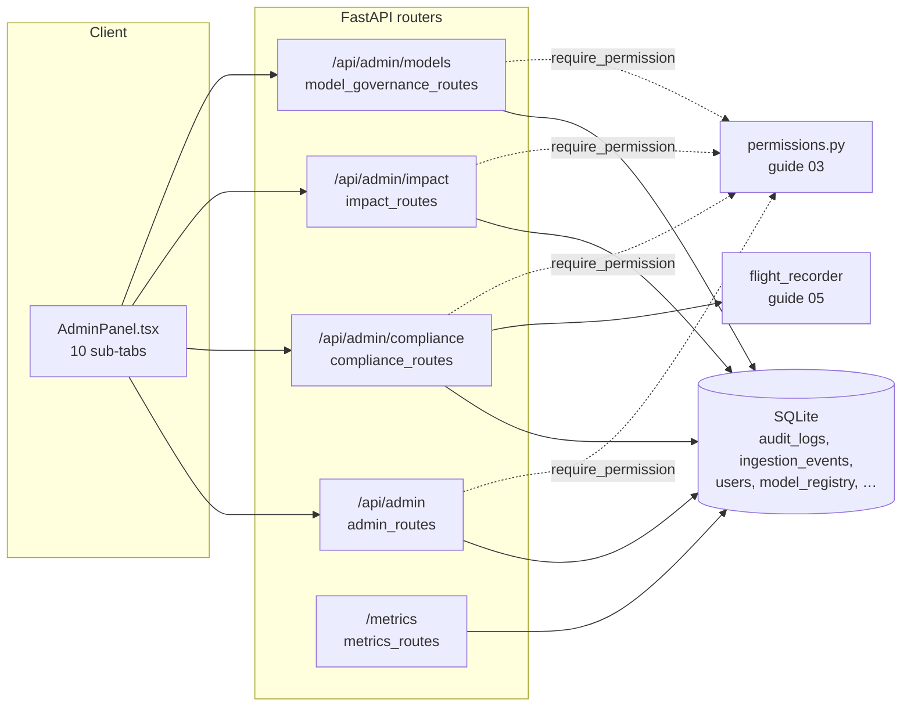
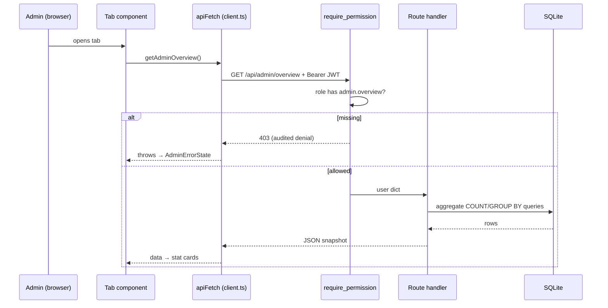

# 25: The Admin Panel: overview, compliance, impact, governance, security, ingestion monitor

The Admin Panel is Orb's single "governance console", the place a hospital administrator (and, more importantly during a sale, an *auditor* or *investor*) goes to see whether the system is behaving, whether it is compliant, whether the money it saves is real, and whether Orb is honest about the AI it ships. It is one React component (`AdminPanel.tsx`) that renders a row of ten sub-tabs; each tab is a small self-contained component that fetches one pre-aggregated JSON payload from one FastAPI endpoint and renders it. There is almost no client-side business logic, the *aggregation* (counting audit rows, verifying the tamper-evident hash chain, turning clinical activity into dollars, listing model provenance) all happens server-side in four services (`compliance_service`, `impact_service`, `metrics_service`, `model_governance_service`) so the numbers are computed once, honestly, from real database state. This guide covers the panel shell, the six tabs covered here (Overview, Security, Alerts, Model Governance, Impact, Trust Center, four of which are backed by the services above; Security and Alerts read guide 05's audit-log endpoint), the ingestion-monitor tab (UI only; its backend is guide 24), and the Prometheus `/metrics` endpoint.

> Jargon note, read once. **REST endpoint** = a URL the browser calls over HTTP to get/return JSON. **Route handler** = the Python function that answers one endpoint. **Router / router prefix** = FastAPI groups handlers under a shared URL prefix (e.g. `/api/admin`). **RBAC** (Role-Based Access Control) = permissions are attached to *roles* (admin, doctor, nurse…), not individual users; a route is "gated" on a permission string. **JWT** (JSON Web Token) = the signed login token the browser sends in the `Authorization: Bearer …` header. **Dependency injection** = FastAPI's `Depends(...)` mechanism that runs a function (here a permission check) before your handler and passes its result in. **React hook** = a `useX()` function (`useState`, `useEffect`) that lets a function-component hold state or run side effects. **PHI** = Protected Health Information (patient data). **MFA/TOTP** = multi-factor auth via time-based one-time passwords (an authenticator app). **Prometheus** = a metrics-scraping server; it periodically GETs a text endpoint and stores the numbers.

---

## Purpose and neighbors

The subsystem exists to answer four questions a buyer asks, each with a dedicated surface:

| Question | Surface | Backend |
|---|---|---|
| "Is the system healthy right now?" | Overview, Ingestion, Alerts, Security tabs | `admin_routes`, `/ingest/status` (guide 24), `/audit/logs` (guide 05) |
| "Are you compliant / secure?" | Trust Center tab | `compliance_service` |
| "Is the ROI real?" | Impact tab | `impact_service` |
| "Are your AI models honest?" | Model Governance tab | `model_governance_service` |
| "Can Prometheus watch you?" | (no tab) `/metrics` | `metrics_service` |

Everything here is **read-only aggregation** over data that other subsystems write. The Admin Panel owns almost no source-of-truth data, the one exception is the `model_registry` table, which the Model Governance service seeds and upserts.

Neighbors referenced throughout: **guide 03** (auth + RBAC, `require_permission`, `get_current_user`, the `admin.overview` permission), **guide 04** (database schema, every table read here), **guide 05** (audit log + flight recorder, the `AuditLogTable`, `CorrelationTrace`, `FlightRecorder` tabs and `verify_chain`), **guide 24** (ingestion, the `/ingest/status` endpoint and the `ingestion_events` table).

---

## File map

| File | Lines (approx) | Role |
|---|---|---|
| `server/routes/admin_routes.py` | 702 | Eight endpoints: the pre-aggregated 24h governance snapshot for the Overview tab (`:28`), patient erasure (`:265`), and the six history-import endpoints (`:517-676`, documented in guide 36). |
| `server/routes/compliance_routes.py` | 511 | Twelve endpoints: the live compliance posture report (`:125`) plus the DPDP data-rights surface, subject export, retention, the erasure request/adjudicate/execute chain and the breach register (`:239-496`, documented in guide 35). |
| `server/routes/impact_routes.py` | 68 | Two endpoints: the ROI model (with query-param overrides) and the assumptions catalogue. |
| `server/routes/model_governance_routes.py` | 43 | Three endpoints: full model registry, compact provenance chips, reseed. |
| `server/routes/metrics_routes.py` | 51 | One endpoint: Prometheus `/metrics` (optional bearer-token gate). |
| `server/services/compliance_service.py` | 508 | Probes real system state (encryption, audit chain, MFA, RBAC, models, residency, backups) into an auditor control checklist + score. |
| `server/services/impact_service.py` | 357 | Turns counted clinical events × cited assumptions into monthly/annual dollars and prevented-harm estimates. |
| `server/services/metrics_service.py` | 218 | Dependency-free Prometheus exposition: in-process counter/gauge registry + freshly-sampled operational gauges. |
| `server/services/model_governance_service.py` | 146 | The model registry: seeds known model surfaces, resolves checkpoint presence from disk, lists them. |
| `src/pages/panels/AdminPanel.tsx` | 127 | The panel shell: fourteen-tab sub-nav + conditional render of the active tab. |
| `src/pages/panels/admin/Admin.css` | 980 | Styles the tab bar, Overview stat cards, and the shared audit-table look. `AdminPanel.tsx:1` imports it as `./admin/Admin.css`. There is no `AdminPanel.css`. |
| `src/pages/panels/admin/AdminBadges.tsx` | 78 | Shared colored pill/icon components: outcome, source, parse-status badges + action icons. |
| `src/pages/panels/admin/AdminEmptyState.tsx` | 35 | Shared empty / loading / error placeholders for every tab. |
| `src/pages/panels/admin/AdminOverview.tsx` | 142 | Overview tab: six stat cards + recent-failure and auth-summary tables. |
| `src/pages/panels/admin/AlertOperations.tsx` | 134 | Alerts tab: filters + paginates Vigil/Relay alert audit rows. |
| `src/pages/panels/admin/ImpactDashboard.tsx` | 245 | Impact tab: hero savings headline, metric cards, editable assumptions panel. |
| `src/pages/panels/admin/ImpactDashboard.module.css` | 305 | Scoped (CSS-module) styles for the Impact "money slide". |
| `src/pages/panels/admin/IngestionMonitor.tsx` | 88 | Ingestion tab (UI only): filters + tabulates ingestion events. |
| `src/pages/panels/admin/ModelGovernance.tsx` | 84 | Model Governance tab: table of every model's lineage, checkpoint, validation, active state. |
| `src/pages/panels/admin/SecurityActivity.tsx` | 95 | Security tab: paginated `auth`-category audit rows (logins, denials). |
| `src/pages/panels/admin/TrustCenter.tsx` | 307 | Trust Center tab: score ring, audit-chain badge, control checklist, MFA bars, RBAC matrix. |
| `src/pages/panels/admin/TrustCenter.css` | 179 | Styles for the Trust Center dashboard. |
| `server/tests/test_compliance.py` | 139 | Middleware/uploads compliance tests (PHI mutation is audited; media is role-gated). |
| `server/tests/test_compliance_center.py` | 71 | Trust Center service contract tests (never crashes; shape; RBAC/score/audit keys). |
| `server/tests/test_impact.py` | 159 | ROI-model tests (structure, seeded compute, zero-degrade, overrides). |
| `server/tests/test_model_governance.py` | 29 | Registry tests (seeds all keys; untrained ≠ validated; checkpoint→active consistency). |

CSS files are covered in the file map and in short notes under their owning component; they are not given the per-unit template because they contain no functions.

---

## How it works

### Flow 1: a tab renders (the universal pattern)

Every tab follows the same three-step lifecycle. `AdminOverview` is the canonical example.

1. The component mounts. A `useState` triple holds `data`/`loading`/`error`. A `useEffect(() => fetchData(), [])` fires once on mount (`src/pages/panels/admin/AdminOverview.tsx:20`).
2. `fetchData` calls a typed helper in `src/api/client.ts` (e.g. `getAdminOverview()`), which is a thin wrapper over `apiFetch`. `apiFetch` prepends `API_BASE` (`${API_HOST}/api`) and attaches the JWT from `localStorage` as `Authorization: Bearer …` (`src/api/client.ts:109`). On HTTP 401 it clears the token and reloads; on 403 it throws a structured permission error (`src/api/client.ts:116`).
3. The server handler is gated by `Depends(require_permission("admin.overview"))`. If the caller's role lacks the permission, `require_permission` logs a `permission_denied` audit event and raises 403 *before* the handler body runs (`server/permissions.py:164`). Otherwise it returns the pre-aggregated JSON, which React drops into `setData`, flipping `loading` off and rendering cards.

### Flow 2: the Impact "recompute with my numbers" loop

The Impact tab is the only tab that sends user input back to the server (as query params, not a body).

1. On mount, `ImpactDashboard` GETs `/api/admin/impact/` with no params. The server computes the model with default assumptions and *echoes back* every assumption it used (value + unit + citation) (`server/services/impact_service.py:319`).
2. The component copies those echoed values into a `draft` map of controlled `<input>` fields (`src/pages/panels/admin/ImpactDashboard.tsx:86`).
3. The admin edits a field (say ICU-day cost). `dirty` (a `useMemo`) turns true because a draft value now differs from the model's value (`src/pages/panels/admin/ImpactDashboard.tsx:97`).
4. "Apply & recompute" re-fetches `/api/admin/impact/?icu_day_cost_usd=…`. The route drops `None` params, passes the rest to `compute_impact`, which re-resolves assumptions (rejecting negatives/nonsense) and re-runs the counted-event × assumption arithmetic (`server/routes/impact_routes.py:52`, `server/services/impact_service.py:100`).

### Flow 3: the Trust Center posture report

`compliance_report()` runs ten independent probes, each wrapped so a failure degrades to a safe default rather than crashing the report, then assembles them into a thirteen-control auditor checklist with a 0–100 weighted score (`server/services/compliance_service.py:453`). The Trust Center component renders the score as an SVG ring, the audit-chain result as a badge, and the checklist as colored rails. Detail below.

---

## Function-by-function

### `server/routes/admin_routes.py`

#### admin_overview: `server/routes/admin_routes.py:29`
**Signature:** `admin_overview(user = Depends(require_permission("admin.overview"))) -> dict`
**Does:** Returns a single pre-aggregated 24-hour governance snapshot for the Overview tab.
**How it works:**
1. Computes `now` (UTC) and a `cutoff_24h` ISO timestamp 24h earlier (`:33`).
2. Opens one `db_session()` and runs seven aggregate queries: audit counts by `event_category` (`:37`), audit counts by `outcome` (`:48`), an ingestion summary (total/parsed/failed/duplicate + summed `vitals_inserted`/`observations_inserted`) (`:57`), source mix by `source_type` (`:71`), alert counts filtered to `vigil_alert_generated`/`relay_alert_generated` action types (`:80`), the five most recent parse failures (`:91`), and an auth-events breakdown grouped by action+outcome (`:102`).
3. Assembles a flat dict, coalescing every possibly-`NULL` SUM to `0`, and stamps `ingestion_mode` and `audit_simulation_enabled` from `config` (`:113`).
**Why it exists:** The Overview tab must load instantly and show "system pulse" without the browser issuing seven queries; one gated endpoint does the fan-out server-side.
**Data in/out:** In: JWT. Out: `{ingestion_mode, audit_simulation_enabled, audit_total_24h, audit_categories{}, audit_outcomes{}, ingestion{total,parsed,failed,duplicates,total_vitals,total_observations}, source_mix{}, alerts{vigil,relay}, recent_failures[], auth_events[]}`.
**Talks to:** Reads `audit_logs` and `ingestion_events`. Called by `getAdminOverview()` → `AdminOverview.tsx`. Depends on `permissions.require_permission` (guide 03) and `config.INGESTION_MODE` / `AUDIT_SIMULATION_EVENTS`.
**Change guide:** To widen the window to 7 days, change the `timedelta(hours=24)` at `:33`, every `WHERE … >= ?` comparison uses the same cutoff; knock-on: the tab's "24h" labels in `AdminOverview.tsx` become wrong, so update them too. To add a new stat card (e.g. "orders placed 24h"), add a query here, add the field to the return dict, then add a card in `AdminOverview.tsx`. Footgun: the alert query filters on `action_type` **without** an `event_category` filter, so it counts those actions in *any* category, keep that in mind if you re-home where alerts are logged.
**Gotchas:** `recent_failures` is *not* time-limited to 24h, it is the last 5 failures ever (`:91` has no `received_at >=` clause), unlike every other block. That is deliberate (you always want to see the newest failures) but easy to misread.

---

### `server/routes/compliance_routes.py`

#### get_compliance_report: `server/routes/compliance_routes.py:126`
**Signature:** `get_compliance_report(user = Depends(require_permission("admin.overview"))) -> dict`
**Does:** Returns the aggregated live compliance posture (delegates entirely to the service).
**How it works:** One line: `return compliance_report()`. All logic is in `compliance_service`.
**Why it exists:** Keeps the HTTP layer thin and the (heavily-tested, never-crashing) aggregation logic in a service that can also be imported directly by tests.
**Data in/out:** Out: the full report dict (see `compliance_report` below). Route path is `GET /api/admin/compliance/` (note the **trailing slash**, the router prefix is `/api/admin/compliance` and the handler path is `/`).
**Talks to:** `services.compliance_service.compliance_report`; called by `apiFetch('/admin/compliance/')` in `TrustCenter.tsx:88`.
**Change guide:** To make this readable by non-admins (e.g. a security-officer role), change the gate string at `:126`; knock-on: the report contains the RBAC matrix and residency host, decide whether that is safe to widen. Footgun: the client calls `/admin/compliance/` with a trailing slash; drop it and FastAPI 307-redirects, which can strip the auth header on some proxies.
**Gotchas:** None noteworthy.

---

### `server/routes/impact_routes.py`

#### get_impact: `server/routes/impact_routes.py:21`
**Signature:** `get_impact(user, period_days?, doc_minutes_saved_per_note?, clinician_hourly_cost_usd?, icu_day_cost_usd?, deterioration_icu_avoidance_rate?, ade_cost_usd?, ade_avoidance_rate_per_alert?, ward_bed_day_cost_usd?, los_reduction_days_per_discharge?) -> dict`
**Does:** Returns the ROI/outcomes model, with any assumption overridable via a bounded query param.
**How it works:**
1. FastAPI validates each optional query param with `Query(..., ge=…, le=…)` (e.g. rates are `0..1`, `period_days` is `1..3650`) (`:24`).
2. Collects the params into an `overrides` dict, then **drops every `None`** so omitted params fall back to the service's cited defaults (`:52`).
3. Returns `compute_impact(overrides)`.
**Why it exists:** Lets a skeptical CFO re-run the whole model with their own unit economics in the URL, no client-side math, single source of truth.
**Data in/out:** Out: the impact model dict (see `compute_impact`). Path: `GET /api/admin/impact/`.
**Talks to:** `services.impact_service.compute_impact` + `DEFAULT_ASSUMPTIONS`; called by `ImpactDashboard.tsx:83`.
**Change guide:** To add a new assumption (e.g. "radiology-read minutes saved"), add it to `DEFAULT_ASSUMPTIONS`, add a `Query` param here, add it to the `overrides` dict, and add the counting logic in `compute_impact`; the UI needs no change because it renders assumptions from the echoed catalogue. Footgun: the `Query` bounds are the *only* server-side validation of ranges beyond `compute_impact`'s negative-rejection, if you add a param, mirror its bound.
**Gotchas:** The bounds catch out-of-range values with a 422 *before* the handler runs, so the service's own graceful-degradation for bad values is a second line of defense, not the first.

#### get_assumptions: `server/routes/impact_routes.py:56`
**Signature:** `get_assumptions(user) -> {"assumptions": {key: {value, unit, citation}}}`
**Does:** Returns the catalogue of tunable assumptions (default value + unit + citation) without their computed dollars.
**How it works:** Projects `DEFAULT_ASSUMPTIONS` into a `{value, unit, citation}` triple per key.
**Why it exists:** So the UI could render the editable panel from a single source of truth. (Note: the current `ImpactDashboard` reads the assumptions off the main `/impact/` response instead, so this endpoint is presently unused by the shipped UI.)
**Data in/out:** Out: assumptions catalogue. Path: `GET /api/admin/impact/assumptions`.
**Talks to:** `DEFAULT_ASSUMPTIONS`. No current frontend caller (see Discrepancies).
**Change guide:** To surface citations in a standalone "methodology" page, call this endpoint. Gotcha: it does not include the *resolved* (overridden) values, those live only on the `/impact/` response's `assumptions` block.
**Gotchas:** None noteworthy.

---

### `server/routes/metrics_routes.py`

#### _authorized: `server/routes/metrics_routes.py:31`
**Signature:** `_authorized(authorization: str | None) -> bool`
**Does:** Decides whether a `/metrics` request may proceed.
**How it works:** If `ORB_METRICS_TOKEN` is unset, returns `True` (open). If set, requires an `Authorization: Bearer <token>` header and compares with `hmac.compare_digest` (constant-time, resistant to timing attacks) (`:43`).
**Why it exists:** Prometheus scrapes are conventionally unauthenticated; Orb's metrics contain only coarse counts (no PHI), so the endpoint is zero-config open but can be locked down by setting one env var.
**Data in/out:** In: the raw header string. Out: bool.
**Talks to:** Called by `metrics`. Reads `os.getenv("ORB_METRICS_TOKEN")`.
**Change guide:** To force auth everywhere, set `ORB_METRICS_TOKEN` in the deployment env; knock-on: your Prometheus scrape config needs the bearer token. Footgun: a *blank* token env var (`ORB_METRICS_TOKEN=`) is falsy → still open.
**Gotchas:** None noteworthy.

#### metrics: `server/routes/metrics_routes.py:46`
**Signature:** `metrics(authorization: str | None = Header(default=None)) -> PlainTextResponse`
**Does:** The Prometheus scrape endpoint; returns the text exposition body.
**How it works:** Calls `_authorized`; on failure raises 401. Otherwise returns `render_metrics()` wrapped in a `PlainTextResponse` with `CONTENT_TYPE` (`text/plain; version=0.0.4; charset=utf-8`).
**Why it exists:** Exposes operational health to a standard monitoring stack.
**Data in/out:** Out: Prometheus text. Path: `GET /metrics`, **no `/api` prefix** (this router declares no prefix), so it is at the server root, matching Prometheus convention.
**Talks to:** `services.metrics_service.render_metrics` + `CONTENT_TYPE`.
**Change guide:** To add a metric, register it in `metrics_service` (see `render_metrics`); nothing changes here. Footgun: because there is no `/api` prefix, a reverse proxy that only forwards `/api/*` to the backend will 404 this, forward `/metrics` explicitly.
**Gotchas:** None noteworthy.

---

### `server/routes/model_governance_routes.py`

#### get_models: `server/routes/model_governance_routes.py:20`
**Signature:** `get_models(user = Depends(require_permission("admin.overview"))) -> {"models": [...]}`
**Does:** Returns the full model registry (provenance + validation + internal fields).
**How it works:** `return {"models": list_models()}`.
**Data in/out:** Path: `GET /api/admin/models`. Out: full rows including `training_data`, `validation_metrics` (parsed JSON), `notes`, etc.
**Talks to:** `list_models`; called by `getModelRegistry()` → `ModelGovernance.tsx`.
**Change guide:** To hide `notes` from the admin table, either strip it here or (better) leave the API complete and choose columns in the component. Gotcha: this is the *full* registry, do not add secrets (model paths, keys) as columns.
**Gotchas:** None noteworthy.

#### get_model_provenance: `server/routes/model_governance_routes.py:26`
**Signature:** `get_model_provenance(user = Depends(get_current_user)) -> {"models": [compact...]}`
**Does:** Compact per-model provenance for the inline "which model produced this?" chips shown on AI outputs.
**How it works:** Maps each registry row down to `_CHIP_FIELDS` (`model_key, version, task, training_data, validated, checkpoint_present, is_active`) (`:16`).
**Why it exists:** Any authenticated clinician (not just admins) should be able to see, inline on an AI output, the model+version and whether it is validated, so this uses `get_current_user` (authenticated) rather than the admin gate. Detail (metrics, lineage, notes) stays behind the admin console.
**Data in/out:** Path: `GET /api/admin/models/provenance`. Out: the seven-field subset only.
**Talks to:** `list_models`, `auth.get_current_user` (guide 03). Consumers are the per-output provenance chips elsewhere in the app.
**Change guide:** To add a field to the chip (e.g. `notes`), append it to `_CHIP_FIELDS` at `:16`; knock-on: it becomes visible to *all* authenticated users, so only add non-sensitive fields. Worked example: exposing `validation_metrics` here would leak AUROC to every nurse, don't.
**Gotchas:** This is the only endpoint in the whole subsystem **not** gated on `admin.overview`; it is the deliberate exception.

#### reseed_models: `server/routes/model_governance_routes.py:38`
**Signature:** `reseed_models(user = Depends(require_permission("admin.overview"))) -> {"ok": True, "count": n}`
**Does:** Re-syncs the registry with the known model surfaces and recomputes checkpoint presence from disk.
**How it works:** `return {"ok": True, "count": seed_default_models()}`.
**Why it exists:** After a checkpoint is trained and dropped on disk, an admin can refresh `checkpoint_present`/`is_active` without a redeploy.
**Data in/out:** Path: `POST /api/admin/models/reseed`.
**Talks to:** `seed_default_models`. No shipped UI button calls it (invoked manually / by tooling).
**Change guide:** To auto-reseed on startup, call `seed_default_models()` in app lifespan instead of relying on this endpoint. Footgun: `seed_default_models` upserts only the *known* surfaces, a model you added to the DB by hand but not to `_default_models()` is left untouched, not deleted.
**Gotchas:** None noteworthy.

---

### `server/services/compliance_service.py`

#### _safe: `server/services/compliance_service.py:35`
**Signature:** `_safe(fn: Callable[[], Any], default: Any) -> Any`
**Does:** Runs a probe, returning `default` (and logging a warning) if it raises.
**Why it exists:** The report must never crash. A missing table, renamed symbol, or import error in one probe degrades *that control* to a safe default instead of taking down the whole Trust Center. This is the structural guarantee behind `test_compliance_center.test_report_does_not_crash…`.
**Talks to:** Wraps every probe in `compliance_report`.
**Gotchas:** Catches bare `Exception` (intentional, marked `# pragma: no cover - defensive`), so a genuine bug in a probe is silently swallowed as a `warn`. Watch the logs.

#### _encryption_posture: `server/services/compliance_service.py:49`
**Signature:** `() -> dict`
**Does:** Reports database-at-rest and upload-at-rest encryption honestly.
**How it works:** Reads `config.DB_ENCRYPTION_KEY` (presence only, the SQLCipher driver is a deploy detail it can't observe), `config.UPLOAD_ENCRYPTION_KEY`, and asks `crypto_service.is_encryption_enabled()` whether upload encryption is actually active (`:56`). Returns both raw keys-set booleans and two aggregate badges (`db_at_rest`, `uploads_at_rest`).
**Data in/out:** Out: `{db_encryption_key_set, upload_encryption_key_set, upload_encryption_active, db_at_rest, uploads_at_rest}`.
**Talks to:** `config`, `services.crypto_service` (uploads/crypto guide).
**Change guide:** To badge DB encryption as active only when the driver is present too, extend this probe to import the SQLCipher driver and AND it in. Gotcha: `db_at_rest` is key-presence, *not* proof of encryption, the control's evidence string says so.
**Gotchas:** None noteworthy.

#### _audit_chain: `server/services/compliance_service.py:74`
**Signature:** `() -> {verified, broken_at, count}`
**Does:** Verifies the global tamper-evident audit hash-chain.
**How it works:** Calls `flight_recorder_service.verify_chain()` (guide 05), which walks every hashed `audit_logs` row and returns `{ok, broken_at, count}`; maps `ok→verified`.
**Why it exists:** Tamper-evidence is a headline control, any altered/deleted audit row breaks the SHA-256 chain and `verified` flips false with the first-broken row id.
**Talks to:** `services.flight_recorder_service.verify_chain` (guide 05).
**Change guide:** To scope the badge to one patient, `verify_chain` accepts a `patient_id`; not wired here (the Trust Center is a global posture). Footgun: if this probe throws (e.g. table missing), `_safe`'s default carries `unknown: True`, which `compliance_report` later converts to an `unknown` control, never a false `fail`/"tampering detected".
**Gotchas:** None noteworthy.

#### _audit_coverage: `server/services/compliance_service.py:86`
**Signature:** `() -> {total_events, by_category, categories}`
**Does:** Distribution of audit rows by `event_category`, which PHI/route categories actually appear in the immutable log.
**How it works:** `GROUP BY event_category ORDER BY c DESC`, coalescing a NULL category to `"uncategorized"`.
**Data in/out:** Out: totals + per-category counts + distinct-category count.
**Talks to:** Reads `audit_logs`. Rendered as the Trust Center "coverage pills" (top 8).
**Gotchas:** None noteworthy.

#### _mfa_adoption: `server/services/compliance_service.py:106`
**Signature:** `() -> {required_roles, by_role, total_users, total_enrolled, adoption_pct, required_gap}`
**Does:** TOTP MFA adoption per role, plus which mandated roles still have un-enrolled users.
**How it works:**
1. Reads `config.MFA_REQUIRED_ROLES` (the roles for which MFA is mandated) (`:111`).
2. `GROUP BY role`, counting total users and `SUM(totp_enabled=1)` enrolled per role (`:114`).
3. Computes `required_gap` = mandated roles where enrolled < total (`:132`), and an org-wide `adoption_pct`.
**Why it exists:** Drives the MFA control (`pass` only when every mandated role is fully enrolled) and the Trust Center's per-role progress bars.
**Data in/out:** Reads `users(role, totp_enabled)`.
**Change guide:** To mandate MFA for admins, set `ORB_MFA_REQUIRED_ROLES=admin,doctor,nurse`; knock-on: the MFA control flips `pass→warn` until those users enroll, and `required_gap` lists the laggards. Gotcha: `adoption_pct` is org-wide (all roles) but the *control* only cares about mandated roles, a low org-wide pct with fully-enrolled mandated roles is still a `pass`.
**Gotchas:** None noteworthy.

#### _rbac_matrix: `server/services/compliance_service.py:148`
**Signature:** `() -> {roles, permissions, matrix, role_count, permission_count}`
**Does:** Builds the role × permission grid from the canonical `permissions.ROLE_PERMISSIONS`.
**How it works:** Takes the sorted union of every permission any role holds, then for each role emits `{perm: bool}` for the full permission set (a dense grid, so absent = explicit `False`).
**Why it exists:** Renders the collapsible RBAC matrix and proves "least privilege" is real. `test_compliance_center` asserts doctor+nurse appear and every row's keys equal the permission list.
**Talks to:** `permissions.ROLE_PERMISSIONS` (guide 03).
**Change guide:** Add a role or permission in `permissions.py` and it appears here automatically, no change needed. Gotcha: the matrix reflects the *code's* mapping, not any per-user overrides; if you ever add per-user grants, this becomes optimistic.
**Gotchas:** None noteworthy.

#### _model_posture: `server/services/compliance_service.py:169`
**Signature:** `() -> {validated, total, unvalidated}`
**Does:** Validated-vs-unvalidated model counts for the honesty narrative.
**How it works:** `list_models()` then counts `validated`.
**Talks to:** `services.model_governance_service.list_models`.
**Gotchas:** None noteworthy.

#### _residency: `server/services/compliance_service.py:183`
**Signature:** `() -> {host, loopback_only, cors_origins, deployment_profile, on_prem}`
**Does:** On-prem / data-residency attestation from the server bind host + CORS + profile.
**How it works:** Reads `config.HOST`; `loopback_only` is true for `127.0.0.1`/`localhost`/`::1`. Reads `CORS_ORIGINS`, `DEPLOYMENT_PROFILE`.
**Change guide:** Binding to `0.0.0.0` flips the `data_residency` control to `warn`. Gotcha: `on_prem` is **hard-coded `True`** here regardless of the bind (`:195`), see Discrepancies.
**Gotchas:** As above.

#### _backup_present: `server/services/compliance_service.py:199`
**Signature:** `() -> bool`
**Does:** Whether a backup script ships (evidence of a recovery plan).
**How it works:** Checks three candidate paths (`scripts/backup.sh` at repo root or under `server/`, or `server/scripts/backup_db.py`) relative to `config.BASE_DIR`.
**Gotchas:** Presence of a *script* is not proof backups *run*, the control's remediation says to schedule and restore-test.

#### _dpdp_posture: `server/services/compliance_service.py:213`
**Signature:** `() -> dict`
**Does:** The DPDP Act 2023 probe, consent register, data-principal rights, retention, breaches.
**How it works:** A one-line delegate: imports `dpdp_posture` from `services.consent_service` and returns it. The import is function-local so a broken consent service cannot break module import of the compliance service.
**Data in/out:** Out: `{consents_recorded, consents_withdrawn, patients_with_consent, retention_policies, erasure_requests_total, erasure_requests_awaiting_decision, breaches_recorded, breaches_awaiting_board_notification}`, the same keys `compliance_report` uses as the `_safe` default, so a probe failure yields all-zeros rather than a crash.
**Talks to:** `services.consent_service.dpdp_posture`; feeds the four `dpdp_*` controls in `_build_controls`.
**Gotchas:** All-zeros is indistinguishable from "the probe failed" at the control layer, an empty consent register and a dead consent service both render as amber.

#### _session_revocation_supported: `server/services/compliance_service.py:220`
**Signature:** `() -> bool`
**Does:** True when `users.token_version` exists (enables logout-everywhere).
**How it works:** `PRAGMA table_info(users)` and checks for the `token_version` column.
**Talks to:** Reads the `users` schema (column added by migration, `database.py:1194`).
**Gotchas:** None noteworthy.

#### _build_controls: `server/services/compliance_service.py:233`
**Signature:** `(enc, audit, mfa, rbac, residency, backups, revocation, dpdp) -> list[dict]`
**Does:** Turns the raw posture into the auditor control checklist, each control an `{id, name, status, evidence, remediation}`.
**How it works:** A local `add()` appends controls (`:240`). It always enumerates **thirteen** controls: the original nine, `tls_in_transit` (always `warn`, the app terminates no TLS, `:251`), `enc_at_rest_db`, `enc_at_rest_uploads`, `mfa`, `audit_hash_chain`, `rbac`, `backups`, `session_revocation`, `data_residency`, plus four DPDP Act 2023 controls fed by the `dpdp` probe: `dpdp_consent` (`:374`), `dpdp_data_principal_rights` (`:390`, unconditional `pass`), `dpdp_retention` (`:400`), `dpdp_breach_register` (`:415`). Each branch picks `pass`/`warn`/`fail` from the probe and writes a concrete evidence string + a remediation hint. The MFA control has three branches (mandated+no-gap→pass, mandated+gap→warn, none-mandated→warn). Two controls can go `fail`: `audit_hash_chain` (broken chain, `:314`) and `dpdp_breach_register` (a recorded breach not yet notified to the Data Protection Board, `:415`).
**Why it exists:** An auditor wants a checklist with evidence, not a green wall. The honest amber/red is the point, `test_compliance_center` asserts the original nine ids are always a *subset* of what comes back (`_EXPECTED_CONTROL_IDS <= ids`, `server/tests/test_compliance_center.py:40`) even when several are `warn`, so adding a control cannot break the test but renaming one can.
**Data in/out:** Out: list of thirteen control dicts.
**Change guide:** To add a control (e.g. "penetration test on file"), add a probe, thread it into `compliance_report`'s call, and `add(...)` a branch here; knock-on: the score denominator grows so every existing control's weight shrinks slightly. Worked example: adding a `pass` control to a currently 6/9-passing report *raises* the score; adding a `warn` one *lowers* it. Footgun: the `_EXPECTED_CONTROL_IDS` test set fails if you rename an id, update the test.
**Gotchas:** `tls_in_transit` is hard-`warn` by design (the app can't see the reverse proxy), so a perfect deployment behind nginx still shows amber here.

#### _overall_score: `server/services/compliance_service.py:441`
**Signature:** `(controls) -> int`
**Does:** 0–100 posture score as the weighted mean of control statuses.
**How it works:** Weights are `pass=1.0, warn=0.5, unknown=0.5, fail=0.0` (`:32`); score = `round(mean × 100)`.
**Why it exists:** One headline number for the ring. `test_compliance_center` asserts it is an int in `[0,100]`.
**Change guide:** To make warnings hurt more, lower the `warn` weight in `_STATUS_WEIGHT` at `:32`; knock-on: every deployment's score drops and the ring color band (`scoreColor` in the UI) may shift. Gotcha: because `tls_in_transit` is permanently `warn=0.5`, a flawless deployment caps below 100.
**Gotchas:** None noteworthy.

#### compliance_report: `server/services/compliance_service.py:453`
**Signature:** `() -> dict`
**Does:** The public entrypoint: aggregates all probes into one report and never raises.
**How it works:** Wraps each of the ten probes in `_safe` with an explicit default (the audit default carries `unknown: True`, `:466`; the `dpdp` default is an all-zeros dict, `:478`), builds controls, then post-processes: if the audit probe returned `unknown`, it overwrites the `audit_hash_chain` control to `status="unknown"` with honest evidence (`:489`). Returns `{generated_at, overall_score, controls, mfa, rbac_matrix, audit_chain, audit_coverage, encryption, residency, models, dpdp}`.
**Data in/out:** Out: the report the Trust Center renders.
**Talks to:** All probes + `_build_controls` + `_overall_score`; called by the compliance route.
**Change guide:** To add a top-level block (e.g. `backups_detail`), compute it and add it to the return dict; the TypeScript `ComplianceReport` interface in `TrustCenter.tsx:39` must gain the field too or the UI ignores it. Footgun: the `unknown` audit remap only fixes the *control*; `audit_chain.verified` in the payload stays `False` with `unknown:True`, and the UI reads `audit_chain.unknown` to render the "Unknown" badge, keep both in sync.
**Gotchas:** The `dpdp` block is a live instance of the change-guide footgun above: the server returns it (`:507`) but `interface ComplianceReport` in `TrustCenter.tsx:39` does not declare it, so the DPDP detail is fetched over the wire and then dropped by the UI. The four `dpdp_*` controls still render, because they arrive inside `controls[]`.

---

### `server/services/impact_service.py`

#### DEFAULT_ASSUMPTIONS: `server/services/impact_service.py:47`
**Does:** The single module-level dict of tunable assumptions; each entry is `{value, unit, citation}`.
**Why it exists:** Every dollar traces to a counted event × a *named, cited* assumption, no magic numbers. Nine keys: `period_days`, `doc_minutes_saved_per_note` (7 min), `clinician_hourly_cost_usd` (120), `icu_day_cost_usd` (4000), `deterioration_icu_avoidance_rate` (0.15), `ade_cost_usd` (5000), `ade_avoidance_rate_per_alert` (0.03), `ward_bed_day_cost_usd` (1200), `los_reduction_days_per_discharge` (0.25). Citations name real literature (Dasta 2005, Bates JAMA 1997, AHRQ HCUP) and stress conservatism.
**Change guide:** To make the model more conservative, lower a `value` here; update the citation string to match or diligence breaks. This dict is echoed to the UI so the editable fields and citations stay in sync automatically.
**Gotchas:** None noteworthy.

#### _resolve_assumptions: `server/services/impact_service.py:121`
**Signature:** `(overrides: dict | None) -> dict[str, float]`
**Does:** Merges caller overrides onto defaults into a flat `{key: value}` map, sanitizing hostile input.
**How it works:** Starts from defaults; for each override, ignores unknown keys and `None`, coerces to `float`, and **rejects negatives** (falls back to default) so a bad query param can never produce a negative dollar (`:113`). Clamps `period_days` to `max(1, int(...))` (`:117`).
**Why it exists:** The CFO can override anything, but the model must stay defensible, no negative or nonsense inputs.
**Change guide:** To allow an assumption to be zero-but-not-negative (already the case) vs strictly positive, adjust the `val < 0` guard. Footgun: a *string* like `"abc"` is caught by the `try/except`, but a numeric-looking huge value is accepted, the route's `Query` bounds are the real ceiling.
**Gotchas:** `test_negative_override_ignored` locks in the negative-rejection behavior.

#### _count: `server/services/impact_service.py:145`
**Signature:** `(db, sql, params=()) -> int`
**Does:** Runs a scalar COUNT, swallowing any error (missing table/column) as `0`.
**Why it exists:** On a partial/fresh DB the model degrades to zeros instead of 500-ing. Monkeypatched to `0` in `test_no_data_path_is_all_zero`.
**Gotchas:** Catches bare `Exception` and logs at `debug`, a real query bug is invisible unless debug logging is on.

#### _scalar_float: `server/services/impact_service.py:158`
**Signature:** `(db, sql, params=()) -> float | None`
**Does:** Same as `_count` but returns a float or `None` (used for average LOS).
**Gotchas:** None noteworthy.

#### _money: `server/services/impact_service.py:169`
**Signature:** `(x: float) -> float`
**Does:** Rounds to 2dp, clamped `>= 0`, `round(max(0.0, x), 2)`.
**Why it exists:** Guarantees the "no metric ever produces a negative amount" invariant (`test_metrics_compute_with_data`). Note the unit is **not** dollars: every amount in the payload is denominated in `currency.code` (`CURRENCY_CODE`, emitted at `:331-334`), which for an India deployment is INR. There is no function named `_dollars`.
**Gotchas:** None noteworthy.

#### compute_impact: `server/services/impact_service.py:174`
**Signature:** `(assumptions: dict | None = None) -> dict`
**Does:** Computes the four-metric ROI model over the reporting window.
**How it works:**
1. Resolves assumptions and derives a `cutoff` = `now - period_days` (`:164`). All time filters use `julianday(col) >= julianday(?)` so both `CURRENT_TIMESTAMP` (`YYYY-MM-DD HH:MM:SS`) and full ISO-8601 timestamps compare correctly and any unparseable/NULL timestamp is simply excluded (`:169`).
2. **Metric 1, documentation time saved:** counts `scribe_notes` since cutoff; `minutes = notes × doc_minutes_saved_per_note`; `dollars = (minutes/60) × clinician_hourly_cost_usd` (`:177`).
3. **Metric 2, deterioration caught early:** counts `risk_scores` at `level='critical'` + `care_bundles` triggered since cutoff; `icu_days_avoided = escalations × deterioration_icu_avoidance_rate`; `dollars = icu_days_avoided × icu_day_cost_usd` (`:199`).
4. **Metric 3, medication safety:** counts `medications` with `source IN ('llm_extracted','agentic')` that a pharmacist actually verified, plus `medication_verify`/`medication_reject` audit rows; `ades_avoided = med_events × ade_avoidance_rate_per_alert`; `dollars = ades_avoided × ade_cost_usd` (`:231`).
5. **Metric 4, throughput:** counts `discharge_summaries` since cutoff; also computes all-time `AVG(length_of_stay_days)` from `admission_history WHERE discharged=1`; `los_days_saved = discharge_recons × los_reduction_days_per_discharge`; `dollars = los_days_saved × ward_bed_day_cost_usd` (`:264`).
6. **Totals:** normalizes each period's dollars to a 30-day month (`monthly = sum(dollars) × 30/period_days`), `annual = monthly × 12`, and two separate harm figures: `icu_days_avoided` (the deterioration metric's `value`) and `ades_avoided` (the medication metric's `value`). They used to be summed into one `events_prevented` number, which added ICU days to adverse drug events; the two units are now reported apart.
7. Echoes the resolved assumptions with unit+citation and sets `has_data = total_evidence > 0`.
**Why it exists:** The investor "money slide," but audit-grade: each metric carries a human-readable `assumption` string (e.g. `"12 Scribe note(s) x 7 min saved/note x $120/clinician-hour"`).
**Data in/out:** Out: `{generated_at, period{days,start,end}, metrics[4], totals{monthly_savings,annual_savings,icu_days_avoided,ades_avoided}, assumptions{}, has_data}`.
**Talks to:** Reads `scribe_notes, risk_scores, care_bundles, medications, audit_logs, discharge_summaries, admission_history`. Called by the impact route.
**Change guide:** To add a fifth metric, append a block computing `evidence_count`, `value`, `dollars`, and an `assumption` string, add its evidence to `total_evidence`, and decide whether its `value` needs its own figure in `totals` (only deterioration and medication have one, `icu_days_avoided` and `ades_avoided`; never add values of different units together). Worked example: doubling `doc_minutes_saved_per_note` roughly doubles documentation dollars, `test_assumption_override_changes_result` verifies this. Worked example: on an empty DB every `_count` returns 0, so every `dollars` is 0 and `has_data` is False, `test_no_data_path_is_all_zero` verifies this.
**Gotchas:** The throughput metric's `value` is *measured average LOS* (a level in days), whereas every other metric's `value` is the estimated *saved/prevented* quantity, an inconsistency (see Discrepancies). Also, `avg_los` is computed over *all* history, not the reporting window, so it does not move when you change `period_days`.

---

### `server/services/metrics_service.py`

> This module hand-rolls the **Prometheus text exposition format** so no `prometheus_client` dependency is needed. The format is line-based: `# HELP <name> <text>`, `# TYPE <name> counter|gauge`, then `name{label="v"} <number>` sample lines. Prometheus scrapes this text and stores each number against the scrape timestamp.

#### inc: `server/services/metrics_service.py:55`
**Signature:** `(name, value=1.0, labels=None, help_text="") -> None`
**Does:** Increments an in-process counter (creating it on first use), thread-safely.
**How it works:** Builds a `(name, sorted-label-tuple)` key, takes `_LOCK`, declares HELP/TYPE once, adds `value`.
**Why it exists:** Other modules (e.g. middleware bumping a request counter) can cheaply record metrics that `render_metrics` later emits.
**Gotchas:** Counters live only in process memory, they reset on restart (correct Prometheus counter semantics, which tolerate resets).

#### set_gauge: `server/services/metrics_service.py:64`
**Signature:** `(name, value, labels=None, help_text="") -> None`
**Does:** Sets a gauge to an absolute value.
**Gotchas:** None noteworthy.

#### _label_key / _declare / _format_labels / _escape: `:45`, `:51`, `:74`, `:81`
**Do:** Helpers: canonicalize labels into a sorted tuple key; remember HELP/TYPE per metric name (first declaration wins via `setdefault`); render a label tuple as `{k="v",…}`; escape `\`, newlines, and `"` per the exposition spec.
**Gotchas:** `_declare` uses `setdefault`, so the *first* HELP/TYPE seen for a name sticks, a later `inc` with a different help string is ignored.

#### _render_registry: `server/services/metrics_service.py:85`
**Signature:** `() -> list[str]`
**Does:** Emits every registry counter+gauge grouped by name with a single HELP/TYPE header each.
**How it works:** Snapshots the dicts under the lock, groups samples by metric name, and for each name (sorted) prints HELP, TYPE, then one line per label-set.
**Gotchas:** None noteworthy.

#### _num: `server/services/metrics_service.py:107`
**Signature:** `(v: float) -> str`
**Does:** Renders integers without a trailing `.0`, else `repr(v)`.
**Gotchas:** `repr` on odd floats can produce long/scientific strings; harmless for Prometheus but ugly.

#### _emit: `server/services/metrics_service.py:114`
**Signature:** `(lines, name, mtype, help_text, value) -> None`
**Does:** Appends a self-contained HELP/TYPE/sample triple for a single freshly-sampled metric.
**Gotchas:** None noteworthy.

#### _count: `server/services/metrics_service.py:120`
**Signature:** `(query: str) -> int | None`
**Does:** Runs a cheap COUNT defensively; `None` if it cannot be sampled.
**How it works:** Uses `database.get_db()` + `conn.close()` (a *different* access pattern from the `db_session()` context manager used elsewhere in this subsystem).
**Gotchas:** Because a failed sample returns `None` and `render_metrics` then *omits* that line, a broken query makes a metric silently disappear rather than error.

#### _db_size_bytes: `server/services/metrics_service.py:134`
**Signature:** `() -> int | None`
**Does:** Total on-disk size of the SQLite DB plus its `-wal`/`-shm` sidecars.
**Talks to:** `config.DB_PATH`.
**Gotchas:** None noteworthy.

#### _llm_queue_depth: `server/services/metrics_service.py:149`
**Signature:** `() -> (queued|None, active_workers|None)`
**Does:** Reads the LLM priority queue depth and active-worker count without touching the event loop.
**How it works:** Reaches into `llm_queue._queue.qsize()` (a safe synchronous read on an asyncio queue) and `llm_queue.active_workers`; if the queue was never created, depth is 0.
**Talks to:** `services.llm_queue_service.llm_queue` (LLM-queue guide).
**Gotchas:** Reads a private `_queue` attribute, fragile if that internal is renamed.

#### render_metrics: `server/services/metrics_service.py:167`
**Signature:** `() -> str`
**Does:** Builds the full exposition body: process uptime, DB size, four row-count gauges (`orb_patients_total`, `orb_orders_total`, `orb_audit_rows_total`, `orb_active_admissions`), LLM queue depth + active workers, then the runtime registry.
**How it works:** Each sampled metric is independently guarded (a `None`/exception simply omits that block) so one failing query never blanks the endpoint. Joins lines with `\n` and appends a trailing newline.
**Data in/out:** Out: one text body. Emitted metric names are the stable contract Prometheus/Grafana dashboards depend on.
**Talks to:** `_count`, `_db_size_bytes`, `_llm_queue_depth`, `_render_registry`; called by the `/metrics` route.
**Change guide:** To add a row-count gauge, add a `(name, help, query)` tuple to `row_counts` at `:191`; it is auto-guarded. Footgun: renaming an existing metric name breaks every dashboard/alert that queries it, treat names as an API.
**Gotchas:** None noteworthy.

#### CONTENT_TYPE: `server/services/metrics_service.py:218`
**Does:** The exact media type string (`text/plain; version=0.0.4; charset=utf-8`) the route sets; Prometheus keys on this version.

---

### `server/services/model_governance_service.py`

#### _checkpoint_exists: `server/services/model_governance_service.py:25`
**Signature:** `(*relative_paths: str) -> bool`
**Does:** True if any given path (relative to `BASE_DIR`) exists on disk.
**Why it exists:** Checkpoint presence must be computed from the *filesystem*, not asserted, the honesty guarantee.
**Gotchas:** None noteworthy.

#### _default_models: `server/services/model_governance_service.py:34`
**Signature:** `() -> list[dict]`
**Does:** The known model surfaces with honest, current status; resolves checkpoint presence live.
**How it works:** Probes disk for the forecast and CfC checkpoints, then returns four models:

| model_key | version | validated | is_active | checkpoint_present | honesty note |
|---|---|---|---|---|---|
| `vigil_news2` | rcp-news2-2017 | **1** | 1 | 1 | Published RCP standard, deterministic, no training. |
| `vigil_cfc` | cfc-lnn-v0 | 0 | 1 *iff* checkpoint | 1 *iff* checkpoint | Fails closed to NEWS2-only when untrained. |
| `forecast_lstm` | synthetic-v1 / untrained | 0 | 1 *iff* checkpoint | 1 *iff* checkpoint | Synthetic demo; needs MIMIC-IV train + eICU validation. |
| `sage_llm` | medgemma-27b | 0 | 1 | 1 | Decision-support drafts only, never orders. |

**Why it exists:** Structurally enforces honesty, `validated` defaults to 0; a checkpoint's mere existence never flips validation. Only NEWS2 (a published clinical standard) is `validated=1`.
**Change guide:** To register a new model, add a dict here with its real lineage and `validated=0` until externally validated, then POST `/models/reseed` (or call `seed_default_models`). Worked example: dropping a trained `models/vigil_cfc.pt` on disk and reseeding flips CfC's `checkpoint_present`/`is_active` to 1 but leaves `validated=0`, exactly the behavior `test_checkpoint_presence_is_boolean_and_consistent` guards.
**Gotchas:** `forecast_lstm`'s `version` string itself changes (`synthetic-v1` vs `untrained`) based on checkpoint presence, so an untrained→trained transition creates a *new* registry row (the UNIQUE key is `(model_key, version)`) rather than updating the old one.

#### seed_default_models: `server/services/model_governance_service.py:89`
**Signature:** `() -> int`
**Does:** Idempotently upserts the known surfaces; returns the count.
**How it works:** `INSERT … ON CONFLICT(model_key, version) DO UPDATE SET …` for each model, refreshing task/lineage/validated/active/checkpoint/notes.
**Talks to:** Writes `model_registry`. Called by `reseed_models`, `list_models` (on empty), and `test_model_governance`.
**Change guide:** The `ON CONFLICT` set intentionally does *not* update `version` (it's part of the key); to rename a version you must delete the old row. Footgun: `calibration_stats` is inserted from `m.get("calibration_stats")` (always `None` in defaults), fine, but a column you forget to list in the UPDATE won't refresh.
**Gotchas:** None noteworthy.

#### list_models: `server/services/model_governance_service.py:127`
**Signature:** `() -> list[dict]`
**Does:** Returns all registry rows, seeding defaults first if the table is empty.
**How it works:** Counts rows; if 0, calls `seed_default_models()`; then selects `ORDER BY model_key, version` and JSON-parses `validation_metrics`/`calibration_stats` where present.
**Why it exists:** Lazy self-seeding means the Model Governance tab works on a fresh DB with no manual step.
**Talks to:** Reads/writes `model_registry`. Called by `get_models`, `get_model_provenance`, `_model_posture`.
**Change guide:** To stop auto-seeding (e.g. so an empty registry stays empty), remove the `if n == 0` block at `:130`. Gotcha: lazy seeding means the very first `list_models()` on a fresh DB does a write, surprising for a "read" path.
**Gotchas:** None noteworthy.

---

### `src/pages/panels/AdminPanel.tsx`

#### AdminPanel: `src/pages/panels/AdminPanel.tsx:82`
**Signature:** `() -> JSX` (default export)
**Does:** The panel shell, renders the fourteen-tab sub-nav and the active tab's component.
**How it works:**
1. `ADMIN_TABS` (`:20`) is a static array of `{id, label, icon}` for fourteen tabs: `overview, scorecard, audit, trace, ingestion, security, alerts, models, impact, trust, flight, users, roster, data` (`:18`). Icons are inline SVGs.
2. `useState<AdminTab>('overview')` holds the active tab; clicking a chip calls `setActiveTab` (`:99`).
3. `traceCorrelationId` state + `handleTraceClick` let the Audit Logs tab deep-link into the Trace tab: it stores a correlation id and switches to `trace` (`:86`).
4. The content region conditionally renders exactly one tab component (`:110`). Six are owned by this guide; `AuditLogTable`/`CorrelationTrace`/`FlightRecorder` are guide 05 (only their tab wiring lives here). Four more, `ScorecardView`, `UsersPanel`, `RosterImport`, `DataPanel`, were added after this chapter was written and are not documented here yet.
**Why it exists:** One lazy-loaded governance console with cheap client-side tab switching (no routing, no refetch on tab change except the tab's own mount effect).
**Data in/out:** No props. Internal state only.
**Talks to:** Imports all fourteen tab components; mounted by `ClinicianShell.tsx:577` inside a `PanelErrorBoundary` and lazy-loaded (`ClinicianShell.tsx:131`). The shell decides who sees the Admin nav (app-shell guide).
**Change guide:** To add a tab, add an entry to `ADMIN_TABS`, extend the `AdminTab` union at `:18`, and add a `{activeTab === 'x' && <X />}` line in the content region at `:110`. Worked example: adding a "Metrics" tab that iframes `/metrics` needs all three edits. Footgun: the union type and the render switch are *not* generated from `ADMIN_TABS`, forget one and TypeScript won't catch a new string id used only in the array.
**Gotchas:** Switching tabs unmounts the previous tab, so each revisit refetches (state is not cached across tab switches).

#### AdminPanel.css: `src/pages/panels/AdminPanel.css`
**Role:** Styles `.admin-tabs` (a horizontally-scrollable chip row, `:15`), the active chip in gold (`.admin-tab--active`, `:56`), the Overview `.admin-stat-card` grid (`:77`), status chips (`--ok/--warn/--danger`, `:125`), and the shared `.admin-table` look (`:169`) reused by Security/Alerts/Ingestion/Overview. All colors come from theme tokens (`var(--…)`) so it works in light and dark. On `<768px` it hides tab labels, leaving icon-only chips (`:70`).

---

### `src/pages/panels/admin/AdminBadges.tsx`

Small presentational helpers shared by every tab. Each maps a string to a `{bg, color, border}` style and renders a ``.

#### OutcomeBadge: `src/pages/panels/admin/AdminBadges.tsx:11`
**Does:** Colors an audit `outcome` (`success`/`failure`/`partial_success`/`denied`), defaulting to the `denied` style for unknowns; renders the value with underscores turned to spaces.

#### SourceBadge: `src/pages/panels/admin/AdminBadges.tsx:28`
**Does:** Labels an ingestion `source_type` (`simulated`, `ingested_hl7`→"HL7", `ingested_json`→"JSON", `csv_replay`→"CSV Replay"), falling back to the raw string.

#### ParseStatusBadge: `src/pages/panels/admin/AdminBadges.tsx:45`
**Does:** Colors a parse status (`parsed`/`failed`/`duplicate`/`received`).

#### ActionIcon: `src/pages/panels/admin/AdminBadges.tsx:76`
**Does:** Maps an audit `action_type` to a small inline SVG (or nothing). Defined but not used by the tabs in this guide's scope.
**Gotchas (all):** These are pure functions with hard-coded style maps (the tints are literals, though text colors are `var(--status-*)`). Adding a new source/outcome value without a map entry falls back to a neutral style, safe but visually generic.

---

### `src/pages/panels/admin/AdminEmptyState.tsx`

#### AdminEmptyState / AdminLoadingState / AdminErrorState: `:1`, `:11`, `:20`
**Do:** The shared placeholders every tab shows for empty / loading / error states. `AdminErrorState` takes an `error` string and optional `onRetry` callback and renders a red icon + Retry button (`:20`).
**Why they exist:** Uniform look and one place to change the loading/empty/error UX across all tabs.
**Talks to:** Imported by Overview, Alerts, Ingestion, Security, Impact.
**Gotchas:** None noteworthy.

---

### `src/pages/panels/admin/AdminOverview.tsx`

#### AdminOverview: `src/pages/panels/admin/AdminOverview.tsx:6`
**Signature:** `() -> JSX`
**Does:** The Overview tab, six stat cards plus recent-failure and auth-summary tables.
**How it works:**
1. Standard fetch lifecycle (Flow 1) via `getAdminOverview()`; on mount only (`:20`).
2. Derives a mode badge/color from `ingestion_mode` (`hybrid`→amber, `ingestion`→green, else simulation/muted) (`:26`).
3. Renders six `.admin-stat-card`s: Ingestion Mode, Audit Events 24h (with per-category chips), Ingested Payloads (parsed/failed/dupe chips), Source Distribution (per-source `SourceBadge` + count), Alert Activity (Vigil+Relay, red when >0), Records Written (vitals+observations) (`:32`).
4. Conditionally renders a "Recent Parse Failures" table and an "Auth Summary" chip list only when non-empty (`:97`, `:126`).
**Data in/out:** Consumes the `admin_overview` payload verbatim (typed as `any`).
**Talks to:** `getAdminOverview` (client.ts) → `/api/admin/overview`; badges from `AdminBadges`; states from `AdminEmptyState`.
**Change guide:** To add a card, add a query+field server-side (see `admin_overview`) then a `.admin-stat-card` block here. Footgun: the payload is typed `any`, so a server field rename won't be caught by the compiler, it silently renders `undefined`.
**Gotchas:** Timestamps use `new Date(f.received_at).toLocaleTimeString()`, rendered in the *viewer's* local timezone, so two admins in different zones see different times for the same event.

---

### `src/pages/panels/admin/AlertOperations.tsx`

#### AlertOperations: `src/pages/panels/admin/AlertOperations.tsx:6`
**Signature:** `() -> JSX`
**Does:** The Alerts tab, lists Vigil/Relay alert audit rows with a type filter and client-side pagination.
**How it works:**
1. Fetches up to 200 `event_category: 'ingestion'` audit rows via `getAuditLogs` (guide 05), optionally narrowed by `action_type` (`:23`).
2. If no specific type is selected, filters client-side to `vigil_alert_generated`/`relay_alert_generated`; otherwise uses the server-filtered rows (`:30`).
3. Sets `total = filtered.length` and slices `page × 25` client-side (`:33`).
4. Renders a table (timestamp, Vigil/Relay type badge, patient, outcome, risk level parsed from `metadata_json`, summary) (`:96`).
**Data in/out:** Consumes `AuditLog[]`. `risk_level` is read from each row's parsed `metadata_json`.
**Talks to:** `getAuditLogs` → `/api/audit/logs` (guide 05); `OutcomeBadge`.
**Change guide:** To page server-side instead, pass `limit`/`offset` to `getAuditLogs` and drop the client slice; knock-on: `total` must then come from the response's `total`, not `filtered.length`. Footgun: with the "All alert types" filter, only the first 200 ingestion rows are fetched, so alerts beyond that window are invisible and `total` under-counts.
**Gotchas:** The tab filters on `event_category: 'ingestion'`, assuming Vigil/Relay alerts are logged under that category, but `admin_overview` counts the same action types with *no* category filter. If those alerts are ever logged under a non-`ingestion` category, this tab silently shows nothing while the Overview count stays correct (see Discrepancies).

---

### `src/pages/panels/admin/ImpactDashboard.tsx`

#### money / num / ASSUMPTION_LABELS: `:41`, `:48`, `:52`
**Do:** `money` formats USD (compact notation for ≥$10k when asked); `num` formats a number to ≤1 decimal; `ASSUMPTION_LABELS` maps assumption keys to friendly field names (values/citations still come from the API).

#### ImpactDashboard: `src/pages/panels/admin/ImpactDashboard.tsx:64`
**Signature:** `() -> JSX`
**Does:** The Impact tab, hero savings headline, four metric cards, and an editable "Assumptions" panel that recomputes the model.
**How it works:**
1. `fetchModel(overrides?)` builds a query string from non-empty overrides and GETs `/admin/impact/${qs}` via `apiFetch` (`:73`). On success it stores the model and refreshes the `draft` inputs from the server-echoed assumption values (`:86`).
2. On mount it fetches with no overrides (`:95`).
3. `dirty` (`useMemo`) compares each draft value to the model's value (`:97`).
4. Renders: intro; hero (`money(monthly)/month`, compact annual, `icu_days_avoided` and `ades_avoided` as two separate figures) with a data/no-data sub-line (`:117`); a no-data warning banner when `!has_data` (`:137`); four metric cards each showing dollars, value+unit, an evidence pill (`evidence_count`), and the `assumption` string (`:146`); a collapsible assumptions panel with a controlled `<input type=number>` per assumption plus its citation, and "Apply & recompute" / "Reset to defaults" buttons (`:163`).
**Data in/out:** Consumes the `ImpactModel` interface (`:32`), mirrors `compute_impact`'s output.
**Talks to:** `apiFetch` → `/api/admin/impact/`; states from `AdminEmptyState`; scoped styles from `ImpactDashboard.module.css`.
**Change guide:** To add an editable assumption field, nothing changes here, the panel renders whatever `model.assumptions` contains; just add a friendly label to `ASSUMPTION_LABELS` and add the assumption server-side. Worked example: "Apply & recompute" with a doubled ICU-day cost re-fetches with `?icu_day_cost_usd=8000`, and the deterioration card's dollars roughly double. Footgun: `fetchModel` sets `loading` only when there is no model yet (`setLoading(!model)`, `:74`) and `applying` otherwise, so recompute shows an inline "Recomputing…" button rather than blanking the page.
**Gotchas:** Inputs are strings; `dirty` compares `String(model.assumptions[k]?.value) !== v`, so typing `4000` when the value is `4000.0` may read as dirty until the server echoes it back normalized.

#### ImpactDashboard.module.css: `src/pages/panels/admin/ImpactDashboard.module.css`
**Role:** CSS-module (locally-scoped class names) styling for the "money slide": the gold-gradient hero (`.hero`, `.heroPrimary` gradient text, `:18`/`:48`), the metric-card grid with hover lift (`.card`, `:97`), the evidence pill (`.evidence`, `:148`), and the assumptions expander (`.assumptionsPanel`, `:177`). Theme-aware via global tokens.

---

### `src/pages/panels/admin/IngestionMonitor.tsx`

> UI only, the backend (`/ingest/status`, the `ingestion_events` table, parsing) is **guide 24**.

#### IngestionMonitor: `src/pages/panels/admin/IngestionMonitor.tsx:6`
**Signature:** `() -> JSX`
**Does:** The Ingestion tab, a filterable table of recent ingestion events.
**How it works:**
1. `getIngestionStatus(50, statusFilter||undefined)` fetches up to 50 events + the current `ingestion_mode`; refetches whenever `statusFilter` changes (`:16`, `:22`).
2. Renders a filter bar (mode display, status `<select>` for parsed/failed/duplicate, refresh button) and a table (time, source badge, source name, parse-status badge, vitals, observations, correlation id, error) (`:28`).
3. Shows `AdminEmptyState` when there are no events (`:48`).
**Data in/out:** Consumes the `/ingest/status` payload (`{events[], ingestion_mode}`) typed as `any`.
**Talks to:** `getIngestionStatus` → `/api/ingest/status` (guide 24); `SourceBadge`, `ParseStatusBadge`.
**Change guide:** To add a "source name contains" filter, add an input and pass it through `getIngestionStatus` (and add server support in guide 24). Footgun: this is capped at 50 rows with no pagination, it is a live monitor, not an archive; for history use the Audit Logs tab.
**Gotchas:** Because the fetch key is `statusFilter`, changing the filter refetches, but the manual refresh button re-runs the same `fetchData` for a live poke.

---

### `src/pages/panels/admin/ModelGovernance.tsx`

#### ModelGovernance: `src/pages/panels/admin/ModelGovernance.tsx:21`
**Signature:** `() -> JSX`
**Does:** The Model Governance tab, a table of every model's provenance, checkpoint presence, validation, and active state.
**How it works:**
1. `getModelRegistry()` on mount, guarded by an `alive` flag to avoid setting state after unmount (`:26`).
2. A local `badge(ok, yes, no)` helper renders a green/amber pill (`:39`).
3. Renders a table: model_key + task, version (monospace), training data, checkpoint (present/none), validated (validated/not validated), active (active/inactive) (`:66`).
**Why it exists:** The "honesty layer" as a product surface, the credible counter to opaque models (the intro text explicitly names the Epic Sepsis Model that failed external validation, `:19`).
**Data in/out:** Consumes `ModelRow[]` (`:4`) from `/api/admin/models`.
**Talks to:** `getModelRegistry` (client.ts).
**Change guide:** To show validation metrics, add a column reading `m.validation_metrics` (the API already returns it parsed). Footgun: the table uses `key={model_key-version}`; if you ever have duplicate `(key,version)` (impossible given the DB UNIQUE) React would warn.
**Gotchas:** Inline styles here use `var(--accent-green)`/`var(--accent-amber)` fallbacks, which differ from the `--status-ok`/`--status-warn` tokens the rest of the panel uses, cosmetic inconsistency.

---

### `src/pages/panels/admin/SecurityActivity.tsx`

#### SecurityActivity: `src/pages/panels/admin/SecurityActivity.tsx:6`
**Signature:** `() -> JSX`
**Does:** The Security tab, server-paginated `auth`-category audit rows (logins, MFA, permission denials).
**How it works:** Fetches `event_category: 'auth'` with real `limit`/`offset` pagination (`:17`), tracks `total` from the response, and renders a table (timestamp, action, outcome badge, actor, role, IP, path, summary) with prev/next controls. Failure rows get an `admin-tr--failure` class (`:71`).
**Data in/out:** Consumes `AuditLog[]` + `total` from `/api/audit/logs` (guide 05).
**Talks to:** `getAuditLogs`; `OutcomeBadge`.
**Change guide:** This is the correct pagination model to copy for Alerts (which paginates client-side). Footgun: `useCallback([page])` means changing page refetches; if you add a filter, add it to the dependency array or it goes stale.
**Gotchas:** Unlike Alerts, this uses true server pagination, so `total` is accurate.

---

### `src/pages/panels/admin/TrustCenter.tsx`

#### scoreColor: `src/pages/panels/admin/TrustCenter.tsx:57`
**Signature:** `(score: number) -> string`
**Does:** Maps the 0–100 score to a token color: ≥80 green, ≥50 amber, else red.

#### StatusChip: `src/pages/panels/admin/TrustCenter.tsx:63`
**Signature:** `({status}) -> JSX`
**Does:** Renders a `pass/warn/fail/unknown` pill with a colored dot.

#### TrustCenter: `src/pages/panels/admin/TrustCenter.tsx:80`
**Signature:** `() -> JSX`
**Does:** The Trust Center tab, the full live compliance-posture dashboard.
**How it works:**
1. Fetches `/admin/compliance/` on mount (alive-guarded) (`:86`).
2. `counts` (`useMemo`) tallies controls by status for the hero stats (`:95`).
3. Renders: intro; a hero with an SVG **score ring** (geometry computed from radius 66, circumference `2πR`, dash proportional to score, `:107`) colored by `scoreColor`, plus pass/warn/fail counts and `models.validated/total`; a **tamper-evident audit** section deriving `auditState` (`unknown`/`verified`/`broken`, `:112`) into a badge, sealed-row count, and top-8 coverage pills (`:115`); the **control checklist** (colored rail + name + evidence + remediation + StatusChip per control, `:197`); an **MFA adoption** section (per-role progress bars from `enrolled/total`, `:223`) plus three posture mini-cards (encryption, model validation, residency); and a collapsible **RBAC matrix** (permissions × roles grid of ✓/·, `:276`).
**Why it exists:** A live, self-serve compliance surface that de-risks the enterprise sale, honest amber/red is the point (the intro says so, `:121`).
**Data in/out:** Consumes the `ComplianceReport` interface (`:39`), a faithful mirror of `compliance_report()`.
**Talks to:** `apiFetch` → `/api/admin/compliance/`; styles from `TrustCenter.css`.
**Change guide:** To surface a new control, add it server-side in `_build_controls`; it flows into the checklist automatically. To add a top-level section (e.g. backups detail), extend the `ComplianceReport` interface (`:39`) and add a render block. Worked example: the audit-chain badge shows "Unknown" (not "Broken") when `audit_chain.unknown` is true, matching the service's honest degrade. Footgun: the interface is hand-written, a server field added without updating it is silently dropped by TypeScript.
**Gotchas:** The ring `<svg>` is rotated -90° in CSS (`TrustCenter.css:36`) so the dash starts at 12 o'clock; changing the rotation without adjusting `strokeDasharray` misaligns the arc.

#### TrustCenter.css: `src/pages/panels/admin/TrustCenter.css`
**Role:** Glassmorphic, theme-aware styling: the score ring (`.tc-ring`, rotated svg, `:35`), status chips/rails by status (`:70`, `:95`), MFA gold-gradient fill bars (`.tc-mfa__fill`, `:118`), audit badge variants (`:124`), and the sticky-header RBAC matrix (`.tc-matrix`, `:158`), with a light-theme surface nudge for sticky cells (`:181`).

---

## Cross-subsystem contracts

### REST endpoints this subsystem owns

| Method | Full path | Auth gate | Purpose |
|---|---|---|---|
| GET | `/api/admin/overview` | `admin.overview` | 24h governance snapshot (Overview tab). |
| GET | `/api/admin/compliance/` | `admin.overview` | Live compliance posture report (Trust Center). |
| GET | `/api/admin/impact/` | `admin.overview` | ROI model; assumptions overridable via query params. |
| GET | `/api/admin/impact/assumptions` | `admin.overview` | Assumptions catalogue (value+unit+citation). |
| GET | `/api/admin/models` | `admin.overview` | Full model registry. |
| GET | `/api/admin/models/provenance` | authenticated (any role) | Compact provenance chips (the one non-admin endpoint). |
| POST | `/api/admin/models/reseed` | `admin.overview` | Reseed the registry / recompute checkpoint presence. |
| GET | `/metrics` | open (or `ORB_METRICS_TOKEN` bearer) | Prometheus text exposition, **no `/api` prefix**. |

Prefixes verified in `server/main.py`: `admin_router`/`model_governance_router` both mount under `/api/admin` (their handler paths don't collide, `/overview` vs `/models*`), `compliance_router` under `/api/admin/compliance`, `impact_router` under `/api/admin/impact`, `metrics_router` with no prefix.

### Endpoints this subsystem *consumes* (owned elsewhere)

- `GET /api/audit/logs` (guide 05), used by Security and Alerts tabs via `getAuditLogs`.
- `GET /api/ingest/status` (guide 24), used by the Ingestion tab via `getIngestionStatus`.

### Socket events

None. This subsystem is pure request/response; there are no socket.io emissions or subscriptions in any scope file.

### DB tables

| Table | Access | By |
|---|---|---|
| `model_registry` | read + **write** (seed/upsert) | model governance service |
| `audit_logs` | read | admin overview, compliance (`_audit_coverage`, chain via flight recorder), impact (med-safety), metrics (row count), Security/Alerts tabs |
| `ingestion_events` | read | admin overview |
| `users` | read (`role, totp_enabled`, `token_version` presence) | compliance (MFA, session revocation) |
| `scribe_notes`, `risk_scores`, `care_bundles`, `medications`, `discharge_summaries`, `admission_history` | read | impact service |
| `patients`, `orders` | read (COUNT) | metrics service |

### Exported functions other subsystems rely on

- `services.compliance_service.compliance_report()`, imported by the compliance route and by `test_compliance_center`.
- `services.impact_service.compute_impact()` + `DEFAULT_ASSUMPTIONS`, imported by the impact route and `test_impact`.
- `services.model_governance_service.list_models()` / `seed_default_models()`, imported by the model-governance route, `compliance_service._model_posture`, and `test_model_governance`.
- `services.metrics_service.inc()` / `set_gauge()`, the in-process registry any module may bump; `render_metrics()`/`CONTENT_TYPE` for the route.

---

## Rebuild notes

**Prerequisites (build these first):**
1. **Auth + RBAC** (guide 03): `get_current_user`, `require_permission`, and `ROLE_PERMISSIONS` with an `admin` role holding `admin.overview` (`permissions.py:117`/`:128`). Every endpoint here depends on it.
2. **Database + schema** (guide 04): the `db_session()` context manager and the tables listed above, including `model_registry` (`database.py:660`) and the `users.totp_enabled`/`token_version` columns.
3. **Audit log + flight recorder** (guide 05): `audit_logs` and `flight_recorder_service.verify_chain()` (compliance's tamper-evidence probe) and the `/api/audit/logs` endpoint (Security/Alerts tabs).
4. **Ingestion** (guide 24): `ingestion_events` + `/api/ingest/status` (Overview + Ingestion tabs).
5. **Frontend shell**: `apiFetch` with JWT injection (`client.ts:109`), the `AdminEmptyState` placeholders, and a shell that mounts `AdminPanel` for admins.

**Build order:**
1. **Services first** (they are independently testable and never crash): `model_governance_service` (seed + list), then `compliance_service` (its probes import model governance), `impact_service`, `metrics_service`.
2. **Routes**: wrap each service in its gated router; register all five in `main.py` with the exact prefixes above.
3. **Shared UI**: `AdminBadges`, `AdminEmptyState`, `AdminPanel.css`.
4. **Tabs**: `AdminOverview`, `SecurityActivity`, `AlertOperations`, `IngestionMonitor` (all follow Flow 1), then `ModelGovernance`, `ImpactDashboard` (+ its module.css), `TrustCenter` (+ its css).
5. **Shell wiring**: `AdminPanel` sub-nav + conditional render; mount in the clinician shell.

**Acceptance check:** Log in as an `admin`, open the Admin Panel. You can now: (a) see the Overview cards populate with real 24h counts; (b) open Trust Center and see a score ring, a "Verified, chain intact" audit badge (green when the hash chain is intact), and all thirteen controls (nine platform + four DPDP) with honest pass/warn statuses; (c) open Impact, edit an assumption, click "Apply & recompute", and watch the dollars change; (d) open Model Governance and see `vigil_news2` marked validated while the neural models show "not validated"; (e) `curl http://localhost:PORT/metrics` and get Prometheus text with `orb_patients_total` etc. A non-admin (e.g. nurse) hitting `/api/admin/overview` gets a 403 with an audited `permission_denied` row, but the same nurse can still GET `/api/admin/models/provenance`.

---

## Discrepancies and open questions

1. **`on_prem` is hard-coded `True`.** `_residency()` returns `"on_prem": True` unconditionally (`server/services/compliance_service.py:195`), even if the server binds a non-loopback address. The `data_residency` *control* honestly degrades to `warn` in that case, but the raw `residency.on_prem` field always claims on-prem, mildly at odds with the module's stated "never lies" principle. The UI only reads `residency.loopback_only`/`host`/`cors_origins`, so the stale field is currently invisible, but a future consumer of `on_prem` would be misled.

2. **Throughput metric's `value` is inconsistent with the other metrics.** For metrics 1–3, `value` is the estimated *saved/prevented* quantity (minutes, ICU-days, ADEs). For throughput, `value` is the *measured average length of stay* (`avg_los`, `server/services/impact_service.py:283`), a level, not a saving, and it is computed over *all* discharged admissions, not the reporting window, so it does not respond to `period_days`. The dollars/evidence for throughput are correctly period-scoped; only the displayed `value` is out of step. Not a correctness bug (throughput's `value` has no figure of its own in `totals`), but a reader comparing the four cards will find the fourth "value" means something different.

3. **Alerts tab category assumption vs. Overview.** `AlertOperations` fetches only `event_category: 'ingestion'` audit rows (`src/pages/panels/admin/AlertOperations.tsx:24`), while `admin_overview` counts the same `vigil_alert_generated`/`relay_alert_generated` action types with **no** category filter (`server/routes/admin_routes.py:68`). If those alerts are ever logged under a category other than `ingestion`, the Alerts tab will show nothing while the Overview "Alert Activity" count remains correct, the two surfaces would silently disagree. I did not read where these alert audit events are written (outside this scope), so whether they are in fact under `ingestion` is unverified here; worth confirming against the Vigil/Relay logging code.

4. **`/api/admin/impact/assumptions` appears unused by the shipped UI.** `ImpactDashboard` reads assumptions off the main `/impact/` response's echoed `assumptions` block (`src/pages/panels/admin/ImpactDashboard.tsx:86`) and never calls `getAssumptions`. The endpoint is a valid, tested-adjacent contract but currently has no frontend caller, either dead or intended for an external methodology page.

5. **`reseed_models` has no UI trigger.** `POST /api/admin/models/reseed` exists and works, but no button in `ModelGovernance.tsx` (or elsewhere in scope) calls it; it is operator/tooling-only. Not a bug, but a rebuild that expects a "Refresh registry" button in the UI would be surprised.

6. **Lazy self-seeding writes on a read path.** `list_models()` calls `seed_default_models()` (a write) when the table is empty (`server/services/model_governance_service.py:116`). This means the first render of the Model Governance tab, the first `_model_posture` probe in Trust Center, or the first `/models/provenance` chip fetch can each trigger a DB write. Harmless and idempotent, but a genuinely read-only replica would fail here.
