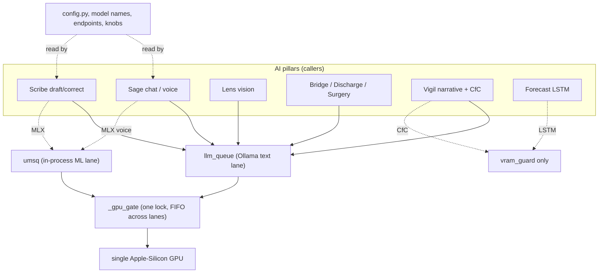
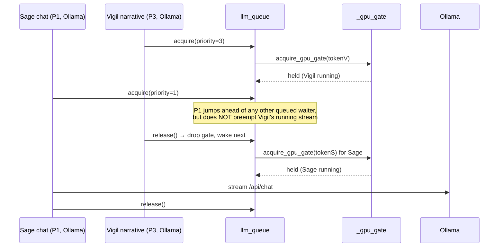

# AI Infrastructure: the GPU coordinator, LLM queue, model configs and adapters

Orb runs its AI on **one local machine with one GPU** (the target hardware is an Apple-Silicon Mac, an M-series chip whose CPU and GPU share the same "unified" memory). Many features want that GPU at once: Sage answering a clinician's voice question, Scribe drafting a note, Vigil scoring 30 patients for deterioration, Forecast predicting length-of-stay. If they all hit the GPU simultaneously, nothing runs well. This subsystem is the traffic cop. It has two cooperating serializers, an **LLM queue** (`llm_queue_service.py`, for text generation served by a local **Ollama** server) and a **Metal queue coordinator / UMSQ** (`gpu_coordinator.py`, for in-process machine-learning models loaded inside the Python process), joined by a single **cross-lane GPU admission gate** so at most one GPU job of any kind runs at a time, with real-time voice (Sage) always preempting background scoring. It also owns `config.py`, the single file that names every model, endpoint, and tuning knob the AI features read, and the **LoRA fine-tuning** adapters/scripts that specialize the small on-device model.

---

## Purpose and neighbors

**The core problem.** A GPU is a single physical device with a single Metal command queue (Metal is Apple's low-level GPU API, the macOS equivalent of CUDA). Two things fight over it:

- **VRAM contention**, "VRAM" is video RAM, the GPU's working memory. On Apple Silicon it is the *same* physical RAM the CPU uses ("unified memory"), but the allocators still behave as separate pools. When two models submit work at once, the Metal driver context-switches between them, and throughput of *both* collapses. Separately, each inference leaves cached buffers behind; without explicit flushing the cache grows monotonically until the machine swaps or OOMs.
- **Concurrency of independent code paths**, Orb's LLM text generation goes out over HTTP to a separate **Ollama** process (Ollama is a local server that loads a GGUF model and exposes an OpenAI-ish `/api/chat` endpoint). Its ML models (Vigil's CfC, Forecast's LSTM, the MLX voice/scribe models) run *inside* the FastAPI Python process via PyTorch-MPS or MLX. These two worlds don't know about each other, yet they share the one GPU.

**The solution, in one picture.** Every AI feature that touches the GPU must pass through a lane first. There are two lanes, and both lanes hand their token to one shared gate:

Note the dotted `vram_guard only` edge: Vigil's CfC scoring and Forecast's LSTM run under `vram_guard` (memory hygiene) but do **not** take a lane or the gate, see [Discrepancies](#discrepancies-and-open-questions).

**Jargon defined once, up front:**

| Term | Meaning in this guide |
|---|---|
| **GPU VRAM contention** | Two GPU jobs running at once, each slowing the other because they share one device/memory pool. |
| **Semaphore / lock / mutex** | A concurrency primitive that lets only N holders proceed at once (a lock/mutex is a semaphore with N=1). `asyncio.Lock` here is a mutex: one holder. |
| **Queue backpressure** | When the queue is busy, new requests *wait* (block) instead of piling onto the GPU. A bounded wait (timeout) turns "wait forever" into "fail fast." |
| **Priority queue** | A queue that pops the *highest-priority* item next, not the oldest. Here lower number = higher priority. |
| **Preemption** | Letting a higher-priority job jump ahead of lower-priority ones already waiting. Orb never preempts mid-inference (a running job is never killed). In UMSQ it preempts *at the queue*, Sage is dequeued first. In the LLM queue it does not queue interactive work at all: since 2026-07-31, P1 has a **reserved lane** of its own, which is why a clinician no longer waits out a 45 s background stream. |
| **LoRA adapter** | "Low-Rank Adaptation", a small set of extra weight matrices (rank 8 here) trained on top of a frozen base model. Instead of retraining a 4-billion-parameter model, you train ~a few million adapter params and load them alongside. Cheap to train, tiny to ship. |
| **Quantization** | Storing model weights in fewer bits (e.g. 4-bit instead of 16-bit) to shrink VRAM use. Configurable here per Scribe ASR stage via a `quant` field (default off). |
| **MPS / MLX** | Two ways to run ML on Apple GPUs. MPS = "Metal Performance Shaders," PyTorch's Apple GPU backend. MLX = Apple's own array framework. Orb uses both, so it must flush both caches. |
| **Ollama** | A local server process that hosts the big text model (MedGemma) and answers HTTP calls. Not part of Orb; Orb talks to it at `http://localhost:11434`. |

**Neighbors:** this subsystem is a *service layer*, it owns no REST routes and no database tables. Its callers are the AI pillars: see guide 09-sage, 10-sage-proactive-ambient, 11-scribe, 12-lens, 07-vigil, 13-forecast, 23-bridge-patient-portal, 21-admissions-discharge, 17-surgical-suite. Its queue depth is surfaced by the metrics subsystem (guide 30-harness-and-ci). Note that Helix (guide 14) and Orders/CPOE (guide 16) are **deterministic** DB/rules services and do **not** enter this subsystem at all.

---

## File map

| File | Lines | Role |
|---|---|---|
| `server/services/gpu_coordinator.py` | ~295 | `vram_guard` memory hygiene, the priority-aware **UMSQ** in-process ML lock, the shared cross-lane **GPU admission gate**, and the canonical priority constants. |
| `server/services/llm_queue_service.py` | 564 | The **PriorityLLMQueue**, two-lane (reserved-interactive + priority-ordered background) admission control in front of Ollama text generation; holds a refcount on the shared gate for the duration of each LLM stream. |
| `server/config.py` | ~505 | Every AI setting: Ollama URL/model, keep-alive, embeddings, Whisper, the Scribe 4-stage pipeline config, the Voice pipeline config, deployment profile, Lens/demo gates. Also non-AI settings owned elsewhere. |
| `server/adapters/adapter_config.json` | 41 | MLX-LoRA training config for a 50-iteration MTSamples experiment (adapters written to `adapters/`). |
| `server/adapters/medgemma-lora/adapter_config.json` | 41 | MLX-LoRA training config for the real 1000-iteration MedGemma-4B fine-tune (adapters → `adapters/medgemma-lora`). |
| `server/scripts/download_medgemma_4b.py` | 31 | One-off: pull the MedGemma-1.5-4B weights from Hugging Face into `models/`. |
| `server/scripts/prep_llm_dataset.py` | 62 | One-off: turn the MTSamples CSV into MLX-LoRA `train.jsonl`/`valid.jsonl`. |
| `server/tests/test_gpu_coordinator.py` | ~327 | Unit tests for `vram_guard` and UMSQ (serialization, priority ordering, exception safety). |
| `server/tests/test_gpu_gate.py` | ~135 | Unit tests proving LLM and in-process ML are mutually exclusive on the shared gate, plus per-acquisition ownership regressions. |
| `server/tests/test_tier1_small_closes.py` | ~122 | A grab-bag "small closes" test file; only `test_lens_gate_config_default_dev` touches this subsystem (asserts `config.LENS_ENABLED` is a bool). The rest belong to other guides. |

---

## How it works

### Flow A: an in-process ML session (UMSQ lane)

Used by Sage voice (MLX) and Scribe MLX. Example: `async with umsq.acquire("Sage Voice", priority=PRIORITY_SAGE): with vram_guard("Sage MLX"): model(...)`.

1. **Enqueue.** `acquire()` returns an async context manager. Entering it (`__aenter__`) takes UMSQ's internal `guard_lock`, bumps a monotonic counter, and pushes `(priority, seq, event, task_name)` onto an `asyncio.PriorityQueue` (`gpu_coordinator.py:204`).
2. **Wake or wait.** If the GPU is idle, it wakes the highest-priority waiter immediately; otherwise this task blocks on its own `asyncio.Event` (`gpu_coordinator.py:206-212`).
3. **Granted by the lane.** When woken, the task is now the UMSQ "active" holder, but it does not yet own the physical GPU.
4. **Grab the shared gate.** It then `await acquire_gpu_gate(self)`, a process-wide `asyncio.Lock`, passing *itself* as the ownership token (`gpu_coordinator.py:221`). This guarantees no Ollama stream is running on the GPU at the same time.
5. **Run + clean.** Inside, `vram_guard` runs the inference and, on exit, unconditionally does `gc.collect()` → PyTorch MPS `empty_cache()` → MLX `clear_cache()`/`clean_eval()`.
6. **Release.** `__aexit__` releases the gate (only if this context owns it), clears the active slot, and wakes the next-highest-priority waiter (`gpu_coordinator.py:241-257`).

### Flow B: an LLM text stream (Ollama lane)

Used by Sage chat, Scribe draft/correction, Lens, Bridge, Discharge, Surgery, Vigil narratives, nervous-system triggers. Pattern: `await llm_queue.acquire(priority=N)` … stream from Ollama … `finally: llm_queue.release()`.

1. **Pick a lane.** `acquire()` splits on priority (`llm_queue_service.py:262`): P1 (Sage) takes the **reserved interactive lane** and never queues behind background work; P2 and lower take the **background lane**.
2. **Wait for a slot**, bounded by `timeout` (default 120 s), this is the backpressure: if the lane never clears in time, `acquire()` raises `TimeoutError` instead of hanging forever. Interactive waits on a `BoundedSemaphore` (`llm_queue_service.py:274`); background enqueues under a lock, calls `_maybe_wake()`, then waits on an `asyncio.Event` (`llm_queue_service.py:308-322`, wake at `:316`).
3. **Take a reference on the shared gate**, same deadline (`llm_queue_service.py:276` / `:324`, both via `_gate_ref_acquire` at `:357`). The gate is refcounted across the two lanes, not owned by a single token.
4. **Install a lane ticket** in the `_lane_ticket` ContextVar so `release()` can find this acquisition later (`llm_queue_service.py:405`).
5. **Caller streams** tokens from Ollama's `/api/chat`. Long background streams may poll `llm_queue.preempt_requested` (`:227`) and bail early.
6. **Release** synchronously in the caller's `finally` (`llm_queue_service.py:458`): recover the ticket, drop the gate ref, then free the interactive semaphore slot or decrement `_bg_active` and `_maybe_wake()` the next background request (`:503`).

### The shared gate makes the two lanes mutually exclusive

Each lane keeps its own priority ordering **within** the lane. The gate is a single FIFO `asyncio.Lock` **across** lanes. So a P3 Vigil-narrative Ollama call cannot run on the GPU while an MLX voice session holds the gate, and vice versa. Ownership is *explicit* (a token object) because `asyncio.Lock` has no owner concept, this stops a timed-out waiter from releasing the active holder's lock.

**Key nuance:** nothing is preempted mid-flight, a running Ollama stream is never killed. Since the 2026-07-31 two-lane rework, Sage (P1) no longer waits behind a streaming background job either: it takes the reserved interactive lane. So under load you can briefly have two Ollama streams, one per lane, though both still serialize on the shared GPU gate, so only one is actually generating at a time. `max_concurrent = 1` now bounds the *background* lane only.

---

## Function-by-function

### gpu_coordinator.py

#### vram_guard: `server/services/gpu_coordinator.py:38`
**Signature:** `vram_guard(label: str = "") -> contextmanager` (sync `with`-block) → yields, then cleans.
**Does:** wraps a GPU inference block so that, no matter how it exits, the GPU caches are flushed.
**How it works:**
1. Records a monotonic start time, then `yield`s to the body (`:51-53`).
2. In `finally` (runs on success *and* exception): `gc.collect()` to drop Python references to GPU tensors (`:58`).
3. Best-effort `torch.mps.empty_cache()` if PyTorch-MPS is present, swallowing `ImportError`/`RuntimeError` (`:61-66`).
4. Best-effort `mx.metal.clear_cache()` and `mx.clean_eval()` if MLX is present, swallowing import/attr/runtime errors (`:69-76`).
5. If a `label` was given, logs elapsed ms at debug level (`:78-79`).
**Why it exists:** without step 2/4 the MPS allocator fragments and the MLX buffer pool bloats (~50-100 MB/inference per the module docstring), eventually starving the machine. It is deliberately a *sync* context manager (not async) because it wraps the tight CPU/GPU-bound call itself, not the await.
**Data in/out:** in, a label string; out, nothing (it is a side-effecting cleanup).
**Talks to:** called by `vigil_service.py:200` (CfC), `forecast_service.py:554` (LSTM), `voice_agent_service.py:405/439` (Sage voice MLX), `scribe_providers.py:223/301` (Scribe MLX). Calls PyTorch and MLX only if installed.
**Change guide:** To add a third framework's cache flush (say a future JAX-Metal), add another guarded `try/except` block after `:76`; knock-on effects: none, because each block is independent and failure-tolerant. Watch out: never raise from cleanup, a raised cleanup would mask the body's real exception.
**Gotchas:** the framework imports are *inside* the `finally` so a missing framework is a silent no-op; that is intentional (test `test_no_crash_without_torch_or_mlx` sets the modules to `None`). It does **not** acquire any lock, so calling `vram_guard` alone (as Vigil/Forecast do) provides hygiene but *not* GPU exclusivity.

#### PRIORITY_SAGE / PRIORITY_SCRIBE / PRIORITY_BACKGROUND: `server/services/gpu_coordinator.py:91-93`
**Signature:** module constants `= 1, 2, 3`.
**Does:** the canonical priority scale shared by *both* serializers (lower = higher priority).
**How it works:** `llm_queue_service.py` imports these (`:6-8`) instead of redefining `1/2/3`, so "interactive" means the same thing in both lanes.
**Why it exists:** one source of truth prevents the two queues from disagreeing about what preempts what.
**Talks to:** imported by `llm_queue_service.py`, `voice_agent_service.py`, `scribe_providers.py`, and the tests.
**Gotchas:** callers into `llm_queue.acquire()` mostly pass **raw integers** (`priority=1/2/3`, and even `priority=5` in the warmup) rather than these named constants, see [Discrepancies](#discrepancies-and-open-questions). The values still sort correctly because it is a numeric priority queue.

#### gpu_gate: `server/services/gpu_coordinator.py:112`
**Signature:** `gpu_gate() -> asyncio.Lock`
**Does:** returns the process-wide GPU admission lock, lazily creating it.
**How it works:** if the module global `_gpu_gate` is `None`, create an `asyncio.Lock()` and cache it (`:113-117`).
**Why it exists:** lazy init so the lock binds to whatever event loop first uses it (creating an `asyncio.Lock` at import time can bind it to the wrong loop).
**Data in/out:** out, the singleton `asyncio.Lock`.
**Talks to:** `acquire_gpu_gate`/`release_gpu_gate`; tests read `gpu_gate().locked()` to assert exclusivity.
**Gotchas:** loop-bound. Tests reset `_gpu_gate = None` between `asyncio.run` calls (`test_gpu_gate.py:_reset_singletons`) so it re-binds to the fresh loop; production has one long-lived loop so this is fine.

#### acquire_gpu_gate: `server/services/gpu_coordinator.py:120`
**Signature:** `async acquire_gpu_gate(owner: object, timeout: float | None = None) -> bool`
**Does:** takes the shared gate on behalf of `owner`, optionally bounded by a timeout.
**How it works:**
1. Get the lock (`:129`).
2. If `timeout is None`, `await gate.acquire()`; else wrap in `asyncio.wait_for(..., timeout)` (`:130-133`).
3. On success set the module global `_gpu_gate_owner = owner` and return `True` (`:134-135`).
**Why it exists:** `asyncio.Lock` has no notion of *who* holds it. Recording an explicit owner token is what lets `release_gpu_gate` refuse to release someone else's hold.
**Data in/out:** in, an opaque token object + optional timeout; out, `True` or raises `asyncio.TimeoutError`. On timeout the gate is **not** held and ownership is unchanged (`:126-127`).
**Talks to:** called from UMSQ `__aenter__` (`:221`, token = the context instance) and from `llm_queue.acquire` (`:70`, token = a fresh `object()`).
**Change guide:** To make the gate re-entrant per owner (so the same owner could acquire twice), you would have to replace `asyncio.Lock` with a counting structure keyed on `owner`; today a double-acquire by one owner would deadlock. Watch out: the timeout here is the same as the caller's lane timeout, so a slow gate and a slow lane share one budget.
**Gotchas:** the owner token must be *unique per acquisition*. UMSQ uses the context object; the LLM queue uses a fresh `object()`. Reusing a shared token across acquisitions would let a stale waiter release a live holder.

#### release_gpu_gate: `server/services/gpu_coordinator.py:138`
**Signature:** `release_gpu_gate(owner: object) -> None`
**Does:** releases the shared gate **only if** `owner` currently holds it.
**How it works:** if `_gpu_gate_owner is owner` **and** the lock is `locked()`, clear the owner and `gate.release()`; wrap in `try/except RuntimeError` so a spurious release during loop teardown never raises (`:141-148`).
**Why it exists:** prevents a timed-out or cancelled waiter from stealing/releasing the active holder's gate, the central correctness property tested by `test_queued_llm_timeout_does_not_release_active_holder`.
**Data in/out:** in, the same token used to acquire; out, nothing.
**Talks to:** UMSQ `__aenter__`/`__aexit__` and `llm_queue.acquire`/`release`.
**Gotchas:** identity comparison (`is`), not equality, you must pass back the exact same object. Never raises, by design.

#### MetalQueueCoordinator: `server/services/gpu_coordinator.py:151`
**Signature:** class; singleton exported as `umsq`.
**Does:** priority-aware serialization for in-process (MPS/MLX) GPU sessions.
**How it works:** holds a lazily-created `asyncio.PriorityQueue` of waiters, a `guard_lock` mutex protecting its bookkeeping, a monotonic `_counter`, and `_active`/`_active_task` state. `acquire()` hands out an `_AcquireContext`.
**Why it exists:** so a clinician's Sage voice query preempts background Vigil scoring even with 30 patients queued.
**Talks to:** `voice_agent_service.py`, `scribe_providers.py`; internally uses `acquire_gpu_gate`/`release_gpu_gate`.

##### MetalQueueCoordinator.__init__: `:165`
Initializes all fields to `None`/`0`/`False`. The queue and guard-lock are created lazily via properties to avoid binding to the wrong event loop.

##### MetalQueueCoordinator.queue (property): `:173`
Lazy-inits and returns the `asyncio.PriorityQueue`. Same loop-binding rationale as `gpu_gate`.

##### MetalQueueCoordinator.guard_lock (property): `:180`
Lazy-inits and returns the `asyncio.Lock` that guards `_counter`, `_active`, `_active_task`, and queue mutations.

##### MetalQueueCoordinator._AcquireContext.__aenter__: `:198`
**How it works:**
1. Create the wake `Event` (`:199`).
2. Under `guard_lock`: bump `_counter`, push `(priority, seq, event, task_name)` onto the queue. If `_active`, log "queued"; else `_wake_next()` to grant immediately (`:201-212`).
3. Outside the lock: `await event.wait()` until granted; set `_acquired = True`; then `await acquire_gpu_gate(self)` and mark `_gate_held = True`; record start time; return `self` (`:214-224`).
4. On `TimeoutError`/`CancelledError` during the waits: release the gate if held, mark the event cancelled, clear the active slot **only if this context actually became the holder** (`_acquired`), then `_wake_next()` and re-raise (`:225-239`).
**Why the `_acquired` guard matters:** `task_name` is not unique, so a queued same-named waiter that is cancelled must not reset the *running* holder's state, the regression `test_umsq_queued_timeout_does_not_reset_active_holder` locks this in.

##### MetalQueueCoordinator._AcquireContext.__aexit__: `:241`
If never `_acquired`, return `False` immediately (`:242-243`). Otherwise log elapsed ms, release the gate if held, and under `guard_lock` clear `_active`/`_active_task` and `_wake_next()`. Returns `False` so exceptions are not suppressed (`:245-257`).

##### MetalQueueCoordinator._wake_next: `:259`
**Does:** wake the highest-priority non-cancelled waiter. **Must** be called under `guard_lock`.
**How:** while the queue is non-empty and not `_active`, pop the lowest-number item; skip if its event is flagged `_is_cancelled`; else set `_active`, record `_active_task`, log the grant, and `event.set()` (`:261-268`).
**Gotcha:** this is where priority ordering actually happens, the `PriorityQueue` pops `(priority, seq, ...)` tuples, so lower priority number and, as a tiebreaker, lower sequence (FIFO within a priority) wins.

##### MetalQueueCoordinator.acquire: `:270`
**Signature:** `acquire(task_name="unknown", priority=PRIORITY_BACKGROUND) -> _AcquireContext`
Returns the async context manager. Default priority is BACKGROUND (3), so a caller that forgets to prioritize is treated as lowest-priority, a safe default.

##### MetalQueueCoordinator.is_busy / active_task: `:284` / `:289`
Read-only properties returning `_active` and `_active_task` for introspection/logging.

##### umsq singleton: `:295`
`umsq = MetalQueueCoordinator()`, the one process-wide instance every caller imports.

**Worked example (UMSQ):** To make Scribe MLX outrank a hypothetical new "batch export" MLX job, keep Scribe at `PRIORITY_SCRIBE` (2) and give the export `PRIORITY_BACKGROUND` (3) at its `umsq.acquire("Batch Export", priority=PRIORITY_BACKGROUND)` call site (in the export service, *not* here). Knock-on: nothing changes in `gpu_coordinator.py`; the priority queue does the rest. Footgun: if you instead lower Scribe's number to 1 you'd make it tie with Sage voice and Sage would only win by FIFO sequence, not what you want.

### llm_queue_service.py

#### PriorityLLMQueue: `server/services/llm_queue_service.py:65`
**Signature:** class; singleton exported as `llm_queue` (`:564`).
**Does:** **reserved-lane** admission control in front of Ollama text generation. Not one slot any more, **two independent lanes**: an *interactive* lane sized `MAX_INTERACTIVE` (`:36`, currently 1) that `priority <= PRIORITY_SAGE` takes, and a *background* lane sized `max_concurrent = 1` (`:118`) that everything else queues for in priority order.

> **This class was re-architected on 2026-07-31 and this section was rewritten to match.**
> The old design, one slot, priority-ordered but **non-preemptive**, is described in the
> class docstring (`:66-109`) as the thing that was fixed. Priority decided who went *next*;
> it did not evict the current holder, so a clinician's Sage turn arriving while a background
> job held the slot waited for that job to *finish*. Background holders are long (the ward
> narrator streams up to 45 s, timeline projection up to 120 s), and the measured result on
> the appliance was a clinician's question sitting **31 s** in this queue against a model that
> decodes the answer in ~2 s. Reserved lanes remove the wait without needing preemption.

**Why two lanes and not preemption:** you cannot safely evict a stream that is already writing tokens to a client. Giving interactive traffic its own permanently-reserved slot achieves the same clinician-facing latency without ever killing in-flight background work. Both lanes still take the shared cross-lane GPU gate while running, so in-process ML (UMSQ) still cannot run concurrently with an Ollama stream, the lanes buy *admission* concurrency, not GPU concurrency.

**The race this implementation closes:** an earlier reserved-lane attempt was reverted the same day because the ref-counted GPU gate had a check-then-await race (two tasks both saw `refs == 0`, both tried to take the exclusive lock). The fix is structural, documented at `:82-93`: every mutation of `_gate_refs` is synchronous (atomic on a single-threaded loop), and the one place that awaits, `_gate_ref_acquire` on a 0 → 1 transition, holds `self.lock` across *both* the decision and the await, publishing the ref only after the gate is actually held. A second acquirer therefore blocks on `self.lock` and wakes to a settled refcount.

##### PriorityLLMQueue.__init__: `:111`
Sets `_lock`/`_queue`/`_interactive_sem`/`_loop` to `None` (lazy, loop-binding safety), `counter = 0`, `max_concurrent = 1` (background lane), `max_interactive = MAX_INTERACTIVE`, the three counters `_bg_active` / `_interactive_active` / `_interactive_waiting`, `_gate_refs = 0`, `_gate_token = None`, and `_holders = []` (live lane tickets, oldest first).

##### PriorityLLMQueue.lock / queue / interactive_sem (properties): `:164` / `:170` / `:177`
Lazy-init the `asyncio.Lock`, `asyncio.PriorityQueue` and `asyncio.BoundedSemaphore` on first use (loop-binding safety, same as UMSQ). `_bind_loop()` (`:137`) records the owning loop.

##### PriorityLLMQueue.preempt_requested (property): `:227`
`(_interactive_active + _interactive_waiting) > 0`, True while a clinician's turn is waiting *or* streaming. Long background streams are expected to poll this and bail early (every background caller has a deterministic fallback). **Nothing is wired to it in this file on purpose**, callers own that decision.

##### PriorityLLMQueue.acquire: `:243`
**Signature:** `async acquire(priority: int = PRIORITY_SCRIBE, timeout: float = 120.0)`
**How it works:** `_bind_loop()`, then a two-way split (`:262`): `priority <= PRIORITY_SAGE` → `_acquire_interactive`, everything else → `_acquire_background`.
**Data in/out:** in, priority int, timeout; out, `True` on success (the caller then streams from Ollama), or raises `asyncio.TimeoutError`. On **any** failure path neither a lane slot nor a gate reference is leaked.
**Talks to:** called by `sage_service.py:1349` (P1), `scribe_service.py:413/445` (P2) and `:571` (P3), `lens_service.py:84` (P2), `bridge_service.py:211` (P2), `discharge_service.py:694` (P2), `surgery_service.py:208` (P2), `vigil_service.py:731` (P2) and `:1672` (P3), `timeline_service.py:233` (P3), `sage_narrator_service.py:311` (P3), `nervous_system_triggers.py:263/522` (P3), `batch_coordinator.py:100/146` (caller-supplied), `main.py:378/411` (P5 warmup).

##### PriorityLLMQueue._acquire_interactive: `:266`
Bumps `_interactive_waiting` **synchronously before the first await** (`:269`) so `preempt_requested` is live the instant a clinician's turn exists, not after it is granted. Then: `wait_for(sem.acquire())` → `_gate_ref_acquire(deadline)` → `_install_ticket(LANE_INTERACTIVE)` → `_interactive_active += 1` → `granted = True`, with **no await** between the ticket install and `granted` so no observer can see the acquisition counted twice. The `finally` decrements `_interactive_waiting` on every path and, when not granted, unwinds gate then slot **fully synchronously**, a second cancellation cannot interrupt it, so nothing leaks.

##### PriorityLLMQueue._acquire_background: `:306`
The old queue path, intact: under `lock` bump `counter`, `queue.put((priority, counter, event))`, `_maybe_wake()`; then wait on the event bounded by the deadline, take a gate ref, install a `LANE_BACKGROUND` ticket. On timeout/cancel the `finally` sets `event._is_cancelled = True` so `_maybe_wake()` skips the dead item, hands back the slot if one had already been granted, and calls `_maybe_wake()`.

##### PriorityLLMQueue.release: `:458`
**Signature:** `release() -> None` (synchronous, takes no arguments)
**How it works:** it no longer keys off singleton state. It reads the per-task lane ticket from the `_lane_ticket` **ContextVar** (`:60`) that `acquire()` installed; if the ticket belongs to this queue instance it clears and `_retire()`s it. If the context has no ticket (a `finally` running in a different task context), `_infer_holder()` (`:429`) attributes the release to a live holder by fallback and logs a warning; if nothing is attributable it logs and returns rather than corrupting a counter.
**`_retire`, `:503`:** idempotent (`ticket.released` guard), removes the ticket from `_holders`, drops the gate ref, then either frees the interactive semaphore slot or decrements `_bg_active` and `_maybe_wake()`s the background queue.
**Why it is synchronous:** the comment at `:465-471` is load-bearing. It *used* to schedule `asyncio.create_task(self._safe_release())` and return; but callers invoke `release()` from `finally` blocks inside streaming async generators, and during client disconnect / loop teardown that fire-and-forget task could be cancelled or never scheduled ("no running event loop"). A single dropped release wedged the queue until process restart. Everything it does now is plain attribute mutation plus `Event.set()` / `Semaphore.release()`, all safe to run inline on the owning loop.
**Gotchas:** must be called exactly once per successful `acquire()`, in a `finally`. Double-release is absorbed by the ticket's `released` flag and by `_free_interactive_slot`'s `ValueError` guard (`:529`, a `BoundedSemaphore` raises rather than over-releasing, and that is logged loudly, never re-raised out of a `finally`). *Skipping* release is still the fatal case.

##### PriorityLLMQueue._maybe_wake: `:545`
**Does:** grant the background slot to the highest-priority background waiter.
**How:** while `_bg_active < max_concurrent` and the queue is non-empty, pop the lowest item, skip if `_is_cancelled`, else increment `_bg_active` and `event.set()`. Must run on the queue's owning loop.
**Why interactive traffic does not gate this** (`:548-552`): the lanes are independent by design. A background job that is already streaming cannot be evicted, so making *new* background work wait on interactive would only add timeouts without giving the clinician the GPU any sooner.

##### llm_queue singleton: `:564`
`llm_queue = PriorityLLMQueue()`, one per FastAPI worker.

**Worked example (LLM queue):** To let Scribe tolerate a longer wait under heavy Vigil load, raise the `timeout` at Scribe's call site, `await llm_queue.acquire(priority=2, timeout=240.0)` in `scribe_service.py`, not here; the queue reads whatever timeout the caller passes. Knock-on: Scribe requests will queue up to 4 minutes before failing. Note that Scribe is P2, so it rides the **background** lane; only P1 (Sage) gets the reserved interactive slot. Footgun: raising `max_concurrent` above 1 *here* would let two background Ollama streams run at once and defeat the point, don't, unless you also give Ollama multiple loaded model slots. Raising `MAX_INTERACTIVE` (`:36`) above 1 has the same hazard on the interactive side.

### config.py

`config.py` is the single settings module every service imports from. Below are the **AI-relevant** settings (the file also holds auth/DB/ingestion settings owned by other guides, 03-auth-rbac, 04-database-schema, 24-ingestion-interop, which are summarized but not the focus here).

#### LLM / Ollama settings

| Symbol | Line | Value / default | Meaning |
|---|---|---|---|
| `OLLAMA_BASE_URL` | `:82` | env `ORB_OLLAMA_BASE_URL`, default `http://localhost:11434` (trailing slash stripped) | Where every service POSTs `/api/chat`. |
| `LLM_MODEL` | `:132` | env `ORB_LLM_MODEL`, default `medgemma:27b` | The one text/vision model tag. Loaded once in Ollama (~17 GB VRAM per the comment). |
| `VISION_MODEL` | `:243` | env `ORB_VISION_MODEL`, default = `LLM_MODEL` | Lens's vision model. Deliberately the *same* instance to avoid a second model in VRAM. `test_lens.py:118` asserts they match. |
| `OLLAMA_KEEP_ALIVE` | `:244-248` | env `ORB_OLLAMA_KEEP_ALIVE`, default `"1h"` | How long Ollama keeps the model resident when idle. Parsed as int seconds if numeric, else passed through as a duration string (e.g. `"1h"`). |

Every LLM caller reads `OLLAMA_BASE_URL`, `LLM_MODEL`, `OLLAMA_KEEP_ALIVE` directly (e.g. `sage_service.py:12`, `discharge_service.py:9`, `main.py:181`). There is **no** central Ollama client module; each service builds its own `httpx` POST.

#### Embeddings / Whisper

| Symbol | Line | Value | Meaning |
|---|---|---|---|
| `EMBEDDING_MODEL` | `:263` | `BAAI/bge-m3` | Sentence-embedding model for RAG/retrieval (owned by Helix/knowledge guides). RAG = "retrieval-augmented generation": fetch relevant text, feed it into the prompt. |
| `EMBEDDING_DIM` | `:264` | `1024` | BGE-M3 output vector dimension. |
| `WHISPER_MODEL` | `:267` | `large-v3` | Legacy top-level default for Scribe ASR (see 11-scribe). ASR = "automatic speech recognition." |
| `WHISPER_BATCH_SIZE` | `:268` | `12` | Legacy top-level ASR batch size. |

#### Deployment profile & gates

| Symbol | Line | Default | Meaning |
|---|---|---|---|
| `DEPLOYMENT_PROFILE` | `:11` | env `ORB_DEPLOYMENT_PROFILE`, default `prod` | `dev` vs `prod`. Drives many fail-closed/demo defaults across the file. |
| `is_dev` | `:275` | `DEPLOYMENT_PROFILE == "dev"` | Convenience bool. |
| `DEMO_MODE` | `:281` | ON in dev, OFF in prod | Permits synthetic clinical content (mock notes, simulation bots). Fail-closed so fabricated data can never enter a real deployment. |
| `LENS_ENABLED` | `:288` | ON in dev, OFF in prod | Gates the Lens vision feature. Lens ships **no validated imaging model**, it is a general vision LLM writing reference prose, so it is demo-only unless an operator sets `ORB_LENS_ENABLED`. Asserted a bool by `test_tier1_small_closes.py:92`. When it is off the Lens screen says so before any upload and the analyse control is disabled. |
| `SCORING_ENABLED` | beside `LENS_ENABLED` | ON | `ORB_SCORING_ENABLED=false` is the Orb Ward Record's scoring-off mode: observation sets are stored with no NEWS2, no `risk_scores` row, no escalation, no Relay alert and no sepsis bundle. |
| `SEPSIS_AUTOSTART` | beside `LENS_ENABLED` | ON | `ORB_SEPSIS_AUTOSTART=false` stops a high NEWS2 opening a sepsis bundle by itself; starting one by hand still works. |
| `MODELS_ENABLED` | beside `LENS_ENABLED` | ON | `ORB_MODELS_ENABLED=false` runs no local model: the gateway and the provider seams refuse, no warm-up at boot, and the model routes answer 404 "Switched off on this computer". |
| `WARD_RECORD` | beside `LENS_ENABLED` | OFF | `ORB_WARD_RECORD=true` is the Orb Ward Record profile: forces `SCORING_ENABLED`, `SEPSIS_AUTOSTART`, `LENS_ENABLED` and `MODELS_ENABLED` off and logs one boot line naming them. |

#### Correction/draft/verify model defaults (`:104-109`)

These pick a **small local MLX model in dev** and fall back to the **big Ollama model in prod**:

| Symbol | Line | dev value | prod value |
|---|---|---|---|
| `DEFAULT_CORRECTION_MODEL` | `:290` | `medgemma-1.5-4b-it` | `LLM_MODEL` |
| `DEFAULT_CORRECTION_PROVIDER` | `:291` | `mlx` | `ollama` |
| `DEFAULT_DRAFT_MODEL` | `:292` | `LLM_MODEL` (always, "drafting prioritizes quality") | `LLM_MODEL` |
| `DEFAULT_VERIFY_MODEL` | `:293` | `medgemma-1.5-4b-it` | `LLM_MODEL` |
| `DEFAULT_VERIFY_PROVIDER` | `:294` | `mlx` | `ollama` |
| `DEFAULT_VERIFY_ENABLED` | `:295` | `"false"` | `"false"` |

#### SCRIBE: the four-stage pipeline config: `:113`

A nested dict, each stage independently env-overridable (fully documented in guide 11-scribe; here is the shape):

- **`asr`** (`:114`): `model`/`provider` (`whisper-mlx`), `batch_size`, `quant` (**quantization** bit-width, default `None`/off), `language` (default `en`; supports Hindi + auto/code-switching for the India market), and a `supported` picker list surfaced in the UI.
- **`correction`** (`:130`): `enabled`, `model`, `provider`, `temperature` 0.1, `max_tokens` 2048, `ctx_size` 8192.
- **`draft`** (`:138`): `model`, `provider` `ollama`, `temperature` 0.3, `max_tokens` 4096, `ctx_size` 8192.
- **`verify`** (`:145`): `enabled` (default off), `model`, `provider`, `temperature` 0.1, `max_tokens` 1024, `ctx_size` 8192.

#### VOICE: the voice-intelligence pipeline config: `:199`

Also fully owned by the Voice/Sage guides; shape:

- **`daemon`** (`:200`): a persistent Whisper streaming process on a ZeroMQ IPC socket (`ipc:///tmp/orb-whisper.sock`), model, `timeout_ms` 5000, `enabled`.
- **`vad`** (`:206`): **Voice Activity Detection**, the Silero VAD ONNX model that decides when the clinician is actually speaking. `threshold` 0.5, `min_speech_ms` 250, `min_silence_ms` 300.
- **`corrector`** (`:212`): an RxNorm drug-name spell-corrector (SQLite + CSV, `max_edit_distance` 2) that fixes mis-transcribed medication names.
- **`conversational`** (`:218`): the on-device MedGemma-4B voice agent, `model_path` under `models/medgemma-1.5-4b-it` (comment: switch to `-fused` after fine-tuning), a Whisper-LoRA `whisper_adapter_path`, `max_tokens` 256, `temperature` 0.3, `enabled`.

#### Sage Ambient & misc AI

| Symbol | Line | Meaning |
|---|---|---|
| `SAGE_AMBIENT_ENABLED` … `SAGE_AMBIENT_SAMPLE_RATE` | `:190-196` | Tuning for the always-listening ambient Sage (debounce 3 s, context window 15, summary/intent caps, timeout 30 s, sample rate 1.0). See 10-sage-proactive-ambient. |
| `SAGE_RERANKING_ENABLED` | `:504` | `False`, reranking of retrieved passages is off. |

**Non-AI settings in this file** (owned elsewhere, listed so the map is complete): `DB_PATH`/`UPLOAD_DIR` (`:10/:15`), `HOST`/`PORT`/`CORS_ORIGINS` (`:23-34`), `JWT_SECRET`/`JWT_ALGORITHM`/`JWT_EXPIRY_HOURS` (`:37-45`), `MFA_*` (`:48-52`), `DB_ENCRYPTION_KEY`/`UPLOAD_ENCRYPTION_KEY` (`:58-61`), `VITALS_INTERVAL_SECONDS` (`:156`), `INGESTION_MODE`/`INGESTION_API_KEY` (`:162-178`), `AUDIT_SIMULATION_EVENTS` (`:181`), `DISCHARGE_ACCESS_*`/`PUBLIC_APP_BASE_URL` (`:184-187`).

**Config change guide / worked example:** To run the whole stack on the small 4-bit MedGemma-4B via Ollama instead of the 27B (e.g. on a laptop), set `ORB_LLM_MODEL=alibayram/medgemma:4b` (exactly the tag the warmup error message suggests, `main.py:204`). Knock-on: Sage, Lens, Bridge, Discharge, Surgery, Vigil narratives all switch model with no code change, because they all read `LLM_MODEL`; `VISION_MODEL` follows automatically since it defaults to `LLM_MODEL`. Footgun: the model tag must actually be *pulled* in Ollama first (`ollama pull ...`), or every LLM call 404s and Sage/Lens silently return empty, the startup warmup logs a loud error for exactly this reason (`main.py:201-206`).

### Adapters (LoRA fine-tune configs)

Both files are MLX-LoRA training configs (consumed by the MLX `mlx_lm.lora` trainer, not by the running server). They are near-identical; the meaningful fields:

| Field | `adapters/adapter_config.json` | `adapters/medgemma-lora/adapter_config.json` | Meaning |
|---|---|---|---|
| `fine_tune_type` | `lora` | `lora` | Train LoRA adapters, not full weights. |
| `model` | `../models/medgemma-1.5-4b-it` | same | Frozen base model being adapted. |
| `data` | `../datasets/mtsamples/processed` | `../training_data/llm` | Training data dir (the latter is what `prep_llm_dataset.py` writes). |
| `adapter_path` | `adapters` | `../adapters/medgemma-lora` | Where trained adapters are written. |
| `iters` | `50` (quick experiment) | `1000` (real run) | Training iterations. |
| `max_seq_length` | `256` | `1024` | Token window during training. |
| `lora_parameters` | rank 8, dropout 0.0, scale 20.0 | same | The LoRA hyperparameters, rank-8 low-rank matrices. |
| `num_layers` | 8 | 8 | How many top layers get adapters. |
| `learning_rate` | 1e-05 | 1e-05 | Optimizer LR (`adam`). |
| `batch_size` / `grad_checkpoint` | 1 / true | 1 / true | Batch 1 with gradient checkpointing (memory-frugal on a laptop GPU). |
| `val_batches` | 25 | 1 | Validation batches per eval. |

**Why two files:** the root `adapter_config.json` is a small 50-iteration smoke experiment on preprocessed MTSamples; `medgemma-lora/adapter_config.json` is the actual 1000-iteration fine-tune on the JSONL dataset. The output adapters are what `config.VOICE["conversational"]` refers to (the `-fused` model after `fuse_medgemma.sh`).

### Scripts (overview depth)

#### download_medgemma_4b.py: `server/scripts/download_medgemma_4b.py`
**Does:** one-off download of `google/medgemma-1.5-4b-it` into `models/medgemma-1.5-4b-it` via `huggingface_hub.snapshot_download` (`:22`).
**How:** reads `HF_TOKEN` from the env (exits if absent, `:16-18`), `login()`s, then downloads with `local_dir_use_symlinks=False` inside a broad `try/except` that prints the exception type/details.
**Why it lives in `scripts/`:** the file was moved out of the package root so pytest's `test_*.py` discovery does not execute a multi-GB network download during a test run (`:2-6`).
**Gotchas:** the token must never be hard-coded, the docstring notes a previously committed literal token was removed and should be revoked (`:7-9`). Run manually: `python scripts/download_medgemma_4b.py`.

#### prep_llm_dataset.py: `server/scripts/prep_llm_dataset.py`
**Does:** converts the MTSamples clinical-transcription CSV into MLX-LoRA `train.jsonl`/`valid.jsonl` (90/10 split).
- **`format_conversation(transcription, specialty, description)`, `:6`:** builds one training row. It wraps a fixed Sage system prompt, the transcription as the user turn, and a **synthetic** target JSON (the Sage output schema, `action_intent`, `concise_answer`, `patient_facts_summary`, `clinical_assessment`, `escalation`, etc.) into MedGemma's `<system>…</system> <user>…</user> <model>…</model>` special-token format, returning `{"text": ...}` (`:14-29`).
- **`main()`, `:31`:** reads `datasets/mtsamples/mtsamples.csv`, drops rows missing transcription/description/specialty, formats every row, shuffles, splits 90/10, and writes the two JSONL files to `training_data/llm/` (`:31-59`).
**Why it exists:** MLX-LoRA expects JSONL with a `text` field; this bootstraps a dataset from MTSamples.
**Gotcha (honest):** the target JSON is *synthetic*, `concise_answer`/`clinical_assessment` are just the CSV `description`, and the code comment concedes a real pipeline would bootstrap targets with a teacher model like GPT-4 or MedGemma-27B (`:12-13`). So fine-tuning on this teaches *format*, not clinical reasoning.

### Tests

#### test_gpu_coordinator.py
Validates the coordinator in isolation with `asyncio.run` per test:

| Test | Line | Asserts |
|---|---|---|
| `test_basic_execution` | `:39` | `vram_guard` runs the body and exits cleanly. |
| `test_gc_collect_called` | `:46` | `gc.collect()` runs on exit (monkeypatched). |
| `test_mps_cache_flush_called` | `:57` | mocks `torch.mps.empty_cache()` and asserts it is called. |
| `test_mlx_cache_flush_called` | `:88` | mocks `mx.metal.clear_cache()` and asserts it is called. |
| `test_exception_propagation` | `:120` | `vram_guard` re-raises the body's exception. |
| `test_cleanup_runs_on_exception` | `:126` | cleanup still runs when the body raises. |
| `test_no_crash_without_torch_or_mlx` | `:138` | sets torch/mlx modules to `None`; guard is a clean no-op. |
| `test_basic_acquire_release` | `:179` | UMSQ acquire sets `is_busy`/`active_task`, release clears them. |
| `test_serialization` | `:191` | two concurrent tasks never overlap. |
| `test_priority_ordering` | `:220` | with a blocker held, queued P1/P2/P3 run in exactly sage→scribe→vigil order. |
| `test_exception_releases_lock` | `:254` | an exception inside the context releases the lock, no deadlock. |
| `test_properties` | `:272` | `is_busy`/`active_task` reflect state. |
| `TestPriorityConstants` | `:294` | `PRIORITY_SAGE < SCRIBE < BACKGROUND` and values are 1/2/3. |
| `TestSingleton` | `:314` | `umsq` is a `MetalQueueCoordinator` and is acquirable. |

#### test_gpu_gate.py
Proves cross-lane exclusivity. `_reset_singletons()` (`:15`) nulls the loop-bound globals so each `asyncio.run` re-binds.

| Test | Line | Asserts |
|---|---|---|
| `test_umsq_holds_gate_during_session` | `:26` | the gate is `locked()` inside a UMSQ session, unlocked after. |
| `test_llm_cannot_run_while_ml_holds_gate` | `:36` | while UMSQ holds the gate, an LLM `acquire(timeout=0.2)` times out; after release it succeeds. |
| `test_ml_cannot_run_while_llm_holds_gate` | `:56` | the mirror image, UMSQ blocks while the LLM holds the gate. |
| `test_queued_llm_timeout_does_not_release_active_holder` | `:76` | regression: a queued LLM waiter's timeout must not release the *active* worker's gate. |
| `test_umsq_queued_timeout_does_not_reset_active_holder` | `:99` | regression: a same-named queued UMSQ waiter's cancellation must not reset the holder. |
| `test_llm_release_frees_gate_no_leak` | `:122` | `release()` frees the gate and a fresh acquire works (no leaked slot). |

#### test_tier1_small_closes.py
A cross-cutting "A11 small-closes" file. **Only `test_lens_gate_config_default_dev` (`:87`) is in this subsystem's scope**, it reloads `config` and asserts `config.LENS_ENABLED` is a bool. The others belong to: WHO checklist → 17-surgical-suite; discharge med reconciliation → 21-admissions-discharge; downtime FHIR self-export → 28-offline-pwa-downtime; relay provenance → 08-relay. They are listed here only because the file appears in scope.

---

## Cross-subsystem contracts

This subsystem exposes **no REST routes and no DB tables**. Its contract surface is a set of imported Python symbols and one observability read:

| Contract | Where defined | Consumed by | Guarantee |
|---|---|---|---|
| `llm_queue` singleton + `acquire(priority, timeout)` / `release()` | `llm_queue_service.py:564,243,458` | sage, scribe, lens, bridge, discharge, surgery, vigil, timeline, sage_narrator, nervous_system_triggers, batch_coordinator, main warmup | Two-lane admission control: P1 takes the reserved interactive slot, P2+ queue in the priority-ordered background lane; bounded wait; both lanes refcount the shared GPU gate. Caller **must** `release()` in `finally`. |
| `umsq` singleton + `acquire(task_name, priority)` | `gpu_coordinator.py:295,270` | voice_agent_service, scribe_providers | Serializes in-process MLX/MPS sessions; holds the shared gate. |
| `vram_guard(label)` | `gpu_coordinator.py:38` | vigil (CfC), forecast (LSTM), voice_agent, scribe_providers | Flushes MPS+MLX caches on exit; framework-optional; never raises from cleanup. |
| `acquire_gpu_gate`/`release_gpu_gate`/`gpu_gate` | `gpu_coordinator.py:120,138,112` | the two lanes; tests | One FIFO lock; per-owner-token release safety. |
| `PRIORITY_SAGE/SCRIBE/BACKGROUND = 1/2/3` | `gpu_coordinator.py:91-93` | llm_queue, voice_agent, scribe_providers | Canonical shared priority scale. |
| `config.*` (LLM_MODEL, OLLAMA_BASE_URL, OLLAMA_KEEP_ALIVE, VISION_MODEL, SCRIBE, VOICE, LENS_ENABLED, DEMO_MODE, EMBEDDING_MODEL, …) | `config.py` | nearly every service | Single source of model names/endpoints/knobs. |
| LLM queue depth `(_queue.qsize(), active_workers)` | read by `metrics_service.py:149-164` | surfaced on `GET /metrics` (owned by 30-harness-and-ci) | Safe synchronous read; `None` if never used. |

**Which pillar calls which entry point** (verified at each call site):

| Pillar / caller | Entry point | Priority | Line |
|---|---|---|---|
| Sage chat | `llm_queue.acquire` | 1 (SAGE) | `sage_service.py:221` |
| Sage voice (MLX) | `umsq.acquire` + `vram_guard` | PRIORITY_SAGE | `voice_agent_service.py:483` |
| Scribe draft / correction (Ollama) | `llm_queue.acquire` | 2 (SCRIBE) | `scribe_service.py:407,434` |
| Scribe background summary | `llm_queue.acquire` | 3 | `scribe_service.py:534` |
| Scribe MLX (in-process) | `umsq.acquire` | PRIORITY_SCRIBE | `scribe_providers.py:316` |
| Lens vision | `llm_queue.acquire` | 2 | `lens_service.py:84` |
| Bridge (patient portal) | `llm_queue.acquire` | 2 | `bridge_service.py:211` |
| Discharge | `llm_queue.acquire` | 2 | `discharge_service.py:694` |
| Surgery | `llm_queue.acquire` | 2 | `surgery_service.py:186` |
| Vigil narrative | `llm_queue.acquire` | 2 and 3 | `vigil_service.py:615,663` |
| Vigil CfC scoring (torch/MPS) | `vram_guard` **only** | n/a | `vigil_service.py:200` |
| Forecast LSTM (torch/MPS) | `vram_guard` **only** | n/a | `forecast_service.py:554` |
| Nervous-system triggers | `llm_queue.acquire` | 3 | `nervous_system_triggers.py:111` |
| Startup warmup | `llm_queue.acquire` | 5 (raw, below all) | `main.py:183` |
| **Helix (14), Orders/CPOE (16)** |, none, | n/a | deterministic DB/rules; do not touch this subsystem |

---

## Rebuild notes

**Prerequisites before building this subsystem:**
1. A Python FastAPI backend running on a single `asyncio` event loop (guide 01/02 territory).
2. A local **Ollama** server reachable at `OLLAMA_BASE_URL`, with a MedGemma tag pulled (`ollama pull alibayram/medgemma:4b` for a laptop, or `medgemma:27b` on a big GPU).
3. Optional: PyTorch-MPS and/or MLX installed for the in-process ML lane. Everything degrades gracefully if they are absent (the tests prove `vram_guard` no-ops).

**Build order:**
1. `config.py` first, it is imported by everything. Nail down `OLLAMA_BASE_URL`, `LLM_MODEL`, `OLLAMA_KEEP_ALIVE`, `DEPLOYMENT_PROFILE`, `LENS_ENABLED`, `DEMO_MODE`, and the `SCRIBE`/`VOICE` dicts.
2. `gpu_coordinator.py`: the priority constants → the gate (`gpu_gate`/`acquire`/`release`) → `vram_guard` → `MetalQueueCoordinator`/`umsq`.
3. `llm_queue_service.py`: `PriorityLLMQueue` importing the shared priority constants and gate, with a reserved interactive lane (`MAX_INTERACTIVE`), a background lane at `max_concurrent = 1`, a refcounted gate whose mutations are all synchronous, a `_lane_ticket` ContextVar, and a **synchronous** `release()`.
4. Wire each pillar to the right lane/priority per the table above; add the startup warmup in `main.py`.
5. (Optional, offline) the fine-tune path: `prep_llm_dataset.py` → MLX-LoRA train with an `adapter_config.json` → fuse → point `config.VOICE["conversational"]` at the fused model.

**Acceptance checks:**
- Run `pytest server/tests/test_gpu_coordinator.py server/tests/test_gpu_gate.py`, all green means: UMSQ serializes and priority-orders; the gate makes LLM and ML mutually exclusive; timed-out waiters never release a live holder; `release()` never leaks a slot.
- Start the server: the log shows `LLM model pre-loaded (GPU warm)` (or the loud actionable 404 error if the model tag is not pulled).
- You can now fire a P1 Sage request and a P3 Vigil request concurrently and observe (in logs) that only one Ollama stream runs at a time and Sage is served first.

---

## Discrepancies and open questions

1. **Vigil CfC and Forecast LSTM bypass the cross-lane gate.** The module docstring and the gate comment (`gpu_coordinator.py:98-104`) claim the gate closes the gap where "a P3 background CfC run under umsq could execute concurrently with a P1 Sage Ollama stream." But at the actual call sites, `vigil_service.py:200` and `forecast_service.py:554` wrap their torch/MPS inference in **`vram_guard` only**, they never call `umsq.acquire` or `acquire_gpu_gate`. So those in-process ML inferences do **not** hold the gate and *can* overlap a concurrent Ollama LLM stream on the physical GPU. The gate only actually protects the MLX paths (voice_agent, scribe_providers) versus Ollama. This is the single most important correctness gap in the subsystem's stated guarantee.

2. **Callers pass raw priority integers, not the shared constants.** Despite `PRIORITY_SAGE/SCRIBE/BACKGROUND` existing precisely to be a single source of truth, every `llm_queue.acquire` caller passes literal `priority=1/2/3` (and the warmup passes `priority=5`, which is not a named constant at all). It works because the queue sorts numerically, but it defeats the "import the constant" intent and makes a future renumbering error-prone.

3. **`OLLAMA_BASE_URL` is hard-coded, unlike every other endpoint.** `config.py:65` is a literal `http://localhost:11434` with no `os.getenv`, while `HOST`, `PORT`, model names, etc. are all env-overridable. Deploying Ollama on another host/port requires a code edit.

4. **No central Ollama client.** Each pillar re-implements the same `httpx.post(f"{OLLAMA_BASE_URL}/api/chat", ...)` block (sage, discharge, bridge, nervous_system_triggers, main). This is duplication, not a bug, but it means a change to the request shape (e.g. adding a header) must be made in many places.

5. **`prep_llm_dataset.py` produces synthetic targets.** As the file itself admits (`:12-13`), the training targets are mechanically derived from the CSV `description`, not from a teacher model, so a LoRA trained on this learns output *format* only, not clinical judgement. Not a bug, but a caveat for anyone who assumes the adapters improve reasoning.

6. **`test_tier1_small_closes.py` is only marginally in scope.** Six of its seven tests exercise unrelated subsystems; only the Lens-gate config assertion touches this subsystem. Included for completeness because it was listed in scope.
