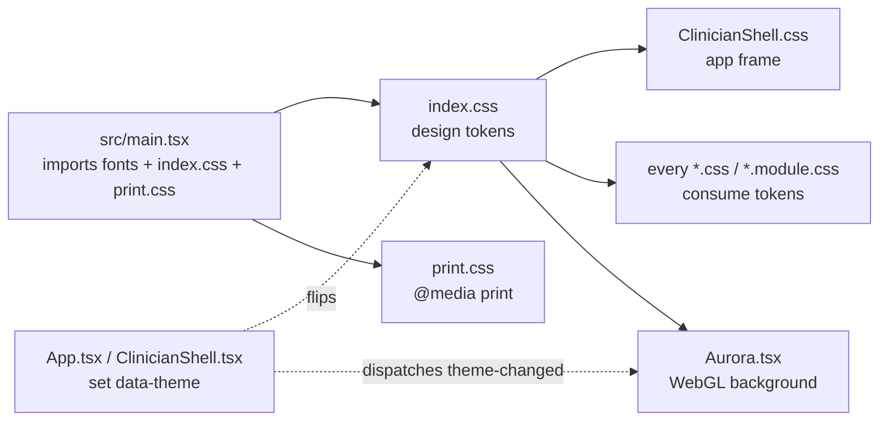
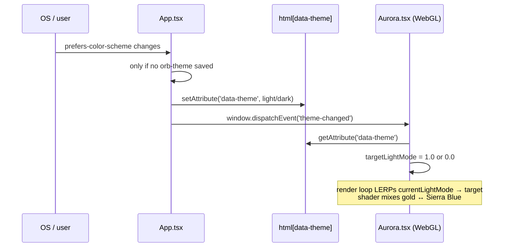

# The Design System: tokens, themes, liquid glass, typography, motion

Orb has exactly one visual language, and it lives almost entirely in **CSS custom properties** (browser-native variables, written `--name`, read with `var(--name)`). Every colour, radius, shadow, blur, font, spacing step and animation timing is declared once in `src/index.css` and consumed by every component. Switching the whole application between its dark "gold" identity and its light "Sierra Blue" identity is a single attribute flip on the `<html>` element, `data-theme="light"`, which re-points a few dozen variables and lets the rest of the stylesheet follow automatically. This guide is the definitive reference for that system: every token and its two values, the theme mechanism and its one load-bearing rule, the "liquid glass" recipe, the type stack, the animated Aurora background, the print stylesheet, and the conventions a new panel must follow to fit in.

---

## Purpose and neighbors

**The problem this subsystem solves.** A hospital UI has hundreds of surfaces, vitals cards, order tables, modals, sidebars, print-outs, built by different modules (Vigil, Relay, Sage, Helix…). If each hard-codes its own colours and spacing, three things break: (1) the two themes drift apart, (2) a brand change means editing hundreds of files, and (3) contrast/accessibility regressions slip in silently. The design system fixes this by making **one file the single source of truth** for every visual constant, and by giving every module the same small vocabulary of tokens and utility classes (`.glass`, `.glass-card`, `--accent-gold`, `--space-4`, …).

**Why it exists as its own layer.** The tokens are deliberately decoupled from any React component. `index.css` and `print.css` are imported once in `src/main.tsx` (guide 01) and thereafter apply globally. Components never import them; they simply *reference* the variables. That inversion is what lets the theme toggle work with zero component re-renders, the browser re-resolves `var(--accent-gold)` the instant `data-theme` changes.



**Neighbours.** The theme *state* (who owns the toggle, localStorage keys, the `theme-changed` event) is shared with the app-shell subsystem, see **guide 01-app-shell**. The print classes are produced by the discharge and handoff views, see **guide 21-admissions-discharge** and **guide 22-handoff-ipass**. Aurora is rendered only by the Login screen (guide 01). Every feature guide (07-vigil through 25-admin) consumes the tokens this guide documents.

---

## File map

| File | Lines (approx) | Role |
|------|----------------|------|
| `src/index.css` | 741 | The token catalogue: all CSS custom properties (dark defaults + `[data-theme="light"]` overrides), the CSS reset, the `.glass*` liquid-glass recipes, keyframes, reduced-motion, scrollbar styling. The single source of truth. |
| `src/App.css` | 1 | Empty placeholder (`/* App-level styles */`). Imported by `App.tsx` but currently holds nothing. |
| `src/print.css` | 379 | `@media print` rules only. Strips the dark app chrome and reveals just the active discharge/handoff print portal as a clean black-on-white A4/Letter document. |
| `index.html` | 34 | The Vite HTML entry: `#root` mount point, viewport/description meta, SVG favicon, and an inline global error-catcher that paints uncaught exceptions full-screen. |
| `src/components/Aurora.tsx` | 452 | The animated login background: a WebGL fragment-shader aurora (SDF-masked volumetric glow) plus a 2-D canvas dot-grid with mouse displacement. Theme-aware, `pointer-events:none`. |
| `src/pages/ClinicianShell.css` | 963 | Styles for the global application frame only, sidebar rail, top header, theme/language toggles, offline badge, generic `orb-panel`/`orb-metric-card` primitives, and the responsive collapse breakpoints. Module-specific styles are forbidden here (see the file header). |

Two files outside this scope are referenced repeatedly because they *drive* the system: `src/main.tsx` (imports the fonts and the two stylesheets; guide 01) and `src/App.tsx` / `src/pages/ClinicianShell.tsx` (set `data-theme`; guide 01).

---

## How it works

### Flow 1: Boot and initial theme

1. `index.html` ships a bare `<div id="root">` and loads `/src/main.tsx` as an ES module (`index.html:23-24`).
2. `main.tsx` imports the three variable fonts, then `index.css`, then `print.css`, fonts first so `@font-face` is registered before the cascade needs them (`src/main.tsx:6-10`).
3. **Before React renders**, a top-level `try` block in `AppRoot.tsx` stamps `data-theme` on `<html>` from `bootTheme()`, which reads `localStorage['orb-theme']` (falling back to the legacy `orb_theme`), else the OS preference via `matchMedia('(prefers-color-scheme: light)')` (`src/AppRoot.tsx:42-49`, `src/lib/theme.ts:39-45`). Doing this at module-evaluation time, not inside a component effect, avoids a "flash of wrong theme" on first paint.
4. The cascade resolves. `:root` supplies the dark values; if `data-theme="light"` is present, the `[data-theme="light"]` block (`src/index.css:299`) overrides the subset of variables that differ.

### Flow 2: Toggling the theme at runtime

1. Inside the authenticated app, `ClinicianShell` renders a round `.shell__theme-toggle` button (`src/pages/ClinicianShell.tsx:451`).
2. Clicking it calls `toggleTheme`, which flips React state between `'dark'` and `'light'` (`src/pages/ClinicianShell.tsx:260`).
3. A `useEffect` writes the new value to `data-theme` on `<html>` and persists it to `localStorage['orb_theme']` (`src/pages/ClinicianShell.tsx:255-258`).
4. The browser instantly re-resolves every `var(--…)`; no component re-render is needed for the colour change, only the button's own state updated.

> **Two storage keys, one reader.** `storedTheme()` reads `orb-theme` and falls back to the legacy `orb_theme` (`src/lib/theme.ts:27-34`); boot and the OS listener both go through it (`src/AppRoot.tsx:46`, `:143`). See **Discrepancies**.

### Flow 3: Aurora reacts to the theme (login only)



Aurora cannot read CSS variables inside a WebGL shader, so it re-reads `data-theme` from the DOM and feeds a single `u_light_mode` uniform (0 = dark/gold, 1 = light/blue) that the fragment shader interpolates (`src/components/Aurora.tsx:293-297`, `112`, `193-194`).

---

## Function-by-function

Because four of the six scope files are stylesheets, the "units" here are a mix of TypeScript functions (Aurora) and named CSS rule-groups. Load-bearing pieces get the full template; boilerplate is summarised in tables.

### The token catalogue: `src/index.css:4-102`
**Signature:** `:root { --token: value; … }` → global CSS custom properties.
**Does:** declares every design constant once, as the dark-mode default set.
**How it works:** CSS custom properties declared on `:root` (the `<html>` element) cascade to every descendant. Any rule anywhere can read them with `var(--name)`, and `var(--name, fallback)` supplies a default if the variable is missing.
**Why it exists:** one edit here re-skins the entire product; it also makes the light theme a small *diff* rather than a parallel stylesheet.
**Talks to:** read by literally every other stylesheet and by inline `style={{…}}` props (e.g. `src/pages/panels/ScribePanel.tsx:306` uses `var(--accent-deep)`).

The complete catalogue, grouped by category, dark value (`:root`) and light value (`[data-theme="light"]`):

**Colour, backgrounds** (`src/index.css:6-11`, light `300-305`)

| Token | Dark | Light | Purpose |
|-------|------|-------|---------|
| `--bg-primary` | `#08090d` | `#F5F5F7` | Page background (body). Deep near-black / warm white. |
| `--bg-secondary` | `#0f1117` | `#EBEBEF` | Secondary panels, table header fills. |
| `--bg-surface` | `#161822` | `#FFFFFF` | Solid raised surface. |
| `--bg-glass` | `rgba(255,255,255,.04)` | `rgba(255,255,255,.45)` | Base translucent fill for frosted glass. |
| `--bg-glass-hover` | `rgba(255,255,255,.07)` | `rgba(255,255,255,.65)` | Glass fill on hover. |
| `--bg-elevated` | `rgba(22,24,34,.8)` | `rgba(255,255,255,.94)` | Popover/menu fill (near-opaque). |

**Colour, text** (`src/index.css:14-16`, light `307-309`)

| Token | Dark | Light | Purpose |
|-------|------|-------|---------|
| `--text-primary` | `#f5f5f7` | `#111215` | Body copy, headings, values. |
| `--text-secondary` | `#a0a0b8` | `#333336` | Secondary labels, table cells. |
| `--text-muted` | `#6b6b82` | `#62626A` | De-emphasised captions, units, timestamps. |

**Colour, accent** (`src/index.css:19-25`, light `312-318`), the brand family, and the one that *inverts* between themes

| Token | Dark (gold) | Light (Sierra Blue) | Purpose |
|-------|------|-------|---------|
| `--accent-gold` | `#FFD700` | `#7AA5C7` | Primary accent: active nav, focus, brand fills. Bright on black; mid-tone blue on white. |
| `--accent-amber` | `#F5A623` | `#5D8EB8` | Secondary accent / hover partner. |
| `--accent-deep` | `#C8960C` | `#2C465E` | **Deep/dark accent, the one safe for accent-coloured *text* (see the load-bearing rule below).** |
| `--accent-warm` | `#FFE566` | `#A2C1DB` | Lightest accent tint, gradient highlights. |
| `--accent-glow` | `rgba(255,215,0,.10)` | `rgba(122,165,199,.08)` | Faint accent wash (button/badge backgrounds). |
| `--accent-glow-strong` | `rgba(255,215,0,.22)` | `rgba(122,165,199,.18)` | Stronger accent wash (hover). |
| `--btn-primary-text` | `#000000` | `#111215` | Text colour that sits *on top of* a gold/blue primary button. Black on gold; near-black on blue. |

**Colour, Orb rings** (`src/index.css:28-30`, light `321-323`): `--orb-ring-1/2/3`, three increasing-opacity accent rings used by the animated `OrbLogo` (guide 01).

**Colour, status** (`src/index.css:33-35`, light `325-327`)

| Token | Dark | Light | Purpose |
|-------|------|-------|---------|
| `--status-ok` | `#00E676` | `#059669` | Healthy/success. Light values are darker for contrast on white. |
| `--status-warn` | `#FFB300` | `#D97706` | Caution/elevated. |
| `--status-danger` | `#FF5252` | `#DC2626` | Critical/error. |

**Colour, borders** (`src/index.css:38-40`, light `329-331`)

| Token | Dark | Light | Purpose |
|-------|------|-------|---------|
| `--border-subtle` | `rgba(255,255,255,.06)` | `rgba(0,0,0,.05)` | Hairline dividers. Note the polarity flips: white-on-dark → black-on-light. |
| `--border-glass` | `rgba(255,255,255,.09)` | `rgba(0,0,0,.06)` | Glass-panel edge. |
| `--border-focus` | `rgba(255,215,0,.4)` | `rgba(122,165,199,.4)` | Focus ring / active input border. |

**Radius** (`src/index.css:43-47`, no light override): `--radius-sm 12px`, `--radius-md 16px`, `--radius-lg 22px`, `--radius-xl 32px`, `--radius-full 9999px` (pill). Same in both themes.

**Blur** (`src/index.css:50-51`, no light override): `--blur-glass 40px` (heavy frost), `--blur-light 20px` (light frost).

**Typography, font stacks** (`src/index.css:56-59`, no light override)

| Token | Value | Used for |
|-------|-------|----------|
| `--font-family` | `'Inter Variable', -apple-system, …` | Default UI/body. Inter is a highly legible sans chosen for clinical density. |
| `--font-display` | `'Space Grotesk Variable', 'Inter Variable', …` | Headings (`h1,h2,h3`) and brand titles, a distinctive geometric display face. |
| `--font-serif` | `Georgia, 'Times New Roman', serif` | Rarely used; declared for completeness. |
| `--font-mono` | `'JetBrains Mono Variable', 'SF Mono', …` | Data, IDs, codes, `<code>`/`<pre>`, a monospace with clear digit shapes. |

**Typography, type scale** (`src/index.css:87-93`, no light override): `--text-xs .72rem`, `--text-sm .82rem`, `--text-base .95rem`, `--text-md 1.05rem`, `--text-lg 1.25rem`, `--text-xl 1.6rem`, `--text-2xl 2.1rem`. Set in `rem` off a 16 px root (`src/index.css:112`), so the whole scale respects the user's browser font-size.

**Motion, transitions** (`src/index.css:62-64`, no light override): `--transition-fast 150ms`, `--transition-base 250ms`, `--transition-slow 400ms`, all with the `cubic-bezier(0.4,0,0.2,1)` "standard" easing (fast-out, slow-in).

**Shadow** (`src/index.css:67-72`, light `333-337`)

| Token | Dark | Light | Purpose |
|-------|------|-------|---------|
| `--shadow-xs` | `0 1px 2px rgba(0,0,0,.5)` | *(no override, keeps dark value)* | Tiny lift. |
| `--shadow-sm` | `0 1px 3px rgba(0,0,0,.4)` | `0 1px 3px rgba(0,0,0,.04)` | Small lift. |
| `--shadow-md` | `0 4px 20px rgba(0,0,0,.35)` | `0 4px 16px rgba(0,0,0,.06)` | Card. |
| `--shadow-lg` | `0 16px 48px rgba(0,0,0,.45)` | `0 12px 40px rgba(0,0,0,.08)` | Modal/floating. |
| `--shadow-glow` | `0 0 24px rgba(255,215,0,.08)` | `0 0 24px rgba(122,165,199,.15)` | Accent glow halo. |
| `--shadow-card` | `0 8px 32px rgba(0,0,0,.4), inset 0 1px 0 rgba(255,255,255,.1)` | `0 1px 3px rgba(0,0,0,.05), 0 0 0 1px rgba(0,0,0,.02)` | Default glass card shadow (outer + inset top highlight). |

**Shadow, elevation** (`src/index.css:75-77`, no light override): `--elev-1/2/3`, layered, "physically plausible" multi-shadow stacks for glass depth (a tight near shadow + a soft far shadow). Not overridden in light mode, which is a mild inconsistency (they stay dark-tuned), see Discrepancies.

**Glass kit** (`src/index.css:80-84`, no light override, but `.glass*` classes are re-skinned in light mode directly): `--glass-saturate 140%`, `--glass-highlight` (inset top highlight), `--glass-edge` (inset 1 px edge), `--glass-sheen` / `--glass-sheen-hover` (diagonal white gradients that fake a light reflection).

**Spacing** (`src/index.css:96-101`, no light override): a 4 px rhythm, `--space-1 4px`, `--space-2 8px`, `--space-3 12px`, `--space-4 16px`, `--space-5 24px`, `--space-6 32px`.

**Change guide (worked example 1, re-brand the accent).** To change the dark brand from gold to, say, teal: edit the six `--accent-*` values at `src/index.css:19-25` (and the matching `--orb-ring-*`, `--accent-glow*`). Knock-on effects: every active nav item, focus ring, primary button, badge, and the Aurora fallback comment all shift automatically; you do **not** touch any component. Footgun: the Aurora shader hard-codes gold/blue RGB in the fragment source (`src/components/Aurora.tsx:110-172`) and will *not* follow token edits, update the shader separately.

**Change guide (worked example 2, widen the corner radius).** To make all cards rounder, raise `--radius-lg` at `src/index.css:45`. Knock-on: `.glass`, `.glass-card`, `.glass-strong`, KPI cards, and anything using `var(--radius-lg)` update together. Footgun: `.shell__sidebar` deliberately sets `border-radius:0` (`src/pages/ClinicianShell.css:36`) and won't change, full-height rails should stay square.

**Gotchas:** custom properties inherit and cascade, so a token *redefined on a subtree* (as light mode does on `[data-theme]`) wins for that subtree only, never `!important` a token unless you mean it globally. Alpha-only tokens (the `rgba(255,255,255,…)` glass fills) assume a dark backdrop; they are separately re-declared for light, not merely tinted.

---

### The theme mechanism: `src/index.css:299-370`
**Signature:** `[data-theme="light"] { …overrides… }` plus a handful of `[data-theme="light"] .selector` rules.
**Does:** turns the entire product from dark-gold to light-Sierra-Blue by overriding a subset of tokens and a few glass surfaces.
**How it works:**
1. `[data-theme="light"]` (an attribute selector on `<html>`) has higher specificity than the bare `:root`, so its variable re-declarations win when the attribute is present (`src/index.css:299`).
2. It redeclares backgrounds, text, the accent family, status, borders, and the light-tuned shadows (`src/index.css:300-337`).
3. It then *directly* re-skins the glass classes for light backgrounds, `.glass`, `.glass-card`, `.glass-card:hover` get new fills/borders/blur because translucent-white-on-dark maths does not read the same on white (`src/index.css:345-363`), and re-tints the scrollbar (`365-370`).
**Why it exists:** hospitals run on bright ward monitors by day and dim rooms at night; a real light theme (not an inverted hack) is a usability requirement.
**Data in/out:** input is the single DOM attribute `data-theme ∈ {light, dark|absent}`; output is the resolved value of every `var(--…)`.
**Talks to:** the attribute is written by `AppRoot.tsx:46,144` (boot + OS-follow) and `ClinicianShell.tsx:256` (toggle); read by every stylesheet and by `Aurora.tsx:235,294,360`.

> ### THE LOAD-BEARING RULE, accent-coloured *text* must use `--accent-deep` in light mode
> **Where it is stated.** The rule is written down in the rebuild plan and master doc (`docs/REBUILD_PLAN.md:211`, `docs/ORB_MASTER.md:428`) and is *enforced by the token values themselves* in `src/index.css`.
> **Why it is load-bearing (the contrast rationale, provable from the values I read):**
> - In **dark** mode `--accent-gold` is `#FFD700` (bright yellow) on `--bg-primary #08090d` (near-black). Gold-on-black has huge luminance contrast, so gold text is perfectly readable.
> - In **light** mode `--accent-gold` becomes `#7AA5C7` (Sierra Blue, a *mid-tone* blue) and backgrounds become near-white (`#F5F5F7`/`#FFFFFF`). Mid-tone-blue text on white is low-contrast and fails accessibility, it looks washed out and is hard to read.
> - `--accent-deep` in light mode is `#2C465E` (dark navy, `src/index.css:314`). Dark-navy text on white has strong contrast.
> **The rule, therefore:** use `--accent-gold` for accent *fills/borders/icons* (which sit on their own backdrop), but any accent-coloured **text on a page/card background must use `--accent-deep`** so it stays legible after the light-mode inversion. You can see the deep token used exactly this way for on-surface accent elements, e.g. the admit button fill in `src/pages/panels/ScribePanel.tsx:306,657` and the MFA meter gradient in `src/pages/panels/admin/TrustCenter.css:118`.
> **Gotcha:** it is easy to reach for `--accent-gold` for a coloured heading because it looks great in dark mode; QA only catches it after switching to light. When authoring any accent-coloured text, default to `--accent-deep`.

**Change guide (worked example 3, add a third "high-contrast" theme).** Duplicate the `[data-theme="light"]` block as `[data-theme="hc"]`, override the tokens, and extend the toggle in `ClinicianShell.tsx:260` from a boolean flip to a 3-way cycle. Knock-on: `Aurora`'s `u_light_mode` is a single float 0↔1 (`src/components/Aurora.tsx:250`) and only understands two themes, it would need a new uniform or would fall back to dark. Footgun: remember to also override the light-only glass re-skins (`src/index.css:345-363`) or the new theme inherits dark glass on a light page.

**Gotchas:** specificity, because light mode overrides some classes (`.glass-card`) *and* some tokens, a component that hard-codes a colour instead of using a token (see `Helix.module.css` below) will **not** switch themes and will look broken in light mode.

---

### Liquid glass: `.glass`, `.glass-card`, `.glass-strong`: `src/index.css:189-227`
**Signature:** three utility classes → frosted translucent surfaces.
**Does:** produce the "liquid-glass" look, a blurred, saturated, faintly-reflective translucent panel with a top highlight.
**How it works (the copyable recipe, annotated exactly as the code does it):**

```css
.glass {
  position: relative;
  background: var(--bg-glass);                 /* 1. translucent fill (4% white on dark) */
  backdrop-filter: blur(var(--blur-glass))     /* 2. blur what's BEHIND the panel (40px) */
                   saturate(var(--glass-saturate)); /*    + boost saturation 140% so colour
                                                          bleeds through like real frosted glass */
  -webkit-backdrop-filter: blur(var(--blur-glass)) saturate(var(--glass-saturate)); /* 3. Safari */
  border: 1px solid var(--border-glass);       /* 4. hairline edge to define the pane */
  border-radius: var(--radius-lg);
  box-shadow: var(--elev-1), var(--glass-highlight); /* 5. outer depth + inset top highlight
                                                          (the "wet" sheen line) */
}
```

- `.glass-card` (`src/index.css:199-216`) is the interactive version: a diagonal `--glass-sheen` gradient fill, heavier 32 px blur, 32 px padding, `--elev-2` + highlight + edge, and a hover state that lifts 2 px (`translateY(-2px)`), brightens the sheen, and adds an accent-gold border + `--shadow-glow`.
- `.glass-strong` (`src/index.css:219-227`) is for modals/popovers: a near-opaque dark gradient fill, 48 px blur, 160% saturation, brighter border and `--elev-3`. It is *not* alpha-cheap; it deliberately blocks most of what's behind so overlaid content stays readable.

**Why it exists:** frosted glass gives depth and hierarchy (you can tell what floats above what) without heavy opaque panels that would hide the animated background; it is the core of Orb's "premium" identity.
**Talks to:** used directly as a className throughout the app; re-skinned for light mode at `src/index.css:345-363`; the same recipe is *inlined* by panels that want glass without the utility class (e.g. `CommandCenter.css:64-67,106-109`, `ClinicianShell.css:41-43`).
**Browser caveats (important):** `backdrop-filter` is the load-bearing property and it (a) needs the `-webkit-` prefix for Safari, always paired here; (b) is GPU-expensive, dozens of large blurred panels can drop frame-rate on weak ward tablets; (c) silently does nothing if an ancestor sets `overflow`/`filter`/`transform` that creates the wrong stacking context, in which case the panel looks merely translucent, not blurred. If glass ever looks flat, suspect a parent, not the class.
**Gotchas:** the translucent white fills assume a dark backdrop, that is exactly why light mode has to redefine `.glass`/`.glass-card` rather than just flipping a token.

---

### CSS reset, base type, and utilities: `src/index.css:104-182`
| Rule group | Lines | What it does |
|-----------|-------|--------------|
| Universal reset | `105-109` | Zero margin/padding, `box-sizing:border-box` on everything. |
| `html` | `111-120` | 16 px root, antialiasing, `text-rendering:optimizeLegibility`, Inter character-variant `font-feature-settings`, and `overflow-x:hidden` + `max-width:100vw` to kill horizontal scroll. |
| `body` | `122-131` | Binds `--font-family`, `--bg-primary`, `--text-primary`; `line-height:1.55`, slight negative tracking. |
| `h1,h2,h3,.shell__page-title` | `136-140` | Bind the display face (`--font-display`) with tighter tracking and weight 600, headings are styled per-element because the app styles most headings inline. |
| Tabular numerals | `144-150` | Any element whose class contains `stat`/`metric`/`kpi`/`score`, plus `td,th,input,.mono,code,pre`, get `font-variant-numeric: tabular-nums lining-nums` so digits align in columns and vitals never reflow width. `code,pre,.mono` also bind `--font-mono`. |
| Forecast legend | `154-174` | One-off fix classes for `ForecastPanel` (which has no stylesheet of its own). |
| `#root`, `a`, `button`, `input` | `176-182` | `#root` full height; links inherit colour; buttons reset to bare (no border/background, pointer cursor). |

**Why it matters:** the tabular-numerals rule is a clinical-safety touch, a NEWS2 score or a drug dose that jitters its column width as digits change is harder to scan.

---

### Animations and motion: `src/index.css:229-294`
| Rule group | Lines | What it does |
|-----------|-------|--------------|
| Keyframes | `230-248` | `fade-in` (opacity), `slide-up` (opacity + 24 px rise), `pulse-soft` (opacity 0.4↔0.7), `orb-spin` (0→360°). |
| Animation utilities | `250-262` | `.animate-fade-in` (0.6 s), `.animate-slide-up` (0.5 s), and `.stagger-1…5` delay helpers (0.1–0.5 s) for cascading list entrances. |
| **Reduced motion** | `265-271` | Under `@media (prefers-reduced-motion: reduce)`, *all* animations and transitions are forced to `0.01ms`, an accessibility must for vestibular-sensitive users. |
| Scrollbar | `273-294` | Slim 8 px WebKit scrollbar, transparent track, translucent thumb that turns gold-tinted on hover; Firefox `scrollbar-width:thin` + `scrollbar-color`. Light mode re-tints to black at `365-370`. |

**Gotcha:** the reduced-motion block uses `!important` and a universal selector, so it overrides *every* transition including Aurora's DOM canvas, but Aurora's WebGL loop runs on `requestAnimationFrame`, which CSS cannot stop; a truly motion-free login would need a JS check (not present). See Discrepancies.

---

### App.css: `src/App.css:1`
**Does:** nothing. It is a single comment (`/* App-level styles */`), imported by `src/AppRoot.tsx:18` as a reserved seam for future app-level rules. No units.

---

### index.html: `index.html:1-26`
| Unit | Lines | What it does |
|------|-------|--------------|
| Inline error-catcher `<script id="error-catcher">` | `4-11` | Registers `window` `error` and `unhandledrejection` listeners *before any bundle loads*; on an uncaught error it appends a full-screen dark-red overlay showing the message and stack. A blunt but effective last-resort visual for failures that occur before (or outside) React's error boundary. |
| Head meta | `13-20` | `charset`, SVG favicon (`/favicon.svg`), responsive `viewport`, description, `<title>Orb</title>`. A code comment (`17-19`) documents that fonts are self-hosted (no CDN) for offline/CSP-locked on-prem deployments. |
| Body | `22-25` | `<div id="root">` mount point and the `<script type="module" src="/src/main.tsx">` entry. |

**Why the inline error overlay exists:** on a mid-shift clinical device, a white screen with no message is a patient-safety hazard; this guarantees *some* diagnostic even if the JS bundle itself throws on load. It complements (does not replace) the React `RootErrorBoundary` in `src/main.tsx:26-77`.
**Gotcha:** the overlay is developer-facing (raw stack traces) and uses `z-index:99999`, it will cover everything, including the React error boundary's friendlier "Something went wrong" card.

---

### Aurora: the WebGL login background: `src/components/Aurora.tsx`

This file is the one substantial piece of imperative rendering in the design system. It draws two stacked full-screen `position:fixed` canvases behind the login form, both `pointer-events:none` so they never intercept clicks.

#### cheapNoise: `src/components/Aurora.tsx:25`
**Signature:** `(x:number, y:number, t:number) → number` in roughly `[-1,1]`.
**Does:** a cheap sine/cosine pseudo-noise used to gently wobble the dot grid.
**How it works:** sums two `sin·cos` products of the coordinates and time and scales by 0.5. Not real Perlin noise, just enough organic drift to avoid a rigid grid.
**Why it exists:** true noise per-dot per-frame would be wasteful for a purely decorative layer.
**Talks to:** called twice per dot per frame in the dot-grid loop (`:341-342`).
**Gotchas:** none noteworthy.

#### VERT_SRC / FRAG_SRC: the shader source: `src/components/Aurora.tsx:34-199`
**Does:** GLSL source strings. The vertex shader draws a full-screen quad; the fragment shader computes the aurora colour per pixel.
**How it works (fragment shader, `:41-199`):**
1. Helper GLSL functions `hash`, `noise`, `fbm` (5-octave fractional Brownian motion), and `sdCircle` (a signed-distance-field circle, negative inside, positive outside) provide organic texture and shapes (`:48-79`).
2. `main()` builds four "arcs" (crescent glows). Each arc: places a drifting SDF circle centre `cN`, computes distance `dN`, turns it into a soft rim glow via `exp(-d²/rimWidth²)`, multiplies by scrolling FBM texture, masks the inside with `smoothstep`, and tints it (`:91-173`).
3. `col1..col4` each `mix` a gold colour and a blue colour by `u_light_mode`, so the same geometry renders gold in dark mode and Sierra Blue in light mode (`:112,132,152,172`).
4. A centre-darkening term keeps the login form's text area readable (`:175-178`).
5. Separate dark and light alpha/colour paths are computed, then LERP-blended by `u_light_mode` for a smooth theme cross-fade, and written to `gl_FragColor` (`:180-196`).
**Why it exists:** replicates a premium "raymarched nebula" login backdrop without a heavy third-party engine.
**Data in/out:** uniforms `u_resolution` (vec2), `u_time` (float seconds), `u_light_mode` (float 0→1). Output: per-pixel RGBA.
**Talks to:** compiled by `createShader`; the light-mode value is driven from `data-theme`.
**Gotchas:** the arc colours are **hard-coded RGB literals** (`vec3(1.0,0.62,0.0)` etc.), *not* CSS tokens, a brand change to `--accent-*` will not touch Aurora (see Discrepancies and worked example 1).

#### createShader / createProgram: `src/components/Aurora.tsx:201-223`
**Signature:** `createShader(gl, type, src) → WebGLShader|null`; `createProgram(gl, vs, fs) → WebGLProgram|null`.
**Does:** compile a shader / link a program, logging and returning `null` on failure.
**How it works:** standard WebGL boilerplate, `createShader`→`shaderSource`→`compileShader`, checking `COMPILE_STATUS`; then `attachShader`×2→`linkProgram`, checking `LINK_STATUS`.
**Why it exists:** DRY wrappers around the verbose WebGL API.
**Talks to:** called by the Aurora component's WebGL effect (`:243-245`).
**Gotchas:** on failure they return `null` but the caller uses non-null assertions (`!`), so a compile failure would throw downstream rather than degrade gracefully.

#### Aurora (component): `src/components/Aurora.tsx:225`
**Signature:** `() → JSX` (two `<canvas>` elements).
**Does:** the React component; owns two `useEffect` render loops.
**How it works:**
1. Holds four refs: the two canvases, a mouse position, and `targetLightMode`/`currentLightMode` floats for smooth theme LERP (`:226-231`).
2. **WebGL effect** (`:234-308`): reads `data-theme` to seed light mode, gets a `webgl` context, compiles the program, uploads a 2-triangle full-screen quad, and starts a `requestAnimationFrame` loop that eases `currentLightMode` toward the target by 8%/frame and redraws. It renders at **half resolution** (`innerWidth*0.5`) upscaled by CSS for cheap bloom (`:263-271`). It listens for the `theme-changed` window event to retarget light mode (`:293-297`) and cleans up all listeners + RAF on unmount.
3. **Dot-grid effect** (`:311-372`): a 2-D canvas of dots on a 24 px grid; each frame applies `cheapNoise` drift plus a cubic mouse-repulsion falloff within a 600 px radius, LERPs each dot toward its target, and fades opacity near the cursor. Dot colour is read from `data-theme` per frame (Sierra Blue tint in light, grey in dark, `:360-361`).
**Why it exists:** gives the unauthenticated login screen a living, brand-defining backdrop.
**Data in/out:** no props; reads the DOM `data-theme` and mouse events; writes pixels.
**Talks to:** rendered only by `src/pages/Login.tsx:90`; listens for `AppRoot.tsx`'s `theme-changed` event (`src/AppRoot.tsx:145`).
**Change guide (worked example 4, slow the aurora down):** the shader multiplies time by `0.6` at `src/components/Aurora.tsx:87` (commented "~8× faster base time"); lower it to slow every arc. Knock-on: all four arcs share this `t`, so they slow together. Footgun: the half-res render at `:264-265` is a perf lever, not a motion lever, changing it rescales sharpness, not speed.
**Gotchas:** the WebGL effect re-reads theme only on the `theme-changed` event, and the shell toggle **does not fire that event** (`ClinicianShell.tsx:260` omits it). This is latent because Aurora only mounts on Login where the shell toggle is absent, but mounting Aurora inside the shell would leave it stuck on the boot theme. See Discrepancies.

---

### The application frame: `src/pages/ClinicianShell.css`

This file styles the global chrome only; a header comment forbids module-specific rules here (`src/pages/ClinicianShell.css:8-13`). It is the canonical example of *consuming* the tokens.

| Rule group | Lines | Role |
|-----------|-------|------|
| `.shell` | `16-22` | Flex root, full-height, `overflow-x:hidden`, `max-width:100vw`. |
| `.shell__sidebar` + `-top`/`-bottom` | `25-117` | Fixed 220 px left rail; a dark gradient fill with 48 px `backdrop-filter` glass; scrollable nav region with a hidden scrollbar. |
| `.shell__nav-item` (+ `:hover`, `--active`) | `72-107` | Nav buttons; active state gets a gold left-border, gold gradient wash and inset glow using `--accent-gold`/`--glass-highlight`. |
| `.shell__user-card`, `-avatar`, `-name`, `-role` | `120-172` | Sidebar user block; avatar ring in `--accent-gold` on `--accent-glow`. |
| `.shell__logout` | `175-197` | Full-width sign-out; hovers to a red (`#f87171`) danger tint. |
| `.shell__main`, `.shell__header`, `-left`, `-right` | `200-244` | Content column offset by the 220 px rail; header row with `--border-subtle` divider. |
| `.shell__offline-badge` (+ `--syncing`/`--synced`) | `246-297` | The connectivity pill: amber offline (`pulse-offline`), amber "syncing" with spinning dot, green "synced" confirmation using `--status-ok`. |
| `.shell__theme-toggle` | `299-319` | The round 36 px theme button; hovers to gold with `--shadow-glow`. This is the DOM home of Flow 2. |
| `.shell__lang-toggle` | `322-347` | en/hi language switch, styled to match. |
| `.orb-panel`, `.orb-panel-grid`, `.orb-metric-*`, `.orb-section*` | `393-458` | Generic reusable primitives every panel can adopt, scrollable panel container, auto-fit metric grid, metric value/label (with `--warn`/`--danger` colour variants). |
| Icon fix | `462-472` | Forces header/pulse SVGs to 18 px with `currentColor` stroke. |
| Responsive `@media (max-width:1024px)` | `483-544` | Collapses the rail to a 72 px icon-only strip; hides text labels; 44 px min touch targets. |
| Responsive `@media (max-width:768px)` | `547-635` | Turns the rail into a horizontal sticky top bar; active indicator moves from left-border to bottom-border; content stacks full-width. |

**Why it is separated:** keeping frame styles here (and forbidding feature styles) prevents the shell from becoming a dumping ground and keeps module CSS co-located with modules, an explicit architecture boundary.
**Gotchas:** the responsive `--active` rule swaps `border-left` for `border-bottom` at ≤768 px (`:592-595`); a module that copies the desktop active style will look wrong on tablet. The sidebar hard-codes `rgba(...)` fills rather than tokens in a few places (e.g. `:41,88`), so it is only partly theme-token-driven, acceptable because it also has no light-mode override and is always dark-tinted glass.

---

### The print stylesheet: `src/print.css`
**Signature:** one `@media print { … }` block.
**Does:** replaces the on-screen dark app with a clean black-on-white clinical document containing only the active discharge or handoff record.
**How it works (the three-step strategy, exactly as the file header explains at `:1-22`):**
1. **Remove the app chrome.** `.shell`, `.modal-overlay`, `.modal`, and floating widgets are `display:none` (`:44-51`). Because the active print record is a React portal rendered to `<body>` *outside* `.shell` (guides 21/22), hiding the shell never hides the record. Hiding the modal also removes the on-screen preview, which embeds a *duplicate* `.discharge-print-layout`, leaving exactly one to print.
2. **Belt-and-suspenders reveal.** `body *` is `visibility:hidden`, then `.discharge-print-layout`/`.handoff-print-layout` and their descendants are set back to `visible` (`:56-65`). This also covers the patient-portal `DischargeAccess` case where the layout lives *inside* `#root` rather than as a body-level portal.
3. **Anchor and normalise.** The print layout is `position:absolute` at the page origin, full width, white background, Arial 11 pt, with `print-color-adjust:exact` (`:69-104`); every descendant is forced to black text, transparent background, and no shadows/animations/`backdrop-filter` carried over from the screen theme.
Below that, per-document typographic rules style the discharge summary (`:107-149`) and the handoff report (`:152-242`), bordered tables, section titles, `page-break-inside:avoid` on logical blocks, signature lines, and a monospace mock-QR.
**Why it exists:** without it, the browser would print the entire dark glass UI around (and on top of) the record, wasting toner and rendering an illegible clinical document.
**Data in/out:** input is whichever print portal is currently mounted; output is a paginated A4/Letter (`@page { margin:14mm }`) black-on-white document.
**Talks to:** the class contracts `.discharge-print-layout` and `.handoff-print-layout` are produced by `src/components/DischargePrintView.tsx` and `src/components/HandoffPrintView.tsx` (guides 21, 22).
**Change guide (worked example 5, add a new printable document):** give its root the class `.xyz-print-layout`, then add that selector to the reveal list (`:60-65`) and the normalise/anchor lists (`:69-70,92-93`). Footgun: if you forget the reveal list, the belt-and-suspenders `body * { visibility:hidden }` will render a blank page.
**Gotchas:** `backdrop-filter:none !important` (`:100-101`) is essential, a stray glass blur survives into print otherwise and greys the page. The strategy relies on the record being either a body-level portal *or* inside `#root`; a record mounted elsewhere with a different class name will print blank.

---

### Conventions: global CSS vs CSS Modules

Orb uses **two** stylesheet styles, and knowing which is which matters when you add a panel.

- **Global CSS** (`*.css`, e.g. `CommandCenter.css`, `ClinicianShell.css`): class names are global, `.cmd-kpi` means the same thing everywhere. These files consume tokens (`var(--…)`) and are theme-aware automatically. Naming is BEM-ish: a block prefix and `__element`/`--modifier` suffixes (`.shell__nav-item--active`, `.cmd-kpi__value`).
- **CSS Modules** (`*.module.css`, e.g. `Helix.module.css`): the bundler *rewrites every class name to a unique hash at build time*, so `.container` in one module cannot collide with `.container` in another. You import the file as an object and reference `styles.container`:

```ts
import styles from './Helix.module.css'          // src/components/helix/HelixFormulary.tsx:1
<span className={`${styles.badge} ${styles.badgeCritical}`}>…</span>  // :77
```

**Representative file A, `src/components/command/CommandCenter.css` (the good pattern).** Every colour, radius, blur and spacing is a token with a fallback: `background: var(--bg-glass, rgba(255,255,255,0.04))` (`:64`), KPI accent stripes via a local `--kpi-accent` variable set per status modifier (`:72-76`), status colours from `--status-*` (`:129-131`). It inlines the glass recipe rather than using the `.glass` class (`:64-67`) but still through tokens, so it themes correctly and degrades gracefully if a token is missing. This is how a new panel should consume the system.

**Representative file B, `src/components/helix/Helix.module.css` (the anti-pattern to avoid).** Despite being a module, it **hard-codes** raw hex/rgba instead of tokens: `color:#FFFFFF`, `background-color:#000000` (`:7-8`), accent `#D4AF37` for icons/badges/buttons (`:115,240,421`), status hexes like `#EF4444`/`#22C55E` (`:258,252`). Consequence: **this surface does not respond to the theme toggle**, it stays dark-on-black in light mode. It works today only because Helix is presented on a dark canvas. Treat it as a cautionary example, not a template. See Discrepancies.

**How a new panel should consume tokens (checklist):**
1. Use `var(--token, fallback)` for *every* colour, radius, blur, shadow, spacing and font, never a raw hex.
2. For accent-coloured **text**, use `--accent-deep` (the load-bearing rule), and `--accent-gold` only for fills/borders/icons.
3. For a frosted panel, prefer the `.glass`/`.glass-card` classes; if you must inline, copy the recipe *including* the `-webkit-backdrop-filter` line.
4. Use the 4 px `--space-*` rhythm and the `--text-*` scale, not arbitrary px.
5. Keep wide content (tables/grids) inside an `overflow-x:auto` container so the body never scrolls horizontally (as `CommandCenter.css:133,199` do).
6. If the surface can appear on a light page, add a `[data-theme="light"] .yourclass { … }` override for anything that used a dark-assuming alpha fill.

---

## Cross-subsystem contracts

This subsystem exposes **no REST routes and no socket events**, it is pure presentation. Its contracts are DOM/CSS surfaces that other code depends on:

| Contract | Where defined | Consumed by |
|----------|---------------|-------------|
| `data-theme` attribute on `<html>` (`"light"` \| `"dark"`/absent) | written `src/AppRoot.tsx:46,144`, `src/pages/ClinicianShell.tsx:256` | every `[data-theme="light"]` rule in `index.css` + component CSS; read by `Aurora.tsx:235,294,360` |
| `theme-changed` `CustomEvent` on `window` | dispatched `src/AppRoot.tsx:145` | `Aurora.tsx:297` |
| CSS custom properties `--bg-*`, `--text-*`, `--accent-*`, `--status-*`, `--border-*`, `--radius-*`, `--blur-*`, `--font-*`, `--text-{xs..2xl}`, `--space-{1..6}`, `--transition-*`, `--shadow-*`, `--elev-*`, `--glass-*` | `src/index.css:4-102`, light overrides `299-337` | all stylesheets and inline `style` props app-wide |
| Utility classes `.glass`, `.glass-card`, `.glass-strong`, `.animate-fade-in`, `.animate-slide-up`, `.stagger-1..5`, `.tabular-nums` | `src/index.css:189-262` | any component |
| Generic primitives `.orb-panel`, `.orb-panel-grid`, `.orb-metric-card`, `.orb-metric-value(--warn/--danger)`, `.orb-section` | `src/pages/ClinicianShell.css:393-458` | feature panels |
| Print class contracts `.discharge-print-layout`, `.handoff-print-layout` (+ their child classes) | styled `src/print.css` | produced by `DischargePrintView.tsx` / `HandoffPrintView.tsx` (guides 21, 22) |
| `#root` mount div; `/favicon.svg`; module entry `/src/main.tsx` | `index.html:14,23-24` | React bootstrap (guide 01) |
| Self-hosted fonts `Inter Variable`, `Space Grotesk Variable`, `JetBrains Mono Variable` | imported `src/main.tsx:6-8`; referenced `src/index.css:56-59` | all text |

---

## Rebuild notes

**Prerequisites (must exist first):**
- A Vite + React 19 + TypeScript app with an `index.html` mounting `#root` and loading `src/main.tsx` (guide 01).
- The three `@fontsource-variable` packages installed (`inter`, `space-grotesk`, `jetbrains-mono`), imported in `main.tsx` **before** `index.css` so `@font-face` is ready.
- A place to set `data-theme` (the app-shell/auth flow, guide 01), the design system is inert without it.

**Build order:**
1. **Tokens.** Author `src/index.css`: the `:root` dark set, then the `[data-theme="light"]` override block. Encode the load-bearing rule by making `--accent-gold` bright-on-dark and `--accent-deep` dark-on-light.
2. **Reset + base type.** Universal reset, `html`/`body`, heading display face, tabular-numeral rule.
3. **Liquid glass.** `.glass`, `.glass-card`, `.glass-strong`, plus their `[data-theme="light"]` re-skins; always pair `backdrop-filter` with `-webkit-backdrop-filter`.
4. **Motion.** Keyframes, animation utilities, the `prefers-reduced-motion` guard, scrollbar styling.
5. **Theme wiring.** Set `data-theme` at boot (`App.tsx`) and via a toggle (`ClinicianShell.tsx`); dispatch `theme-changed` on system-preference changes.
6. **Frame.** `ClinicianShell.css`, sidebar, header, toggles, generic primitives, responsive breakpoints, consuming only tokens.
7. **Print.** `print.css`, the three-step "hide-all, reveal-portal, anchor" strategy plus per-document typography.
8. **Aurora** (optional polish): the two-canvas WebGL + dot-grid login background, reading `data-theme` and the `theme-changed` event.

**Acceptance check, you can now:**
- Toggle `data-theme` on `<html>` and watch the entire UI switch dark-gold ↔ light-Sierra-Blue with correct text contrast (accent text uses `--accent-deep` and stays legible on white).
- Drop `<div class="glass-card">…</div>` anywhere and get a correctly frosted, hover-lifting panel in both themes.
- Trigger the browser print dialog on a discharge/handoff view and see only that record, black-on-white, no dark chrome, paginated cleanly.
- Add a new panel that references only `var(--…)` tokens and have it theme correctly with zero extra work.

---

## Discrepancies and open questions

1. *(resolved since: one reader, `storedTheme()` at `src/lib/theme.ts:27`, reads `orb-theme` and falls back to `orb_theme`, and boot and the OS listener both use it. The rest of this entry records how it was.)* **Two theme storage keys.** Boot read `localStorage['orb-theme']` (hyphen); the shell toggle writes `localStorage['orb_theme']` (underscore, `src/pages/ClinicianShell.tsx:252,257`). A user's manual toggle is therefore **not** honoured on next boot, `App.tsx` won't find `orb-theme`, falls back to OS preference, and the OS-follow listener also keys off the hyphen version so it may override the user's choice. Likely a bug; the two keys should be unified.
2. **`theme-changed` never fires on manual toggle.** Only the OS-preference listener dispatches it (`src/AppRoot.tsx:145`); `toggleTheme` (`src/pages/ClinicianShell.tsx:260`) does not. Aurora's WebGL layer only re-reads the theme on that event (`src/components/Aurora.tsx:293-297`). Latent today (Aurora and the shell toggle never co-exist), but a trap if Aurora is ever mounted inside the shell.
3. **Light-mode section comment is stale.** `src/index.css:297` labels the light theme "Warm white with **violet-purple** accent", but the actual tokens are **Sierra Blue** (`#7AA5C7`/`#2C465E`, `:311-323`). The comment predates a re-theme.
4. **Leftover violet in a light-mode override.** `src/pages/panels/SurgicalSuitePanel.css:1226-1228` styles the light-mode "today" card with `rgba(124,58,237,…)` (violet), a remnant of the old violet-purple accent that no longer matches the Sierra Blue token system.
5. **Aurora hard-codes brand RGB.** The shader's gold/blue colours are literal `vec3(…)` values (`src/components/Aurora.tsx:110-172`), decoupled from the `--accent-*` tokens; a token-level re-brand silently leaves Aurora on the old palette.
6. **`Helix.module.css` ignores the token system.** It hard-codes `#FFFFFF`/`#000000`/`#D4AF37`/status hexes (`src/components/helix/Helix.module.css:7-8,115,240-295,421`) instead of `var(--…)`, so that surface does not respond to the theme toggle and would render dark-on-black in light mode. Works only because it is shown on a dark canvas.
7. **Reduced-motion does not stop Aurora.** The `prefers-reduced-motion` block (`src/index.css:265-271`) neutralises CSS transitions/animations, but Aurora animates via `requestAnimationFrame` in JS (`src/components/Aurora.tsx:290,364`), which CSS cannot pause, a motion-sensitive user still sees the moving background on the login screen.
8. **Elevation shadows are not light-tuned.** `--elev-1/2/3` (`src/index.css:75-77`) use heavy black alphas and have no `[data-theme="light"]` override, so glass panels that use them (e.g. `.glass`, `.glass-card`) carry dark-weight shadows onto a light page. Minor visual inconsistency versus the softened `--shadow-*` light values.
9. **`ClinicianShell.css` stale placeholder comment.** Lines `409-410` reference migrating the Relay panel to `Relay.css` with "empty placeholders to prevent build errors", the placeholders are gone but the comment remains, which is confusing.
10. **A stray Google Fonts CDN `@import` contradicts the "no CDN / CSP-safe" story.** `src/index.css:1` opens with `@import url('https://fonts.googleapis.com/css2?family=Lora…&family=Raleway…&family=Inter…&family=Fira+Code…')`, a runtime request to Google's font CDN for Lora, Raleway, Inter and Fira Code. None of those four families are referenced by the `--font-*` tokens, which use the self-hosted *Inter Variable*, *Space Grotesk Variable* and *JetBrains Mono Variable* bundled via `@fontsource-variable` in `src/main.tsx:6-8`. So the import is dead weight for the design system, and it undercuts the `index.html:17-19` comment's promise that type renders on an offline, CSP-locked, on-prem deployment, under a strict CSP this request is simply blocked. Almost certainly a leftover from an earlier font iteration; it should be deleted.
