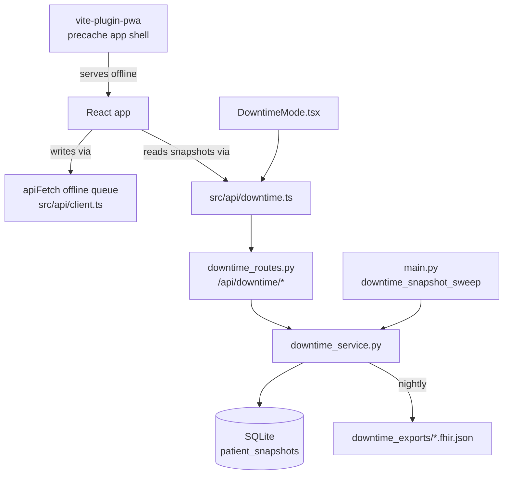

# Offline, PWA, and Downtime Mode: surviving network and EHR failure

Hospitals lose their network, their power, and their electronic health record (EHR, the software system of record for patient data) more often than vendors like to admit, and a ward that goes blind during an outage is a patient-safety emergency. This guide covers the three independent layers Orb uses to stay useful when connectivity fails: (1) the **PWA** layer that lets the browser app load with no server, (2) the small **offline write queue** inside `apiFetch` that parks a couple of clinical writes in the browser until the network returns, and (3) **Downtime Mode**, the real safety net, where the backend continuously freezes a read-only, LLM-free, network-free snapshot of every admitted patient into local SQLite, plus a nightly standards-based FHIR export to local disk, and a clean print-friendly page renders those snapshots so a nurse can keep working (and literally print a paper copy) when everything else is down.

---

## Purpose and neighbors

The problem: a cloud-only EHR structurally cannot help you when its servers are unreachable, the ward simply has nothing. Orb runs **on-prem** (on a server physically in the building), so it can keep a durable local copy of each patient's must-know data that survives loss of the internet, loss of the LLM (large language model, the AI text engine), and even loss of most of the backend. Three layers, deliberately separate so a failure of one does not take out the others:

| Layer | Lives in | What it survives | What it does NOT do |
|---|---|---|---|
| PWA precache | `vite.config.ts` (build time) | Losing the dev/static server; lets the app *shell* load offline | Does not cache API data |
| `apiFetch` offline queue | `src/api/client.ts` | Brief network blips during a write | Only 3 endpoints opt in; no reads; a replay is refused unless its author is still signed in |
| Downtime Mode | `server/services/downtime_service.py`, `downtime_routes.py`, `DowntimeMode.tsx`, `main.py` sweep | Full EHR/network/LLM outage; gives a read-only clinical picture + printout | Read-only; cannot place new orders |



Neighbors referenced below: NEWS2 scoring (see guide 07-vigil), FHIR export (see the FHIR/bundle export guide), audit logging (see guide 05-audit-chain), RBAC permissions (see guide 03-auth-rbac), and the deep dive on `apiFetch` itself (see guide 02-api-client).

---

## File map

| File | Lines (approx) | Role |
|---|---|---|
| `vite.config.ts` | 79 | Build config; registers `vite-plugin-pwa` (precache + manifest) and the dev proxy to the FastAPI backend. |
| `src/api/client.ts` | 1914 | The shared API client. Owns `apiFetch`, the offline write queue, socket auth, SSE helpers. Only the offline-queue portion is in scope here. |
| `src/api/downtime.ts` | 145 | Typed client for the four Downtime endpoints, plus every snapshot TypeScript interface. |
| `server/services/downtime_service.py` | 706 | The heart: assembles a snapshot from pure DB reads + rule-based NEWS2, persists it, reads it back, and runs the nightly FHIR self-export. |
| `server/routes/downtime_routes.py` | 91 | FastAPI routes under `/api/downtime`; RBAC gates + audit logging. |
| `src/pages/DowntimeMode.tsx` | 276 | The read-only, print-friendly React page that renders a snapshot. |
| `src/pages/DowntimeMode.css` | 307 | Light, paper-like styling + print rules that reveal only the snapshot document. |
| `server/main.py` | 1273 | App entry point; hosts the hourly `downtime_snapshot_sweep` background task and registers the router. Only the downtime-relevant parts are in scope. |
| `server/tests/test_downtime.py` | 218 | Unit tests proving capture filters (active-only), NEWS2 round-trip, latest/history reads, and admitted-only capture-all. |

---

## How it works

### Flow 1: Continuous background capture (the safety net is built *before* the outage)

1. On startup, `main.py` lifespan schedules `downtime_snapshot_sweep()` as an asyncio background task (`server/main.py:458`).
2. After a 30s settle delay (`server/main.py:145`), the sweep calls `capture_all_admitted("auto")` every hour, via `asyncio.to_thread` so the blocking DB work stays off the event loop (`server/main.py:149`).
3. `capture_all_admitted` lists every `status='admitted'` patient and calls `capture_snapshot` for each, never aborting on one bad patient (`server/services/downtime_service.py:249`).
4. `capture_snapshot` reads demographics, active allergies, active problems, active meds, the latest vitals row, recent signed notes, and recent risk scores, **all pure DB reads**, computes NEWS2 in-process, and INSERTs one `patient_snapshots` row (`server/services/downtime_service.py:83`).
5. Once every 24 ticks (~daily), the same sweep also awaits `run_nightly_fhir_self_export_async` to write a FHIR `$everything` bundle per admitted patient to a local directory (`server/main.py:156`, `server/main.py:162`, `server/services/downtime_service.py:549`). Note this one is **not** dispatched with `asyncio.to_thread`: it runs on downtime_service's own single-thread lane and self-throttles, so a restart loop cannot re-write the whole export on every boot.

So by the time an outage hits, a recent read-only copy already exists on local disk. That is the whole design: you cannot assemble a snapshot when the network is already down, so you assemble it *continuously beforehand*.

### Flow 2: A nurse uses Downtime Mode during an outage

Picture the EHR or the network going down mid-shift. The nurse:

1. Opens (or already has open) `/downtime/<patientId>` in the browser. The app shell loads from the **PWA precache** even if the static server is unreachable (`vite.config.ts:26`).
2. `DowntimeMode.tsx` calls `getLatestSnapshot(patientId)` → `GET /api/downtime/<id>/latest` (`src/pages/DowntimeMode.tsx:63`). If the backend is still up (only the *EHR* or LLM failed), this returns the most recent frozen snapshot. Because reads are pure SQLite with no Ollama/network, they keep working even with the AI stack fully offline.
3. The page renders a clean, high-contrast, paper-like document: demographics, **allergies front and centre in red**, latest vitals with NEWS2, active problems, active meds, recent signed notes.
4. The nurse taps **Print** (`window.print()`, `src/pages/DowntimeMode.tsx:112`) and gets a one-page clinical sheet that survives even if the browser tab later dies, paper does not need a network.
5. If the outage is fixed and the backend is reachable, the nurse can tap **Re-capture now** to freeze a fresh snapshot (`src/pages/DowntimeMode.tsx:80`).

```mermaid
sequenceDiagram
  participant N as Nurse browser
  participant P as DowntimeMode.tsx
  participant C as api/downtime.ts
  participant R as downtime_routes.py
  participant S as downtime_service.py
  participant DB as SQLite

  Note over N,DB: (hourly, BEFORE the outage) main.py sweep -> capture_all_admitted -> INSERT rows
  N->>P: open /downtime/:patientId
  P->>C: getLatestSnapshot(id)
  C->>R: GET /api/downtime/:id/latest (Bearer JWT)
  R->>S: get_latest_snapshot(id)
  S->>DB: SELECT ... ORDER BY created_at DESC LIMIT 1
  DB-->>S: patient_snapshots row
  S-->>R: envelope {id, summary, snapshot}
  R-->>C: 200 JSON
  C-->>P: DowntimeSnapshotEnvelope
  P->>N: render read-only sheet; Print on tap
```

### Flow 3: The offline write queue (a narrow, separate mechanism)

Two write helpers in `client.ts` (`addClinicalNote`, `addMedication`) check `navigator.onLine`; if the browser reports offline, they stash the request in `localStorage` and return an optimistic fake response. A `window 'online'` listener replays the queue when connectivity returns. This is a much smaller, separate concern from Downtime Mode, full deep dive lives in guide 02-api-client; it is summarised here because it is the third offline layer.

---

## Function-by-function

### Build & transport config: `vite.config.ts`

Jargon first:
- **PWA (Progressive Web App):** a normal website that a browser can install and run like a native app, including working (partly) offline via a service worker.
- **Service worker:** a script the browser runs in the background, separate from the page, that can intercept network requests and serve cached responses, this is what makes offline load possible.
- **Workbox:** Google's library that generates the service worker; `vite-plugin-pwa` uses it under the hood.
- **Precache:** at build time, Workbox records a list of files and their hashes; the service worker downloads and stores them so the app can load with no server.
- **App manifest:** a small JSON blob (`name`, icons, colors, `display`) that tells the browser how to present the installed app.

#### VitePWA plugin config: `vite.config.ts:26`
**Signature:** object passed to `VitePWA({...})` inside `plugins`.
**Does:** turns the built frontend into an installable, offline-capable PWA.
**How it works:**
1. `registerType: 'autoUpdate'` (`vite.config.ts:27`), when a new build is deployed, the service worker fetches the new precache and swaps it in automatically on the next load, rather than prompting the user. No "click to update" UI.
2. `devOptions.enabled: **false**` (`vite.config.ts:28`), the service worker does **not** run under `vite dev`. (This chapter previously said `true`; it was flipped.) The consequence matters: you cannot exercise offline behavior against the dev server, you have to `vite build` + `vite preview`, or the service worker simply is not registered and every "offline" test silently tests the live network instead.
3. `workbox.globPatterns: ['**/*.{js,css,html,ico,png,svg,woff2}']` (`vite.config.ts:34`), `woff2` was added so an installed/offline launch keeps the self-hosted typography instead of falling back to system fonts. Alongside it, `navigateFallbackDenylist: [/^\/api/, /^\/uploads/, /^\/socket.io/]` (`vite.config.ts:35`) stops the SPA fallback from swallowing those paths, every JS/CSS/HTML/icon/image asset in the build output is precached. Note: this is the app *shell* and static assets only. **API responses (`/api/...`) are NOT precached**, there is no runtime caching rule here, so live clinical data is never silently served stale from the service worker. That is deliberate; stale vitals would be dangerous.
4. `includeAssets` (`vite.config.ts:36`) and `manifest` (`vite.config.ts:38`), names the app "Orb Hospital OS", short name "Orb", dark theme/background `#0a0a0a`, `display: 'standalone'` (opens without browser chrome, like a native app), plus a three-entry `icons` array (192/512/maskable-512, `vite.config.ts:46`), without icons the PWA is not installable on Chrome/Android at all, which it previously was not.
**Why it exists:** so the browser app itself keeps loading during a static-server or network outage. Combined with Downtime Mode's cached snapshots, a clinician can open the app and read a patient sheet with the network fully down.
**Data in/out:** build-time config only; output is a generated `sw.js` service worker + `manifest.webmanifest` in the build.
**Talks to:** the browser's service-worker runtime. Nothing in the app imports this; it is wholly build-time. The `server.proxy` block (`vite.config.ts:63`) is dev-only.
**Change guide:** To also cache API GETs for read-only offline browsing, add a `workbox.runtimeCaching` array with a `NetworkFirst` handler scoped to `/api/...`; knock-on effect is that you now risk serving stale PHI, so scope it tightly and short-TTL it. To change the installed app icon/name, edit `manifest` (`vite.config.ts:38`). Watch out: `autoUpdate` means a bad deploy propagates automatically, there is no manual gate.
**Gotchas:** Because only static assets are precached, opening a *fresh* patient the app has never loaded during an outage will show the app shell but fail its data fetch, the only offline data path is a previously-captured Downtime snapshot. The `server` proxy block (`vite.config.ts:63`) rewrites `/api`, `/uploads`, `/socket.io` to `localhost:8000`, dev-only and unrelated to production offline behavior.

---

### Offline write queue: `src/api/client.ts` (summary; deep dive in guide 02-api-client)

The following units are the offline-relevant slice of the API client. `apiFetch` itself (`src/api/client.ts:195`) is the generic fetch wrapper every call goes through; its full behavior (auth headers, 401 reload, 403 RBAC error shaping) is documented in guide 02, here we cover only the queue.

> **This subsystem was rebuilt after this chapter was first written; the section below is
> the rewritten version.** Three things changed materially, not cosmetically: (1) queued
> writes now carry an **author** and an **Idempotency-Key**, and a replay is refused unless
> the author is the clinician currently signed in; (2) failures are classified
> permanent-vs-transient instead of all being retried forever; (3) **`addMedication` no
> longer queues offline at all**, it throws. The old text said meds were one of the two
> queued writes; that is now the opposite of the truth.

#### OfflineRequest interface: `src/api/client.ts:329`
**Signature:** `{ id: string; url: string; method: string; body: any; timestamp: number; idempotencyKey?: string; userId?: string }`
**Does:** the persisted shape of one deferred write.
**Why the two optional fields exist:** `idempotencyKey` goes out as a header on the replay so the server can dedupe a request it already processed but whose response was lost. `userId` records **who** queued the write, a replay is sent on whatever session is signed in when the connection returns, so without it the previous nurse's note would be filed under the next nurse's name, silently and long after either could notice. Both are optional only because entries queued by an older build have neither; the replay path **refuses** an entry with no author rather than attributing it to a guess.

#### getOfflineQueue / setOfflineQueue: `src/api/client.ts:348`, `src/api/client.ts:353`
**Signature:** `() → OfflineRequest[]` / `(queue) → void`
**Does:** read/write the queue array from `localStorage` key `orb_offline_queue` (`:346`).
**How it works:** JSON-parse / JSON-stringify against one localStorage key.
**Talks to:** browser `localStorage`. Called by `queueRequest`, `processOfflineQueue`, and the two clear helpers below.
**Gotchas:** localStorage is synchronous and per-origin; a corrupted value would throw on parse (no try/catch here).

#### clearOfflineQueue / clearForeignOfflineQueue: `src/api/client.ts:365`, `src/api/client.ts:382`
**Signature:** `() → number` / `(userId: string | null) → OfflineRequest[]`
**Does:** drop every queued write / drop only the writes that do **not** belong to `userId` (pass `null` to drop all).
**Why they exist:** the queue holds free clinical text, patient ids and dose payloads. On a shared ward tablet that is PHI belonging to whoever is walking away, so sign-out and user-switch must not let it survive them (see `hooks/useOfflineSession`). `clearForeignOfflineQueue` returns the discarded entries rather than swallowing them, so the caller can decide whether anyone needs telling, the replay path does, a sign-out does not.

#### queueRequest: `src/api/client.ts:391`
**Signature:** `(path, method, body, idempotencyKey?) → void`
**Does:** append one request to the offline queue with a fresh `crypto.randomUUID()` id, a timestamp, the caller's idempotency key, and `getUser()?.id` as the author stamp.
**Talks to:** called only by `offlineMutate` (below), no write helper calls it directly any more.
**Why it exists:** so a clinician writing a note, a message or a dose during a blip does not lose the entry.

#### offlineMutate: `src/api/client.ts:428`
**Signature:** `async <T>(path, body, offlineResult: (idempotencyKey: string) => T, method = 'POST', key?) → Promise<T>`
**Does:** the single opt-in point for "a write that survives going offline". Mints (or accepts) an Idempotency-Key, then either queues the request and returns the caller's optimistic result, or sends it straight through with the key header.
**Why the `key` parameter matters:** minting a key per call protects the *offline replay* but **not** a user-initiated retry. A bedside dose whose response is lost to a Wi-Fi drop looks like a failure; the nurse taps Given again; a fresh key goes out and the server charts a **second** dose. Any caller that exposes a retry affordance for a clinical write must mint one key per attempt and reuse it, see `AdministerModal` and the regression test `src/api/administerIdempotency.test.ts`.
**Talks to:** exactly three callers opt in, `sendMessage` (Relay, `:877`), `addClinicalNote` (`:1322`), and `administerMedication` (eMAR, `:1422`).

#### isPermanentReplayFailure: `src/api/client.ts:449`
**Signature:** `(err: unknown) → boolean`
**Does:** `true` for a 4xx that will never succeed on retry (validation, gone, permission revoked); `408` and `429` are deliberately excluded and treated as transient.
**Why it exists:** retrying a permanently-failed replay forever would both spin the loop and hide the failure from a clinician whose UI already said "saved".

#### processOfflineQueue: `src/api/client.ts:465`
**Signature:** `async () → void`
**Does:** replay every queued write **belonging to the current user**, removing each only after the server confirms success.
**How it works:**
1. **Re-entrancy guard** (`:463`, checked at `:466`): the browser can fire `online` several times in quick succession; a second concurrent pass would double-send.
2. **Ownership gate, before anything goes on the wire** (`:485-495`). Three cases, all deliberate: *nobody signed in* → **hold** (the `online` event can land on the login screen; there is no identity to attribute the write to and nobody to tell it was dropped); *another user* → **drop and say so** via the `orb:offline-sync-failed` event (`:494`), because the tablet has changed hands and this write can never be replayed truthfully; *no author stamp* → **drop** (queued by an older build).
3. **Outer re-scan loop** (`:512`): after draining the queue it looks again, picking up anything queued *while* the replay was running, connectivity flapping is exactly when that happens, and otherwise those writes would sit until the next `online` event.
4. For each request, `await apiFetch(...)` with the original `Idempotency-Key` as a header. Permanent failures go to `failed[]`; transient ones are added to a `deferred` set (`:506`) so they stay persisted for the next event but do not spin this loop.
5. **Persist after each item** (`:552`) so a crash mid-loop never loses confirmed-or-pending work.
6. On exit, dispatch `orb:offline-sync-failed` with the permanently-failed entries (`:562`); an App-level listener renders it as "something you did offline was NOT saved", which is exactly true.
**Why it exists:** the comment at `:497-501` explains the original fix, the old version cleared the whole queue up front, so any replay failure silently dropped a clinical note the UI had already shown as "saved" (a documentation-gap / patient-safety hazard). The ownership gate is the second-generation version of the same concern: a write that cannot be attributed truthfully is worse than one that is lost loudly.
**Data in/out:** reads/writes `orb_offline_queue`; issues real API writes; dispatches `orb:offline-sync-failed`.
**Talks to:** registered on `window.addEventListener('online', processOfflineQueue)` (`:567`) so it fires automatically on reconnect.
**Gotchas:** the persist-after-each line re-reads **current** storage and filters by request id rather than writing back an array derived from the pre-loop snapshot, a request queued during the `await` above exists only in localStorage, and the old snapshot-based write erased it.

#### addClinicalNote / addMedication: `src/api/client.ts:1319`, `src/api/client.ts:1332`
**Signature:** `(patientId, content, docType?) → Promise<any>` / `(patientId, medData, safetyAck?) → Promise<any>`
**Does:** these two are **no longer symmetric**, and the asymmetry is the point.
- `addClinicalNote` routes through `offlineMutate`: free-text notes carry no safety gate, so they are safe to queue and sync on reconnect, and the server dedupes the replay by Idempotency-Key. Offline it returns an optimistic object (`id: 'offline-' + Date.now()`, `created_at: now`) so the UI proceeds.
- `addMedication` is **ONLINE-REQUIRED** and throws when `!navigator.onLine` (`:1339`). The order-time drug-safety gate (allergy + interaction screen) runs server-side and a severe interaction returns a **428** the clinician must acknowledge. That acknowledgement cannot happen offline, so queuing an order optimistically would report "active" for a med the server may reject on replay, a real prescribing hazard. It fails loudly instead. On re-submission after a 428 it carries `safety_ack` so the server can record the audited override.
**Why it exists:** notes are the writes a clinician most needs not to lose during a blip; medication *orders* are the writes a clinician most needs not to have silently accepted.
**Gotchas:** `navigator.onLine` only reflects whether the browser has *a* network interface, it can report `true` while the backend is unreachable, in which case `addClinicalNote` skips the queue and the `apiFetch` fails normally. Three writes total are covered (note, Relay message, eMAR administration); every other write fails hard when offline. Note the deliberate exclusion documented in `src/api/nurse.ts:178`: an observation set is *not* routed through `offlineMutate`, because it is the input to a scoring decision.

---

### Downtime client: `src/api/downtime.ts`

This file is the typed contract between the React page and the backend. Lines 10–125 are pure TypeScript interfaces mirroring the snapshot JSON shape; the four functions at the bottom are the callable API.

#### Snapshot interfaces: `src/api/downtime.ts:10`–`src/api/downtime.ts:125`
**Does:** describe every field of a snapshot: `DowntimeDemographics`, `DowntimeAllergy`, `DowntimeProblem`, `DowntimeMedication`, `DowntimeVitals`, `DowntimeNews2`, `DowntimeNote`, `DowntimeRiskScore`, the top-level `DowntimeSnapshot`, its `DowntimeSnapshotEnvelope` wrapper, and `CaptureAllResult`.
**Why it exists:** these types must exactly match the dicts the Python service builds (`server/services/downtime_service.py:201`). They are the source of truth the page renders against.
**Data in/out:** `DowntimeSnapshotEnvelope` = `{ id, patient_id, summary, created_by, created_at, snapshot }` where `snapshot` is the full `DowntimeSnapshot` (`src/api/downtime.ts:111`).
**Gotchas:** `DowntimeRiskScore.drivers` is typed `string[] | string | null` (`src/api/downtime.ts:93`) because the backend stores drivers as a JSON string and only *sometimes* decodes it (see the service gotcha below), the type honestly reflects that ambiguity.

#### captureSnapshot: `src/api/downtime.ts:128`
**Signature:** `(patientId: string) → Promise<DowntimeSnapshotEnvelope>`
**Does:** `POST /downtime/capture/{patientId}`, freeze a fresh snapshot now.
**Talks to:** `apiFetch`; called by the page's "Capture snapshot" / "Re-capture now" button (`src/pages/DowntimeMode.tsx:85`).

#### getLatestSnapshot: `src/api/downtime.ts:133`
**Signature:** `(patientId: string) → Promise<DowntimeSnapshotEnvelope>`
**Does:** `GET /downtime/{patientId}/latest`, the primary downtime fallback read.
**Talks to:** `apiFetch`; called on mount by `DowntimeMode.tsx` (`src/pages/DowntimeMode.tsx:63`).
**Gotchas:** the backend returns 404 when no snapshot exists; the page treats that as an empty-but-valid state, not an error (`src/pages/DowntimeMode.tsx:67`).

#### listSnapshots: `src/api/downtime.ts:138`
**Signature:** `(patientId: string) → Promise<{ snapshots: DowntimeSnapshotEnvelope[] }>`
**Does:** `GET /downtime/{patientId}/history`, newest-first history.
**Talks to:** `apiFetch`. Not currently called by any page component (the page only uses latest + capture); it is a ready contract for a future history UI.

#### captureAll: `src/api/downtime.ts:143`
**Signature:** `() → Promise<CaptureAllResult>`
**Does:** `POST /downtime/capture-all`, snapshot every admitted patient (a manual pre-downtime drill).
**Talks to:** `apiFetch`. Server-side the same function is what the hourly sweep calls automatically.
**Change guide:** To add a "Run downtime drill" admin button, call `captureAll()` from an admin page; knock-on: it requires `admin.overview` permission (see the route), so a nurse token gets 403. Watch out: on a large ward this loops every admitted patient synchronously on the server.

---

### Downtime service (backend core): `server/services/downtime_service.py`

This module's design contract (`server/services/downtime_service.py:11`) is the single most important fact: **everything here must work with NO Ollama and NO network.** Capture is pure DB reads plus one rule-based function.

#### module constants: `server/services/downtime_service.py:33`
`SNAPSHOT_SCHEMA_VERSION = 1` is stamped into every snapshot so readers can branch if the shape changes. `_RECENT_NOTES = 5` and `_RECENT_RISK = 5` (`server/services/downtime_service.py:36`) cap how many recent notes/risk rows are frozen.

#### _now_iso / _row_to_dict: `server/services/downtime_service.py:45`, `server/services/downtime_service.py:49`
**Does:** UTC ISO-8601 timestamp helper; sqlite `Row` → `dict` (empty dict for None).
**Gotchas:** `_now_iso` is timezone-aware UTC (`datetime.now(timezone.utc)`), so `captured_at` is unambiguous across timezones, good.

#### _build_summary: `server/services/downtime_service.py:53`
**Signature:** `(demo, allergies, problems, medications, news2) → str`
**Does:** compose the one-line human summary shown in the snapshot list / banner.
**How it works:** builds `"Name (MRN x, 67M), Ward / Bed. N active allergies. N active problems. N active meds. NEWS2 5 (elevated)."`; uses `"NKDA"` (No Known Drug Allergies) when the allergy list is empty (`server/services/downtime_service.py:68`) and `"no vitals recorded"` when NEWS2 is absent.
**Why it exists:** so a list of snapshots is scannable without opening each one, and the printout has a header line.
**Gotchas:** singular/plural handling is hand-rolled per field; the age/sex string takes only the first letter of `sex` uppercased (`server/services/downtime_service.py:62`).

#### capture_snapshot: `server/services/downtime_service.py:83`
**Signature:** `(patient_id: str, created_by: str = "auto") → dict`
**Does:** assemble one patient's essential clinical picture from the DB and persist it as a single `patient_snapshots` row.
**How it works:**
1. Open a DB session; SELECT the patient joined to their attending doctor's name; raise `ValueError` if not found (`server/services/downtime_service.py:103`). Pops `on_scale_2` out of the demographics dict (it is needed for NEWS2, not for display) (`server/services/downtime_service.py:106`).
2. SELECT **active** allergies, ordered severe→moderate→mild (allergies are called out as "the single most safety-critical field") (`server/services/downtime_service.py:109`).
3. SELECT **active** problems, newest first (`server/services/downtime_service.py:123`).
4. SELECT medications with status `active` or `prn` (as-needed), active first (`server/services/downtime_service.py:135`).
5. SELECT the single latest vitals row (`server/services/downtime_service.py:147`).
6. SELECT up to 5 **signed** scribe notes, newest by signed/created time (`server/services/downtime_service.py:158`).
7. SELECT up to 5 recent risk scores (`server/services/downtime_service.py:172`).
8. Compute NEWS2 from the latest vitals via `compute_news2`, a pure rule-based function, NOT the LLM narrative and NOT the optional torch/CfC overlay (`server/services/downtime_service.py:186`). This is the crux: a snapshot can always be taken even on a box with no models and no connectivity.
9. Decode each risk row's JSON `drivers` string into a list (`server/services/downtime_service.py:198`).
10. Build the snapshot dict (schema_version, captured_at, all sections, `counts`) (`server/services/downtime_service.py:206`), build the summary (`:225`), and INSERT one row into `patient_snapshots` (`server/services/downtime_service.py:229`).
11. Log and return the full envelope with the new row id (`server/services/downtime_service.py:235`).
**Why it exists:** to freeze a safe, printable, offline copy of must-know data. The parameterized SQL (`?` placeholders) throughout prevents SQL injection.
**Data in/out:** in: `patient_id`, optional `created_by`. Out: envelope `{id, patient_id, summary, created_by, created_at, snapshot}`.
**Talks to:** `db_session` (see guide 04-database-schema), `compute_news2` (see guide 07-vigil, `server/services/vigil_service.py:225`). Called by `capture` route (`server/routes/downtime_routes.py:31`), `capture_all_admitted`, and the tests.
**Change guide:** To add a new section (say, recent labs), (a) SELECT it inside the DB block, (b) add it to the `snapshot` dict (`server/services/downtime_service.py:206`), (c) bump `SNAPSHOT_SCHEMA_VERSION` (`server/services/downtime_service.py:38`), (d) add the matching TS interface field in `src/api/downtime.ts`, and (e) render it in `DowntimeMode.tsx`. Knock-on: old snapshots lack the field, so the page must null-guard. Watch out: whatever you add must be a pure DB read, never call the LLM or an external service here or you break the offline guarantee.
**Gotchas:** The two `db_session()` blocks (read then write) are separate transactions (`server/services/downtime_service.py:91`, `server/services/downtime_service.py:227`); a concurrent write between them is possible but harmless for a point-in-time snapshot. NEWS2 is only computed when a vitals row exists; otherwise `news2` is `None`.

#### capture_all_admitted: `server/services/downtime_service.py:249`
**Signature:** `(created_by: str = "auto") → dict`
**Does:** snapshot every `status='admitted'` patient; the scheduled/drill entry point.
**How it works:** list admitted ids, loop `capture_snapshot`, catch per-patient exceptions so one bad patient never aborts the drill (`server/services/downtime_service.py:265`), return `{count, total_admitted, failed[], captured_at}`.
**Talks to:** called by the hourly sweep (`server/main.py:88`), the `/capture-all` route, and tests.
**Gotchas:** Sequential and synchronous, fine for a ward, but O(patients) DB round-trips.

#### fhir_self_export_dir: `server/services/downtime_service.py:278`
**Signature:** `() → PathLike`
**Does:** return (creating if needed) the directory for nightly FHIR exports.
**How it works:** uses the `ORB_FHIR_EXPORT_DIR` env var or `BASE_DIR/downtime_exports`; creates it `0o700` (owner-only) and re-chmods even if it pre-existed (`server/services/downtime_service.py:302`). The env value is stripped, and a value that is empty after stripping is treated as unset, so `ORB_FHIR_EXPORT_DIR=` cannot silently resolve the PHI export root to the process working directory. It is read on every call rather than bound to a module constant at import, which is what makes the redirect below possible.
**Why it exists:** the export filenames encode patient ids, so the directory listing is PHI-adjacent (Protected Health Information) and must not be world-enumerable.
**Gotchas:** the `import os` is inside the function; the return annotation string `"os.PathLike"` is a forward-ref because `os` isn't imported at module top.
**In tests:** `server/tests/conftest.py` points `ORB_FHIR_EXPORT_DIR` at a per-session `tempfile.mkdtemp()`, the same pattern already used for `ORB_DB_PATH` and `ORB_WATCHDOG_DIR`. Without it every test run wrote real patient FHIR bundles into `server/downtime_exports/` in the source tree, where they accumulated untracked (~30 per full-suite run). It also stops concurrent test processes fighting over one shared directory.

> **This export grew a whole throttling layer** (`server/services/downtime_service.py:355-548`)
> after the naive version was measured writing ~287 MB on every process start and blocking the
> event loop while it did. The block below describes the current shape.

#### the export machinery: `server/services/downtime_service.py:355-548`
Six pieces sit between the caller and the disk, none of which existed in the first version:
- `_EXPORT_EXECUTOR` (`:355`), a **private** `ThreadPoolExecutor(max_workers=1)`. Not asyncio's shared default executor: a multi-minute PHI write must not occupy a slot everything else in the process is also waiting on.
- `_EXPORT_LOCK` (`:361`), a `threading.Lock` taken **non-blocking**. A second trigger while a run is in flight returns `{"skipped": "already_running"}` rather than queueing.
- `_marker_path` / `_last_run_age_hours` / `_touch_marker` (`:397`, `:401`, `:409`), the `.last_fhir_export` throttle marker on disk, which is what makes the interval survive a restart.
- `_bundle_path` (`:419`), sanitized id + `.` + first 8 hex of `sha256(id)` + `.fhir.json`. The hash suffix prevents two distinct ids that sanitize to the same string (e.g. `a.b` vs `a_b`) from colliding and overwriting each other.
- `_write_bundle_throttled` (`:432`), the atomic write, now **chunked**: the temp file is created `0o600` **from the start** (`:452`, never world-readable even mid-write), the JSON is written in `_CHUNK_BYTES` slices with a `_CHUNK_SLEEP_S` yield between them, then `os.replace(tmp, final)`; rename preserves the mode.
- `prune_fhir_self_exports` (`:499`), retention sweep, run at the end of every export (`:626`). This is what stops the directory growing without bound.

#### run_nightly_fhir_self_export: `server/services/downtime_service.py:549`
**Signature:** `(created_by="auto", min_interval_hours=24.0, chunk_bytes=None, chunk_sleep_s=None, patient_sleep_s=None) → dict`
**Does:** write a FHIR `$everything` Bundle per admitted patient to local disk, Orb's own on-prem escrow of the record.
Jargon: **FHIR** (Fast Healthcare Interoperability Resources) is the standard JSON format for exchanging health records; a `$everything` **Bundle** is "all resources for this patient in one document." **Escrow** here means a safe local copy that never left the building.
**BLOCKING.** Callers on the event loop must use `run_nightly_fhir_self_export_async` (`:645`), which dispatches onto the module's private single-thread executor.
**How it works:**
1. Resolve the export dir, then try `_EXPORT_LOCK.acquire(blocking=False)`, bail with `skipped: "already_running"` if a run is in flight (`:574`).
2. **Throttle:** if `min_interval_hours` is set and a successful export finished more recently than that, return `skipped: "too_soon"` with `last_run_age_hours` (`:580-585`). This is the guard that stops a restart loop re-writing ~287 MB on every boot. Pass `0`/`None` to force.
3. Resolve chunking knobs, and an optional `since` cutoff from `ORB_FHIR_EXPORT_SINCE_DAYS`, a bad value logs a warning and falls back to full history (`:592-599`).
4. SELECT admitted patient ids (`:600`), then for each call `_export_one_patient` (`:486`), which builds the bundle via `patient_bundle(pid)` (from `services.fhir_export_service`, see the FHIR export guide) and writes it through `_write_bundle_throttled`. One bad patient is logged and recorded in `failed[]`, never raised.
5. `time.sleep(patient_sleep_s)` **between** patients (`:623`), the next patient immediately opens a DB read and starts another multi-MB write, so this is where the rest of the process gets its slot back.
6. Prune, touch the marker, log, and return `{count, total_admitted, failed[], directory, bytes_written, duration_s, pruned, exported_at}`.
**Why it exists:** if the primary EHR is down or a hospital wants a portable, standards-based copy, the freshest per-patient FHIR bundle is already on local disk.
**Talks to:** `patient_bundle` (FHIR export service). Called by the sweep once per 24 hourly ticks, as the **async** wrapper, deliberately *not* via `asyncio.to_thread` (`server/main.py:162`).
**Change guide:** To export more often, change the `hours % 24` gate in `main.py` (`server/main.py:156`) **and** lower `min_interval_hours`, the on-disk marker will otherwise skip the extra runs as "too soon". Watch out: bundles are overwritten each run (latest-only), so there is no history on disk, if you need versioned exports, add a timestamp to the filename and revisit `prune_fhir_self_exports`.

#### _envelope: `server/services/downtime_service.py:665`
**Signature:** `(row) → dict`
**Does:** turn a `patient_snapshots` row into the API envelope, parsing `snapshot_json` back to an object (None on bad JSON).
**Talks to:** used by both read functions below.

#### get_latest_snapshot: `server/services/downtime_service.py:683`
**Signature:** `(patient_id: str) → dict | None`
**Does:** most-recent snapshot envelope for a patient (`ORDER BY created_at DESC, id DESC LIMIT 1`), or None.
**Talks to:** the `/latest` route and tests.
**Gotchas:** ties on `created_at` are broken by `id DESC`, important because the hourly sweep and a manual re-capture can share a timestamp.

#### list_snapshots: `server/services/downtime_service.py:696`
**Signature:** `(patient_id: str, limit: int = 50) → list[dict]`
**Does:** newest-first history, capped at `limit`.
**Talks to:** the `/history` route and tests.

---

### Downtime routes: `server/routes/downtime_routes.py`

Router prefix is `/api/downtime` (`server/routes/downtime_routes.py:23`), registered in `main.py` via `app.include_router(downtime_router)` (`server/main.py:701`). Jargon: **RBAC** (Role-Based Access Control), permissions are attached to roles; `require_permission("x")` is a FastAPI **dependency** (a function FastAPI runs before the handler) that 403s if the caller's role lacks permission `x` (`server/permissions.py:376`). The two *read* routes here use the stricter `require_patient_access("vitals.read")`, which additionally scopes the caller to that patient.

#### capture: `server/routes/downtime_routes.py:26`
**Route:** `POST /api/downtime/capture/{patient_id}` · auth `vitals.read`
**Does:** freeze one patient's snapshot now and return it.
**How it works:** call `capture_snapshot(patient_id, created_by=user id)`; map `ValueError` → 404 (`server/routes/downtime_routes.py:33`); write a `downtime_snapshot_captured` audit event (`server/routes/downtime_routes.py:35`); return the envelope.
**Talks to:** `capture_snapshot`, `log_audit_event` (see guide 05-audit-chain). Called by `captureSnapshot` in the client.

#### capture_all: `server/routes/downtime_routes.py:50`
**Route:** `POST /api/downtime/capture-all` · auth `admin.overview`
**Does:** snapshot every admitted patient (manual drill); audits the count.
**Gotchas:** Higher privilege (`admin.overview`) than the per-patient capture (`vitals.read`), a bulk operation is an admin action.

#### latest: `server/routes/downtime_routes.py:74`
**Route:** `GET /api/downtime/{patient_id}/latest` · auth `require_patient_access("vitals.read")`
**Does:** the downtime fallback read; 404 if none captured (`server/routes/downtime_routes.py:83`).
**Talks to:** `get_latest_snapshot`. Called by `getLatestSnapshot`, i.e. `DowntimeMode.tsx` on mount.

#### history: `server/routes/downtime_routes.py:88`
**Route:** `GET /api/downtime/{patient_id}/history?limit=50` · auth `require_patient_access("vitals.read")`
**Does:** newest-first snapshot history wrapped as `{"snapshots": [...]}`.
**Gotchas:** Unlike `capture`/`capture-all`, the two read routes do NOT emit an audit event. This is no longer an oversight, the comment at `server/routes/downtime_routes.py:76-78` makes it a deliberate decision: both read routes are **scope-checked but not read-audited**, because wiring a fail-closed audit write into the one surface whose whole job is to work when things are broken is exactly backwards.

---

### Downtime page: `src/pages/DowntimeMode.tsx`

Jargon: a **React hook** is a function starting with `use` that lets a component hold state or run side effects; **`useState`** holds a value across renders, **`useEffect`** runs code after render, **`useCallback`** memoizes a function so it isn't recreated every render, **`useParams`** reads `:patientId` out of the router URL.

#### fmt: `src/pages/DowntimeMode.tsx:26`
**Signature:** `(dt?: string | null) → string`
**Does:** format an ISO timestamp to a locale date-time; returns `', '` for null, the raw string if unparseable.
**Gotchas:** uses the browser's locale/timezone, the printed sheet shows local time, while the stored `captured_at` is UTC.

#### levelClass: `src/pages/DowntimeMode.tsx:36`
**Signature:** `(level?: string | null) → string`
**Does:** map a risk level (`critical`/`elevated`/`stable`) to a CSS badge class.

#### DowntimeMode component: `src/pages/DowntimeMode.tsx:45`
**Signature:** `({ patientId? }: DowntimeModeProps) → JSX`
**Does:** the whole read-only page.
**How it works:**
1. Resolve `patientId` from the prop or the `:patientId` route param (`src/pages/DowntimeMode.tsx:46-47`).
2. State: `env` (the envelope), `loading`, `capturing`, `error` (`src/pages/DowntimeMode.tsx:49`).
3. `load` (memoized) calls `getLatestSnapshot`; a "no snapshot" 404 is treated as empty-but-valid (`src/pages/DowntimeMode.tsx:66-69`); other errors set `error`.
4. `useEffect(() => void load(), [load])` runs the load on mount / when patientId changes (`src/pages/DowntimeMode.tsx:78`).
5. `handleCapture` calls `captureSnapshot` and swaps in the result (`src/pages/DowntimeMode.tsx:80`).
6. Render: a sticky toolbar (Reload / Capture-or-Re-capture / Print) that is hidden when printing, then the printable document, banner, demographics grid, **allergies section (red when present, green "NKDA" when empty)**, latest vitals + NEWS2 badge, problems, meds table, recent signed notes, and a footer stamping the snapshot id and "may not reflect changes after <time>".
**Why it exists:** to be the ward's safe fallback view: paper-like, high-contrast, one-tap print, no live data / streaming / LLM.
**Data in/out:** consumes a `DowntimeSnapshotEnvelope`; produces DOM + a print job.
**Talks to:** `getLatestSnapshot`, `captureSnapshot` from `src/api/downtime.ts`. Mounted by the router at `/downtime/:patientId`, gated to non-patient roles (`src/AppRoot.tsx:185`).
**Change guide:** To surface snapshot history, call `listSnapshots` and add a picker that sets `env`; knock-on: none server-side, the contract already exists. To show a staleness warning, compare `env.created_at` to `Date.now()` and render a banner when older than, say, 2 hours. Watch out: the page never auto-polls, it is intentionally static; do not add a socket subscription or you reintroduce a network dependency into the one screen that must work offline.
**Gotchas:** The "Print" button is disabled until `env` exists (`src/pages/DowntimeMode.tsx:112`). If the backend itself is down (not just the EHR/LLM), `getLatestSnapshot` will fail and the page shows an error, the app-shell loads offline via the PWA, but the snapshot *data* still needs the backend reachable; the true "network fully gone" fallback is the already-printed paper.

---

### Downtime styles: `src/pages/DowntimeMode.css`

**Does:** style the page as a light, paper-like clinical sheet, deliberately NOT the dark gold app theme (`src/pages/DowntimeMode.css:1`).
**Load-bearing details:**
- CSS custom properties define the paper palette and semantic colors (danger red for allergies, green for NKDA) (`src/pages/DowntimeMode.css:12-22`).
- `-webkit-print-color-adjust: exact` forces browsers to print the background colors (`src/pages/DowntimeMode.css:30`), otherwise the safety-critical red allergy box would print white.
- The `@media print` block (`src/pages/DowntimeMode.css:277`) reveals only `.downtime-print-layout` and its children, positions it at the page origin, strips borders/shadows, and re-asserts the red allergy cues on paper (`src/pages/DowntimeMode.css:304-306`).
- `.shell:has(.downtime-print-layout) { display: block !important }` (`src/pages/DowntimeMode.css:271`) overrides the global `src/print.css` rule `.shell { display: none }` so the document still prints when mounted inside the app shell.
**Why it exists:** a downtime sheet must be legible on any screen and print cleanly, colour cues (red allergies) must survive to paper.
**Gotchas:** relies on the `:has()` CSS selector, which is modern-browser-only; on an old browser inside the shell, the global print rule could hide the document. `page-break-inside: avoid` on sections/notes (`src/pages/DowntimeMode.css:153`, `:255`) keeps a note from splitting across pages.

---

### Background sweep: `server/main.py`

#### downtime_snapshot_sweep: `server/main.py:140`
**Signature:** `async () → never returns` (runs for the app's life)
**Does:** the hourly job that keeps snapshots fresh and runs the daily FHIR export.
**How it works:**
1. Sleep 30s to let startup settle (`server/main.py:145`).
2. Loop forever: `await asyncio.to_thread(capture_all_admitted, "auto")`, run the sync DB work in a thread so it doesn't block the event loop (`server/main.py:149`); log the count; never raise (errors are caught and logged) (`server/main.py:152`).
3. Every 24th tick (`hours % 24 == 0`, `server/main.py:156`), also `await run_nightly_fhir_self_export_async("auto")` (`server/main.py:162`). Note the asymmetry with step 2, and the comment that explains it (`server/main.py:157-161`): the export is deliberately **not** dispatched with `asyncio.to_thread`, because it runs on downtime_service's own single-thread lane and self-throttles, it skips entirely if a run completed within the last 24 h, so a restart loop cannot re-write the whole export on every boot.
4. `await asyncio.sleep(3600)`, one hour between ticks (`server/main.py:168`).
**Why it exists:** the safety net must be built *continuously before* the outage; you cannot snapshot once the network is already gone.
**Talks to:** `capture_all_admitted`, `run_nightly_fhir_self_export_async`. Scheduled in lifespan as `lifespan_tasks.append(_spawn(downtime_snapshot_sweep()))` (`server/main.py:458`), a tracked spawn, not a bare `asyncio.create_task`, so shutdown can cancel it.
**Change guide:** To snapshot more often, lower the `3600` sleep (`server/main.py:168`); knock-on: more `patient_snapshots` rows accrue (there is no pruning of *snapshots*, the pruning that exists covers FHIR bundles only; see Discrepancies). To change FHIR-export cadence, change `hours % 24` (`server/main.py:156`) **and** lower the service's `min_interval_hours`, or the on-disk marker will skip the extra runs.
**Gotchas:** Because `hours` is a local counter reset on every process restart, the tick that *attempts* the export lands right after every restart (`hours` starts at 0 and `0 % 24 == 0`). The service-side throttle is what makes that harmless now, the attempt returns `skipped: "too_soon"` instead of re-exporting. The cadence is still "every 24 hours of uptime", not aligned to wall-clock midnight despite the name "nightly".

#### include_router(downtime_router): `server/main.py:701`
Mounts the `/api/downtime` routes onto the app. Without this line the endpoints 404.

---

## Cross-subsystem contracts

**REST routes owned (prefix `/api/downtime`, verified at `server/routes/downtime_routes.py:23` + `server/main.py:317`):**

| Method | Path | Auth (permission) | Returns |
|---|---|---|---|
| POST | `/api/downtime/capture/{patient_id}` | `vitals.read` | `DowntimeSnapshotEnvelope` |
| POST | `/api/downtime/capture-all` | `admin.overview` | `CaptureAllResult` |
| GET | `/api/downtime/{patient_id}/latest` | `vitals.read` | `DowntimeSnapshotEnvelope` (404 if none) |
| GET | `/api/downtime/{patient_id}/history?limit=50` | `vitals.read` | `{ snapshots: DowntimeSnapshotEnvelope[] }` |

**DB table owned:** `patient_snapshots` (`server/database.py:647`), `id, patient_id (FK patients), snapshot_json, summary, created_by, created_at`, index `idx_snapshots_patient(patient_id, created_at DESC)` (`server/database.py:655`).

**Exported functions other code relies on:** `capture_all_admitted` and `run_nightly_fhir_self_export` (called by `main.py`'s sweep, `server/main.py:83`); `capture_snapshot`, `get_latest_snapshot`, `list_snapshots` (called by routes + tests).

**Consumes from other subsystems (contracts, not owned here):** `compute_news2` (Vigil, `server/services/vigil_service.py:225`), `patient_bundle` (FHIR export, `server/services/fhir_export_service.py:457`), `log_audit_event` (audit), `require_permission` (RBAC, `server/permissions.py:164`), `db_session` (DB). Reads from tables `patients`, `patient_allergies`, `problem_list`, `medications`, `vitals`, `scribe_notes`, `risk_scores`, `users`.

**Frontend contract:** router mounts `DowntimeMode` at `/downtime/:patientId` for non-patient roles (`src/AppRoot.tsx:185`). PWA precache config lives at `vite.config.ts:26`. The offline write queue key is `localStorage['orb_offline_queue']`, replayed on `window 'online'` (`src/api/client.ts:567`).

---

## Rebuild notes

**Prerequisites (must exist first):**
- SQLite DB with `patients`, `patient_allergies`, `problem_list`, `medications`, `vitals`, `scribe_notes`, `risk_scores`, `users` tables, plus a `db_session()` helper (guide 04-database-schema).
- `compute_news2` from the Vigil service (rule-based, no LLM/torch/network), guide 07-vigil.
- `patient_bundle` from the FHIR export service (for the nightly export).
- Auth/RBAC: `require_permission` and `get_current_user`; `log_audit_event` (guides 03, 05).
- Frontend: `apiFetch` client (guide 02), React Router, and the app's route table (guide 01-app-shell).

**Build order:**
1. Add the `patient_snapshots` table + index (`server/database.py:647`).
2. Write `downtime_service.py`: `capture_snapshot` (pure DB reads + `compute_news2`), then `_envelope`/`get_latest_snapshot`/`list_snapshots`, then `capture_all_admitted`, then `fhir_self_export_dir`/`run_nightly_fhir_self_export`.
3. Add `downtime_routes.py` with the four routes + audit + RBAC, and `include_router` it in `main.py`.
4. Add the `downtime_snapshot_sweep` background task and schedule it in lifespan.
5. Frontend: `src/api/downtime.ts` (interfaces + 4 functions), then `DowntimeMode.tsx` + `.css`, then the `/downtime/:patientId` route.
6. Configure `vite-plugin-pwa` in `vite.config.ts` for the app shell precache.
7. (Optional, separate) add the `apiFetch` offline queue for note/med writes.

**Acceptance check:** With Ollama stopped and the machine offline, you can `POST /api/downtime/capture/{id}` and then `GET /api/downtime/{id}/latest` and receive a snapshot whose `news2.raw_news2 > 0` for deranged vitals, containing only *active* allergies/problems/meds and only *signed* notes; the hourly sweep produces rows automatically; `DowntimeMode.tsx` renders that snapshot as a printable sheet with allergies in red; and `run_nightly_fhir_self_export` writes one `.fhir.json` per admitted patient at `0o600` under `downtime_exports/`. The suite `server/tests/test_downtime.py` passes (active-only filtering, NEWS2 round-trip, latest/history reads, admitted-only capture-all).

---

## Discrepancies and open questions

- **No snapshot retention/pruning.** The hourly sweep INSERTs a new `patient_snapshots` row per admitted patient every hour forever (`server/main.py:88`, `server/services/downtime_service.py:222`); nothing deletes old rows. Over weeks this table grows unbounded. `list_snapshots` caps its *read* at `limit=50` but the rows persist.
- **"Nightly" FHIR export is not wall-clock nightly.** The `hours` counter is a local variable reset on every process restart (`server/main.py:85`), so the export runs every 24 hours of *uptime* and again immediately after each restart (`0 % 24 == 0`), not at a fixed time of night. The name "nightly" is misleading.
- **Read routes are not PHI-access audited.** `capture`/`capture-all` write audit events, but `latest`/`history` (GETs that return full PHI snapshots) do not emit `log_audit_event` (`server/routes/downtime_routes.py:74`, `server/routes/downtime_routes.py:83`). If per-read PHI access auditing is a requirement, it is absent on the fallback read path.
- **`drivers` decode asymmetry.** In `capture_snapshot`, `risk_scores` drivers are JSON-decoded to a list (`server/services/downtime_service.py:198`), but NEWS2 `drivers` come straight from `compute_news2` (already a list). The TS type `DowntimeRiskScore.drivers: string[] | string | null` (`src/api/downtime.ts:93`) honestly reflects that a very old snapshot could still hold a raw string. The page only `.join`s `news2.drivers`, not the risk-score drivers, so this is a latent shape it tolerates rather than an active bug.
- **`navigator.onLine` false-positive.** The offline queue only triggers when the browser reports offline (`src/api/client.ts:436`, inside `offlineMutate`); it reports `true` whenever any interface is up, so a reachable-Wi-Fi-but-dead-backend scenario bypasses the queue and the write fails hard. Known limitation of `navigator.onLine`, not a code defect.
- **No runtime API caching in the PWA.** Only static assets are precached (`vite.config.ts:34`); there is no `runtimeCaching`, so opening a never-before-loaded patient with the backend down yields the app shell but a failed data fetch. Intentional (avoid stale PHI) but worth stating plainly.
