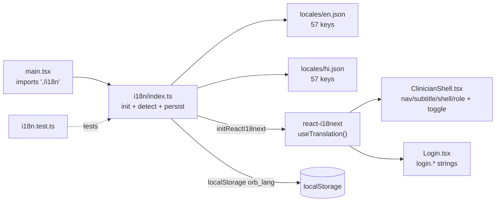
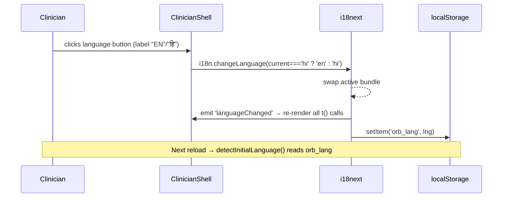

# Internationalization: i18next, locales, and translation conventions

Orb's internationalization ("i18n", the numeronym for the 18 letters between the *i* and the *n* of "internationalization") is a deliberately small, self-contained slice. One file (`src/i18n/index.ts`) wires the i18next library into React, two JSON files (`en.json`, `hi.json`) hold English and Hindi strings for the app's navigation, shell chrome, login screen and panel headings, and one test file (`i18n.test.ts`) guards the behaviour. The stated design intent is a "proven first slice" for ward tablets in the India market: translate the high-visibility surfaces first, persist the tablet's language choice, and let the rest of the app migrate incrementally by adding keys. This guide explains the setup, the key-naming convention, exactly how English and Hindi compare (they are at full parity, 57 keys each), and the precise recipes for adding a new language or a new translated string.

Definitions used throughout:
- **i18n**, internationalization: the practice of externalizing every user-facing string so the UI can render in multiple languages without code changes.
- **locale**, a language (and optionally region) identity, here just the language codes `en` (English) and `hi` (Hindi). Each locale has one JSON bundle.
- **interpolation**, substituting a runtime value into a template string, e.g. turning `"Offline · {{count}} pending"` plus `{ count: 3 }` into `"Offline · 3 pending"`. The `{{...}}` placeholders are i18next's interpolation syntax.
- **fallback language**, the locale i18next uses to look up a key when the active locale is missing that key. Here it is English, so a missing Hindi string degrades to real English text rather than showing a raw key like `shell.signOut`.
- **React hook**, a function (name starts with `use`) that lets a React component tap into framework features. `useTranslation()` from `react-i18next` is the hook components call to get the translator function `t` and the live `i18n` instance.

---

## Purpose and neighbors

The problem: Orb runs on shared tablets at nursing stations in Indian hospitals where the operating clinician may prefer Hindi. Hard-coding English strings into every component would make translation impossible without rewriting the UI. i18n solves this by giving every translatable surface a stable *key* (e.g. `nav.vigil`) that resolves to different text per locale, plus a single switch that flips the whole UI and remembers the choice.

Why it is small: the codebase treats translation as an *incremental migration*. Only the always-on chrome, navigation rail, page subtitles, sign-out/theme/language controls, sync-status pill, role labels, and the login form, is translated today. Deep clinical panels remain English and are meant to be migrated key-by-key later. The fallback language guarantees nothing ever renders a broken raw key while that migration is in progress.

Neighbors:
- **App shell / navigation** (`src/pages/ClinicianShell.tsx`), the biggest consumer; renders nav labels, subtitles, role label, and owns the language-toggle button. See guide 01 (app shell).
- **Login** (`src/pages/Login.tsx`), consumes the `login.*` namespace.
- **App bootstrap** (`src/main.tsx`), imports `./i18n` for its init side-effect before React mounts. See guide 02 (app bootstrap / api client neighbourhood).
- **Realtime/offline sync** (guide 06), owns the *behaviour* behind `status.offlinePending` / `status.syncingPending`; i18n only owns the *wording*.

---

## File map

| File | Lines (approx) | Role |
| --- | --- | --- |
| `src/i18n/index.ts` | 55 | Configures and exports the singleton i18next instance: language detection, resource registration, fallback, and localStorage persistence. |
| `src/i18n/locales/en.json` | 83 | English bundle. 57 leaf keys across 6 top-level namespaces. The reference bundle and fallback source. |
| `src/i18n/locales/hi.json` | 83 | Hindi bundle. Mirrors `en.json` exactly (same 57 keys, same structure) with Devanagari translations. |
| `src/i18n/i18n.test.ts` | 36 | Vitest suite: default-load, language switch, interpolation, fallback, and localStorage persistence. |

---

## How it works

### Flow 1: Boot and initial language selection

1. `src/main.tsx:11` runs `import './i18n'`. This is a *side-effect import*: it does not use any named export, it simply executes `index.ts` top to bottom so i18next is initialized before React renders.
2. `index.ts` calls `detectInitialLanguage()` (`src/i18n/index.ts:21`), which reads `localStorage['orb_lang']`. If the stored value is one of the supported languages (`en`, `hi`) it is used; otherwise it defaults to `'en'`.
3. `i18n.use(initReactI18next).init({...})` (`src/i18n/index.ts:33`) registers both bundles under the default namespace `translation`, sets `lng` to the detected language and `fallbackLng` to `'en'`, and disables i18next's HTML escaping because React already escapes rendered values.
4. A `languageChanged` listener (`src/i18n/index.ts:47`) is attached so any future switch writes the new language back to `localStorage['orb_lang']`.

### Flow 2: A component reads a translated string

1. A component calls `const { t } = useTranslation()` (e.g. `src/pages/Login.tsx:33`).
2. It renders `t('login.signIn')`. i18next looks up `signIn` under the `login` namespace object of the active locale.
3. If the active locale lacks the key, i18next falls back to `en` and returns that string. If English also lacks it, i18next returns the raw key string.
4. For strings with placeholders, the component passes values: `t('status.offlinePending', { count: 3 })` → `"Offline · 3 pending"`.

### Flow 3: Switching language at runtime

Note this flow is entirely client-side. There is no server round-trip, no server-owned locale, and no HTTP header negotiation, language lives purely in the browser's localStorage.

---

## Function-by-function

### Module constants: `src/i18n/index.ts:17-19`
**Signature:** `LANGUAGE_STORAGE_KEY: string`, `SUPPORTED_LANGUAGES: readonly ['en','hi']`, `SupportedLanguage = 'en' | 'hi'`
**Does:** declare the localStorage key name and the closed set of supported language codes, plus a derived TypeScript union type.
**How it works:**
1. `LANGUAGE_STORAGE_KEY = 'orb_lang'` (`src/i18n/index.ts:17`) is the single source for the persistence key, reused by `detectInitialLanguage`, the `languageChanged` listener, and the test.
2. `SUPPORTED_LANGUAGES = ['en', 'hi'] as const` (`src/i18n/index.ts:18`), the `as const` makes it a readonly tuple of literal strings, not `string[]`.
3. `SupportedLanguage` (`src/i18n/index.ts:19`) is `(typeof SUPPORTED_LANGUAGES)[number]`, i.e. the union `'en' | 'hi'`, derived so the type can never drift from the array.
**Why it exists:** centralizing these prevents the storage key or the language whitelist from being duplicated (and diverging) across files, and the derived type gives compile-time safety for any function that returns a language code.
**Data in/out:** none (declarations).
**Talks to:** consumed by `detectInitialLanguage`, `i18n.on('languageChanged')`, and imported by `src/i18n/i18n.test.ts:2` (`LANGUAGE_STORAGE_KEY`).
**Change guide:** To add a language, append its code here (see the recipe below). Knock-on: `detectInitialLanguage`'s membership check and the `SupportedLanguage` type update automatically; you must also register its resource bundle at `src/i18n/index.ts:34-37`.
**Gotchas:** The membership check at `src/i18n/index.ts:24` casts to `readonly string[]`, adding a code here is necessary but *not sufficient*; a code accepted by detection with no matching `resources` entry would fall back to English silently.

### detectInitialLanguage: `src/i18n/index.ts:21`
**Signature:** `() → SupportedLanguage`
**Does:** pick the startup language from persisted storage, defaulting to English.
**How it works:**
1. Read `localStorage.getItem('orb_lang')` inside a `try` (`src/i18n/index.ts:23`).
2. If the stored value is truthy *and* is in `SUPPORTED_LANGUAGES`, return it cast to `SupportedLanguage` (`src/i18n/index.ts:24-26`).
3. Any thrown error (localStorage unavailable in private mode or server-side rendering) is swallowed by the empty `catch` and execution falls through (`src/i18n/index.ts:27-29`).
4. Return `'en'` as the default (`src/i18n/index.ts:30`).
**Why it exists:** a ward tablet must remember its language across reloads, but localStorage access can throw in restricted contexts; wrapping it keeps boot crash-proof.
**Data in/out:** in: `localStorage['orb_lang']` (string or null). out: `'en' | 'hi'`.
**Talks to:** called once at `src/i18n/index.ts:38` (`lng: detectInitialLanguage()`). Reads the same key that `languageChanged` writes.
**Change guide:** To change the default language, edit the `return 'en'` at `src/i18n/index.ts:30` (and consider aligning `fallbackLng`). Watch out: changing only the default without the fallback means a missing key still resolves via English.
**Gotchas:** An unknown stored value (e.g. a stale `'fr'` from a future build) is ignored, not honoured, the function returns `'en'` rather than trusting arbitrary storage. Good defensive behaviour, but means downgrading the supported set can silently reset a user's chosen language.

### i18n.init call: `src/i18n/index.ts:33`
**Signature:** `i18n.use(initReactI18next).init(config) → i18n`
**Does:** register the React binding and the translation resources, and configure fallback/interpolation.
**How it works:**
1. `.use(initReactI18next)` (`src/i18n/index.ts:33`) installs the react-i18next plugin so `useTranslation` and `<Trans>` work and re-render on language change.
2. `resources` (`src/i18n/index.ts:34-37`) maps each locale to `{ translation: <bundle> }`. `translation` is i18next's default *namespace*, because all keys live under it, components address keys without a namespace prefix (`t('nav.vigil')`, not `t('translation:nav.vigil')`).
3. `lng: detectInitialLanguage()` (`src/i18n/index.ts:38`) sets the starting locale.
4. `fallbackLng: 'en'` (`src/i18n/index.ts:39`) routes any missing key to English.
5. `interpolation.escapeValue: false` (`src/i18n/index.ts:41-42`) disables i18next's own HTML-escaping because React escapes rendered content itself; double-escaping would corrupt output.
**Why it exists:** this single call is the whole configuration of the subsystem, one place that ties bundles, React, fallback and interpolation together.
**Data in/out:** in: the two imported JSON objects `en`, `hi`. out: the initialized singleton (mutated in place; the module's `default` export).
**Talks to:** imports `en`/`hi` (`src/i18n/index.ts:3-4`), `i18next` and `initReactI18next` (`src/i18n/index.ts:1-2`). Downstream, every `useTranslation()` in the app binds to this instance.
**Change guide:** To register a third bundle, add a line like `fr: { translation: fr }` here after importing `fr`. To make the app default to Hindi, change `lng` (via `detectInitialLanguage`), but leaving `fallbackLng: 'en'` is usually correct so partial locales still resolve.
**Gotchas:** Because `escapeValue` is `false`, never interpolate untrusted/raw HTML through `t()` outside React's escaping (e.g. into `dangerouslySetInnerHTML`); rely on React to escape. The init is synchronous with statically-imported JSON, no async loading, so bundles ship in the main JS chunk (fine at this size, but every added locale grows the bundle unless later switched to lazy backend loading).

### languageChanged listener: `src/i18n/index.ts:47`
**Signature:** `i18n.on('languageChanged', (lng: string) → void)`
**Does:** persist the newly-selected language to localStorage on every switch.
**How it works:**
1. On each `changeLanguage` call, i18next emits `languageChanged` with the new code.
2. The handler writes `localStorage.setItem('orb_lang', lng)` inside a `try` (`src/i18n/index.ts:48-49`).
3. Write failures (private mode quota/security errors) are swallowed by the empty `catch` (`src/i18n/index.ts:50-52`).
**Why it exists:** closes the persistence loop, `detectInitialLanguage` reads exactly what this writes, so a chosen language survives reloads.
**Data in/out:** in: `lng` string from i18next. out: side-effect write to localStorage.
**Talks to:** paired with `detectInitialLanguage`. Fired by `src/pages/ClinicianShell.tsx:244` `i18n.changeLanguage(...)`.
**Change guide:** To also inform the backend of language preference, add an API call here, but keep the localStorage write, since detection depends on it.
**Gotchas:** The handler writes whatever `lng` i18next reports, including values with region suffixes or unknown codes if some future code calls `changeLanguage('en-US')`; `detectInitialLanguage` would then reject `'en-US'` on next boot and reset to `'en'`. Keep language codes aligned with `SUPPORTED_LANGUAGES`.

### default export: `src/i18n/index.ts:55`
**Signature:** `export default i18n`
**Does:** expose the configured singleton for direct imports (mainly tests).
**Talks to:** imported by `src/i18n/i18n.test.ts:2`. Application components use the `i18n` returned from `useTranslation()` rather than this import; the raw import is for non-component code and tests.
**Gotchas:** none noteworthy.

---

### Locale bundles: `src/i18n/locales/en.json` and `hi.json`

Both files are flat-per-namespace JSON objects with the identical shape. There is no code here; the "units" are the six top-level **namespaces** (nested key groups). The convention is `namespace.key`, dot-addressed via `t('namespace.key')`. Do not list every leaf key in changes, think in namespaces mapped to their UI pillar.

| Namespace | Keys | Pillar / surface it labels | Where consumed |
| --- | --- | --- | --- |
| `nav` | 15 | Navigation-rail labels, one per pillar tab (helix/pharmacy, pharmacy-verify, vigil/patients, orders, relay, sage, scribe, lens, forecast, appointments, surgical-suite, admin, command, capacity, coding) | `src/pages/ClinicianShell.tsx:345,349` via `t(\`nav.${tab.id}\`)` |
| `subtitle` | 15 | The descriptive subtitle under each active pillar's page header | `src/pages/ClinicianShell.tsx:389` via `t(\`subtitle.${activeTab}\`)` |
| `shell` | 7 | Shell chrome buttons: admit patient, sign out (+ title), theme toggle (both directions), language toggle, current language name | `src/pages/ClinicianShell.tsx:415-421` and admit/sign-out controls |
| `status` | 4 | Offline/sync pill wording (offlineCaching, offlinePending, syncingPending, synced) | `src/pages/ClinicianShell.tsx` sync pill |
| `role` | 5 | Human role labels (doctor→Physician, nurse, admin→Administrator, pharmacist, staff) | `src/pages/ClinicianShell.tsx:241` via `t(\`role.${roleKey}\`)` |
| `login` | 11 | Login/Bridge form: titles, field labels, placeholders, button/loading states, quick-access | `src/pages/Login.tsx:98-185` |

**Interpolation keys:** two `status` keys carry a `{{count}}` placeholder, `status.offlinePending` (`src/i18n/locales/en.json:47`) and `status.syncingPending` (`src/i18n/locales/en.json:48`). These are the only interpolated strings; callers must pass `{ count }`.

**Dynamic key construction:** `nav`, `subtitle`, and `role` are addressed with template literals built from runtime values (`tab.id`, `activeTab`, `roleKey`). This is why every pillar id must have a matching key in *both* namespaces, and why the `role` fallback logic in the shell (`src/pages/ClinicianShell.tsx:237-241`) normalizes unusual roles (e.g. `surgeon`→`doctor`, unknown→`staff`) to a key that exists.

**Why this convention:** grouping by surface (nav/shell/login) rather than by pillar keeps related strings together for translators and makes the "translate the chrome first" strategy legible, a translator can complete an entire namespace and know a whole surface is covered.

**Hindi coverage:** measured programmatically, `en.json` and `hi.json` each contain **57 leaf keys** across the **same 6 namespaces with identical structure**, zero keys missing from Hindi, zero extra. Hindi is at full parity with English for the translated slice. (Counts: nav 15, subtitle 15, shell 7, status 4, role 5, login 11 = 57.)

**Change guide, add a translated string:**
1. Add the key under the right namespace in `en.json`, e.g. `"shell": { ..., "help": "Help" }`.
2. Add the *same* key path with the translation in `hi.json`: `"help": "मदद"`.
3. Use it in the component: `t('shell.help')`.
4. If it needs a value, use `{{name}}` in the string and pass `t('shell.greeting', { name })`.
Knock-on: nothing today enforces parity automatically (see Discrepancies), so you must add both bundles by hand. Footgun: dynamic keys (`t(\`nav.${id}\`)`) are invisible to grep, adding a new pillar id requires adding the key to `nav` *and* `subtitle`, or the label falls back to English/raw.

**Change guide, worked example (new pillar "labs"):** to add a Labs tab you would add `"labs": "Labs"` to `nav` and `"labs": "Lab results & trends"` to `subtitle` in both bundles, because `src/pages/ClinicianShell.tsx:345` and `:389` build those keys from the tab id at runtime.

**Change guide, worked example (reword the offline pill):** to change `"Offline · {{count}} pending"` to `"Working offline, {{count}} queued"`, edit `status.offlinePending` in both bundles, keep the exact `{{count}}` token, and update the hard-coded expectation in `src/i18n/i18n.test.ts:22` or that test breaks.

**Gotchas:** Devanagari strings and the `·` middot in `status`/`login` are multi-byte UTF-8, keep files UTF-8 and never regex-split on byte length. The `{{count}}` placeholders must match exactly between locales (same name, double braces) or interpolation silently leaves the placeholder in.

---

### i18n.test.ts: Vitest parity/behaviour suite

**Framework note:** Vitest is the test runner (see the tests guide). `describe`/`it`/`expect` group and assert; `beforeEach` runs before every case.

### beforeEach reset: `src/i18n/i18n.test.ts:5`
**Does:** reset the active language to `'en'` before each test so cases don't leak state.
**How it works:** `await i18n.changeLanguage('en')`, awaited because `changeLanguage` returns a promise; this also fires `languageChanged`, writing `orb_lang` to the jsdom localStorage.
**Why it exists:** the i18next singleton is shared across tests; a test that switches to Hindi would poison the next unless reset.
**Talks to:** the default-exported singleton from `src/i18n/index.ts`.
**Gotchas:** because it awaits, the persistence side-effect runs, tests share jsdom localStorage state.

### "loads the English bundle by default": `src/i18n/i18n.test.ts:9`
**Does:** assert `t('nav.vigil') === 'Patients'` and `t('login.signIn') === 'Sign In'`, verifies default locale and basic lookup.

### "loads the Hindi bundle and switches keys": `src/i18n/i18n.test.ts:14`
**Does:** after `changeLanguage('hi')`, assert `i18n.language === 'hi'`, `t('nav.vigil') === 'मरीज़'`, `t('login.signIn') === 'साइन इन'`, verifies the switch actually swaps bundles.

### "interpolates the pending count": `src/i18n/i18n.test.ts:21`
**Does:** assert `t('status.offlinePending', { count: 3 }) === 'Offline · 3 pending'`, the one test that exercises interpolation and confirms `escapeValue:false` doesn't mangle the middot.

### "falls back to English for a missing key": `src/i18n/i18n.test.ts:25`
**Does:** in Hindi, assert `t('shell.signOut') !== 'shell.signOut'`, i.e. never returns the raw key. As the comment notes, every English key currently exists in Hindi, so this proves the *fallback guarantee* rather than an actual gap.
**Gotchas:** This is a weak assertion, it passes if Hindi *has* the key too (which it does). It does not verify that fallback specifically produced English; it only verifies "not a raw key."

### "persists the chosen language": `src/i18n/i18n.test.ts:32`
**Does:** after switching to Hindi, assert `localStorage.getItem('orb_lang') === 'hi'`, verifies the `languageChanged` persistence listener.

**Overall change guide:** This suite is not a structural parity test, it hard-codes specific expected strings, so any wording change to those exact keys (e.g. renaming "Patients") breaks a test. There is *no* automated loop asserting `en.json` and `hi.json` have identical key sets; parity today is verified only manually / by these spot checks. If you want a real parity guard, add a test that recursively collects leaf keys from both bundles and asserts equal sets (see Discrepancies).

---

## Cross-subsystem contracts

This subsystem exposes **no REST routes, no socket events, and no DB tables**, it is a pure client-side module. What other code relies on:

| Contract | Kind | Consumers |
| --- | --- | --- |
| `export default i18n` (`src/i18n/index.ts:55`) | ES module default export (configured singleton) | `src/i18n/i18n.test.ts`; any non-component code needing the raw instance |
| `LANGUAGE_STORAGE_KEY` (`src/i18n/index.ts:17`) | named export (`'orb_lang'`) | `src/i18n/i18n.test.ts:2` |
| `SUPPORTED_LANGUAGES` / `SupportedLanguage` (`src/i18n/index.ts:18-19`) | named exports | available for typed language handling |
| `import './i18n'` side-effect | module init | `src/main.tsx:11`, must run before React mounts |
| The `translation` namespace key space (`nav.*`, `subtitle.*`, `shell.*`, `status.*`, `role.*`, `login.*`) | string-key contract | `src/pages/ClinicianShell.tsx`, `src/pages/Login.tsx` via `useTranslation()` |
| `localStorage['orb_lang']` | browser storage key | read by detection, written by the listener; no other owner |

The realtime/offline subsystem (guide 06) owns the *events* that decide when `status.*` strings show; i18n owns only their wording. RBAC/role mapping (guide 03) supplies the `role` value that the shell normalizes into a `role.*` key.

---

## Rebuild notes

**Prerequisites before building i18n:**
1. A React 19 + TypeScript app with a Vite entry (`main.tsx`), guide 02.
2. Dependencies `i18next` and `react-i18next` installed.
3. Vitest + jsdom configured (for the test), the tests guide.
4. A component that will consume translations (the shell / login), but i18n can be built and tested standalone first.

**Build order:**
1. Create `src/i18n/locales/en.json` with the six namespaces. Start with `nav` + `shell` + `login` so the always-on chrome is covered.
2. Create `src/i18n/locales/hi.json` mirroring the exact key structure with translations. Keep `{{count}}` placeholders identical.
3. Create `src/i18n/index.ts`: constants (`LANGUAGE_STORAGE_KEY`, `SUPPORTED_LANGUAGES`, `SupportedLanguage`), `detectInitialLanguage`, the `.use(initReactI18next).init({resources, lng, fallbackLng:'en', interpolation.escapeValue:false})` call, the `languageChanged` persistence listener, and the default export.
4. Add `import './i18n'` to `main.tsx` before `App`.
5. Wire consumers: `const { t, i18n } = useTranslation()`; render `t('nav.vigil')`; add a toggle that calls `i18n.changeLanguage(i18n.language === 'hi' ? 'en' : 'hi')`.
6. Write `i18n.test.ts` covering default load, switch, interpolation, fallback, persistence.

**Acceptance check:** you can now (a) load the app and see English chrome; (b) click the language button and watch nav labels, subtitles, buttons, and login form flip to Hindi Devanagari; (c) reload the tablet and keep Hindi (because `orb_lang` persisted); (d) run `vitest src/i18n/i18n.test.ts` green; (e) confirm both bundles have 57 identical keys, so no surface renders a raw key.

---

## Discrepancies and open questions

1. **No automated key-parity test.** `i18n.test.ts` hard-codes expected strings and spot-checks fallback, but there is *no* test that programmatically asserts `en.json` and `hi.json` share the same leaf-key set. Parity is currently 57/57 by manual discipline. A translator who adds an English key and forgets Hindi would ship an English-in-Hindi string with no failing test, the fallback masks it. Recommended: add a recursive leaf-key set-equality test.
2. **Fallback test is weak.** `src/i18n/i18n.test.ts:29` asserts only that `t('shell.signOut')` is not the raw key. Since Hindi actually contains `shell.signOut`, the test passes on the Hindi value, not on an English fallback. It therefore does not truly exercise the fallback path; a genuinely-missing key is never tested.
3. **Bundles are eagerly imported into the main chunk.** `src/i18n/index.ts:3-4` statically imports both JSON files, so every locale ships in the initial bundle. Harmless at 57 keys × 2, but as more of the app migrates and more languages are added this grows the entry chunk; there is no lazy `i18next-http-backend` loading. Noted as a scaling consideration, not a current bug.
4. **Region-suffix / unknown codes reset silently.** If any caller ever invokes `changeLanguage` with a code outside `SUPPORTED_LANGUAGES` (e.g. `'en-US'`), the `languageChanged` listener persists it, but the next boot's `detectInitialLanguage` rejects it and resets to `'en'`, a silent preference loss. Not triggered by current code (the only switch site at `src/pages/ClinicianShell.tsx:244` toggles strictly between `'en'`/`'hi'`), but a latent trap.
