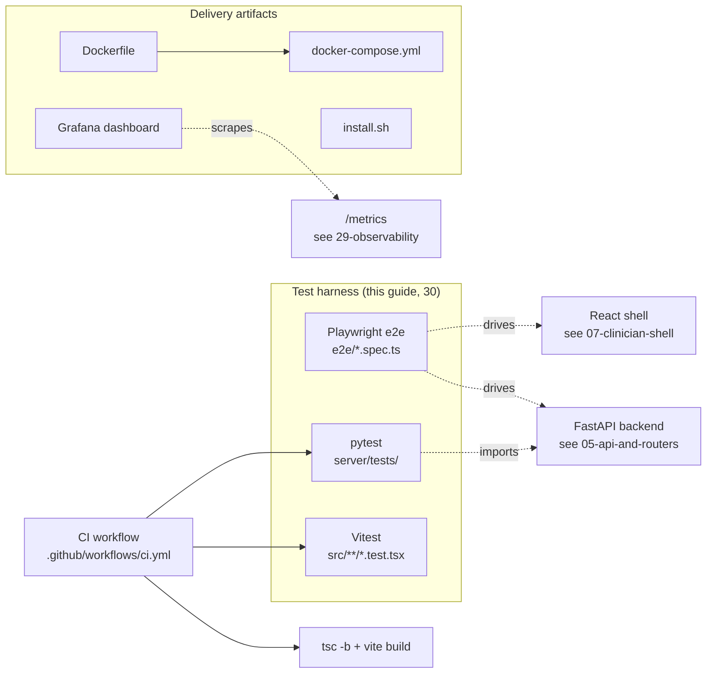
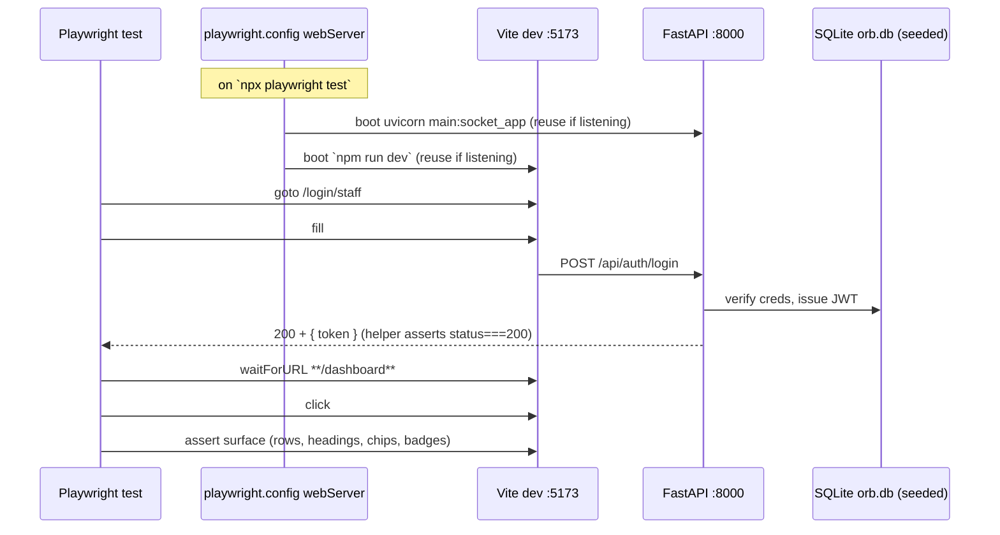

# The Test Harness and CI: e2e golden journeys, unit tests, pytest, pipeline gates

> **Update, 4 October 2026.** The `Dockerfile` and `docker-compose.yml` described in this guide were retired: Orb is installed natively on the appliance, and a container on macOS cannot reach the GPU. The files are in `docs/archive/retired-docker-2026-10-04/`. The sections about them below are kept as a record of what they did.

Orb ships with three independent automated-test layers and one delivery pipeline that runs them. **Playwright** drives five browser "golden journeys" against the *real* React shell and the *real* FastAPI backend; **Vitest** runs fast, isolated React component/unit tests in a fake browser (jsdom); **pytest** runs the Python backend suite against an isolated throwaway SQLite database. A single GitHub Actions workflow (`ci.yml`) gates every push and pull request on the pytest suite, the TypeScript typecheck+build, and the Vitest suite, while treating lint as informational. Alongside the harness live the *delivery artifacts*: a two-stage Dockerfile, a two-service docker-compose topology, a one-command `install.sh`, and a Grafana dashboard that reads the app's `/metrics` endpoint. This guide walks every file, defines the jargon inline, and tells you exactly what to change to extend each piece.

---

## Purpose and neighbors

**Why this subsystem exists.** Orb handles PHI (Protected Health Information, patient data that must not leak or be corrupted) and makes clinical decisions, so "does it still work?" cannot be answered by clicking around. The harness answers it three ways at three speeds:

| Layer | Speed | What it proves | Runs where |
|-------|-------|----------------|------------|
| **Playwright e2e** | slow (seconds/journey, needs both servers) | The whole stack boots and a real user journey completes end-to-end | `e2e/` |
| **Vitest** | fast (ms) | Individual React components/utilities behave in isolation | `src/**/*.test.tsx` |
| **pytest** | fast-ish | Backend services/routes/RBAC behave against a real (but throwaway) DB | `server/tests/` |

Jargon you need before reading on:

- **e2e test** ("end-to-end"): a test that exercises the *entire* system as a user would, real browser, real network, real backend, real database, rather than one function in isolation.
- **golden journey**: a canonical, must-never-break user path (log in → see patients; write a note; place an order). If a golden journey fails, the product is broken for real users, not just in the abstract.
- **fixture**: a reusable piece of test setup/teardown. In pytest, a function decorated `@pytest.fixture` that supplies state (like a seeded database) to tests and cleans up afterwards.
- **conftest** (`conftest.py`): pytest's special auto-discovered file. Any fixture defined here is available to every test in that directory tree *without importing it*. Code at its top level runs once, before any test module is imported, which Orb exploits to redirect the database before the app can bind to the wrong one.
- **CI gate**: a check in the Continuous Integration pipeline that must pass (green) for a change to be considered mergeable. A "non-blocking" check runs and reports but does not fail the build.
- **flake** (flaky test): a test that passes or fails non-deterministically (timing, shared state, network). Flakes erode trust in the whole suite; much of the config below exists to kill flakes (serial workers, generous timeouts, fail-fast login).

**Neighbors** (cross-referenced throughout): the auth flow (see guide 03-auth-rbac), the Vigil patient panel (see 08-vigil), Scribe documentation (see 12-scribe), Orders/CPOE (see 14-orders), Pharmacy verify (see 15-pharmacy), the Flight Recorder audit replay (see 20-flight-recorder), the seed script (see 04-database-schema / seed), and observability/metrics (see 29-observability).

---

## File map

| File | Lines (approx) | Role |
|------|----------------|------|
| `e2e/01-login-and-vigil.spec.ts` | 42 | Golden journey #1: log in as doctor, see the Vigil patient list render with ≥1 seeded patient. |
| `e2e/02-scribe-note.spec.ts` | 58 | Golden journey #2: open Scribe, type a note, assert the compose + note-format governance UI renders (no audio/LLM). |
| `e2e/03-orders-cpoe.spec.ts` | 80 | Golden journey #3: create an order with a real LOINC code, assert it lists with a `draft` status chip. |
| `e2e/04-pharmacy-verify.spec.ts` | 47 | Golden journey #4: pharmacist opens the Verify Queue; empty state OR populated queue both pass. |
| `e2e/05-admin-flight-recorder.spec.ts` | 47 | Golden journey #5: admin opens Flight Recorder, asserts timeline + hash-chain integrity badge. |
| `e2e/helpers.ts` | 88 | Shared e2e helpers: demo credentials, `login`, `logout`, `openTab`. |
| `e2e/README.md` | 115 | How to seed/boot/run the e2e suite; credentials; traces; load test pointer. |
| `playwright.config.ts` | 103 | Playwright config: serial single worker, dual webServer boot, pinned Chromium, trace-on-failure. |
| `vitest.config.ts` | 15 | Vitest config: jsdom environment, jest-dom setup, `src/**/*.{test,spec}` glob. |
| `src/test/setup.ts` | 3 | Registers `@testing-library/jest-dom` matchers for all Vitest tests. |
| `server/tests/conftest.py` | 198 | Test-DB isolation (throwaway temp DB) + autouse user reseeding + session init/teardown. |
| `server/pytest.ini` | 10 | pytest config: collect only `tests/`, native asyncio mode, warning filter. |
| `.github/workflows/ci.yml` | 140 | CI: `backend` (pytest) + `frontend` (lint non-blocking, typecheck+build, vitest). |
| `Dockerfile` | 99 | Two-stage image: build SPA (node) → run FastAPI (python) with CPU torch + dev deps. |
| `docker-compose.yml` | 108 | Two services (`ollama`, `orb`); `orb` shares ollama's netns so hardcoded `localhost:11434` resolves. |
| `install.sh` | 262 | Idempotent one-command installer: venv, deps, secrets, self-signed TLS, migrations, frontend build. |
| `ops/grafana-dashboard.json` | 295 | Grafana dashboard reading Prometheus metrics scraped from Orb's `/metrics`. |
| `server/requirements.txt` | 42 | Full backend deps (incl. Mac/GPU-only FlagEmbedding + whisper). |
| `server/requirements-dev.txt` | 26 | Slim deps for tests/CI/Docker: core app + torch + pytest, no Mac/GPU packages. |

---

## How it works

### Flow A: a Playwright golden journey end-to-end

Every spec follows the same skeleton: **boot → log in → open a tab → assert the surface**. Playwright (a browser-automation library) launches a real Chromium, navigates to the Vite dev server on `:5173`, which proxies API calls to FastAPI on `:8000`.

1. **Server management.** Unless `ORB_E2E_NO_WEBSERVER=1` is set, Playwright itself boots both servers via the `webServer` array (`playwright.config.ts:77`), waiting for the backend's `/docs` and the Vite base URL to respond, and reusing any instance already listening (`reuseExistingServer: true`).
2. **Login.** Each spec calls `login(page, role)` (`e2e/helpers.ts:25`), which fills the real staff-login form, watches the `/api/auth/login` response, and throws a *precise* error if it is not HTTP 200, so a bad seed fails fast instead of hanging until the 60 s timeout.
3. **Navigation.** `openTab(page, tabId)` (`e2e/helpers.ts:80`) clicks `#nav-<tabId>` and asserts it gains the `shell__nav-item--active` class.
4. **Assertions.** Each spec asserts something a real user would see (a patient row, a note-format `<select>`, a `draft` chip, a "Chain verified" badge). All panels are mounted at once with display toggled, so specs scope queries to the active panel (e.g. `#panel-orders`) to avoid Playwright *strict mode* errors (a locator matching >1 element throws).

### Flow B: Vitest (frontend unit tests)

`npm run test` → `vitest run` (`package.json:11`). Vitest loads `vitest.config.ts`, which sets `environment: 'jsdom'` (jsdom = a pure-JS implementation of a browser DOM, so React components render without a real browser), runs `src/test/setup.ts` once to register jest-dom matchers, and collects `src/**/*.{test,spec}.{ts,tsx}`. Existing examples: `src/components/OrbLogo.test.tsx`, `src/api/sse.test.ts`, `src/i18n/i18n.test.ts`.

### Flow C: pytest (backend suite)

`pytest -q` from `server/`. `pytest.ini` restricts collection to `tests/`. Before any test module imports the app, `conftest.py`'s top-level code redirects `ORB_DB_PATH` to a fresh temp file; a session-scoped fixture calls `init_db()` and seeds users; an autouse fixture re-seeds baseline users before *every* test so foreign-key constraints survive tests that wipe the `users` table. 41 test modules currently live under `server/tests/`.

### Flow D: CI pipeline

On every push/PR, `ci.yml` runs two parallel jobs: `backend` (pytest against a throwaway DB in dev profile) and `frontend` (lint non-blocking → `npm run build` which runs `tsc -b` then `vite build` → `npm run test`).

---

## Function-by-function

### e2e/helpers.ts

#### CREDS: `e2e/helpers.ts:10`
**Signature:** `const CREDS = { doctor|nurse|pharmacist|admin: { id, password, name } } as const`
**Does:** Names the four demo staff accounts used by the specs.
**How it works:** A frozen (`as const`) record mapping each role to the seeded employee id (`DOC001`, `NUR001`, `PHA001`, `ADM001`), the shared password `"password"`, and a display name.
**Why it exists:** Centralises the credentials so a seed change touches one place, and gives `login()` a typed `keyof typeof CREDS` argument so a typo (`'docter'`) is a compile error.
**Data in/out:** Static object literal; no I/O.
**Talks to:** Read by `login()`. The values must match `server/scripts/seed_clinical_data.py` (see guide 04). Consumed indirectly by all five specs.
**Change guide:** To add a role journey (e.g. `charge_nurse`), add an entry here whose `id`/`password` the seed actually creates; knock-on: the new role must expose a `#nav-<tab>` for `openTab` to click. Watch out: these are DEV-only quick accounts gated behind `import.meta.env.DEV` in the UI, they will not exist in a prod build.
**Gotchas:** The password is `"password"` for all four; if the seed ever per-account-randomises passwords, every spec breaks at `login`.

#### login: `e2e/helpers.ts:25`
**Signature:** `login(page: Page, who: keyof typeof CREDS) → Promise<void>`
**Does:** Logs in through the real staff form and lands on the dashboard shell, or throws a precise error.
**How it works:**
1. Looks up `{ id, password }` from `CREDS`.
2. `page.goto('/login/staff')` and asserts `#input-employee-id` is visible (a clear message if the form never rendered).
3. Fills id + password (`#input-employee-id`, `#input-password`).
4. Registers `page.waitForResponse(...)` for the `POST /api/auth/login` call *before* clicking `#btn-login` (so the response is not missed).
5. If the response status is not 200, reads the body and throws `Login failed for <who> (<id>): HTTP <status>, <body>. Is the backend seeded ...?`.
6. Waits for the URL to become `**/dashboard**`, then asserts the `.login__error` banner has count 0.
**Why it exists:** Turns the single most common e2e failure (bad seed / wrong password / backend down) from a mystery 60 s timeout into a one-line diagnosis. This is the "skippable-graceful" contract the specs rely on.
**Data in/out:** In: page + role key. Out: none (side effect: authenticated session, JWT stored in `localStorage` under `orb_token`).
**Talks to:** Calls `POST /api/auth/login` (owned by guide 03-auth). Called by all five specs. Reads `CREDS`.
**Change guide:** To point the suite at a different login route, change `/login/staff` and the `waitForResponse` URL predicate together. Knock-on: `waitForURL('**/dashboard**')` must still match the post-login redirect. Footgun: registering `waitForResponse` *after* the click races the network and can miss the response.
**Gotchas:** The 20 s response timeout is separate from the config's `expect` timeout; a slow cold-start backend can exceed it on first boot.

#### logout: `e2e/helpers.ts:68`
**Signature:** `logout(page: Page) → Promise<void>`
**Does:** Clicks the shell logout button if present and best-effort returns to the login screen.
**How it works:** If `#btn-logout` exists, click it and `waitForURL('**/login/**')`, swallowing the wait error (`.catch(() => {})`) so logout never fails a test.
**Why it exists:** A safe teardown helper. Currently defined but not called by any of the five specs (they each run in a fresh context).
**Talks to:** Clicks `#btn-logout` in `ClinicianShell` (see guide 07).
**Change guide:** If you add per-test cleanup, call `logout(page)` in an `afterEach`.
**Gotchas:** Because it swallows the navigation wait, a broken logout is silently ignored, deliberate, but do not build assertions on top of it.

#### openTab: `e2e/helpers.ts:80`
**Signature:** `openTab(page: Page, tabId: string) → Promise<void>`
**Does:** Clicks a shell nav item by id and asserts it becomes active.
**How it works:** Locates `#nav-<tabId>`; asserts visible with the message "nav item #nav-<tabId> is not available for this role"; clicks it; asserts it gains class `shell__nav-item--active`.
**Why it exists:** Encapsulates the nav-id convention (`nav-<tab>` in `ClinicianShell.tsx`) and gives a role-aware failure message, a nurse has no `#nav-admin`, so the assertion message tells you *why*.
**Data in/out:** In: tab id string (`vigil`, `scribe`, `orders`, `pharmacy-verify`, `admin`). Out: none.
**Talks to:** The shell nav (guide 07). Called by every spec.
**Change guide:** To add a tab, ensure the shell renders `#nav-<newtab>` with the active class toggled; then `openTab(page, 'newtab')` works with no helper change.
**Gotchas:** Relies on the *exact* class `shell__nav-item--active`; a CSS-module rename would break every spec's navigation.

### e2e/01-login-and-vigil.spec.ts

#### "clinician logs in and sees the Vigil patient list": `e2e/01-login-and-vigil.spec.ts:13`
**Journey:** doctor logs in → Vigil ("Patients") panel renders with ≥1 admitted patient.
**Does / how it works:**
1. Subscribes to `pageerror` events into a `pageErrors[]` array (non-fatal collection for diagnostics).
2. `login(page, 'doctor')`; asserts `#btn-logout` visible (shell chrome is up).
3. `openTab(page, 'vigil')` (explicit, so the journey does not depend on default-tab ordering).
4. Asserts the text "Active Patients" and "Admitted" (metric header) are visible.
5. Locates `.patient-row`, asserts the first is visible (20 s timeout) and count > 0, the seed loads 30 patients.
6. Finally asserts `pageErrors` is empty (no uncaught JS errors during the journey).
**Why it exists:** The smoke test, "app boots, auth works, seed data reaches the UI." If this fails, running the others is pointless.
**What would break it:** backend not seeded/running; auth broken; `VigilPanel`/`PatientRow` renaming the `.patient-row` class or the "Active Patients"/"Admitted" labels; any uncaught page error.
**Talks to:** login flow (03), Vigil panel (08), seed (04).
**Gotchas:** The empty-`pageErrors` assertion makes this the strictest spec: an unrelated console *error* (not warning) anywhere on the page fails it.

### e2e/02-scribe-note.spec.ts

#### "clinician opens Scribe and the compose + structure UI renders": `e2e/02-scribe-note.spec.ts:20`
**Journey:** doctor opens Scribe → empty state → type a note → the note-format governance selector + "Structure Note" action appear.
**Does / how it works:**
1. `login('doctor')`; `openTab('scribe')`.
2. Asserts `.scribe-empty__title` text equals "Orb Scribe" (empty state).
3. Asserts the composer `#scribe-input` is visible with a `placeholder` matching `/Type clinical notes/i`, and `#scribe-record-btn` visible.
4. Fills a deterministic note and asserts its value round-trips (drives `transcript` state).
5. Asserts a `Structure Note` button appears (the entry point to the governance pipeline).
6. Scopes to `.scribe-actions select.scribe-format-select` (there are **two** such selects on screen, language and note-format, so it targets the one inside the actions row) and asserts its options contain "SOAP Note", "Discharge Summary", "I-PASS Handoff".
7. Asserts `#scribe-record-btn` is still enabled (dictation affordance wired).
**Why it exists / why it stops short:** It deliberately does **not** click "Structure Note", because that calls the MedGemma/Ollama LLM path, unavailable in CI and non-deterministic. Asserting the *governance affordances render* is the robust, deterministic contract.
**What would break it:** Scribe renaming `.scribe-empty__title`, `#scribe-input`, `#scribe-record-btn`, `.scribe-format-select`, or `.scribe-actions`; dropping one of the three governed document types.
**Talks to:** Scribe (12). **Gotchas:** the "two selects" trap is called out in-code, an unscoped `.scribe-format-select` would match both and throw strict-mode.

### e2e/03-orders-cpoe.spec.ts

#### "clinician creates a coded order and it appears with a status chip": `e2e/03-orders-cpoe.spec.ts:19`
**Journey:** doctor opens Orders (CPOE = Computerised Provider Order Entry) → enters a real patient id → creates a lab order with LOINC code `58410-2` → order lists with a `draft` chip.
**Does / how it works:**
1. `login('doctor')`; `openTab('orders')`; scope everything to `#panel-orders` (hidden sibling panels reuse the same placeholders/labels, strict-mode trap).
2. Assert the "Orders" heading.
3. Read the JWT from `localStorage.orb_token`, then `page.request.get('/api/vigil/patients', { Authorization: Bearer <token> })` through the Vite proxy to fetch a **real** patient id (seed ids `PAT-*` are random, so must not be hard-coded).
4. Fill the Patient ID input (`placeholder "e.g. PAT001"`) with that id.
5. Click "New Order"; fill the code input (`placeholder "e.g. 2524-7"`) with `LOINC_CODE` (`58410-2` = CBC panel, from `terminology_service.seed_terminology()`); click **Validate**.
6. Assert a `✓` appears (15 s), validation succeeded and auto-fills the description.
7. Belt-and-suspenders: if the description is empty, fill it; capture `uniqueDesc`.
8. Click "Create Order"; assert the new card shows `uniqueDesc`, a `draft` status (exact), and the LOINC code text.
**Why it exists:** Proves the real terminology-validation + order-creation state machine works, not a mock.
**What would break it:** terminology seed dropping `58410-2`; Orders renaming placeholders/`#panel-orders`; the order state machine defaulting to a status other than `draft`; `/api/vigil/patients` shape changing (`patients[0].id`).
**Talks to:** Orders/CPOE (14), terminology service (13/14), Vigil patients API (08).

**Worked example (03).** *Goal: default new orders to `pending` instead of `draft`.* Change the orders state machine (`orders_service`, guide 14) so the initial status is `pending`. Knock-on: line `e2e/03-orders-cpoe.spec.ts:78` asserts `page.getByText('draft', { exact: true })`, update it to `'pending'`. Footgun: the chip text is matched `exact: true`; a status label of "Pending" (capitalised) would silently miss.

### e2e/04-pharmacy-verify.spec.ts

#### "pharmacist opens the Verify Queue and it renders": `e2e/04-pharmacy-verify.spec.ts:13`
**Journey:** pharmacist logs in → opens "Verify Queue" → the pharmacist-only surface mounts and loads without error (empty state OR rows both pass).
**Does / how it works:**
1. `login('pharmacist')`; `openTab('pharmacy-verify')`.
2. Assert the heading `/Pharmacist Verification Queue/i`.
3. Wait until "Loading verification queue" has count 0 (15 s), the load resolved.
4. Compute `isEmpty` (text "No AI/agentic medications are awaiting verification") and `hasRows` (a `Verify`/`…` button present); assert `isEmpty || hasRows`.
5. If empty, assert the exact `"Queue clear"` text (another background panel renders a longer "Queue clear, no pending orders." string, matching exact avoids the collision).
**Why it exists:** The seed does not guarantee a pending AI-ordered medication, so an empty queue is a *valid* state. The real contract is "the RBAC-gated pharmacist surface mounts and loads." (RBAC = Role-Based Access Control, only certain roles see certain tabs; see guide 03.)
**What would break it:** pharmacist role losing the `pharmacy-verify` tab; the queue renaming its heading, loading text, or empty-state strings; the load hanging past 15 s.
**Talks to:** Pharmacy verify (15), RBAC (03). **Gotchas:** the "two Queue clear strings" collision is the reason for `exact: true`.

### e2e/05-admin-flight-recorder.spec.ts

#### "admin opens Flight Recorder and sees timeline + chain-integrity badge": `e2e/05-admin-flight-recorder.spec.ts:15`
**Journey:** admin logs in → Admin tab → Flight Recorder sub-tab → forensic timeline + hash-chain integrity badge render.
**Does / how it works:**
1. `login('admin')`; `openTab('admin')`.
2. Locate `#admin-tab-flight`, assert visible, click it.
3. Assert the "Flight Recorder" heading.
4. Scope to the header badge `.fr-header-right .fr-badge` (the per-event detail pane also renders an `.fr-badge`, unscoped it matches two) and assert its text matches `/Chain verified|Tampered at/i`.
5. Assert `.fr-timeline` visible and the first `.fr-tl-item` visible, a running app always has audit rows (logins, vitals, deterioration events).
6. Assert `.fr-transport` (play/step/scrub controls), proves a replay surface, not a static list.
**Why it exists:** Flight Recorder replays Orb's *hash-chained* audit + event log (each row's hash includes the previous row's hash, so tampering breaks the chain) and shows a green "Chain verified · N" or red "Tampered at #N" badge. This spec proves the forensic surface renders and the chain verifies.
**What would break it:** admin losing the tab; Flight Recorder renaming `#admin-tab-flight`, `.fr-header-right`, `.fr-badge`, `.fr-timeline`, `.fr-tl-item`, `.fr-transport`; a genuine chain break would flip the badge to "Tampered at" (still matches the regex, the test asserts the badge *renders*, either state).
**Talks to:** Flight Recorder (20), audit chain (20/29). **Gotchas:** the badge regex accepts *both* states, so a real tamper does not fail this spec, it only fails if the badge is missing.

### playwright.config.ts

#### default config export: `playwright.config.ts:35`
**Does:** Configures the whole e2e run.
**Key decisions (with rationale):**

| Setting | Line | Value | Why |
|---------|------|-------|-----|
| `testDir` | 36 | `./e2e` | Where the specs live. |
| `timeout` | 39 | 60 000 ms | Integration-heavy journeys need headroom, but not so long a hung login stalls CI forever. |
| `expect.timeout` | 40 | 15 000 ms | Per-assertion polling ceiling. |
| `fullyParallel` | 41 | `false` | **All specs share one backend DB**, parallel runs would interleave writes and make state illegible/flaky. |
| `workers` | 42 | `1` | Same reason: strictly serial so the shared SQLite state is deterministic. |
| `forbidOnly` | 43 | `!!CI` | A stray `test.only` fails CI (prevents accidentally running one test). |
| `retries` | 44 | `CI ? 1 : 0` | One retry in CI to absorb rare infra flakes; zero locally so flakes are visible. |
| `reporter` | 45 | `list` + `html` | Console list + an HTML report in `playwright-report/`. |
| `trace` | 51 | `retain-on-failure` | Full trace (DOM/network/console) captured on failure for `show-trace`. |
| `screenshot` | 52 | `only-on-failure` | Failure screenshot alongside the trace. |
| `baseURL` | 48 | `:5173` (Vite) | Specs use relative paths; Vite proxies `/api` + `/socket.io` to `:8000`. |

**CHROMIUM_PATH pin, `playwright.config.ts:23`.** The sandbox ships a pre-installed Chromium at `/opt/pw-browsers/chromium` whose revision does not match what Playwright 1.61 would download (downloads are blocked). So `executablePath` is pinned to it when `PLAYWRIGHT_BROWSERS_PATH` is set; on a normal host you unset `ORB_CHROMIUM_PATH` and Playwright uses its managed browser. Launch args `--no-sandbox --disable-dev-shm-usage` (`:67`) are the standard container-Chromium flags.

**webServer array, `playwright.config.ts:77`.** When `MANAGE_SERVERS` is true (default; `ORB_E2E_NO_WEBSERVER!=='1'`), Playwright boots **both**: (1) the backend via `cd server && . .venv-dev/bin/activate && ORB_DEPLOYMENT_PROFILE=dev ORB_INGESTION_MODE=simulation python -m uvicorn main:socket_app --port 8000`, waiting on `/docs`; (2) `npm run dev`, waiting on the base URL. `reuseExistingServer: true` attaches to anything already listening rather than double-booting.
**Talks to:** the specs, the backend ASGI object `socket_app` (see guide 05), the Vite dev server.
**Change guide:** To run specs in parallel you would first have to give each spec its own isolated DB (per-worker `ORB_DB_PATH`), then set `fullyParallel: true` and raise `workers`. Footgun: flipping `workers` without DB isolation guarantees cross-test contamination.
**Gotchas:** `reuseExistingServer: true` means a *stale* server left running from a previous session (wrong profile/seed) is silently reused, if journeys behave oddly, kill stray `:8000`/`:5173` processes first.

### vitest.config.ts

#### default config export: `vitest.config.ts:6`
**Does:** Configures the frontend unit-test runner separately from the app's build config.
**How it works:** Uses `@vitejs/plugin-react`; `globals: true` (so `describe`/`it`/`expect` need no import); `environment: 'jsdom'`; `setupFiles: ['./src/test/setup.ts']`; `include: ['src/**/*.{test,spec}.{ts,tsx}']`; `css: false` (skip CSS processing, irrelevant to logic tests, faster).
**Why it exists:** A *dedicated* test config so the PWA/build plugins in `vite.config.ts` (service worker, bundle splitting; see guide 02/06) do not run under the test runner and slow/break it.
**Talks to:** `src/test/setup.ts`; the `src/**` test files; invoked by `npm run test` → `vitest run`.
**Change guide:** To test a util outside `src/`, widen the `include` glob. Footgun: `css: false` means a test that asserts computed styles will not see them, such assertions belong in Playwright, not Vitest.

### src/test/setup.ts

#### module side-effect: `src/test/setup.ts:3`
**Does:** `import '@testing-library/jest-dom/vitest'`, registers matchers like `toBeInTheDocument()`, `toHaveTextContent()` on Vitest's `expect`.
**Why it exists:** Without it, DOM-oriented assertions used by component tests are undefined. Runs once via `setupFiles`.
**Talks to:** Referenced by `vitest.config.ts:11`. **Gotchas:** none noteworthy.

### server/tests/conftest.py

This file is the backbone of backend-test *safety*. Read the header comment (`conftest.py:9`) carefully: the suite once ran against the live `orb.db` and corrupted demo data + audit logs. Everything here prevents a recurrence.

#### top-level DB redirect: `server/tests/conftest.py:24`
**Does:** Sets `ORB_DB_PATH` to a unique throwaway temp file **before** `config`/`database` are ever imported, and, since 2026-08-08, three more env vars on the same principle.
**How it works:**
1. `sys.path.insert` adds the server root so `from database import ...` resolves (`:7`).
2. `if not os.environ.get("ORB_DB_PATH")`: create a `NamedTemporaryFile(prefix="orb_test_", suffix=".db", delete=False)`, close it, and export its path into `ORB_DB_PATH`.
3. `ORB_KNOWLEDGE_INPROCESS=1` (`:33`), run the embedder/reranker in-process rather than spawning a 2 GB model subprocess per session.
4. `ORB_WATCHDOG_DIR` → a `mkdtemp(prefix="orb_test_watchdog_")` (`:40`), every `TestClient` boots the real lifespan, which arms the loop-starvation watchdog; without this the suite littered `server/ops/watchdog` with a `status.json` and a dead-man file per run.
5. `ORB_FHIR_EXPORT_DIR` → a `mkdtemp(prefix="orb_test_fhir_export_")` (`:60`), the same bug with a worse payload. The nightly FHIR self-export defaulted to `server/downtime_exports`, so every un-overridden run wrote whole patient `$everything` bundles into the **checkout** and never swept them: 390 files / 339 MB by 2026-08-08. The filenames alone are PHI (they encode patient ids). It was also the last shared non-temp path left unisolated, so concurrent pytest processes shared one directory *and* one `.last_fhir_export` throttle marker, one run could silently suppress another's export. See 28-offline-pwa-downtime for the service side.
**Why it exists:** `database.py` binds `DB_PATH` at import time from `config.DB_PATH`, which reads the `ORB_DB_PATH` env var. Because conftest top-level code runs *before* pytest imports any test module (and thus before any `from database import ...`), this is the only place the redirect can happen in time.
**Why a file, not `:memory:`:** the app opens *multiple* short-lived sqlite3 connections via `get_db()`; an in-memory DB is private per connection, so the schema/seed would be invisible to other connections. A file-backed temp DB is shared across them.
**Data in/out:** Env side effect only.
**Talks to:** `config.py` / `database.py` (see guide 04). **Gotchas:** if `ORB_DB_PATH` is *already* set (e.g. exported by a wrapper), conftest respects it, which is why the session fixture has a safety assert (below).

#### _reseed_users: `server/tests/conftest.py:127`
**Signature:** `@pytest.fixture(autouse=True)` (function scope) → yields
**Does:** Before **every** test, `INSERT OR IGNORE` four baseline users (`D001`, `D002`, `N001`, `DOC001`) with password hash `hash_password("password")`.
**How it works:** Caches the bcrypt hash in a module global `_SEED_USERS_HASH` (bcrypt is slow, compute once); opens a `get_db()` connection; `executemany` a *parameterised* insert; commit; close; yield.
**Why it exists:** Some tests wipe the `users` table for their own isolation. Without re-seeding, a *later* test's foreign-key constraints (e.g. `scribe_notes.author_id → users.id`) would fail. `autouse=True` means no test has to remember to request it.
**Talks to:** `database.get_db`, `auth.hash_password` (see guide 03/04). **Gotchas:** `INSERT OR IGNORE` silently skips existing rows, correct here, but it also masks a duplicate-id mistake.

#### init_test_db: `server/tests/conftest.py:153`
**Signature:** `@pytest.fixture(autouse=True, scope="session")` → yields, then cleans up
**Does:** Once per session, create a fresh schema (`init_db()`) and seed the four users; on teardown, delete the throwaway DB file.
**How it works:**
1. **Safety net (`:160`):** `assert "orb_test_" in basename(DB_PATH) or DB_PATH == ":memory:"`, refuses to run the destructive/seed-writing suite against a non-test DB even if `ORB_DB_PATH` was misconfigured to point at the live one. This is the guard that makes the whole suite safe.
2. `init_db()` builds the schema.
3. Seed users via **parameterised** `executemany` (the comment `:167` explicitly rejects f-string SQL, a password hash could contain a quote, and string-built SQL is a bad pattern to normalise in a PHI codebase).
4. `yield` (tests run).
5. Best-effort `os.unlink` the temp DB file if its basename still contains `orb_test_`.
**Why it exists:** Guarantees a clean, isolated, correctly-seeded DB per test session with automatic cleanup, and a hard stop against clobbering production data.
**Talks to:** `database.init_db/get_db`, `config.DB_PATH`, `auth.hash_password`. **Gotchas:** cleanup is best-effort (`except OSError: pass`), a leftover `orb_test_*.db` in `$TMPDIR` after a hard crash is harmless but not auto-reaped.

**Worked example (conftest).** *Goal: add a seeded pharmacist so a backend test can log one in.* Add `("P001", "Pharma Test", "pharmacist", "General Medicine", hashed_pwd)` to both the `seed_users` list (`:175`) **and** the `_reseed_users` rows (`:136`), miss the second and any test that wipes `users` will lose your pharmacist mid-suite. Footgun: the role string must match what RBAC (guide 03) expects, or the login succeeds but authorisation checks fail.

### server/pytest.ini
**Does / key lines:**
- `testpaths = tests` (`:4`), collect only the curated suite, keeping ad-hoc `scripts/` and `dev_tools/` scripts out of collection.
- `asyncio_mode = auto` (`:7`), run `async def` tests natively via pytest-asyncio. The comment records a real bug: before this, pytest-asyncio was not installed and 4 async tests were *silently skipped* rather than executed.
- `asyncio_default_fixture_loop_scope = function` (`:8`), one event loop per test function.
- `filterwarnings = ignore::DeprecationWarning` (`:9`), quiet third-party deprecations.
**Gotchas:** `auto` mode means *any* `async def test_*` is treated as an asyncio test with no marker, convenient, but a stray async helper accidentally named `test_*` becomes a "test."

### .github/workflows/ci.yml

**Trigger, `.github/workflows/ci.yml:3`:** every push on any branch (`"**"`) and every `pull_request`.

#### backend job: `.github/workflows/ci.yml:9`
**Does:** Run pytest on Python 3.12.
**How it works:** `working-directory: server`; env `ORB_DEPLOYMENT_PROFILE=dev` (config.py *raises* on a missing JWT secret in the prod profile, tests run in dev to avoid that), `PYTHONUNBUFFERED=1`. Steps: checkout → setup-python 3.12 with pip cache → `pip install -r requirements-dev.txt` (the *slim* file, no FlagEmbedding/whisper) → `pytest -q`.
**Why it exists:** Gates every change on the backend suite passing. **This job is blocking** (no `continue-on-error`).
**Talks to:** `conftest.py` (which redirects the DB), `requirements-dev.txt`. **Gotchas:** the DB isolation is entirely in `conftest.py`; the workflow does not set `ORB_DB_PATH`, so conftest creates the temp file itself.

#### frontend job: `.github/workflows/ci.yml:33`
**Does:** Lint (non-blocking) → typecheck+build → unit tests, on Node 20.
**Steps:**
1. checkout → setup-node 20 with npm cache → `npm ci`.
2. **Lint (non-blocking)**, `npm run lint` with `continue-on-error: true` (`:50`). **Why non-blocking:** the codebase has a large pre-existing lint backlog (mostly `@typescript-eslint/no-explicit-any`). Making lint a gate now would either block all work or force a mass suppression; instead it is surfaced in CI logs and paid down incrementally, keeping the *meaningful* gates (build/test) green-means-green.
3. **Typecheck + build**, `npm run build`, which runs `tsc -b` *first*, so this single step gates both the TypeScript typecheck and the Vite production build. Blocking.
4. **Unit tests**, `npm run test` (`vitest run`). Blocking.
**Talks to:** `vitest.config.ts`, `package.json` scripts. **Gotchas:** `npm run build` gates typecheck *because* `tsc -b` precedes `vite build`, if that script were ever changed to skip `tsc`, CI would stop catching type errors silently.

**Worked example (CI).** *Goal: make lint blocking once the backlog is cleared.* Delete `continue-on-error: true` at `.github/workflows/ci.yml:50`. Knock-on: any remaining `no-explicit-any` (or new lint error) now fails the PR. Footgun: do this only after `npm run lint` is actually clean locally, or you red-wall every open PR at once.

### Dockerfile

Two-stage build (multi-stage = build in a fat image, copy only the artifact into a lean runtime image).

#### Stage 1 `frontend`: `Dockerfile:27`
`FROM node:20-bookworm-slim`. Copies `package.json` + `package-lock.json` and runs `npm ci` *first* (layer caching: this layer only re-runs when the lockfile changes), then copies the rest and `npm run build` → `/build/dist` (== `tsc -b && vite build`).

#### Stage 2 `runtime`: `Dockerfile:43`
`FROM python:3.12-slim`. Key decisions:
- **ENV (`:46`):** `PYTHONUNBUFFERED`, `PYTHONDONTWRITEBYTECODE`, pip flags, `ORB_HOST=0.0.0.0`, `ORB_PORT=8000`, `ORB_DB_PATH=/data/orb.db`.
- **apt (`:57`):** `libgomp1` (OpenMP runtime required by torch) + `ca-certificates`; everything else ships as a manylinux wheel, so no compiler toolchain.
- **deps (`:65`):** install `torch==2.6.0+cpu` from the PyTorch CPU wheel index, then `-r requirements-dev.txt`, **the slim/dev file, NOT `requirements.txt`.** The header (`:9`) documents the tradeoff: `requirements.txt` pins `FlagEmbedding` (BGE-M3 embeddings) and `lightning-whisper-mlx` (Apple-MLX Whisper) that do **not** build on Linux; they are imported lazily and degrade gracefully, so in this container **semantic search (Sage retrieval) and on-device Whisper (Scribe) are degraded/unavailable**, while text-LLM features still work because Ollama runs as an *external* service (compose).
- **copy source (`:71`, `:78`):** backend `server/` and the built SPA `/app/dist` from stage 1. Note (`:73`): `main.py` does not mount a `StaticFiles` route for `dist/`, the SPA is intended to be served by a reverse proxy; the copy just makes assets available in the image.
- **non-root (`:84`):** create uid 10001 `orb`, `mkdir /data /app/server/uploads`, chown, `USER orb`, defence-in-depth for a PHI-handling image.
- **HEALTHCHECK (`:95`):** stdlib `urllib` GET `http://localhost:8000/api/health` (the real route, there is no bare `/health`).
- **CMD (`:99`):** `python main.py` → uvicorn `main:socket_app` on `ORB_HOST:ORB_PORT`.

**Change guide:** To ship the SPA *from* FastAPI instead of a proxy, add a `StaticFiles` mount in `main.py` for `/app/dist` and expose it; knock-on: CORS + route-ordering (see guide 05). To enable GPU embeddings you would need `requirements.txt` + a CUDA base image + GPU passthrough, a different image entirely.
**Gotchas:** `config.UPLOAD_DIR` is `/app/server/uploads` and is *not* env-overridable, so the uploads volume must mount at exactly that path (see compose).

### docker-compose.yml

Two services (`docker-compose.yml:25`).

#### ollama service: `docker-compose.yml:26`
`ollama/ollama:latest`. Publishes **both** ports: `11434` (Ollama API) *and* `8000` (Orb), the latter because `orb` shares this namespace (below). Volume `ollama-models:/root/.ollama` persists pulled weights (e.g. `medgemma:27b`). Healthcheck `ollama list`. Commented GPU `deploy.resources` block for NVIDIA passthrough.

#### orb service: `docker-compose.yml:57`
`build: .`; `network_mode: "service:ollama"` (`:61`), **shares ollama's network namespace so `localhost` inside `orb` == the ollama container.** Rationale (`:7` header): `config.py` hardcodes `OLLAMA_BASE_URL = "http://localhost:11434"` and is *not* env-overridable, and the installability workstream may not edit `config.py`; sharing the namespace is the only no-code-change way to make that hardcoded localhost reach Ollama. Consequence: `orb` cannot declare its own `ports:`/`networks:`, which is why both ports live on `ollama`.
- `depends_on: ollama condition: service_healthy`.
- **env (`:65`):** `ORB_DEPLOYMENT_PROFILE` (default prod), `ORB_JWT_SECRET` and `ORB_INGESTION_API_KEY` as **required** (`${VAR:?...}` fails compose if unset, matching config.py's prod fail-closed), CORS origins, `ORB_DB_PATH=/data/orb.db`, `ORB_LLM_MODEL` (default `medgemma:27b`), `ORB_INGESTION_MODE` (default `ingestion`).
- **volumes (`:95`):** `orb-data:/data` (SQLite DB) and `orb-uploads:/app/server/uploads` (PHI media, mounted at the non-overridable UPLOAD_DIR).
**Change guide:** the file documents the clean future path, once `config.py` honours `ORB_OLLAMA_BASE_URL`, drop `network_mode`, give each service its own network, put `ports: ["8000:8000"]` back on `orb`, and set `ORB_OLLAMA_BASE_URL=http://ollama:11434` (left commented at `:85`).
**Gotchas:** because `orb` shares the netns, `docker compose` will not let it have `ports:`, publish everything on `ollama` or it silently won't route.

### install.sh

Idempotent one-command installer (`install.sh:17` sets `set -euo pipefail`). Never overwrites secrets, `.env`, or an existing TLS cert.

Flow (each `step` is a labelled section):
1. **Arg parse (`:42`):** `--backend-only`/`--skip-frontend` toggle `BUILD_FRONTEND=0`; `--help` prints the header banner.
2. **Preflight (`:51`):** require `python3` (warn if <3.11), require `openssl` (hard fail, needed for secrets + certs), require `node`/`npm` if building the frontend (else warn + skip).
3. **venv (`:85`):** create/reuse `server/.venv`, activate, upgrade pip.
4. **Backend deps (`:100`):** `pip install -r server/requirements.txt` (the **full** file, note this differs from Docker/CI which use the slim `requirements-dev.txt`). Warns but continues if native builds (torch/whisper) fail.
5. **Secrets (`:113`):** if no `.env`, generate one under `umask 077` with fresh `openssl rand -hex 32` values for `ORB_JWT_SECRET`, `ORB_INGESTION_API_KEY`, `ORB_DB_ENCRYPTION_KEY`, `ORB_UPLOAD_ENCRYPTION_KEY`; profile defaults to `prod`; `chmod 600`. Existing `.env` is preserved untouched.
6. **TLS (`:151`):** if no cert, generate a self-signed dev cert (RSA-4096 to 365 days, SANs `localhost`/`127.0.0.1`) into `certs/`; prints how to swap in a CA cert for prod.
7. **Migrations (`:170`):** source `.env` (so config.py's prod fail-closed guards are satisfied), then run the versioned migration runner `python server/migrate.py` (see guide 04).
8. **Frontend build (`:182`):** if enabled, `npm ci` (or `npm install`) then `npm run build` → `dist/`.
9. **Backups + next steps (`:193`):** prints a nightly-cron/systemd-timer hint for `scripts/backup.sh`, then the run instructions.
**Change guide:** to make the installer CI-friendly you would swap step 4 to `requirements-dev.txt`. Footgun: `set -e` means any un-guarded failing command aborts the whole install, the deps step deliberately wraps `pip install` in an `if` so a native-build failure only warns.
**Gotchas:** it installs the *full* requirements (heavy native builds), unlike the container. On a Linux host without Rust/build tooling, torch/whisper pins can fail, hence the explicit warn-and-continue.

### ops/grafana-dashboard.json
**Does:** A Grafana dashboard (uid `orb-hospital-os-ops`) visualising Prometheus metrics scraped from Orb's `GET /metrics` (dependency-free Prometheus text exposition; see guide 29-observability). Panels: Process Uptime (`orb_process_uptime_seconds`), DB size (`orb_db_size_bytes`), LLM queue depth + active workers (`orb_llm_queue_depth`, `orb_llm_active_workers`), active admissions (`orb_active_admissions`), record counts (`orb_patients_total`, `orb_orders_total`, `orb_audit_rows_total`), and HTTP request rate (`rate(orb_http_requests_total[5m])` by route). Templated datasource `${DS_PROMETHEUS}`, 30 s refresh.
**Why it lives here:** it is the *observability* half of "operate Orb in production", the metric names are the contract the backend's metrics service must keep emitting (see guide 29).
**Change guide:** to chart a new metric, add a panel with an `expr` matching the exact metric name the backend registers. Footgun: the HTTP-rate panel is empty until the app actually populates `orb_http_requests_total` (its own description says so, `:254`).
**Gotchas:** none noteworthy; this is declarative JSON.

### server/requirements.txt & server/requirements-dev.txt
**requirements.txt**, the *full* runtime set: FastAPI/uvicorn/python-socketio, JWT+bcrypt+cryptography auth, httpx (Ollama client), **FlagEmbedding + torch + transformers** (BGE-M3 embeddings), **lightning-whisper-mlx** (Apple-Silicon Whisper), sqlite-vec, aiosqlite, numpy. The whisper pin drags in ancient `tiktoken 0.3.3` (no py3.12 wheel; needs Rust), flagged in-file as "install separately / defer."
**requirements-dev.txt**, the *slim* set used by CI + Docker: the core app kept in sync with the full file, **plus torch** (required because `services/forecast_service.py` imports it at module load and 5 tests import the full app via `from main`), **minus** FlagEmbedding + whisper (lazy-loaded, not exercised by `tests/`, won't install on Linux CI), **plus** `pytest==8.3.4` + `pytest-asyncio==0.25.3`.
**Why two files:** keeps CI/Docker fast and Linux-installable while the full stack keeps the Mac/GPU features. **Gotcha:** the two must be kept "in sync" for the shared core pins by hand, a version drift between them is a silent source of "works in dev, breaks in CI."

---

## Cross-subsystem contracts

The harness **owns no REST routes**, it is a *consumer*. What it depends on from other subsystems (and therefore what those subsystems must not break without updating this guide's tests):

| Contract | Surface | Consumed by | Owning guide |
|----------|---------|-------------|--------------|
| `POST /api/auth/login` returns 200 + `{token}` | REST (prefix `/api/auth`, verified `server/routes/auth_routes.py:14`) | `login()` helper | 03-auth |
| `GET /api/vigil/patients` returns `[{id,...}]` | REST (prefix `/api/vigil`, `server/routes/vigil_routes.py:11`) | spec 03 fetches a real patient id | 08-vigil |
| `GET /api/health` returns 200 | REST (`server/main.py:454`) | Dockerfile HEALTHCHECK | 29-observability |
| `GET /metrics` Prometheus text | REST | Grafana dashboard | 29-observability |
| `localStorage.orb_token` holds the JWT | browser storage | spec 03 | 03-auth |
| Stable DOM ids/classes | `#input-employee-id`, `#input-password`, `#btn-login`, `#btn-logout`, `#nav-<tab>`, `.shell__nav-item--active`, `.patient-row`, `.scribe-empty__title`, `#scribe-input`, `#scribe-record-btn`, `.scribe-format-select`, `.scribe-actions`, `#panel-orders`, `#admin-tab-flight`, `.fr-header-right`, `.fr-badge`, `.fr-timeline`, `.fr-tl-item`, `.fr-transport` | all specs/helpers | 07-shell + panel guides |
| ASGI object `socket_app` | `server/main.py` | Playwright webServer, pytest `from main` | 05-api |
| Env: `ORB_DB_PATH`, `ORB_DEPLOYMENT_PROFILE`, `ORB_INGESTION_MODE` | config | conftest, CI, compose, Dockerfile | 04/05 |
| Terminology seed contains LOINC `58410-2` | `terminology_service.seed_terminology()` | spec 03 | 13/14 |
| Seed users `DOC001/NUR001/PHA001/ADM001` @ password `password` | `server/scripts/seed_clinical_data.py` | all e2e | 04-seed |

Contracts the harness itself *exports* to other guides: the npm scripts `test`, `test:e2e`, `test:e2e:manual`, `test:e2e:report` (`package.json:11`); the `requirements-dev.txt` slim-deps contract used by both CI and Docker; and the `ORB_DB_PATH` "must contain `orb_test_`" safety invariant (`conftest.py:160`) that any new backend test relies on for isolation.

---

## Rebuild notes

**Prerequisites (must exist before this subsystem is meaningful):**
1. A working backend that boots as `main:socket_app` with a `/api/auth/login`, `/api/vigil/patients`, and `/api/health` route (guides 03, 05, 08).
2. A seed script creating the four demo users + ≥1 patient + the terminology subset (guide 04).
3. A React shell served by Vite that proxies `/api` to `:8000`, with the stable DOM ids/classes listed above (guide 07 and the panel guides).
4. `config.py`/`database.py` that read `ORB_DB_PATH` at import time and a `init_db()` (guide 04).

**Build order:**
1. **pytest isolation first**, write `pytest.ini` (`testpaths=tests`, `asyncio_mode=auto`) and `conftest.py` (temp-DB redirect at top level, session `init_test_db` with the `orb_test_` safety assert, autouse `_reseed_users`). This lets backend tests run safely against a throwaway DB.
2. **Vitest**, `vitest.config.ts` (jsdom + include glob) and `src/test/setup.ts` (jest-dom). Add one trivial `*.test.tsx` to confirm it runs.
3. **requirements-dev.txt**, the slim deps CI and Docker share.
4. **e2e**, `helpers.ts` (CREDS/login/logout/openTab), then the five specs, then `playwright.config.ts` (serial single worker, dual webServer, pinned Chromium).
5. **CI**, `ci.yml` wiring pytest (blocking) + lint (non-blocking) + build (blocking) + vitest (blocking).
6. **Delivery**, Dockerfile (two stages, slim deps, CPU torch, non-root, `/api/health` probe), docker-compose (shared netns), install.sh, Grafana dashboard.

**Acceptance check, you can now:**
- Run `pytest -q` from `server/` and see it create+seed+drop an `orb_test_*.db` without touching `orb.db`.
- Run `npm run test` and see Vitest pass in jsdom.
- Seed + boot both servers and run `npx playwright test`; all five golden journeys pass, with a trace retained on any failure.
- Push a branch and watch `ci.yml` gate the PR on backend + build + unit tests, with lint reported-but-non-blocking.
- `docker compose up` (with `ORB_JWT_SECRET` + `ORB_INGESTION_API_KEY` set) and hit `/api/health` returning 200.

---

## Discrepancies and open questions

1. **The "visual-audit harness in `tests/visual/`" does not exist.** The project brief references a visual-audit harness under `tests/visual/`. There is **no `tests/` directory at all** in this repo (verified: `ls tests/` and `ls tests/visual` both return "not found"). The real test harness is `e2e/` (Playwright) + Vitest (`src/**/*.test.tsx`, config `vitest.config.ts`) + pytest (`server/tests/`). Any doc or plan referring to `tests/visual/` is stale, treat this guide's three layers as the source of truth.
2. **`logout()` is dead code in the current specs.** `e2e/helpers.ts:68` is defined and exported but no spec calls it (each spec runs in a fresh browser context). Harmless, but it is untested and swallows its navigation error, do not rely on it as-is.
3. **Flight Recorder spec accepts a real tamper.** `05-admin-flight-recorder.spec.ts:35` asserts the badge matches `/Chain verified|Tampered at/i`, so a genuine hash-chain break ("Tampered at #N") *passes* this test. The spec proves the badge *renders*, not that the chain is *intact*. If detecting tamper in e2e is desired, it needs a stricter assertion.
4. **install.sh installs the full `requirements.txt`; Docker/CI install the slim `requirements-dev.txt`.** These paths intentionally diverge, but the two files must be hand-synced on their shared core pins (`requirements-dev.txt:12` says "kept in sync with requirements.txt"). A drift is a silent "works in dev, breaks in CI/Docker" hazard, no automated check enforces the sync.
5. **The two seed-user lists in conftest must be edited together.** `_reseed_users` (`conftest.py:136`) and `init_test_db` (`conftest.py:175`) duplicate the same four-user list. Adding a seed user to only one leaves tests that wipe `users` mid-suite without it. Not a bug, but a maintenance footgun worth a shared constant.
6. **Grafana HTTP-rate panel may render empty.** `ops/grafana-dashboard.json:254` notes `orb_http_requests_total` is only populated "if the app registers one via metrics_service.inc", the panel is empty until the backend actually emits that counter. Confirm against guide 29 whether the counter is wired.
