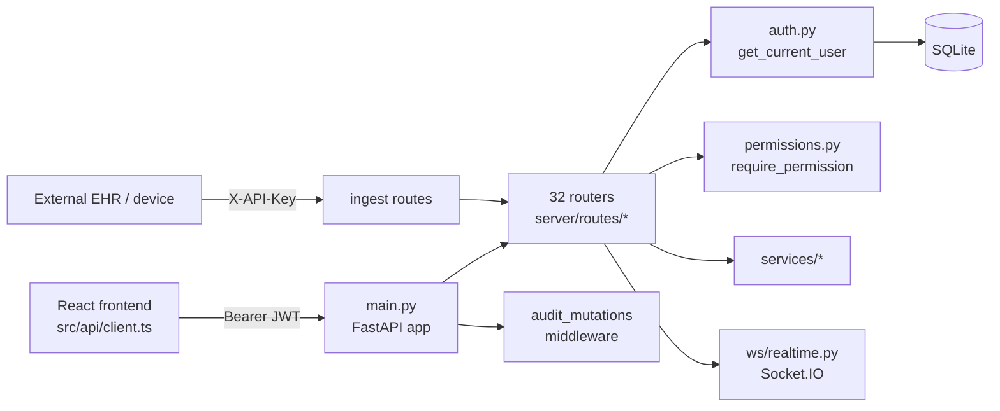
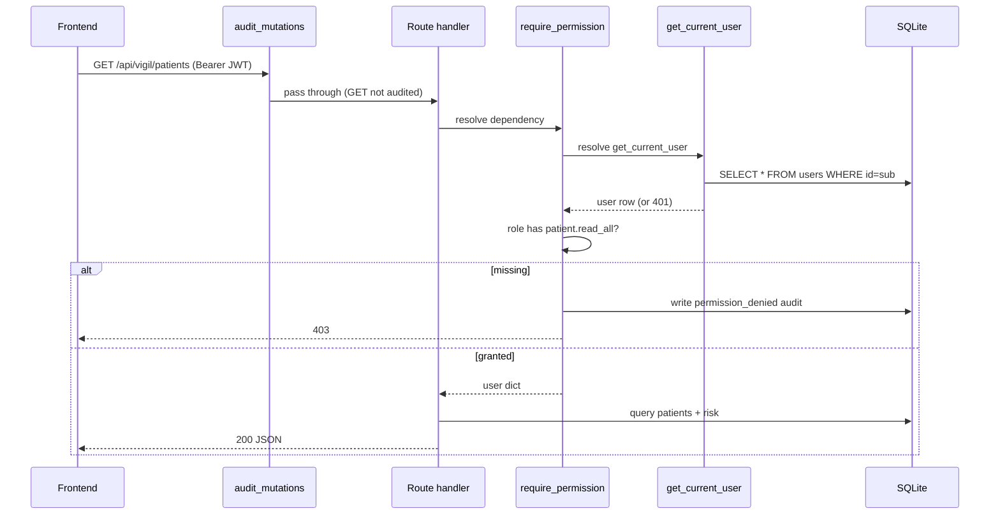

# The Complete API Reference: every REST endpoint and socket event

This guide is the exhaustive map of Orb's HTTP surface. Every request the React
frontend (or an external EHR) makes to the backend goes through one of the routes
catalogued here. Orb's backend is a **FastAPI** app (a Python web framework that
turns ordinary functions into HTTP endpoints) whose routes are split across 42
modules under `server/routes/`, mounted as 43 routers (`compliance_routes.py`
exports two) at `server/main.py:681-724`, each at its own URL prefix. This document enumerates all of them, method, full path, who
is allowed to call it, what it accepts, what it returns, and the exact
`file:line` of the handler, then documents the conventions (error shape,
authentication, pagination, id formats) that every route shares. For the realtime
side (Socket.IO events) this guide gives only a pointer; the authoritative socket
reference lives in **guide 06-realtime**.

---

## Purpose and neighbors

**The problem this subsystem solves.** A hospital OS has dozens of features, 
patient monitoring, messaging, AI assistants, pharmacy, surgery, audit. Each
feature needs a stable, documented contract so the frontend and any integrating
system know exactly how to talk to it. FastAPI's `APIRouter` (a group of related
routes sharing a URL prefix) lets each feature own its routes in its own file;
`main.py` is the single place that wires all those routers into one app and adds
the cross-cutting concerns (CORS, the PHI audit middleware, authenticated media
serving). This guide is the flattened view of that whole contract.

A few terms used throughout, defined once:

- **JWT** (JSON Web Token): a signed string the client sends in the
  `Authorization: Bearer <token>` header to prove who it is. Orb mints it at
  login and validates it on every protected route. See guide 03-auth-rbac.
- **Dependency / `Depends(...)`**: FastAPI's dependency-injection mechanism. A
  route declares `user: dict = Depends(get_current_user)` and FastAPI runs
  `get_current_user` first, passing its return value in. If that function raises
  `HTTPException`, the route body never runs. This is how auth is enforced.
- **RBAC** (Role-Based Access Control): permissions are attached to roles
  (doctor, nurse, pharmacist, admin, patient), not individuals. A route guards
  itself with `require_permission("patient.read_all")`. See guide 03.
- **SSE** (Server-Sent Events): a one-way streaming response
  (`media_type="text/event-stream"`) where the server pushes `data: ...` lines
  as they are produced. Orb uses it for every token-by-token LLM answer.
- **Router prefix**: the URL fragment (e.g. `/api/vigil`) prepended to every
  path in a router file. The full path is `prefix + route path`.

The route handlers are thin: they authenticate, validate input, call a function
in `services/`, and shape the JSON response. The clinical logic lives in the
services (see the per-pillar guides). This guide documents the HTTP boundary, not
the service internals.

---

## File map

Every file in scope. Line counts are approximate (from `wc -l`).

| File | Lines | Role |
|---|---|---|
| `server/main.py` | 1273 | Builds the FastAPI app; wires all 32 routers, CORS, the PHI audit middleware, and the authenticated `/uploads`, `/api/auth/me`, `/api/health` routes; mounts Socket.IO. |
| `server/auth.py` | 509 | JWT mint/decode, password hashing, `get_current_user` and `require_role` dependencies (not in routes/ but every route depends on it). |
| `server/permissions.py` | 565 | The RBAC map (`ROLE_PERMISSIONS`) and the `require_permission` / `require_patient_self` dependency factories. |
| `server/services/audit_middleware.py` | 113 | `audit_mutations` HTTP middleware, logs every state-changing request. |
| `routes/auth_routes.py` | 1533 | Login, MFA (TOTP) enrolment, logout/session revocation, login rate-limiting. |
| `routes/vigil_routes.py` | 1174 | Patient monitoring: patient lists/detail, vitals, notes, meds, AI analysis stream, discharge, QR, patient creation. |
| `routes/relay_routes.py` | 1631 | Messaging: channels, messages, alerts, Sage ambient memory + action cards, agentic order confirmation. |
| `routes/sage_routes.py` | 2810 | Sage AI: streaming clinical query with safety gate + response sanitization; voice query; conversation history. |
| `routes/sage_proactive_routes.py` | 156 | Proactive surveillance insight feed; one-click into an agentic action. |
| `routes/scribe_routes.py` | 964 | Clinical documentation: transcription, structuring, async verification, note lifecycle (draft→sign→revise). |
| `routes/bridge_routes.py` | 439 | Patient portal (self-scoped): status, vitals, reports, meds, discharge, documents, ask-a-question. |
| `routes/lens_routes.py` | 274 | Medical image upload + AI analysis stream; assign analysis to patient. |
| `routes/forecast_routes.py` | 145 | Hospital/patient flow, capacity, discharge board, admission patterns, appointments. |
| `routes/surgery_routes.py` | 688 | Surgical schedule, cases, WHO checklist, team alerts/responses, start/complete/prep, risk stream. |
| `routes/ingestion_routes.py` | 346 | Machine-to-machine ingest (JSON / HL7 / FHIR), status query, dev replay. |
| `routes/admission_routes.py` | 70 | Transactional patient admission. |
| `routes/audit_routes.py` | 79 | Query the audit log (filtered, paginated). |
| `routes/admin_routes.py` | 702 | Admin governance overview (24h aggregates). |
| `routes/discharge_access_routes.py` | 46 | Public discharge-summary verification via token + DOB (patients, no JWT). |
| `routes/helix_routes.py` | 167 | Pharmacy inventory, orders, order state machine. |
| `routes/pulse_routes.py` | 98 | Environmental intelligence (weather, AQI, flu, FDA recalls). |
| `routes/clinical_records_routes.py` | 112 | Structured allergies, problem list, order-time medication safety pre-check. |
| `routes/model_governance_routes.py` | 43 | AI model registry / provenance chips. |
| `routes/bundle_routes.py` | 71 | Sepsis Six / deterioration care bundles. |
| `routes/ipass_routes.py` | 83 | I-PASS shift-handoff auto-draft + save. |
| `routes/downtime_routes.py` | 91 | EHR-downtime read-only snapshots. |
| `routes/fhir_export_routes.py` | 137 | FHIR R4 export/write-back (PHI leaving the building). |
| `routes/pharmacy_routes.py` | 133 | Pharmacist verify/reject of AI-charted meds. |
| `routes/orders_routes.py` | 400 | CPOE-lite: orders + terminology validation + state machine. |
| `routes/flight_recorder_routes.py` | 55 | Admin replay/forensics over the audit chain + event bus. |
| `routes/metrics_routes.py` | 51 | Prometheus `/metrics` scrape endpoint (unauthenticated by default). |
| `routes/impact_routes.py` | 68 | ROI / outcomes model with tunable assumptions. |
| `routes/compliance_routes.py` | 511 | Live compliance-posture report. |
| `routes/coding_routes.py` | 68 | AI medical-coding / CDI suggestions. |
| `routes/command_center_routes.py` | 83 | House-wide operational snapshot. |
| `routes/capacity_sim_routes.py` | 47 | What-if capacity/surge simulator. |

---

## How it works

### The lifecycle of one request

Take a typical call: `GET /api/vigil/patients` from the ward board.

1. **CORS pre-check.** For non-`prod` profiles CORS allows all origins
   (`main.py:281`); in `prod` it is restricted to `CORS_ORIGINS`
   (`main.py:272`). CORS ("Cross-Origin Resource Sharing") is the browser rule
   that decides whether JS on one origin may call an API on another.
2. **Audit middleware.** `audit_mutations` (`main.py:293`) runs for every
   request but only *records* state-changing methods (POST/PUT/PATCH/DELETE);
   a GET passes straight through (`audit_middleware.py:49`).
3. **Routing.** FastAPI matches the path to the handler registered by
   `vigil_router` (mounted at `main.py:298`), i.e. `list_patients` in
   `vigil_routes.py:36`.
4. **Dependency resolution.** The handler declares
   `user = Depends(require_permission("patient.read_all"))`. FastAPI runs that
   factory's inner `_checker` (`permissions.py:176`), which itself depends on
   `get_current_user` (`auth.py:75`). `get_current_user` decodes the JWT,
   re-reads the user row from SQLite, and checks the token version. If any step
   fails it raises `HTTPException(401)` and the body never runs.
5. **Permission check.** `_checker` looks up the role's permission set in
   `ROLE_PERMISSIONS` (`permissions.py:93`); if `patient.read_all` is missing it
   writes a `permission_denied` audit event and raises `HTTPException(403)`.
6. **Handler body.** Runs the SQL, shapes the JSON, returns it. FastAPI
   serialises the return value to a JSON response.

### Three ways a caller authenticates

Orb has **three distinct auth schemes**, and the "Auth" column below tells you
which one guards each route:

1. **Staff JWT**, the default. `Depends(get_current_user)` (any logged-in
   staffer) or `Depends(require_permission(...))` / `Depends(require_role(...))`
   (specific capability). This is the vast majority of routes.
2. **Patient self-scope**, `Depends(require_patient_self())`
   (`permissions.py:224`): the caller must have role `patient`; the service
   layer additionally scopes every query to that patient's own `user_id`. Only
   the `/api/bridge/*` routes use this.
3. **Machine-to-machine API key**, the `X-API-Key` header, constant-time
   compared against `INGESTION_API_KEY` (`ingestion_routes.py:29`). Only the
   `/api/ingest/*` write endpoints use this. There is **no JWT** here because
   the caller is a device or another system, not a person.

A handful of routes are deliberately **public** (`/api/health`,
`/api/auth/login`, `/metrics`, discharge-access verify) and one
(`/api/vigil/test-stream`) is public by omission, see Discrepancies.

---

## Function-by-function

> ## ⚠️ The `Handler` column in the route tables below is stale, do not trust it yet
>
> As of the 2026-08-09 citation audit, **every** handler `file:line` in the tables
> that follow points at the wrong line, and the tables are **missing 101 live
> endpoints** (entire feature areas: `/api/admin/shadow/*`, `/api/admin/compliance/*`,
> `/api/admin/users/*`, `/api/consent/*`, `/api/chart/*`, `/api/nurse/*`,
> `/api/emar/*`, `/api/ops/*`, `/api/orders/sets/*`, `/api/auth/device*`,
> `/api/appointments*`, `/api/health/*`, and more).
>
> This is a **regeneration** job, not a renumbering one: the tables must be rebuilt
> from the live app (see `docs/guide/_CITATION_AUDIT.md` §6.1, which enumerates all
> 268 endpoints with current decorator lines), not hand-patched row by row. Until
> that lands, treat the method / path / auth / request / response columns as broadly
> correct and the `Handler` column as a hint only.
>
> The **prose deep-dives** after each table, and the dependency helpers immediately
> below, *have* been re-verified against the live code and their citations are good.

Because this guide owns the exhaustive route table, the tables below **are** the
per-handler documentation: one row per endpoint, each carrying its handler
`file:line`, so every route handler in scope is documented. After the tables,
the load-bearing / non-obvious handlers get a full deep-dive using the standard
template. Boilerplate handlers (thin `return service.foo()` wrappers) are fully
specified by their table row and are not repeated in prose.

Auth-column shorthand:

- **public**, no dependency; anyone can call.
- **auth**, `Depends(get_current_user)`; any logged-in staffer.
- **perm: X**, `Depends(require_permission("X"))`.
- **role: a/b**, `Depends(require_role("a","b"))` (legacy helper; reads DB role).
- **patient-self**, `Depends(require_patient_self())`.
- **api-key**, `X-API-Key` header (`_verify_api_key`, `ingestion_routes.py:29`; constant-time compare at `:36`).
- **grant**, custom bearer access-grant header (discharge access only).

### The dependency helpers (every table row rests on these)

#### get_current_user: `server/auth.py:416`
**Signature:** `async (request: Request) -> dict`
**Does:** validates the session and returns the authoritative user row.

> The signature changed. It is no longer `Depends(HTTPBearer())`, it takes the
> raw `Request`, because the token can now arrive in **either** the
> `Authorization` header **or** the HttpOnly `orb_session` cookie, and the CSRF
> rule below depends on knowing which.

**How it works:**
1. `_extract_token(request)` returns the token **and its source** (`auth.py:419`);
   no token → `401 "Not authenticated"`.
2. **CSRF double-submit** (`auth.py:429`): if the token came from the *cookie*
   and the method is unsafe, a valid double-submit token must also be present, or
   `403`. Bearer auth (an explicit header a cross-site attacker cannot forge) and
   safe methods are exempt. It is enforced here, the one dependency every
   session-protected route passes through, so it can never falsely block a
   public or alt-auth endpoint.
3. Decodes the token with the server secret (`decode_token`, `auth.py:371`); an
   expired or malformed token becomes `401`. Reads `sub`; a payload without one
   is `401`.
4. Loads the user row **off the event loop** via `await run_db(_load_session_context, ...)`
   (`auth.py:442`). The comment at `:437-440` is the reason: this is the single
   highest-traffic blocking call in the process, and since encryption-at-rest each
   page read also costs HMAC-SHA512 + AES, on the loop it serialises the whole
   API behind one SQLite lock. It re-reads the full row and does **not** trust the
   role embedded in the token.
5. **Device binding** (`auth.py:464`): if the token carries a `did`, the device
   must still be enrolled and un-revoked, else `401`, so revoking a lost tablet
   severs its live sessions at the next request instead of at token expiry. Note
   what this deliberately does *not* do (`:455-463`): it checks enrolment, not
   re-presentation of the device credential, because whoever physically holds the
   tablet holds both cookies anyway.
6. **Deactivation** (`auth.py:478`): an inactive account is `403` on *every*
   request, not just at login, so deactivating a terminated clinician is immediate.
7. **Session revocation** (`auth.py:488`): the token's `tv` claim must equal
   `users.token_version`; a mismatch → `401 "Session revoked; please log in again"`.
   Logout and password/MFA changes bump the DB value, invalidating every
   previously-issued token without a server-side blocklist.
8. Returns the row as a dict (plus `device_id` / `auth_method` when PIN-authed).
**Why it exists:** central chokepoint so every protected route gets a fresh,
authoritative identity, and instant global logout, device revocation and account
deactivation all work without a server-side token blocklist.
**Talks to:** the `users` table (and `devices` when `did` is present); called
(directly or transitively) by nearly every route. See guide 03-auth-rbac.
**Gotchas:** the returned dict is the raw DB row, so `user["role"]` is always
current even if the token is stale, this is deliberate and load-bearing for
authz. The `device_id` it may attach is for **audit metadata only**; the actor is
always `user["id"]`, never the device (`auth.py:472-473`).

#### require_permission: `server/permissions.py:376`
**Signature:** `(*permissions) -> dependency`
**Does:** builds a dependency that requires the caller's role to hold **all**
listed permissions.
**How it works:** the inner `_checker` (`permissions.py:388`) resolves
`get_current_user`, computes `missing = permissions - ROLE_PERMISSIONS[role]`,
and if anything is missing writes a `permission_denied` audit event and raises
`403` with a structured body (`{error, message, required, missing}`).
**Why it exists:** least-privilege enforcement in one auditable place, instead of
scattered `if role == ...` checks.
**Talks to:** `ROLE_PERMISSIONS` (`permissions.py:104`), `log_audit_event`.
**Gotchas:** the 403 body here is a **dict** (`permissions.py:428`), whereas most
other errors use a string `detail`. The frontend must handle both shapes, see
Conventions.

#### require_patient_self: `server/permissions.py:523`
**Signature:** `() -> dependency`
**Does:** requires role `patient`; returns the user dict for self-scoped queries.
**Gotchas:** this only checks the *role*, not that a given `patient_id` in the
path belongs to the caller. The Bridge routes never take a `patient_id` from the
client, they resolve it from `user_id` server-side (`bridge_routes.py:70`), so
ownership is enforced by construction, not by this dependency.

#### require_role: `server/auth.py:493`
**Signature:** `(*roles) -> dependency`
**Does:** legacy gate; passes if `user["role"]` is in `roles`.
**Why it exists / gotcha:** marked **deprecated** in its own docstring
(`auth.py:494-499`), it bypasses the central permission map and does not audit
denials. Still used by Scribe and Lens upload routes (`role: doctor/nurse/admin`).
New routes should use `require_permission`.

#### audit_mutations: `server/services/audit_middleware.py:53`
**Signature:** `(request, call_next) -> response`
**Does:** logs every state-changing API call generically (HIPAA §164.312(b)
safety net) so no mutation goes unlogged even if the route forgot to audit.
**How it works:** for `POST/PUT/PATCH/DELETE` under `/api/` (except
`/api/auth/login`), best-effort decodes the JWT for the actor, runs the request,
and in a `finally` writes an `api_mutation` audit event with the outcome derived
from the HTTP status (`<400`=success, `401/403`=denied, else failure). The
`finally` guarantees even a request that 500s is audited.
**Gotchas:** it decodes the JWT itself (`_actor_from_request`, `audit_middleware.py:39`) rather
than reusing the route's `get_current_user`, so a revoked-but-unexpired token
still yields an actor id in the audit row; that is acceptable for a safety-net
log.

---

### auth_routes.py: `/api/auth`

| Method | Path | Auth | Request | Response | Purpose | Handler |
|---|---|---|---|---|---|---|
| POST | `/api/auth/login` | public (rate-limited) | `{employee_id, password, totp_code?}` | `{token, user{id,name,role,department,registration_number}}` | Authenticate; issue JWT (MFA-gated). | `auth_routes.py:96` |
| GET | `/api/auth/me` | (broken stub) | n/a | n/a | Dead stub; real `/me` is in `main.py`. See Discrepancies. | `auth_routes.py:228` |
| POST | `/api/auth/mfa/enroll/begin` | auth | n/a | `{secret, otpauth_uri, issuer}` | Start TOTP enrolment (QR provisioning). | `auth_routes.py:244` |
| POST | `/api/auth/mfa/enroll/confirm` | auth | `{totp_code}` | `{status:"enabled"}` | Confirm first code; flip MFA on. | `auth_routes.py:272` |
| POST | `/api/auth/mfa/disable` | auth | `{password, totp_code}` | `{status:"disabled"}` | Disable MFA (password + live code). | `auth_routes.py:305` |
| POST | `/api/auth/logout` | auth | n/a | `{status:"logged_out"}` | Revoke all sessions (bump token_version). | `auth_routes.py:340` |

#### login: `server/routes/auth_routes.py:362` (route decorator `:361`)
**Signature:** `(credentials: UserLogin, request: Request, response: Response) -> TokenResponse`, it takes `response` because the session is now set as an HttpOnly cookie, not only returned in the body.
**Does:** authenticates a user and returns a JWT, enforcing rate-limiting and MFA.
**How it works:**
1. **Rate-limit** by client IP via an in-memory sliding window
   (`is_ip_rate_limited`, `auth_routes.py:61`); 5 failures in 15 min → `429`.
   Localhost in the `dev` profile is exempt (`auth_routes.py:65`).
2. Looks up the user by id (employee id for staff, patient id for patients) and
   verifies the password with a **constant-work** helper that always runs one bcrypt op so a missing user and a wrong password cost the same (`verify_password_ct`, `auth.py:185`; the plain `verify_password` is at `:163`, and the constant-work rationale is at `auth_routes.py:412`). Wrong → record attempt, audit `login_failure`, `401`.
3. **MFA gate** (`auth_routes.py:456`): if the role is in `MFA_REQUIRED_ROLES`
   but the user has not enrolled → `403 "mfa_enrollment_required"` (`auth_routes.py:487`). If MFA is
   enabled but no code was supplied → `401 "mfa_required"` (this is *not*
   counted toward lockout, it is a normal two-step flow). A wrong code →
   `401 "Invalid MFA code"` and counts toward lockout.
4. `consume_totp` (`auth_routes.py:275`) verifies the code **and** enforces
   single-use by persisting `totp_last_step`, so a code (or an earlier in-window
   code) cannot be replayed.
5. On success: clears the lockout bucket, auto-upgrades a legacy password hash to
   bcrypt if needed (`auth_routes.py:537`), mints the token with the current
   `token_version`, audits `login_success`, returns `{token, user}`.
**Data in/out:** in `UserLogin{employee_id, password, totp_code?}`; out
`TokenResponse{token, user: UserOut}`.
**Talks to:** `verify_password_ct`, `create_token` (`auth.py:323`), `mfa_service`,
`log_audit_event`. Called by the frontend login form.
**Change guide:** to raise the lockout threshold, change `MAX_LOGIN_ATTEMPTS`
(`auth_routes.py:40`); knock-on: attackers get more guesses, and the in-memory
counter is per-process (resets on restart, keyed on raw peer IP, behind a proxy
this is one shared IP). To require MFA for nurses, add `"nurse"` to
`MFA_REQUIRED_ROLES` in `config`; footgun: existing nurses without enrolment then
get `403` at login until they enrol.
**Gotchas:** the rate limiter is in-memory and per-IP only (documented at
`auth_routes.py:26-38`), credential stuffing across many IPs is unthrottled; noted
as a deferred fix in the code.

#### logout: `server/routes/auth_routes.py:856` (route decorator `:855`)
**Does:** revokes **every** outstanding session for the user by
`UPDATE users SET token_version = token_version + 1`. Because
`get_current_user` compares each token's `tv` claim to this counter, all
previously-issued tokens instantly become `401`. There is no per-device logout, 
it is all-or-nothing.

---

### vigil_routes.py: `/api/vigil`

| Method | Path | Auth | Request | Response | Purpose | Handler |
|---|---|---|---|---|---|---|
| GET | `/api/vigil/test-stream` | **public** | n/a | SSE token stream | Hard-coded SSE demo. See Discrepancies. | `vigil_routes.py:13` |
| GET | `/api/vigil/patients` | perm: patient.read_all | n/a | `[{id,name,mrn,bed,ward,department,risk_score,...}]` | Admitted patients (dept-scoped) with latest risk. | `vigil_routes.py:36` |
| GET | `/api/vigil/discharged` | perm: patient.read_all | n/a | `[patient+discharge]` | Discharged patients. | `vigil_routes.py:97` |
| GET | `/api/vigil/patients/{patient_id}` | perm: patient.read_all | n/a | `{patient,risk,trend,vitals,notes,scribe_notes,risk_history,lens_analyses,medications}` | Full patient detail + CfC risk inference. | `vigil_routes.py:111` |
| GET | `/api/vigil/patients/{patient_id}/vitals` | perm: vitals.read | `?hours=6` | `[vital rows]` | Recent vitals for sparklines. | `vigil_routes.py:217` |
| GET | `/api/vigil/patients/{patient_id}/notes` | perm: patient.read_all | n/a | `[note]` | Clinical notes. | `vigil_routes.py:245` |
| POST | `/api/vigil/patients/{patient_id}/notes` | perm: patient.read_all | `{content, doc_type?, title?}` | `{status,id}` | Add a clinical note. | `vigil_routes.py:258` |
| GET | `/api/vigil/patients/{patient_id}/analysis` | perm: patient.read_all | n/a | SSE token stream | AI patient analysis (5-min cache + dedup). | `vigil_routes.py:282` |
| GET | `/api/vigil/patients/{patient_id}/medication-reconciliation` | perm: discharge.generate | n/a | reconciliation object | Discharge med reconciliation preview. | `vigil_routes.py:350` |
| POST | `/api/vigil/patients/{patient_id}/discharge` | perm: discharge.generate | n/a | discharge result | Discharge patient (summary+timeline+QR). | `vigil_routes.py:366` |
| GET | `/api/vigil/patients/{patient_id}/discharge-summary` | perm: discharge.read | n/a | `{summary,timeline,qr_code_url,discharged_at}` | Fetch discharge summary. | `vigil_routes.py:418` |
| POST | `/api/vigil/patients/{patient_id}/medications` | perm: medication.write | `{drug_name,dosage,frequency,route?,status?}` | `{status,id}` | Add a medication. | `vigil_routes.py:441` |
| GET | `/api/vigil/patients/{patient_id}/qr` | perm: discharge.read | n/a | PNG image | Discharge QR image. | `vigil_routes.py:470` |
| POST | `/api/vigil/patients` | perm: patient.write | `{name, ward?, bed?, diagnosis?, age?, sex?, mrn?, attending_doctor_id?}` | `{id,user_id,channel_id,temporary_password,message}` | Create patient + Bridge account + Relay case room. | `vigil_routes.py:495` |

#### get_patient: `server/routes/vigil_routes.py:500` (route decorator `:499`)
**Signature:** `(patient_id, user=Depends(perm patient.read_all)) -> dict`
**Does:** returns the complete clinical picture for one patient in a single call.
**How it works:** in one `db_session` it fetches the patient row, last 288
vitals (24h at 5-min cadence), clinical + scribe notes, last 50 risk scores,
lens analyses, and medications. Then it runs the CfC neural-net risk inference
**off the event loop** via `asyncio.to_thread(get_patient_risk, ...)`
(`vigil_routes.py:516`) so the synchronous Torch/MPS call does not stall live
telemetry, and shapes everything into one JSON object.
**Why it exists:** the patient card needs everything at once; one round-trip
beats ten.
**Data out:** the big object listed in the table. Note the `medications` list
adds an `unverified` flag (`vigil_routes.py:552`) for AI-extracted meds a
pharmacist has not confirmed, so the UI never shows an unreviewed AI med as
equal to a clinician order.
**Talks to:** `get_patient_risk`, `get_vitals_trend` (vigil_service; see the
Vigil guide). Called by the patient detail view.
**Gotchas:** offloading the CfC call is deliberate, reverting it to a direct
call reintroduces event-loop stalls on every card open (comment at
`vigil_routes.py:510-512`).

#### create_patient: `server/routes/vigil_routes.py:856` (route decorator `:853`)
**Does:** in one transaction creates (1) a `patient`-role user account with a
**unique one-time password** (`secrets.token_urlsafe(9)`, never a shared
default), (2) the `patients` row, (3) a Relay `case_room` channel, and (4) an
initial admission message. Returns `temporary_password` **exactly once**, only
its bcrypt hash is stored (`vigil_routes.py:881`, hashed at `:884`).
**Change guide:** to change the id format, edit the `PAT`/`CH-` prefixes at
`vigil_routes.py:872` and `:899`; knock-on: any code that pattern-matches ids (there is little) and
existing rows keep the old format. Footgun: the temp password is unrecoverable, 
if the caller loses it the patient must be re-credentialed.
**Gotchas:** the security comment (`vigil_routes.py:877-880`) records that the old
code seeded a shared `"patient123"` password; do not reintroduce a default.

---

### relay_routes.py: `/api/relay`

| Method | Path | Auth | Request | Response | Purpose | Handler |
|---|---|---|---|---|---|---|
| GET | `/api/relay/channels` | perm: relay.read | n/a | `[channel]` | Channels visible to the user. | `relay_routes.py:91` |
| GET | `/api/relay/alerts` | perm: relay.read | n/a | `[alert]` | Targeted active alerts. | `relay_routes.py:97` |
| GET | `/api/relay/channels/{channel_id}/messages` | perm: relay.read | `?limit=50&offset=0` | `[message]` | Channel messages (membership-checked). | `relay_routes.py:130` |
| POST | `/api/relay/channels/{channel_id}/read` | perm: relay.read | n/a | `{status,marked_read}` | Clear unread badge. | `relay_routes.py:146` |
| GET | `/api/relay/channels/{channel_id}/sage_memory` | perm: relay.read | n/a | Sage room-memory object or null | Ambient memory for the room. | `relay_routes.py:221` |
| GET | `/api/relay/channels/{channel_id}/sage_actions` | perm: relay.read | n/a | `[action(+handoff)]` | Sage action cards for the room. | `relay_routes.py:255` |
| POST | `/api/relay/channels/{channel_id}/sage_actions/{action_id}/transition` | perm: relay.execute_action | `{state, version, reason?}` | `{status,action,handoff}` | Move an action card's state (optimistic lock). | `relay_routes.py:400` |
| POST | `/api/relay/channels/{channel_id}/messages` | perm: relay.send | `{content, message_type}` | message | Send message; broadcast + fire ambient AI. | `relay_routes.py:516` |
| POST | `/api/relay/alerts/{message_id}/resolve` | perm: relay.send | `{action:"confirm"\|...}` | `{status}` | Resolve/escalate an alert message. | `relay_routes.py:1051` |
| GET | `/api/relay/channels/{channel_id}/sage_actions/{action_id}/pre_flight` | perm: relay.execute_action | n/a | `{action,resolved_medication,reconciliation_score,stock_status,alternative_suggestion,is_high_risk}` | Pre-flight an agentic med order. | `relay_routes.py:1096` |
| POST | `/api/relay/channels/{channel_id}/sage_actions/{action_id}/confirm_agentic` | perm: relay.execute_action | `{clinician_pin, co_signer_id?, co_signer_pin?, override_reason?, dose_confirmation?, safety_ack?}` | `{status,action_id,order_id,correlation_id,delegation_hash,safety}` | PIN-verified agentic order → Helix + hash-chain audit. | `relay_routes.py:1312` |

This table lists the routes this reference has always covered; the router also serves direct channels, channel members, Sage assessments and room-fit flags (`relay_routes.py:174-490`, `:787`, `:853`).

#### execute_ambient_action: removed 2026-10-03
`POST /api/relay/actions/{message_id}/execute` no longer exists (the note at `server/routes/relay_routes.py:949-954`). It executed legacy `ambient_action` cards (add, stop or replace a medication, discharge, surgery prep) from a message row. No screen had called it since the cards were retired, nothing writes new cards, and clients can no longer post a message of that type, so it was only an unused door onto the chart. Legacy rows stay in the `messages` table and the readers keep skipping them. Confirmed Sage actions reach the chart through the transition endpoint above and `sage_handoff_service` (guide 22), or through `confirm_agentic` below.

#### confirm_agentic_action: `server/routes/relay_routes.py:1313` (route decorator `:1312`)
**Does:** the highest-stakes route: converts a Sage agentic medication action
into a real Helix pharmacy order after a PIN check, then records a cryptographic
delegation hash chain in the audit log. The handler takes a per-action lock
(`_confirm_lock`, `:1203`) so a double-click cannot dispatch two orders, and the
body runs in `_confirm_agentic_action` (`:1324`).
> Three claims in an earlier version of this block were **security-relevant and
> wrong**, and are corrected below: the PIN is no longer plain SHA-256, the
> delegation hash no longer folds in the raw PIN, and high-risk drugs now *do* gate
> dispatch.

**How it works:**
1. Channel-membership check, then `pin_security.verify_pin(user_row, req.clinician_pin)`
   (`relay_routes.py:1381`) → `401` on mismatch, with a `pin_failure` security audit
   row and a lockout counter. `verify_pin` **upgrades a legacy unsalted SHA-256
   digest to bcrypt on success**, so the "plain SHA-256" this guide used to describe
   is now only a legacy-migration path, not the scheme.
2. Immediately after a successful verify, **re-read** `pin_hash` (`relay_routes.py:1401-1402`).
   The comment at `:1397-1400` is the reason: the pre-upgrade digest of a 4–8 digit
   PIN is offline-brute-forceable, so folding it into the persisted delegation hash
   would leak the PIN much like the raw value would.
3. **Co-signer, fail-closed** (`relay_routes.py:1404-1450`) when `co_signer_id` is
   supplied: must differ from the confirming clinician (`400`), must not be
   PIN-locked (`429`), must be an active user (`403`), must have a provisioned
   signing PIN (`403`), and must pass `verify_pin` (`401`, audited). A
   supplied-but-unverifiable co-signer **aborts the dispatch** rather than silently
   downgrading to a single signature, the confirmed id is written into the
   tamper-evident chain, so an unverified id would attribute a sign-off to a
   colleague who never saw the order and could not repudiate it.
4. Load the action; reject if already resolved. Reconcile the target drug to the
   Helix master via the phonetic `rxnorm_reconciler` (`relay_routes.py:1463-1464`);
   unmatched → `400`.
5. **Stock:** the order is always for the drug the clinician confirmed. Out of
   stock with no `override_reason` is a **`409 out_of_stock`** that orders nothing
   and names any in-stock exact equivalent (same molecule, strength and form) as a
   suggestion to prescribe separately (`relay_routes.py:1483-1521`); with a reason
   the drug is ordered as written for pharmacy to source. (It used to switch the
   order silently to a therapeutic alternative.)
6. **Dose:** the agentic pipeline resolves no dose, so a missing or `TBD`
   `dose_confirmation` is a **`422 dose_confirmation_required`** (`:1523-1553`);
   route (IV/IM/SC) is parsed heuristically from the rationale unless the
   confirmation names one.
7. **Drug-safety gate and high-risk gate:** every dispatch runs
   `enforce_medication_safety` (`:1559-1570`; severe alerts use the 428
   `safety_ack` contract). A high-alert medication (the `high_risk_names` set at
   `:1474`, epinephrine, heparin, insulin, potassium, tPA, and the opioids) also
   returns **`428 drug_safety_acknowledgement_required`** unless the request
   carries a `safety_ack` that is both `acknowledged` **and** has a non-empty
   `reason` (`:1571-1582`). This is a real block on dispatch, not audit metadata.
8. Create the Helix order (`create_order`, `:1584-1597`). It commits in its own
   transaction, with status `pending`, before anything below runs.
9. Build a **delegation hash**: `sha256(source_msg_id : llm_prompt_signature :
   verification_hash)` where `verification_hash = sha256(user_id : pin_hash_at_signing)`,
   the post-upgrade **hash**, never the PIN (`relay_routes.py:1599-1607`), and
   write it into `sage_action_events`, `sage_actions` (state→confirmed, conditional
   so a racing dismissal is not overwritten), and a `clinical_safety` /
   `agentic_med_confirm` `audit_logs` row (`_persist_confirmation`, `:1225`). If the
   conditional write loses, the request gets `409` and none of those three rows
   persists, but the Helix order from step 8 is **not** rolled back: it stays
   `pending` in the pharmacist's queue. Open defect, awaiting a ruling (Discrepancy 8
   below; guide 08-relay, Discrepancy 9).
10. Emit `sage:action_update` and `patient:timeline_updated` sockets (`:1619-1620`).
**Data out:** `{status, action_id, order_id, correlation_id, delegation_hash, safety}`.

---

### sage_routes.py + sage_proactive_routes.py: `/api/sage`

| Method | Path | Auth | Request | Response | Purpose | Handler |
|---|---|---|---|---|---|---|
| POST | `/api/sage/query` | perm: sage.query | `{query, patient_id?}` | SSE: content, metadata, structured_response, done | Streaming clinical AI answer (safety-gated, sanitized). | `sage_routes.py:48` |
| GET | `/api/sage/history` | auth | n/a | `{messages}` | Conversation history. | `sage_routes.py:363` |
| DELETE | `/api/sage/history` | auth | n/a | `{message}` | Clear history. | `sage_routes.py:370` |
| POST | `/api/sage/voice` | perm: sage.query | `{query, patient_id?, conversation_history?}` | SSE token stream | Conversational voice query (MedGemma 4B). | `sage_routes.py:385` |
| GET | `/api/sage/insights` | perm: sage.query | n/a | `{insights}` | Proactive surveillance feed. | `sage_proactive_routes.py:14` |
| POST | `/api/sage/insights/{insight_id}/transition` | perm: sage.query | `{state}` | insight | Ack/dismiss an insight. | `sage_proactive_routes.py:19` |
| POST | `/api/sage/insights/{insight_id}/act` | perm: sage.query | n/a | `{status,action_id,channel_id}` | Turn insight into an agentic action card. | `sage_proactive_routes.py:36` |
| POST | `/api/sage/insights/evaluate` | perm: sage.query | `{patient_id?}` | `{created,ids}` | Manual surveillance sweep. | `sage_proactive_routes.py:75` |

> Note both routers use the same `/api/sage` prefix; their paths don't collide
> because the proactive router only owns `/insights*`.

#### sage_query: `server/routes/sage_routes.py:1506` (route decorator `:1505`)
**Signature:** `(request, user=Depends(perm sage.query)) -> StreamingResponse`
**Does:** answers a clinical question as an SSE stream, with a pre-LLM safety
gate and post-LLM sanitization that prevents the model from ever claiming it
performed an action.
**How it works:**
1. **Pre-LLM safety gate** (`_safety_refusal`, `sage_routes.py:42`): two regexes
   detect (a) intent to harm a patient and (b) prompt-injection/jailbreak
   attempts; either short-circuits to a fixed refusal *before* the model runs.
2. Retrieves RAG context (`get_relevant_context`), RAG = "retrieval-augmented
   generation", pulling relevant documents so the model answers from real data.
3. Streams tokens from the LLM through an **incremental sanitizer**. Note the
   flag `stream_raw_to_client` is now `True` (`sage_routes.py:1703`), this reads
   like a weakening and is not. The comment at `:1691-1702` spells out the change:
   the guarantee ("raw model output must NEVER reach the client, because the model
   can assert *I've added X, order placed* in the raw `<concise_answer>` before the
   end-of-stream policy override lands") is unchanged. What changed is how it is
   met. It used to buffer the **entire** generation, so the first client byte cost
   a full generation. `SentenceStreamSanitizer` + `XmlAnswerStreamer` now release
   only sentence-complete, forbidden-phrase-stripped text, and a mutation turn
   (deterministic gate **or** a model-declared `<action_intent>`) emits **nothing**
   until the buffered action-state override has rewritten the answer. The flag now
   means "stream *sanitized* content incrementally", not "stream raw".
   (Earlier revisions of this guide read the flag name literally and described the
   old buffer-everything behaviour; that is why the sentence changed.)
4. Parses the XML-tagged model output, applies the **action-state policy
   override**: if the model tried to mutate the chart, it replaces the answer
   with a safe "drafted, requires approval" message and marks the action
   unsupported/drafted (`sage_routes.py:1844` onward).
5. Runs an **unconditional forbidden-phrase strip** (`_strip_forbidden`,
   `sage_routes.py:217`; the shared core is `_strip_forbidden_core` at `:183` and
   the streaming variant `_strip_forbidden_streaming` at `:224`, same patterns,
   same fixed point, whitespace preserved, which is what keeps the streamed lane
   and the buffered lane from diverging) on the answer regardless of whether a mutation was
   detected, and validates that cited sources are a subset of retrieved sources
   (else downgrades confidence to `low`).
6. Emits the sanitized `content`, a rich `metadata` object (sources, confidence,
   escalation, display_mode, timing), the `structured_response`, then `done`.
**Why it exists:** a small local LLM can hallucinate confident, dangerous
confirmations; this route is the guardrail layer that makes its output safe to
render. See the Sage guide.
**Gotchas:** the safety and sanitization logic is load-bearing, the long
comment at `sage_routes.py:1691-1702` explains that the thing which closes the
"hallucinated confirmation reaches client" hole is that **raw** chunks never
leave the server. Incremental release of *sanitized*, sentence-complete text is
fine and is what the current code does; releasing raw tokens for
"responsiveness" is not, and mutation turns must keep emitting nothing until the
action-state override has rewritten the answer.

---

### scribe_routes.py: `/api/scribe`

| Method | Path | Auth | Request | Response | Purpose | Handler |
|---|---|---|---|---|---|---|
| POST | `/api/scribe/transcribe` | role: doctor/nurse/admin | multipart: `audio`, `hints?`, `skip_correction?`, `patient_id?`, `language?` | `{transcript, audio_path}` | Transcribe an audio file (Whisper). | `scribe_routes.py:306` |
| POST | `/api/scribe/transcribe-chunk` | role: doctor/nurse/admin | multipart: `audio`, `chunk_index?`, `hints?`, `patient_id?` | `{text, chunk_index}` | Transcribe a short live chunk. | `scribe_routes.py:362` |
| POST | `/api/scribe/structure` | role: doctor/nurse/admin | `{transcript, format?, patient_id?, verify?, audio_path?}` | SSE: content, done(+note id) | Structure transcript → note; async verify. | `scribe_routes.py:418` |
| GET | `/api/scribe/notes` | perm: scribe.read_all | `?patient_id&status` | `[note]` | List notes. | `scribe_routes.py:512` |
| GET | `/api/scribe/notes/{note_id}` | perm: scribe.read_all | n/a | note | Get one note. | `scribe_routes.py:524` |
| GET | `/api/scribe/notes/{note_id}/verification` | perm: scribe.read_all | n/a | `{note_id,verification,pipeline}` | Poll verification status. | `scribe_routes.py:533` |
| POST | `/api/scribe/notes/{note_id}/verify` | role: doctor/nurse/admin | n/a | `{note_id,verification}` | Retry a failed verification. | `scribe_routes.py:555` |
| PATCH | `/api/scribe/notes/{note_id}` | perm: scribe.edit_draft | `{structured_note}` | `{ok,note_id}` | Edit a draft. | `scribe_routes.py:631` |
| POST | `/api/scribe/notes/{note_id}/sign` | perm: scribe.sign | `{acknowledge_unverified?}` | `{ok,note_id,status,superseded_note_id}` | Sign a draft (sign-gate). | `scribe_routes.py:693` |
| POST | `/api/scribe/notes/{note_id}/reject` | perm: scribe.reject | `{reason}` | `{ok,note_id,status}` | Reject a draft. | `scribe_routes.py:779` |
| POST | `/api/scribe/notes/{note_id}/revise` | perm: scribe.edit_draft | n/a | `{ok,new_note_id,version,status}` | Create revision from signed note. | `scribe_routes.py:820` |
| GET | `/api/scribe/config` | perm: admin.overview | n/a | pipeline config | Active Scribe model config. | `scribe_routes.py:862` |
| GET | `/api/scribe/daemon/status` | role: doctor/nurse/admin | n/a | daemon status | Whisper warm-daemon health. | `scribe_routes.py:893` |

#### structure: `server/routes/scribe_routes.py:423` (route decorator `:422`)
**Does:** streams the drafted clinical note, saves it as a draft immediately, and
kicks off verification in the background.
**How it works:** validates the format is one of `soap/discharge/handoff`;
streams draft tokens (`structure_transcript_stream`); saves the note with
`verification_status = pending|not_requested`; sends the `done` event with the
new `note_id` *immediately*; then, if verification was requested and enabled,
dispatches `_run_verification_async` (`scribe_routes.py:87`) as an
`asyncio.create_task` guarded by an in-process registry so the same note is never
verified twice concurrently (`_is_verification_in_flight`, `scribe_routes.py:61`).
**Why it exists:** the clinician sees the draft instantly; the slow
hallucination-check runs after and is polled via
`/notes/{id}/verification`.
**Gotchas:** the verification registry is in-process, not distributed, fine for
single-server Orb (comment at `scribe_routes.py:52-56`). If the server restarts mid-verification the
note is stuck `pending`; `reconcile_stale_pending_verifications`
(`scribe_routes.py:229`) runs at startup to flip stale pendings to `failed`.

#### sign_note: `server/routes/scribe_routes.py:735` (route decorator `:734`)
**Does:** transitions a draft to `signed`, but only past a **sign-gate**.
**How it works:** `_verification_verdict` (`scribe_routes.py:707`) inspects the
note's persisted verification. If the note did not pass (`verified != true`,
status `unverifiable`, or any high/critical warning/omission) the verdict is
*blocking*. A blocking verdict with no `acknowledge_unverified:true` in the body
returns **`428 Precondition Required`** with the reasons; the signer must
explicitly acknowledge to override. A note with no verification record is treated
as blocking (fail-closed).
**Why it exists:** prevents a clinician from silently one-click-signing an AI note
that failed the hallucination check.
**Gotchas:** the unusual `428` status is intentional, the frontend must special-
case it to prompt the acknowledgement, not treat it as a generic error.

---

### bridge_routes.py: `/api/bridge` (all patient-self)

| Method | Path | Auth | Request | Response | Purpose | Handler |
|---|---|---|---|---|---|---|
| GET | `/api/bridge/status` | patient-self | n/a | status object | Patient's own status in plain language. | `bridge_routes.py:26` |
| GET | `/api/bridge/vitals` | patient-self | n/a | `{vitals}` | Simplified own vitals. | `bridge_routes.py:37` |
| POST | `/api/bridge/ask` | patient-self | `{question}` | SSE token stream | Ask a question; plain-language answer. | `bridge_routes.py:47` |
| GET | `/api/bridge/reports` | patient-self | n/a | `{medications,clinical_documents,discharge_summary,imaging_reports}` | Aggregated own reports. | `bridge_routes.py:80` |
| GET | `/api/bridge/medications` | patient-self | n/a | `{medications}` | Own medications. | `bridge_routes.py:131` |
| GET | `/api/bridge/discharge` | patient-self | n/a | `{discharge_summary,timeline,discharged_at}` | Own discharge summary. | `bridge_routes.py:148` |
| GET | `/api/bridge/documents` | patient-self | n/a | `{documents}` | Own clinical documents. | `bridge_routes.py:178` |

Every handler resolves `patient_id` from `user_id` via `_resolve_patient_id`
(`bridge_routes.py:12`), never from a client-supplied id, this is how ownership
is guaranteed. The client cannot ask for another patient's data because there is
no parameter to do so.

---

### lens_routes.py: `/api/lens`

| Method | Path | Auth | Request | Response | Purpose | Handler |
|---|---|---|---|---|---|---|
| POST | `/api/lens/analyze` | role: doctor/nurse/admin | multipart: `image`, `clinical_context?`, `patient_id?`, `image_type?` | SSE token stream | Analyze a medical image (vision LLM). | `lens_routes.py:46` |
| GET | `/api/lens/analyses` | perm: lens.read | `?patient_id` | `[analysis]` | List saved analyses. | `lens_routes.py:136` |
| PATCH | `/api/lens/analyses/{analysis_id}/assign` | role: doctor/nurse/admin | form: `patient_id`, `reviewed_text?` | `{status,patient_name}` | Assign analysis to a patient; notify case room. | `lens_routes.py:145` |

`analyze` (`lens_routes.py:46`) is gated behind `LENS_ENABLED` (`403` if off,
`lens_routes.py:60`), validates the upload with an **extension allowlist +
magic-byte signature check + 25 MB cap** (never trusting the client filename,
which could be `.svg`/`.html` and become stored-XSS), writes the image encrypted
at rest, streams the analysis, and saves it. See the Lens guide.

---

### forecast_routes.py: `/api/forecast`

| Method | Path | Auth | Request | Response | Purpose | Handler |
|---|---|---|---|---|---|---|
| GET | `/api/forecast/hospital` | perm: forecast.read | `?days=7` | flow forecast | 7-day hospital flow. | `forecast_routes.py:26` |
| GET | `/api/forecast/patient/{patient_id}` | perm: forecast.read | n/a | LoS prediction | Per-patient length-of-stay. | `forecast_routes.py:38` |
| GET | `/api/forecast/capacity` | perm: forecast.read | n/a | capacity object | Bed capacity by ward. | `forecast_routes.py:51` |
| GET | `/api/forecast/discharge-board` | perm: forecast.read | n/a | ranked board | Discharge-readiness ranking. | `forecast_routes.py:62` |
| GET | `/api/forecast/admission-patterns` | perm: forecast.read | n/a | pattern analysis | Historical admission analysis. | `forecast_routes.py:73` |
| GET | `/api/forecast/appointments` | perm: forecast.read | `?days=7` | schedule | Upcoming appointments. | `forecast_routes.py:84` |

All six are thin wrappers over `forecast_service` and clamp `days` to 1-14.

---

### surgery_routes.py: `/api/surgery`

| Method | Path | Auth | Request | Response | Purpose | Handler |
|---|---|---|---|---|---|---|
| GET | `/api/surgery/schedule` | perm: surgery.read | `?days=7` | `[{date,day_label,surgeries}]` | Week schedule grouped by day. | `surgery_routes.py:19` |
| GET | `/api/surgery/emergency-queue` | perm: surgery.read | n/a | `[case]` | Emergency surgical cases. | `surgery_routes.py:66` |
| GET | `/api/surgery/cases` | perm: surgery.read | n/a | `[case(+team)]` | Active cases + team. | `surgery_routes.py:80` |
| GET | `/api/surgery/{surgery_id}` | perm: surgery.read | n/a | full case detail | One surgery (risk, allergies, checklist). | `surgery_routes.py:110` |
| GET | `/api/surgery/checklist/template` | perm: surgery.read | n/a | WHO template | Canonical WHO checklist. | `surgery_routes.py:185` |
| GET | `/api/surgery/{surgery_id}/checklist` | perm: surgery.read | n/a | checklist state | WHO checklist completion. | `surgery_routes.py:192` |
| POST | `/api/surgery/{surgery_id}/checklist` | perm: surgery.write | `{item_id, checked}` | updated state | Check/uncheck an item. | `surgery_routes.py:202` |
| POST | `/api/surgery/{surgery_id}/alert-team` | perm: surgery.write | `{team:[{user_id,role}]}` | `{status}` | Targeted team alerts via Relay. | `surgery_routes.py:217` |
| POST | `/api/surgery/{surgery_id}/team-response` | auth | `{action:"confirm"\|"decline"}` | `{status}` | Team member confirm/decline. | `surgery_routes.py:304` |
| POST | `/api/surgery/{surgery_id}/start` | perm: surgery.write | n/a | `{status}` | Start surgery (all confirmed gate). | `surgery_routes.py:367` |
| POST | `/api/surgery/{surgery_id}/complete` | perm: surgery.write | n/a | `{status,note_id}` | Complete; write post-op note. | `surgery_routes.py:383` |
| POST | `/api/surgery/{surgery_id}/prep` | perm: surgery.write | n/a | `{status,...}` | Trigger prep package. | `surgery_routes.py:425` |
| POST | `/api/surgery/emergency/{surgery_id}/acknowledge` | perm: surgery.write | n/a | `{status,surgery_id}` | Acknowledge emergency intake. | `surgery_routes.py:441` |
| GET | `/api/surgery/{surgery_id}/risk` | perm: surgery.read | n/a | SSE token stream | Streamed MedGemma risk assessment. | `surgery_routes.py:452` |

Note `team-response` uses bare `get_current_user` (any staffer) rather than a
permission, because the responder is whoever was alerted, identified by their own
JWT. `complete` (`surgery_routes.py:383`) is idempotent (a second call returns
`already_completed`) and only fabricates operative detail in `DEMO_MODE`.

---

### ingestion_routes.py: `/api/ingest`

| Method | Path | Auth | Request | Response | Purpose | Handler |
|---|---|---|---|---|---|---|
| POST | `/api/ingest/json` | api-key | raw JSON body; headers `X-API-Key`, `X-Correlation-Id?`, `X-Message-Id?` | `{status,event_id,correlation_id,parse_status,counts,errors}` | Ingest structured JSON. | `ingestion_routes.py:56` |
| POST | `/api/ingest/hl7` | api-key | raw HL7 v2 ORU string (or `{message}`) | same envelope | Ingest HL7. | `ingestion_routes.py:108` |
| POST | `/api/ingest/fhir` | api-key | FHIR R4 JSON (Bundle or resource) | same envelope | Ingest FHIR R4. | `ingestion_routes.py:166` |
| GET | `/api/ingest/status` | perm: ingest.monitor | `?limit=20&status` | `{events,count,ingestion_mode}` | Query ingestion events. | `ingestion_routes.py:220` |
| POST | `/api/ingest/replay` | api-key | raw payload (auto-detect) | same envelope | Dev replay with auto-detect adapter. | `ingestion_routes.py:264` |

The write endpoints are the only ones guarded by `X-API-Key` (`_verify_api_key`,
`ingestion_routes.py:29`, constant-time) and are disabled in `simulation` mode
(`503`, `_check_ingestion_enabled`, line 42). The ingest envelope uses **HTTP
status to signal parse outcome**: 200 parsed/duplicate, 207 partial, 422 failed
(`_http_status_from_result`, `ingestion_routes.py:315`). See the ingestion guide.

---

### Remaining routers (thin wrappers)

**admission_routes.py, `/api/admissions`**

| Method | Path | Auth | Request | Response | Purpose | Handler |
|---|---|---|---|---|---|---|
| POST | `/api/admissions/admit` | perm: patient.write | `AdmissionRequest` (large model, `admission_routes.py:10`) | admission result | Transactional admission across modules. | `admission_routes.py:53` |

**audit_routes.py, `/api/audit`**

| Method | Path | Auth | Request | Response | Purpose | Handler |
|---|---|---|---|---|---|---|
| GET | `/api/audit/logs` | perm: audit.read | `?patient_id,correlation_id,action_type,event_category,outcome,start_date,end_date,limit(1-1000),offset` | `{logs,total,limit,offset}` | Filtered, paginated audit log. | `audit_routes.py:11` |

**admin_routes.py, `/api/admin`**

| Method | Path | Auth | Request | Response | Purpose | Handler |
|---|---|---|---|---|---|---|
| GET | `/api/admin/overview` | perm: admin.overview | n/a | governance snapshot | 24h aggregates (audit, ingestion, alerts). | `admin_routes.py:16` |

**model_governance_routes.py, `/api/admin`** (same prefix as admin_routes)

| Method | Path | Auth | Request | Response | Purpose | Handler |
|---|---|---|---|---|---|---|
| GET | `/api/admin/models` | perm: admin.overview | n/a | `{models}` | Model registry + provenance. | `model_governance_routes.py:20` |
| GET | `/api/admin/models/provenance` | auth | n/a | `{models}` | Compact provenance chips (any user). | `model_governance_routes.py:26` |
| POST | `/api/admin/models/reseed` | perm: admin.overview | n/a | `{ok,count}` | Re-sync registry from disk. | `model_governance_routes.py:38` |

**discharge_access_routes.py, `/api/discharge-access`**

| Method | Path | Auth | Request | Response | Purpose | Handler |
|---|---|---|---|---|---|---|
| POST | `/api/discharge-access/verify` | public | `{token, dob}` | access grant | Verify DOB; short-lived grant. | `discharge_access_routes.py:14` |
| GET | `/api/discharge-access/{token}/summary` | grant | header `Authorization: Bearer <grant>` | summary | Retrieve summary with grant. | `discharge_access_routes.py:29` |

**helix_routes.py, `/api/helix`**

| Method | Path | Auth | Request | Response | Purpose | Handler |
|---|---|---|---|---|---|---|
| GET | `/api/helix/catalog` | perm: helix.read | n/a | `{catalog}` | Medication master catalog. | `helix_routes.py:14` |
| GET | `/api/helix/inventory` | perm: helix.read | n/a | `{inventory}` | Inventory lots. | `helix_routes.py:19` |
| GET | `/api/helix/orders/pending` | perm: helix.read | n/a | `{orders}` | Orders awaiting verification. | `helix_routes.py:24` |
| GET | `/api/helix/orders` | perm: helix.read | n/a | `{orders}` | All orders. | `helix_routes.py:29` |
| GET | `/api/helix/stock-movements` | perm: helix.read | n/a | `{movements}` | Stock movement log. | `helix_routes.py:34` |
| GET | `/api/helix/orders/{order_id}/transitions` | perm: helix.read | n/a | `{transitions}` | Order transition history. | `helix_routes.py:39` |
| POST | `/api/helix/orders/approve` | perm: helix.write | `{patient_name,medication,dose?,route?,frequency?}` | `{status,order}` | Approve a drafted med → Helix order. | `helix_routes.py:56` |
| POST | `/api/helix/orders/{order_id}/transition` | perm: helix.write | `{target_status,idempotency_key?,pharmacist_notes?,substitute_medication_id?,scheduled_at?}` | order result | Guarded order state transition. | `helix_routes.py:85` |

**pulse_routes.py, `/api/pulse`**

| Method | Path | Auth | Request | Response | Purpose | Handler |
|---|---|---|---|---|---|---|
| GET | `/api/pulse/dashboard` | perm: forecast.read | `?lat,lon` | dashboard | Full environmental dashboard. | `pulse_routes.py:30` |
| GET | `/api/pulse/weather` | perm: forecast.read | `?lat,lon` | weather | Weather + forecast + risk flags. | `pulse_routes.py:43` |
| GET | `/api/pulse/aqi` | perm: forecast.read | `?lat,lon` | AQI | Air quality + respiratory flags. | `pulse_routes.py:56` |
| GET | `/api/pulse/flu` | perm: forecast.read | n/a | flu data | CDC ILI surveillance. | `pulse_routes.py:69` |
| GET | `/api/pulse/drug-recalls` | perm: forecast.read | `?limit(≤50)` | recalls | FDA recall/enforcement. | `pulse_routes.py:80` |
| GET | `/api/pulse/audit-log` | perm: audit.read | `?limit(≤200)` | ingestion audit | External-ingestion audit trail. | `pulse_routes.py:92` |

**clinical_records_routes.py, `/api/patients`**

| Method | Path | Auth | Request | Response | Purpose | Handler |
|---|---|---|---|---|---|---|
| GET | `/api/patients/{patient_id}/allergies` | perm: patient.read_all | `?include_inactive` | `{allergies}` | List allergies. | `clinical_records_routes.py:19` |
| POST | `/api/patients/{patient_id}/allergies` | perm: patient.write | `{substance, reaction?, severity?, source?}` | record | Record allergy. | `clinical_records_routes.py:25` |
| DELETE | `/api/patients/{patient_id}/allergies/{allergy_id}` | perm: patient.write | n/a | `{ok}` | Deactivate allergy. | `clinical_records_routes.py:47` |
| GET | `/api/patients/{patient_id}/problems` | perm: patient.read_all | `?include_resolved` | `{problems}` | List problems. | `clinical_records_routes.py:63` |
| POST | `/api/patients/{patient_id}/problems` | perm: patient.write | `{problem, icd10_code?, snomed_code?, onset_date?, source?}` | record | Record problem. | `clinical_records_routes.py:69` |
| PATCH | `/api/patients/{patient_id}/problems/{problem_id}/resolve` | perm: patient.write | n/a | `{ok}` | Resolve problem. | `clinical_records_routes.py:90` |
| GET | `/api/patients/{patient_id}/medication-safety` | perm: medication.write | `?drug` (required) | safety result | Allergy + interaction pre-check. | `clinical_records_routes.py:99` |

> `clinical_records_router` owns `/api/patients/{id}/...`; the FHIR export router
> owns the distinct `/api/fhir/patient/...` paths, no collision.

**bundle_routes.py, `/api/bundles`**

| Method | Path | Auth | Request | Response | Purpose | Handler |
|---|---|---|---|---|---|---|
| GET | `/api/bundles/active` | perm: vitals.read | n/a | `{bundles}` | Active care bundles. | `bundle_routes.py:16` |
| GET | `/api/bundles/patient/{patient_id}` | perm: vitals.read | `?active_only` | `{bundles}` | Patient's bundles. | `bundle_routes.py:21` |
| POST | `/api/bundles/patient/{patient_id}/start` | perm: alert.read | `{bundle_type?, reason?}` | bundle | Start a bundle. | `bundle_routes.py:27` |
| POST | `/api/bundles/{bundle_id}/complete/{element}` | perm: alert.read | n/a | bundle | Complete a bundle element. | `bundle_routes.py:46` |
| POST | `/api/bundles/{bundle_id}/cancel` | perm: alert.read | n/a | `{ok}` | Cancel a bundle. | `bundle_routes.py:64` |

**ipass_routes.py, `/api/ipass`**

| Method | Path | Auth | Request | Response | Purpose | Handler |
|---|---|---|---|---|---|---|
| GET | `/api/ipass/{patient_id}/draft` | perm: vitals.read | n/a | I-PASS draft | Auto-draft handoff from last ~12h. | `ipass_routes.py:24` |
| POST | `/api/ipass/{patient_id}/save` | perm: scribe.create_draft | `{content}` | `{id,status,note_format}` | Save handoff as scribe note. | `ipass_routes.py:36` |
| GET | `/api/ipass/{patient_id}/recent` | perm: vitals.read | n/a | `{handoffs}` | Recent handoffs. | `ipass_routes.py:73` |

**downtime_routes.py, `/api/downtime`**

| Method | Path | Auth | Request | Response | Purpose | Handler |
|---|---|---|---|---|---|---|
| POST | `/api/downtime/capture/{patient_id}` | perm: vitals.read | n/a | snapshot | Snapshot one patient. | `downtime_routes.py:26` |
| POST | `/api/downtime/capture-all` | perm: admin.overview | n/a | `{count,total_admitted,failed}` | Snapshot all admitted. | `downtime_routes.py:50` |
| GET | `/api/downtime/{patient_id}/latest` | perm: vitals.read | n/a | snapshot | Latest snapshot (fallback view). | `downtime_routes.py:74` |
| GET | `/api/downtime/{patient_id}/history` | perm: vitals.read | `?limit=50` | `{snapshots}` | Snapshot history. | `downtime_routes.py:83` |

**fhir_export_routes.py, `/api/fhir`**

| Method | Path | Auth | Request | Response | Purpose | Handler |
|---|---|---|---|---|---|---|
| GET | `/api/fhir/Patient/{patient_id}` | perm: patient.read_all | n/a | FHIR Patient | Export Patient resource. | `fhir_export_routes.py:55` |
| GET | `/api/fhir/patient/{patient_id}/$everything` | perm: patient.read_all | `?since` | FHIR Bundle | Full collection Bundle. | `fhir_export_routes.py:69` |
| GET | `/api/fhir/patient/{patient_id}/MedicationRequest` | perm: patient.read_all | n/a | searchset Bundle | Meds as MedicationRequest Bundle. | `fhir_export_routes.py:85` |

Every FHIR export writes a fail-closed `phi_access` audit event (`_audit_export`,
`fhir_export_routes.py:29`) because PHI is leaving the building.

**pharmacy_routes.py, `/api/pharmacy`**

| Method | Path | Auth | Request | Response | Purpose | Handler |
|---|---|---|---|---|---|---|
| GET | `/api/pharmacy/pending` | perm: helix.read | n/a | `{pending}` | AI meds awaiting verification. | `pharmacy_routes.py:33` |
| POST | `/api/pharmacy/{med_id}/verify` | perm: helix.write | `{dosage?,route?,frequency?}` | verify result | Verify (dose-correct) AI med → active. | `pharmacy_routes.py:39` |
| POST | `/api/pharmacy/{med_id}/reject` | perm: helix.write | `{reason}` | reject result | Reject AI med → discontinued. | `pharmacy_routes.py:79` |

**orders_routes.py, `/api/orders`**

| Method | Path | Auth | Request | Response | Purpose | Handler |
|---|---|---|---|---|---|---|
| GET | `/api/orders/terminology/validate` | perm: order.read | `?code_system,code` | `{valid,code_system,code,display}` | Validate a code (defined before `/{order_id}`). | `orders_routes.py:46` |
| POST | `/api/orders` and `/api/orders/` | perm: order.write | `CreateOrderRequest` | `{status,order}` | Create order (validates codes). | `orders_routes.py:66` |
| GET | `/api/orders/patient/{patient_id}` | perm: order.read | `?status` | `{orders}` | List patient orders. | `orders_routes.py:87` |
| GET | `/api/orders/{order_id}` | perm: order.read | n/a | `{order}` | Get one order. | `orders_routes.py:97` |
| GET | `/api/orders/{order_id}/events` | perm: order.read | n/a | `{events}` | Order event history. | `orders_routes.py:105` |
| POST | `/api/orders/{order_id}/transition` | perm: order.write | `{to_status, detail?}` | `{status,order}` | State transition. | `orders_routes.py:112` |
| POST | `/api/orders/{order_id}/result` | perm: order.write | `{result_text}` | `{status,order}` | Attach a result. | `orders_routes.py:127` |

Route order matters here: `/terminology/validate` is defined **before**
`/{order_id}` so the literal path is not swallowed by the `{order_id}` wildcard
(comment `orders_routes.py:43`).

**flight_recorder_routes.py, `/api/flight-recorder`**

| Method | Path | Auth | Request | Response | Purpose | Handler |
|---|---|---|---|---|---|---|
| GET | `/api/flight-recorder/timeline` | perm: audit.read | `?patient_id,since,until,limit(1-5000)` | `{events,count}` | Unified replay stream. | `flight_recorder_routes.py:21` |
| GET | `/api/flight-recorder/verify` | perm: audit.read | `?patient_id` | `{ok,broken_at,count}` | Verify audit hash chain. | `flight_recorder_routes.py:34` |
| GET | `/api/flight-recorder/event/{source}/{event_id}` | perm: audit.read | `source∈{audit,event,order}` | detail | Raw detail for one entry. | `flight_recorder_routes.py:43` |

**metrics_routes.py, (no prefix)**

| Method | Path | Auth | Request | Response | Purpose | Handler |
|---|---|---|---|---|---|---|
| GET | `/metrics` | public (optional `ORB_METRICS_TOKEN`) | header `Authorization` (if token set) | Prometheus text | Operational metrics (no PHI). | `metrics_routes.py:46` |

**impact_routes.py, `/api/admin/impact`**

| Method | Path | Auth | Request | Response | Purpose | Handler |
|---|---|---|---|---|---|---|
| GET | `/api/admin/impact/` | perm: admin.overview | many optional numeric overrides (`impact_routes.py:24`) | ROI model | ROI / outcomes model. | `impact_routes.py:21` |
| GET | `/api/admin/impact/assumptions` | perm: admin.overview | n/a | `{assumptions}` | Tunable assumption catalogue. | `impact_routes.py:56` |

**compliance_routes.py, `/api/admin/compliance`**

| Method | Path | Auth | Request | Response | Purpose | Handler |
|---|---|---|---|---|---|---|
| GET | `/api/admin/compliance/` | perm: admin.overview | n/a | compliance report | Live compliance posture. | `compliance_routes.py:21` |

**coding_routes.py, `/api/coding`**

| Method | Path | Auth | Request | Response | Purpose | Handler |
|---|---|---|---|---|---|---|
| GET | `/api/coding/patient/{patient_id}` | perm: scribe.read_all | `?use_llm=false` | `{patient_id,suggested_codes,cdi_flags,reimbursement}` | AI coding/CDI suggestions. | `coding_routes.py:20` |

**command_center_routes.py, `/api/command-center`**

| Method | Path | Auth | Request | Response | Purpose | Handler |
|---|---|---|---|---|---|---|
| GET | `/api/command-center` and `/api/command-center/` | perm: forecast.read | n/a | house snapshot | House-wide operational snapshot. | `command_center_routes.py:18` |

**capacity_sim_routes.py, `/api/capacity-sim`**

| Method | Path | Auth | Request | Response | Purpose | Handler |
|---|---|---|---|---|---|---|
| POST | `/api/capacity-sim` and `/api/capacity-sim/` | perm: forecast.read | `ScenarioRequest` (`capacity_sim_routes.py:20`) | projection | What-if capacity simulation. | `capacity_sim_routes.py:38` |

### Routes defined directly in main.py

| Method | Path | Auth | Request | Response | Purpose | Handler |
|---|---|---|---|---|---|---|
| GET | `/uploads/{filename:path}` | auth + role∈{doctor,nurse,admin} | n/a | file bytes (attachment) | Authenticated, patient-scoped, audited PHI media. | `main.py:771` |
| GET | `/api/auth/me` | auth | n/a | `UserOut` | Current user (real impl; but see Discrepancies). | `main.py:854` |
| GET | `/api/health` | public | n/a | `{status,service,version}` | Liveness check. | `main.py:865` (decorator `:864`). Four more health endpoints now live alongside it, `/api/health/loop` (`:870`), `/api/health/access` (`:892`, perm `admin.overview`), `/api/health/models` (`:912`), and are not yet catalogued here. |

#### serve_upload: `server/main.py:780` (route decorator `:770`)
**Does:** streams an uploaded PHI file (Lens image, Scribe audio) only to an
authenticated clinical user, only if the file is a *registered* media record, and
audits every access.
**How it works:** rejects non-clinical roles (`403`); resolves the path and
refuses traversal outside `UPLOAD_DIR` (`relative_to`, `main.py:801`); resolves
the filename back to its owning patient via `_resolve_media_patient`
(`main.py:749`) and `404`s if it is not a known record; writes a **fail-closed**
`phi_access` audit event, if the audit cannot be persisted it returns `503` and
does **not** serve the file (`main.py:832`); decrypts transparently and returns
the bytes as an `application/octet-stream` attachment (blunting stored-XSS via
served HTML/SVG).
**Why it exists:** the previous `StaticFiles` mount served the whole uploads
directory publicly, a direct PHI leak. This route is the replacement.
**Gotchas:** browsers do not send the `Authorization` header on plain
``/`<audio src>`, so the frontend must fetch+blob these, noted in the
TODO at `main.py:735`.

---

## Cross-subsystem contracts

Other subsystems depend on these exact facts:

- **Auth contract.** Every protected route trusts `get_current_user`
  (`auth.py:75`) to return the authoritative user dict and to reject revoked
  tokens; `require_permission` (`permissions.py:164`) enforces the
  `ROLE_PERMISSIONS` map (`permissions.py:93`). Changing a permission's role
  membership silently widens/narrows every route guarded by it. See guide
  03-auth-rbac.
- **Router prefixes** (verified in `main.py:297-329`): the full path of any route
  is its router's `prefix` + the route path. Two routers share `/api/admin`
  (`admin_routes`, `model_governance_routes`) and two share `/api/sage`
  (`sage_routes`, `sage_proactive_routes`); their paths do not collide.
- **Error envelope.** Most errors are `{"detail": "<string>"}` (FastAPI default).
  Permission denials are the exception: `{"detail": {error, message, required,
  missing}}` (`permissions.py:206`). Malformed JSON bodies return
  `{"detail": "Malformed JSON in request body"}` at `400` via a global handler
  (`main.py:264`).
- **Ingestion envelope.** All `/api/ingest/*` write endpoints return
  `{status, event_id, correlation_id, parse_status, counts{received,
  inserted_vitals, inserted_observations, duplicates}, errors}`
  (`_build_response`, `ingestion_routes.py:326`) with HTTP status encoding the
  parse outcome (`ingestion_routes.py:315`). Consumed by ingestion tooling.
- **Audit is a hard dependency.** `phi_access` audit events fail closed, media
  serving (`main.py:421`) and FHIR export (`fhir_export_routes.py:29`) abort with
  `503` if the audit cannot be written. Every mutation is also caught by the
  `audit_mutations` middleware (`audit_middleware.py:44`). See guide 05-audit-chain.
- **Socket events emitted from these routes** (authoritative reference in **guide
  06-realtime**): `message:new` (`relay_routes.py:570,916`, `surgery_routes.py:649,651`,
  `lens_routes.py:384`), `message:update` (`relay_routes.py:1065`),
  `sage:action_update` (`relay_routes.py:428,1619`, `sage_proactive_routes.py:142`),
  `patient:timeline_updated` (`relay_routes.py:1620`), and `sage:insight`
  (`sage_proactive_routes.py:55,143,168`, `main.py:144`). These are all
  server→client emits; the inbound socket handlers (`join`, `send_message`,
  `typing`) live in `ws/realtime.py` and belong to guide 06.
- **Id formats.** Patients `PAT<6 hex upper>`, patient users `P<6 hex>`, channels
  `CH-<6 hex upper>` (`vigil_routes.py:504-531`); Sage actions/insights and many
  correlation ids are full UUID4 strings; scribe/medication/allergy ids are
  auto-increment integers. Audit query and ingestion status support
  `limit`/`offset` pagination; most other list endpoints do not paginate.

---

## Rebuild notes

**Prerequisites** (must exist before this subsystem works):

1. `config.py` (secrets, `CORS_ORIGINS`, `DEPLOYMENT_PROFILE`, `INGESTION_MODE`,
   `UPLOAD_DIR`, feature flags).
2. `database.py` with `get_db` / `db_session` / `init_db` and the schema (guide
   04-database-schema).
3. `auth.py` (JWT + `get_current_user` + `require_role`) and `permissions.py`
   (`ROLE_PERMISSIONS` + `require_permission` + `require_patient_self`), guide
   03-auth-rbac.
4. `services/audit_service.log_audit_event` and `services/audit_middleware`.
5. `ws/realtime.sio` (guide 06) and the per-pillar `services/*` each router calls.

**Build order:**

1. Create the FastAPI app in `main.py`; add the malformed-JSON handler, CORS, and
   the `audit_mutations` middleware.
2. Bring up `auth.py` + `permissions.py`, then `auth_routes`, you can now log in
   and get a JWT.
3. Add `/api/health` (public) and `/api/auth/me` (authed) to confirm the
   dependency chain works end-to-end.
4. Add each feature router and `include_router` it in `main.py` (the prefix is
   the router's own `prefix=`). Add the authenticated `/uploads` route once Lens
   and Scribe write media.
5. Mount Socket.IO last (`socketio.ASGIApp(sio, app)`, `main.py:461`) and run
   with `main:socket_app`.

**Acceptance check:** you can log in via `POST /api/auth/login`, call
`GET /api/auth/me` with the returned bearer token and get your user back, call
`GET /api/vigil/patients` and receive a `200` when your role has
`patient.read_all` (and a `403` with the structured body when it does not, and
you see a `permission_denied` row appear in `/api/audit/logs`), and a
`GET /metrics` scrape succeeds unauthenticated. That exercises all three auth
schemes and the audit path, the whole HTTP boundary is then live.

---

## Discrepancies and open questions

1. **Duplicate `/api/auth/me`, one broken.** `auth_routes.py:228` defines a
   `GET /me` stub whose body is `pass` (returns `None`) with signature
   `(user: dict = None)`, no auth dependency, no real logic. Because
   `auth_router` is included (`main.py:297`) *before* the app-level
   `@app.get("/api/auth/me")` is defined (`main.py:443`), FastAPI matches the
   stub first, so the real, working implementation may be shadowed and the stub
   would fail `UserOut` validation (or mis-parse `user` as a body). This should
   be deleted from `auth_routes.py`. Verify at runtime which one wins in the
   current FastAPI version.

2. **`/api/vigil/test-stream` is public.** `vigil_routes.py:13` has no auth
   dependency and streams a hard-coded patient sentence
   ("Suresh Pillai … acute chest pain"). It is a demo/debug leftover; it exposes
   no live data but is an unauthenticated endpoint that should be removed or
   gated.

3. **Vigil analysis cache disabled.** `get_patient_analysis`
   (`vigil_routes.py:282`) has its 5-minute cache short-circuit commented out
   "for debugging" (lines 295-309), so every open regenerates the LLM analysis
   despite the docstring claiming a cache. The in-flight dedup still works.

4. ~~**Agentic PIN uses SHA-256, not bcrypt.**~~ **RESOLVED.** This entry said the
   agentic-confirmation PIN was compared as an unsalted `sha256(pin)`, a weaker
   scheme than the login password path, for a control that authorizes real
   medication orders. It is no longer true. `confirm_agentic_action` now calls
   `pin_security.verify_pin` (`server/services/pin_security.py:62`), which
   verifies bcrypt (`$2` prefix) directly, verifies a legacy unsalted digest with
   `hmac.compare_digest` in constant time, and **upgrades that legacy digest to
   bcrypt on success** (`pin_security.py:83-96`) so unsalted hashes age out of the
   `users` table. The upgrade is best-effort and an upgrade failure never fails the
   verification. `verify_pin` also fails closed when the row has no `pin_hash`, so
   callers can surface a distinct "no PIN provisioned" error instead of a
   misleading "invalid PIN". A per-user attempt limiter with a 15-minute lockout
   mirrors the login limiter (`pin_security.py:100` onward, 15-minute window at `:40`).

5. **Write routes guarded by read permission.** `POST
   /api/vigil/patients/{id}/notes` (`vigil_routes.py:258`) requires only
   `patient.read_all`, and the care-bundle start/complete/cancel routes
   (`bundle_routes.py:27,46,64`) require `alert.read` to *write* bundle state.
   These are read-permission gates on write operations, likely intentional
   (low-risk actions) but worth confirming against the intended RBAC matrix.

6. **`surgery/alert-team` does DDL at request time.** `alert_surgical_team`
   (`surgery_routes.py:241`) runs `CREATE TABLE IF NOT EXISTS
   surgery_team_assignments` inside the request handler rather than in a
   migration, and the decline path hard-codes a demo fallback user
   (`surgery_routes.py:345`). Schema creation belongs in `init_db`/migrations.

7. **`get_patient_vitals` leaks its connection on error.** `vigil_routes.py:217`
   uses raw `get_db()` + manual `db.close()` (not the `db_session` context
   manager), so an exception between open and close leaks the connection, the
   same pattern the code elsewhere (`lens_routes.py:155`) explicitly moved away
   from.

8. **Open defect, awaiting a ruling: `confirm_agentic` can leave an order behind a
   409.** `helix_service.create_order` opens its own `db_session` and commits
   (`server/services/helix_service.py:219-235`) before `_persist_confirmation`
   runs its conditional state write (`server/routes/relay_routes.py:1253-1266`).
   A 409 there rolls back only the confirmation's own rows, so a dismissal that
   races a confirm, or two confirms on two workers (`_confirm_lock` is per
   process), leaves a `pending` Helix order that reaches the pharmacist with no
   `agentic_med_confirm` audit row naming it.
