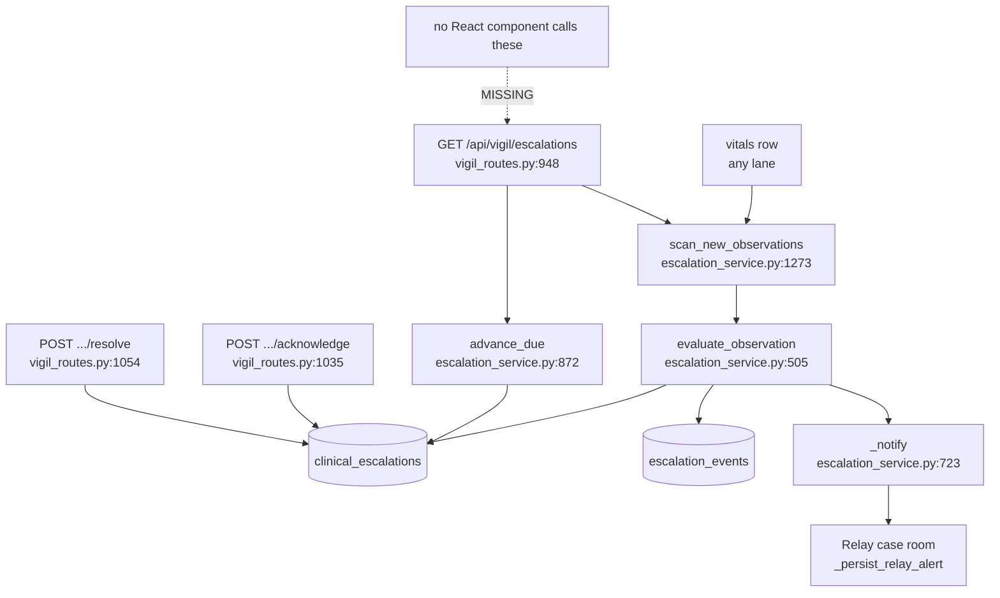
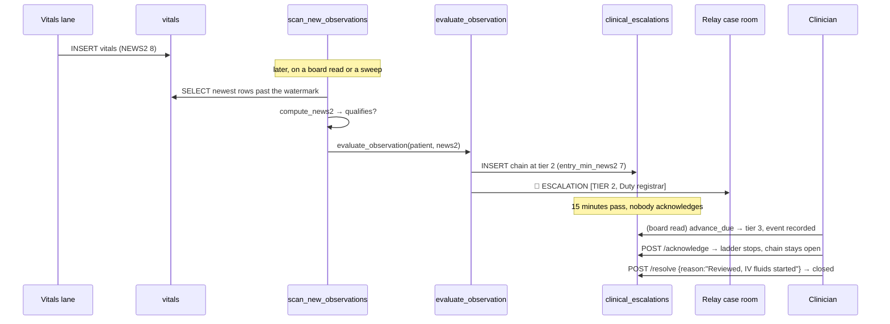

# Escalation chain: a deterioration that reaches a named human

Built 2026-08-07. This is the feature that answers the question "who actually got told?"

Before it existed, Orb could score a patient at NEWS2 19, the top of the deterioration scale, and the only durable consequences were a row in the `vitals` table and, on some paths, one line posted into the patient's Relay case room. Nothing recorded that a human had seen it. Nothing happened when no human did. A line that scrolls off a busy channel is indistinguishable from a line that was answered.

The escalation chain fixes that. A qualifying observation opens a **chain**: an object addressed to a tier (ward nurse → duty registrar → consultant), each tier with a timeout, which stays **open and visible forever** until a named human acknowledges it, and which climbs to the next tier automatically when the timeout passes unacknowledged. It closes only when someone types a reason.

**Read this before anything else in the chapter:** the whole server side is built and tested (35 tests in `server/tests/test_escalation_chain.py`), the six HTTP endpoints are live, but **no React component calls any of them**. There is no escalation board on screen today. Every "On screen" block below says so explicitly, because the honest answer is more useful than a plausible one. See *Discrepancies and open questions* for exactly what is missing and where it would go.

---

## Purpose and neighbors

**The problem.** Detection is not the hard part, Orb has scored NEWS2 correctly on every vitals lane since Vigil shipped (guide 07-vigil). The hard part is *dispatch with accountability*: proving a human received the alert, making the alert louder when nobody does, and closing it only on a stated clinical act. Everything in this chapter is about the gap between "the number was computed" and "somebody dealt with it".

**Jargon used throughout:**

| Term | Meaning in Orb |
|---|---|
| **NEWS2** | *National Early Warning Score 2*, the RCP's aggregate deterioration score from six vitals. Computed in exactly one place, `compute_news2` (`server/services/vigil_service.py:343`). This module never re-derives it. |
| **Single-parameter 3** | RCP's rule that any *one* vital scoring 3 warrants urgent review even if the total is low. Carried on `compute_news2`'s output as `single_param_3`. |
| **Chain** | One escalation. A row in `clinical_escalations` plus its append-only history in `escalation_events`. |
| **Tier** | A rung of the ladder: `{tier, role, label, timeout_minutes, entry_min_news2}`. Configured per site. |
| **Acknowledge** | "I have seen this and I am dealing with it." Records who and when. **Stops the ladder. Does not close the chain.** |
| **Resolve** | Closes the chain, with a mandatory free-text reason and a category. |
| **Watermark** | `clinical_escalations.last_vitals_id`, the newest `vitals.id` any chain for this patient has already accounted for. Stops the safety-net scan re-reading the same rows. |
| **Sweep** | One tick of the mechanism: advance every overdue tier, then scan for qualifying observations nothing dispatched. |



**Neighbors:** guide 07-vigil (`compute_news2`, the Patients board, the sepsis bundle), guide 05-audit-chain (`log_audit_event`, the fail-closed `clinical_access` category), guide 03-auth-rbac (`require_permission`, `department_scope`, `require_patient_access`), guide 08-relay (`_persist_relay_alert` writes into the patient's case room), guide 40-ops-health-site-config (`site.toml`'s `[escalation]` block is translated into the `ORB_ESCALATION_*` variables this module reads), guide 42-nurse-mode (`record_observation` is the manual vitals lane whose missing escalation caused all of this).

---

## File map

| File | Lines | Role |
|---|---:|---|
| `server/services/escalation_service.py` | 1323 | Everything. Policy, targeting, raise, notify, the clock, acknowledge, resolve, reads, and the safety-net scan. 30 top-level functions, 1 exception class. |
| `server/routes/vigil_routes.py` | 1174 | Six escalation endpoints live at `:1011`–`:1174`, plus two request models (`:977`, `:984`) and the scope helper `_escalation_or_404` (`:989`). The rest of the file is Vigil proper (guide 07). |
| `server/migrations.py` | 1719 | Migration 11, `_m11_escalation_chain` (`:592`), creates `clinical_escalations` (`:633`) and `escalation_events` (`:689`) plus four indexes. |
| `server/services/vigil_service.py` | 1162 | `compute_news2` (`:343`), the only scorer. Imported at `escalation_service.py:97`. |
| `server/services/nurse_shift_service.py` | 996 | `dispatch_observation_alert` (`:710`), the Relay-post half of the same story, called post-commit from `record_observation` (`:827`). Does **not** raise a chain. |
| `server/services/site_config_service.py` | 659 | Validates the `[escalation]` block of `site.toml` (`:473`) and translates it to `ORB_ESCALATION_*` (`_to_env`, `:519`). |
| `server/tests/test_escalation_chain.py` | 780 | 35 tests. The behavioural spec: entry tiers, the ladder, idempotency, races, reopening, resolution, scoping. |

**No frontend files.** There is no `src/api/escalations.ts`, no escalation component, and no import of any escalation endpoint anywhere under `src/`.

---

## How it works

### Flow 1: a deterioration becomes a chain

1. A nurse charts an observation set, or a monitor pushes one, or the simulator writes one. Either way a `vitals` row lands.
2. **Today, nothing calls the escalation service at that moment.** (Confirmed: `evaluate_observation` has no production caller, see *Discrepancies*.) The chain is raised later, by the safety net.
3. Somebody opens an escalation view, or a scheduler calls `POST /api/vigil/escalations/sweep`. That runs `scan_new_observations` (`escalation_service.py:1273`), which reads `vitals` directly, re-computes NEWS2 with `compute_news2`, and finds any qualifying observation newer than the patient's watermark.
4. `evaluate_observation` (`:503`) decides the entry tier from the score, derives who the tier means on this ward, `INSERT`s the `clinical_escalations` row, writes a `raised` event, and writes a fail-closed audit row inside the same transaction.
5. Post-commit, `_notify` (`:717`) posts a message into the patient's Relay case room reading `🔺 ESCALATION [TIER n, label], NEWS2 x (level)` and records a `notified` or `notify_failed` event.

### Flow 2: the ladder climbs

1. Every read of the board, and every call to the sweep endpoint, runs `advance_due` (`:776`) **unscoped**.
2. It selects open chains whose `tier_due_at` has passed, walks them **one tier at a time** so every crossed timeout gets its own `tier_advanced` event, then claims the move with a single conditional `UPDATE … WHERE id = ? AND status = 'open' AND current_tier = ?`.
3. If the `UPDATE` affects zero rows, someone acknowledged the chain in the gap, nothing at all is recorded. The append-only history must never say a chain escalated past a human who had already taken it.
4. Each advance posts a fresh Relay message naming the new tier.

### Flow 3: a human answers

1. `POST /api/vigil/escalations/{id}/acknowledge` records who and when, sets `tier_due_at = NULL` (the ladder stops), and writes an `acknowledged` event. Status becomes `acknowledged`. **The chain is still on the board.**
2. `POST /api/vigil/escalations/{id}/resolve` requires a reason of at least 3 characters. It writes `resolved_at`, `resolved_by`, `resolution_reason`, `resolution_category`, and a `resolved` event. Only now does the chain leave the default board view.
3. If the patient deteriorates *further* while the chain is acknowledged, `evaluate_observation` re-opens it at the higher tier and **clears the acknowledgement**. Acknowledgement must never become a mute button.



---

## Function-by-function

### File: `server/services/escalation_service.py`

The module docstring (`:1-88`) is required reading and is not repeated here in full. Its most important claim: Orb has **no duty model**, no on-call table, no rota, no shift calendar, no grade column, no team membership, no bleep or pager. Every tier target below is a best-available approximation and says so in `target_description` rather than pretending otherwise.

#### `_DEFAULT_TIER_POLICY`: `escalation_service.py:121`
**Signature:** module-level `list[dict]` → n/a
**Does:** The shipped ladder. Tier 1 `nurse` / "Ward nurse" / 10-minute timeout / entry at NEWS2 ≥ 5; tier 2 `registrar` / "Duty registrar" / 15-minute timeout / entry at ≥ 7; tier 3 `consultant` / "Consultant / attending" / no timeout / never an entry tier.
**On screen:** nothing directly. The labels ("Duty registrar") are what would be printed on a board and are already printed in the Relay message `_notify` composes (`:734`).
**How it works:** `entry_min_news2` means "a chain enters at the highest tier whose entry score it meets", NEWS2 ≥ 7 is the RCP emergency-response band, so a peri-arrest patient does not spend ten minutes on the ward-nurse rung first. `timeout_minutes: None` on the last tier means "nowhere left to climb", which is why the chain waits there indefinitely rather than closing.
**Why it exists:** Ward geography decides timings. A 40-bed open ward with one registrar on site is not a 12-bed HDU, so the ladder is data, per site.
**Breaks if you change it:** shortening tier 1's timeout makes every deterioration reach a registrar sooner and multiplies registrar-facing alerts; raising `entry_min_news2` on tier 2 means a NEWS2 7 patient starts at the nurse rung and loses up to ten minutes. Setting a `timeout_minutes` on the last tier does nothing, `tier_policy` overwrites it to `None` at `:180`.

#### `tier_policy`: `escalation_service.py:140`
**Signature:** `() -> list[dict]`
**Does:** Returns this site's ladder, parsed from the `ORB_ESCALATION_TIERS` environment variable (a JSON list), falling back to `_DEFAULT_TIER_POLICY`.
**On screen:** the whole policy is returned in the board payload as `policy` (`vigil_routes.py:1071`), so a board could render "Ward nurse, 10 min → Duty registrar, 15 min → Consultant". Nothing consumes it today.
**How it works:** read **at call time, not at import** (`:150`), an operator editing the ladder should not need a restart. Each entry is validated: role must be non-empty, `timeout_minutes` must be `> 0` or `null`, `entry_min_news2` coerced to int. The last tier's timeout is forced to `None` (`:182`). Any exception falls back to the default and logs at ERROR (`:184-189`).
**Why it exists:** A malformed policy must not stop escalation. Refusing to escalate because someone fat-fingered a `.env` would turn a config typo into the exact clinical failure the module exists to prevent.
**Breaks if you change it:** make the fallback raise instead of log and a bad `.env` silently disables deterioration alerting on the whole appliance. Move the `os.getenv` to module import and a site config change stops taking effect until restart, while tests that set the variable per-case start bleeding into each other.

#### `news2_threshold`: `escalation_service.py:195`
**Signature:** `() -> int`
**Does:** The aggregate NEWS2 at or above which a chain is raised. Default `5`, overridable with `ORB_ESCALATION_NEWS2_THRESHOLD`.
**On screen:** returned as `news2_threshold` in the board payload (`vigil_routes.py:1072`) so a UI can say "showing everything at or above 5". Unused today.
**How it works:** `int(os.getenv(...))` with a logged fallback to 5 on a non-integer.
**Why it exists:** 5 is the RCP urgent-response threshold ("registered nurse to urgently inform the medical team"). A site that finds it noisy raises it.
**Breaks if you change it:** raising the default silently reduces the number of chains raised across every ward and every test that asserts on a NEWS2-5 case; it does **not** affect the single-parameter rule, which is a separate flag.

#### `_honour_single_param_3`: `escalation_service.py:210`
**Signature:** `() -> bool` (env `ORB_ESCALATION_ON_SINGLE_PARAM_3`, default `True`)
**Does:** Whether one vital scoring 3 escalates on its own, even below the aggregate threshold.
**On screen:** nothing. The consequence is visible only as a chain that exists.
**Why it exists:** On by default because it is part of NEWS2, not an Orb embellishment.
**Breaks if you turn it off:** a patient with a respiratory rate of 26 and everything else normal (aggregate 3, single-parameter 3) stops raising a chain. That is a clinically real presentation.

#### `_lookback_minutes`: `escalation_service.py:217`
**Signature:** `() -> int` (env `ORB_ESCALATION_SCAN_LOOKBACK_MINUTES`, default 120)
**Does:** How far back `scan_new_observations` looks for an unescalated observation.
**On screen:** nothing.
**Why it exists:** Bounds the one-time catch-up on first deploy. An appliance switched on today raises chains for the last two hours of deterioration, not for every deterioration in the database's history.
**Breaks if you change it:** set it to 43200 and the first board read after go-live opens a chain for every qualifying observation in the last month, all of them stale, all of them needing a human to resolve with a reason.

#### `_now` / `_parse_ts`: `escalation_service.py:237` / `:248`
**Signature:** `(datetime | None) -> datetime` / `(Any) -> datetime | None`
**Does:** The injected clock, and a tolerant timestamp parser. Both always return **timezone-aware UTC**.
**On screen:** nothing.
**Why it exists:** This database stores two timestamp shapes, offset-aware ISO strings written by Python, and naive `CURRENT_TIMESTAMP` values written by SQLite. Comparing the two shapes raises `TypeError`, and inside the ladder that shows up as a chain that silently stops advancing. Every public function in this module takes `now: datetime | None` so tests can walk hours of the ladder in microseconds without a module-level mutable clock.
**Breaks if you change it:** returning a naive datetime from `_now` makes every `tier_due_at` comparison in `advance_due` throw, which the sweep swallows per-chain, the ladder appears to work and never advances.

#### `qualifies`: `escalation_service.py:263`
**Signature:** `(news2: dict | None) -> bool`
**Does:** Does this NEWS2 result cross the site's escalation threshold?
**On screen:** nothing. It is the gate that decides whether a chain exists at all.
**How it works:** Reads `compute_news2`'s **own output fields**, `raw_news2` (falling back to `raw_mews`) and `single_param_3`. It never looks at the underlying vitals.
**Why it exists:** The moment this function inspects a heart rate, there are two scorers in the system, and a previewed score and a recorded score can diverge. That is how a ward stops trusting the number.
**Breaks if you change it:** adding "or spo2 < 88" here creates a second scorer. The nurse's live NEWS2 preview (`/api/nurse/news2-preview`, guide 42) would show one thing and the escalation another.

#### `_entry_tier` / `_tier_spec`: `escalation_service.py:280` / `:290`
**Signature:** `(policy, raw_news2) -> int` / `(policy, tier) -> dict`
**Does:** The tier a chain starts at, and the spec for a given tier number.
**On screen:** decides the tier printed in the Relay message (`_notify`, `:733`).
**How it works:** `_entry_tier` takes the **highest** tier whose `entry_min_news2` the score meets, clamped to the ladder length. `_tier_spec` falls back to the last tier for an unknown number rather than raising.
**Breaks if you change it:** switching `max` to the first match would make a NEWS2 12 patient enter at tier 1 and waste both timeouts before a registrar is named.

#### `_patient_context`: `escalation_service.py:303`
**Signature:** `(db, patient_id) -> dict`
**Does:** Loads the patient's name, bed, ward, department, attending doctor, SpO2 scale and status in one query.
**On screen:** `name` and `bed` end up on the board rows via `list_escalations`; `department` decides who the tier resolves to.
**How it works:** Department comes from `PATIENT_DEPARTMENT_SQL` (`server/permissions.py`), which derives it from the active admission, **never** from `patients.ward`. Attending prefers the active admission's `attending_doctor_id` over the patient's.
**Why it exists:** `ward` is a free-text bed prefix ("GM-1"); `department` is the clinical service ("General Medicine"). Confusing the two is how a scope stops scoping.
**Breaks if you change it:** swap in `p.ward` and every ward-scoped read starts comparing "GM-1" against "General Medicine" and returns nothing, an escalation board that is silently always empty.

#### `_user_with_role` / `_first_in_department`: `escalation_service.py:336` / `:347`
**Signature:** `(db, user_id, roles) -> str | None` / `(db, roles, department, exclude=None) -> str | None`
**Does:** Confirm a specific user holds one of the given roles; pick the first user with one of those roles in a department.
**On screen:** the resulting user id becomes `target_user_id`, joined to `users.name` as `target_name` in `list_escalations` (`:1182`).
**How it works:** `_first_in_department` is `ORDER BY id LIMIT 1`, a deterministic pick, not a fair one, and it returns `None` rather than reaching outside the department.
**Why it exists:** Stable and obviously not a rota, so nobody mistakes it for one. Paging a doctor who has never seen this ward is worse than addressing the role.
**Breaks if you change it:** adding `ORDER BY RANDOM()` makes the same deterioration page a different person on each retry and makes every targeting test non-deterministic. Removing the department filter pages doctors across the hospital.

#### `_derive_target`: `escalation_service.py:370`
**Signature:** `(db, ctx, role, label, charting_actor_id) -> tuple[str | None, str]`
**Does:** Turns a tier's role into `(a user id or None, a human description)`.
**On screen:** the second element is `target_description`, the sentence a board would print under the patient's name and the sentence `_notify` puts in the Relay message: `"Addressed to: Duty registrar on General Medicine (no grade in the roster, ward doctor who is not the attending)"`.
**How it works:** three resolvers, each with a documented fallback chain.
- `nurse` → the nurse who charted this observation if we were told who → any nurse in the department → the role itself.
- `consultant` → the admission's attending → any ward doctor → the role itself.
- `registrar` → a ward doctor who is **not** the attending (the closest Orb gets to "the junior covering the ward") → the attending → the role itself.
- anything else → `None` with `"Any {role} on {dept}, Orb has no roster mapping for this tier"`.
**Why it exists:** This is the single function a real duty model would replace. When no individual is derivable, `target_user_id` is `NULL` and the escalation is addressed to a **role on a ward**, which is not a failure state, because it stays on the board of everyone holding that role there.
**Breaks if you change it:** returning `None` with an empty description silently targets nobody, which reads on a board as an escalation with no owner. If you ever add a `duty_assignments` table, this is the only function that changes.
**Gotchas:** the `nurse` resolver prefers `charting_actor_id`, which only the manual entry lane knows. A monitor feed does not record a human, and the `vitals` table has no author column at all, the author is in the audit chain, keyed by `vitals_id`, and reaching into the hash chain to page someone would be worse than this.

#### `_ESCALATION_FIELDS` / `_to_dict`: `escalation_service.py:425` / `:436`
**Signature:** tuple of 32 column names / `(row, now=None) -> dict`
**Does:** Converts a `clinical_escalations` row to the dict every route returns, adding three derived fields.
**On screen:** this dict *is* the board row shape. `age_minutes` is what a board renders as "open 47 min"; `awaiting_acknowledgement` is the single boolean a board should sort and colour on; `minutes_to_acknowledge` is the pilot's response-time metric.
**How it works:** parses `drivers_json` to a list, computes `age_minutes` from `raised_at`, `minutes_to_acknowledge` from `acknowledged_at - raised_at`, and sets `awaiting_acknowledgement = (status == "open")`.
**Breaks if you change it:** dropping a name from `_ESCALATION_FIELDS` makes every route's response quietly lose that key, no error, just a missing field a UI would render as blank. Adding a column to the table without adding it here means the column is invisible to the API.

#### `_record_event`: `escalation_service.py:455`
**Signature:** `(db, escalation_id, event_type, occurred_at, *, tier, tier_role, target_user_id, target_description, actor_user_id, actor_role, news2, detail, metadata) -> int`
**Does:** Appends one row to `escalation_events` and returns its `seq`.
**On screen:** these rows are the timeline `GET /api/vigil/escalations/{id}` returns as `events` (`:1232`), the "raised → observation → tier advanced → acknowledged → resolved" list an incident review reads.
**How it works:** `SELECT COALESCE(MAX(seq),0)+1` then `INSERT`, using the **caller's** connection so the event and the state change commit together.
**Why it exists:** The founder's requirement is "each step recorded", and a step recorded only by mutating a status column is not recorded.
**Breaks if you change it:** giving it its own connection means an event can commit while the status update rolls back, producing a history that disagrees with the row. Making it `UPDATE` an existing row rather than insert destroys the append-only property the audit story depends on.
**Gotchas:** `seq` is computed with a read-then-write, not a database sequence. Two concurrent writers on the same chain could in principle collide; in practice SQLite's connection-level write lock serialises them.

#### `_audit`: `escalation_service.py:477`
**Signature:** `(db, action_type, summary, escalation_id, patient_id, *, actor_id, actor_role, metadata) -> None`
**Does:** Writes a `clinical_access` audit row inside the caller's transaction.
**On screen:** these rows appear in the Admin panel's Audit Logs tab (`src/pages/panels/AdminPanel.tsx`, guide 25) with action types `escalation_raised`, `escalation_reopened`, `escalation_tier_advanced`, `escalation_acknowledged`, `escalation_resolved`.
**Why it exists:** `clinical_access` is one of the **fail-closed** audit categories (guide 05), so an escalation state change that cannot be audited does not commit. Same rule the eMAR and the observation write already hold.
**Breaks if you change it:** wrapping the call in `try/except` turns a fail-closed audit into a best-effort one, and a clinical act with no trail is not a clinical act anyone can defend afterwards.

#### `evaluate_observation`: `escalation_service.py:505`
**Signature:** `(patient_id, news2, *, vitals_id=None, source=None, actor_id=None, observed_at=None, now=None, notify=None) -> dict | None`
**Does:** The entry point for any vitals path. Given the dict `compute_news2` returned, it raises a new chain, extends an existing one, or does nothing. Returns the chain or `None`.
**On screen:** nothing today (no component calls the escalation API). Its **indirect** on-screen effect is real: the Relay case room gets a `🔺 ESCALATION [TIER n]` message, which appears in the Messages panel (`src/pages/panels/RelayPanel.tsx`) like any other message in that channel.
**How it works:**
1. `qualifies(news2)` is False → return `None` immediately (`:534-535`).
2. Load the patient context; no such patient → log ERROR and return `None` (`:551-554`).
3. `SELECT … WHERE patient_id = ? AND status != 'resolved'`, is there already an open or acknowledged chain?
4. **Existing chain, higher tier deserved** (`:565-566`): update to the new tier, set a fresh `tier_due_at`, re-derive the target, **null out `acknowledged_at` / `acknowledged_by` / `acknowledged_tier`**, and record a `reopened` event.
5. **Existing chain, no bump** (`:621`): update score/peak/drivers/watermark only, and record an `observation` event.
6. **No chain**: mint `ESC` + 12 hex chars, `INSERT`, record a `raised` event, `_audit`, and queue the notify.
7. `DBIntegrityError` on the insert (`:666`) means the partial unique index caught a race, take the winner's row and record a `observation` event on it instead of raising into a caller that has already committed a reading.
8. `_notify` runs **after** the `with db_session()` block closes.

Every event detail, audit summary and Relay line names the observation with the one NEWS2 label, `news2_description` (`label`, built from the same raw score and level the chain row stores), so the chain, the audit trail and the Relay post read the same words.
**Why it exists:** Idempotency by construction. Five deteriorating sets in a row are one escalation with five recorded steps, not five acknowledgements a registrar has to clear.
**Breaks if you change it:** the acknowledgement clear at `:589-590` is the subtle one. Leave the old acknowledgement on a chain that has just re-opened unanswered and a board prints "acknowledged by Dr X" next to a deterioration nobody has yet taken, misleading in exactly the direction that gets a patient missed. Making an improving observation close the chain would be worse: improving vitals are not evidence that a human answered the alert.
**Gotchas:** an observation **below** threshold does nothing at all, it neither raises nor closes anything. `notify=False` suppresses the Relay post (used by tests and by any caller that wants the chain without the message).

#### `_notify`: `escalation_service.py:723`
**Signature:** `(escalation_id, patient_id, raw, level, tier, tier_label, target_description, *, now=None, label=None, climbs=True) -> bool`
**Does:** Posts the escalation into the patient's Relay case room and records a `notified` or `notify_failed` event.
**On screen:** **this is the only thing in the whole feature a user actually sees today.** A message appears in the patient's case-room channel in the Messages panel (`src/pages/panels/RelayPanel.tsx:153` listens for `message:new`), reading:
```
🔺 ESCALATION [TIER 2: Duty registrar]: NEWS2 8 (critical)
Addressed to: Duty registrar on General Medicine (no grade in the roster, …)
Orb does not page or phone anyone. If this is addressed to you, review the
patient now; if not, phone them.
This alert stays open and moves to the next tier automatically when this
tier's time runs out.
Reference ESC7F3A91C2D004
```
On the last tier (`climbs=False`, no timeout) the fourth line reads "This alert stays open. It is at the last tier, so it does not move on." The post used to tell the reader to acknowledge it "in Vigil", a control that does not exist yet; until the board ships, it names only what a reader can do.
**How it works:** calls `_persist_relay_alert` (`server/services/ingestion_service.py`), which finds or creates the patient's case room and writes the message, then pushes it live with `_emit_message_new` (`:779`, `:813`), so a tier post written by the background sweep at 03:00 reaches whoever has that room open without a refresh. Runs **post-commit and non-raising**, then opens its own session to record the delivery outcome.
**Why it exists:** `_persist_relay_alert` opens its own connection and would block on the WAL lock taken inside our write transaction; and a delivery failure must never roll back an escalation that is already recorded.
**Breaks if you change it:** call it inside the `db_session()` in `evaluate_observation` and every raise deadlocks against its own write lock. Let it raise and a Relay outage starts throwing away escalations.
**Gotchas:** **this is not a page.** Orb has no bleep, pager, phone or push channel. If nobody has Orb open, the escalation is visible but not intrusive. A patient with no case room logs an ERROR (`:795-801`) and the escalation exists on the board only, which is why there needing to *be* a board matters.

#### `advance_due`: `escalation_service.py:872`
**Signature:** `(*, now=None, limit=500) -> list[dict]`
**Does:** Advances every open chain whose current tier has timed out. Returns the chains that moved.
**On screen:** nothing today. It is called on every `GET /api/vigil/escalations` (`vigil_routes.py:1042`), so once a board exists, simply looking at it ticks the clock. Each advance also posts a fresh Relay message.
**How it works:** three deliberate phases.
- **Phase 1 (`:808`)** works out the whole walk with no writes, one tier at a time, so a chain unattended for hours records *every* crossed timeout rather than one jump. Collapsing that would hide exactly what an incident review needs.
- **Phase 2 (`:827`, the `UPDATE` at `:933`)** claims the move with one conditional `UPDATE` guarded on both `status = 'open'` and the `current_tier` we read. `rowcount == 0` means someone acknowledged in the gap; the loop `continue`s and records **nothing**.
- **Phase 3 (`:853`)** writes one `tier_advanced` event and one audit row per step, then re-reads the row.
Notifications are sent after the session closes (`:878`).
**Why it exists:** It is deliberately **not** department-scoped. Advancing a tier creates no chain and discloses nothing; scoping it would mean an escalation on a ward nobody happens to be looking at never climbs, the exact failure this module exists to prevent, reintroduced through a permissions detail.
**Breaks if you change it:** collapse phases 1–3 into a single loop that writes as it walks, and a chain acknowledged mid-sweep gets a permanent, false "escalated past you" entry in its append-only history. Add a department filter and unattended wards stop escalating.
**Gotchas:** acknowledged chains are skipped entirely, acknowledgement is precisely the signal that a human has it.

#### `_load_policy`: `escalation_service.py:982`
**Signature:** `(row) -> list[dict]`
**Does:** Returns the ladder a given chain climbs, preferring the `policy_json` snapshot taken when it was raised.
**On screen:** nothing.
**Why it exists:** A site that edits its timings mid-shift must not retroactively change why an old escalation advanced when it did.
**Breaks if you change it:** always using the live policy makes historical `tier_advanced` timings unexplainable after any config edit.

#### `EscalationNotFound`: `escalation_service.py:1005`
**Signature:** `class EscalationNotFound(LookupError)`
**Does:** Raised for an unknown chain id. Routes turn it into 404, never 403.
**Breaks if you change it:** a 403 confirms the escalation exists, which is itself a disclosure about a patient the caller may not be entitled to know about.

#### `acknowledge`: `escalation_service.py:1009`
**Signature:** `(escalation_id, user, *, note=None, now=None) -> dict`
**Does:** Records "I have seen this and I am dealing with it", who and when, and stops the tier ladder.
**On screen:** would drive the acknowledged state on a board (`acknowledged_by_name` is joined in `list_escalations`, `:1085`). No component calls it today.
**How it works:** loads the chain; 404 if missing; `ValueError` if already resolved. If already acknowledged, records an `acknowledgement_repeated` event and returns unchanged, the **first** responder is the clinically interesting one. Otherwise `UPDATE … SET status='acknowledged', acknowledged_at, acknowledged_by, acknowledged_tier, tier_due_at = NULL`, writes an `acknowledged` event with the optional note, and audits with `minutes_open`.
**Why it exists:** Acknowledged is not finished. The chain stays on the board until somebody says what was done.
**Breaks if you change it:** make acknowledge also set `status='resolved'` and you have rebuilt the dismiss button this whole feature exists to abolish. Leave `tier_due_at` set and the ladder keeps climbing past a human who already took the alert.

#### `RESOLUTION_CATEGORIES`: `escalation_service.py:1072`
**Signature:** module-level tuple of seven strings
**Does:** `reviewed_treated`, `reviewed_no_change`, `escalated_to_icu`, `artefact`, `patient_discharged` (closed from the discharge screen, with its reason), `patient_died`, `other`.
**On screen:** would populate a dropdown in a resolve dialog.
**Gotchas:** **unknown values are accepted and stored**, `resolve` does not validate against this tuple. Refusing a clinician's wording is how a resolution box fills with "other".
**Breaks if you change it:** the pilot scorecard counts outcomes by category; renaming a member orphans historical rows.

#### `resolve`: `escalation_service.py:1085`
**Signature:** `(escalation_id, user, *, reason, category=None, now=None) -> dict`
**Does:** Closes the chain, with a mandatory reason.
**On screen:** would remove the chain from the default board view (`include_resolved=False`). No component calls it today.
**How it works:** strips the reason and rejects anything under `_MIN_REASON_CHARS = 3` (`:1082`) with `ValueError("a resolution reason is required, say what was done, in a few words")`. Then `UPDATE … status='resolved', resolved_at, resolved_by, resolution_reason, resolution_category, tier_due_at = NULL`, a `resolved` event carrying `was_acknowledged`, and an audit row.
**Why it exists:** A resolve button with no reason is a dismiss button, and a dismiss button is how a deterioration alert becomes noise a ward learns to clear without reading. The reason is also the only artefact telling the next reviewer whether the escalation worked.
**Breaks if you change it:** drop the minimum-length check and the field fills with "." and "ok". Note a chain can be resolved **without** ever being acknowledged, the `was_acknowledged: False` metadata is how you find those afterwards.

#### `list_escalations`: `escalation_service.py:1145`
**Signature:** `(*, department=None, patient_id=None, include_resolved=False, limit=200, now=None) -> list[dict]`
**Does:** The board query. Returns chains inside one department's ward boundary, joined to patient name/bed/ward/status, target name, and acknowledger name.
**On screen:** this is exactly the payload a board would render, one row per chain with the patient's name and bed, the tier label, `target_description`, `age_minutes`, and a colour driven by `awaiting_acknowledgement`.
**How it works:** `department` is whatever `permissions.department_scope(user)` returned **and nothing else**, `None` means a genuinely unscoped governance account, not "scope unknown". The boundary is derived on every read through `PATIENT_DEPARTMENT_SQL` against `admissions.department`, **never** from the `raised_in_department` snapshot on the row. Ordering is `(status = 'open') DESC, peak_news2 DESC, raised_at ASC`, unanswered first, sickest first, oldest first.
**Why it exists:** The board answers one question: "what has not been answered yet".
**Breaks if you change it:** scope on `e.raised_in_department` instead and a patient who transfers ward mid-admission drops off the new ward's board while staying on the old one's, the chain becomes invisible to the people now caring for them. Default `include_resolved=True` and the board fills with closed chains.

#### `get_escalation`: `escalation_service.py:1205`
**Signature:** `(escalation_id, *, include_events=True, now=None) -> dict | None`
**Does:** One chain plus its whole recorded history, oldest step first.
**On screen:** would drive a detail drawer: the chain header plus a timeline of `raised → observation → tier_advanced → acknowledged → resolved` with actor names.
**How it works:** one row query with three `LEFT JOIN`s for names, then `SELECT … FROM escalation_events … ORDER BY seq ASC` (`:1135`) joined to `users.name` as `actor_name`. Each event's `metadata_json` is parsed back to a dict.
**Breaks if you change it:** ordering events by `occurred_at` instead of `seq` reorders a multi-tier advance, because `advance_due` deliberately backdates each step's `occurred_at` to when that timeout actually passed (`:854`, `s_entered`). `seq` is the only stable order.

#### `patient_escalations`: `escalation_service.py:1251`
**Signature:** `(patient_id, *, include_resolved=True, limit=50, now=None) -> list[dict]`
**Does:** Every escalation for one patient, for the chart, not the board. Defaults to including resolved ones.
**On screen:** would drive an "escalation history" section of the patient chart in `VigilPanel`'s detail view.
**How it works:** a thin call into `list_escalations` with no department.
**Why it exists:** The caller owns the ward check (the route uses `require_patient_access`). Deliberately no department parameter, so there is no second, divergent scope derivation in the system.
**Breaks if you change it:** add a department filter here and you now have two places that decide ward boundaries, which will drift.

#### `_scan_max_rows`: `escalation_service.py:1266`
**Signature:** `() -> int` (env `ORB_ESCALATION_SCAN_MAX_ROWS`, default 1000, floor 1)
**Does:** Hard cap on how many `vitals` rows one scan reads.
**Breaks if you change it:** set it too low on a busy ward and the newest-first window never reaches a deteriorating patient whose last observation is older than the cap.

#### `scan_new_observations`: `escalation_service.py:1273`
**Signature:** `(*, department=None, now=None) -> list[dict]`
**Does:** The safety net. Raises chains for qualifying observations that **nothing dispatched**, deriving them from the `vitals` table alone.
**On screen:** nothing directly, but this is what makes a chain exist at all today. Its side effects (a Relay message per new chain) are visible in the Messages panel.
**How it works:**
1. Two queries only. One over `clinical_escalations` grouped by patient for the watermark (`MAX(last_vitals_id)`, across resolved chains too), the active tier, and the active chain id. One over `vitals` joined to `patients`, newest-first, filtered to `status='admitted'` and `timestamp >= cutoff`, optionally department-scoped, capped at `_scan_max_rows()`.
2. Per patient, walking newest-first: stop at the watermark (`settled`); skip non-qualifying rows; take the **most recent qualifying** row.
3. If a chain is already open and already at least as loud as this score deserves, just advance the watermark and record nothing.
4. Otherwise call `evaluate_observation`, **outside** the read session, because it opens its own transaction and so does the notify path.
**Why it exists:** Orb has three vitals lanes, the simulator, the HL7/FHIR/JSON ingestion feed, and manual bedside entry, and the bug this module answers was that one of them had no escalation wired to it. "Somebody will remember to call the service from the fourth lane" is precisely the assumption that failed.
**Breaks if you change it:**
- Take the *most recent* row instead of the most recent *qualifying* row and a spike followed a minute later by a benign reading is silently lost. That is the dangerous direction to be wrong in.
- Remove the "already open, already this loud" short-circuit (`:1402-1413`) and a monitor feed writing every few seconds staples two "further observation" steps a minute onto an open chain until its history is unreadable.
- Turn it back into a query per admitted patient and a 40-bed ward polled by a dozen tablets becomes thousands of SQLCipher round trips a minute for nothing.
**Gotchas:** it is a **safety net, not the mechanism**. Latency is the gap between sweeps. It is bounded to the caller's department when given one, so a hospital-wide governance account reading a board does not manufacture clinical state across every ward it can see.

#### `sweep`: `escalation_service.py:1435`
**Signature:** `(*, department=None, now=None) -> dict`
**Does:** One tick of the whole mechanism: `advance_due` then `scan_new_observations`. Returns `{advanced, raised, swept_at, department}`.
**On screen:** nothing, it returns **counts only, no PHI**, which is what makes it safe to expose to an ops caller, safe to log, and safe to poll from a cron line.
**Breaks if you change it:** adding patient ids or scores to the return value turns a safe-to-log ops endpoint into a PHI leak in every log aggregator it reaches.

---

### File: `server/routes/vigil_routes.py` (escalation section, `:952`–`:1174`)

The section header comment (`:952-975`) states two rules worth keeping. **Every route here is a plain `def`, not `async def`**, the escalation service opens SQLite (an encrypted write plus a fail-closed audit row on the raise path), and `async def` would run all of that on the event loop, the shape that froze the API on 2026-07-30. FastAPI runs sync routes in a threadpool.

And the permission model: reading is `alert.read`; acknowledging and resolving require `alert.read` **and** `vitals.write`, which resolves to `{doctor, clinician, nurse}`. An administrator can see an unanswered deterioration and cannot silently clear it. The header is honest that this combination stands in for a dedicated `escalation.acknowledge` permission that does not exist yet.

#### `EscalationAcknowledgeIn`: `vigil_routes.py:1103`
**Signature:** `class EscalationAcknowledgeIn(BaseModel)`, one optional field, `note: str | None`
**Does:** The acknowledge request body.
**On screen:** would be a free-text "note" box in an acknowledge dialog.
**Why it exists:** It deliberately carries **no patient id**. The chain names the patient; letting a request name one is the caller-named-scope hole `server/tests/test_caller_named_patient_scope.py` exists to catch.
**Breaks if you add a `patient_id`:** you have reintroduced a class of bug the test suite specifically hunts.

#### `EscalationResolveIn`: `vigil_routes.py:1110`
**Signature:** `class EscalationResolveIn(BaseModel)`, `reason: str` (required), `category: str | None`
**Does:** The resolve request body. `reason` being required at the Pydantic layer means a missing reason is a 422 before the handler runs; a *blank* reason is a 400 from the service.
**Breaks if you make `reason` optional:** the dismiss button returns.

#### `_escalation_or_404`: `vigil_routes.py:1115`
**Signature:** `(escalation_id, user, include_events=True) -> dict`
**Does:** Loads a chain and proves the caller's ward owns its patient.
**On screen:** the difference between a detail drawer opening and a "not found" state.
**How it works:** `get_escalation` then `enforce_patient_scope(user, chain["patient_id"])`, which raises 404 itself when the patient is outside the caller's department.
**Why it exists:** 404 on both "no such escalation" and "not your ward", never 403. `require_patient_access` cannot be used here because the id on the path is a **surrogate**, an escalation id that resolves to a patient.
**Breaks if you change it:** returning 403 for a cross-ward chain confirms that a chain (and therefore a deteriorating patient) exists on another ward.

#### `GET /api/vigil/escalations`: `vigil_routes.py:1137` (`list_escalations_route`)
**Signature:** query `include_resolved: bool = False`, `limit: int = 200` (1–500); guard `require_permission("alert.read")` → `{escalations, open_count, policy, news2_threshold}`
**Does:** The board. Returns everything on this ward that a deterioration alert is still waiting on.
**On screen:** **nothing today.** This endpoint has no caller under `src/`. It is designed to feed an escalation board, most naturally a strip or tab inside `src/pages/panels/VigilPanel.tsx`, next to the patient list.
**How it works:** the read is also a tick of the mechanism. `advance_due()` runs **unscoped** on every call (`:1042`); `scan_new_observations(department=dept)` runs **only** when the caller has a department (`:1043`). Then `list_escalations`, then a `log_phi_read` audit row (`:1050`) carrying `result_count`, `open_count` and the patient ids, but only when rows came back.
**Breaks if you change it:** removing the `advance_due()` call means nothing ever advances a tier unless somebody hits the sweep endpoint. Scoping `advance_due` to the department means an escalation on a ward nobody has open never climbs. Removing the `if rows:` guard would write a PHI-read audit row for every empty poll, which on a 30-second polling board is thousands of meaningless audit rows a day.

#### `GET /api/vigil/escalations/{escalation_id}`: `vigil_routes.py:1202` (`get_escalation_route`)
**Signature:** guard `require_permission("alert.read")` → the chain dict with `events`
**Does:** One chain and every recorded step.
**On screen:** nothing today; designed for a detail drawer.
**How it works:** `_escalation_or_404` then a `log_phi_read` with the chain's status and tier.
**Breaks if you change it:** dropping `_escalation_or_404` in favour of a bare `get_escalation` removes the ward check, and any `alert.read` holder can read any ward's deteriorating patients by id.

#### `POST /api/vigil/escalations/{escalation_id}/acknowledge`: `vigil_routes.py:1035`
**Signature:** body `EscalationAcknowledgeIn`; guard `require_permission("alert.read", "vitals.write")`
**Does:** Records the acknowledgement.
**On screen:** nothing today. Would be the primary button on a board row.
**How it works:** ward check, then `escalation_service.acknowledge`. `EscalationNotFound` → 404, `ValueError` (already resolved) → 400.
**Breaks if you change it:** widening the guard to `alert.read` alone lets an administrator clear a clinical alert they cannot act on.

#### `POST /api/vigil/escalations/{escalation_id}/resolve`: `vigil_routes.py:1054`
**Signature:** body `EscalationResolveIn`; guard `require_permission("alert.read", "vitals.write")`
**Does:** Closes the chain with a reason.
**On screen:** nothing today. Would be a dialog with a text box and a category dropdown.
**How it works:** identical shape to acknowledge; a blank reason surfaces as HTTP 400 with the service's message.
**Breaks if you change it:** see `resolve`.

#### `POST /api/vigil/escalations/sweep`: `vigil_routes.py:1075`
**Signature:** guard `require_permission("alert.read")` → `{advanced, raised, swept_at, department}`
**Does:** One tick for an ops caller or a scheduler.
**On screen:** nothing, deliberately, counts only, no patient, no score, no name.
**How it works:** `escalation_service.sweep(department=department_scope(user))`. Hospital-wide for an unscoped governance account, which is the case a scheduled sweep should run under.
**Breaks if you change it:** this is the only thing that makes escalations advance when nobody is looking at a board. If you ever build the board, keep this endpoint, a ward with every tablet asleep still needs the ladder to climb.
**Gotchas:** nothing in Orb calls this on a timer today. There is no background task and no cron line. See *Discrepancies*.

#### `GET /api/vigil/patients/{patient_id}/escalations`: `vigil_routes.py:1092`
**Signature:** query `include_resolved: bool = True`; guard `require_patient_access("alert.read", audit_action="patient_escalations_viewed")` → `{patient_id, escalations}`
**Does:** Escalation history for one patient, for the chart rather than the board.
**On screen:** nothing today. Would sit in the patient detail view in `VigilPanel`.
**Why it exists:** ward check and PHI-read audit both come from `require_patient_access`, so this route holds no second scope derivation of its own.
**Breaks if you change it:** swapping to `require_permission("alert.read")` removes both the ward check and the audit row in one edit.

---

### File: `server/migrations.py`: migration 11

#### `_m11_escalation_chain`: `migrations.py:592`
**Signature:** `(conn) -> None`; registered as `Migration(11, "escalation_chain", …)` in the `MIGRATIONS` list at `:1620`
**Does:** Creates both tables and four indexes.
**On screen:** nothing. A migration that has not run means every escalation route returns a 500 on a missing table.
**How it works:** two `CREATE TABLE IF NOT EXISTS` plus:
- `idx_escalation_one_active_per_patient` (`:676`), a **partial UNIQUE index** over `patient_id` where `status != 'resolved'`.
- `idx_escalation_due` (`:680`), `(status, tier_due_at)`, the index `advance_due` rides.
- `idx_escalation_patient_raised` (`:684`), `(patient_id, raised_at DESC)`.
- `idx_escalation_events_chain` (`:708`), `(escalation_id, seq)`.
**Why two tables:** `clinical_escalations` (`:633`) is the **current state**, and it is `UPDATE`d, because "what is outstanding right now" is a question a ward board asks a hundred times a shift and folding an event log on every poll is how a board gets slow and then gets wrong. `escalation_events` (`:689`) is the **append-only** record; rows are never updated and `seq` orders them.
**Breaks if you change it:** dropping the partial unique index makes the one-active-chain-per-patient rule a service-layer *intention* rather than a guarantee, and a monitor push racing a nurse's manual set in the same second produces two chains the clinician must acknowledge separately. Adding an `UPDATE` path to `escalation_events` destroys the only tamper-evident record of what happened.
**Gotchas:** `raised_in_department` (`:637`) is a display and targeting **snapshot**. The schema comment says it in capitals: never scope a query on it.

---

## Cross-subsystem contracts

| Contract | Producer | Consumer | Breaks how |
|---|---|---|---|
| The NEWS2 dict shape (`raw_news2`, `level`, `drivers`, `single_param_3`, `complete`, `missing_parameters`) | `vigil_service.compute_news2` (`server/services/vigil_service.py:343`) | `qualifies` (`server/services/escalation_service.py:263`), `evaluate_observation` (`:505`), `scan_new_observations` (`:1273`) | rename `raw_news2` and `qualifies` silently returns False for every patient, total, silent loss of escalation |
| `ORB_ESCALATION_*` environment variables | `site_config_service._to_env` (`server/services/site_config_service.py:519`) | `tier_policy` (`:138`), `news2_threshold` (`:193`), `_honour_single_param_3` (`:208`), `_lookback_minutes` (`:215`), `_relay_notify_enabled` (`:228`) | a `site.toml` tier list that is not a JSON array makes `tier_policy` fall back to the default and log, the site's timings silently do not apply |
| Ward boundary | `permissions.PATIENT_DEPARTMENT_SQL` + `department_scope` | `_patient_context` (`:301`), `list_escalations` (`:1048`), `vigil_routes.py:1041` | any second derivation of "which ward" drifts from this one |
| Relay case room delivery | `ingestion_service._persist_relay_alert` | `_notify` (`:717`), `nurse_shift_service.dispatch_observation_alert` (`:710`) | a patient with no case room means the escalation message reaches nobody; logged at ERROR, chain still exists |
| Fail-closed audit | `audit_service.log_audit_event` with `event_category="clinical_access"` | `_audit` (`:475`) | an audit failure rolls back the escalation state change, by design |
| Partial unique index | `migrations.py:676` | the `DBIntegrityError` branch in `evaluate_observation` (`:660`) | drop the index and the race branch becomes dead code while duplicate chains appear |

---

## Rebuild notes

If you had to rebuild this from scratch, the order that matters:

1. **The score is not yours.** Take `compute_news2`'s output dict as the input and never look at a heart rate.
2. **Two tables, not one.** Current state for the board, append-only events for the history. Enforce one-active-chain-per-patient with a partial unique index, not with a `SELECT` before `INSERT`.
3. **Inject the clock everywhere.** `now: datetime | None` on every public function. No module-level mutable time.
4. **Acknowledge ≠ resolve.** Two verbs, two states. Acknowledge stops the ladder; resolve needs a reason.
5. **Re-open clears the acknowledgement.** A worse observation on an acknowledged chain must make it unanswered again.
6. **Claim before you record.** In the timeout sweep, do the conditional `UPDATE` first; if it affects zero rows, write nothing.
7. **Build the safety net anyway.** Do not trust that every writer will remember to call you. Derive the chain from the observation table too.
8. **Notify post-commit and never raise.** Delivery is best-effort; the record is not.
9. **Then build the board**, which is the step that has not happened.

---

## Discrepancies and open questions

These are real, current, and load-bearing. An investor's engineer will find them in ten minutes; better they read them here first.

1. **There is no user interface.** No file under `src/` references any `/api/vigil/escalations*` endpoint. The server, the schema, the audit trail and 35 tests exist; the screen does not. Everything a clinician can see today is the Relay message `_notify` posts, and that message ends with "acknowledge it in Vigil", pointing at a control that has not been built. The natural home is a strip or sub-tab in `src/pages/panels/VigilPanel.tsx`, fed by a new `src/api/escalations.ts` mirroring the six endpoints.

2. **Nothing calls `evaluate_observation` in production.** Grep confirms the only non-test callers are inside this module (`scan_new_observations:1298`) and a mention in a route docstring. So the immediate path, "chart an observation, a chain appears at once", is not wired. Chains only appear when `scan_new_observations` runs, which happens on a board read (there is no board) or on a call to the sweep endpoint (nothing calls it on a timer). **In a running appliance today, escalations are raised only if something deliberately pokes the sweep endpoint.** The two obvious fixes: call `evaluate_observation` post-commit from `nurse_shift_service.record_observation` (`:827`, right beside the existing `dispatch_observation_alert` call at `:978`) and from the ingestion vitals path; and add `sweep` to the lifespan background tasks in `server/main.py`.

3. **`dispatch_observation_alert` and the escalation chain are two separate mechanisms that do not know about each other.** `nurse_shift_service.dispatch_observation_alert` (`:710`) posts a `⚠️ VIGIL ALERT [NURSE OBS]` message; `escalation_service._notify` (`:717`) posts a `🔺 ESCALATION [TIER n]` message. On a nurse-charted deterioration that both paths cover, the case room gets **two** messages about the same observation. Consolidating them is unfinished work.

4. **`getEscalationStatus` in `src/api/client.ts:1786` is not this feature.** It calls `/demo/escalation-status/{patientId}`, for which **no server route exists** (grep finds none), and no component imports it. Same for `triggerDeterioration` (`src/api/client.ts:1779`). They are leftovers from a demo harness. An engineer grepping "escalation" in the frontend will find them first and reach the wrong conclusion.

5. **The permission is a placeholder.** Acknowledge and resolve are gated on the *combination* `alert.read` + `vitals.write` rather than a dedicated `escalation.acknowledge`. The route header says so at `vigil_routes.py:970-975`. The combination is strictly narrower than either permission alone, so it fails safe, but it is not the permission the feature deserves.

6. **`RESOLUTION_CATEGORIES` is not enforced.** `resolve` lower-cases and stores whatever it is given (`:1099`). Any pilot analysis grouping by category must handle values outside the tuple.

7. **`seq` is allocated with a read-then-write** in `_record_event` (`:456`). SQLite's write lock makes this safe in practice; it would not survive a move to a store with row-level concurrency.

8. **No delivery channel exists.** No bleep, pager, SMS, phone or push. `_notify`'s docstring states it plainly (`:726-731`): loud if someone has Orb open, silent if nobody does. Until the board exists, "silent if nobody does" is the normal case.
