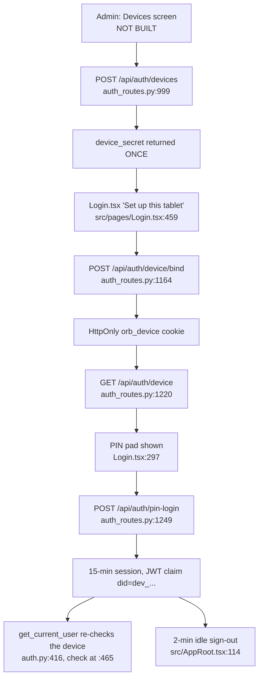
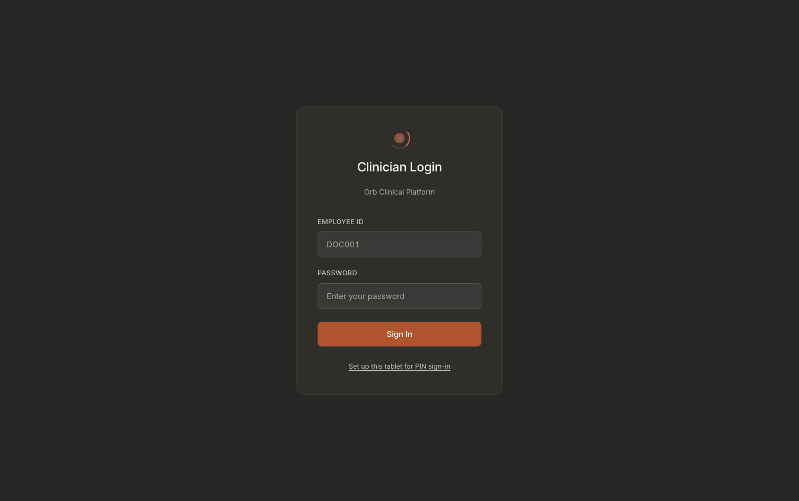
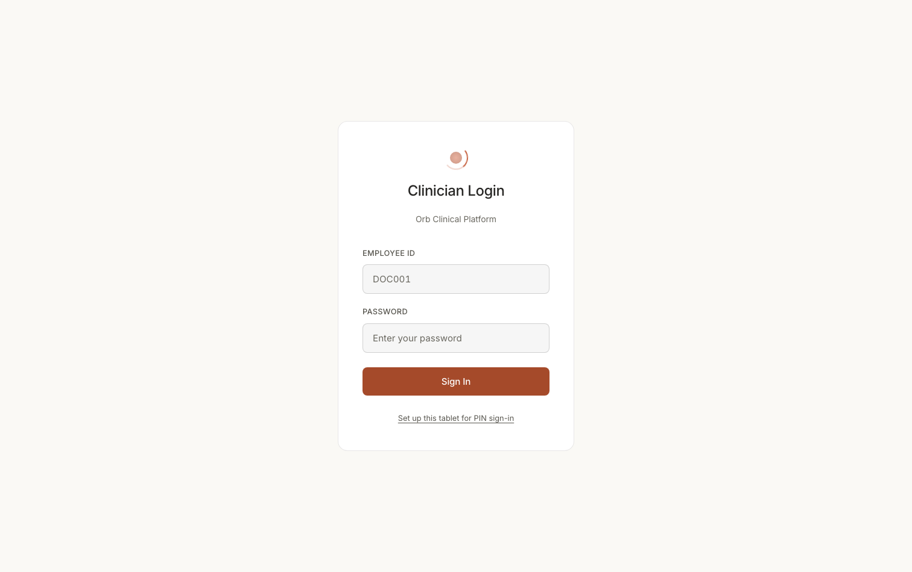
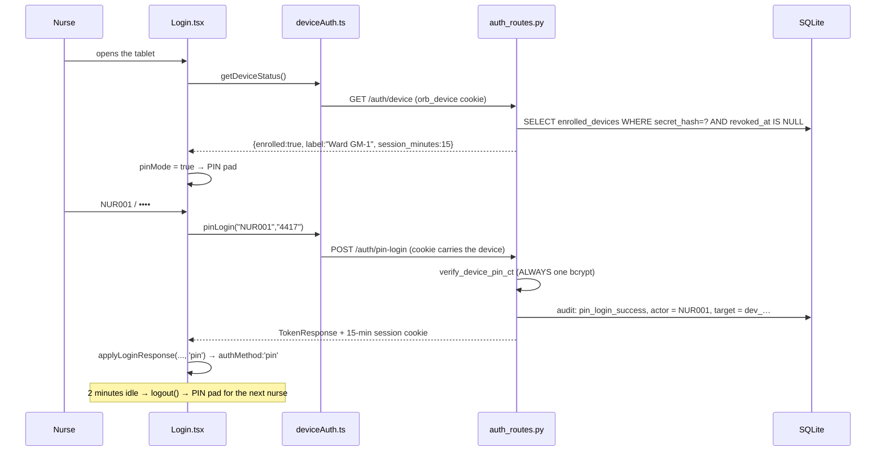

# PIN-on-device identity: signing in as yourself on a shared ward tablet

Built 2026-08-07.

**The problem, stated once.** Typing a full password before every patient interaction is what makes staff share a login. A shared login destroys the audit trail: every row says `NUR001` when three different nurses touched the chart. Attribution is the entire point of the trail, so the fix has to make signing in *as yourself* the path of least resistance on a trolley tablet.

**The shape.** An administrator enrols the tablet **once**; the browser then holds a long-lived device credential in an HttpOnly cookie. A person signs in on top of that with a short PIN. The resulting session names the **person**, the device is context in the audit metadata, never the actor.

**One thing to get straight before you read the code.** Orb has **two different PINs** on two different columns, and confusing them is the single easiest mistake to make in this area:

| | Column | Set by | Used for |
|---|---|---|---|
| **Tablet PIN** | `users.device_pin_hash` | `POST /api/auth/device-pin` (self) · `POST /api/auth/device-pin/{user_id}` (admin) | Signing in to a ward tablet. This chapter. |
| **Signing PIN** | `users.pin_hash` | `POST /api/admin/users/{user_id}/pin` (`server/routes/admin_users_routes.py:334`) | Co-signing an agentic medication order. Guide 08-relay / guide 14-helix. |

They are deliberately separate. If unlocking the tablet used the same secret, anyone who shoulder-surfs an unlock typed thirty times a shift on a shared screen could also countersign a medication order in that nurse's name, two independent controls collapsed into one. Migration 12's docstring says exactly this at `server/migrations.py:743-751`.

---

## Purpose and neighbors

**Jargon:**

| Term | Meaning in Orb |
|---|---|
| **Enrolled device** | A tablet an admin has registered. One row in `enrolled_devices`. Has a 256-bit secret, shown once. |
| **Device credential / device secret** | The 256-bit random string. Held by the browser as the HttpOnly `orb_device` cookie after a one-time bind. |
| **Bind** | The one-time exchange of the raw secret for the cookie (`POST /api/auth/device/bind`). |
| **Tablet PIN** | 4–8 digits, bcrypt-hashed into `users.device_pin_hash`. |
| **Constant-work verification** | Always paying exactly one bcrypt, on every code path, so response latency reveals nothing about whether an account exists. |
| **The sweep** | The attack a per-account lockout cannot see: five guesses each across forty staff is two hundred guesses on one tablet, and no single account ever trips. Countered by a per-*device* throttle. |

**Neighbors:** guide 03-auth-rbac (`create_token`, `get_current_user`, the login limiter, MFA), guide 05-audit-chain (every route here writes an `authentication` audit row), guide 25-admin-panel (where the device inventory screen *would* live), guide 39-offline-read-cache (`clearOfflineCache` on the same logout that ends a PIN session), guide 42-nurse-mode (the nurse is the user this whole feature is for).

---

## File map

| File | Lines | Role |
|---|---:|---|
| `server/auth.py` | 600+ | The primitives: `verify_device_pin_ct` (`:214`), `generate_device_secret` (`:251`), `hash_device_secret` (`:256`), `extract_device_token` (`:270`), `set_device_cookie` (`:288`), `clear_device_cookie` (`:295`), `load_active_device` (`:299`), `create_token` (`:323`), `_load_session_context` (`:380`), `get_current_user` (`:416`). Constants `DEVICE_COOKIE` (`:39`), `DEVICE_HEADER` (`:40`), `DEVICE_COOKIE_MAX_AGE` (`:44`), `DEVICE_PIN_SESSION_MINUTES` (`:65`). |
| `server/routes/auth_routes.py` | 1533 | Nine device/PIN endpoints plus the throttle helpers. Section header at `:927-953`. |
| `server/models/user.py` | n/a | Request bodies: `PinLogin` (`:20`), `DeviceEnrollBody` (`:32`), `DeviceBindBody` (`:40`), `DevicePinBody` (`:45`), `AdminDevicePinBody` (`:52`). |
| `server/services/pin_security.py` | 130 | The **signing**-PIN helpers (`hash_pin` `:45`, `verify_pin` `:62`, the in-memory limiter `:102`–`:131`). Reused by `_write_device_pin` for hashing only. |
| `server/migrations.py` | 1719 | Migration 12, `_m12_device_pin_identity` (`:713`), four `users` columns plus `enrolled_devices` (`:772`). |
| `src/api/deviceAuth.ts` | 85 | The typed client: `DeviceStatus` (`:20`), `getDeviceStatus` (`:36`), `bindDevice` (`:49`), `pinLogin` (`:69`), `setOwnDevicePin` (`:80`). |
| `src/pages/Login.tsx` | 506 | The only screen that uses any of it. PIN state (`:30`–`:37`), device probe (`:42`), `pinMode` (`:71`), `applyLoginResponse` (`:81`), `handlePinLogin` (`:106`), `handleBindDevice` (`:132`), `handleSubmit` (`:210`), the PIN form (`:297`), the two toggle buttons (`:439`, `:459`). |
| `src/App.tsx` | 201 | `authMethod` on the user (`:35`), `IDLE_LOCK_MS` / `SHARED_DEVICE_IDLE_MS` (`:51`/`:52`), the shared-device branch (`:99`-`:105`), `logout` (`:146`). |
| `src/hooks/useIdleTimer.ts` | 87 | `useIdleTimer` (`:20`). |
| `src/pages/Login.pin.test.tsx` | n/a | The behavioural spec for the screen: pad shown only when enrolled, fallback always available, the async-race escape hatch. |

*These captures were taken on a browser that is **not** enrolled, so they show the password form plus the "Set up this tablet for PIN sign-in" button. On an enrolled tablet the same card shows the tablet's label under the title and a staff-ID + PIN pair instead of the password field.*

---

## How it works

### Flow 1: enrolling a tablet (one time, per device)

1. An administrator calls `POST /api/auth/devices` with a label and optional department. The response contains `device_secret`, **256 bits of `secrets.token_urlsafe`, shown once and never again**. Only its SHA-256 digest is stored.
2. The admin carries that string to the tablet.
3. On the tablet's login screen they tap **"Set up this tablet for PIN sign-in"** (`src/pages/Login.tsx:459`), paste the code into the textarea (`:277-296`) and submit.
4. `bindDevice` (`src/api/deviceAuth.ts:49`) posts it to `POST /api/auth/device/bind`. The server validates it and sets the HttpOnly `orb_device` cookie with a one-year max-age.
5. The raw secret is then thrown away client-side. It was never persisted.

### Flow 2: a nurse signs in

1. The login screen mounts and calls `getDeviceStatus()` → `GET /api/auth/device` (`src/pages/Login.tsx:42-50`). It never throws; a failure just leaves the password form up.
2. `{enrolled: true}` sets `usePin`, which makes `pinMode` true (`:71`) and swaps the form to **staff ID + PIN** (`:297-335`). The tablet's label is printed under the title (`:270`).
3. Submitting calls `pinLogin(id, pin)` → `POST /api/auth/pin-login`. The device credential is **not** in the body, it rides as the cookie.
4. The server checks, in this exact order: IP rate limit → device valid → device-wide throttle → **constant-work bcrypt** → per-account throttle → credentials → is_active → role gate. Order matters; see `pin_login` below.
5. On success it mints a JWT with `did = <device id>`, `amr = "pin"` and a **15-minute** expiry (`DEVICE_PIN_SESSION_MINUTES`, `server/auth.py:65`), sets the session cookies with a matching max-age, and writes a `pin_login_success` audit row whose **actor is the person**.

### Flow 3: the session ends

Three independent mechanisms, none of which relies on the other:

- **Server expiry.** 15 minutes, baked into the token. `/api/auth/refresh` cannot launder it longer.
- **Client idle sign-out.** `src/AppRoot.tsx:114` runs `useIdleTimer` at `SHARED_DEVICE_IDLE_MS` = **2 minutes** when `user.authMethod === 'pin'`, and calls `logout()`, a full sign-out, not a lock modal.
- **Admin revocation.** `POST /api/auth/devices/{id}/revoke` marks the row. `get_current_user` (`server/auth.py:457`) re-reads the device on **every** request and 401s a session whose tablet is no longer enrolled, the check is at `server/auth.py:505-511`, and note it fires on either a missing device row or a non-null `revoked_at`, so deleting the row revokes just as effectively as marking it.

---

## Function-by-function

### File: `server/auth.py`: the primitives

#### `DEVICE_COOKIE` / `DEVICE_HEADER` / `DEVICE_COOKIE_MAX_AGE` / `DEVICE_PIN_SESSION_MINUTES`: `auth.py:39` / `:40` / `:44` / `:65`
**Signature:** module constants, `"orb_device"`, `"x-orb-device-token"`, `365*24*3600`, `_int_env("ORB_DEVICE_PIN_SESSION_MINUTES", 15)`
**Does:** Names the cookie, the fallback header, the device credential's lifetime, and the PIN session's lifetime.
**On screen:** `DEVICE_PIN_SESSION_MINUTES` is returned to the login screen as `session_minutes` (`auth_routes.py:1245`) and lands in `DeviceStatus.session_minutes` (`src/api/deviceAuth.ts:27`). Nothing renders it today.
**Breaks if you change it:** raising `DEVICE_PIN_SESSION_MINUTES` widens the window in which a stolen token works, and that window is the *only* thing bounding a leaked PIN token, because the request path deliberately does not re-present the device credential (see `get_current_user`). Renaming `DEVICE_COOKIE` invalidates every already-bound tablet at once; every one needs re-enrolling by hand.

#### `verify_device_pin_ct`: `auth.py:255`
**Signature:** `(pin: str | None, hashed: str | None) -> bool`
**Does:** Verifies a tablet PIN while always doing exactly the same amount of work.
**On screen:** nothing directly, the *absence* of a signal is the feature. A wrong PIN and an unknown staff ID produce identical bodies and identical latency in the login card's red error strip (`src/pages/Login.tsx:274`).
**How it works:** **always** performs exactly one `bcrypt.checkpw`. Unknown user, user with no PIN, and a corrupt (non-`$2`) hash all bcrypt against `_DUMMY_BCRYPT_HASH` (`auth.py:182`) and return False. A real PIN bcrypts against the stored hash.
**Why it exists:** A 4–6 digit PIN is trivially guessable, so the online path is rate-limited, but rate limiting is worthless if latency answers "does this staff id exist, and does it have a tablet PIN?" for free. That is not hypothetical: the plain login path shipped exactly that oracle (unknown user skipped bcrypt, ~2.5 ms vs ~223 ms, 90x, fully separable).
**Breaks if you change it:** the docstring's last line is the rule, **callers must run this before branching on lockout or device state**. Add an early `if not hashed: return False` and you have restored the oracle in one line. Note also there is no legacy SHA-256 tier here (unlike `pin_security.verify_pin`): `device_pin_hash` is a new column that only ever receives bcrypt, so a non-bcrypt value is corruption and must fail, in bcrypt time.

#### `generate_device_secret`: `auth.py:292`
**Signature:** `() -> str`
**Does:** `secrets.token_urlsafe(32)`, 256 bits of randomness.
**On screen:** the string an administrator copies out of the enrol response and pastes into the tablet's setup textarea (`src/pages/Login.tsx:283`).
**Breaks if you change it:** shortening it below ~128 bits makes brute-forcing the unauthenticated `/device/bind` endpoint theoretically reachable; that endpoint's whole safety argument is "guessing it is not an attack that finishes".

#### `hash_device_secret`: `auth.py:297`
**Signature:** `(secret: str) -> str`, SHA-256 hex digest
**Does:** Hashes the device secret for storage. **Not bcrypt, on purpose.**
**On screen:** nothing.
**Why it exists:** bcrypt exists to make *low-entropy* secrets expensive to guess. This secret is 256 random bits; no work factor makes it more unguessable. Paying ~200 ms of bcrypt would buy nothing, would land on the hot path of the one interaction this feature exists to make fast, and would do so on **top** of the bcrypt the PIN itself already costs. A plain digest also lets the lookup be a single UNIQUE-index probe instead of a scan comparing every enrolled tablet.
**Breaks if you change it:** switching to bcrypt breaks the `secret_hash TEXT NOT NULL UNIQUE` index lookup entirely (bcrypt salts differ per call, so you could never look a device up by digest), `load_active_device` would have to scan and compare every row.

#### `extract_device_token`: `auth.py:311`
**Signature:** `(request: Request) -> str | None`
**Does:** Pulls the device credential from the HttpOnly cookie, falling back to the `x-orb-device-token` header.
**On screen:** nothing.
**Why it exists:** the cookie is the steady state; the header is for the bind call itself, the one moment the raw secret is in the client's hands, and for machine clients with no cookie jar.
**Breaks if you change it:** dropping the header fallback breaks any non-browser client and makes the bind flow cookie-only.

#### `set_device_cookie` / `clear_device_cookie`: `server/auth.py:329` / `:336`
**Signature:** `(response, request, secret) -> None` / `(response) -> None`
**Does:** Sets/deletes `orb_device`, `httponly=True`, `samesite="lax"`, `secure=cookie_secure(request)`, one-year max age.
**On screen:** nothing visible; the effect is that the PIN pad appears on this browser and only this browser.
**Why it exists:** A long-lived credential in `localStorage` is readable by any script on the origin, the exact hole the session JWT was moved out of. HttpOnly puts it beyond JavaScript.
**Breaks if you change it:** drop `httponly` and a single XSS lifts the ward tablet's permanent credential. Change `samesite` to `none` without `secure` and browsers reject the cookie outright, so the PIN pad silently never appears.

#### `load_active_device`: `auth.py:340`
**Signature:** `(secret: str) -> Row | None`
**Does:** Returns the **active** `enrolled_devices` row for a secret, or `None`.
**On screen:** decides whether the login card shows the PIN pad or the password form.
**How it works:** `SELECT * FROM enrolled_devices WHERE secret_hash = ? AND revoked_at IS NULL`, wrapped in a bare `try/except` that returns `None`.
**Why it exists:** fail-closed on every ambiguity. An unknown digest, a revoked tablet, **or a database that has not yet run migration 12** all return `None`. A missing table must not 500 the login path: during a partial upgrade the correct answer is "this device is not enrolled", not a stack trace on the ward's only tablet.
**Breaks if you change it:** it is **blocking**. Call it from an `async def` and it runs SQLCipher on the event loop, the shape that froze the API on 2026-07-30. Every caller here is a plain `def` route, which FastAPI runs in a threadpool.

#### `create_token`: `server/auth.py:364` (device claims at `:401-408`)
**Signature:** `(user_id, role, *, token_version=0, device_id=None, auth_method=None, expires_in_minutes=None, …) -> str`
**Does:** Mints the session JWT. When `device_id` is given it adds `did` (device id) and `amr` (auth method) claims.
**On screen:** nothing, but `did` is what makes revocation work and what makes the 2-minute idle rule apply.
**Breaks if you change it:** drop the `did` claim and `get_current_user` can no longer tell a PIN session from a password session, so revoking a stolen tablet stops severing its live sessions.

#### `_load_session_context`: `auth.py:421`
**Signature:** `(user_id, device_id) -> tuple[Row | None, Row | None]`
**Does:** One blocking read that fetches the authoritative `users` row **and**, when the session is device-bound, the `enrolled_devices` row.
**On screen:** nothing.
**Why it exists:** two reasons, both load-bearing. (1) It is module level rather than a closure inside `get_current_user`, because this runs on every authenticated request and rebuilding the function object per call is pure waste on the hottest path in the process. (2) **One session, deliberately**, `get_current_user` makes four decisions off this snapshot (exists / is_active / token_version / device-still-enrolled) and they must all be judged against the same one. Splitting the reads would put an `await` between them, letting an admin deactivation, a logout-driven `token_version` bump, or a device revocation land in the gap.
**Breaks if you change it:** splitting into two `run_db()` hops validates a request against a half-old, half-new picture. A missing `enrolled_devices` table is caught and returns `device = None`, which fails **closed**, because a token claiming a device we cannot verify is not honoured.

#### `get_current_user` device branch: `server/auth.py:465` (branch at `:505-514`)
**Signature:** inside `async def get_current_user(request) -> dict`
**Does:** If the token carries `did`, requires the device to still exist and be un-revoked; 401 otherwise. Carries `user["device_id"]` and `user["auth_method"]` for audit metadata.
**On screen:** a revoked tablet's next request 401s, which the SPA's global interceptor turns into the session-expired modal (`src/components/SessionExpiredModal.tsx`, wired at `src/App.tsx`).
**Why it exists:** it is what makes a long-lived device credential acceptable. Revocation ends access at the next call, not whenever the token happened to expire.
**Breaks if you change it:** the comment at `server/auth.py:496-504` is explicit about what it deliberately does **not** do, it checks the device is still *enrolled*, not that the request re-presents the device credential. Requiring the credential every call is stronger on paper, but the realistic theft is physical possession of the tablet (and whoever holds the tablet holds both cookies), while the cost is a new failure mode: a browser evicting the device cookie while keeping the session cookie strands a ward mid-shift needing an administrator. The 15-minute lifetime is what bounds a leaked token instead. **`user["device_id"]` is context, never the actor**, the actor is always `user["id"]`.

---

### File: `server/routes/auth_routes.py`: the nine endpoints

The section header at `server/routes/auth_routes.py:1015-1035` states the safety argument in five bullets: a PIN is worthless off the tablet; verification is constant-work; there are two independent throttles; the session expires in minutes and `/refresh` cannot launder it; revoking the tablet severs live sessions; and an administrator can clear either lock instantly, because a clinician locked out mid-shift is itself a patient-safety event.

#### Throttle constants: `server/routes/auth_routes.py:185-188`
**Signature:** `DEVICE_PIN_MAX_FAILURES = 5`, `DEVICE_PIN_LOCK_SECONDS = 900`, `DEVICE_SWEEP_MAX_FAILURES = 15`, `DEVICE_SWEEP_LOCK_SECONDS = 900`
**Does:** Two throttles. Per account: 5 failures → 15-minute PIN lock. Per device: 15 failures → 15-minute tablet lock.
**On screen:** the per-account lock produces "Your PIN is temporarily locked after too many failed attempts. Sign in with your password, or ask an administrator to clear it." in the login card's error strip. The per-device lock produces "This tablet is temporarily locked after too many failed PINs."
**Why two:** a per-account limit cannot see the **sweep**, five guesses each across forty staff is two hundred guesses on one tablet with no single account tripping.
**Breaks if you change it:** both locks are separate from `login_locked_until` on purpose. Share the counter and a PIN brute-force also locks the password path, i.e. a clinician stranded out of the EHR mid-shift.

#### `_PIN_FORMAT` / `_BANNED_PINS` / `validate_pin_format`: `server/routes/auth_routes.py:192` / `:193` / `:200`
**Signature:** `validate_pin_format(pin: str) -> None`, raising `HTTPException(400)`
**Does:** 4–8 ASCII digits, and rejects a short list of catastrophically weak sequences (`1234`, `0000`, `4321`, all-same-digit, …).
**On screen:** "PIN must be 4-8 digits." or "That PIN is too easy to guess. Choose a different one." shown inline wherever the PIN is being set.
**Why it exists:** `1234` on a shared ward tablet is not a credential. This is a floor, not a policy engine.
**Breaks if you change it:** `re.ASCII` on the pattern is not decorative, plain `\d` also matches Unicode digits like `١٢٣٤`, which would store a PIN nobody can type on the tablet's numeric keypad.

#### `_locked_until`: `auth_routes.py:212`
**Signature:** `(row, column: str) -> bool`
**Does:** "Is this lock expiry still in the future?" Tolerates a missing column, a `None`, and a non-numeric value, all as *not locked*.
**Breaks if you change it:** making a malformed value mean *locked* would strand users on data corruption.

#### `_record_pin_failure`: `auth_routes.py:231`
**Signature:** `(user_id: str, device_id: str | None) -> None`
**Does:** Bumps **both** counters for one failed attempt and sets a lock on whichever crosses its threshold.
**On screen:** invisible until a threshold trips, then the lock messages above.
**Why it exists:** never raises, a throttling bookkeeping error must not turn a failed sign-in into a 500 on the ward's only tablet.
**Breaks if you change it:** letting it raise converts a bad-PIN typo into a 500. Bumping only one counter re-opens the sweep.

#### `_clear_pin_failures`: `auth_routes.py:280`
**Signature:** `(user_id, device_id) -> None`
**Does:** A single correct PIN resets both counters.
**Why it exists:** so an ordinary fat-finger never creeps toward a lock across a twelve-hour shift.
**Breaks if you change it:** remove it and failures accumulate across a whole shift until a nurse who typed four wrong PINs over ten hours is locked out on her fifth typo.

#### `_device_public`: `auth_routes.py:1059`
**Signature:** `(row) -> dict` → `{device_id, label, department, enrolled_by, enrolled_at, last_seen_at, revoked_at, active, pin_locked}`
**Does:** The admin-visible view of an enrolled device.
**On screen:** would be one row of a device inventory table. **No such screen exists**, see *Discrepancies*.
**Why it exists:** it **never** includes `secret_hash`. The digest is not a usable credential, but publishing it turns an admin read into an offline target for no benefit at all.
**Breaks if you change it:** adding `secret_hash` hands an offline cracking target to anyone who can read the admin API.

#### `POST /api/auth/devices`: `server/routes/auth_routes.py:1054` (`enroll_device`)
**Signature:** body `DeviceEnrollBody` (`server/models/user.py:32`); guard `require_permission("admin.overview")`; **201** → `{device_id, label, department, device_secret}`
**Does:** Enrols a ward tablet and returns its secret **once**.
**On screen:** nothing today. The `device_secret` in this response is the string an administrator must copy immediately.
**How it works:** generates the secret, mints `dev_` + 16 hex, inserts with `hash_device_secret(secret)`, commits, writes a `device_enrolled` audit row.
**Why it exists:** the secret is returned here and never again, only its digest is stored, so a later database read (or a stolen backup) does not hand over a working device credential. If the tablet is re-imaged, enrol it again and revoke the old row.
**Breaks if you change it:** storing the raw secret so it can be re-displayed turns the `enrolled_devices` table into a list of live tablet credentials.
**Gotchas:** `department` on the device is inventory metadata only. It **never** widens what a person signed in on it can see, `permissions.department_scope` is derived from the USER, always (`server/models/user.py:34-36`).

#### `GET /api/auth/devices`: `server/routes/auth_routes.py:1107` (`list_devices`)
**Signature:** guard `require_permission("admin.overview")` → `{devices: [...]}`
**Does:** The tablet inventory: which devices can take PIN sign-ins, which are revoked, which are currently throttled. No secrets in any form.
**On screen:** **nothing.** No component calls it.
**How it works:** `ORDER BY (revoked_at IS NOT NULL), enrolled_at DESC`, active first, newest first. The index `idx_enrolled_devices_active` (`migrations.py:789-792`) exists for exactly this ordering.

#### `POST /api/auth/devices/{device_id}/revoke`: `server/routes/auth_routes.py:1124` (`revoke_device`)
**Signature:** guard `require_permission("admin.overview")` → `{status:"revoked", device_id}`; 404 on unknown
**Does:** Retires a tablet, lost, stolen, re-imaged, or leaving the ward.
**On screen:** nothing today. Its **effect** is visible: the next request from that tablet 401s, so whoever is holding it lands back on the login screen.
**How it works:** sets `revoked_at` and `revoked_by`. Idempotent, an already-revoked row is left alone but still audited.
**Why it exists:** this is the control that makes a long-lived device credential acceptable. It stops new PIN sign-ins **and** severs sessions already minted on that tablet, because every such session carries the device id and `get_current_user` re-checks on each request.
**Breaks if you change it:** deleting the row instead of marking it makes the audit rows written from that tablet unreadable, they name a device id that no longer resolves to a label.

#### `POST /api/auth/devices/{device_id}/unlock`: `server/routes/auth_routes.py:1174` (`unlock_device`)
**Signature:** guard `require_permission("admin.overview")` → `{status:"unlocked", device_id, was_locked}`
**Does:** Clears a tablet's PIN throttle immediately.
**On screen:** nothing today. Effect: the tablet stops answering PIN attempts with 429.
**Why it exists:** the device lock stops a roster-wide sweep, but it takes the **ward's** tablet offline for everyone on it. So it self-heals in 15 minutes *and* an administrator can end it in one click. A hard lock is only defensible when there is an immediate way out.

#### `POST /api/auth/device/bind`: `server/routes/auth_routes.py:1225` (`bind_device`)
**Signature:** body `DeviceBindBody` (secret, 16–256 chars); **guard: none**; → `{device_id, label, department}`; 401 unknown/revoked; 429 rate-limited
**Does:** The one-time exchange of the raw device secret for the HttpOnly cookie.
**On screen:** the "Tablet setup code" textarea and its submit button (`src/pages/Login.tsx:277-296`, `handleBindDevice` at `:132`). Success flips the card straight to the PIN pad.
**How it works:** IP rate-limited by the same limiter as `/login`; `load_active_device`; on failure records an attempt and writes a `device_bind_failure` audit row; on success sets the cookie and writes `device_bound`.
**Why it exists:** unauthenticated on purpose, the secret **is** the credential, and this runs on a freshly-imaged tablet before any person has signed in.
**Breaks if you change it:** requiring authentication makes the bootstrap impossible (nobody can sign in until the tablet is bound, and the tablet cannot be bound until someone signs in). Removing the rate limit turns an unauthenticated endpoint into an unbounded oracle, even against a 256-bit secret.

#### `GET /api/auth/device`: `server/routes/auth_routes.py:1281` (`device_status`)
**Signature:** **guard: none** → `{enrolled: false}` or `{enrolled: true, device_id, label, department, session_minutes}`
**Does:** "Does this browser hold a valid device credential?"
**On screen:** **this is the single call that decides what the login card looks like.** `src/pages/Login.tsx:45` consumes it; `enrolled: true` sets `usePin`, which makes `pinMode` (`:71`) true, which renders the staff-ID + PIN fields (`:297`) instead of the password field, prints the tablet's label under the title (`:270`), and shows the "Use my password instead" toggle (`:439`) rather than the "Set up this tablet" button (`:459`).
**How it works:** if a cookie is present but no longer resolves (revoked tablet, rebuilt appliance) it **clears the cookie** (`:1278`) rather than leaving a dead credential to be re-sent for a year.
**Why it exists:** it discloses only the tablet's own label, and only to a caller that already holds its credential, **deliberately not the staff roster**. A name-picker would be friendlier, but it would also mean a stolen tablet hands over the ward's staff list. Staff type their own ID.
**Breaks if you change it:** returning a list of staff on this ward is the friendly change that turns a stolen tablet into a roster disclosure.

#### `POST /api/auth/pin-login`: `server/routes/auth_routes.py:1310` (`pin_login`)
**Signature:** body `PinLogin` (`employee_id`, `pin`; `server/models/user.py:20`); **guard: none**; → `TokenResponse`
**Does:** Signs in as a person, with a short PIN, on an enrolled tablet.
**On screen:** the PIN form's submit. Success runs `applyLoginResponse(data, 'pin')` (`src/pages/Login.tsx:113` → `:81`), which sets `authMethod: 'pin'` on the app user and navigates to `/dashboard`. Failure clears the PIN field (`:115`) and puts the server's message in the error strip.
**How it works, the order is load-bearing:**
1. **IP rate limit** (`:1304`) → 429.
2. **The device** (`:1310-1335`, refused at `:1331`). No enrolled tablet, no PIN sign-in, full stop, 401 with a message deliberately *distinct* from a wrong PIN, so a tablet that lost its binding can tell "re-enrol me" from "wrong PIN". Confirming the validity of a credential the caller already holds escalates nothing. `Login.tsx:118-123` reads that message and flips the card back to the password form.
3. **Device-wide throttle** (`:1337-1338`) → 429.
4. **Constant-work verification** (`:1367-1370`), `verify_device_pin_ct` runs **before** the account-lock branch. Checking the lock first would return early without spending bcrypt time and re-open the enumeration oracle through a side door: "locked" implies "exists", and latency would say so on every probe.
5. **Per-account throttle** (`:1372-1373`) → 429.
6. **Credentials** (`:1395-1412`) → 401 "Invalid staff ID or PIN", identical for unknown user and wrong PIN.
7. **Post-authentication gates** (`:1414-1446`), deactivated account → 403; `role == "patient"` or role in `MFA_REQUIRED_ROLES` (`server/config.py:63`) → 403. Checked *after* verification so an unauthenticated caller cannot use the response to learn which ids are deactivated or privileged.
8. **Success** (`:1447`), clear both throttles, mint the token with `device_id` / `auth_method="pin"` / 15-minute expiry, set cookies with a matching max-age, and audit with the **person** as actor and the device in metadata.
**Why the MFA gate:** a PIN must not become the back door around a TOTP mandate. Device + PIN is genuinely two factors, but it is not the factor the hospital mandated for that role, and silently accepting a weaker one is how a policy stops being a policy. Patients never use ward tablets, so they are excluded outright.
**Breaks if you change it:** move step 4 after step 5 and you have restored the timing oracle. Make step 2's error message identical to step 6's and a tablet that lost its cookie looks exactly like a mistyped PIN, so nobody ever re-enrols it. Set `actor_user_id` to the device and the audit trail becomes the shared-login trail this feature exists to replace.

#### `_write_device_pin`: `auth_routes.py:1537`
**Signature:** `(user_id: str, pin: str) -> None`
**Does:** Writes `device_pin_hash` (bcrypt via `pin_security.hash_pin`), stamps `device_pin_set_at`, and **clears the lockout**.
**On screen:** nothing.
**Why it exists:** setting a PIN doubles as the fastest way to get a stranded clinician back onto the ward tablet.
**Breaks if you change it:** forget the lockout clear and provisioning a new PIN for a locked-out nurse leaves her locked out for the remainder of the 15 minutes.

#### `POST /api/auth/device-pin`: `server/routes/auth_routes.py:1552` (`set_own_device_pin`)
**Signature:** body `DevicePinBody` (`password`, `pin`); guard `get_current_user` → `{status:"pin_set", id}`
**Does:** Set or change your own tablet PIN.
**On screen:** **nothing.** `setOwnDevicePin` exists in `src/api/deviceAuth.ts:80` and **no component imports it**, there is no "set my tablet PIN" screen.
**How it works:** requires the current **password** even though the caller already holds a session, then `validate_pin_format`, then `_write_device_pin`, then a `device_pin_set` audit row.
**Why the password re-check:** a tablet left unlocked for ninety seconds is the threat this whole feature is built around. Without it, the first thing an opportunist could do with a borrowed session is mint themselves a permanent PIN credential for that nurse.
**Breaks if you change it:** it returns **400, not 401**, on a wrong password, the caller is already authenticated, so a 401 would trip the SPA's global "session expired" interceptor instead of showing an inline error (same convention as `/mfa/disable`). Change it to 401 and a typo logs the user out.

#### `POST /api/auth/device-pin/{user_id}`: `server/routes/auth_routes.py:1570` (`admin_set_device_pin`)
**Signature:** body `AdminDevicePinBody` (`pin`); guard `require_permission("admin.overview")` → `{status:"pin_set", id}`; 404 unknown user
**Does:** An administrator provisions a tablet PIN for a member of staff.
**On screen:** **nothing.** No admin screen calls it.
**Why it exists:** the onboarding path (a new nurse cannot set a PIN she has not been given) and the recovery path (a forgotten PIN, mid-shift).

---

### File: `server/services/pin_security.py`: the *signing*-PIN module

This file predates the tablet feature and is used by it only for hashing. Everything else in it belongs to the agentic order co-sign flow.

#### `hash_pin`: `pin_security.py:45`
**Signature:** `(pin: str) -> str`
**Does:** Salted bcrypt via `auth.hash_password`. Used by both `_write_device_pin` (`auth_routes.py:1467`) and `admin_users_routes.set_user_pin` (`:373`).
**Breaks if you change it:** returning a bare SHA-256 makes every new PIN offline-crackable in seconds.

#### `_pin_hash_of`: `pin_security.py:50`
**Signature:** `(user_row) -> str | None`, handles both `sqlite3.Row` and plain dicts.

#### `verify_pin`: `pin_security.py:62`
**Signature:** `(user_row, pin: str) -> bool`
**Does:** Constant-time verification of the **signing** PIN against `users.pin_hash`, with legacy support.
**On screen:** the PIN prompt on the agentic medication confirm flow (guide 08-relay).
**How it works:** bcrypt hashes (`$2…`) go through `verify_password`; legacy unsalted SHA-256 hex digests are compared with `hmac.compare_digest` and **upgraded to bcrypt on first successful verification** (best-effort; an upgrade failure never fails the verification).
**Why it exists:** a NULL/empty `pin_hash` **never** verifies. Universal-PIN seeding was removed; the caller must fail closed and say "no PIN is provisioned" rather than "invalid PIN".
**Breaks if you change it:** this is **not** the tablet PIN path, the tablet path uses `verify_device_pin_ct` and has no legacy tier. Pointing `pin_login` at this function would reintroduce a non-constant-work path and, worse, would collapse the two PINs into one.

#### `_prune_pin_attempts` / `is_pin_locked` / `record_pin_failure` / `clear_pin_failures`: `pin_security.py:102` / `:114` / `:124` / `:129`
**Signature:** the in-memory sliding-window limiter, `PIN_ATTEMPTS` (`:38`), `MAX_PIN_ATTEMPTS = 5` (`:39`), `LOCKOUT_DURATION_SECONDS = 900` (`:40`), `_MAX_TRACKED_USERS = 10000` (`:42`)
**Does:** Throttles online guessing of the **signing** PIN, per user, in process memory.
**On screen:** blocks the agentic-order PIN prompt after five failures.
**Gotchas:** the module docstring is explicit, this state is **per-process and lost on restart**, so a multi-worker deploy would need a persistent attempts table. The server runs single-process (`uvicorn workers=1`), so it is functional for the present deploy. The tablet-PIN throttles do **not** share this weakness: they are database columns.
**Breaks if you change it:** running two workers silently doubles the effective attempt budget.

---

### File: `server/migrations.py`: migration 12

#### `_m12_device_pin_identity`: `migrations.py:719`
**Signature:** `(conn) -> None`; registered as `Migration(12, "device_pin_identity", …)` at `:1621`
**Does:** Adds four columns to `users` and creates `enrolled_devices` plus one index.
**On screen:** nothing. Without it, `load_active_device` returns `None` for everything and the PIN pad never appears, which is the intended graceful degradation, not a crash.
**How it works:** every column is introspection-guarded (`PRAGMA table_info(users)`, `:761`) and the table is `IF NOT EXISTS`, so a re-run changes nothing.
- `users.device_pin_hash` (`:763`), `device_pin_set_at` (`:765`), `device_pin_failed_attempts` (`:767`), `device_pin_locked_until` (`:769`).
- `enrolled_devices` (`:772`): `secret_hash TEXT NOT NULL UNIQUE`, `revoked_at`/`revoked_by`, `failed_pin_attempts`, `pin_locked_until`, `last_seen_at`.
- `idx_enrolled_devices_active` on `(revoked_at, enrolled_at DESC)` (`:789-792`).
**Why it is shaped this way** (all from the docstring, `:714-758`): SHA-256 not bcrypt for the secret; `revoked_at` not `DELETE` so a retired tablet stays answerable; per-device counters to catch the sweep; a separate PIN column from `users.pin_hash` so the tablet PIN cannot countersign a medication order; and a separate lockout from `login_locked_until` so a PIN lock degrades to "use your password" rather than "you are out".
**Breaks if you change it:** dropping the `UNIQUE` on `secret_hash` turns the lookup into a scan and allows two tablets to share a credential. Merging `device_pin_hash` into `pin_hash` collapses two independent controls into one.

---

### File: `src/api/deviceAuth.ts`: the typed client

#### `DeviceStatus`: `deviceAuth.ts:20`
**Signature:** `interface DeviceStatus { enrolled: boolean; device_id?; label?; department?; session_minutes? }`
**Does:** The shape of `GET /auth/device`.
**On screen:** `label` is the tablet name rendered under the login title (`src/pages/Login.tsx:270`).

#### `getDeviceStatus`: `deviceAuth.ts:36`
**Signature:** `() -> Promise<DeviceStatus>`
**Does:** Asks whether this browser is a bound ward tablet.
**On screen:** decides the entire shape of the login card.
**Why it exists:** **it never throws**, it catches and returns `{enrolled: false}`. A device that cannot reach the check simply falls back to the password form, which always works.
**Breaks if you change it:** let it throw and an appliance with a flaky network shows a blank or broken login screen instead of the password form. That is the ward's only way in.

#### `bindDevice`: `deviceAuth.ts:49`
**Signature:** `(deviceSecret: string) -> Promise<DeviceStatus>`
**Does:** Posts the trimmed secret to `/auth/device/bind` and returns `{enrolled: true, ...}`.
**On screen:** the "Set up this tablet" submit. On success `handleBindDevice` (`src/pages/Login.tsx:132`) stores the status, closes the setup form and switches to PIN mode.
**Breaks if you change it:** persisting `deviceSecret` anywhere client-side (localStorage, a state library that serialises) puts the long-lived credential back within reach of a single XSS. It is held in component state only (`src/pages/Login.tsx:37`).

#### `pinLogin`: `deviceAuth.ts:69`
**Signature:** `(employeeId: string, pin: string) -> Promise<LoginResponse>`
**Does:** Signs in with a PIN, caches the non-sensitive user for the UI (`setUser`), and re-handshakes the realtime socket (`authenticateSocket`).
**On screen:** the PIN form's submit path.
**Why it exists:** it mirrors `login()` in `client.ts` so the two cannot drift. The device credential is **not** passed here, it rides as the HttpOnly cookie. That is the property that makes a shoulder-surfed PIN worthless anywhere else.
**Breaks if you change it:** persisting the JWT would undo the cookie-only session decision. Skipping `authenticateSocket()` leaves the tablet on a socket authenticated as the *previous* nurse.

#### `setOwnDevicePin`: `deviceAuth.ts:80`
**Signature:** `(password: string, pin: string) -> Promise<void>`
**On screen:** **nothing, no component imports this function.** The endpoint works; the screen does not exist.

---

### File: `src/pages/Login.tsx`: the only screen

#### PIN state block: `Login.tsx:30-37`
**Signature:** `device`, `usePin`, `pin`, `showDeviceSetup`, `deviceSecret`, all `useState`
**Does:** Everything the PIN flow needs, held in component state.
**On screen:** these five values decide which of four forms the card renders.
**Breaks if you change it:** moving `deviceSecret` into localStorage or a persisted store defeats the HttpOnly design.

#### Device probe effect: `Login.tsx:42-50`
**Signature:** `useEffect(..., [isPatient])`
**Does:** Calls `getDeviceStatus()` on mount for staff logins only; on `enrolled` it sets `usePin` true.
**On screen:** the moment the card switches from password fields to the PIN pad.
**How it works:** guarded by a `cancelled` flag so a fast unmount does not set state on a dead component.
**Breaks if you change it:** removing the `isPatient` early return makes the patient portal probe for a device credential it will never have, harmless but a pointless request on every patient login.

#### `pinMode`: `Login.tsx:71`
**Signature:** `const pinMode = usePin && !!device?.enrolled && !isPatient && !mfaRequired && !showDeviceSetup`
**Does:** The single boolean that gates the PIN form.
**On screen:** true → staff ID + PIN (`:297`); false → password, patient, MFA or setup form.
**Why it exists:** the PIN pad is only ever shown on a bound tablet, for staff, and **never mid-MFA**, an in-flight TOTP step owns the form until it resolves.
**Breaks if you change it:** drop `!mfaRequired` and a user halfway through a TOTP challenge sees the form swap under them and loses the challenge.

#### `applyLoginResponse`: `Login.tsx:88`
**Signature:** `(data: LoginResponse, authMethod: 'password' | 'pin' = 'password') -> void`
**Does:** Adopts a successful login, normalises the role (`surgeon` → `doctor` in department Surgery), builds the `User`, calls `login(user)`, and navigates.
**On screen:** the transition from the login card to `/dashboard` (or `/bridge` for a patient).
**Why it exists:** **shared by the password and PIN paths so the two cannot drift** on role normalisation or the post-login destination.
**Breaks if you change it:** the `authMethod` argument is what later makes the 2-minute idle rule apply. Forget to pass `'pin'` and a shared tablet gets the 15-minute personal-workstation timeout instead.

#### `handlePinLogin`: `Login.tsx:106`
**Signature:** `(employeeId: string, code: string) -> Promise<void>`
**Does:** Runs the PIN sign-in and handles its two failure shapes.
**On screen:** on any failure it **clears the PIN field** (`:115`). If the message contains "not enrolled" it sets `device` to `{enrolled:false}`, turns off `usePin`, and shows "This tablet is not set up for PIN sign-in. Use your password." Otherwise it shows the server's message verbatim.
**Why it exists:** letting a nurse retype a PIN that cannot possibly work on this browser is the worst failure mode available.

#### `handleBindDevice`: `Login.tsx:132`
**Signature:** `() -> Promise<void>`
**Does:** Exchanges the pasted setup code for the cookie, then flips the card into PIN mode.
**On screen:** the setup textarea's submit; guarded at `:213` by a minimum length of 16 characters with the message "Paste the full setup code from the administrator."

#### `handleSubmit`: `Login.tsx:210`
**Signature:** `(e: React.FormEvent) -> void`
**Does:** One submit handler routed by mode: setup → bind, `pinMode` → PIN login, `mfaRequired` → TOTP, patient → password, else staff password.
**On screen:** the PIN branch enforces a non-empty staff ID ("Enter your staff ID.") and a minimum of 4 digits ("Enter your 4-digit PIN.") before any request goes out.

#### The PIN form: `Login.tsx:297-335`
**Does:** Two fields. Staff ID (`id="input-pin-id"`, placeholder `NUR001`, autofocus) and PIN (`id="input-pin"`, `type="password"`, `inputMode="numeric"`, `maxLength={8}`, non-digits stripped on every keystroke at `:323`).
**On screen:** the hint under the PIN reads *"Your PIN identifies you personally. Everything you do on this tablet is recorded under your name, never share it."* That sentence is the feature's entire user-facing argument.
**Breaks if you change it:** removing `inputMode="numeric"` gives a nurse the full alphabetic keyboard on a tablet for a numeric field. Removing the `replace(/\D/g,'')` lets a paste put non-digits in a field the server will reject with an unhelpful 400.

#### The "Use my PIN / Use my password instead" toggle: `Login.tsx:439-450`
**Signature:** rendered when `!isPatient && !mfaRequired && !showDeviceSetup && device?.enrolled`; `id="btn-toggle-pin"`
**Does:** Swaps between the PIN pad and the password form on an enrolled tablet.
**On screen:** a text button below the submit.
**Why it exists:** the password fallback is **always one tap away** on an enrolled tablet. It is what makes a PIN lockout survivable: a locked PIN degrades to "use your password", never to "you are out of the record mid-shift".
**Breaks if you remove it:** a nurse who locks her PIN at 02:00 has no way into the chart until an administrator wakes up. That is a patient-safety event.

#### The "Set up this tablet for PIN sign-in" toggle: `Login.tsx:459-473`
**Signature:** rendered when `!isPatient && !mfaRequired && (showDeviceSetup || !device?.enrolled)`; `id="btn-device-setup"`
**Does:** Opens and closes the setup form.
**On screen:** a text button; an enrolled ward tablet never advertises it.
**Why the condition is `showDeviceSetup || !device?.enrolled`:** this is load-bearing and was a real bug. The device-status fetch is async, so a tap on this button *before* it resolves opens the setup form on a browser that then turns out to **be** enrolled. Gating purely on `!device?.enrolled` made the way back vanish at that moment and stranded the user in the setup form with only a page reload to get out.
**Breaks if you change it:** simplify the condition and you restore that trap.

---

### Files: `src/App.tsx` and `src/AppRoot.tsx`: the shared-device session rules

#### `User.authMethod`: `App.tsx:23`
**Signature:** `authMethod?: 'password' | 'pin'`
**Does:** Records how this session was created. `'pin'` means a shared, enrolled ward tablet.
**On screen:** invisible, but it is the switch for every rule below.
**Breaks if you change it:** it is stored in `localStorage` with the rest of the user object (`storeUser`, `AppRoot.tsx:75`). A tampered value only affects the *client* timeout, the server's 15-minute expiry is the real control.

#### `IDLE_LOCK_MS` / `SHARED_DEVICE_IDLE_MS`: `AppRoot.tsx:39` / `:40`
**Signature:** `15 * 60_000` / `2 * 60_000`
**Does:** Two inactivity budgets.
**On screen:** at 15 minutes a personal workstation shows the idle-lock modal; at 2 minutes a PIN tablet returns to the login screen.
**Why two:** a personal workstation locks and the **same** person re-authenticates. A shared ward tablet sits on a trolley in a corridor and the next person to pick it up is usually somebody else. **Signing out rather than locking matters:** a lock modal would ask the NEXT nurse to re-authenticate as the PREVIOUS one, which is precisely the shared-identity habit this feature exists to break. Two minutes is tolerable only because signing back in is four digits.
**Breaks if you change it:** raising `SHARED_DEVICE_IDLE_MS` to 15 minutes leaves a named nurse's session live on a corridor trolley for a quarter of an hour. Turning the shared branch into a lock modal reintroduces the shared identity.

#### The idle branch: `AppRoot.tsx:111-120`
**Signature:** `const isSharedDevice = user?.authMethod === 'pin'` then `useIdleTimer(ms, cb, enabled)`
**Does:** Picks the budget and the action: `logout()` for a shared device, `setIdleLocked(true)` otherwise.
**On screen:** the PIN pad reappears, or the lock modal appears.
**Gotchas:** the comment at `AppRoot.tsx:37-38` is explicit, **this is the comfort layer, not the control.** The server mints PIN sessions with a short expiry of their own, so a tampered client cannot hold one open.

#### `logout`: `AppRoot.tsx:81`
**Signature:** `() -> void`
**Does:** Clears the app user, the token, the socket, **the nurse drafts** (`clearNurseDrafts`), **the offline PHI cache** (`clearOfflineCache`) and **the offline write queue** (`clearOfflineQueue`).
**On screen:** returns the tablet to the login card with nothing of the previous nurse left on it.
**Why it exists:** the three clears are the shared-tablet privacy story, and each has its own reason spelled out in the comments at `:91-108`. Drafts: the next nurse could otherwise read the previous nurse's half-entered observation for a named patient. Cache: it holds the whole bay, names, diagnoses, NEWS2, drug charts. Queue: anything queued offline is this nurse's clinical text and would replay on the **next** nurse's session, putting her name on somebody else's note.
**Breaks if you change it:** removing any one of the three clears leaks the previous user's data or identity to the next one on the same tablet. See guide 39 for the offline half.

---

## Cross-subsystem contracts

| Contract | Producer | Consumer | Breaks how |
|---|---|---|---|
| `orb_device` HttpOnly cookie | `set_device_cookie` (`server/auth.py:288`) | `extract_device_token` (`:270`) on every device route | rename the cookie and every enrolled tablet must be re-enrolled by hand |
| JWT `did` / `amr` claims | `create_token` (`server/auth.py:360-366`) | `get_current_user` (`:464`), audit metadata | drop `did` and revocation stops severing sessions |
| `DeviceStatus.enrolled` | `GET /api/auth/device` (`auth_routes.py:1220`) | `src/pages/Login.tsx:45` → `pinMode` (`:71`) | any change to this shape silently reverts the tablet to the password form |
| `authMethod: 'pin'` | `applyLoginResponse` (`src/pages/Login.tsx:81`) | `src/AppRoot.tsx:113` idle branch | forget to pass it and a shared tablet gets the 15-minute timeout |
| `users.device_pin_hash` ≠ `users.pin_hash` | migration 12 (`migrations.py:761`) vs `database.py` | `verify_device_pin_ct` vs `pin_security.verify_pin` | merging them lets a shoulder-surfed tablet PIN countersign a medication order |
| Constant-work ordering | `verify_device_pin_ct` docstring (`server/auth.py:235-236`) | `pin_login` step 4 (`auth_routes.py:1327-1330`) | any early return before it re-opens the account-enumeration oracle |
| Audit actor = person | `pin_login` (`auth_routes.py:1422-1446`) | guide 05's audit chain, the Admin Audit tab | naming the device as actor rebuilds the shared-login trail |

---

## Rebuild notes

1. **Two credentials, two columns.** Tablet PIN and signing PIN never share a hash, a counter, or a lockout.
2. **The device secret is high-entropy: hash it with SHA-256, index it UNIQUE, and show it once.**
3. **Exchange the secret for an HttpOnly cookie immediately.** Never let the SPA hold a long-lived credential.
4. **Always pay one bcrypt.** Every path, every failure mode, before any user-dependent branch.
5. **Throttle twice**, per account and per device, and keep both separate from the password lockout.
6. **Keep the password fallback one tap away**, always.
7. **Short server session; shorter client idle; sign out rather than lock** on a shared device.
8. **Re-check the device on every request**, so revocation is immediate.
9. **The actor in the audit row is the person.** The device is metadata. If you get this backwards you have built the thing you were replacing.
10. **Clear everything on logout**, drafts, PHI cache, write queue.

---

## Discrepancies and open questions

1. **There is no admin device-management screen.** `GET /api/auth/devices`, `POST /api/auth/devices`, `/revoke` and `/unlock` are all live and audited, and **nothing under `src/` calls them**. Today a tablet can only be enrolled with `curl` or the FastAPI `/docs` page. The natural home is a new sub-tab of `src/pages/panels/AdminPanel.tsx` beside Users.

2. **There is no "set my tablet PIN" screen.** `setOwnDevicePin` exists at `src/api/deviceAuth.ts:80` and no component imports it; `POST /api/auth/device-pin/{user_id}` (admin provisioning) has no caller either. So in practice a nurse cannot get a tablet PIN through the UI at all, the whole feature is currently reachable only through the API.

3. **The audit's mapping of `/api/admin/users/{id}/pin` to this feature is wrong.** That endpoint (`server/routes/admin_users_routes.py:334`) sets `users.pin_hash`, the *signing* PIN for agentic medication orders. It is a different credential with a different threat model. Documented here only so nobody wires it to the tablet.

4. **`enrolled_devices.last_seen_at` is only stamped on a *successful* PIN login.** It is written inside `_clear_pin_failures` (`auth_routes.py:265`), which runs on the success path of `pin_login` and nowhere else. So the column tracks "last successful PIN sign-in", not "last contact", a tablet used all day by someone who signs in once shows a timestamp from that morning, and a tablet whose users only ever fail shows nothing at all. `_device_public` reports it at `auth_routes.py:992`.

5. **`pin_security`'s limiter is per-process and lost on restart** (its own docstring says so at `pin_security.py:20-23`). It guards the *signing* PIN only. A restart clears every signing-PIN lockout in the building. The tablet-PIN throttles are database columns and do not have this problem.

6. **A PIN session cannot be extended, but nothing tells the user it is about to end.** The server expiry is 15 minutes and the client signs out at 2 minutes idle; there is no countdown, no warning, and no "you were signed out because the tablet was idle" message on the login card afterwards.

7. **Role gating for PIN sign-in is coarse.** Any non-patient role not in `MFA_REQUIRED_ROLES` may use a PIN, including `admin`. There is no per-user "may use PIN sign-in" flag.
