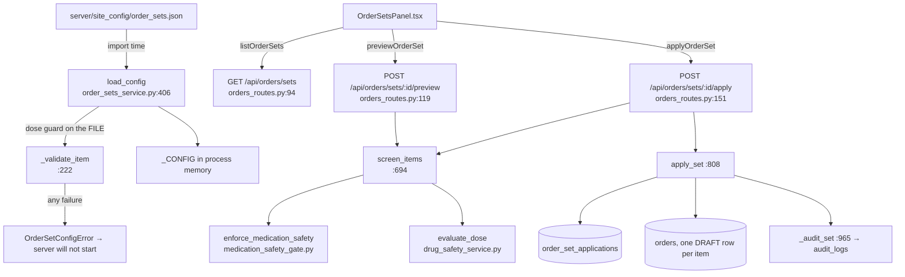
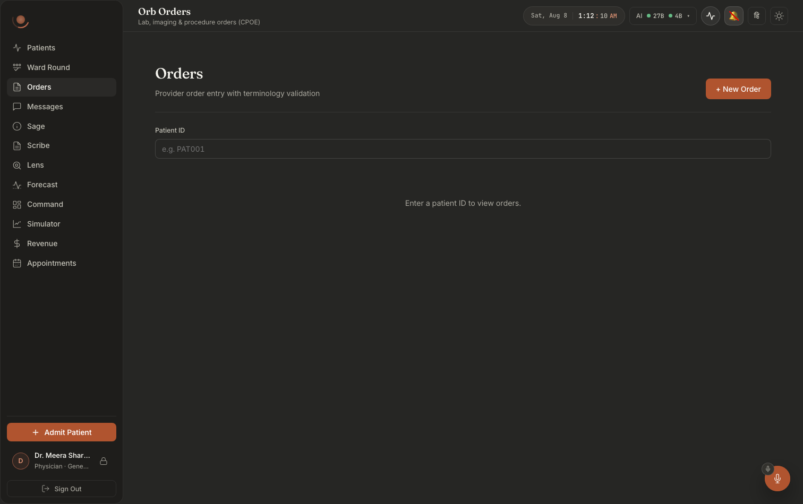
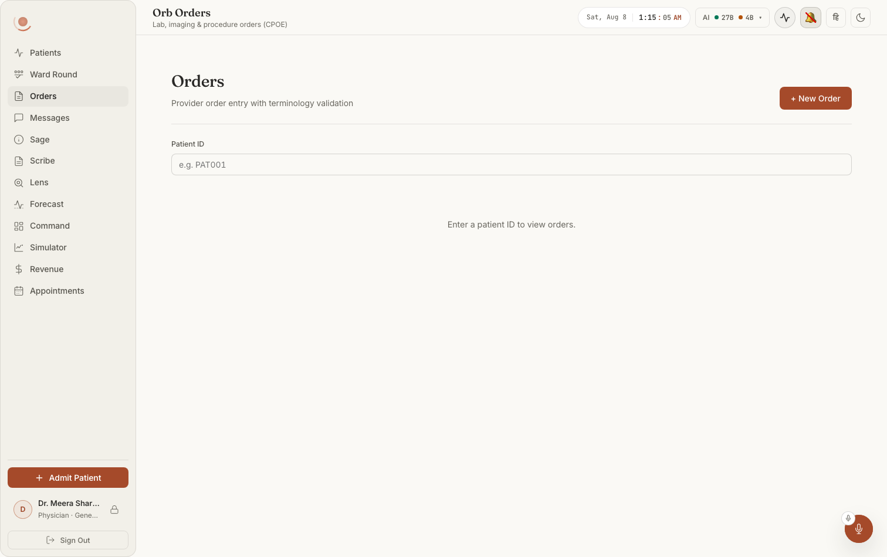
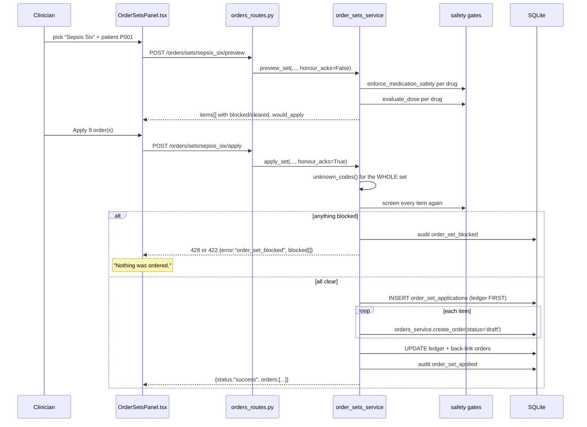

# Order sets: applying a cited protocol without opening a hole in the safety gates

Built 2026-08-07.

An **order set** is a named, ordered list of orders, drugs, fluids, labs, imaging, observations, that a clinician applies in one action instead of typing eight things at 03:00 with a deteriorating patient in front of them. Orb ships five: Sepsis Six, ACS initial management, DKA first hour, routine post-operative care, and acute severe asthma.

It is the one medication feature that is genuinely buildable without a licensed drug database, because **it adds no new clinical knowledge, it only removes typing.**

**The four rules that shape every line of this subsystem**, taken from the service's own module docstring (`server/services/order_sets_service.py:1-59`):

1. **A set is a convenience, never a bypass.** Every order a set produces goes through the same gates a hand-typed order does, at the moment it is written. And the set is **refused whole** if any item is stopped, nothing is written at all.
2. **Real orders, not a black box.** Applying a set creates individual `orders` rows in **draft**, one per item, each with its own event trail, each separately cancellable through the existing state machine. There is no "the set charted eight things" record with nothing behind it.
3. **Configured by a file an engineer edits**, not by an admin screen. Clinical protocol is reviewed, versioned and deployed, not changed through a web form during a night shift.
4. **A malformed file stops the server.** Loud, at startup, naming the file, the line and the field. The alternative, loading nothing and carrying on, is far worse: the ward opens the protocol list, finds it empty, and either assumes Orb has no protocols or assumes theirs was deliberately removed.

**The sharpest decision in the chapter, stated up front.** The dose guard also runs against the **protocol file itself, at load time**. A dose-guard block inside a site's protocol file is not one clinician's judgement about one patient that somebody might have a reason to override, it is a lethal instruction sitting in a file that will be applied to every future patient who gets this protocol. So a config encoding, say, concentrated potassium by IV push **refuses to start the server**. And at apply time a dose-guard block returns **422, not 428**: it is deliberately *not* acknowledgeable, because the fix is the file, not a click.

---

## Purpose and neighbors

**Jargon:**

| Term | Meaning in Orb |
|---|---|
| **Set / protocol** | One entry in `server/site_config/order_sets.json`. Has an id, a name, an indication, a cited guideline, and a list of items. |
| **Item** | One order the set will place. Has `order_type`, `description`, `code`/`code_system`, `priority`, plus `drug_name`/`dose`/`route`/`frequency` for medications. |
| **Selection** | The clinician's per-item edits at apply time, include/exclude, and overrides of description, priority, dose, route, frequency. |
| **Verdict** | One item after every gate has run. Carries `medication_safety`, `dose_check`, `blocked`, `block_kind`, `block_reason`. |
| **Fingerprint** | A 16-hex-char SHA-256 of the set as it was in the file. Stored on every application so you can tell afterwards *which version* of the bundle a patient received. |
| **Application** | One row in `order_set_applications`, "this protocol was applied to this patient by this person at this time, citing this guideline, and these are the orders it produced". |
| **Whole or nothing** | If any item is blocked, `apply_set` raises and **zero** orders are written. |

**Neighbors:** guide 16-orders-cpoe (`orders_service.create_order`, the status machine, terminology validation), guide 43-medication-interlocks (`medication_safety_gate.enforce_medication_safety`, `allergy_interlock`), guide 14-helix (`drug_safety_service.evaluate_dose`, the dose guard rules), guide 05-audit-chain (`log_audit_event`, `log_phi_read`), guide 03-auth-rbac (`ORDER_READ`/`ORDER_WRITE`, `enforce_patient_scope`), guide 41-shadow-mode (`_shadow_clinical_action` records every applied order as a shadow episode).

---

## File map

| File | Lines | Role |
|---|---:|---|
| `server/services/order_sets_service.py` | 1182 | Everything: the config schema, the line-numbered validator, the load-time dose guard, the reads, `screen_items`, `preview_set`, `apply_set`, the ledger and the audit event. Loads the file at **import** (`:1182`). |
| `server/site_config/order_sets.json` | 473 | The five shipped protocols. `config_version: 1`. |
| `server/routes/orders_routes.py` | 510 | Five order-set endpoints (`:95`, `:110`, `:120`, `:152`, `:197`) plus the request models `OrderSetItemSelection` (`:48`) and `OrderSetApplyRequest` (`:65`), and `_order_set_status` (`:84`). |
| `server/migrations.py` | 1719 | Migration 13, `_m13_order_sets` (`:795`), `order_set_applications` (`:842`), `orders.order_set_application_id` (`:840`), and local terminology codes for the shipped protocols. |
| `src/api/orderSets.ts` | 145 | Typed client: `listOrderSets` (`:108`), `getOrderSet` (`:115`), `previewOrderSet` (`:119`), `applyOrderSet` (`:130`), `listOrderSetApplications` (`:141`). |
| `src/components/orders/OrderSetsPanel.tsx` | 637 | The screen. `PatientBannerView` (`:105`), `Placeholder` (`:142`), `findingsFor` (`:177`), `OrderSetsPanel` (`:213`), the invalidate-and-refetch effect (`:304`), `runPreview` (`:329`), `runApply` (`:343`). |
| `src/components/orders/OrdersPanel.tsx` | 761 | Hosts it. `OrdersViewSwitch` (`:18`), the `view` state (`:106`), the `sets` branch (`:253-273`). |
| `server/tests/test_order_sets.py` | 916 | The behavioural spec: config validation, the load-time dose guard, whole-or-nothing, the ledger. |
| `src/components/orders/OrderSetsPanel.order.test.tsx` | 381 | Pins the pick-protocol-then-patient ordering bug (see `:304` below). |

*The Order Sets screen is the second tab of the Orders panel, the "Order sets" toggle at the top (`src/components/orders/OrdersPanel.tsx:33`).*

---

## How it works

### Flow 1: server startup

1. `server/routes/orders_routes.py` imports `order_sets_service` at module scope; `server/main.py` imports that router at module scope.
2. The last line of `order_sets_service.py` (`:1182`) calls `reload_config()`.
3. `load_config` reads the JSON, validates every field of every set, **runs the dose guard on every medication item**, and collects *all* errors into one message.
4. Any problem raises `OrderSetConfigError` before uvicorn ever binds a port. There is deliberately **no** `try/except` and **no** env switch to disable this.
5. On success the config sits in the module-level `_CONFIG` with a fingerprint per set and one for the whole file.

### Flow 2: a clinician previews a set

1. Orders panel → "Order sets" tab → `OrderSetsPanel` loads the protocol list (`GET /api/orders/sets`) and prints the provenance line *"Protocol library version 1. Changes are made by your Orb administrator."* (`src/components/orders/OrderSetsPanel.tsx:409`).
2. Picking a protocol **and** a patient (in either order) triggers the effect at `:304`, which calls `POST /api/orders/sets/{id}/preview`.
3. The server runs the identical gates apply runs, allergy/interaction through the single enforcement point, then the dose guard, and returns one verdict per item plus `would_apply`.
4. Each item renders with a green **Cleared** chip or a red **STOPPED** chip carrying the exact reason (`:309-320`).
5. A preview **never consumes an override**: `honour_acks=False` (`:795`), so a supplied acknowledgement is ignored.

### Flow 3: apply

1. `Apply N order(s)` is disabled unless `preview.would_apply` (`:329`).
2. `POST /api/orders/sets/{id}/apply` → `apply_set`.
3. Terminology for the **whole set** is checked first. Any unresolvable code refuses the set with zero orders written.
4. Every item is screened with `honour_acks=True`. If **anything** is blocked: an `order_set_blocked` audit row is written, `OrderSetBlocked` is raised, and **no orders exist**.
5. Otherwise the ledger row is written **first**, then the individual draft orders through `orders_service.create_order`, then the ledger is completed and each order back-linked.
6. One audit event names the protocol, the guideline and every order it produced.
7. The panel shows *"Applied, N draft order(s) created and audited."* and re-runs the preview.

---

## Function-by-function

### File: `server/services/order_sets_service.py`

#### `_DEFAULT_CONFIG_PATH` / `CONFIG_PATH_ENV` / `config_path`: `order_sets_service.py:84` / `:88` / `:91`
**Signature:** `Path` / `"ORB_ORDER_SETS_FILE"` / `() -> Path`
**Does:** Locates the protocol file, `server/site_config/order_sets.json` by default, overridable by env with an absolute path.
**On screen:** the resolved path is returned by `GET /api/orders/sets` as `config.path` (`server/routes/orders_routes.py:102`). The panel does not print it; it prints only `config_version` in the provenance line (`src/components/orders/OrderSetsPanel.tsx:262-270`).
**Why it exists:** for sites that keep protocols in their own config repo, and for tests.
**Breaks if you change it:** `config_path()` is read at **call** time, so a test can point it elsewhere and call `reload_config()`. Caching the path at import would break every test that swaps files.

#### `OrderSetConfigError`: `order_sets_service.py:100`
**Signature:** `class OrderSetConfigError(Exception)`
**Does:** "The site's order-set file is unusable."
**On screen:** nothing, the server does not start, so there is no screen. That is the point.
**Why it exists:** raised at import so a broken protocol file can never present as an *empty* one.
**Breaks if you change it:** catch it at `:1182` and log instead, and a ward opens the Order Sets tab to "No protocols are configured for this site." (`src/components/orders/OrderSetsPanel.tsx:421`), indistinguishable from a site that genuinely has none.

#### `OrderSetError`: `order_sets_service.py:105`
**Signature:** `class OrderSetError(Exception)`
**Does:** Request-level problems: unknown set, unknown or ineligible patient, no items selected.
**On screen:** the panel's red error strip, with the server's message verbatim.
**How it is mapped:** `_order_set_status` (`orders_routes.py:83`) returns **404** when the message contains "not found" or "Unknown order set", **400** otherwise.
**Breaks if you change it:** the 404 for a patient is not a style choice. A 403, or a 400 that distinguishes "this patient is not yours" from "no such patient", confirms the patient exists.

#### `OrderSetBlocked`: `order_sets_service.py:110`, `status_code` at `:126`
**Signature:** `__init__(verdicts: list[dict], blocked: list[dict])`; `.status_code -> int`
**Does:** Signals that a safety gate stopped at least one item, so the **whole** set was refused. Carries the per-item verdicts so the caller can show exactly which item was stopped and why, rather than a bare refusal.
**On screen:** the panel's `applyBlocked` block (`src/components/orders/OrderSetsPanel.tsx:596-609`) renders **"Nothing was ordered."** in bold, the server's message, and a bulleted list of every blocked item with its reason.
**How `status_code` works:** **428** when *every* block is an acknowledgeable severe allergy/interaction alert, the same contract CPOE and the pharmacy verify queue already speak. **422** the moment anything harder is in the list.
**Why it exists, and this is the load-bearing paragraph:** a dose-guard block is deliberately **not** acknowledgeable here. It means the protocol *file* encodes a lethal dose or route, and the fix for that is to correct the file, not to click past it once per patient. Ditto a screen that could not run.
**Breaks if you change it:** make `status_code` always return 428 and you have handed the ward a one-click override for a lethal number in a protocol, applied to every future patient who gets that protocol, one acknowledgement at a time.

#### Schema constants: `order_sets_service.py:140-153`
**Signature:** `_VALID_ORDER_TYPES` (`:139`), `_VALID_PRIORITIES` (`:140`), `_SET_KEYS` (`:142`), `_SET_REQUIRED` (`:143`), `_GUIDELINE_KEYS` (`:144`), `_ITEM_KEYS` (`:145`), `_MEDICATION_REQUIRED` (`:147`), `_CODELESS` (`:152`)
**Does:** The whole file schema as data.
**On screen:** nothing directly; they decide which files load at all.
**Gotchas:** `_CODELESS = orders_service.CODELESS_ORDER_TYPES` (`:152`), the set validator does **not** keep its own copy of "which order types may be free-text". It reads CPOE's. Two copies would drift and a set could encode an order CPOE then rejects.
**Breaks if you change it:** adding an item field without adding it to `_ITEM_KEYS` makes every file using it fail validation with "unknown field(s)", which is the intended behaviour, because a typo'd key is the quietest failure there is: `"dosage"` instead of `"dose"` leaves the dose guard nothing to check and the order text unchanged, so nothing looks wrong anywhere (`:230-233`).

#### `_line_of` / `_Ctx` / `_require_str`: `order_sets_service.py:156` / `:165` / `:213`
**Signature:** `(lines, needle, start) -> int | None` / `class _Ctx` / `(ctx, obj, key, where, *needles, after) -> str | None`
**Does:** The error-reporting machinery. `_Ctx` accumulates failures and `raise_if_any()` emits them all in one message, each naming the file, a line number and the field.
**On screen:** the message an operator sees in the server's startup log when Orb refuses to boot.
**Why it exists:** a validator that stops at the first error makes fixing a protocol file a fix-one-restart loop.
**Breaks if you change it:** the line numbers come from searching the raw text for an anchor string (`_line_of`), not from a JSON parser with position tracking, so a line number is best-effort. Reformat the file (e.g. minify it) and every reported line becomes 1.

#### `_validate_item`: `order_sets_service.py:223`
**Signature:** `(ctx, item, where, set_anchor) -> dict | None`
**Does:** Validates one item, and, for medications, **runs the dose guard against the protocol itself**.
**On screen:** nothing; it decides whether the server starts.
**How it works:**
1. Reject unknown keys (`:229-234`), then an invalid `order_type` (`:238-244`), then require `description` (`:245`), then check `priority` (`:249-253`).
2. Code rules (`:254-267`): a `code` requires a `code_system`; an order type not in `_CODELESS` requires a code.
3. For `order_type == "medication"` (`:279`): require `drug_name`, `dose`, `route`, `frequency` (`:280-282`), then call `drug_safety_service.evaluate_dose(drug_name, dose, route)` (`:296`).
4. **A `DOSE_BLOCK` verdict fails the config** (`:302`) with `"THE DOSE GUARD STOPS THIS ITEM, it must not ship in a protocol. <reasons>"` (`:307-308`).
5. Medication-only fields present on a non-medication item are an error (`:309-316`).
**Why the load-time dose guard exists:** running it here as well as per-patient is not belt-and-braces for its own sake. A dose-guard block inside a site's protocol file is not a clinical judgement about one patient that a clinician might have a reason to override, it is a lethal instruction sitting in a file that will be applied to every future patient who gets this protocol. The place to catch it is once, at startup, before anyone is on the ward.
**Breaks if you change it:** remove this and a site can ship "potassium chloride 20 mmol IV push" in a protocol; the per-patient guard would still stop it at apply time, but only after it has been in the file, in the protocol list, and in front of clinicians for however long.
**Gotchas:** the call is **pure evaluation only, no formulary or ingredient resolution**, because there is no database at import time. `screen_items` runs the fuller version with ingredients resolved. So a branded name whose ingredient triggers a rule may pass load-time and be blocked per-patient.

#### `_validate_set`: `order_sets_service.py:320`
**Signature:** `(ctx, raw_set, index, seen_ids) -> dict | None`
**Does:** Validates one set: id uniqueness, required fields, the guideline block, and every item.
**On screen:** nothing.
**Breaks if you change it:** duplicate ids would make `sets_by_id` silently keep the last one, so a protocol would vanish from the list with no error.

#### `_fingerprint`: `order_sets_service.py:400`
**Signature:** `(payload) -> str`, first 16 hex chars of a SHA-256 over the canonical JSON
**Does:** Hashes a set (and the whole file) so a version can be identified later.
**On screen:** appears in `OrderSetSummary.fingerprint` and in the config header, but nothing renders it today.
**Why it exists:** protocol files get edited, a new antibiotic, a changed fluid volume, and without the fingerprint stored on the application there is no way to know afterwards which version of the bundle a patient actually received.
**Breaks if you change it:** changing the hash input (key order, separators) makes every historical `config_fingerprint` unmatchable against the current file.

#### `load_config`: `order_sets_service.py:406`
**Signature:** `(path: Path | None = None) -> dict`, **pure, no database**
**Does:** Reads and fully validates the file, returning `{config_version, path, fingerprint, sets, sets_by_id}`.
**On screen:** nothing directly. Its failure is a server that will not start.
**How it works:** missing file → a message that says an absent protocol file is a deployment mistake, not a site that has no protocols (`:414-419`). Unreadable → OSError message. Bad JSON → `"{name}:{lineno}:{colno}: … not valid JSON, {msg}"` using **json's own line/column**, which is the whole reason this file is JSON and not a format needing a third-party parser to say where it hurt (`:429-435`, message at `:432`). Then root-shape checks, `config_version` must be exactly `1`, unknown root keys rejected, `sets` must be a non-empty list, then every set.
**Breaks if you change it:** it must stay **pure**. Add a database read (for example, resolving terminology) and it can no longer run at import, and the fail-loudly-at-startup mechanism disappears. That is why `unknown_codes` is a separate function.

#### `_CONFIG` / `reload_config` / `get_config`: `order_sets_service.py:482` / `:485` / `:495`
**Signature:** `Optional[dict]` / `(path=None) -> dict` / `() -> dict`
**Does:** The process-wide loaded config, and the way to replace it.
**On screen:** every read endpoint serves from here, so the protocol list is a memory read, not a file read.
**Breaks if you change it:** there is **no hot reload**. An operator who edits `order_sets.json` must restart the server; nothing watches the file. `reload_config` exists for import, for tests, and for an operator restarting after an edit.

#### `list_sets`: `order_sets_service.py:501`
**Signature:** `() -> list[dict]`, id, name, indication, guideline, item_count, fingerprint
**Does:** Summary of every configured set. **No PHI**, safe for any `ORDER_READ` user.
**On screen:** the protocol cards down the left of the Order Sets screen (`src/components/orders/OrderSetsPanel.tsx:423-438`). Each card prints the name, the indication, and `"N items · <guideline name>"`.
**Breaks if you change it:** adding a field is harmless; removing `item_count` blanks the card's meta line.

#### `get_set`: `order_sets_service.py:516`
**Signature:** `(set_id) -> dict`; raises `OrderSetError` listing the configured ids
**Does:** The full definition of one set.
**On screen:** the detail pane's title and citation (`src/components/orders/OrderSetsPanel.tsx:457-460`).

#### `unknown_codes`: `order_sets_service.py:527`
**Signature:** `(set_id) -> list[dict]` of `{code_system, code}`
**Does:** Which of this set's codes are **not** in the local `terminology` table.
**On screen:** the amber note *"N codes in this protocol are not in this hospital's code list: LOINC 2524-7, …"* (`src/components/orders/OrderSetsPanel.tsx:479-487`).
**Why it exists:** code validity is a **database** question, so it cannot be answered at import time, but the clinician should learn about a site's un-loaded code before they try to apply the protocol, not from a 400 halfway through.
**How it works:** a handful of indexed point lookups on **one** connection, deliberately never a full read of `terminology`, a site that has bulk-loaded the real LOINC and ICD-10 releases has millions of rows in there, and this runs on every preview.
**Breaks if you change it:** rewriting it as `SELECT code FROM terminology` and filtering in Python turns every preview into a multi-million-row read.

#### `resolve_items`: `order_sets_service.py:557`
**Signature:** `(set_id, selections: list[dict] | None) -> list[dict]`
**Does:** Applies the clinician's per-item edits, include/exclude and overrides of `description`, `priority`, `dose`, `route`, `frequency`, and returns the items that will actually be ordered, each with an `index` and an `edited_fields` list.
**On screen:** nothing today, **the panel never sends selections.** `previewOrderSet`/`applyOrderSet` are always called with `items` undefined (`src/components/orders/OrderSetsPanel.tsx:314`, `:334`, `:349`), so every item is included unedited. The server-side capability is fully built; the UI for it is not.
**Why `edited_fields` exists:** so the audit row can say which items the clinician changed from the protocol.
**Breaks if you change it:** excluding everything raises `OrderSetError`, *"every item in '{set_id}' was excluded, nothing to order. Applying an empty set would write an audit row claiming a protocol was applied."* (`:609-611`). Remove that check and the ledger fills with applications that ordered nothing.

#### `require_orderable_patient`: `order_sets_service.py:616`
**Signature:** `(patient_id) -> dict`; raises `OrderSetError`
**Does:** The patient must exist and must still be an inpatient (`status` in `{None, "", "admitted"}`).
**On screen:** the panel's error strip, *"Patient P001 is not admitted (status=discharged), an order set cannot be applied to a discharged patient. Re-admit them first, or order individually if this is deliberate follow-up."*
**Why it exists:** same guard, same reasoning, as `emar_service.record_administration`. A patient discharged through Vigil keeps `medications.status='active'` and disappears from every board, so an order written against them afterwards is written against someone no ward believes it still has. **A protocol is exactly the kind of bulk action where that would go unnoticed.**
**Breaks if you change it:** drop the check and eight orders can land on a discharged chart in one click, invisible to every ward board.

#### `_dose_screen`: `order_sets_service.py:643`
**Signature:** `(patient_id, item) -> dict`
**Does:** The dose guard for one medication item, at order time, **with** formulary ingredient resolution.
**On screen:** feeds `verdict.dose_check`, which the panel uses only via `blocked`/`block_reason` today.
**How it works:** resolves ingredients through `allergy_interlock.resolve_ingredients`, the same hospital formulary the allergy interlock and the bedside dose guard use, so a branded protocol item ("Monocef 1 g") is judged as its ingredient rather than as an unknown drug. Then `drug_safety_service.evaluate_dose`.
**Why it exists, and this is a subtle one:** it is **not fail-open and not fail-closed-silent**. If the evaluation itself errors, the item is reported `unavailable` with a `DOSE_WARN`, exactly as the bedside guard does, the clinician is told this item was **not** checked. It does not block, because an internal fault in this code is not evidence about the patient.
**Breaks if you change it:** making an internal error block turns a bug in Orb into a refused sepsis bundle. Making it silently allow removes the clinician's only signal that the check did not run.

#### `screen_items`: `order_sets_service.py:695`
**Signature:** `(patient_id, items, *, actor_id, entry_point, honour_acks) -> list[dict]`
**Does:** Runs **every** gate on **every** item and returns one verdict per item. Writes nothing to `orders`.
**On screen:** this list is what the panel renders, one `<li>` per item: a red **STOPPED** chip plus the reason for a blocked item, amber caution chips for an unblocked drug the gates raised something on or could not fully screen, a green **Cleared** chip for a drug with no findings, and no chip for a non-drug item (`src/components/orders/OrderSetsPanel.tsx:489-536`).
**How it works:**
1. Non-medication items skip both gates and pass through (`:735-737`).
2. **Gate 1, allergy + interaction** (`:740-742`): `enforce_medication_safety(patient_id, drug_name, actor_id, entry_point, safety_ack)`, the **single enforcement point**, not a copy. A `HTTPException` 428 becomes `block_kind = "drug_safety_acknowledgement_required"`; anything else becomes `"drug_safety_screen_unavailable"`.
3. **Gate 2, the dose guard** (`:765-773`): `_dose_screen`; a `DOSE_BLOCK` becomes `block_kind = "dose_guard_block"` with the block findings joined as the reason.
**Why `entry_point` matters:** it names which of preview/apply it was, so the screen, the block and any override land on the audit hash chain from here exactly as they do from CPOE. Values are `"order_set.preview"` and `"order_set.apply"`.
**Why `honour_acks` matters:** `False` (preview) means a supplied acknowledgement is **ignored**. A preview must never quietly consume an override, the clinician sees the severe alert, and the override happens on apply, once, with the order.
**Breaks if you change it:** re-implementing the allergy screen here instead of calling `enforce_medication_safety` creates a second enforcement point that will drift from CPOE's. Setting `honour_acks=True` on preview means a clinician's override is spent on a screen that wrote nothing.

#### `preview_set`: `order_sets_service.py:894`
**Signature:** `(patient_id, set_id, *, actor_id, selections=None) -> dict`
**Does:** What applying this set to this patient would do, and what would stop it. Writes no orders.
**On screen:** the entire detail pane. `items` → the item list; `blocked` → the note under the Apply button; `would_apply` → whether Apply is enabled; `unknown_codes` → the amber terminology note; `recent_application` (`recent_application`, `:816`) → a warning, never a block, that this set was already applied to this patient inside the recent window (a Sepsis Six applied twice in two minutes is two sets of STAT drafts); `patient` (`patient_banner`, `:864`) → who the gates ran for, with their active allergies, so the name on the Apply button is the patient the verdicts belong to.
**Why it exists:** it runs the **same** gates apply runs, so the preview and the apply cannot disagree about whether an item is safe.
**Breaks if you change it:** any divergence between this and `apply_set`'s screening produces the worst possible user experience, a green preview followed by a refused apply.

#### `apply_set`: `order_sets_service.py:925`
**Signature:** `(patient_id, set_id, *, actor_id, actor_role=None, selections=None) -> dict`
**Does:** Creates the real, individual, **draft** orders for a set. **All or nothing.**
**On screen:** success → *"Applied for <patient>: N draft orders created and audited."* (`src/components/orders/OrderSetsPanel.tsx:579-585`), plus an amber note when the set held medications saying they are not sent to the ward or pharmacy and must be prescribed from the patient chart (`:586-594`); the applications history list refreshes, and the new drafts appear in the Orders tab with `draft` status chips. Failure → the "Nothing was ordered." block.
**How it works, the order of operations is the design:**
1. Resolve the set and the clinician's edits; check the patient is one we may order for at all (`:956-958`).
2. **Terminology for the whole set, before a single order is written** (`:960-971`). `orders_service` rejects an unknown code per order, which mid-loop would leave a half-applied protocol.
3. Screen every item with `honour_acks=True` (`:973-981`). If **anything** is blocked: write an `order_set_blocked` audit row and raise `OrderSetBlocked`. **No orders are written.** A set that is partly applied is worse than one that is refused: the chart then shows a protocol nobody completed and nobody knows to finish.
4. **(4a)** Write the `order_set_applications` ledger row **first**, with `order_count = 0` (`:985-996`). **(4b)** Then create each order through `orders_service.create_order` (`:1025`) with `status="draft"`, `source="order_set"`, and a `detail.order_set` block carrying the application id, set id, item index, guideline, fingerprint and `edited_fields` (`:1002-1024`). For medications, `detail.medication` and `detail.safety` record the drug fields and the screen verdicts.
5. Complete the ledger (`order_count`, `order_ids_json`, `safety_json`) and back-link every order via `orders.order_set_application_id` (`:1054-1064`).
6. One `_audit_set` event naming the protocol and every order it produced.
**Why the ledger comes first:** if the process dies in the middle, the ledger records that the set was applied and the orders that exist are **drafts**, visible, cancellable, un-actioned. The opposite order would leave orders no ledger row explains. The `except` at `:1039` deliberately keeps the ledger row and stamps it with however many orders got written, then re-raises.
**Why draft and not active:** the clinician still commits each order. Draft is what makes a partial failure harmless.
**Breaks if you change it:** creating orders `active` removes the human commit step and makes a half-finished apply dangerous. Writing the ledger after the orders leaves orphan orders. Screening item-by-item as you write produces the fix-one-restart loop step 3 exists to prevent.
**Gotchas, stated honestly in the docstring (`:950-954`):** between the screen in step 3 and the write in step 4 there is a sub-millisecond window in which another connection could chart a new allergy. The bedside eMAR closes that window because a dose is the last line of defence; an order is not administered for minutes to hours, and its own administration re-screens.

#### `_audit_set`: `order_sets_service.py:1082`
**Signature:** `(*, outcome, action_type, patient_id, set_def, actor_id, actor_role, verdicts, order_ids, application_id) -> None`
**Does:** Writes the one event that says a **protocol** was applied, naming its orders.
**On screen:** appears in the Admin panel's Audit Logs tab with action type `order_set_applied` or `order_set_blocked`, and a summary reading e.g. *"Order set 'Sepsis Six (1-hour bundle)' (sepsis_six) success for P001: 9 order(s), 2 safety alert(s). Guideline: Surviving Sepsis Campaign 2021"*.
**Why it exists:** deliberately **in addition to**, never instead of, the per-order `order_events` row and the per-drug `clinical_safety` rows the medication gate already wrote. A reviewer asking "why are there eight orders at 02:14?" needs the answer "the sepsis bundle, by Dr X, citing SSC 2021"; a reviewer asking "was this drug screened?" needs the drug-level row. **Neither answers the other.**
**Breaks if you change it:** the category is `clinical_record`, an established category, so an order set shows up in the same filter a reviewer already runs, and deliberately **not** one of the fail-closed categories, because a failed audit row must not un-write orders that are already on the chart. That is also why the whole call is wrapped in `try/except` (`:1099`). Making it fail-closed would roll back a protocol that is already partly on the chart.

#### `list_applications`: `order_sets_service.py:1153`
**Signature:** `(patient_id, limit=50) -> list[dict]`; limit clamped to 1–200
**Does:** Protocols applied to this patient, newest first. **PHI, callers scope.**
**On screen:** the "Already applied to this patient" section at the bottom of the panel (`src/components/orders/OrderSetsPanel.tsx:619-634`), one line per application: set name, applied-at timestamp, applied-by, order count.
**How it works:** parses `order_ids_json` into `order_ids` and **drops `safety_json` and `order_ids_json` from the response**.
**Breaks if you change it:** returning `safety_json` would push every allergy and interaction alert for every applied protocol into a list view that has no business rendering them.

#### The import-time load: `order_sets_service.py:1161`
**Signature:** a bare `reload_config()` at module scope
**Does:** **This is the fail-loudly-at-startup mechanism.**
**On screen:** nothing, the server does not start.
**Why it exists:** `routes/orders_routes.py` imports this module and `main.py` imports that router at module scope, so a malformed site file raises before uvicorn ever binds a port. There is deliberately **no** `try/except` here and **no** env switch to disable it: "carry on without protocols" is the exact outcome this design refuses.
**Breaks if you change it:** wrap it and you get the empty-protocol-list failure mode described at the top of this chapter.

---

### File: `server/routes/orders_routes.py`: the five endpoints

#### `OrderSetItemSelection` / `OrderSetApplyRequest`: `server/routes/orders_routes.py:48` / `:65`
**Signature:** Pydantic bodies. `OrderSetApplyRequest` carries `patient_id` and an optional `items: list[OrderSetItemSelection]`.
**Does:** The preview/apply request shape.
**On screen:** the panel sends `{patient_id}` only (`src/api/orderSets.ts:126`, `:137`).
**Gotchas:** **the patient is named in the body, not the path.** That is why both routes call `enforce_patient_scope(user, req.patient_id)` explicitly (`:135`, `:166`) instead of using the path-shaped `require_patient_access` dependency, the dependency cannot see a body field.
**Breaks if you change it:** moving `patient_id` to the path without changing the guard, or removing the explicit `enforce_patient_scope`, opens a cross-ward hole: any `ORDER_WRITE` holder could apply a protocol to any patient in the hospital.

#### `_selections`: `server/routes/orders_routes.py:80`
**Signature:** `(req) -> list[dict] | None`
**Does:** `[s.model_dump() for s in req.items] if req.items else None`.

#### `_order_set_status`: `server/routes/orders_routes.py:84`
**Signature:** `(e: OrderSetError) -> int` → 404 or 400
**Does:** Maps a service error to a status code by inspecting its message.
**Gotchas:** it is **string matching on the exception message**, "not found" or "Unknown order set". Reword either message in the service and the endpoint silently starts returning 400 where it returned 404.

#### `GET /api/orders/sets`: `server/routes/orders_routes.py:95` (`list_order_sets`)
**Signature:** guard `require_permission(ORDER_READ)` → `{sets, config:{path, config_version, fingerprint, editable_by}}`
**Does:** Every configured set. No patient, no PHI, the protocol list itself.
**On screen:** the left-hand card list, plus the provenance line built from `config.config_version` (`src/components/orders/OrderSetsPanel.tsx:262-270`, rendered at `:409`).
**Why `editable_by` is a literal string:** `"an engineer, in the site configuration file, not through this API"` (`:105`). The panel does not print it: it names a config file, which a clinician should not be told to go and find, so the screen says *"Changes are made by your Orb administrator."* instead. The claim a CIO will test, that nobody changes protocols through this UI, still holds: no endpoint writes the protocol file.
**Breaks if you change it:** returning `config.path` to a lower-privilege caller discloses a server filesystem path; today it is `ORDER_READ`, which is every clinician.

#### `GET /api/orders/sets/{set_id}`: `server/routes/orders_routes.py:110` (`get_order_set`)
**Signature:** guard `require_permission(ORDER_READ)` → `{set, unknown_codes}`; 404 unknown
**Does:** One set in full, with the codes this deployment cannot resolve flagged.
**On screen:** **nothing.** `getOrderSet` exists in `src/api/orderSets.ts:115` and no component calls it, the panel gets everything it needs from the list and the preview.

#### `POST /api/orders/sets/{set_id}/preview`: `server/routes/orders_routes.py:120` (`preview_order_set`)
**Signature:** body `OrderSetApplyRequest`; guard `require_permission(ORDER_WRITE)` → the preview dict
**Does:** What this set would order for this patient, and what would stop it. Writes no orders.
**On screen:** everything in the detail pane.
**How it works:** `enforce_patient_scope` first, then `preview_set`, then a `log_phi_read` audit row recording the item count and the descriptions of the blocked items (`:141-148`).
**Breaks if you change it:** the guard is `ORDER_WRITE`, not `ORDER_READ`, a preview runs the allergy screen against a named patient and returns their safety verdicts, so it is a clinical read that only an orderer should make.

#### `POST /api/orders/sets/{set_id}/apply`: `server/routes/orders_routes.py:152` (`apply_order_set`)
**Signature:** body `OrderSetApplyRequest`; guard `require_permission(ORDER_WRITE)` → `{status:"success", application_id, patient_id, set, orders, items}`
**Does:** Creates the real, individual, draft orders. **All or nothing.**
**On screen:** the Apply button. The docstring states the two failure codes plainly: **428** = a severe allergy/interaction alert on at least one drug, re-submittable with that item's `safety_ack`; **422** = something harder (the dose guard stopped an item, or a screen could not run), *not acknowledgeable here; fix the protocol file, or order the drug individually where the per-dose override machinery lives*.
**How it works:** `enforce_patient_scope` → `apply_set` → on `OrderSetBlocked`, a structured 428/422 body `{error:"order_set_blocked", message, blocked, items}`. The message is the one the panel prints: *"This order set was NOT applied, no orders were created. A safety check stopped at least one item, and a set is applied whole or not at all."* On success, every created order is passed to `_shadow_clinical_action` (`:193`) so the pilot scorecard sees it.
**Breaks if you change it:** the client keys on `err.detail.error === 'order_set_blocked'` (`src/components/orders/OrderSetsPanel.tsx:361`). Rename that string and the panel falls through to its generic error branch and stops listing which items were stopped.

#### `GET /api/orders/sets/applications/{patient_id}`: `server/routes/orders_routes.py:197` (`list_order_set_applications`)
**Signature:** guard `require_patient_access(ORDER_READ, audit_action="order_set_applications_viewed")` → `{applications}`
**Does:** Protocols applied to this patient, newest first.
**On screen:** the "Already applied to this patient" section.
**Gotchas:** the path segment `applications` must keep sitting **above** `/{order_id}` in the file, or FastAPI matches `applications` as an order id. The file has an explicit comment about this ordering hazard at `:206-208` for the terminology route, and the same rule applies here.

---

### File: `server/migrations.py`: migration 13

#### `_m13_order_sets`: `migrations.py:801`
**Signature:** `(conn) -> None`; registered as `Migration(13, "order_sets", …)` at `:1622`
**Does:** Three additive changes.
**On screen:** without it, `apply_set` 500s on a missing table and every medication item in every shipped protocol fails terminology validation.
**How it works:**
- **`orders.order_set_application_id`** (`:840`), nullable, introspection-guarded. **A NULL is meaningful:** the order was typed individually, which is a different clinical act from the same order arriving inside a protocol. Never backfilled.
- **`order_set_applications`** (`:842`), one row per application. `config_fingerprint` is the hash of the set **as it was in the file** at the moment it was applied. `safety_json` is the per-item verdict as of application, same reasoning as `medication_administrations.allergy_check_json`: what the screen saw at the time is evidence, and re-deriving it later from today's allergy list answers a different question.
- Indexes `idx_order_set_app_patient` on `(patient_id, id DESC)` (`:857`) and `idx_orders_set_application` on `orders(order_set_application_id)` (`:861`).
- **`_ORDER_SET_LOCAL_CODES`** inserted `OR IGNORE` into `terminology` (`:866`). Orb's curated starter terminology is LOINC/SNOMED/ICD-10 only, it has **no drug codes at all**, so without these rows every medication item in every shipped protocol would fail validation on the ward.
**Why LOCAL codes and not RxNorm:** inventing plausible-looking RXCUIs for an offline hospital appliance is how a fake identifier ends up in a discharge summary and then in somebody's national submission. These are honestly labelled as this deployment's own codes; a site that has loaded RxNorm (`scripts/load_rxnorm_formulary.py`) should edit `site_config/order_sets.json` to use its real codes, and only the file changes.
**Breaks if you change it:** backfilling `order_set_application_id` on historical orders destroys the distinction between "typed individually" and "arrived in a protocol". Dropping the local codes makes every shipped protocol unapplicable.

---

### File: `server/site_config/order_sets.json`

**Shape:** `{"config_version": 1, "sets": [...]}`, 473 lines. The five shipped protocols and their item counts:

| id | name | items |
|---|---|---:|
| `sepsis_six` | Sepsis Six (1-hour bundle) | 9 |
| `acs_initial` | Acute coronary syndrome, initial management | 11 |
| `dka_initial` | Diabetic ketoacidosis, first hour | 10 |
| `post_operative` | Routine post-operative care (adult, ward) | 8 |
| `acute_asthma` | Acute severe asthma (adult) | 9 |

**On screen:** these five names and their indications are the cards down the left of the Order Sets screen. Each set's `guideline.citation` is printed under the detail title.

**The `reviewed_by` convention.** A guideline whose `reviewed_by` starts with `"SITE TO COMPLETE"` makes the panel render a warning: *"This protocol has not yet been signed off by a named consultant at this site."* (`src/components/orders/OrderSetsPanel.tsx:461-465`). The shipped file uses that marker so a site cannot accidentally run someone else's unreviewed protocol as if it were their own.

**Breaks if you change it:** the file is validated at import, every edit is one server restart away from being live, and a mistake means the server does not start. That is the intended trade.

---

### File: `src/api/orderSets.ts`: the typed client

The module docstring records why it exists: the backend had been complete and safety-enforced for a while, list, get, preview, apply, applications, an `order_set_applications` table, audit hooks and a cited protocol file, and `grep -rni "order.set" src/` returned **nothing**. A whole demo step ("apply an order set, see the safety gates fire") had no surface at all.

#### Types: `src/api/orderSets.ts:16` (`OrderSetGuideline`), `:23` (`OrderSetSummary`), `:35` (`MedicationSafetyAlert`), `:46` (`MedicationSafety`), `:58` (`OrderSetVerdict`), `:78` (`OrderSetPreview`), `:87` (`OrderSetApplication`), `:97` (`OrderSetSelection`)
**Does:** Mirror the server payloads.
**Gotchas:** `medication_safety` is typed (`MedicationSafety`, `:71`) because the panel reads its alerts, `interaction_screened` and `coverage_note` to build the caution chips. `dose_check` is still `unknown` (`:72`); the panel casts it to a local `DoseCheck` shape (`OrderSetsPanel.tsx:73-78`), so a renamed dose-guard key is not caught by the compiler.
**Breaks if you change it:** `blocked` is the whole point of `OrderSetVerdict`; the comment at `:32` says so.

#### `listOrderSets`: `orderSets.ts:158`
**Signature:** `() -> Promise<{sets, config}>` → `GET /orders/sets`
**On screen:** the protocol card list and the provenance line.

#### `getOrderSet`: `orderSets.ts:167`
**Signature:** `(setId) -> Promise<{set, unknown_codes}>`
**On screen:** **nothing, no component calls this.**

#### `previewOrderSet`: `orderSets.ts:174`
**Signature:** `(setId, patientId, items?) -> Promise<OrderSetPreview>`
**On screen:** everything in the detail pane.
**Gotchas:** the panel always calls it **without** `items`, so per-item edits never reach the server today.

#### `applyOrderSet`: `orderSets.ts:185`
**Signature:** `(setId, patientId, items?) -> Promise<{status, orders, ...}>`
**On screen:** the Apply button. A 428/422 surfaces as a thrown error carrying `detail`.

#### `listOrderSetApplications`: `orderSets.ts:203`
**Signature:** `(patientId) -> Promise<{applications}>`
**On screen:** the "Already applied to this patient" list.

---

### File: `src/components/orders/OrderSetsPanel.tsx`: the screen

The file header states the rule this screen enforces **by its shape**: a set is applied whole or not at all; preview runs the identical gates apply runs, so the two can never disagree; a blocked item makes Apply refuse and say why, per item; and **there is deliberately no control anywhere on this screen that skips a gate.** An override, when one is legitimate, belongs on the individual order where the per-dose acknowledgement machinery and its audit row live.

#### `Placeholder`: `src/components/orders/OrderSetsPanel.tsx:142`
**Signature:** `({title, detail}) -> JSX`
**Does:** The empty state, an icon, a title and an explanation.
**On screen:** two uses. *"No protocol selected"* and *"No patient selected"*, whose detail reads *"The safety gates are patient-specific (allergies, weight, renal function) so there is nothing honest to show until Orb knows whose chart this is. Choose a patient above."*
**Why it exists:** deliberately **not** shaped like `.order-sets__error`. On a clinical screen an empty region and a failed region must never be confusable, because one means "no findings" and the other means "we could not look".
**Breaks if you change it:** styling it like the error block makes "nothing selected yet" read as "something went wrong".

#### `OrderSetsPanel`: `src/components/orders/OrderSetsPanel.tsx:213`
**Signature:** `({patientId?, selectedPatientId?, onSelectPatient?, onApplied?}) -> JSX`
**Does:** The whole screen.
**On screen:** header + patient picker, provenance line, protocol cards (left), detail pane (right) headed by the patient banner (`PatientBannerView`, `:105`: name, bed, ward, MRN and allergies, or a warning when the allergy list could not be read), applications history (bottom).
**How it is mounted:** `src/components/orders/OrdersPanel.tsx:15` lazily imports it; the `view === 'sets'` branch at `:253-273` renders it inside a `Suspense` with the fallback "Loading protocols…". The toggle is `OrdersViewSwitch` (`:18`), whose "Order sets" tab is at `:35`. When hosted inside a patient chart the `patientId` prop fixes the patient and the picker is hidden (`src/components/orders/OrderSetsPanel.tsx:399`). From the Orders tab the patient is shared: `OrdersPanel` passes `selectedPatientId` and `onSelectPatient`, the picker stays visible, and a patient picked here is the one the order list shows on return. `patientId` is derived on every render (`:221-228`), never copied into state, because everything downstream of it is patient-specific. `onApplied` lets the host refresh its order list after an apply.

#### The protocol-list effect: `src/components/orders/OrderSetsPanel.tsx:255`
**Does:** Loads the sets once on mount and builds `configNote` from `config.config_version` (`:262-270`).
**On screen:** `"Protocol library version 1. Changes are made by your Orb administrator."` The server's `editable_by` string is deliberately not shown.

#### `loadApplications`: `src/components/orders/OrderSetsPanel.tsx:276`
**Signature:** `useCallback(() => void, [patientId])`
**Does:** Loads the applications history for the current patient.
**On screen:** the bottom section. **It swallows its error** and sets an empty list, a missing history list must not look like a failed apply.

#### The invalidate-and-refetch effect: `src/components/orders/OrderSetsPanel.tsx:304`
**Signature:** `useEffect(..., [patientId, selectedSet])`
**Does:** Clears everything downstream of the two inputs, then re-runs the preview for the new pair.
**On screen:** this is what makes the item list appear at all.
**Why it exists, this is a real bug, fixed:** it used to be two separate things, an effect that *cleared* the preview on any change and a `runPreview()` called only from the protocol card's `onClick`. So the gates ran **only if you picked the protocol last**. Pick the protocol first and the patient second, which is the order the screen reads in (big list on the left, small picker top-right) and the order the demo script uses, and the effect wiped the preview the click had just fetched, and nothing ever refetched it. The panel sat on a title, a citation and no items, with no Apply button and nothing saying why.
**How it works:** a `live` flag (`:312`, `:323`) drops any response that arrives after its inputs changed, so a slow preview can never paint onto a patient it was not run for. The effect also disarms a pending repeat-apply confirm. A second guard sits in render (`:246-253`): the stored preview is only used when its `patient_id` and set id match the current inputs, so the frame between a change and the effect's commit shows nothing rather than the last patient's verdicts under the new name.
**Breaks if you change it:** splitting invalidation and refetch across two owners reintroduces exactly that bug. Removing `live` lets a slow preview for patient A render against patient B, a cross-patient safety display error. `src/components/orders/OrderSetsPanel.order.test.tsx` pins this.

#### `runPreview`: `src/components/orders/OrderSetsPanel.tsx:329`
**Signature:** `(s: OrderSetSummary) -> Promise<void>`
**Does:** An explicit re-run, for the **Retry** link on a failed preview (`:471`) and for refreshing the gates after an apply (`:358`).
**Why it exists:** the effect above covers every *input* change; this covers the cases where the inputs are unchanged but the answer may not be.

#### `runApply`: `src/components/orders/OrderSetsPanel.tsx:343`
**Signature:** `() -> Promise<void>`
**Does:** Applies the set, then refreshes the history and re-runs the preview.
**On screen:** the Apply button's label becomes "Applying…"; success shows the green status line naming the patient, plus the amber medication note when the set held drugs (`:586-594`); a structured refusal shows the "Nothing was ordered." block; anything else shows a generic error.
**How it works:** it distinguishes the two by `err.detail?.error === 'order_set_blocked'` (`:361`).
**Breaks if you change it:** losing that discrimination collapses "a safety gate stopped this, here is which item" into "The order set could not be applied."

#### The item list: `src/components/orders/OrderSetsPanel.tsx:489-536`
**Does:** One `<li>` per verdict. Description, then a meta line joining order type, priority, dose/route/frequency and the code, the item's note, and for a drug the line *"Not sent to the ward or pharmacy. Prescribe from the patient chart (Medications) so nurses can give it."* Then one of four endings. A blocked item gets a red `STOPPED` chip with `block_reason` (`role="alert"`). An unblocked drug that a gate raised something on, or could not fully screen, gets amber caution chips from `findingsFor` (`:177`, `role="note"`): `Allergy alert`, `Interaction alert`, `Not screened for interactions`, `Partly screened for interactions`, `Not screened`, `Dose not checked`, `Dose warning`. A drug with no findings gets the green `Cleared` chip. A non-drug item gets no chip, because no drug gate looked at it.
**On screen:** this is the "watch the safety gates fire" moment.
**Breaks if you change it:** dropping `role="alert"` from the block removes the only screen-reader announcement that an item was stopped.

#### The Apply button and its note: `src/components/orders/OrderSetsPanel.tsx:549-575`
**Does:** `disabled={applying || previewing || !preview.would_apply}`. The label names the order count and the patient, e.g. "Apply 9 orders for <name> (<bed>)" (`:375-381`). When the same set went on this patient recently, a warning above the button says who applied it and when (`:538-547`), and the first press only arms a confirm: the label becomes "Confirm: apply again, …" and a "Do not apply again" button appears (`onApplyClick`, `:382-387`). When blocked, prints: *"N items are stopped by a safety check. A set is applied whole or not at all. Resolve these on the individual orders, where the override is recorded against the dose it applies to."*
**Breaks if you change it:** removing `!preview.would_apply` from `disabled` would let a clinician fire an apply the server will refuse, harmless in outcome (the server is the control) but it teaches the ward that Apply sometimes does nothing, which is how a safety message becomes noise.

---

## Cross-subsystem contracts

| Contract | Producer | Consumer | Breaks how |
|---|---|---|---|
| `CODELESS_ORDER_TYPES` | `orders_service` (guide 16) | `_CODELESS` (`server/services/order_sets_service.py:153`) | a second copy would let a set encode an order CPOE then rejects |
| `enforce_medication_safety` | `services/medication_safety_gate.py` (guide 43) | `screen_items` (`:743`) | re-implementing it here creates a second enforcement point that will drift |
| `evaluate_dose` verdict shape (`decision`, `rule`, `findings`, `parsed_dose`, `route_tags`) | `services/drug_safety_service.py` (guide 14) | `_validate_item` (`:297`), `_dose_screen` (`:675`) | a renamed key silently degrades the load-time guard to "no block found" |
| `orders_service.create_order` | guide 16 | `apply_set` (`:1025`) | a stricter create would fail mid-loop and leave a half-applied protocol |
| `{error: "order_set_blocked", blocked, items}` | `server/routes/orders_routes.py:174-186` | `src/components/orders/OrderSetsPanel.tsx:361` | rename the string and the UI stops listing blocked items |
| `order_set_applications.config_fingerprint` | `_fingerprint` (`:400`) | migration 13's column, any later review | change the hash input and history becomes unmatchable |
| `_shadow_clinical_action` | `server/routes/orders_routes.py:337` | guide 41's scorecard | applied orders stop appearing as shadow episodes |

---

## Rebuild notes

1. **Put the protocol in a file, validate it at import, and let a bad file stop the server.** Never degrade to an empty list.
2. **Run the dose guard on the file too.** A lethal number in a protocol is not a per-patient judgement call.
3. **Never re-implement a gate.** Call the same function the hand-typed path calls, and pass an `entry_point` so the audit says which surface it was.
4. **Preview and apply must share one screening function**, with a single `honour_acks` flag as the only difference.
5. **Whole or nothing.** Screen everything, then decide. Partial application is the worst outcome.
6. **Ledger first, orders second, back-link third.**
7. **Create orders as drafts.** It is what makes a crash mid-apply harmless.
8. **Fingerprint the version applied.** Protocol files change.
9. **One protocol-level audit event, in addition to the per-order and per-drug rows.** Each answers a different question.
10. **Put "editable by an engineer, not through this API" on the screen.** It is the claim a CIO tests.

---

## Discrepancies and open questions

1. **The per-item edit capability is server-only.** `resolve_items` (`server/services/order_sets_service.py:557`), `OrderSetItemSelection` (`server/routes/orders_routes.py:48`) and `OrderSetSelection` (`src/api/orderSets.ts:97`) fully support include/exclude and per-item dose/route/frequency overrides with `edited_fields` tracked into the audit row. **The panel never sends selections**, `previewOrderSet`/`applyOrderSet` are always called with `items` undefined. So today a set is all-items-as-written or nothing.

2. **`safety_ack` cannot be supplied from the UI either.** The 428 path exists end to end on the server (`screen_items(honour_acks=True)` consumes `item["safety_ack"]`), but with no selection UI there is no way for a clinician to acknowledge a severe alert on an order-set item. In practice every 428 is a dead end on this screen, the message correctly tells them to go to the individual order.

3. **No hot reload.** Editing `order_sets.json` requires a server restart. Nothing watches the file and there is no admin "reload protocols" action.

4. **`GET /api/orders/sets/{set_id}` has no caller.** `getOrderSet` (`src/api/orderSets.ts:115`) is unused.

5. **`_order_set_status` matches on exception message text** (`server/routes/orders_routes.py:84`). Rewording `require_orderable_patient`'s or `get_set`'s message changes the HTTP status silently.

6. **Load-time and per-patient dose screening are not identical.** Load time is pure `evaluate_dose` with no ingredient resolution (no database at import); per-patient adds `allergy_interlock.resolve_ingredients`. A branded protocol item can therefore pass startup and be blocked at the bedside. That is the safe direction, but it means "the file loaded" is not a promise that every item will clear.

7. **The shipped protocols use `LOCAL` terminology codes** created by migration 13. They are honestly labelled and are placeholders a site replaces with its own catalogue codes. A site that loads real RxNorm must edit the JSON file; nothing migrates it.

8. **The apply→screen race is documented, not closed** (`apply_set` docstring, `:835-838`). A new allergy charted in the sub-millisecond window between screening and writing would not be seen. Orders are drafts and are re-screened at administration, which is the mitigation.

9. **No auto-application.** Nothing triggers a set from a Vigil alert or a Sage suggestion, and there is no per-item conditional logic ("if creatinine > X, halve the dose"). `frequency` is recorded on the order for the ward to read; Orb does not generate future administration times from it. All four are stated as non-goals in the module docstring (`:49-58`).
