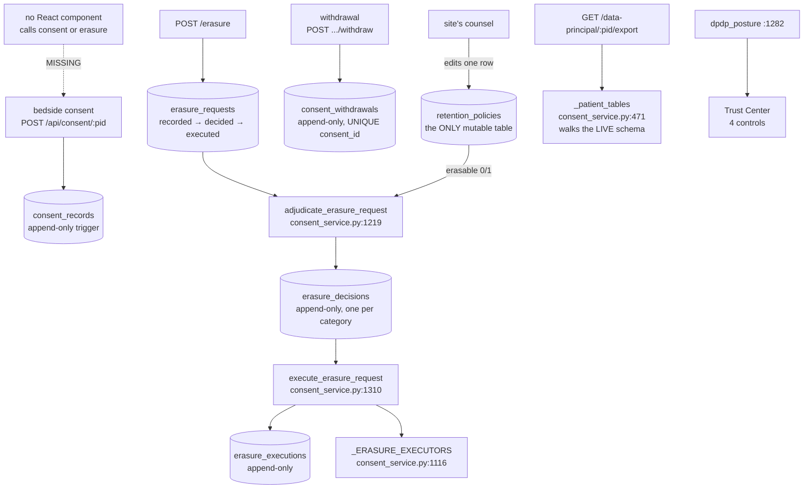
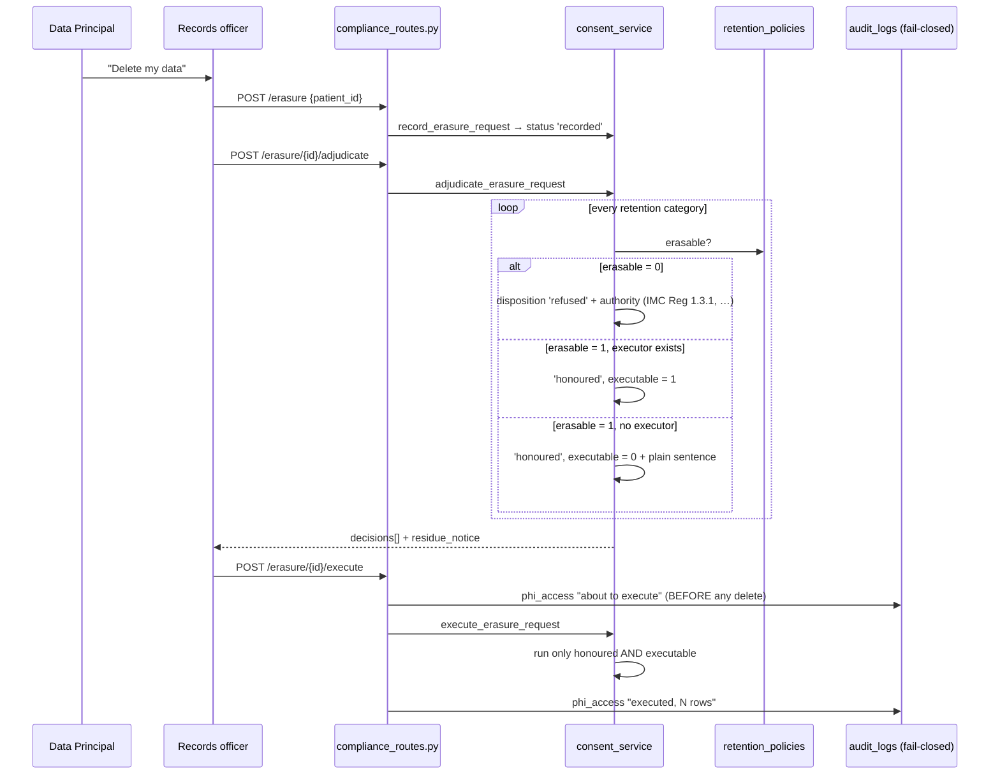

# DPDP consent and data rights: the erasure a hospital may refuse, and the reason it must state

Built 2026-08-07.

India's **Digital Personal Data Protection Act 2023** gives a person, the *Data Principal*, the right to know what a hospital holds about them, and the right to have it erased. Indian medical-record law simultaneously **compels** the hospital to keep most of that same material for years. And Orb's audit trail is a SHA-256 hash chain, so deleting one row inside it destroys the tamper-evidence of every row after it.

Three obligations, pointing three different directions. This chapter is about the position Orb takes and, more importantly, **where that position lives**: not in an `if` statement somebody argued into a service, but in one column of one seeded table, `retention_policies.erasable`.

**The thing a reader cannot reconstruct from the code alone**, and the reason this chapter exists: the code will show you that an erasure request is adjudicated per category and that some categories come back `refused`. What it will not show you is *why the line falls where it does*. The line is **the lawful basis, not the data type**. Personal data Orb holds because a law requires it is out of reach of s.12(3); personal data Orb holds because the patient agreed is in reach and is actually destroyed. That distinction is the whole design, and everything else, the two-step adjudicate-then-execute flow, the `authority` string quoted back to the principal, the residue notice, the `executable: False` honesty flag, falls out of it.

**Read this before anything else in the chapter:** there is **no user interface for any of this**. Seven tables, eighteen public service functions, sixteen HTTP endpoints and 40 tests exist. No React component calls a single consent or compliance endpoint except the Trust Center, which reads the aggregate posture report and renders four green ticks. A consent cannot be recorded from a screen today. See *Discrepancies and open questions*, every "On screen" block below says so explicitly, because the honest answer is more useful than a plausible one.

---

## Purpose and neighbors

**The problem.** Compliance is usually a PDF. A CIO asks "are you DPDP compliant?" and receives a policy document describing intentions. This module is the opposite bet: five things a Data Fiduciary must be able to **do**, each with a table behind it, each provable to the Data Protection Board from the database rather than from a slide.

**Jargon used throughout:**

| Term | Meaning in Orb |
|---|---|
| **DPDP** | Digital Personal Data Protection Act 2023. India's general data-protection statute. Its healthcare rules were still being written when this shipped. |
| **Data Principal** | The person the data is about, here, the patient. |
| **Data Fiduciary** | The organisation deciding how the data is processed, here, the hospital. |
| **Consent record** | One immutable row in `consent_records`: what, when, by what means, by whom, against which notice version, in which language. |
| **Withdrawal** | A **new row** in `consent_withdrawals` pointing at the consent it retires. Never an edit. There is deliberately no `status` column to flip. |
| **Effective status** | `active` / `withdrawn` / `expired`, **derived** at read time from the presence of a withdrawal row and the expiry date. Never stored. |
| **Retention category** | One of twelve rows in `retention_policies`, each with a lawful basis, a day count, a citation and, load-bearing, `erasable`. |
| **Erasure request → decision → execution** | Three separate tables and three separate acts. Logging the ask, deciding it per category, and destroying data are never the same call. |
| **Refused with a reason** | A `disposition = 'refused'` decision row carrying the statute that compels retention. A "no" with a citation attached is a lawful answer; silence is not. |
| **Residue** | The permanent trace an erasure request leaves in the audit trail. Stated to the principal in the decision rather than discovered by them later. |
| **Data-principal export** | s.11 right of access. The largest single PHI disclosure Orb can perform. |

**Neighbors:** guide 05-audit-chain (`log_audit_event`, the fail-closed `phi_access` category, the hash chain that makes erasure-inside-the-audit-trail impossible), guide 03-auth-rbac (`require_permission`, `require_patient_access`, `enforce_patient_scope`, `department_scope`, `scope_patient_ids_sql`), guide 04-database-schema (the migration runner that applies migration 14), guide 25-admin-panel (the Trust Center, which is the only screen any of this reaches), guide 23-bridge-patient-portal (`discharge_access_tokens` and the portal `users` row that `_erase_portal_account` revokes), guide 09-sage / guide 11-scribe (the `ai_interaction_transcript` category is Sage's working memory, and it is the one clinical-adjacent category that **is** erasable), guide 36-history-import (`history_import_patient_xref` is named in the export's refusal text as the example of a second patient column that is legitimately the same person).

---

## File map

| File | Lines | Role |
|---|---:|---|
| `server/services/consent_service.py` | 1583 | Everything. Vocabularies, consent, withdrawal, the schema-walking export, retention review, the four-stage erasure machinery, the breach register, and the posture summary. 18 public functions. The 105-line module docstring (`:1-105`) states the collision and Orb's position; it is required reading. |
| `server/routes/compliance_routes.py` | 516 | Two routers. `router` (`/api/admin/compliance`, `:35`) is governance, all `admin.overview`. `consent_router` (`/api/consent`, `:36`) is bedside, department-scoped. Sixteen endpoints, five request bodies, one audit helper (`:93`). |
| `server/migrations.py` | 5587 | Migration 14, `_m14_dpdp_act_machinery` (`:903`). Seven tables, ten append-only triggers, the seeded retention matrix `_DPDP_RETENTION_SEED` (`:1239`). Registered at `:5460`. |
| `server/services/compliance_service.py` | n/a | `compliance_report()` (`:1008`) calls `_dpdp_posture` (`:491`) which calls `dpdp_posture` (`server/services/consent_service.py:1607`); `_build_controls` (`server/services/compliance_service.py:524`) turns the counts into four Trust Center controls at `:919`, `:939`, `:949`, `:966`. |
| `server/permissions.py` | n/a | `department_scope` (`:192`), `scope_patient_ids_sql` (`:248`), `enforce_patient_scope` (`:292`), `require_permission` (`:376`), `require_patient_access` (`:445`). |
| `server/tests/test_dpdp_compliance.py` | 1327 | 48 tests. The behavioural spec: append-only enforcement, derived status, the export's structural guard, the refusal reasons, the two-step erasure, ward scoping of the register. |
| `src/pages/panels/admin/TrustCenter.tsx` | n/a | The only screen. Fetches `/admin/compliance/` (`:88`) and renders the controls list, including the four DPDP ones. It never touches a consent, an erasure or a breach endpoint. |

**No other frontend files.** There is no `src/api/consent.ts`, no consent form, no erasure console, no breach register screen. `src/pages/panels/admin/DataPanel.tsx` has an erasure card, but it calls a **different** endpoint, see *Discrepancies* item 2.

---

## The collision, stated properly

This is the section to read if you read nothing else.

### The three obligations

**(A) DPDP s.12(3)** gives the Data Principal the right to erasure of their personal data, and **s.8(7)** obliges the Data Fiduciary to erase on withdrawal of consent, or once the purpose is served.

**(B) Indian law compels a hospital to keep medical records.** The IMC (Professional Conduct, Etiquette and Ethics) Regulations 2002, Reg. 1.3.1 require indoor patient records for three years from the commencement of treatment. The Drugs and Cosmetics Rules 1945 require dispensing registers. The Limitation Act 1963 and the Consumer Protection Act 2019 set windows within which a claim may still arrive, meaning the record destroyed on request may be the very record the hospital needs to defend itself, or the one a coroner needs.

**(C) Orb's audit trail is a hash chain** with `BEFORE UPDATE`/`BEFORE DELETE` triggers (guide 05). Deleting one row does not merely remove that row; it breaks verification for every row after it. An erasure honoured inside `audit_logs` would destroy the tamper-evidence of the entire hospital's access history in order to satisfy one person's request.

### The three naive readings, and why each fails

**"Erase everything on request."** Illegal under (B) and self-destructive under (C). It also erases the evidence that the erasure was carried out lawfully: the hospital would have complied and be unable to prove it.

**"Refuse everything, we're a hospital."** Wrong, and the easy hiding place. A marketing list, a Bridge portal login, a stale dictation recording and a year of AI scratch notes are **not** medical records, and no Indian law requires their retention. Refusing those is non-compliance dressed up as clinical seriousness.

**"Anonymise instead."** Attractive and mostly false in a ward system. A clinical narrative with the name removed is still re-identifiable from the ward, the dates and the diagnosis. Claiming otherwise to a regulator is worse than not doing it.

### Orb's five positions, and where each one lives in code

1. **The lawful basis decides, not the data type.** Data held because a law requires it (`legal_basis = 'legal_obligation'`) is out of reach; DPDP's own text carves out retention "necessary for compliance with any law for the time being in force". Data held because the principal agreed (`legal_basis = 'consent'`) is in reach and is erased. **Lives in:** `retention_policies.erasable`, seeded at `migrations.py:1238`, read at `consent_service.py:1247`.

2. **The refusal is itself a deliverable.** A refused category returns a stated reason **and** the citation that compels retention, sealed into an immutable `erasure_decisions` row. A principal who disagrees can take that exact row to the Board. **Lives in:** `consent_service.py:1263-1270`, and the `authority` column at `migrations.py:1096`.

3. **The audit trail is never erased, and Orb says so out loud.** This is the sharpest edge and the one most likely to be argued. Orb's ground: audit rows are records of *access*, who opened which chart, when, retained under s.8(5) reasonable-security safeguards, and the chain is the control. An audit trail editable on request is not an audit trail. Orb does **not** pretend this is free to the principal: an erasure request leaves a permanent trace, because the request, the decision and the execution are all themselves audited. That residue is stated in the decision (`residue_notice`, `consent_service.py:1302`) rather than hidden.

4. **Erasure is adjudicated, then executed, and never on a timer.** Deciding is one act (`adjudicate_erasure_request`, `:907`); destroying is a second, separate, explicitly-triggered act (`execute_erasure_request`, `:998`). Retention overdue never auto-deletes anything, `retention_review` (`:690`) returns `deleted_anything: False` as a literal (`:766`) and produces a list for a human. A background job that quietly destroyed a medical record because a day count elapsed would be the worst bug this system could have.

5. **What Orb cannot yet erase, it refuses to claim.** A category may be erasable in law but not yet executable in code. The decision then says `disposition: honoured, executable: False` with a plain sentence explaining what a human must do instead (`_NOT_YET_EXECUTABLE`, `:852`). Orb never reports an erasure it did not perform.

**This is a defensible position, not settled law.** It is written down in the module docstring so the hospital's counsel can disagree with a *specific sentence* and change a *specific row* of `retention_policies`, which is exactly why that one table is mutable and every other table in migration 14 is append-only at the database layer.

### The matrix, as shipped

Twelve categories. The `erasable` column is the collision resolved in data.

| Category | Days | Basis | Erasable | Why |
|---|---:|---|:---:|---|
| `clinical_record` | 1095 | legal_obligation | **0** | IMC Regs 2002 Reg. 1.3.1 to 3 years from commencement of treatment; plus the Limitation Act / Consumer Protection Act windows |
| `medico_legal_record` | none | legal_obligation | **0** | Held until proceedings conclude; destruction needs the legal officer |
| `prescription_and_dispensing` | 1095 | legal_obligation | **0** | Drugs and Cosmetics Rules 1945, Schedule H1 register / Rule 65 |
| `imaging` | 1095 | legal_obligation | **0** | PCPNDT Act 1994 s.29 sets a 2-year floor; Orb applies the safer 3-year clinical period |
| `audit_trail` | 2920 | legal_obligation | **0** | DPDP s.8(5); and removing one row destroys tamper-evidence for every row after it |
| `breach_record` | 2920 | legal_obligation | **0** | DPDP s.8(6), the register is the proof notification happened |
| `consent_record` | none | legal_obligation | **0** | DPDP s.5/s.6, this is the proof consent existed |
| `ai_interaction_transcript` | 365 | consent | **1** | Sage working memory. Derived, not the signed record |
| `ambient_audio` | 30 | consent | **1** | The signed note is the record; the audio is working material |
| `patient_portal_account` | none | consent | **1** | An account is a convenience, not a medical record |
| `non_clinical_contact` | none | consent | **1** | Note: name/address/next-of-kin *inside* the record proforma are `clinical_record`, not this |
| `marketing_communications` | none | consent | **1** | Pure consent basis; withdrawal honoured in full |

Read the `erasable` column top to bottom and the position is legible without reading a line of Python: **every 0 has a statute in its `authority` string, and every 1 does not.**

---

## How it works

### Flow 1: a consent is taken, and later withdrawn

1. `POST /api/consent/{patient_id}` with a purpose, a method, and optionally the notice version and language. `record_consent` (`:179`) validates every coded field against a closed set **before** touching the database, because `consent_records` has a `BEFORE UPDATE` trigger and a typo'd purpose would be a permanent typo.
2. One row is inserted. A `consent_recorded` audit row follows (`compliance_routes.py:194`).
3. Later: `POST /api/consent/{patient_id}/{consent_id}/withdraw`. `withdraw_consent` (`:276`) inserts a **new** row into `consent_withdrawals`. The original consent row is untouched, it is physically impossible to touch it.
4. Reading the consent back, `_hydrate_consent` (`:374`) joins the withdrawal and computes `effective_status` (`:362`) on the fly. There is no stored status to disagree with the evidence.
5. The withdrawal response names the retention categories a human must now review (`_PURPOSE_TO_CATEGORIES`, `:350`) and returns `auto_deleted: False`. **DPDP s.8(7) creates an erasure obligation and Orb does not discharge it here.** Auto-deleting on withdrawal is how a patient who withdrew consent for *family updates* loses their AI-drafted notes.

### Flow 2: the data-principal export (s.11)

1. `GET /api/admin/compliance/data-principal/{patient_id}/export`, gated on `admin.overview` **through `require_patient_access`** so it also carries the department scope and the 404-not-403 rule.
2. `data_principal_export` (`:556`) starts with the `patients` row, then calls `_patient_tables` (`:471`), which **walks the live schema**, every table with a `patient_id` column is in the export.
3. Three filters run over that walk: the static exclusion list with per-table reasons (`_EXPORT_EXCLUDED`, `:440`); a skip for virtual tables (`:503`); and the **structural guard** (`:543`), a table with more than one column that could name a patient is refused, with the reason stated.
4. Access history is appended from `audit_logs`, restricted to nine columns (`:464`), no hash-chain internals, no staff IP address.
5. Consents are appended in readable form.
6. The route writes one **fail-closed** `phi_access` audit row naming the section count, the record count and the per-section row counts (`compliance_routes.py:272`). If that row cannot be persisted, the export does not return.

### Flow 3: an erasure request, end to end

1. `POST /api/admin/compliance/erasure` → `record_erasure_request` (`:869`). Logs the ask. Decides nothing, deletes nothing. `categories = None` means "everything", which is the normal case: a patient says "delete my data", not "delete retention category 7".
2. `POST .../erasure/{id}/adjudicate` → `adjudicate_erasure_request` (`:907`). For every category in scope it reads `retention_policies.erasable` and writes **one immutable decision row**: honoured + executable, honoured + not-yet-executable, or refused with the compelling authority quoted. The request moves `recorded → decided`. A decision is sealed: re-adjudicating raises, and the route turns that into a 409.
3. The response carries the `residue_notice`, the principal is told, at decision time, that the request itself is permanently recorded.
4. `POST .../erasure/{id}/execute` → the route writes an **intent** `phi_access` audit row *first* (`compliance_routes.py:411`), then `execute_erasure_request` (`:998`) runs only the executors for decisions that are both honoured and `executable = 1`, then a second **outcome** audit row records what was actually destroyed.
5. Each executor writes its own `erasure_executions` row with the per-table counts. The request moves `decided → executed`.

---

## Function-by-function

### File: `server/services/consent_service.py`

The module docstring (`:1-105`) is required reading and is summarised above rather than repeated. Its operational warning, separate from the legal argument: **everything here is blocking.** Every public function opens a `db_session` and must be called from a sync `def` route (FastAPI threadpools those) or through `run_db` from an async one. The 2026-07-30 event-loop stalls were sync SQLite on the loop and this module would reproduce them exactly.

#### `CONSENT_PURPOSES`: `consent_service.py:126`
**Signature:** module-level `dict[str, str]` (value → human label)
**Does:** The eight purposes a consent may be recorded against: `treatment`, `ai_assisted_documentation`, `ambient_recording`, `research_secondary_use`, `family_sharing`, `external_referral_sharing`, `patient_portal`, `marketing_communications`.
**On screen:** nothing today. It is served verbatim by `GET /api/consent/vocabulary` (`compliance_routes.py:137`) precisely so a future consent form renders the same options the server will accept instead of guessing, but nothing calls it.
**Why it exists:** free-text purposes are how a consent register becomes unauditable. Three spellings of "research" is three consents nobody can reconcile. The set is small on purpose; adding one is a deliberate act with a code review attached.
**Breaks if you change it:** **removing or renaming a key strands every historical row that used it.** The row is immutable and cannot be migrated in place, and `_hydrate_consent` (`:379`) falls back to printing the raw key when the label is missing, so the register silently degrades from labels to slugs. Adding a key is safe. Renaming one is not.

#### `CONSENT_METHODS`: `consent_service.py:137`
**Signature:** module-level `dict[str, str]`
**Does:** Five ways a consent can be taken: `written_signature`, `verbal_witnessed`, `digital_portal`, `kiosk_thumbprint`, `proxy_guardian`.
**On screen:** nothing; same vocabulary endpoint.
**Why it exists:** the Board's question is not "did they consent" but "how do you know". The method is the answer, and `evidence_ref` on the row points at the scan or the recording.
**Breaks if you change it:** `withdraw_consent` validates the **withdrawal** method against this same dict (`:295`). Delete a method and you can no longer record a withdrawal taken that way, which means a patient who signed on paper and withdrew on paper cannot have their withdrawal recorded.

#### `GIVEN_BY` / `BREACH_NATURES`: `consent_service.py:145` / `:147`
**Signature:** two module-level tuples
**Does:** `("patient", "guardian", "proxy")`, and the seven breach natures the register accepts.
**On screen:** `GIVEN_BY` is returned by the vocabulary endpoint (`compliance_routes.py:144`). `BREACH_NATURES` is not exposed anywhere, a caller must already know the vocabulary, which is a small asymmetry.
**Why it exists:** `given_by != "patient"` is what triggers the DPDP s.9 guardian check in `record_consent` (`:249`), in an Indian ward, guardian consent for a child or a person with disability is the common case, not the edge one.
**Breaks if you change it:** adding a fourth `given_by` value that is not `"patient"` silently inherits the proxy-name requirement, which is probably what you want; adding one that *should not* require a named proxy needs the check at `:249` rewritten, not the tuple extended.

#### `_now` / `_rows` / `_new_id` / `_require`: `consent_service.py:157` / `:161` / `:165` / `:169`
**Signature:** `() -> str` (UTC ISO) / `(cursor) -> list[dict]` / `(prefix: str) -> str` / `(value, name) -> Any`
**Does:** Timestamp, row-dict conversion, prefixed id (`CNS-`, `CNW-`, `ERQ-`, `ERD-`, `ERX-`, `BRC-`, `BRN-` + 12 hex), and a blank-rejecting required-argument check.
**On screen:** the id prefixes are the only user-visible artefact, an `ERQ-…` in a support conversation immediately identifies an erasure request rather than a decision.
**Breaks if you change it:** `_new_id` uses `uuid4().hex[:12]`, 48 bits. That is fine for a register measured in hundreds of rows per year; do not copy the pattern into anything bulk (see guide 36, where 32 bits was measurably not enough).

#### `record_consent`: `consent_service.py:179`
**Signature:** `(*, patient_id, purpose, method, recorded_by, recorded_by_role=None, scope_detail=None, notice_version=None, notice_language=None, granted_at=None, expires_at=None, given_by='patient', proxy_name=None, proxy_relationship=None, evidence_ref=None) -> dict`
**Does:** Writes **one immutable** consent row and returns it hydrated.
**On screen:** nothing today. It is reachable only through `POST /api/consent/{patient_id}` (`compliance_routes.py:158`), which no component calls.
**How it works:** validation is strict and entirely up front (`:239-256`), unknown purpose, unknown method, bad `given_by`, and the s.9 rule that a guardian/proxy consent must name the proxy *and* the relationship. Only then does it check the patient exists and insert. `notice_version` and `notice_language` are stored because DPDP s.5 makes the **notice** part of the consent: a consent taken against a notice nobody can reproduce, or in a language the principal does not read, is not a consent.
**Why the validation is front-loaded:** the row can never be corrected. `consent_records` carries a `BEFORE UPDATE` trigger (`migrations.py:984`). A typo'd purpose is a permanent typo, so a bad purpose is refused rather than stored.
**Breaks if you change it:** relaxing the proxy check produces guardian consents with no named guardian, rows that cannot be verified later and therefore cannot be relied on, which is worse than not having them. Moving validation *after* the insert makes a rejected consent leave a partial row that no code path can clean up.

#### `withdraw_consent`: `consent_service.py:276`
**Signature:** `(*, consent_id, recorded_by, method, reason=None, recorded_by_role=None, withdrawn_at=None) -> dict`
**Does:** Records a withdrawal as a **new row**. The original consent is never touched.
**On screen:** nothing today. Behind `POST /api/consent/{patient_id}/{consent_id}/withdraw` (`compliance_routes.py:202`).
**How it works:** looks up the consent, checks no withdrawal exists (`:307`), inserts. The pre-check is not the safety mechanism, `idx_consent_withdrawal_unique` (`migrations.py:1012`) is, and would reject the second write anyway. The `ValueError` exists so the route can return **409** instead of **500** (`:311-313`, `compliance_routes.py:226`).
**The return value is the interesting part:** `erasure_review_required: True`, `categories_for_review: [...]`, `auto_deleted: False`, and a `next_step` sentence. DPDP s.8(7) says withdrawal creates an erasure obligation. **Orb names the categories a human must review and stops.**
**Why it does not auto-delete:** a patient who withdraws consent for `family_sharing` has said nothing about their AI-drafted notes. A cascade from one withdrawal to a category sweep is how a narrow withdrawal destroys unrelated material, and it would do so with no decision row, no stated reason, and no possibility of review.
**Breaks if you change it:** wiring a delete in here removes the adjudication step entirely, which means erasure happens with no `erasure_decisions` row, no stated basis, nothing to show the Board, nothing for the principal to disagree with. It also makes withdrawal irreversible in effect while remaining reversible in record, which is the worst of both.

#### `_PURPOSE_TO_CATEGORIES`: `consent_service.py:350`
**Signature:** module-level `dict[str, set[str]]`
**Does:** Maps a withdrawn purpose to the retention categories a human should now look at.
**On screen:** the `categories_for_review` list in the withdrawal response, and the `categories_for_review` key in the withdrawal audit row (`compliance_routes.py:231`).
**Why it exists, and why it is narrow:** withdrawing consent for family updates must not put the clinical record in play. `family_sharing` maps only to `non_clinical_contact`. `treatment` maps to `clinical_record`, which is `erasable = 0`, so even the broadest withdrawal produces a *review*, not a deletion.
**Breaks if you change it:** widening a mapping makes a narrow withdrawal generate a broad review list, which trains the records officer to skim it. Narrowing one hides an obligation.

#### `_effective_status`: `consent_service.py:362`
**Signature:** `(consent: dict, withdrawal: dict | None, now: str | None = None) -> str`
**Does:** Returns `withdrawn` if a withdrawal row exists, else `expired` if `expires_at <= now`, else `active`. **Derived, never stored.**
**On screen:** the `effective_status` field on every consent returned by the register.
**Why there is no `status` column to flip:** a status column would be a second, writable source of truth for the same question. The first time the two disagreed, the hospital would have no way to tell which one the auditor should believe. The migration says this in its own docstring (`migrations.py:920-928`).
**Breaks if you change it:** adding a stored status column reintroduces exactly that ambiguity, and because `consent_records` cannot be updated, the column could only be written at insert time, when the answer is not yet known.

#### `_hydrate_consent` / `get_consent` / `list_consents`: `consent_service.py:374` / `:386` / `:395`
**Signature:** `(db, row) -> dict` / `(consent_id) -> dict | None` / `(patient_id) -> list[dict]`
**Does:** Attaches the purpose and method labels, the withdrawal row, and the derived status. `list_consents` returns every consent the patient ever gave, newest first.
**On screen:** would be the consent register on a patient chart. Behind `GET /api/consent/{patient_id}` (`compliance_routes.py:148`). Nothing renders it.
**Why withdrawn consents are always included:** a register that hides them cannot show the history the Board asks for, "was there a valid consent on 4 March, and when was it withdrawn?" is a question about rows that are no longer in force.
**Breaks if you change it:** filtering withdrawn rows out of `list_consents` also silently changes `has_active_consent` (`:407`), which iterates the same list, so a filter added for display reasons would become a subtle change to a would-be enforcement gate.
**Gotcha:** `_hydrate_consent` issues one extra `SELECT` per consent. Fine for a register; do not call it in a loop over the whole hospital.

#### `has_active_consent`: `consent_service.py:407`
**Signature:** `(patient_id: str, purpose: str) -> bool`
**Does:** Is there an unwithdrawn, unexpired consent for this purpose right now?
**On screen:** **nothing, and nothing calls it.** Grep finds callers only in `tests/test_dpdp_compliance.py`. This is the function that would gate a feature on consent, "do not let Scribe record ambient audio for this patient unless `ambient_recording` is active", and no feature is gated. See *Discrepancies* item 1. Saying so is more useful than implying the register is enforced.
**Breaks if you change it:** nothing today. The day something *does* call it, note that it loads the patient's entire consent history to answer one boolean; that is the version to replace with a targeted query.

#### `_EXPORT_EXCLUDED`: `consent_service.py:440`
**Signature:** module-level `dict[str, str]` (table → the reason the principal is told)
**Does:** Three tables never in the export: `sage_decision_cache` (a rebuildable cache that would repeat clinical content), `event_deliveries` (delivery bookkeeping with no personal content), `world_model_state` (a derived encrypted snapshot of the same clinical picture).
**On screen:** each entry appears in the export's `excluded` array as `{name, reason}`, the principal is told what was left out and why.
**Why it is static and never mutated at runtime:** a module-level dict that grew during a request would make one export's exclusion list depend on which exports ran before it in the same process. `data_principal_export` takes a **copy** (`:566`) and merges the per-call refusals into the copy.
**Breaks if you change it:** deleting an entry puts the table back in the export, for `world_model_state` that means handing the principal an encrypted blob column, which is not a s.11 answer. Mutating this dict in place instead of copying it makes exports non-deterministic across a process's lifetime.

#### `_EXPORT_RENDERED_ELSEWHERE`: `consent_service.py:457`
**Signature:** `frozenset({"consent_records", "consent_withdrawals"})`
**Does:** Tables that *are* exported, but through the curated `consents` section rather than as raw rows.
**On screen:** stops the principal receiving their consents twice, once readable, once as raw table rows.
**Breaks if you change it:** remove `consent_records` and the export contains the same consents in two sections with different shapes, which reads as a bug in a document a regulator may see.

#### `_ACCESS_HISTORY_COLUMNS` / `_ACCESS_HISTORY_LIMIT`: `consent_service.py:464` / `:468`
**Signature:** nine-name tuple / `2000`
**Does:** Restricts the audit rows in the export to timestamp, category, action, outcome, actor id, actor role, path, method and summary.
**On screen:** the "Who has opened your record, and when" section, with a note stating the cap and the omission.
**Why the omissions:** `prev_hash`/`row_hash` are chain internals, not information about the patient. And the **IP address and user-agent of the staff member** who opened the chart are the *staff member's* personal data, not the patient's. An access history is "who looked and when"; it is not a dossier on the nurse.
**Breaks if you change it:** adding `ip_address` back turns a patient's s.11 export into a disclosure of staff location data, a second data principal's personal data inside the first one's export.

#### `_patient_tables`: `consent_service.py:471`
**Signature:** `(db) -> tuple[list[str], dict[str, str], int]` → `(included, refused_by_shape, tables_scanned)`
**Does:** Discovers, from the live schema, every table it is safe to filter by a single `patient_id`.
**On screen:** decides which sections exist in the export, and populates the `excluded` list with the shape-based refusals.
**Why it is discovered rather than hand-listed:** a hand-maintained table list goes stale the first time somebody adds a feature, and a stale list makes the export **quietly incomplete**, the failure mode nobody notices until a regulator does. A table added tomorrow is in the export tomorrow.
**The structural guard (`:543`):** a table is exported only when **exactly one** column could name a patient *and* it is the plain `patient_id`. Two such columns, `message_room_fit_flags` has `room_patient_id` and `suspected_patient_id`, the second naming a patient a message may have been *misdirected* to, is refused. So is a single oddly-named one. The refusal is **declared with a reason**, not silent: a quietly skipped table is how an export becomes incomplete without anybody noticing.
**The wording of that reason is deliberate.** It says Orb "cannot prove", not "contains someone else", because sometimes the second column genuinely is the same person under another name, `history_import_patient_xref.external_patient_id` is this patient's number at their old hospital (guide 36). Orb cannot tell the two cases apart from the schema and says exactly that.
**The virtual-table skip (`:503`) is a correctness fix, not tidiness.** `clinical_knowledge_vec` is a `vec0` table from the sqlite-vec extension, and that extension is **per-connection** state an ordinary `db_session` does not load, so even `PRAGMA table_info(clinical_knowledge_vec)` raises `no such module: vec0`. The export therefore crashed with a 500 on any appliance with the knowledge corpus loaded, which is every real one. It was found by running this module together with the corpus tests; running it alone can never see it, because alone there is no `vec0` table in the database. Nothing is lost, fts5/vec0 indexes hold embeddings of the clinical **reference corpus**, not patient data.
**The belt-and-braces `except` (`:513`):** any other unreadable table is refused *and said*, rather than being allowed to take down the whole export.
**Breaks if you change it:** loosening `patient_cols != ["patient_id"]` to "contains a patient_id column" puts `message_room_fit_flags` into the export and emits **another data principal's identifier inside this principal's document**. Returning `refused` on a module global instead of per call makes one export's exclusion list depend on request ordering.

#### `data_principal_export`: `consent_service.py:556`
**Signature:** `(patient_id: str, *, include_access_history: bool = True) -> dict`
**Does:** Everything Orb holds about one patient, section by section, as plain JSON-able dicts.
**On screen:** nothing today. Behind `GET /api/admin/compliance/data-principal/{patient_id}/export`.
**How it works:** registration row → discovered tables (skipping empties) → access history → consents. Returns `sections`, `section_count`, `record_count`, `tables_scanned`, `excluded[]`, and two plain-English `notes`, that the export covers Orb only (not paper records, not images on imaging equipment, not anything already sent elsewhere), and that some rows name the staff member who wrote them, *because a clinical entry without an author is not a record*.
**Why plain dicts and no format:** DPDP does not prescribe one, and a hospital in India will most often **print** this.
**Breaks if you change it:** the `excluded` array is the honesty mechanism. Dropping it makes the export look complete whether or not it is. Removing the trailing hash-chain entry (`:633`) removes the only statement that the audit rows were trimmed.
**Gotcha:** this function is read-only but it is *the* PHI disclosure. Never call it outside the audited route.

#### `_RETENTION_SOURCES`: `consent_service.py:691`
**Signature:** `dict[str, list[tuple[table, patient_column, timestamp_column]]]`
**Does:** Maps eight of the twelve categories to the tables that actually hold them, with the timestamp column the clock runs from.
**On screen:** the `by_table` breakdown per category in the retention review.
**Why four categories have no entry:** `medico_legal_record`, `ambient_audio`, `non_clinical_contact` and `marketing_communications` have no table in Orb. The policy is still declared so that **the hospital's answer is on record**, `retention_review` returns them with `measurable: False` and a note saying so, rather than omitting them.
**Breaks if you change it:** pointing a category at the wrong timestamp column silently mis-buckets every row, e.g. anchoring `clinical_record` on a row's `updated_at` would make an old record look recent every time anyone edited it, and the overdue list would go quietly empty.

#### `list_retention_policies`: `consent_service.py:848`
**Signature:** `() -> list[dict]`
**Does:** The whole matrix, ordered `erasable, category`, so the refused categories print first.
**On screen:** the `policies` half of `GET /api/admin/compliance/retention` (`compliance_routes.py:300`). No component renders it.
**Breaks if you change it:** the ordering is what makes the printed matrix readable as "here is what we must keep, and then here is what you can have". Alphabetical ordering interleaves them.

#### `retention_review`: `consent_service.py:854`
**Signature:** `(*, now: datetime | None = None, patient_id: str | None = None) -> dict`
**Does:** Reports what is past its retention period, per category. **Deletes nothing.**
**On screen:** the `review` half of the retention endpoint.
**How it works:** for each policy with a day count and a source, computes a cutoff **date** and counts rows older than it, per table. Categories with no day count get a note ("retained until a named person lifts the hold"); categories with no table get the "declared so the answer is on record" note.
**`deleted_anything: False` is a literal, and it is load-bearing (`:885`).** The one thing this function must never grow is a sweep. A hospital reading the list decides per category whether a record can go, and a **signed destruction order**, not a day count, is what authorises it.
**The comparison shape is deliberate (`:825`, explained at `:667-678`).** This schema stores timestamps in two formats, ISO-8601 with a `T` from Python, and `YYYY-MM-DD HH:MM:SS` from SQLite's `CURRENT_TIMESTAMP`, so anything assuming one format mis-buckets every row in the other. Comparing the whole column against a bare 10-character date is correct for both, because a string always sorts after its own prefix. It gives the same answer as `substr(col,1,10) < ?` but is **sargable**: SQLite can use an index, whereas wrapping the column in `substr()` forces a full scan of `audit_logs`, which on a live appliance is the biggest table there is.
**The minority protection (`:684-731`).** Limitation Act 1963 s.6: time does not run against a child until majority, so the claim window for care given to a minor closes at 21 (`MINOR_RETENTION_AGE`, `config.py:885`), not three years after the last visit. For the categories held to answer a claim (`clinical_record`, `prescription_and_dispensing`, `imaging`, `_MINORITY_PROTECTED_CATEGORIES`, `:702`) a row counts as overdue only if its patient is demonstrably past that age (`_RELEASABLE_PATIENT_SQL`, `:722`); rows for minors, and rows whose patient Orb cannot age (no date of birth, no age, no patient row), are **held back**, counted separately under `minority_protection` and named in the category's note. It is applied as a floor over `retention_policies`, not as a row in it, because "was this patient a child" is a property of the patient and that table is keyed by category. Pinned by `test_minor_record_is_held_back_not_listed_as_overdue` (`server/tests/test_dpdp_compliance.py:1203`).
**The `not_patient_scoped` branch (`:823`):** the breach register is keyed by incident, not by person. Counting it unfiltered under a `patient_id` review would report *every breach in the hospital* as this one patient's overdue data. It is skipped and **named in the response** rather than returning a number that reads as if it were theirs.
**Breaks if you change it:** adding a delete here, even behind a flag, creates a background job that can destroy a medical record because a day count elapsed. Switching the comparison to `substr()` keeps the answer and loses the index. Dropping `not_patient_scoped` makes a per-patient review silently include hospital-wide counts. Counting a protected category without the releasable-patient filter puts paediatric records on a list a hospital destroys from.

#### `_erase_ai_transcripts`: `consent_service.py:1024`
**Signature:** `(db, patient_id) -> tuple[int, dict]`
**Does:** Deletes the patient's rows from `sage_observations`, `sage_room_memory`, `sage_decision_cache`, `sage_insights` and `insight_feedback`. Returns the total and a per-table breakdown.
**On screen:** the per-category `detail` in the execution response.
**Why this one is safe to honour:** every one of those tables is **derived**, regenerated from the clinical record. Erasing them removes the AI's notes about the patient without touching a single word a clinician wrote.
**Breaks if you change it:** adding a table that is *not* derived turns an honoured erasure into destruction of the clinical record, the exact outcome the `erasable` column exists to prevent. The per-table `try/except` (`:910-913`) means a missing table is skipped and logged rather than aborting the run; that is right for a pre-migration database and wrong if it hides a table you meant to clear, so check the returned `detail` counts rather than the total.

#### `_erase_portal_account`: `consent_service.py:1043`
**Signature:** `(db, patient_id) -> tuple[int, dict]`
**Does:** Revokes every outstanding `discharge_access_tokens` row and **deactivates** the linked patient `users` row.
**On screen:** the `portal_logins_disabled` and `discharge_access_tokens_revoked` counts.
**Why the user row is deactivated rather than deleted:** audit rows and clinical rows name that user id as an actor. Deleting it would make those rows unreadable. **An erasure that damages somebody else's record is not an erasure, it is a second incident.**
**How the credential is destroyed (`:952-954`):** `password_hash` is `NOT NULL`, so it is overwritten with `erased-` + 32 random bytes rather than nulled. That tombstone does not start with `$2`, so `auth.verify_password` routes it to the legacy SHA-256 branch and compares a 64-character digest against a longer random string, `compare_digest` returns False for every possible password, and nobody, including whoever reads the row, knows a preimage. `pin_hash`, `totp_secret` and `device_pin_hash` are nulled outright.
**Why `token_version` is bumped (`:956`):** it kills every JWT already outstanding, so the erasure takes effect on the **next request** rather than at the next expiry. Without it, a patient whose portal account was "erased" keeps working access for the life of their current token.
**Breaks if you change it:** deleting the `users` row instead orphans every audit and clinical row referencing it. Nulling `password_hash` violates `NOT NULL` and aborts the whole transaction. Dropping the `token_version` bump leaves a live session on an erased account.

#### `_erase_ambient_audio` / `_unlink_erased_audio`: `consent_service.py:1087` / `:1156`
**Signature:** `(db, patient_id) -> tuple[int, dict]` / `(names) -> list[str]`
**Does:** Detaches the patient's dictation audio from their `scribe_notes` (nulls `audio_path`) inside the erasure transaction and names the files; `execute_erasure_request` deletes those files **after** the commit and gets back the names that could not be removed.
**Why two steps:** a file deleted inside the transaction cannot be rolled back with it; if a later executor or the execution row failed, the record would say nothing was erased while the audio was already gone. The signed note is the medical record and is not touched; the audio is working material.
**How it trusts a path:** `scribe_notes.audio_path` arrives from the client, so a file is scheduled only when it resolves inside `UPLOAD_DIR`, and never when another patient's note points at the same file. Anything refused keeps its pointer and is counted (`kept_outside_upload_folder`, `kept_shared_with_another_record`); the unlink step repeats the containment check because it is the line that deletes, and treats a file already gone as removed.
**Breaks if you change it:** unlinking inside `_erase_ambient_audio` makes a failed execution destroy audio while reporting nothing erased. Dropping the shared-file check deletes another patient's recording. Pinned by `server/tests/test_erasure_audio_and_retained.py`.

#### `ERASURE_RETAINED_TABLES` / `_retained_after_erasure`: `consent_service.py:1208` / `:1250`
**Does:** The stores that still name a patient after any erasure, each with the reason (the audit trail, the shadow evidence log, consent records and withdrawals, the erasure request, decision and execution rows, breach notifications), and a per-patient count of the ones with a `patient_id` column.
**Why it exists:** every one of them except `audit_logs` is append-only at the storage layer, so nothing can delete from them; the point of the list is that an erasure **says** they remain instead of implying the patient is gone. `routes/admin_routes.py` builds its destruction plan's keep set from the same dict. Pinned by `test_every_retained_table_says_why` (`server/tests/test_erase_plan_retained.py:45`).

#### `_ERASURE_EXECUTORS`: `consent_service.py:1183`
**Signature:** `dict[str, Callable[[db, patient_id], tuple[int, dict]]]`
**Does:** Three entries: `ai_interaction_transcript`, `patient_portal_account` and `ambient_audio`. **These are the only places this module deletes patient data** (for audio, the files go after the commit, see `_erase_ambient_audio`).
**On screen:** membership decides `executable: True` on a decision row, which decides whether the execute step does anything for that category.
**Why the registry shape:** a category with no executor is honoured in law and reported as `executable: False`. Orb does not claim an erasure it did not perform.
**Breaks if you change it:** adding an executor for a category whose `erasable` is 0 does nothing, `adjudicate` only reaches the executor lookup inside the `if p["erasable"]` branch (`:1192`), so the two must be changed together, and the policy row is the one that decides.

#### `_NOT_YET_EXECUTABLE`: `consent_service.py:1190`
**Signature:** `dict[str, str]` (category → the sentence the principal is told)
**Does:** Two entries (`ambient_audio` left this table when its executor landed). `non_clinical_contact`: Orb holds no contact store separate from the medical record, so those fields fall under `clinical_record`. `marketing_communications`: Orb runs no outreach list, so there is nothing held to erase.
**On screen:** appended verbatim to the decision's `reason` (`:1204`).
**Why it exists:** "granted" with no visible action is indistinguishable from being ignored. Naming the manual step converts a gap into a work item somebody owns.
**Breaks if you change it:** deleting an entry leaves the generic fallback, *"Orb cannot yet carry this out automatically"*, which tells the principal nothing about who does it or when. Building the executor without deleting the entry is harmless; the entry is only consulted when there is no executor.

#### `record_erasure_request`: `consent_service.py:1275`
**Signature:** `(*, patient_id, requested_by, categories=None, requester_identity='patient', channel='in_person', note=None) -> dict`
**Does:** Logs the ask. Decides nothing, deletes nothing.
**On screen:** nothing. Behind `POST /api/admin/compliance/erasure`.
**How it works:** validates the patient exists and that every named category is a real `retention_policies` row, then inserts with `status = 'recorded'`. `categories=None` means "everything" and is stored as a NULL `categories_json`.
**Why `None` is the normal case:** a patient says "delete my data", not "delete retention category 7". Requiring a category list would push the hospital's taxonomy onto the principal.
**Breaks if you change it:** defaulting to an empty list rather than `None` makes `adjudicate` filter the policy list down to nothing and produce a decision with zero rows, a request that reports as decided while answering nothing.

#### `adjudicate_erasure_request`: `consent_service.py:1313`
**Signature:** `(request_id: str, *, decided_by: str) -> dict`
**Does:** **The hard part, executed.** One sealed decision row per category in scope.
**On screen:** nothing. Behind `POST .../erasure/{id}/adjudicate`, which turns its `ValueError` into a 409.
**How it works:** refuses if the request is not still `recorded` (`:1177`), *a decision is sealed and cannot be re-taken; raise a new request instead*. Loads the policies, filters to the requested categories if any, then for each one takes one of three branches (`:1192-1215`):
- `erasable = 1` **and** an executor exists → `honoured`, `executable = 1`, reason names the lawful basis;
- `erasable = 1`, no executor → `honoured`, `executable = 0`, reason names the basis **and** appends the `_NOT_YET_EXECUTABLE` sentence;
- `erasable = 0` → `refused`, `executable = 0`, reason states that DPDP s.12(3) does not reach data whose retention is necessary for compliance with a law in force, plus the policy's `disposition`; and `authority` carries the citation.

Then the request moves to `decided`.
**Why the decision is a row and not a computed answer:** the policy table is mutable. A decision computed on demand would change when counsel edits a policy, which means the answer given to a principal in March could silently become a different answer in June. Sealing it is what makes it evidence.
**Why `authority` is only set on refusals (`:1206`, `:1215`):** a granted request needs no statutory justification. A refused one is worthless without it.
**The `residue_notice` (`:1247`)** is returned with every adjudication: *this request, this decision and anything Orb erases because of it are themselves recorded in the tamper-evident audit trail, which is not erased.* Position 3 of the collision, said to the principal rather than discovered by them.
**Breaks if you change it:** allowing re-adjudication destroys the seal, the same request could produce two contradictory decisions with no way to tell which was given to the principal. Dropping `authority` reduces a lawful refusal to an unexplained one. Computing the disposition from anything other than `retention_policies.erasable` moves the hospital's legal position out of the table its counsel can edit and back into code.

#### `execute_erasure_request`: `consent_service.py:1404`
**Signature:** `(request_id: str, *, executed_by: str) -> dict`
**Does:** Carries out only what was adjudicated **honoured AND executable** (`:1276-1278`).
**On screen:** nothing. Behind `POST .../erasure/{id}/execute`.
**How it works:** refuses if the request is still `recorded`, *erasure without a recorded decision would destroy data with no stated basis* (`:1267`), and refuses a second execution (`:1272`). For each qualifying decision it runs the executor, writes an `erasure_executions` row with the row count and the per-table `detail_json`, moves the request to `executed`, and counts what still names the patient (`_retained_after_erasure`). Only **after the commit** does it unlink the audio files `_erase_ambient_audio` named, so a rolled-back execution has destroyed nothing; a file that will not go is reported in `files_not_removed`, not hidden. The response carries `categories`, `files_not_removed` and `retained`, so "executed" is never read as "the patient is gone".
**Why it is a separate call from adjudication:** deciding and destroying are two acts, and the second one wants a human to have read the first. It is also what makes the route's intent-audit-then-execute ordering possible.
**Why executions are their own table rather than a back-fill:** `erasure_decisions` is append-only at the database layer (`migrations.py:1115`), so `rows_erased`/`executed_at` on that table can never be filled in. The decision says what was **allowed**; the execution says what was **actually done**; they are separate facts on separate dates. The two unused columns on `erasure_decisions` are vestigial, see *Discrepancies* item 7.
**Breaks if you change it:** removing the "not adjudicated" guard produces destruction with no decision row, no basis, nothing to show. Removing the `executable = 1` filter attempts executors that do not exist. Merging this into `adjudicate` collapses the audit story into a single event and removes the point at which a human can stop.

#### `get_erasure_request` / `list_erasure_requests`: `consent_service.py:1479` / `:1499`
**Signature:** `(request_id) -> {request, decisions, executions}` / `(*, patient_id=None, status=None, limit=200, department=None) -> list[dict]`
**Does:** One request with its full decision and execution trail; and the register of requests.
**On screen:** nothing renders either.
**The `department` parameter is not optional in spirit.** Every row in the register names a patient, so an unfiltered listing hands a Cardiology-scoped administrator the id of **every patient in the hospital who ever asked to be forgotten**. The filter goes through `permissions.scope_patient_ids_sql` (`permissions.py:258`), the one derivation, rather than a second local idea of what a ward is. `None` means a genuinely unscoped governance account, per the `department_scope()` convention.
**Breaks if you change it:** open-coding the ward filter here creates a second definition that will drift from the one every other route uses. Defaulting `department` to `None` at a call site that *has* a scoped user turns the register into a hospital-wide disclosure.

#### `record_breach`: `consent_service.py:1541`
**Signature:** `(*, nature, description, reported_by, discovered_at=None, occurred_at=None, exposed_to=None, data_categories=None, records_affected=None, principals_affected=None, affected_patient_ids=None, containment_at=None, containment_actions=None) -> dict`
**Does:** Opens a breach record: what was exposed, to whom, when.
**On screen:** indirectly, the **`dpdp_breach_register` Trust Center control** (`compliance_service.py:415`) goes from `warn` ("no breach has ever been recorded, so the process is untested") to `pass` or `fail` depending on notification state.
**Why `discovered_at` and `occurred_at` are separate:** the two are almost never the same moment, and **the gap between them is the number a regulator asks about first**. `discovered_at` defaults to now; `occurred_at` is optional and never inferred.
**Breaks if you change it:** collapsing them to one column destroys the detection-lag figure permanently, it cannot be reconstructed afterwards.

#### `record_breach_notification`: `consent_service.py:1586`
**Signature:** `(*, breach_id, party_type, notified_party, method=None, reference=None, content_summary=None, recorded_by, notified_at=None) -> dict`
**Does:** One immutable row per notification sent, and updates the header's convenience mirrors.
**On screen:** flips `dpdp_breach_register` from `fail` to `pass` once the Board is notified.
**How it works:** `party_type='board'` sets `board_notified_at` via `COALESCE` (so the **first** notification wins, not the latest) and moves the breach to `notified`; `party_type='data_principal'` sets `principals_notified_at` the same way.
**Why notifications are their own table:** DPDP s.8(6) requires notifying the Board **and** every affected Data Principal. Those are two obligations discharged at two different times, and one timestamp column cannot record both. The header mirrors exist only so a register listing does not need a join.
**Breaks if you change it:** dropping the `COALESCE` lets a later notification overwrite the first, which is the timestamp the regulator cares about. Removing the mirrors is safe but makes `list_breaches` do a join per row.

#### `get_breach`: `consent_service.py:1637`
**Signature:** `(breach_id: str, *, department: str | None = None) -> dict`
**Does:** One breach with its notification history and an `outstanding` list of what has not yet been done.
**On screen:** nothing renders it. Behind `GET /api/admin/compliance/breaches/{breach_id}`.
**The scoping decision here is subtle and worth reading.** A breach is a **hospital-wide governance record** and stays fully visible, nature, description, counts, timeline. But its list of **affected patients** is PHI, and a Cardiology-scoped administrator has no business reading the ids of affected Oncology patients out of an incident report. So the list is filtered to their ward (`:1242-1247`) and **the number withheld is stated** (`affected_patient_ids_withheld`).
**Why the withheld count rather than silent filtering:** the reader must know the incident is **wider than what they can see**, so they escalate rather than under-report it. A silently truncated list would let a ward administrator tell the Board "four patients affected" when the real number was forty.
**Breaks if you change it:** dropping `affected_patient_ids_withheld` converts a scoped view into a misleading one. Scoping the whole breach record rather than just the patient list hides incidents from the people who need to act on them.

#### `list_breaches`: `consent_service.py:1680`
**Signature:** `(*, limit: int = 200) -> list[dict]`
**Does:** The register, newest first, each row carrying a `notification_count` subquery.
**On screen:** nothing renders it.
**Why `affected_patient_ids_json` is popped (`:1544`):** a register page is read by whoever is on shift, and it does not need the names to show that a breach is open and unnotified.
**Breaks if you change it:** leaving the id list in the listing turns a hospital-wide governance page into a bulk PHI disclosure, and unlike `get_breach`, the listing has no `department` parameter to scope it with.

#### `dpdp_posture`: `consent_service.py:1701`
**Signature:** `() -> dict` (eight integer counts)
**Does:** Consents recorded, consents withdrawn, patients with consent, retention policies, erasure requests total and awaiting decision, breaches recorded and awaiting Board notification.
**On screen:** **this is the one function in the module that reaches a screen.** `compliance_service._dpdp_posture` (`server/services/compliance_service.py:491`) calls it, `_build_controls` (`:524`) turns it into four Trust Center controls, and the Trust Center fetches and renders them (`src/pages/panels/admin/TrustCenter.tsx:112`):
- `dpdp_consent`, `pass` with counts, or `warn` when nothing has been recorded yet (`compliance_service.py:374`);
- `dpdp_data_principal_rights`, always `pass`, evidencing the export endpoint (`:390`);
- `dpdp_retention`, `pass` with the category count, `warn` if migration 14 has not run (`:400`);
- `dpdp_breach_register`, **`fail`** if any breach is unnotified, `pass` if all are notified, `warn` if none has ever been recorded so the process is untested (`:415`).
**Why every count is wrapped in a swallowing `count()` helper (`:1286`):** an empty register on a fresh appliance is a legitimate state, not an error, and a pre-migration database missing a table must not take the whole Trust Center down.
**Why the four controls are separate rather than one "DPDP" tick:** a hospital can have a full consent register and no breach process, and a single green tick would hide that (`compliance_service.py:369-370`).
**Breaks if you change it:** renaming a key silently degrades the corresponding control to its `_safe` default, zeros, which renders as `warn` rather than as an error, so a broken probe looks like an unused feature.

---

### File: `server/routes/compliance_routes.py`

The module docstring (`:1-20`) states the split: `router` is **governance** (`/api/admin/compliance`, all `admin.overview`, the records officer's surfaces); `consent_router` is **bedside** (`/api/consent`, ordinary clinical permissions, department-scoped like any per-patient route). Every endpoint taking a patient id returns **404, never 403**, when out of scope, a 403 confirms the patient exists, which is itself a disclosure.

#### `ConsentRequest` / `WithdrawalRequest` / `ErasureRequestBody` / `BreachBody` / `BreachNotificationBody`: `:43` / `:57` / `:62` / `:70` / `:84`
**Does:** The five request bodies. Note `WithdrawalRequest` carries only `method` and `reason`, the consent id and patient id come from the path.
**On screen:** nothing; these would be the shapes a consent form posts.
**Breaks if you change it:** `ConsentRequest` deliberately does **not** carry `recorded_by`; the route takes it from the authenticated user (`:180`). Adding it as a body field would let a caller attribute a consent to somebody else.

#### `_audit`: `compliance_routes.py:93`
**Signature:** `(request, user, *, action_type, summary, category='compliance', patient_id=None, target_type=None, target_id=None, metadata=None) -> None`
**Does:** One audit row per compliance action, with the caller's department and `scope_source` folded into the metadata.
**On screen:** nothing directly; the rows appear in a patient's own export under "Who has opened your record, and when".
**Why it is blocking and that is correct:** every route in this file is a sync `def`, which FastAPI runs in a threadpool, so this stays off the event loop.
**Breaks if you change it:** switching the default `category` away from `"compliance"` moves every consent action out of the category the audit-coverage probe counts. Making it async without moving the callers puts sync SQLite back on the loop.

#### `GET /api/admin/compliance/`: `compliance_routes.py:125` (`get_compliance_report`)
**Signature:** `(user = Depends(require_permission("admin.overview"))) -> dict`
**Does:** Returns the aggregated live posture report.
**On screen:** **the Trust Center** (`src/pages/panels/admin/TrustCenter.tsx:112`). This is the only endpoint in the file with a caller.
**Breaks if you change it:** it is described in its own docstring as an unchanged contract; the Trust Center reads `controls`, `mfa`, `rbac_matrix`, `audit_chain` and the rest by name.

#### `GET /api/consent/vocabulary`: `compliance_routes.py:137`
**Signature:** `(user = Depends(require_permission("patient.read_all"))) -> {purposes, methods, given_by}`
**Does:** The closed sets a consent form may use, as `{value, label}` pairs.
**On screen:** nothing today; it exists so a UI renders the same options the server will accept instead of guessing.
**Gotcha, and it is a real one (`:135-136`):** this literal path **must stay above `/{patient_id}`** or FastAPI matches `"vocabulary"` as a patient id and 404s the whole vocabulary lookup. Route order in this file is load-bearing.
**Breaks if you change it:** moving it below the parameterised route breaks it silently, the endpoint still exists and always 404s.

#### `GET /api/consent/{patient_id}`: `compliance_routes.py:148` (`list_patient_consents`)
**Signature:** `(patient_id, user = Depends(require_patient_access("patient.read_all", audit_action="consent_register_read")))`
**Does:** Every consent this patient gave, with withdrawals and effective status.
**On screen:** nothing. This is the payload a consent register on the patient chart would render.
**Breaks if you change it:** the `audit_action=` kwarg is what makes the dependency write the read-audit row; drop it and the register becomes a PHI read with no trail.

#### `POST /api/consent/{patient_id}`: `compliance_routes.py:158` (`create_consent`)
**Signature:** `(patient_id, body: ConsentRequest, request, user = Depends(require_patient_access("patient.write")))`
**Does:** Records one consent, then audits it with the purpose, method and notice version.
**On screen:** nothing.
**The permission is a known limitation, stated in the docstring (`:167-173`):** `patient.write` today means **doctors only**, not nurses, not administrators. In practice a registration clerk takes the treatment consent at the front desk, and Orb has no such role. Widening this needs a **new permission** in `permissions.py`, not a looser gate here, because `patient.write` also authorises editing the patient record and consent capture must not smuggle that in.
**Breaks if you change it:** swapping to a broader existing permission grants record-editing rights to whoever you meant to give consent-capture rights to.

#### `POST /api/consent/{patient_id}/{consent_id}/withdraw`: `compliance_routes.py:202`
**Signature:** `(patient_id, consent_id, body: WithdrawalRequest, request, user = Depends(require_patient_access("patient.write")))`
**Does:** Withdraws a consent and returns `{withdrawal, consent}`, the consent re-read so the caller sees its new derived status.
**On screen:** nothing.
**How it works:** loads the consent first and 404s if it does not exist **or belongs to a different patient** (`:212`). The comment at `:213-215` explains the choice: the path already proved this caller may see *this* patient, so a consent belonging to a different one must not be confirmed to exist.
**Breaks if you change it:** returning 403 for the cross-patient case turns a 404 into an existence oracle. Dropping the `patient_id` comparison lets a caller withdraw a consent belonging to a patient they cannot see, using a patient they can.

#### `GET /api/admin/compliance/data-principal/{patient_id}/export`: `compliance_routes.py:239`
**Signature:** `(patient_id, request, user = Depends(require_patient_access("admin.overview")))`
**Does:** The s.11 export, followed by a fail-closed `phi_access` audit row carrying the section names and row counts.
**On screen:** nothing.
**Why the dependency rather than a hand-rolled check, this is a real bug, fixed (`:243-255`):** the first cut did the scope check by hand with `enforce_patient_scope()`. It was **correct**, and `tests/test_patient_scope_routes.py::test_every_patient_id_route_that_returns_phi_carries_the_guard` failed it anyway, because the drift guard looks for the **dependency**. The guard was right and the hand-rolled version was wrong: the largest PHI disclosure in the system is the last place to have its own private spelling of the ward check. Using `require_patient_access("admin.overview")` keeps it admin-only *and* inherits the 404-never-403 behaviour and the cross-ward denial audit.
**Why no `audit_action=` on the dependency:** the explicit `phi_access` row below carries the section and row counts, which a generic read audit cannot.
**Why a missing patient returns the same 404 as an out-of-scope one (`:268`):** an admin probing ids learns nothing from the difference.
**Breaks if you change it:** replacing the dependency with a manual check re-breaks the drift test. Moving the audit call after the `return`, or making it non-fail-closed, means the biggest disclosure in the system can happen with no record of it.

#### `GET /api/admin/compliance/retention`: `compliance_routes.py:290`
**Signature:** `(request, patient_id: str | None = None, user = Depends(require_permission("admin.overview")))`
**Does:** Returns `{policies, review}`. Deletes nothing, ever.
**On screen:** nothing.
**Breaks if you change it:** `enforce_patient_scope` is called explicitly when `patient_id` is supplied (`:298`) because this is not a `/{patient_id}` path route and the dependency form does not apply. Dropping it lets a scoped admin count another ward's overdue records.

#### `POST /api/admin/compliance/erasure`: `compliance_routes.py:309` (`create_erasure_request`)
**Signature:** `(body: ErasureRequestBody, request, user = Depends(require_permission("admin.overview")))`
**Does:** Records the request, audits it with the requested categories.
**On screen:** nothing.
**Breaks if you change it:** `enforce_patient_scope(user, body.patient_id)` (`:316`) is the only ward check, the patient id is in the body, not the path, so no dependency can cover it.

#### `GET /api/admin/compliance/erasure`: `compliance_routes.py:335` (`list_erasure`)
**Signature:** `(patient_id=None, status=None, user = Depends(require_permission("admin.overview")))`
**Does:** The register, ward-scoped through `department_scope(user)`.
**On screen:** nothing.
**Why the listing is scoped and not just the by-id lookups (`:343-345`):** every row names a patient. `department_scope()` returns `None` for a genuinely unscoped governance account, which the service reads as "no filter".
**Breaks if you change it:** passing a literal `None` instead of `department_scope(user)` makes every scoped administrator a hospital-wide reader of who asked to be forgotten.

#### `GET /api/admin/compliance/erasure/{request_id}`: `compliance_routes.py:350` (`get_erasure`)
**Does:** One request with decisions and executions; 404 on unknown, then `enforce_patient_scope` on the request's patient (`:359`).
**On screen:** nothing.
**Breaks if you change it:** checking the scope *before* loading the request is impossible (the patient id is inside it), so the order here, load, then scope, is forced; do not "optimise" it into a single query without keeping the scope check.

#### `POST /api/admin/compliance/erasure/{request_id}/adjudicate`: `compliance_routes.py:363`
**Does:** Applies the retention matrix; audits honoured/refused/executable counts. A re-adjudication `ValueError` becomes **409**.
**On screen:** nothing.
**Breaks if you change it:** mapping the `ValueError` to 400 instead of 409 loses the "this is a state conflict, not a bad request" distinction a client needs to tell "already decided" from "malformed".

#### `POST /api/admin/compliance/erasure/{request_id}/execute`: `compliance_routes.py:392`
**Does:** Two audit rows around one destructive call.
**On screen:** nothing.
**The ordering is the point (`:405-410`).** Erasure is irreversible and `phi_access` is a **fail-closed** audit category, so writing the **intent** row *before* touching any data means a failed audit write aborts the request with **nothing destroyed**. Auditing only afterwards would put the one case that matters (audit unavailable) on the wrong side of the line: data gone, no record that anyone asked for it.
**Breaks if you change it:** collapsing the two rows into one post-hoc row reintroduces exactly that window. Changing the category away from `phi_access` removes the fail-closed property that makes the ordering work at all.

#### `POST /api/admin/compliance/breaches`: `compliance_routes.py:438` (`create_breach`)
**Does:** Opens a breach, audits it under the **`security`** category (not `compliance`).
**On screen:** changes the `dpdp_breach_register` Trust Center control.
**Breaks if you change it:** the `security` category is what puts breach events alongside authentication failures in an audit review rather than alongside consent bookkeeping.

#### `GET /api/admin/compliance/breaches`: `compliance_routes.py:469` (`get_breaches`)
**Does:** The register listing. **Not ward-scoped**, deliberately, but the affected-patient id list is stripped in the service (`consent_service.py:1599`).
**On screen:** nothing.
**Breaks if you change it:** if you ever add the id list back to the listing payload, this endpoint needs a `department` parameter first.

#### `GET /api/admin/compliance/breaches/{breach_id}`: `compliance_routes.py:474` (`get_breach_detail`)
**Does:** One breach, with the affected-patient list filtered to `department_scope(user)` and the withheld count stated.
**On screen:** nothing.
**Breaks if you change it:** passing `department=None` here hands every scoped administrator the full affected-patient list for every incident.

#### `POST /api/admin/compliance/breaches/{breach_id}/notifications`: `compliance_routes.py:485`
**Does:** Records that the Board, or the affected people, were told, and when. Audited under `security`.
**On screen:** flips `dpdp_breach_register` from `fail` to `pass`.
**Breaks if you change it:** this endpoint is the only writer of `board_notified_at`; without it the control can never leave `fail` once a breach exists.

---

### File: `server/migrations.py`: migration 14

#### `_m14_dpdp_act_machinery`: `migrations.py:908`
**Signature:** `(conn) -> None`; registered as `Migration(14, "dpdp_act_machinery", …)` at `:1623`
**Does:** Creates seven tables, ten append-only triggers, six indexes, and seeds the twelve-row retention matrix.
**On screen:** nothing. A database where migration 14 has not run makes every consent and compliance route 500 on a missing table, except the Trust Center, which degrades to zeros because `dpdp_posture` swallows the error, so the symptom is four `warn` controls rather than an outage.
**How it works, table by table:**

| Table | Line | Mutable? | Why |
|---|---:|---|---|
| `consent_records` | `:956` | **No**, `BEFORE UPDATE` (`:984`) + `BEFORE DELETE` (`:991`) | A consent is evidence. Evidence the application can quietly rewrite is not evidence. |
| `consent_withdrawals` | `:999` | **No** (`:1020`, `:1027`) + `UNIQUE(consent_id)` (`:1012`) | The withdrawal is a **new fact**, not an edit. UNIQUE makes double-withdrawal a database-level impossibility rather than an application convention. |
| `retention_policies` | `:1036` | **Yes, the only one** | The law changes, and a hospital must be able to correct a policy without a code deploy. |
| `erasure_requests` | `:1059` | Yes, `CHECK (status IN ('recorded','decided','executed'))` | The request has a lifecycle; the decision does not. |
| `erasure_decisions` | `:1087` | **No** (`:1115`, `:1122`) + `UNIQUE(request_id, category)` (`:1106`) | A refusal that cannot be produced later is indistinguishable from ignoring the request. |
| `erasure_executions` | `:1130` | **No** (`:1148`, `:1155`) | What was actually destroyed, on the date it happened. |
| `breach_records` | `:1164` | Yes (status and notification mirrors move) | The incident record is worked on; the notifications are not. |
| `breach_notifications` | `:1191` | **No** (`:1210`, `:1217`) | "We told the Board" and "we told the patients" are two obligations at two times; one timestamp column cannot record both. |

**Why there is no `status` column on `consent_records` (`:920-928`):** it would be a second, writable source of truth for a question the evidence already answers. The first time the two disagreed, the hospital would have no way to tell which one the auditor should believe.
**Why `erasure_decisions` has `rows_erased` and `executed_at` columns that are never filled (`:1109-1113`):** they are the vestige of a design where execution back-filled the decision. An immutable table cannot be back-filled, so execution writes `erasure_executions` instead. The columns are harmless and are documented rather than dropped, because dropping a column in SQLite means rebuilding the table.
**Additive and idempotent throughout:** every `CREATE` is `IF NOT EXISTS`, and the seed is `INSERT OR IGNORE`, so a re-run is a no-op, and, importantly, a site that has **edited** its retention matrix does not have those edits reverted by re-running the migration.
**Breaks if you change it:** dropping a `BEFORE UPDATE` trigger turns evidence back into ordinary data, the whole DPDP argument rests on those triggers being at the database layer and not in the service. Dropping `UNIQUE(consent_id)` on withdrawals makes double-withdrawal an application convention again. Changing the seed's `erasable` values **in the migration** rather than in the deployed table is the wrong lever: a site's counsel edits the table, and `INSERT OR IGNORE` means their edit survives every future migration run.

#### `_DPDP_RETENTION_SEED`: `migrations.py:1244`
**Signature:** module-level `list[tuple]` of twelve rows
**Does:** The shipped retention matrix (reproduced in full in *The collision* above).
**On screen:** the `dpdp_retention` Trust Center control's evidence line counts these rows.
**Why the day counts are what they are:** the conservative reading of Indian practice. Three years for clinical records, prescriptions and imaging; eight years (2920 days) for the audit trail and the breach register; no fixed period for medico-legal holds, consent records, portal accounts and contact data.
**Breaks if you change it:** editing this list only affects **new** databases, `INSERT OR IGNORE` will not update an existing row. That is deliberate (it protects a site's edits) and it is also the trap: a change here silently does nothing on every appliance already in the field.

---

## Cross-subsystem contracts

| Contract | Producer | Consumer | Breaks how |
|---|---|---|---|
| `retention_policies.erasable` | migration 14's seed (`migrations.py:1238`), then the site's counsel | `adjudicate_erasure_request` (`:935`) | this single column **is** Orb's legal position; flipping one row from 0 to 1 authorises destruction of a category a statute compels the hospital to keep |
| `retention_policies.authority` | same | the refusal `reason` (`:958`) | an empty authority turns a lawful refusal into an unexplained one |
| `_ERASURE_EXECUTORS` keys ↔ policy categories | `consent_service.py:1116` | `adjudicate` (`:1193`), `execute` (`:1284`) | a key that is not a real category is dead code; a category with `erasable=1` and no executor is honestly reported as `executable: False` |
| Schema shape: exactly one `patient_id` column | every migration that adds a patient-keyed table | `_patient_tables` (`:543`) | a new table with two patient columns is **refused with a reason**; a new table with one is exported the day it appears |
| Virtual-table DDL sniff | sqlite-vec / fts5 extensions | `_patient_tables` (`:503`) | remove the sniff and the export 500s on any appliance with the knowledge corpus loaded |
| `permissions.scope_patient_ids_sql` | `permissions.py:258` | `list_erasure_requests` (`:1104`), `get_breach` (`:1243`) | any second derivation of "which ward" drifts from the one every other route uses |
| Fail-closed `phi_access` audit | `audit_service.log_audit_event` (guide 05) | export route (`compliance_routes.py:272`), execute route (`:411`, `:424`) | if the audit row cannot be written the disclosure or the destruction does not happen, by design |
| `dpdp_posture()` key names | `consent_service.py:1607` | `compliance_service._build_controls` (`compliance_service.py:524`) → `src/pages/panels/admin/TrustCenter.tsx:112` | a renamed key degrades to the `_safe` zero default, so a broken probe renders as `warn`, not as an error |
| `users.password_hash` `NOT NULL` + the `$2` prefix convention | `auth.verify_password` (guide 03) | `_erase_portal_account` (`:833`) | make bcrypt the only accepted format and the tombstone stops being unmatchable-but-valid |
| `sage_provenance_turns.patient_id` | `sage_provenance_service.py:88` | `_patient_tables` | its metadata rows land in every export by default, correct, but **not reviewed by anyone who knows what a patient should be shown** |

---

## Rebuild notes

If you had to rebuild this from scratch, the order that matters:

1. **Put the legal position in a table, not in code.** One column, `erasable`, with a citation beside it. Counsel edits a row; nobody edits an `if`.
2. **Make the evidence tables append-only at the database layer.** Triggers, not conventions. A service-level rule is a rule the next feature will forget.
3. **A withdrawal is a new row.** No status column. Derive the effective status at read time so there is exactly one source of truth.
4. **Separate the request, the decision and the execution** into three tables and three calls. Adjudicating is not deleting.
5. **Refuse with a reason and a citation, sealed into a row.** A "no" a principal can take to the regulator is compliance; a silent "no" is not.
6. **Say what you cannot do.** `executable: False` with a plain sentence beats an unqualified "granted" that never happens.
7. **State the residue.** Tell the principal that the request itself is permanently recorded, at the time you decide, not when they discover it.
8. **Never sweep on a timer.** `retention_review` returns a list. A day count must never authorise a delete.
9. **Discover the export from the live schema**, and refuse ambiguous tables **out loud**. A hand-maintained list is a quietly incomplete export waiting to happen.
10. **Audit the intent before the destruction**, on a fail-closed category. The one case that matters is "audit unavailable", and it must land on the side where nothing was destroyed.
11. **Then build the screens**, which is the step that has not happened.

---

## Discrepancies and open questions

These are real, current, and load-bearing. An investor's engineer will find them quickly; better they read them here first.

1. **No consent is enforced anywhere.** `has_active_consent` (`:407`) exists, is tested, and has **zero production callers**. Nothing in Sage, Scribe or the Bridge portal checks whether the patient consented to `ai_assisted_documentation`, `ambient_recording` or `patient_portal` before acting. The register today is a **record** of consent, not a **gate** on processing. That is a defensible first cut, the record has to exist before it can be enforced, but "DPDP consent" in a demo means the former, not the latter.

2. **There are two unrelated erasure mechanisms and they do not know about each other.** This chapter's adjudicated, category-driven DPDP path lives in `compliance_routes.py`. A second, older, **GDPR-style** path lives at `POST /api/admin/patients/{patient_id}/erase` (`admin_routes.py:265`), which anonymises the patient row and purges every patient-scoped table via a schema-derived plan (`_build_erase_plan`, `admin_routes.py:171`). **That second one is the one with a screen**, `src/pages/panels/admin/DataPanel.tsx:183`. So the only erasure a user can actually trigger is the one that **does not** consult `retention_policies`, does not write a decision row, and does not refuse anything with a stated reason. Reconciling the two is unfinished work and is the single most important gap in this chapter.

3. **No user interface for consent, retention, erasure or breaches.** Sixteen endpoints, no client. The natural homes: a consent register card on the patient chart (fed by `GET /api/consent/{patient_id}`), and a "Data rights" sub-tab of the admin panel beside the Trust Center for the export, the retention matrix, the erasure queue and the breach register.

4. **`GET /api/consent/vocabulary` is unreachable in practice**, it exists so a form renders the right options, and there is no form. It is also the one endpoint whose correctness depends on route ordering (`:135`).

5. **The consent-capture permission is wrong for the real workflow.** `patient.write` means doctors only, so the registration clerk who actually takes the treatment consent cannot record it. Stated in the route docstring (`:167-173`). Fixing it needs a new permission, not a looser gate.

6. **`retention_review` has no scheduler and no reminder.** Nothing runs it, nothing emails the records officer, nothing surfaces "you have 4,102 rows past retention" on any dashboard. The list is correct and nobody is looking at it.

7. **`erasure_decisions.rows_erased` and `.executed_at` are permanently NULL.** Documented at `migrations.py:1109-1113`, an append-only table cannot be back-filled, so `erasure_executions` carries those facts instead. Any query joining decisions to outcomes must go through the executions table; a naive report reading the decision columns will show zero rows erased for every successful erasure.

8. **Four retention categories are unmeasurable.** `medico_legal_record`, `ambient_audio`, `non_clinical_contact` and `marketing_communications` have no entry in `_RETENTION_SOURCES` because Orb holds no table for them. The review reports them with `measurable: False` and a note, honest, but it means the retention dashboard cannot ever show a number for a legal hold, which is the category a hospital's counsel cares about most.

9. **`ambient_audio` erasure is now executed by Orb (resolved).** It used to be erasable in law and not executable in code, with a manual step nobody tracked. `_erase_ambient_audio` now detaches the audio from the patient's notes inside the transaction and the files are unlinked after the commit, with any file that would not go reported in `files_not_removed`. What remains open: the containment rules mean audio stored outside the upload folder, or shared with another patient's note, is kept and only counted, so an administrator still has to read those counts.

10. **`sage_provenance_turns` is in every export by default and nobody has reviewed that.** `sage_provenance_service.py:88` says so plainly: the table carries a single plain `patient_id`, so `_patient_tables` discovers it and its metadata rows land in the principal's document. The blob tables are not patient-keyed so no content goes with it. The same file (`:92`) notes that DPDP erasure has no category for that store at all, same posture as `audit_logs`, and for the same reason, but it is a decision somebody should make explicitly rather than inherit.

11. **The export has no size guard.** `data_principal_export` builds every section in memory and returns it as one JSON response. For a patient with years of history and 2,000 audit rows that is large; for a heavily-instrumented patient it may be very large. There is no streaming, no pagination and no file download, and the access-history cap (2,000) is the only limit anywhere in the payload.

12. **`RESOLUTION`-style vocabularies are validated; breach categories are not exposed.** `BREACH_NATURES` (`:147`) is enforced on write but never served to a client, so a caller must already know the seven values. Every other closed set in the module is available through `/api/consent/vocabulary`.

13. **The position is a position, not law.** DPDP's healthcare rules were still being written when this shipped. The module says this in its own last paragraph (`:100-104`). Anyone quoting this chapter to a hospital's counsel should quote that sentence with it.
