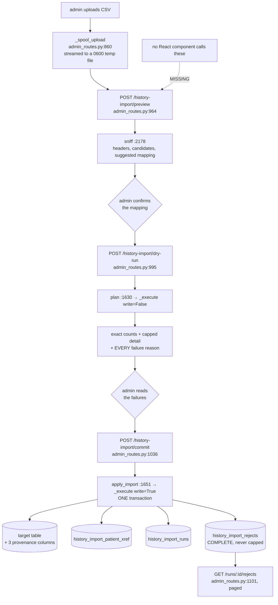
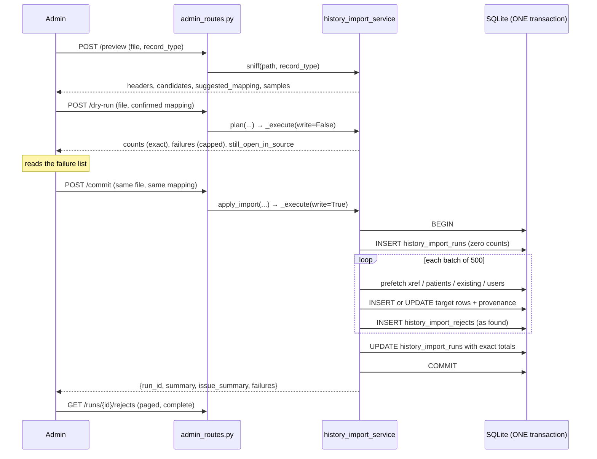

# History import: moving years of a legacy EHR without laundering it into the record

Built 2026-08-07 and 2026-08-08.

Orb **replaces** the incumbent EHR rather than sitting beside it. So on cutover day, years of existing clinical history have to arrive from a system nobody here designed, exported by somebody who will not be available to answer questions about it. This module is that door.

It is built on the shape `services/roster_import.py` proved, tolerant parse, explicit column mapping, dry run first, idempotent apply, and reuses that module's value-level parsing primitives rather than forking them. **What is different here is the blast radius.** Roster import writes tens of rows describing who is on the ward today, and a mistake is visible within a shift. A history import writes hundreds of thousands of rows describing people who are not in the building, and a mistake is invisible until a clinician goes looking for something that is silently not there.

Four rules follow from that, and they are the whole design:

1. **Imported history must not become live clinical state.** Every schema default points the dangerous direction, so every import default is set the other way, and the file's own statement always wins if it makes one.
2. **Provenance is clinical.** Every imported row carries `import_source_system` / `import_external_id` / `import_run_id`. All three NULL means Orb-native. Nothing this module writes ever stamps provenance on a row Orb already held, and nothing overwrites a value Orb already holds.
3. **Idempotency is on a stable external id, and the database enforces it.** A partial `UNIQUE` index per table, not a set in the importer's memory.
4. **Dirty data is normal: handle it, report it, never guess a clinical value.** An ambiguous date is left blank. `<0.01` stays text. A drug with no dose is recorded as the literal `UNKNOWN`, not dropped and not invented.

**Read this before anything else in the chapter.** The server side is complete and tested (43 tests in `server/tests/test_history_import.py`), seven endpoints are live, and the provenance columns are written correctly on every row. But **no React component calls any of these endpoints**, and, more consequentially, **nothing anywhere reads the provenance columns back**. Grep for `import_source_system` across the whole repository and you find three files: the migration that creates it, the service that writes it, and the tests. So rule 2 is honoured in the database and invisible on screen. Every "On screen" block below says so explicitly. See *Discrepancies and open questions*.

---

## Purpose and neighbors

**Jargon used throughout:**

| Term | Meaning in Orb |
|---|---|
| **Record type** | One of six importable shapes: `patients`, `admissions`, `diagnoses`, `medications`, `results`, `documents`. Each names a target table and a set of target fields. |
| **Mapping** | `{orb_field: csv_header}`, confirmed by an admin. Nothing is ever imported off a guessed mapping. |
| **`source_system`** | The old system's name, e.g. `"MediSys HIS"`. Half of the idempotency key and the provenance label. Required. |
| **`external_id`** | The old system's own id for **this record**. Required for every record type. It is what makes a re-run safe and what lets a clinician trace a row back years later. |
| **Xref** | `history_import_patient_xref`, the translation from a legacy patient id to Orb's, written whether the patient was created by the import or matched to one Orb already held. |
| **Dry run / `plan`** | Reports exactly what an import would create, update and skip. Writes nothing, anywhere. |
| **Commit / `apply_import`** | The same code path with `write=True`, inside **one** transaction. |
| **Reject** | A row that did not import, with its physical line number, a code, a plain-English reason and the offending line verbatim. Written durably to `history_import_rejects`. |
| **Issue** | One thing wrong with the input. `severity='error'` means the row is not imported; `severity='warning'` means it is, with a named caveat (`roster_import.py:230`). |
| **`UNKNOWN`** | The literal string written into a `NOT NULL` clinical column the export did not carry. Not a guess, a **recorded refusal to guess**. |



**Neighbors:** `server/services/roster_import.py` (the module this one is built on and imports nine private helpers from, the daily ward-census importer, the opposite contract), guide 25-admin-panel (where the import wizard would live, and where the roster importer's screen already does), guide 05-audit-chain (`log_audit_event` on the `data_management` category, every endpoint here), guide 03-auth-rbac (`ADMIN_OVERVIEW`, admin role only; a doctor cannot bulk-write clinical history from a spreadsheet), guide 04-database-schema (migration 15's provenance columns and partial unique indexes), guide 14-helix (`drug_safety_service` reads `medications.status = 'active'`, which is precisely why an imported drug defaults to `discontinued`), guide 15-pharmacy-verify (`_UNVERIFIED_SOURCES`, and why `SOURCE_TAG` is deliberately not one of them), guide 07-vigil / guide 21-admissions-discharge (`patients.status` and the ward board an imported patient must never appear on), guide 35-dpdp-consent-and-data-rights (`history_import_patient_xref` is the table the data-principal export names as the example of a second patient column that is legitimately the same person).

---

## File map

| File | Lines | Role |
|---|---:|---|
| `server/services/history_import_service.py` | 2292 | Everything: the record-type catalogue, the encoding sniff, header location, row streaming, per-type normalisation, batch resolution, the shared dry-run/apply engine, the writers, and the run/reject readers. The 163-line module docstring (`:1-163`) states the four rules and is required reading. |
| `server/services/roster_import.py` | 1555 | The module this one is built on. Eleven names, nine of them private, are imported at `history_import_service.py:180-192`: `IST` (`:102`), `Issue` (`:230`), `_NULL_TOKENS` (`:212`), `_clean` (`:252`), `_norm_header` (`:516`), `_normalise_mrn` (`:262`), `_parse_date` (`:303`), `_parse_int` (`:273`), `_parse_sex` (`:390`), `_same` (`:1225`), `_sniff_delimiter` (`:506`). Its `_decode` (`:449`) is the deliberate non-shared twin of `_detect_encoding`. |
| `server/routes/admin_routes.py` | n/a | Seven endpoints at `:942`–`:1127`, plus the upload spooler `_spool_upload` (`:860`), the spool directory chooser `_spool_dir` (`:851`), `_discard` (`:895`), `_parse_mapping` (`:902`) and `_history_audit` (`:923`). |
| `server/migrations.py` | 1719 | Migration 15, `_m15_history_import` (`:1345`). Adds `admissions.discharged_at`, three provenance columns + two indexes on six tables, and creates `history_import_patient_xref` (`:1454`), `history_import_runs` (`:1475`) and `history_import_rejects` (`:1504`). Registered at `:1624`. |
| `server/tests/test_history_import.py` | 1034 | 43 tests. The behavioural spec: the safe defaults, idempotency, the identifier conflicts, the dirty-data cases, and the reuse contract with `roster_import`'s private helpers. |
| `server/services/pharmacy_verification_service.py` | n/a | `_UNVERIFIED_SOURCES = ("llm_extracted", "agentic")` (`:29`). `SOURCE_TAG` is deliberately **not** in that tuple, see `SOURCE_TAG` below. |

**No frontend files.** There is no `src/api/historyImport.ts`, no import wizard, and no component under `src/` that references `/history-import` or any provenance column.

---

## How it works

### Flow 1: preview

1. The admin uploads a CSV to `POST /api/admin/history-import/preview` with a record type.
2. `_spool_upload` (`server/routes/admin_routes.py:860`) streams it in 1 MB chunks to a **0600 temp file** under `_spool_dir()` (`:851`), by default a `.import-spool` directory beside the database, **not** `/tmp`, because the upload is PHI in clear text and the operator has secured the database volume, not the system temp directory.
3. `sniff` (`:2178`) builds a `_Source` (which computes the SHA-256 and picks an encoding from the first 64 KB), locates the header row, suggests a mapping from header synonyms, and returns up to five sample rows.
4. If the header could not be identified, `sniff` **still answers** with `header_confident: false` plus the candidate lines. It is the tool the admin uses to *pick* the header line.
5. The temp file is deleted in a `finally`. An audit row records the filename, record type, byte count and SHA-256.

### Flow 2: dry run

1. `POST .../dry-run` with the **confirmed** mapping.
2. `plan` (`:1630`) → `_execute` (`:1675`) with `write=False`.
3. Validation refuses the whole run up front for: an unknown record type, a missing `source_system`, a bad `date_order`, unknown target fields, missing required fields, a child record type with neither `external_patient_id` nor `mrn` mapped, an unconfident header, or a mapped column not present in the file.
4. Rows stream through `_iter_rows` (`:956`) in batches of 500. Each batch is prefetched (`_Resolver.prefetch`, `:1523`) and classified.
5. The report comes back with **exact** `counts` and `issue_summary` over every row read, and **capped** `rows` (200) and `failures` (2000) with `rows_truncated` / `failures_truncated` flags.
6. Nothing is written. Nothing is even opened for writing.

### Flow 3: commit

1. `POST .../commit` with the same file and mapping.
2. `apply_import` (`:1651`) → the **same** `_execute` with `write=True`. One code path, so the plan the admin approved and the plan that executes cannot drift. The plan is recomputed server-side from the uploaded bytes rather than taken from the client, so a commit can never write something a dry run of the same file and mapping did not show.
3. Everything happens inside **one** `db_session` transaction. The run ledger row is opened first with zero counts (`_open_run`, `:2106`) so rejects can be flushed against its foreign key as they are found; it is finalised by `_record_run` (`:2150`) in the same transaction. A run that never completes leaves nothing at all.
4. Every rejected row goes to `history_import_rejects`, **complete, never capped**.
5. A `DBIntegrityError` becomes a **409** naming the constraint, with the honest sentence "and NOTHING was written" (`server/routes/admin_routes.py:1066-1074`).



---

## Function-by-function

### File: `server/services/history_import_service.py`

#### Limits: `history_import_service.py:200-210`
**Signature:** `MAX_BYTES = 200 MB` (`:200`), `MAX_ROWS = 200_000` (`:201`), `BATCH_SIZE = 500` (`:202`), `DEFAULT_DETAIL_LIMIT = 200` (`:205`), `DEFAULT_REJECT_LIMIT = 2_000` (`:206`), `_HEADER_SEARCH_LINES = 100` (`:209`), `_MIN_HEADER_HITS = 2` (`:210`)
**Does:** The size and shape envelope. Both file limits are checked before any DB work.
**On screen:** `MAX_BYTES` and `MAX_ROWS` are returned by `GET /history-import/record-types` (`server/routes/admin_routes.py:948-949`) so a wizard could show them. Nothing renders them. `MAX_BYTES` is also enforced *during the upload* (`server/routes/admin_routes.py:879`) with a 413, so an oversized file is rejected mid-stream rather than after being fully spooled.
**Why these numbers:** far larger than roster import's, because this is a one-off migration of years of history rather than a daily ward census. `BATCH_SIZE` is what keeps peak memory at one batch instead of one file.
**Breaks if you change it:** raising `MAX_ROWS` raises the one thing in the module that is proportional to row count, the `seen_external` dict (`:1747`) that makes an in-file duplicate reportable. At 200 000 rows that is tens of megabytes; at two million it is not. Lowering `BATCH_SIZE` costs a round of prefetch queries per batch; raising it re-inflates the `_Resolver` maps this module deliberately clears (see `_Resolver`).

#### `UNKNOWN_VALUE`: `history_import_service.py:214`
**Signature:** `str = "UNKNOWN"`
**Does:** The literal written into a `NOT NULL` clinical column whose value the export did not carry.
**On screen:** it would appear verbatim in a medication list, as the dose, route or frequency of an imported historical drug.
**Why it exists:** `medications.dosage`, `.route` and `.frequency` are `NOT NULL`. The three options were to invent a plausible value, drop the drug, or record the refusal. Inventing is a fabricated clinical fact. Dropping loses the **exposure**, which is what allergy and interaction history is built on. `UNKNOWN` is not a guess; it is a recorded refusal to guess, and it reads as one at the bedside.
**Breaks if you change it:** substituting a blank string satisfies `NOT NULL` and makes the same row look like a complete prescription with an empty dose field, indistinguishable from a display bug. Substituting a plausible default ("1 tab", "PO", "OD") fabricates a prescription that was never written.

#### `SOURCE_TAG`: `history_import_service.py:220`
**Signature:** `str = "history_import"`
**Does:** Written to the pre-existing `source` column on `medications`, `problem_list` and `observations` (`:2056`), and to `admissions.admission_source` (`:2054`).
**On screen:** nothing renders `source` today. It has one **real behavioural consequence**: `pharmacy_verification_service` queues a medication for pharmacist verification only when `source IN ('llm_extracted', 'agentic')` (`:29`, `:96`), and refuses to verify anything else (`:149`). So an imported historical drug is deliberately **not** placed in the pharmacist's queue.
**Why that is right:** a discontinued drug from 2023 is not a live order awaiting a pharmacist. Putting a five-year migration into the verification queue would bury the handful of AI-extracted medications that genuinely need a human.
**Breaks if you change it:** setting `SOURCE_TAG` to `"llm_extracted"` would dump the entire imported medication history into the pharmacy verification queue overnight. Removing the tag entirely makes an imported drug indistinguishable, in the one column anything actually reads, from a hand-entered one.

#### `_ID_HEX`: `history_import_service.py:239`, comment at `:224-238`
**Signature:** `int = 16` (hex characters of randomness in a generated row id)
**Does:** `_new_id` (`:242`) mints `PREFIX` + 16 hex chars = **64 bits**.
**On screen:** the id prefix, `PAT-HI…`, `ADM-HI…`, is the only visible artefact, and it is a useful one: it identifies a history-imported row at a glance in a support conversation.
**Why 16 and not the rest of Orb's 8, this is a real bug, fixed:** the rest of Orb mints ids as `PREFIX-` + `uuid4().hex[:8]`, which is 32 bits. That is fine for the paths it was written for, which insert tens of rows. It is not fine here. By the birthday bound, 32 bits collides with probability **25% over 50 000 rows and 99% over the 200 000-row cap** this module allows, so a large migration was not unlikely to fail, it was *expected* to. Worse, the failure lands at the **end** of a single all-or-nothing transaction: the entire import rolls back after doing all of the work, with an opaque `UNIQUE` constraint error and no indication which row was at fault. Hit for real on a 50 000-row rehearsal, 2026-08-07. At 64 bits the probability is 1e-9 at the row cap.
**Breaks if you change it:** lowering it back to 8 reintroduces exactly that failure, and reintroduces it *late*, expensively, and unattributably. Note the failure direction is safe (the transaction aborts having written nothing), which is precisely why it went unnoticed as a design flaw until a large rehearsal.

#### `TargetField` / `_f` / `_PATIENT_LINK_FIELDS`: `:251` / `:260` / `:266`
**Signature:** frozen dataclass `(name, label, required, kind, synonyms, note)`; a positional constructor; a two-field tuple
**Does:** One mappable Orb field, its human label, whether it is required, its parse kind, the CSV header synonyms that auto-suggest it, and a note explaining the semantics.
**On screen:** `GET /history-import/fields?record_type=…` (`server/routes/admin_routes.py:953`) serialises `name`, `label`, `required`, `kind` and `note` for a mapping UI. Nothing renders it, which means the `note` strings, which are where most of the clinical reasoning is written ("Missing → UNKNOWN. Oral and IV are not interchangeable, so no default."), are currently invisible.
**`_PATIENT_LINK_FIELDS` (`:266`)** is the two identity fields every **child** record type shares: `external_patient_id` and `mrn`. At least one must be mapped; both may be, and then they must agree.
**Breaks if you change it:** adding a synonym that already belongs to another field is harmless, `suggest_mapping` offers each CSV header to at most one Orb field, in catalogue order. **Reordering the fields inside a record type is not harmless**: order decides which field claims an ambiguous header, which is why `external_id` is listed before `mrn` and therefore claims a "Patient ID" column.

#### `RecordType`: `history_import_service.py:314`, registered at `:308` / `:347` / `:390` / `:418` / `:452` / `:489`
**Signature:** frozen dataclass `(name, label, table, fields, note)` with `by_name` and `required` properties
**Does:** The six importable shapes.

| Record type | Line | Target table | Required fields | The rule it encodes |
|---|---:|---|---|---|
| `patients` | `:308` | `patients` | `external_id`, `mrn`, `name` | Created **discharged**, no admission opened |
| `admissions` | `:347` | `admissions` | `external_id`, `admitted_at` | Closed past encounters only; never opens a live admission |
| `diagnoses` | `:390` | `problem_list` | `external_id`, `problem` | Defaults to **inactive** |
| `medications` | `:418` | `medications` | `external_id`, `drug_name` | Defaults to **discontinued** |
| `results` | `:452` | `observations` | `external_id`, `observation_name` | Numeric value never inferred from non-numeric text |
| `documents` | `:489` | `clinical_documents` | `external_id`, `title`, `content` | An empty document is not a document |

**On screen:** `GET /history-import/record-types` returns the catalogue with each `note`. Nothing renders it.
**Why `mrn` is required on `patients` and the note says what it says:** Orb finds patients by hospital number. A patient imported without one could never be looked up at the bedside. If a legacy export genuinely has none, the admin is told to map the legacy patient id column into `mrn` **as well**, an explicit admin decision, which a silently invented MRN would not be.
**Breaks if you change it:** making `external_id` optional on any record type destroys idempotency for that type, a re-run creates duplicates, and there is nothing to trace a row back with. Pointing a record type at a different `table` without updating `_WRITABLE` (`:1486`) produces an `INSERT` naming columns that do not exist, which aborts the whole transaction at the first row.

#### `record_type_catalogue` / `field_catalogue` / `_record_type`: `:517` / `:526` / `:533`
**Signature:** `() -> list[dict]` / `(record_type: str) -> list[dict]` / `(name: str) -> RecordType`
**Does:** Serialisable catalogues for the two GET endpoints, and the lookup that raises a `ValueError` naming every valid option.
**On screen:** would drive the wizard's first two steps. Nothing calls them.
**Breaks if you change it:** `_record_type`'s error message lists the valid names; the routes turn it into a **422** (`server/routes/admin_routes.py:960-961`). Raising a bare `KeyError` instead would produce a 500 for a user typo.

#### `_HONORIFICS` and the status vocabularies: `:549`, `:552`, `:562`, `:574`, `:586`
**Signature:** five module-level sets/dicts
**Does:** Honorifics an Indian HIS routinely stores inside the name field; the valid and synonym sets for diagnosis, medication and result status; and `_OPEN_ENCOUNTER_TOKENS` (`:586`), the words that mean "this patient has not left".
**On screen:** the synonyms decide what an imported diagnosis's or drug's status ends up being, which is directly visible in the problem list and the medication list.
**Why the honorifics are only detected:** the name is a **bedside identity check**. Rewriting it is not this module's call, so `_check_name` reports and never edits.
**Breaks if you change it:** adding `"held"` to `_MED_SYNONYMS` as `active` rather than `discontinued` would put every held drug from the old system onto the live interaction-checking list. Removing a token from `_OPEN_ENCOUNTER_TOKENS` lets an encounter the export says is open import silently as a closed one, with no `still_open_in_source` entry for the admin to act on.

#### `_check_name`: `history_import_service.py:1116`
**Signature:** `(value: str, line: int) -> list[Issue]`
**Does:** Two warnings, a leading honorific, and a name containing no letters (Latin or Devanagari). **Never rewrites the name.**
**On screen:** the name lands in `patients.name` verbatim, so it is what a nurse reads on the wristband check.
**Breaks if you change it:** stripping the honorific here would make Orb's name differ from the old system's name for the same person, which is exactly the discrepancy a bedside identity check is supposed to catch.

#### `_parse_enum`: `history_import_service.py:1148`
**Signature:** `(value, line, fname, valid, synonyms, fallback, fallback_code) -> tuple[str | None, list[Issue]]`
**Does:** Normalises one coded value. Returns `None` plus a warning when the token is unrecognised, and the caller applies its own safe fallback.
**On screen:** the resulting status on a problem-list entry, a medication or a result.
**Why it returns `None` rather than the fallback:** the caller owns which direction is safe, and the two are different, an unrecognised diagnosis status falls to `inactive`, an unrecognised medication status to `discontinued`, an unrecognised result status to `final`. Baking one fallback into the parser would put a clinical decision in a string utility.
**Breaks if you change it:** returning the fallback silently would drop the warning issue, and the whole point is that the row *says* it was filed on a guess about a word nobody recognised.

#### `_parse_instant`: `history_import_service.py:1182` (regex at `:627`)
**Signature:** `(value: str, fname: str, line: int, date_order: str) -> tuple[str | None, list[Issue]]`
**Does:** Parses a legacy date, optionally with a clock time and a meridiem, into UTC ISO-8601.
**On screen:** every date on an imported admission, medication, result and document, so, every position on the patient's timeline.
**Why a bare date is anchored at IST midnight (`:665-666`):** the hospital is in India and the columns Orb writes are UTC. Stamping UTC midnight would file a patient admitted at 02:00 IST as having arrived **the previous day**, and would shift every historical result five and a half hours earlier.
**How the date half works:** delegated entirely to `roster_import._parse_date` (`:303`), which already refuses two-digit years and genuinely ambiguous D/M vs M/D values. This function only adds the clock.
**Breaks if you change it:** replacing `IST` with `timezone.utc` silently moves the entire imported history back by 5h30, a change that is invisible on any single row and visibly wrong on a timeline. Making the time regex greedier lets a trailing "12:30" inside a *reference range* be read as a clock.

#### `_parse_result_value`: `history_import_service.py:1220`
**Signature:** `(raw: str, line: int) -> tuple[text | None, numeric | None, list[Issue]]`
**Does:** Splits a lab value into a verbatim text column and, **only when the entire cell is a clean number**, a numeric column.
**On screen:** `observations.value_text` and `value_numeric`. The numeric column is what trend graphs and thresholds read, so this function decides whether a historical result appears on a trend at all.
**Why it will not coerce:** `<0.01` is not `0.01`, it is quantitatively wrong and clinically consequential. `NEGATIVE` is not `0`, that invents a result out of nothing. Both keep their text, leave the number NULL, and carry a warning saying the result will not appear on numeric trends.
**Breaks if you change it:** adding a regex that strips `<` and `>` fabricates results across the whole imported corpus, at values that are *close enough to plausible* that nobody will notice.

#### `_Source`: `history_import_service.py:1259`
**Signature:** `__init__(raw: bytes | bytearray | str | os.PathLike)`; `open_text()` (`:744`), `head_lines(limit)` (`:750`)
**Does:** An uploaded export, readable as text more than once without buffering it. Computes `size`, `sha256` and `encoding`.
**On screen:** `source_sha256` and `source_bytes` are returned by every endpoint and stored on the run ledger, which is what makes "the exact bytes that produced these records" identifiable years later.
**How it works:** `bytes` is content (tests, small files) and is decoded whole. `str`/`Path` is a filesystem path, which is how the route passes a large upload, the digest is computed in 1 MB chunks while the **first 64 KB** is accumulated separately (`:735-738`), and the encoding is decided from that head alone (`:742`). The distinction is by **type**, not by guessing whether a string looks path-shaped.
**Breaks if you change it:** reading the whole file to pick an encoding defeats the entire streaming design at the first step. Accepting a string as content rather than a path would make a caller's filename get parsed as CSV.
**Gotcha:** `open_text` uses `errors="replace"`. Combined with the head-only encoding sniff, a file whose encoding changes halfway through decodes with replacement characters rather than raising, which is the right direction, but means a mangled name is a warning-level artefact, not a failure.

#### `_detect_encoding`: `history_import_service.py:1322`
**Signature:** `(head: bytes) -> tuple[str, list[Issue]]`
**Does:** Picks a text encoding from the first bytes of the file. Order: BOM-marked UTF-16 → `utf-8-sig` → `cp1252` → `latin-1`.
**On screen:** nothing directly, and everything indirectly, get this wrong and every name, MRN and date in the import is mojibake.

**Why UTF-16 is only considered when there is a byte-order mark (`:777`), this is a real bug, fixed.** Python's `utf-16` codec without a BOM assumes little-endian and raises only on an odd byte count or an unpaired surrogate. So an ordinary **cp1252 CSV of even length decodes successfully** into CJK mojibake, `PatientID,MRN,Name` comes back as `慐楴湥䥴ⱄ前ⱎ慎敭`. Trying `utf-16` ahead of `cp1252` without a BOM check therefore does **not** fail loudly on a legacy Windows export; it silently corrupts the whole file and hands the importer a header row it cannot recognise, which surfaces as an *ambiguous-header* error pointing the admin at entirely the wrong cause. Whether it happens at all is a coin flip on file length, which is exactly why a plain cp1252 test passed either way. Verified against a cp1252 fixture, 2026-08-07.

**Why the fallback order after that (`:773-775`):** UTF-8 first because it is the common case; then cp1252, because that is what a Windows-era Indian HIS actually emits; then latin-1, which cannot fail and so is the terminal fallback.

**THE ONE DELIBERATE DIFFERENCE FROM `roster_import._decode`, and why copying either tolerance into the other would be wrong.** This is the part worth reading twice.

Both functions now agree about UTF-16: gate on an actual BOM, then fall through `utf-8-sig` → `cp1252` → `latin-1`. They differ in exactly one place, at `:786-790`:

```
except UnicodeDecodeError as exc:
    # A 64 KB window can slice a multi-byte character in half. A failure in
    # the last few bytes is that, not a non-UTF-8 file.
    if exc.start >= len(head) - 4:
        return "utf-8-sig", []
```

`_detect_encoding` is handed a **64 KB head**, arbitrarily cut at a byte offset that has nothing to do with character boundaries. A UTF-8 character is up to four bytes long, so the chunk boundary can land in the middle of one. A `UnicodeDecodeError` starting within the last four bytes of that window is therefore **evidence of the cut, not evidence about the file**. Refusing to tolerate it would make this module fall through to cp1252, and mis-decode a perfectly valid UTF-8 export, whenever the 65 536th byte happened to land mid-character. So it tolerates the trailing error and calls the file UTF-8.

`roster_import._decode` (`roster_import.py:449`) is always handed the **whole file**, both of its callers pass the complete upload. There is no chunk boundary to forgive. A byte that fails UTF-8 at the end of a complete file is a *real* cp1252 byte, most often an unterminated final line, and it **must** fall through to cp1252 rather than be replaced. Its own docstring says so at `:465-472`.

Copying the tolerance in either direction produces a bug: give `_detect_encoding` the strict rule and it rejects valid UTF-8 files on a 1-in-16 000 byte-alignment coincidence; give `_decode` the lenient rule and it silently corrupts the last character of every legacy Windows export it touches. **The asymmetry is not an inconsistency, it is the two functions correctly reflecting the difference between a sample and a whole.**

**Breaks if you change it:** removing the BOM gate reintroduces the mojibake bug, which is pinned by four tests in `tests/test_roster_import.py` (even-length not read as UTF-16, odd-length decoding identically to even, a mis-decoded file planning rather than blaming the header, and a genuine BOM-marked UTF-16 export still decoding). Widening the `len(head) - 4` window to, say, 64 bytes starts forgiving genuine cp1252 bytes near the end of the sample and mis-labels real Windows exports as UTF-8. Narrowing it below 4 fails to cover a 4-byte character.

#### `suggest_mapping`: `history_import_service.py:1394`
**Signature:** `(headers: Iterable[str], record_type: str) -> dict[str, str]`
**Does:** Suggests `{orb_field: csv_header}` from the header synonyms.
**On screen:** the pre-filled mapping in the wizard's mapping step. Nothing renders it.
**How it works:** two passes (`:824`), exact synonym hits first, then substring hits for synonyms longer than three characters. Each CSV header is offered to **at most one** Orb field, so `emergency contact phone` cannot also land on `phone`. Fields are tried in catalogue order.
**Why it is only a suggestion:** nothing is imported off a guessed mapping. `_execute` requires the mapping as an argument and validates it; there is no code path where a suggestion becomes an import without an admin confirming it.
**Breaks if you change it:** dropping the `taken` set lets one CSV column populate two Orb fields, so a phone number silently becomes both the patient's phone and their next-of-kin's. Dropping the exact-first pass lets a substring match beat an exact one, `date` would claim `onset date`.

#### `_exact_header_hits`: `history_import_service.py:1426`
**Signature:** `(fields, rt) -> tuple[str, ...]`
**Does:** How many target fields a candidate line names **exactly**. The evidence `_locate_header` scores on.
**On screen:** nothing.
**Breaks if you change it:** loosening this to substring matching makes a prose report title clear the header bar, which shifts every column.

#### `_HeaderLocation` / `_split`: `:857` / `:866`
**Signature:** dataclass `(index, fields, delimiter, confident, candidates, issues)`; `(line, delimiter) -> list[str]`
**Does:** Where the header is, what it splits into, and whether Orb is confident. `_split` runs one line through `csv.reader` so quoting is respected.
**On screen:** `header_line`, `headers`, `header_confident` and `header_candidates` are all returned by `sniff`.
**Breaks if you change it:** splitting on `line.split(delimiter)` instead of `csv.reader` breaks any header containing a quoted comma.

#### `_locate_header`: `history_import_service.py:1463`
**Signature:** `(source: _Source, rt: RecordType, header_line: int | None) -> _HeaderLocation`
**Does:** Finds the column-header row, skipping a junk preamble.
**On screen:** decides everything downstream; a wrong answer here is a wrong import that reports success.
**Why the bar is evidence and not optimism:** read a report title as the header and **every column lands in the wrong field**, so one patient's ward becomes another's diagnosis. A line is the header only if it names at least `_MIN_HEADER_HITS` (2) columns this record type recognises **exactly**.
**How it works:** with `header_line` supplied, that line is used but still sanity-checked, out of range or blank is a `ValueError`, fewer than two named columns is a `ValueError`, and zero recognised columns is a **warning** telling the admin to check the mapping column by column (`:901-906`). Without it, the first 100 lines are scanned and the first line clearing the bar wins; the top five candidates are returned either way. Skipped preamble lines produce their own warning (`_preamble_issue`, `:946`).
**When nothing clears the bar (`:934-941`):** `confident=False` plus an `error`-severity issue naming the best candidate and telling the admin to re-run with `header_line`. `plan`/`apply_import` then **refuse** (`:1722`); `sniff` deliberately does not, because it is the tool for picking the line.
**Breaks if you change it:** lowering `_MIN_HEADER_HITS` to 1 lets a line containing the single word "Name" become the header. Making `plan` proceed on an unconfident header converts "Orb will not guess" into a silent column shift across the whole file.

#### `_iter_rows`: `history_import_service.py:1576`
**Signature:** `(source, header) -> Iterator[tuple[physical_line, dict, Issue | None, raw_text]]`
**Does:** Streams data rows. Blank and ragged rows are reported, never dropped silently.
**On screen:** the line numbers it emits are what the reject ledger promises, "open the export at this line and look".
**The ragged-row rule (`:1010-1021`):** a row with **more** fields than the header **and a non-blank surplus** is rejected outright. A surplus field is indistinguishable from an unquoted delimiter inside a value, and Indian addresses carry commas constantly, `12 Nehru Street, New Delhi`. Every column after the break is then one place to the left, which files a result under the wrong test and the wrong date **while reporting success**. Truncating the surplus does not help: the damage is the *shift*, not the overflow. Too **few** fields is different and stays a warning, nothing shifts, the absent trailing columns simply read blank.
**Line numbers come from `reader.line_num`, not from counting records (`:994-996`).** A clinical document is the record type most likely to contain a properly quoted field with newlines inside it, a discharge note **is** multi-line, and one such row makes a per-record counter drift permanently, so every line number reported after it points at the wrong row. Since the whole promise of the reject ledger is "open the export at this line", a number that quietly stops meaning that is worse than none.
**The row cap (`:1000`)** emits one file-level `row_limit` error naming the line it stopped at and telling the admin to split the export by year, *the import is idempotent, so the files can be loaded in any order*.
**Breaks if you change it:** downgrading `field_count_mismatch` to a warning imports column-shifted clinical data. Replacing `reader.line_num` with an incrementing counter makes every reject line number wrong after the first multi-line document, which silently destroys the usefulness of the whole reject ledger for exactly the record type most likely to need it.

#### `_PlannedRow`: `history_import_service.py:1665` (`fail` at `:1046`, `to_dict` at `:1053`)
**Signature:** dataclass with `line`, the three identifiers, `action` (`create|update|unchanged|fail`), `reason`, `patient_id`, `target_id`, `values`, `changes`, `issues`, `raw_text`
**Does:** One row's plan. `fail(code, message, field, value)` sets the action, the reason **and** appends an `error`-severity issue in one call, then returns `self` so a normaliser can `return pr.fail(...)`.
**On screen:** `to_dict` is the shape of every entry in the dry run's `rows` and `failures` arrays.
**Breaks if you change it:** setting `action = "fail"` without going through `fail()` produces a rejected row with no issue attached, and `_reject_row` (`:1902`) then writes `"Row was not imported."` with no reason, a reject ledger entry that tells the hospital nothing.

#### `_Report`: `history_import_service.py:1706` (`add` at `:1078`, `note_file_issue` at `:1100`)
**Signature:** `__init__(detail_limit, reject_limit)`
**Does:** **Exact totals, capped detail.** `counts` and `issue_summary` accumulate over every row read; `rows` and `failures` stop at their limits and set a truncation flag.
**On screen:** `counts` is the summary an admin reads before committing; `issue_summary` is the per-code histogram.
**Why the asymmetry is the safety instrument:** a 200 000-row file cannot be returned over HTTP, so the *detail* has to be capped. The *counts* must not be, because "how many rows failed" is the number that decides whether to commit. Truncation is flagged explicitly rather than hidden, and commit persists the complete reject list regardless.
**Breaks if you change it:** capping the counts alongside the detail turns "4 200 rows failed" into "200 rows failed", the precise silent-loss failure this module exists to prevent. Removing `rows_truncated`/`failures_truncated` makes a capped list indistinguishable from a complete one.

#### `_Cells`: `history_import_service.py:1761` (`__call__` at `:1130`, `block` at `:1134`)
**Signature:** `_Cells(raw: dict, mapping: dict)`; `cell(name) -> str`; `cell.block(name) -> str`
**Does:** `cell(name)` is the ordinary single-line read, whitespace collapsed, `N/A`-style tokens treated as blank. `cell.block(name)` preserves line structure: each line is tidied, the breaks between them are kept, and runs of three or more blank lines are collapsed to two.
**On screen:** `block` is what a discharge summary or admission note **looks like** in the chart.
**Why the distinction is not cosmetic, caught by an end-to-end rehearsal, not by a unit test, 2026-08-07:** collapsing all whitespace is right for a ward name or an MRN and destructive for a discharge summary, which is written in paragraphs and often carries a medication list one drug per line. Run together into a single block of prose, an imported summary is materially harder to read than the one the old system held, **a quiet downgrade of the clinical record performed by the tool that was supposed to preserve it.**
**Used by:** `_n_documents` for `content` (`:1445`), `_n_admissions` for `notes` (`:1274`), `_n_medications` for `notes` (`:1359`).
**Breaks if you change it:** routing `content` through `cell()` instead of `cell.block()` flattens every imported clinical narrative, irreversibly, with no error and no warning.

#### `_normalise`: `history_import_service.py:1800`
**Signature:** `(raw, mapping, rt, line, date_order) -> _PlannedRow`
**Does:** CSV row → normalised Orb values + issues. **Touches no database.**
**On screen:** nothing directly.
**How it works:** pulls the three identifiers, fails immediately on a missing `external_id` (`:1159`), *it can neither be matched on a re-run nor traced back to its source record*, then dispatches to the per-type normaliser.
**Why it is DB-free:** it is the half of the work that can run identically in the dry run and the apply pass without any transaction open, which is what makes `_execute`'s single code path possible.
**Breaks if you change it:** adding a database lookup here puts a query on every row instead of every batch, and turns a 200 000-row plan into 200 000 round trips.

#### `_n_patients`: `history_import_service.py:1825`
**Signature:** `(pr, cell, line, date_order) -> None`
**Does:** Normalises a demographics row.
**On screen:** the patient's name, MRN, DOB, age, sex, phone, address and next-of-kin, and, decisively, their **status**.
**Two hard failures:** no MRN (*Orb finds patients by hospital number… Orb will not invent an identifier*), and no name (*a bedside identity check needs a name*).
**The single most important line in the module is `:1218`, `pr.values["status"] = "discharged"`.** `patients.status` defaults to `'admitted'` in the schema. Without this line a five-year export puts **thousands of people who are not in the building** onto Vigil's patient board and the nurse shift board. There is deliberately **no way for the file to override it**: unlike every other default in this module, this one does not yield to the export's own statement, because a history import is by definition not about people who are here.
**Breaks if you change it:** deleting `:1218` floods every ward board in the hospital on cutover day. Making it configurable gives somebody the option to do that.

#### `_n_admissions`: `history_import_service.py:1899`
**Signature:** `(pr, cell, line, date_order) -> None`
**Does:** Normalises a past encounter.
**On screen:** the admission history on a patient chart, and length of stay.
**Two hard failures:** no admission date, and an unparseable one, *an encounter with no start cannot be placed on a timeline*.
**A discharge before the admission is a warning, not a failure (`:1243-1249`):** both dates are imported as given, because **Orb will not reorder a clinical timeline**, and the warning says length of stay for this encounter is wrong.
**The open-encounter rule (`:1266-1277`):** if the export's status is one of `_OPEN_ENCOUNTER_TOKENS`, the row still imports, as **discharged**, with a warning and an entry in `still_open_in_source`. The warning names the fix: *if this patient is genuinely on the ward today, put them there with the ROSTER import, which has the ward, bed and department discipline that a live admission needs.* `transferred`/`referred out` map to `transferred`; everything else to `discharged`.
**Breaks if you change it:** honouring the export's "open" status opens live admissions for patients who left years ago, occupying beds on the capacity view. Dropping the `still_open_in_source` list removes the only signal that some of those encounters need a second, different action.

#### `_n_diagnoses`: `history_import_service.py:1984`
**Signature:** `(pr, cell, line, date_order) -> None`
**Does:** Normalises a problem-list entry.
**On screen:** the patient's problem list, and specifically whether an imported diagnosis appears as a **current** problem.
**The default (`:1308-1316`):** `problem_list.status` defaults to `'active'` in the schema. With no status column mapped, an imported diagnosis is filed **inactive**, with a warning that says why: *asserting an old diagnosis as a current problem is a claim the export never made.* If the file **does** carry a status, the file wins.
**Breaks if you change it:** defaulting to `active` asserts, on the hospital's behalf, that every diagnosis anyone ever recorded is still true today.

#### `_n_medications`: `history_import_service.py:2040`
**Signature:** `(pr, cell, line, date_order) -> None`
**Does:** Normalises a historical drug.
**On screen:** the medication list, the interaction check, and the discharge summary.
**`UNKNOWN` for dose/route/frequency (`:1340-1357`):** all three are `NOT NULL`. Missing values are written as the literal `UNKNOWN` with a warning naming exactly which ones, and the reason: *Orb will not invent a dose, a route or a schedule; the row is kept because the fact that the patient was exposed to this drug is itself clinically important.*
**The default (`:1365-1374`):** `medications.status` defaults to `'active'`. With no status column mapped, an imported drug is filed **discontinued**, with a warning naming the three consumers of `active`: the live drug-interaction check (`drug_safety_service`), Sage, and the discharge summary.
**Why that is a safety issue and not a display one:** a drug the patient stopped in 2023 arriving as `active` is screened against today's prescriptions and handed over at discharge **as a current medication**.
**Breaks if you change it:** defaulting to `active` puts the entire historical pharmacy of every imported patient onto their current medication list. Dropping a dose-less drug instead of writing `UNKNOWN` loses the exposure record that allergy and interaction history is built on.

#### `_n_results`: `history_import_service.py:2122`
**Signature:** `(pr, cell, line, date_order) -> None`
**Does:** Normalises a lab result or observation.
**On screen:** the results view and the numeric trend graphs.
**Two warnings that matter:** a result with **no value** is still imported, *as a record that the test was done, with no result*, because the fact of the test is itself information; and a result with **no observation date** is imported with a warning that it *cannot be placed on the patient's timeline and will not appear in date-ordered views* (`:1413-1418`).
**Status defaults to `final`** when the column is absent, the only place in this module where the silent default is the *assertive* one, because a result held in a legacy archive has by definition already been reported.
**Breaks if you change it:** dropping value-less results loses the record that the test happened. Defaulting the observation date to the import date puts the entire imported history on today's timeline.

#### `_n_documents`: `history_import_service.py:2202`
**Signature:** `(pr, cell, line, date_order) -> None`
**Does:** Normalises a clinical note, summary or report.
**On screen:** the document's title and body in the chart.
**Content is read through `cell.block` (`:1445`)**, see `_Cells`.
**An empty document is a hard failure (`:1437-1441`):** *an empty document in a chart reads as "nothing was written", which is not what the old system holds, the row was NOT imported so the gap stays visible.* That sentence is the whole philosophy of the module in one line: a visible gap beats an invisible falsehood.
**`doc_type` defaults to `imported_document`** (`:1457`), *honest about what it is*.
**Breaks if you change it:** importing empty documents fills the chart with entries that assert an absence of content the source never asserted.

#### `_WRITABLE`: `history_import_service.py:2250`
**Signature:** `dict[str, tuple[str, ...]]`
**Does:** The columns each record type may write, beyond `patient_id` and the three provenance columns. It is also the diff list `_classify` compares against.
**On screen:** nothing.
**Why an explicit allow-list:** it is what stops a normaliser accidentally writing a column that is not its business, and it is what bounds the update path, an update only ever touches columns in this tuple.
**Breaks if you change it:** adding a column here without adding it to the normaliser is inert; adding it to the normaliser without adding it here means the value is computed, reported in the dry run's `values`, and then **silently not written**, the worst kind of divergence between the plan and the result.

#### `_Resolver`: `history_import_service.py:2293`
**Signature:** `_Resolver(db, source_system, rt)`; `prefetch(rows)` (`:1523`), `resolve_patient(pr)` (`:1576`), `check_user(pr, key)` (`:1608`)
**Does:** Per-**batch** database lookups, shared by the dry run and the apply pass. Four maps: `xref`, `by_mrn`, `existing`, `known_users`.
**On screen:** nothing.
**Why three of the four are cleared every batch (`:1524-1526`), this is a real bug, fixed.** They look like caches and were written as ones, growing for the whole run. `by_mrn` holds a full `SELECT *` patients row per MRN, so a 50 000-row rehearsal peaked at **316 MB of RSS** and the 200 000-row cap would have reached roughly a gigabyte, exactly the "must not exhaust memory" promise the streaming exists for, broken by the lookup layer instead of the parser. Measured 2026-08-07.
**Why clearing them costs nothing:** `prefetch` queries for precisely what the current batch needs, and because the apply pass runs in **one transaction**, a patient written in an earlier batch is visible to that query. Rows created *within* the batch being processed are folded in incrementally by `_write_patient` (`:2102-2106`). So clearing costs one repeated lookup in the rare case where the same patient appears in two batches.
**Why `known_users` is deliberately not cleared (`:1521-1523`):** a hospital has hundreds of staff, not hundreds of thousands. It is bounded by the user table.
**`prefetch` batches its `IN` clauses through `_chunks` (`:1633`, 400 at a time)** to stay under SQLite's parameter limit.
**Breaks if you change it:** removing the `clear()` calls reinstates the 316 MB-and-climbing behaviour, which fails as an OOM at the end of a long transaction. Clearing `known_users` too adds a users query per batch for no benefit.

#### `_Resolver.resolve_patient`: `history_import_service.py:2389`
**Signature:** `(pr) -> str | None`
**Does:** Resolves a **child** row's Orb patient id from the legacy patient id (via the xref), the MRN, or both.
**On screen:** whose chart the record lands in.
**The conflict rule (`:1587-1594`):** when both identifiers resolve and they resolve to **different people**, the row **fails**. *Orb will not choose between them, because attaching this record to the wrong chart is worse than not importing it.* Two identifiers that disagree is the duplicate-patient mess every legacy export carries.
**When neither resolves (`:1599`):** the row fails with a message naming both identifiers and telling the admin to import the **patients** file for this source system first.
**Breaks if you change it:** preferring one identifier over the other on a conflict attaches clinical records, results, diagnoses, drugs, to the wrong patient, permanently and silently. This is the single most dangerous change available in the module.

#### `_Resolver.check_user`: `history_import_service.py:2425`
**Signature:** `(pr, key) -> None`
**Does:** If `attending_doctor_id` or `author_id` names someone who is not an Orb user, **drops the value** and warns.
**On screen:** the attending doctor on an imported admission, and the author on an imported document, both blank when the legacy id is unknown.
**Why it never creates a user:** *Orb does not create staff accounts from a clinical export.* The warning names the fix: create the user, then re-run the import to attach them. Because the import is idempotent, the re-run is safe and will fill the hole.
**Breaks if you change it:** writing the raw legacy id into `attending_doctor_id` produces a foreign-key-looking column full of values that point at nothing, which every join then silently drops.

#### `plan` / `apply_import`: `history_import_service.py:2455` / `:1663`
**Signature:** both take `(source, record_type, mapping, *, source_system, …)`; `apply_import` additionally requires `actor_user_id` and accepts `source_filename` and `note`
**Does:** The two public entry points. `plan` is the dry run and writes nothing; `apply_import` writes in one transaction.
**On screen:** the dry-run report and the commit summary.
**Why `apply_import` refuses a blank `actor_user_id` (`:1666`):** *a bulk clinical write must be attributable.* It is the only argument `apply_import` validates itself rather than delegating.
**Why both delegate to one `_execute`:** so the plan the admin approved and the plan that executes cannot drift.
**Breaks if you change it:** giving `apply_import` its own copy of the engine is how the dry run and the commit start disagreeing, the exact failure the shared path exists to prevent.

#### `_execute`: `history_import_service.py:2537`
**Signature:** `(source, record_type, mapping, *, source_system, date_order, header_line, detail_limit, reject_limit, write, actor_user_id, source_filename=None, note=None) -> dict`
**Does:** The shared streaming engine.
**On screen:** its return dict **is** the API response for both dry-run and commit.
**Up-front refusals (`:1690-1731`), all before a single row is read:** unknown record type; blank `source_system` (*it names the system these records came from and is half of the idempotency key, so an import without one could never be re-run safely nor traced back*); a `date_order` outside `auto|dmy|mdy`; unknown target fields; missing required fields; a child type with neither patient identifier mapped; an unconfident header; and a mapped column not present in the file.
**The write path:** `_open_run` first with zero counts (`:1763`), then batches, then `_flush_rejects` + `_record_run` (`:1864-1866`), all inside one `db_session`.
**`note_reject` only buffers when writing (`:1768-1780`)**, a dry run's failure detail is the capped `report.failures`, and accumulating every reject as well would break the memory promise in the most likely failure case there is: **a mis-mapped column makes every row in the file fail at once.**
**In-file duplicate detection (`:1815-1826`):** the first row with a given `external_id` wins; every later one is rejected naming the first line. *The rows were NOT merged, because two records sharing an id in the export is a defect in the export and guessing which one is current would be a clinical decision.*
**The zero-rows guard (`:1839-1850`) is subtle and important.** "0 created, 0 failed" otherwise renders as a **clean success**, which is the silent-failure class this whole module exists to prevent, arrived at from the other end. An empty export, a header line picked one row too low, or a filter left on in the old system all land there. So a file with a header and no data rows produces an `error`-severity `no_data_rows` issue.
**Breaks if you change it:** moving the header/mapping validation after the row loop wastes a full pass before failing. Buffering rejects during a dry run reintroduces the OOM-on-total-failure case. Removing the `no_data_rows` guard makes "the import did nothing" indistinguishable from "the import succeeded".

#### `_reject_row`: `history_import_service.py:2796`
**Signature:** `(pr) -> dict`
**Does:** Flattens a failed `_PlannedRow` into a reject-ledger row, preferring the first `error`-severity issue for the field and message.
**On screen:** every row of `GET /history-import/runs/{id}/rejects`.
**Breaks if you change it:** dropping `raw_row` removes the verbatim line, which is the thing that lets an admin fix the export without opening it side by side with the ledger. Keeping it means the ledger holds PHI, which is why the endpoint is admin-only and audited.

#### `_classify`: `history_import_service.py:2818`
**Signature:** `(pr, resolver, rt, source_system) -> None`
**Does:** Decides `create` / `update` / `unchanged` / `fail` for one normalised child row.
**On screen:** the per-row `action` in the dry run, and the created/updated counts.
**How an update is bounded (`:1931-1933`):** the existing-row lookup is on `(import_source_system, import_external_id)`, so an update here **can only ever touch a row this source system previously wrote**. It can never modify Orb-native clinical data. That single fact is what makes the update path safe enough to have at all.
**How the diff works:** for each column in `_WRITABLE`, compare the current value with `_same` (`roster_import.py:1318`); collect the differences into `changes`; `update` if there are any, `unchanged` otherwise.
**Breaks if you change it:** looking the existing row up by anything other than the provenance pair, by MRN, by name, by a natural key, makes a re-import capable of overwriting rows Orb wrote itself.

#### `_classify_patient`: `history_import_service.py:2856`
**Signature:** `(pr, resolver, source_system) -> None`
**Does:** Matches a patient row on the legacy id first, then MRN, and **fills holes only**.
**On screen:** whether a demographics import creates a patient or quietly enriches one Orb already has.
**Two conflict failures, both about the same underlying mess:** a legacy id already mapped to one Orb patient while the row's MRN names a **different** one (`:1960`), and a legacy id already mapped while the row gives an MRN Orb **does not hold** (`:1968`), *importing it would either rename an existing patient or split one person across two records.* Both refuse: *Orb will not merge or choose; reconcile them in the export.*
**Fill-holes-only (`:1984-1998`):** an existing non-NULL, non-blank value is **kept**, and the difference is reported as a `kept_orb_value` warning naming the fields. *The live record is fresher than the export, and an import must never revert a correction made in Orb.*
**Why that direction:** the alternative, legacy wins, means a migration silently reverts a name a clinician corrected in Orb last week, with no error, no warning and no record. A migration that fails loudly is better than one that quietly regresses the record.
**Breaks if you change it:** making the legacy value win turns every re-run into a regression of every correction made since the last one. Dropping the `kept_orb_value` warning hides the fact that the two systems disagree at all, which is information the records team needs.

#### `_write_row`: `history_import_service.py:3036`
**Signature:** `(db, pr, resolver, rt, source_system, run_id, actor_user_id, written) -> None`
**Does:** Writes one child row, `UPDATE` of only the changed columns, or `INSERT` with the allow-listed columns plus `patient_id` plus the three provenance columns.
**On screen:** the imported clinical record itself.
**`admissions` gets `admitted_by = actor_user_id` and `admission_source = SOURCE_TAG` (`:2045-2054`); `diagnoses`/`medications`/`results` get `source = SOURCE_TAG` (`:2055-2056`).**
**A real bug, fixed, documented at `:2036-2041`:** an "Imported from X by run Y" banner used to be prefixed onto `admitting_notes` here. It has been removed. The provenance columns already say it, and pushing generated text into a **clinical free-text field broke idempotency**, the next run compared the file's plain note against the stored banner+note, found a difference, and **reported an update on every single re-run, forever**.
**The general lesson worth carrying:** anything derived that you write into a field the importer also *reads back for comparison* destroys idempotency. Provenance belongs in provenance columns.
**Breaks if you change it:** writing any generated text into a `_WRITABLE` column reintroduces the perpetual-update bug. Updating a column not in `_WRITABLE` bypasses the diff entirely, so the dry run would not have shown it.

#### `_write_patient`: `history_import_service.py:3097`
**Signature:** `(db, pr, resolver, source_system, run_id, written) -> None`
**Does:** Creates or updates a patient, then writes the cross-system mapping.
**On screen:** the patient record, and, through the xref, every child record that resolves to them.
**The xref is written **either way** (`:2092-2101`), whether the patient was created here or already existed.** Child records resolve through it in both cases, **and an Orb-native row must not be stamped with import provenance to make that work.** That is exactly why the mapping cannot live in `patients.import_external_id` alone: stamping an Orb-native patient row with import provenance would be a lie about where that row came from, but the mapping still has to exist. `created_by_import` records which case it was.
**`INSERT OR IGNORE`** on the xref makes a re-run a no-op against the `UNIQUE(source_system, external_patient_id)` index.
**The resolver fold-in (`:2102-2106`)** adds the just-written patient to `xref` and `by_mrn` so later rows **in the same batch** resolve without another query.
**Breaks if you change it:** writing the xref only for created patients breaks every child record belonging to a patient Orb already had, they would all fail with `unknown_patient` unless the file also carried the MRN. Stamping matched patients with `import_source_system` makes an Orb-native patient claim to have come from the old system.

#### `_open_run` / `_flush_rejects` / `_record_run`: `:2106` / `:2128` / `:2150`
**Signature:** `(db, *, run_id, rt, source_system, actor_user_id, source, source_filename, mapping, date_order, note, started) -> None` / `(db, run_id, buffer) -> None` / `(db, *, run_id, report, written) -> None`
**Does:** Opens the ledger row with zero counts before any row is processed; persists and clears a batch of rejects; finalises the ledger with exact totals.
**On screen:** `GET /history-import/runs` renders these rows; `GET /runs/{id}/rejects` renders the rejects.
**Why the ledger row is opened first (`:2110-2116`):** so rejects can be written **as they are found** rather than accumulated in memory, they carry a foreign key to this row. `finished_at` stays NULL until `_record_run` fills it, and because both happen in one transaction **a NULL `finished_at` is never observable**: either the whole run committed or none of it did.
**Why `_flush_rejects` never caps (`:2131-2134`):** the HTTP response caps its reject detail; this does not. *A migration that silently drops 4% of records is a catastrophe found months later by a clinician looking for something that is simply not there, this table is the complete work list that makes that impossible to miss.*
**Breaks if you change it:** capping the reject writes destroys the only complete record of what did not come across. Opening the run row outside the transaction would leave orphan ledger rows for runs that rolled back.

#### `sniff`: `history_import_service.py:3274`
**Signature:** `(source, record_type, *, header_line: int | None = None) -> dict`
**Does:** Inspects an upload without importing anything. **Reads no patient data** from the database.
**On screen:** the wizard's preview step, delimiter, headers, header line and confidence, up to five candidate header lines, the suggested mapping, unmapped headers, missing required fields, five sample rows, the SHA-256 and the byte count.
**Why it never refuses on an ambiguous header (`:2184-2186`):** unlike `plan`, this is the tool an admin uses to **see** the candidates and pick one, so it always answers, with `header_confident: false` when it could not decide.
**Two header warnings it adds (`:2194-2202`):** blank column names (unmappable) and duplicate column names (*only the LAST column with each name is readable*, because `_iter_rows` builds a dict keyed by header).
**Sample rows skip rejected rows (`:2211-2213`):** *a rejected row's columns are by definition in the wrong places; showing them would teach the admin the wrong shape.*
**Breaks if you change it:** making `sniff` refuse on an ambiguous header removes the only way to discover the right `header_line`. Including rejected rows in the samples shows the admin a column layout that does not exist.

#### `list_runs`: `history_import_service.py:3341`
**Signature:** `(limit: int = 50, record_type: str | None = None) -> list[dict]`
**Does:** Applied-import history, newest first, with `mapping_json` and `summary_json` decoded. **Dry runs are not recorded.**
**On screen:** would be the import-history table. Nothing renders it.
**Breaks if you change it:** recording dry runs here would fill the ledger with runs that wrote nothing and make "what has been imported into this hospital" unanswerable at a glance. The JSON decode is defensive (`:2252-2255`), a corrupt column yields `None` rather than a 500.

#### `list_rejects`: `history_import_service.py:3372`
**Signature:** `(run_id: str, limit: int = 500, offset: int = 0) -> dict`
**Does:** The **complete, durable** list of rows a run did not import, **paged** rather than capped, plus a `by_code` histogram.
**On screen:** would be the work list the hospital gets back from a migration. Nothing renders it.
**Why paged and not capped:** nothing here is unreachable however large the file. Limits are clamped (1–5000) rather than trusted.
**Returns `{}` for an unknown run**, which the route turns into a 404 (`server/routes/admin_routes.py:1120-1121`).
**Breaks if you change it:** capping this instead of paging makes part of the work list permanently unreachable, which reduces the reject ledger to a sample.

---

### File: `server/routes/admin_routes.py`: the seven endpoints

The section header (`:387-420`) states the auth and event-loop posture: every endpoint is gated on `ADMIN_OVERVIEW`, the permission held only by the `admin` role, so **a doctor cannot bulk-write clinical history from a spreadsheet**, and every endpoint that touches PHI writes an audit row. Handlers are `async def` because reading a multipart upload is async, but **all** parsing and DB work goes through `database.run_db` onto the private DB pool: a 200 MB import must not stall the ward's screens.

It also states the one thing the four-step flow cannot enforce (`:408-412`): **dry run is not optional in practice.** The commit path recomputes the plan server-side rather than trusting a plan posted back by the client, so commit can never write something a dry run of the same file and mapping did not show, but an admin who skips the dry run has skipped their only chance to read the failure list before the write.

#### `_spool_dir`: `server/routes/admin_routes.py:910`
**Signature:** `() -> str`
**Does:** Returns the directory uploads are spooled to, `$ORB_IMPORT_SPOOL_DIR`, or a `.import-spool` directory beside the database, created `0700`.
**On screen:** nothing.
**Why not the system temp dir (`:847-850`):** the upload is **PHI in clear text**, and the operator has secured the volume the database lives on, encryption at rest, backup policy, disk disposal, not `/tmp`. Overridable for operators who mount something better.
**Breaks if you change it:** defaulting to `/tmp` puts an unencrypted copy of the hospital's clinical history on a volume nobody in the deployment runbook has thought about.

#### `_spool_upload` / `_discard`: `server/routes/admin_routes.py:921` / `:895`
**Signature:** `async (file: UploadFile) -> tuple[path, bytes]` / `(path: str) -> None`
**Does:** Streams the upload to a private `mkstemp` file in 1 MB chunks, enforcing `MAX_BYTES` **during** the write (413) and rejecting an empty upload (400). `_discard` unlinks it.
**On screen:** nothing.
**Why chunked rather than `await file.read()`:** a historical export can be hundreds of megabytes and reading it whole would hold all of it in the API process, the exact failure mode the service layer streams to avoid.
**`mkstemp` creates the file 0600**, so it is not world-readable while it exists; the caller **must** delete it in a `finally`, and all three upload endpoints do.
**Breaks if you change it:** removing a `finally` leaves clear-text PHI on disk after every import. Reading the file whole reintroduces the memory blow-up at the HTTP layer, where the service's streaming cannot help.

#### `_parse_mapping`: `admin_routes.py:962`
**Signature:** `(mapping: str) -> dict[str, str]`
**Does:** Parses the JSON `mapping` form field, dropping empty values and rejecting non-string keys or values with a **422**.
**On screen:** nothing.
**Breaks if you change it:** accepting non-string values lets a `null` or a number reach `_execute`'s `mapping` and produce a confusing "column not present in the file" error rather than a clear 422.

#### `_history_audit`: `admin_routes.py:984`
**Signature:** `(request, user, action_type, summary, metadata, target_id=None) -> None`
**Does:** One audit row on the `data_management` category, `target_type="history_import"`.
**On screen:** the audit log; `target_id` is the run id on a commit, which is what makes an import traceable from the audit trail to the ledger to the rejects.
**Breaks if you change it:** dropping `target_id` on the commit audit breaks the link from "somebody imported something" to "here is exactly what".

#### `GET /api/admin/history-import/record-types`: `server/routes/admin_routes.py:942`
**Signature:** `(user = Depends(require_permission(ADMIN_OVERVIEW)))`
**Does:** The catalogue, the three date orders, and both limits.
**On screen:** nothing.

#### `GET /api/admin/history-import/fields`: `server/routes/admin_routes.py:953`
**Signature:** `(record_type: str, user = …)`
**Does:** The target fields for one record type. An unknown type is a **422** carrying the list of valid names (`:961`).
**On screen:** nothing.

#### `POST /api/admin/history-import/preview`: `server/routes/admin_routes.py:964`
**Signature:** `async (request, file: UploadFile, record_type: Form, header_line: Form | None, user = …)`
**Does:** Spools, sniffs, discards, audits. Reads nothing from the clinical tables and writes nothing anywhere.
**On screen:** nothing.
**Breaks if you change it:** it is the only endpoint that answers on an ambiguous header; making it refuse leaves the admin with no way to find the right line.

#### `POST /api/admin/history-import/dry-run`: `server/routes/admin_routes.py:995`
**Signature:** `async (request, file, record_type, source_system, mapping, date_order='auto', header_line=None, user = …)`
**Does:** The full plan, no writes. Audits the counts and the issue summary, so **the dry run's own numbers are in the audit trail**, which is what lets somebody later ask whether the admin was shown the failures before committing.
**On screen:** nothing.
**Breaks if you change it:** dropping `issue_summary` from the audit metadata loses the record of what the admin was told.

#### `POST /api/admin/history-import/commit`: `server/routes/admin_routes.py:1036`
**Signature:** `async (request, file, record_type, source_system, mapping, date_order='auto', header_line=None, note=None, user = …)`
**Does:** Applies in one transaction, then audits with the summary, the issue summary, the mapping, the SHA-256 and the run id.
**On screen:** nothing.
**The `DBIntegrityError` branch (`:1066-1074`)** is worth reading: the whole import is one transaction, so **nothing was written**, and the 409 says exactly that rather than returning a bare 500. It is almost always a duplicate external id or MRN that appeared between the dry run and the commit.
**Breaks if you change it:** letting the `DBIntegrityError` become a 500 leaves an admin unsure whether a partial import landed, and the honest answer, which the current message gives, is that it did not.

#### `GET /api/admin/history-import/runs`: `server/routes/admin_routes.py:1091`
**Does:** Applied-import history.
**On screen:** nothing.

#### `GET /api/admin/history-import/runs/{run_id}/rejects`: `server/routes/admin_routes.py:1101`
**Does:** Every row a run did not import, paged, with its line number and reason. 404 on an unknown run. Audited on **every read**.
**On screen:** nothing.
**Why it is audited:** the rows quote the offending source line verbatim, **so this is PHI**.
**Breaks if you change it:** removing the audit turns a PHI surface into an unlogged one; removing the paging makes part of the ledger unreachable.

---

### File: `server/migrations.py`: migration 15

#### `_m15_history_import`: `migrations.py:1415`
**Signature:** `(conn) -> None`; registered as `Migration(15, "history_import", …)` at `:1624`
**Does:** Adds `admissions.discharged_at`; adds three provenance columns plus two indexes to six tables; creates the xref and the two ledgers.
**On screen:** nothing. A database where migration 15 has not run makes every history-import endpoint fail on a missing column or table.
**How it works:**

**`admissions.discharged_at` (`:1414-1428`).** A past admission has a discharge date and Orb had nowhere to record one. Orb-**native** discharges are timestamped on `discharge_summaries.discharged_at`, because a native discharge always produces a summary; a **migrated** encounter has no summary to hang it on, and dropping the date would turn every historical stay into an open-ended one and destroy length-of-stay for the whole imported history.
**Read this before using the column, and the migration says it in capitals:** it is **not** a general "was this discharged" test and must never be used as one. `admissions.status` is that test. This column is NULL for every Orb-native row and populated only where an import knew the date.

**Provenance columns + indexes (`:1431-1451`)**, on `patients`, `admissions`, `problem_list`, `medications`, `observations`, `clinical_documents`:
- `import_source_system`, `import_external_id`, `import_run_id`, all nullable `TEXT`, added only if absent. **All three NULL is the honest signal for Orb-native**, and because the columns are nullable and additive every existing row keeps that meaning for free.
- `idx_{table}_import_external` (`:1441`), a **partial** `UNIQUE` index on `(import_source_system, import_external_id) WHERE import_external_id IS NOT NULL`. Partial so it constrains only imported rows and never Orb-native ones. **This is what makes idempotency a database guarantee rather than an importer convention**, a re-run, a double-click, or two admins committing the same export cannot produce two copies.
- `idx_{table}_import_run` (`:1448`), the "show me everything that came from the old system" query and the per-run inspection path.
- A table absent on a minimal or older database is skipped (`:1435-1437`), and the importer refuses that record type rather than half-writing it.

**`history_import_patient_xref` (`:1454`).** `UNIQUE(source_system, external_patient_id)` **only** (`:1464`). Many external ids may point at **one** Orb patient, that is the legitimate representation of the same human held twice under two MRNs in the old system, and the importer reports it rather than resolving it silently. `idx_history_xref_patient` (`:1469`) gives the reverse lookup: *which old-system ids does this patient answer to?*, the question asked when two legacy records disagree about one human.

**`history_import_runs` (`:1475`).** One row per **applied** run: who, which file with its SHA-256 (*so the exact bytes that produced these records are identifiable years later*), which mapping, and what it did.

**`history_import_rejects` (`:1504`).** Every row that did not import, and why. `raw_row` holds the offending line **verbatim, which is PHI**, reachable only through admin-gated, audited endpoints. The table carries `patient_id` so that when a reject **did** resolve to a patient it is discovered and purged by the schema-derived erasure plan in `routes/admin_routes.py` (`_build_erase_plan`, `:171`). A reject that never resolved to an Orb patient is, by construction, not reachable by per-patient erasure.

**Additive and idempotent throughout:** every column is introspection-guarded, every table and index is `IF NOT EXISTS`.
**Breaks if you change it:** dropping the partial `UNIQUE` index makes idempotency an importer intention again, and the importer does **not** re-check it in memory across runs, so a second commit of the same file would duplicate every row. Making the index non-partial applies it to Orb-native rows, where both columns are NULL, and SQLite treats NULLs as distinct, so it would appear to work and then not. Removing `patient_id` from the rejects table takes the reject ledger out of reach of patient erasure while leaving verbatim PHI in it.

---

## Cross-subsystem contracts

| Contract | Producer | Consumer | Breaks how |
|---|---|---|---|
| Eleven imported names (`_clean`, `_parse_date`, `_parse_int`, `_parse_sex`, `_normalise_mrn`, `_same`, `_norm_header`, `_sniff_delimiter`, `_NULL_TOKENS`, plus `Issue` and `IST`) | `services/roster_import.py` | `history_import_service.py:180-192` | they are **private names**, so nothing on roster import's side would catch a breaking edit, the contract is pinned by a test in `tests/test_history_import.py` instead |
| The BOM-gated encoding order | `roster_import._decode` (`:449`) and `_detect_encoding` (`:760`) | both importers | the two **must agree** about what a legacy export is; the *only* legitimate difference is the trailing-4-byte tolerance, and it follows from head-vs-whole |
| `medications.status = 'active'` | this module's default (`:1368`) | `drug_safety_service` interaction check, Sage, the discharge summary | flip the default and every historical drug is screened and handed over as current |
| `patients.status = 'discharged'` | `:1218` and `:2066` | Vigil's patient board, the nurse shift board, capacity | flip it and a five-year export floods every ward board |
| `problem_list.status = 'inactive'` | `:1311` | the problem list, Sage's picture of current problems | flip it and every historical diagnosis becomes a current one |
| `SOURCE_TAG` ∉ `_UNVERIFIED_SOURCES` | `:220` vs `pharmacy_verification_service.py:29` | the pharmacist verification queue | make them overlap and the whole imported pharmacy lands in the queue |
| Partial `UNIQUE(import_source_system, import_external_id)` | `migrations.py:1441` | the `existing` lookup (`:1555`) and the 409 branch (`server/routes/admin_routes.py:1066`) | drop it and a double commit duplicates everything; the 409 branch becomes dead code |
| `history_import_patient_xref` shape | `migrations.py:1454` | `_Resolver.prefetch` (`:1534`), `_write_patient` (`:2092`), and `consent_service._patient_tables` (guide 35) | it is the table the DPDP export names as the "second patient column that is legitimately the same person"; renaming its columns changes that refusal message |
| `history_import_rejects.patient_id` | `migrations.py:1515` | `_build_erase_plan` (`server/routes/admin_routes.py:676`) | remove it and verbatim PHI in the reject ledger stops being reachable by patient erasure |
| `database.run_db` | guide 04 | all seven route handlers | call the service directly from an `async def` and a 200 MB import stalls the event loop for the whole hospital |

---

## Rebuild notes

If you had to rebuild this from scratch, the order that matters:

1. **Decide the safe direction for every schema default first**, before writing a parser. Every default in this module is the inverse of the schema's, and each inversion is a patient-safety decision, not a preference.
2. **Let the file's own statement win** wherever it makes one. The safe value is only the answer to silence, and every row that took it must say so in its issues.
3. **Require a stable external id per record and enforce uniqueness in the database**, with a partial index so Orb-native rows are untouched.
4. **Make patient identity a mapping table, not a column.** Write it whether the patient was created or matched, and never stamp import provenance on a row Orb already held.
5. **One code path for the dry run and the apply**, differing only in a `write` flag. Recompute server-side; never trust a plan posted back.
6. **One transaction for the whole apply.** A half-applied historical migration is the worst outcome available.
7. **Stream everything, and clear your lookup maps every batch.** The parser streaming is worthless if the resolver caches the file.
8. **Cap the detail, never the counts.** And flag the truncation.
9. **Write every reject durably, with the physical line number and the verbatim row.** This is the deliverable, as much as the imported rows are.
10. **Never guess a clinical value.** Record the refusal (`UNKNOWN`), or fail the row, or leave the column NULL with a warning, but do not produce a number nobody wrote.
11. **Take the line number from the CSV reader**, not from a counter, or multi-line documents will silently invalidate every number after the first one.
12. **Put provenance in provenance columns**, never in a clinical free-text field, or you break idempotency forever.
13. **Then build the screens, and make the provenance visible**, which is the step that has not happened.

---

## Discrepancies and open questions

These are real, current, and load-bearing.

1. **Rule 2 is honoured in the database and invisible everywhere else.** `import_source_system`, `import_external_id` and `import_run_id` are written correctly on every imported row, and **nothing reads them**. Grep the whole repository and the only files that mention them are `migrations.py`, `history_import_service.py` and its test file. No query filters on them, no API returns them, no component displays them. So the promise "a clinician can tell what came from the old system" is **true of the data and false of the product** today. The fix is small and specific: include the three columns in the chart's read models and render a provenance chip ("MediSys HIS · imported 12 Aug 2026") on medications, problems, results and documents.

2. **There is no user interface at all.** Seven endpoints, no client. No `src/api/historyImport.ts`, no wizard. A migration today is run with `curl` or an HTTP client by somebody who has read this chapter. The roster importer's admin screen is the obvious template.

3. **`admissions.discharged_at` is a trap with a warning sign on it.** It is NULL for every Orb-native row, so any query using it as a "was this discharged" test silently returns only imported encounters. `admissions.status` is the real test. The migration says so in capitals (`:1422-1425`); nothing enforces it.

4. **No undo.** The module has no rollback beyond the per-run trail. `idx_{table}_import_run` exists precisely to make "delete everything run X wrote" a fast query, and that query is not written anywhere. A bad import is currently corrected by hand.

5. **No duplicate-patient merge.** The importer detects the same human held under two MRNs and **reports** it (`external_id_mrn_conflict`, `patient_identifier_conflict`), it does not merge. That is the right first cut, and it means a legacy export with a duplicate-patient problem produces a reject list the hospital must reconcile *in the export*, before re-running.

6. **CSV only.** No HL7, no FHIR bundle, no XML, no fixed-width, no Excel. A hospital whose old system exports `.xls` converts it first, and the conversion is where a date column can quietly change format.

7. **The dry run is advisory, not enforced.** Nothing in the server requires a dry run before a commit, the commit is safe *in the sense that it cannot write something a dry run would not have shown*, but an admin can skip straight to it and never read the failure list. A UI could enforce the sequence; the API deliberately does not, because the two calls are independent.

8. **The 64 KB encoding sniff can be wrong about a large file.** The encoding is decided from the head, so a file that switches encoding partway, rare but real, when two exports are concatenated, decodes the tail with replacement characters and never errors. It surfaces as mangled names in the imported rows, and only a human comparing against the old system would catch it.

9. **`still_open_in_source` is capped at 500** (`:1782`) while the counts are not. On an export where most encounters are marked open, the list is a sample and the summary count (`_record_run`, `:2159`) is the total, a mismatch that is correct but reads oddly.

10. **`import_run_id` is overwritten on update, but `import_external_id` is not re-checked.** `_write_row`'s update branch (`:2016-2020`) sets `import_run_id = ?` to the current run, so a row's provenance points at the **most recent** run that touched it, not the one that created it. That is the useful behaviour for "what did run X change", and it means the creating run is no longer recoverable from the row alone, only from the reject/run ledgers and the audit trail.

11. **Nothing schedules or monitors a large import.** A 200 000-row commit is one synchronous HTTP request on the DB pool. There is no progress reporting, no resumability and no client-side timeout guidance. The transaction is safe; the user experience of waiting for it is undefined.

12. **The `Issue.note` strings are the best documentation in the module and nobody can read them.** `field_catalogue` serialises every `TargetField.note`, the sentences explaining why a route defaults to `UNKNOWN`, why a status column matters, why `mrn` is required, and with no mapping UI they reach no one. They are reproduced in this chapter for that reason.
