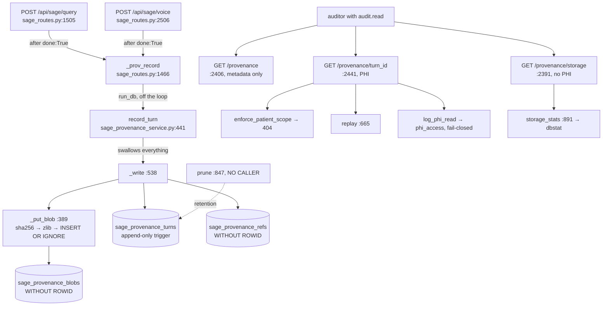
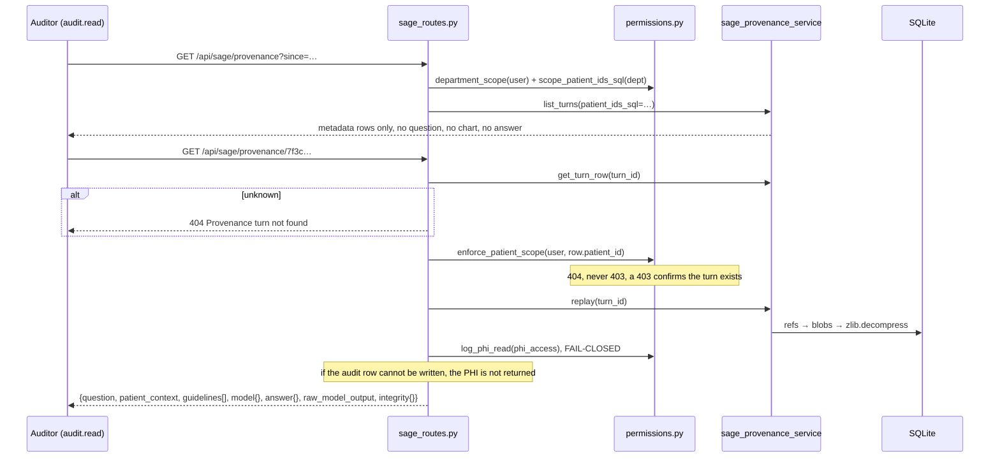

# Sage provenance: making one answer reconstructable six months later

Built 2026-08-09.

Six months into the pilot, somebody asks one question about one Sage answer: **why did it say that?**

By then every input is gone. The chart has moved on, new meds, new labs, a discharge. The corpus has been re-indexed. The model was swapped, or the thinking toggle was off that morning and on this one. So a provenance record that stores a **pointer** to the patient answers nothing: replayed today it re-reads today's chart and tells a confident story about the wrong day. That is worse than having no record at all, because it looks authoritative.

`server/services/sage_provenance_service.py` exists to make that question answerable. It stores the turn's inputs **by value**: the question verbatim, the resolved scope, the whole assembled chart dict frozen as it was, the retrieved guideline passages with their document ids, the model and served model and provider, the thinking-mode decision and whether the safety floor fired, the answer with its citations, and, separately, the raw model output *before* the guardrail strip rewrote it.

**The three decisions that shape every line of this subsystem**, taken from the module docstring (`server/services/sage_provenance_service.py:1-111`) and the route header (`server/routes/sage_routes.py:1449-1465`):

1. **By value, never by reference.** The chart snapshot is the record. `patient_id` is stored too, but only as an index key, the thing an incident review reads is the frozen dict.
2. **It must never cost a clinician an answer.** `record_turn` is pure sync, runs on the DB executor, sits *after* the terminal SSE event on every path, and **never raises**, every failure is logged and swallowed (`:97-101`, `:441-492`).
3. **Storage is the actual design problem, and it is solved with measurement, not optimism.** Content-addressed dedup, zlib, and a retention horizon, with `storage_stats()` (`:891`) computing the cost from rows that exist rather than from a hard-coded estimate.

**The sharpest thing in the chapter, stated up front.** This store holds whole chart snapshots, so **it is PHI** and is fenced like any other PHI surface: `audit.read` (admin-only), scope resolved only through `permissions.department_scope`, **404 and never 403** on an out-of-department turn, and a fail-closed `phi_access` audit row per read (`server/routes/sage_routes.py:2374-2389`). The second-sharpest: `sage_provenance_turns` is **append-only enforced by a database trigger** (`:301-306`), not by convention. "We agreed not to UPDATE it" is not a control an incident review can rely on.

---

## Purpose and neighbors

**Jargon:**

| Term | Meaning in Orb |
|---|---|
| **Turn** | One Sage question-and-answer exchange. One row in `sage_provenance_turns`, one `turn_id`. The same id is the shadow-mode `shadow_turn_id`, so a scorecard row and its replayable reconstruction join on one value (`sage_routes.py:1558-1562`). |
| **Blob / cid** | One large component (question, chart snapshot, one guideline passage, answer, raw output), stored once, keyed by `cid` = the first 32 hex chars of its own sha256 (`sage_provenance_service.py:129-134`). |
| **Ref** | A `(turn_id, role, ord, cid)` edge. ~8 per turn. Exists so the retention GC is an exact reference count, not a reachability walk. |
| **Role** | Which component this edge is, stored as a **single character**, `q`, `c`, `m`, `g`, `a`, `r` (`:144-149`). Readable names live in `ROLE_LABELS` (`:151`). |
| **Manifest** | The metadata list for the retrieved passages: document id, title, source, trust tier, fusion score, and the `passage_cid` pointing at the body blob (`:570-580`). |
| **Lane** | `chat` or `voice`. Both are recorded; the voice record is honestly thinner. |
| **Outcome** | `answered`, `refused`, `failed`, `cancelled`. A refusal is a turn too. |
| **Safety floor** | The rule that keeps patient-specific and dosing questions on the careful 27B even when the thinking toggle is off (`services/thinking_mode.py:503-528`). |
| **`bytes_written` / `bytes_logical`** | New compressed bytes this turn actually added *after* dedup, versus what a naive store would have written. The measurement instrument (`:242-246`). |
| **Replay** | Reconstructing one turn from its stored components, `GET /api/sage/provenance/{turn_id}`. |



**Neighbors:** guide 41-shadow-mode (`shadow_service`, the same `turn_id`, the aggregate scorecard this store is the per-turn complement to), guide 03-auth-rbac (`department_scope`, `scope_patient_ids_sql`, `enforce_patient_scope`, `log_phi_read`), guide 05-audit-chain (`log_audit_event`, the fail-closed `phi_access` category), the thinking-mode chapter (`services/thinking_mode.py:503` `stamp`, which writes the fields this store reads out of `route_info`), guide on Sage retrieval (`get_relevant_context`, which produces the `sources` list and the `patient_context_dict` stored here), and the DPDP/consent chapter (`services/consent_service.py:471` `_patient_tables`, `:846` `_ERASURE_EXECUTORS`).

---

## File map

| File | Lines | Role |
|---|---:|---|
| `server/services/sage_provenance_service.py` | 973 | Everything: config, self-owned schema, the blob store, `record_turn`, `replay`, `list_turns`, `prune`, `storage_stats`. |
| `server/routes/sage_routes.py` | 2810 | The six capture call sites (`:1584`, `:1761`, `:1813`, `:2249`, `:2665`, `:2685`) and the three read endpoints (`:2391`, `:2406`, `:2441`), plus `_prov_record` (`:1466`), `_prov_no_model_route_info` (`:1479`), `_voice_model_name` (`:1494`). |
| `server/permissions.py` | 565 | `AUDIT_READ` (`:92`), admin's grant of it (`:156`), `department_scope` (`:192`), `scope_patient_ids_sql` (`:248`), `enforce_patient_scope` (`:292`), `log_phi_read` (`:319`), `require_permission` (`:376`). |
| `server/services/thinking_mode.py` | 611 | `begin_turn` (`:322`), `current_thinking_flag` (`:339`), `stamp` (`:503`), the producer of every `thinking_*` / `safety_floor_*` key this store persists (`:517-527`). |
| `server/services/sage_service.py` | 2974 | `query_ollama` fills `route_info` with `{lane, provider, model}` (`:1317`, `:1337-1340`), the `model_served` this store records. |
| `server/database.py` | 1979 | `db_session` (`:1034`, commits on success / rolls back on error) and `run_db` (`:1205`), which **refuses a coroutine function** (`:1221`), the reason `_prov_record` binds `record_turn` late as a sync callable. |
| `server/services/consent_service.py` | 1313 | `_patient_tables` (`:471`) discovers `sage_provenance_turns` for a DPDP export; `_erase_ai_transcripts` (`:783`) does **not** touch it; `_ERASURE_EXECUTORS` (`:846`) has no category for it. |
| `server/tests/test_sage_provenance.py` | 771 | The behavioural spec, 28 test functions across immutability, replay, storage arithmetic, RBAC, live-route integration, and the never-costs-an-answer rule. |

**There are no screenshots for this chapter, and that is a finding, not an omission.** `grep -rn "/provenance" src/` returns exactly one hit, `src/components/ProvenanceChip.tsx:35`, which calls `/admin/models/provenance` and is about *model* provenance, an unrelated feature. **No component in the entire frontend calls any of these three endpoints.** The whole subsystem is API-only. Every "on screen" answer below is therefore "nothing you can point at in the app", the deliverable is an HTTP response an auditor fetches with a token, and that is worth knowing before you go looking for a panel that does not exist.

---

## How it works

### Flow 1: a normal chat turn is captured

1. `sage_query` (`sage_routes.py:1505`) mints `shadow_turn_id = uuid4().hex[:16]` (`:1562`). This one id links the shadow rows *and* the provenance row.
2. It reads the thinking flag **in the request's own context** into `_no_model_route_info` (`:1566`), because the ContextVar belongs to the request task and a streaming generator is not guaranteed to be iterated inside it (`:1479-1491`).
3. Retrieval runs on a thread and returns `patient_context_dict` (the assembled chart), `sources` (the passages), `context` (the rendered prompt block), `query_scope`.
4. The model streams. `route_info`, initialised `{}` at `:1722`, is filled by `thinking_mode.stamp` and then by `query_ollama` (`sage_service.py:1345-1348`).
5. The generator's `finally` saves the conversation turn, **then** captures provenance (`:2249`). The client already has `done: True` on every path, so this is never on the critical path.
6. `_prov_record` (`:1466`) imports the service **late, by attribute**, and hands `record_turn` to `run_db`, off the event loop, and a test or ops kill-switch that replaces the attribute is honoured.
7. `record_turn` (`:441`) checks `enabled()`, then wraps `_record_turn_inner` in a bare `except Exception: log; return None`.
8. `_write` (`:538`) ensures the schema, puts each component through `_put_blob` (sha256 → dedup check → zlib → `INSERT OR IGNORE`), inserts one turn row with `INSERT OR IGNORE`, and `executemany`s the ref edges.

### Flow 2: the four exits that are *not* the happy path

Every one of them writes its own record, because each returns before the `finally` or from a different generator:

| Exit | Site | Outcome | What is kept |
|---|---|---|---|
| Pre-LLM safety refusal | `:1584` | `refused` | The question verbatim, the refused question *is* the evidence. `query_scope="SAFETY_REFUSAL"`. |
| Retrieval failure | `:1761` | `failed` | Question + `query_scope="RETRIEVAL_FAILED"` + `retrieval_ms`. Without it a retrieval outage would leave the store describing only the turns that survived retrieval. |
| Cross-department reach | `:1813` | `refused` | Question kept, **`patient_id=None` deliberately**, retrieval refused to confirm that patient exists, and writing their id into a store an auditor can list would re-disclose exactly what the 404-shaped refusal was protecting. |
| Voice stream crash | `:2685` | `failed` | Question + whatever `full_response` had accumulated, `locals()`-probed. |

### Flow 3: an auditor replays a turn



The `/storage` literal path is declared at `:2391`, **before** `/{turn_id}` at `:2441`, FastAPI matches in declaration order and the parametrised route would otherwise swallow it. All three handlers are plain `def`, so FastAPI threadpools them and the decrypt-plus-decompress of a chart-sized blob never runs on the event loop (`test_sage_provenance.py:453` pins this).

---

## Function-by-function

### File: `server/services/sage_provenance_service.py`

#### `SCHEMA_V` / `_CID_LEN` / `LANES` / `OUTCOMES`: `:127` / `:134` / `:136` / `:137`
**Signature:** `1` / `32` / `("chat","voice")` / `("answered","refused","failed","cancelled")`
**Does:** The store's fixed vocabulary. `_CID_LEN = 32` means a cid is the first **128 bits** of the content's sha256.
**On screen:** `schema_v` comes back inside `integrity` on a replay response (`:781`). Nothing renders it.
**Why 128 bits and not the full digest:** at 10⁹ distinct blobs the birthday probability is ~10⁻²¹, and halving the hash halves the cost of the reference rows, which are otherwise pure hash text (`:129-133`). The full digest is deliberately **not** kept beside it, the schema comment at `:264-267` says storing the other 32 hex characters costs 64 bytes on every blob to add nothing an integrity check can use.
**Breaks if you change it:** shortening `_CID_LEN` on a live store makes every existing ref edge point at a cid no blob has, so **every historical replay comes back with the components missing**, and because `_get_blob` returns `None` rather than raising, it comes back *quietly*, as a thin-looking record with entries in `missing_blobs`. Lengthening it has the same effect in the other direction.

#### `ROLE_QUESTION` … `ROLE_RAW` / `ROLE_LABELS`: `:144-149` / `:151`
**Signature:** six one-character constants; a dict from character to readable name.
**Does:** Names the six component kinds. Storage spends **one byte**; the human-readable name appears only in the replay response and in `missing_blobs`.
**On screen:** the readable names are the keys of the replay JSON an auditor reads.
**Why single characters:** there are ~8 reference edges per turn and the edge table plus its index measured **32 % of the entire store** when the roles were spelled out, `"guideline_manifest"` is 18 bytes repeated on the busiest table in the store (`:139-143`).
**Breaks if you change it:** changing a role character orphans every existing edge for that role. `_replay` looks up `by_role.get(role)`, finds nothing, and returns that component as absent, with **no** entry in `missing_blobs`, because `one()` only reports missing when the *blob* is gone, not when the *role key* is (`:687-697`). A silently-thinner record.
**Gotchas:** `ROLE_LABELS` is what `missing` reports by (`:696`). The comment there says why: `"q"` is not an answer to "what is missing from this record?".

#### `enabled` / `retention_days` / `max_blob_bytes`: `:166` / `:171` / `:178`
**Signature:** `() -> bool` / `() -> int` / `() -> int`
**Does:** The three knobs, read from the environment **at call time** so ops and tests can change them live. `ORB_SAGE_PROVENANCE_ENABLED` (default on), `ORB_SAGE_PROVENANCE_RETENTION_DAYS` (default 400), `ORB_SAGE_PROVENANCE_MAX_BLOB_BYTES` (default 131072 = 128 KB, floored at 4096).
**On screen:** `retention_days()` is echoed in the `/provenance/storage` response as `retention_days` and drives `bytes_at_retention_horizon`.
**Why the blob cap exists:** a clinician can paste a 4 MB discharge letter into the box. Without a cap, that becomes 4 MB of provenance and the store's whole cost model, a few KB per turn, is decided by the worst user of the week rather than by design (`:179-185`).
**Breaks if you change it:** setting `ORB_SAGE_PROVENANCE_ENABLED=0` makes `record_turn` return `None` before doing anything (`:476-477`), so turns stop being recorded **with no error anywhere**, the only symptom is an empty listing. That is the intended kill-switch and it is also the trap: nothing on any screen says provenance is off. `test_sage_provenance.py:766` pins the behaviour, not the visibility.
**Gotchas:** both int-parsers swallow `ValueError` and fall back to the default (`:174-175`, `:188-189`), so a typo'd env var is silently the default rather than a startup failure. Deliberate, this is the module that must never break the answer, but it means a misconfigured retention is invisible.

#### `_SCHEMA_STATEMENTS`: `:200-313`
**Signature:** a tuple of individual SQL strings.
**Does:** The whole schema: three tables and two triggers.
**On screen:** nothing.
**Why one statement per entry and never `executescript()`:** `executescript()` issues an **implicit COMMIT** before it runs, so a first-ever call made from inside a caller's open transaction would silently commit their half-finished work (`:195-199`). This module is reachable with a caller-supplied connection (`ensure_schema(db)` from inside `_write`), so that is a live hazard, not a theoretical one.
**Breaks if you change it:** switching to `executescript()` for tidiness would mean the first Sage turn after a deploy commits whatever transaction happened to be open around it.

##### The three tables, and why each is shaped as it is
- **`sage_provenance_turns`** (`:205`), one row per turn, small and fixed-width, holding **no free text**. That is what keeps it scannable for the listing view. `department` + `hospital_wide` carry the resolved scope: `NULL` department with `hospital_wide=1` means a genuinely unscoped governance account, and **`NULL` alone is never "unknown"** (`:213-216`). Three indexes: by time (`:249`), by `(patient_id, occurred_at)` (`:251`), by `(actor_user_id, occurred_at)` (`:253`).
- **`sage_provenance_blobs`** (`:270`), `WITHOUT ROWID`, because it is only ever reached by `cid`. As an ordinary rowid table it pays for two b-trees and the PK autoindex alone measured **73 KB per 1,550 blobs** (`:260-263`). No separate `sha256` column, no `stored_len` column, the latter because "a denormalised copy of a value the row already contains is a value that can disagree with it" (`:268-269`).
- **`sage_provenance_refs`** (`:289`), `WITHOUT ROWID`, highest cardinality in the store. **Deliberately no index on `cid`**: it would be a third b-tree over the busiest table, ~370 B per turn, to serve a query that runs at most once a day during retention pruning, which `_prune` therefore writes as a single `NOT IN` scan instead (`:284-288`, and the scan itself at `:877-879`).

##### The append-only triggers: `:301` and `:307`
**Does:** `BEFORE UPDATE` on both `sage_provenance_turns` and `sage_provenance_blobs`, raising `RAISE(ABORT, …)`.
**On screen:** an auditor never sees them fire; they are a guarantee, not a feature.
**Why they exist, the load-bearing paragraph:** the single property this whole feature rests on is that a stored turn describes the past and **cannot be quietly revised**. "We agreed not to UPDATE it" is not a control an incident review can rely on, so the database enforces it. `DELETE` stays permitted, because retention pruning is a requirement and is the only writer that uses it (`:296-300`).
**Breaks if you change it:** drop the trigger and the store's evidential value collapses, every replay becomes "this is what the record says *today*", which is exactly the failure mode this module was built to avoid. `test_sage_provenance.py:255` pins it by attempting an `UPDATE` directly against the table.
**Gotchas:** the trigger is why `_write` uses `INSERT OR IGNORE` and never `OR REPLACE` (`:599-601`), first write wins. Combined, a recorded turn cannot be revised **by any path at all, including a retry that thinks it is being helpful**.

#### `ensure_schema`: `:319`
**Signature:** `(db=None) -> None`
**Does:** Idempotent DDL behind a module-global `_schema_ready` flag and a `threading.Lock` (`:315-316`). Uses the caller's connection when given one, otherwise opens its own `db_session`.
**On screen:** nothing.
**Why the flag:** this runs on the write path of every Sage turn; a `CREATE TABLE IF NOT EXISTS` × 7 per turn is pure waste after the first.
**Breaks if you change it, and this is the real risk in the module:** `_schema_ready = True` is set **unconditionally** after the statements execute (`:334`), with no commit and no verification. DDL in SQLite is transactional, and `db_session` rolls back on error (`database.py:1038-1041`). So if the very first `_write` in a process raises *after* `ensure_schema`, anywhere in `_put_blob` or the turn INSERT, the rollback takes the tables with it while the flag stays `True`. Every subsequent `record_turn` then inserts into tables that do not exist, fails, and is **swallowed by design** (`:489-492`). Provenance would be dead for the life of the process with nothing in any response to say so. Reading the code, that is the mechanism; I have not reproduced it, and no test covers it.
**Gotchas:** the schema is deliberately **not** in `migrations.py`. The docstring is honest about why (`:103-110`): it is the same self-owned-DDL pattern as `helix_db.py`, `timeline_service.py` and `corpus_loader.py`, the numbered ledger is the right long-term home, and it was not done because `migrations.py` was under concurrent edit and a version-number collision would be a worse defect than a self-owned table.

#### `reset_schema_cache` / `drop_schema`: `:337` / `:343`
**Signature:** `() -> None` / `(db) -> None`
**Does:** Tests only. Forget the flag; drop the two triggers and three tables in dependency order.
**On screen:** nothing. No route reaches either.
**Breaks if you change it:** `drop_schema` drops the triggers **first** (`:345-346`). Reorder it and the drop of `sage_provenance_turns` runs while a `BEFORE UPDATE` trigger still references it, harmless in SQLite, but the ordering is also the documentation of the dependency.

#### `utc_now` / `new_turn_id`: `:355` / `:359`
**Signature:** `() -> str` (ISO-8601, millisecond precision) / `() -> str` (16 hex chars)
**Does:** Timestamp and id minting.
**On screen:** `occurred_at` is the sort key of the listing and the `turn_occurred_at` in the replay's audit metadata (`sage_routes.py:2475`).
**Gotchas:** the turn id is 16 hex chars = 64 bits, matching `shadow_turn_id` in the routes (`sage_routes.py:1562`, `:2549`) so the two stores join. In practice `new_turn_id` is almost never used, every live call site supplies the id from the route.
**Breaks if you change it:** widening the id in one place and not the other silently breaks the join between the scorecard and the replay. Changing `occurred_at`'s format breaks `_list_turns`' `since` comparison and `_prune`'s cutoff, both of which are **string comparisons on ISO text** (`:818`, `:865`), not date arithmetic.

#### `_canon`: `:363`
**Signature:** `(obj) -> str`, `sort_keys=True`, `separators=(",",":")`, `ensure_ascii=False`, `default=str`
**Does:** Canonical JSON.
**On screen:** nothing directly; it is why dedup works.
**Why it exists:** determinism is what makes deduplication work at all, **two identical charts that serialise differently are two blobs** (`:366-367`).
**Breaks if you change it:** flip `sort_keys` off, or change the separators, and dedup silently stops paying. Nothing errors; the store just starts growing at the naive rate, and the only place you would see it is `bytes_written` on the turn rows. `test_sage_provenance.py:331` catches it, it asserts a second turn on an unchanged chart stores less than half what the first did.
**Gotchas:** `ensure_ascii=False` matters for a Devanagari chart, escaping to `\uXXXX` would inflate every Indic string ~6x before compression.

#### `_clip`: `:372`
**Signature:** `(text: str) -> str`
**Does:** Caps one component at `max_blob_bytes()`, cutting on **encoded bytes** and dropping any half-formed character at the boundary, then appending `_TRUNCATION_MARKER` (`:160`).
**On screen:** the marker `… [truncated by provenance store]` appears verbatim inside the replayed component.
**Why bytes and not characters, and this is not academic:** this appliance is going into an Indian hospital, and a paragraph of Devanagari is three bytes per character. A character-counted cap would let the same "128 KB" limit admit a **384 KB** blob (`:375-379`). `test_sage_provenance.py:395` is parametrised over `"x"` and `"न"` for exactly this.
**Why the marker is visible:** a silently shortened record is a record that lies about being complete (`:184-185`).
**Breaks if you change it:** remove the marker and a reviewer reading a truncated chart has no way to know it is truncated, they will conclude the patient had no problem list. Switch the cut to characters and one Devanagari paste triples the store's worst case.
**Gotchas:** the marker is appended **after** the byte cut, so `_clip`'s output can exceed `max_blob_bytes()` by the marker's length. The test allows `+200` (`:404`) for precisely this.

#### `_put_blob`: `:389`
**Signature:** `(db, kind, text) -> tuple[cid, new_bytes_stored, logical_bytes]`
**Does:** sha256 the UTF-8 bytes → take 32 hex chars → **check if that cid already exists** → if so return `(cid, 0, len(raw))` → otherwise zlib level 6 and `INSERT OR IGNORE`.
**On screen:** nothing. It is the engine of the whole storage story.
**Why the returned zero matters:** `new_bytes_stored == 0` when the content was already present. **That zero IS the dedup measurement**, and it is what `bytes_written` on the turn row sums (`:392-393`).
**Breaks if you change it:** returning `len(body)` on a dedup hit would make `bytes_written` report the naive cost, and `/provenance/storage`'s `dedup_ratio` would collapse toward 1 while the disk kept telling the truth, the instrument would lie about the thing it exists to measure. Dropping the existence check and relying on `INSERT OR IGNORE` alone would compress every blob on every turn for nothing (CPU on the DB executor, on every Sage turn).
**Gotchas:** `logical_bytes` is returned as `len(raw)` **whether or not** the blob was new, that is deliberate: `bytes_logical` is "what a naive store would have written", so a dedup hit still costs logically even though it costs nothing physically.

#### `_get_blob`: `:410`
**Signature:** `(db, cid) -> str | None`
**Does:** Fetch, decompress if `encoding == 'z'`, decode UTF-8.
**On screen:** every text field of a replay response comes through here.
**Breaks if you change it:** it returns **`None` on a decompression failure**, logging an exception (`:419-421`), rather than raising. That choice is what makes `missing_blobs` meaningful: one corrupt passage degrades to a named gap in the record instead of a 500 that hides the other nine components. Make it raise and a single bad blob makes the whole turn unreadable.

#### `_as_bool` / `_int_or_none`: `:425` / `:431`
**Signature:** `(v) -> bool | None` / `(v) -> int | None`
**Does:** Three-valued coercion helpers. `_as_bool(None)` stays `None`.
**On screen:** `_as_bool` is what makes `model.thinking` in a replay response distinguish "thinking was off" from "this lane never had a thinking decision" (`:750-751`).
**Breaks if you change it:** make `_as_bool(None)` return `False` and a voice turn, which never runs the thinking decision at all, would read as "the clinician chose fast mode", which is a claim about a clinician who never made that choice.

#### `record_turn`: `:441`
**Signature:** `(*, turn_id=None, lane="chat", outcome="answered", user=None, question="", patient_id=None, patient_context=None, prompt_context=None, sources=None, route_info=None, answer="", raw_output="", structured=None, cited_doc_ids=None, citation_basis=None, confidence=None, escalation=False, query_scope=None, action_status=None, refusal_class=None, timings=None, occurred_at=None, db=None) -> str | None`
**Does:** The single public write. Returns the turn id, or `None` if provenance is disabled or the write failed.
**On screen:** nothing, by construction. It runs after the clinician already has the answer.
**Why it exists, and the one rule it enforces:** **NEVER RAISES.** The `try/except Exception` at `:478-492` logs and returns `None`. The comment is the policy in one line: *"the record degrades, the care does not."*
**Why `user` and not a department parameter:** the department is derived from the authenticated user dict through `permissions.department_scope` inside `_record_turn_inner` (`:512`), never taken from the request. The docstring states the principle: **"a scope the caller can name is not a scope"** (`:473-474`).
**Breaks if you change it:** let one exception through and a bad blob, a locked database or a schema drift turns into a 500 on the Sage stream *after* the clinician already saw the answer, which in an SSE generator means a broken stream on a screen showing a completed reply. `test_sage_provenance.py:733` pins this by making the recorder blow up and asserting the answer still arrives.
**Gotchas:** it is **pure sync** and must stay that way. `database.run_db` raises `TypeError` on a coroutine function (`database.py:1225`), and the reason given there is exactly this class of bug: a coroutine handed to an executor never runs, returns a coroutine object nobody awaits, and the work silently never happens with no exception and no log line.

#### `_record_turn_inner`: `:495`
**Signature:** the same keywords, positionally forwarded; returns the turn id.
**Does:** Builds one flat namespace dict `ns` with every value normalised, then dispatches to `_write` on either the caller's connection or a fresh `db_session`.
**On screen:** nothing.
**How the normalisation works:** `lane` and `outcome` are **clamped to the allowed tuples** rather than validated (`:506-507`), an unknown lane silently becomes `"chat"`, an unknown outcome becomes `"answered"`. `sources` is filtered to dicts only (`:517`), so a malformed retrieval result cannot crash the manifest loop.
**Why the clamping and not a raise:** the CHECK constraints on the table (`:208-210`) would reject a bad value, and a rejected INSERT means a lost turn. Clamping keeps the record.
**Breaks if you change it:** the clamp on `outcome` is the sharp one. Add a fifth outcome to `OUTCOMES` without adding it to the table's CHECK constraint and every turn with that outcome is silently dropped at INSERT time, the constraint fails, `record_turn` swallows, and the turn vanishes. The two lists must move together.
**Gotchas:** `"dept": department_scope(user)` at `:512` is the **one** scope source, computed here rather than passed in. The comment says `None` here means a genuinely unscoped governance account, never "unknown" (`:509-511`).

#### `_write`: `:538`
**Signature:** `(db, ns: dict) -> str`
**Does:** The transactional body. Ensures the schema, stores six kinds of component, inserts the turn row, inserts the ref edges.
**On screen:** nothing.
**How it works, in the order the components are written:**
1. **Question, verbatim** (`:555`), always, even on a refusal.
2. **The chart AS IT WAS** (`:557-559`), `_canon`'d, only when `patient_context is not None`. The comment is the thesis of the module: *"Stored BY VALUE. This is the whole point."*
3. **Passages** (`:563-582`), each body its own blob at `ord = i`, plus a manifest blob of the metadata (`document_id`, `title`, `source`, `source_type`, `trust_tier`, `is_synthetic`, `category`, `fusion_score`, `passage_cid`). Bodies are separate so a passage shared by a thousand turns is stored once.
4. **The answer** (`:585-589`) as a canonical JSON of `{text, structured, cited_document_ids}`.
5. **The raw model output** (`:590-591`), only when non-empty. This is the pre-guardrail text, and the module docstring gives the reason: *"an incident review's first question is almost always 'what did the model actually say?'"* (`:27-28`).
6. The turn row (`:602-637`) and the ref edges (`:638-642`).
**Why the prompt is NOT stored:** `prompt_sha256` is computed at `:594-595` and the full prompt is discarded. The prompt is the chart block plus the passages concatenated, so storing it would duplicate, and defeat the dedup on, the two largest components (`:55-58`). The hash still lets a reviewer prove the components on file correspond to the bytes the model saw. `test_sage_provenance.py:302` pins the anchor.
**How the model fields are derived, read this carefully:** `model_requested = info.get("thinking_model") or info.get("model")` and `model_served = info.get("model")` (`:619`). `thinking_model` is `decision.model` from `thinking_mode.stamp` (`thinking_mode.py:521`), the model the **thinking decision** selected. `model` is `choice.model` from `query_ollama` (`sage_service.py:1346`), what the **residency router** actually served. So "requested" means "what the thinking decision asked for", not "what the clinician typed".
**Breaks if you change it:** the `INSERT OR IGNORE` at `:602` is not a style choice. With the append-only trigger it means a recorded turn cannot be revised by any path at all. Change it to `OR REPLACE` and a retry, or a bug that calls `record_turn` twice with the same `turn_id`, silently overwrites the original record with a later reconstruction of it, which is exactly the property the trigger exists to prevent.
**Gotchas, three real ones:**
- `safety_floor` is stored as `int(bool(info.get("safety_floor")))` (`:625`), which maps a **missing** key to `0`. The column is `NOT NULL DEFAULT 0`. So on a voice turn or a pre-LLM refusal, where `route_info` never carries a thinking decision at all, `safety_floor = 0` means "we never asked", not "the floor did not fire", and **the two are indistinguishable in the stored row**. `thinking` (`:621`) is three-valued and does not have this problem. The asymmetry is real.
- The guideline body edges (role `g`) are written at `:569`, but `_replay` reaches the bodies through the **manifest's** `passage_cid`, not through those edges (`:715-718`). The `g` edges exist so the GC's reference count is right. If the manifest blob is ever lost, the passages become unreachable in a replay even though the edges still keep them alive on disk.
- `add()` (`:547`) always uses `ord_=0`, and the refs PK is `(turn_id, role, ord)` with `INSERT OR IGNORE`. Calling `add` twice for the same role would silently drop the second. Only guideline bodies vary `ord`.

#### `get_turn_row` / `_get_turn_row`: `:649` / `:658`
**Signature:** `(turn_id, db=None) -> dict | None`
**Does:** The metadata row only.
**On screen:** nothing directly, but it is the reason `GET /provenance/{turn_id}` can be safe.
**Why it exists, this is the security-relevant one:** the route calls it **before** reconstructing anything, so it can resolve `patient_id` and run `enforce_patient_scope` *before* a single blob is decompressed (`sage_routes.py:2455-2461`). The docstring says exactly that: "used by the route to resolve `patient_id` BEFORE it decides whether the caller may see anything at all" (`:650-651`).
**Breaks if you change it:** merge this into `replay()` for tidiness and the scope check necessarily runs *after* the chart has been assembled in memory. That is not an exploit on its own, but it inverts the ordering the whole PHI posture depends on, and the next refactor that returns early on an error path will leak.

#### `replay` / `_replay`: `:665` / `:673`
**Signature:** `(turn_id, db=None) -> dict | None`
**Does:** Reconstructs one turn from stored components into the shape the endpoint returns: `turn_id`, `occurred_at`, `lane`, `outcome`, `actor`, `scope`, `question`, `patient_context`, `guidelines[]`, `model{}`, `answer{}`, `raw_model_output`, `retrieved_document_ids`, `timing{}`, `storage{}`, `integrity{}` (`:730-783`).
**On screen:** **this JSON is the entire user-facing product of the subsystem.** No component renders it; an auditor reads it from the endpoint.
**How it works:** loads all refs in one query, buckets them `by_role`, then `one(role)` fetches the first blob for a role and appends to `missing` **by readable name** when the blob is gone (`:687-697`). `load_json` (`:699`) additionally appends `"<name> (corrupt)"` on a `JSONDecodeError`. Guidelines are rebuilt by walking the manifest and pulling each `passage_cid`, dropping the cid from the output and substituting the text under `"passage"` (`:714-722`).
**Why `missing_blobs` exists:** it is the one field an auditor reads when a reconstruction looks thin (`:693-695`). Without it a partially-GC'd or corrupted turn is indistinguishable from a turn that genuinely had no chart and no passages, and those two mean opposite things in a review.
**Breaks if you change it:** stop reporting `missing_blobs` and every degraded record starts reading as a complete one. Return `None` on the first missing blob instead of degrading, and one corrupt passage destroys the other nine components of an incident record.
**Gotchas:** `jload` (`:724`) does `json.loads(...) or default`, a stored empty list is falsy and comes back as the default, which happens to be the same empty list, so no harm today. It would matter if a default were ever non-empty. And `patient_context` is only attempted when a `c` ref exists (`:710`), so a turn with no chart returns `null` rather than a missing-blob entry, correct, and the reason `scope.patient_context_used` (`:740`) is stored separately as the authoritative "was a chart attached" flag.

#### `list_turns` / `_list_turns`: `:787` / `:803`
**Signature:** `(*, patient_ids_sql=None, patient_id=None, actor_user_id=None, since=None, limit=50, offset=0, db=None) -> list[dict]`
**Does:** The metadata index. Returns 24 columns, **no question text, no chart, no answer** (`:822-826`).
**On screen:** the JSON body of `GET /api/sage/provenance`. Nothing renders it.
**Why it holds no content:** so an auditor scanning for "which turns did the safety floor fire on" does not incidentally read fifty charts (`sage_routes.py:2419-2421`). Reading a turn's content means naming it on `/{turn_id}`, which is the call that writes the per-patient audit row.
**How the scope filter works:** `patient_ids_sql` is a `(sql, params)` pair from `permissions.scope_patient_ids_sql`, embedded as `(patient_id IS NULL OR patient_id IN (<sql>))` (`:809`). The docstring is explicit that deriving it is the **caller's** job and that this function will not invent a scope (`:792-795`).
**Breaks if you change it:** add a content column here and every listing call becomes a bulk PHI read that writes no `phi_access` row, the audit trail would show one read where fifty happened. `test_sage_provenance.py:562` asserts the listing never leaks question or chart text.
**Gotchas, a real scope subtlety:** the `patient_id IS NULL OR …` clause means a department-scoped auditor sees **every patient-less turn in the hospital**, all general-knowledge questions, and all the cross-department refusals that were deliberately recorded with `patient_id=None` (`sage_routes.py:1815`). Those refusal rows carry no patient id but their *question* may well name a patient, and `enforce_patient_scope` returns immediately when `patient_id` is falsy (`permissions.py:322-323`), so a scoped auditor can also **replay** them in full. In practice `audit.read` is admin-only and admins are usually hospital-wide, so this is latent rather than live, but it is the one place the scope fence has a documented gap.
**Gotchas:** `limit` is clamped 1–500 (`:820`) and `offset` floored at 0 (`:829`). The `since` filter is a plain string comparison on `occurred_at`.

#### `prune` / `_prune`: `:847` / `:859`
**Signature:** `(*, now=None, days=None, db=None) -> {cutoff, turns_deleted, blobs_deleted, bytes_reclaimed}`
**Does:** Deletes turns older than the retention horizon, then **reference-counted-GCs** the blobs nothing points at any more.
**On screen:** **nothing, and neither does anything else, because nothing calls it.** See the discrepancies section: `grep -rn "prune(" server/ scripts/` finds only `loop_watchdog.py:638` (an unrelated log rotator) and `test_sage_provenance.py:416`, `:443`.
**Why reference-counted and not "delete what the old turn touched":** a chart snapshot is exactly the blob two turns share, and deleting it with the older turn would **silently gut the newer one's replay** (`:850-852`). `test_sage_provenance.py:433` pins this case specifically.
**How the GC works:** one `SELECT cid … WHERE cid NOT IN (SELECT cid FROM sage_provenance_refs)` (`:877-879`), a single scan of the edge table, because `refs` deliberately has no `cid` index and this is the only query that would want one.
**Breaks if you change it:** rewrite the orphan query as a per-blob correlated lookup and you either need that third b-tree (~370 B/turn on the busiest table, forever) or you get an O(blobs × refs) scan. Delete blobs by walking the doomed turn's own refs instead of counting, and every follow-up turn on an unchanged chart loses its chart on the day its first sibling ages out.
**Gotchas:** the cutoff is an **ISO string comparison** (`:862`), which works only because `utc_now()` and every caller write the same format. `test_sage_provenance.py:409` asserts on `content_bytes`, not `stored_bytes`, and the comment there (`:424-428`) explains why: SQLite returns freed pages to a freelist rather than to the filesystem, so pages are the right number for a disk projection and the wrong one for "did the GC actually let go".

#### `storage_stats` / `_storage_stats`: `:891` / `:926`
**Signature:** `(*, turns_per_day=200, db=None) -> dict`
**Does:** Measures, then projects. Returns `turns`, `blobs`, `refs`, `content_bytes`, `stored_bytes`, `measurement_basis`, `logical_bytes`, `bytes_per_turn`, `dedup_ratio`, `retention_days`, and a `projection` block with per-day, per-year and at-horizon bytes.
**On screen:** the JSON body of `GET /api/sage/provenance/storage`. Nothing renders it.
**Why it exists:** it is the answer to "what does this cost?", and **no estimate is hard-coded, every number is computed from rows that exist** (`:892-897`).
**Breaks if you change it:** `dedup_ratio` is `logical / stored`, i.e. end-to-end **after** row, index and page overhead, not before (`:963-965`). Redefine it as `logical / content_bytes` and it becomes a flattering number that ignores the three b-trees and the page granularity, the exact self-deception the `_on_disk_bytes` comment was written against.

#### `_on_disk_bytes`: `:904`
**Signature:** `(db) -> int | None`
**Does:** Sums `dbstat.pgsize` for every object whose `tbl_name LIKE 'sage_provenance%'`, taking the names from `sqlite_master` rather than a hand-written list.
**On screen:** decides whether `measurement_basis` reads `"dbstat"` or `"estimated"`.
**Why it exists, stated bluntly in its own docstring:** summing the compressed blob lengths is **not** the answer an operator needs, it ignores the turn rows, the reference edges, four explicit indexes, three PK autoindexes and SQLite's page granularity, and **it undershot the truth by ~25 %** when the two were compared on a 400-turn corpus (`:907-910`). (Its "four explicit indexes, three PK autoindexes" is the docstring's own count; the schema declares **three** explicit indexes, `:249`/`:251`/`:253`, and the fallback-estimate comment at `:944` says "three indexes" too. The measurement itself is name-driven from `sqlite_master`, so the prose being one out does not affect the number.)
**Breaks if you change it:** hard-code the object names and the next index added to this store is silently left out of the bill, the comment says the `sqlite_master` lookup exists for exactly that reason (`:910-912`).
**Gotchas:** returns `None` when `dbstat` is not compiled into the SQLite build, and the caller falls back to a **clearly-labelled** estimate: `content_bytes × 1.30 + turns × 580 + refs × 60`, every constant rounded **up** from the dbstat-measured figures on a 400-turn corpus, "deliberately generous rather than flattering" (`:942-948`). An operator planning disk from an `"estimated"` basis is over-provisioning, not under.

---

### File: `server/routes/sage_routes.py`: capture and replay

#### The three rules: `:1449-1465`
The section header states them in the order they matter, and every call site below obeys all three:
1. **It never costs the clinician an answer.** Every call site swallows.
2. **It never runs on the event loop.** Always through `run_db()`.
3. **It never runs before the answer is delivered.** Every call site sits **after** the terminal SSE event, so the capture cannot be on the critical path even when the store is slow.

#### `_prov_record`: `:1466`
**Signature:** `async (**kwargs) -> str | None`
**Does:** The single capture wrapper. Imports the service, hands `record_turn` to `run_db`, and swallows anything that still escapes.
**On screen:** nothing.
**Why the late, by-attribute binding:** so a test, or an ops kill-switch, that replaces `record_turn` on the module is honoured, **and** so this stays a sync callable handed to `run_db`, which refuses coroutine functions (`:1470-1473`, and `database.py:1225`).
**Breaks if you change it:** `from services.sage_provenance_service import record_turn` at module scope would freeze the reference at import, so monkeypatching the module attribute would stop working, and `test_sage_provenance.py:733` and `:748`, which are the tests that prove rules 1 and 2, both work by replacing that attribute. The tests would pass against a function that is no longer the one running.
**Gotchas:** this is the **second** layer of swallowing, `record_turn` already never raises (`sage_provenance_service.py:489`). The comment marks it `# pragma: no cover, defence in depth`. Both layers are deliberate: the inner one covers the write, the outer one covers the import and the executor hop.

#### `_prov_no_model_route_info`: `:1479`
**Signature:** `() -> dict`, `{"thinking_requested": bool}` or `{}`
**Does:** Builds a minimal `route_info` for a turn where the model never ran.
**On screen:** it is why a pre-LLM refusal still records the clinician's toggle position.
**Why it exists:** a pre-LLM refusal and a retrieval failure select no provider, but the clinician's toggle position is still part of what happened and a reviewer will ask about it. And it is read **here, in the request's own context**, the ContextVar that holds the flag belongs to the request task, and a streaming generator is not guaranteed to be iterated inside it (`:1482-1486`).
**Breaks if you change it:** move this call inside the generator and `thinking_mode.current_thinking_flag()` (`thinking_mode.py:339`) may read a context that no longer has the token set, recording the configured default in place of what the clinician actually chose. That is a wrong fact in an evidential record, not a missing one.
**Gotchas:** it returns `{}` on any exception, which means `thinking_requested` becomes NULL, honestly absent rather than guessed.

#### `_voice_model_name`: `:1494`
**Signature:** `() -> str | None`
**Does:** The MLX checkpoint basename serving the voice lane, from `config.VOICE`.
**On screen:** appears as `model.served` in a replayed voice turn.
**Why it never raises:** *"this is only ever called to decorate a provenance row, and a config shape change must not be able to turn a spoken answer into an error event"* (`:1495-1497`).
**Breaks if you change it:** let it raise and a `VOICE` config edit turns every spoken turn into a stream error, because the capture at `:2665` is inside the voice generator's `try`.

#### The pre-LLM refusal capture: `:1584`
**Does:** Records `outcome="refused"`, `query_scope="SAFETY_REFUSAL"`, the refusal class, the refusal text as the answer, and, the point, **the question verbatim**.
**On screen:** nothing at capture time; the clinician has already been shown the refusal three yields earlier.
**Why it exists:** *"'Why did Sage refuse me?' is one of the two questions a clinician actually escalates, and a store that only kept answers could not answer it. The refused QUESTION is the whole evidence"* (`:1581-1583`).
**Breaks if you change it:** drop it and the store systematically over-represents Sage's willingness to answer, the record contains only turns that got past the guardrail. `test_sage_provenance.py:654` pins the live route.

#### The retrieval-failure capture: `:1761`
**Does:** Records `outcome="failed"`, `query_scope="RETRIEVAL_FAILED"`, empty answer, and the retrieval latency up to the failure.
**Why it exists:** this `return` leaves the generator **without** passing through the `finally`, so without its own capture a retrieval outage would leave the store describing only the turns that survived retrieval (`:1758-1760`). The shadow row two lines above (`:1755`) exists for the identical reason.
**Breaks if you change it:** remove it and a bad index or an embedding-service outage becomes invisible in the provenance store, the exact failure class an operator would most want to see as a cluster. `test_sage_provenance.py:719` covers it.

#### The cross-department capture: `:1813`
**Does:** Records `outcome="refused"`, `query_scope="OUT_OF_SCOPE"`, `refusal_class="out_of_scope_patient"`, the notice as the answer, and **`patient_id=None`**.
**Why `patient_id=None`, the load-bearing reasoning:** retrieval refused to confirm this patient exists. Writing their id into a store an auditor can list would **re-disclose exactly what the 404-shaped refusal was protecting**. The question is kept, because it is the evidence of the attempted cross-department reach, and the security audit row that *does* name the patient was already written, fail-closed, by retrieval itself (`:1806-1812`).
**Breaks if you change it:** pass `effective_patient_id` here "for completeness" and the provenance listing becomes a way to enumerate which patients exist outside your ward, a disclosure channel around the very check that just fired.
**Gotchas:** because `patient_id` is NULL, this row is visible to **every** scoped auditor through the `patient_id IS NULL` clause in `_list_turns` (`sage_provenance_service.py:809`), and `enforce_patient_scope` no-ops on it. See the discrepancies section.

#### The main chat capture: `:2249`, outcome at `:2246`
**Signature:** the full keyword set, most values `locals()`-probed.
**Does:** The happy path (and the cancelled and empty-response paths). Stores the question, `patient_context_dict` **by value**, `prompt_context=context` (hashed, not kept), the `sources` list, `route_info`, the parsed concise answer, the raw `full_response`, the structured JSON, the cited doc ids, citation basis, confidence, escalation, query scope, action status and all three timings.
**On screen:** nothing. The comment at `:2239-2241` says why that is guaranteed: *"The client already has `done: True` at this point on every path."*
**How the outcome is decided:** `failed` if `sh_failure` or (no response and not cancelled), else `cancelled` if cancelled, else `answered` (`:2246-2248`). The accounting is made **here** rather than read from the shadow block below, and the comment says exactly why: `sh_failure` is not set to `"empty_response"` until `:2308`, *after* this call, so trusting it alone would file a zero-content turn as a delivered answer (`:2242-2245`).
**Why `patient_context_dict` and not `context`:** `patient_context_dict` is the assembled chart; `context` is the rendered prompt block, which is the chart *plus* the passages. Only the first is stored, because keeping the second would duplicate, and defeat the dedup on, both. The prompt's sha256 goes with it as the integrity anchor tying the two together (`:2256-2260`).
**Breaks if you change it:** store `context` instead and the module docstring's own arithmetic applies, adding the assembled prompt on top of the components *roughly doubles* the 7.6 KB/turn naive cost (`sage_provenance_service.py:35-37`), and the chart and passage blobs stop deduplicating because the concatenation is unique per turn. Move this call above the `run_db(_save_turn, …)` and it is still off the critical path, but move it above `done: True` and rule 3 is gone.
**Gotchas:** almost every argument is `'name' in locals()`-guarded, because this sits in a generator `finally` reached from a dozen exits and most of those names may never have been bound. The comment at `:1724-1727` warns against pre-initialising them for tidiness: those probes mean "was this ever bound?", and pre-initialising would silently change what the record stores.

#### The voice captures: `:2665` (happy path) and `:2685` (crash)
**Does:** Records the spoken turn with `lane="voice"`, `query_scope="VOICE"`, `citation_basis="none"`, `route_info={"provider": "mlx", "model": _voice_model_name()}`, the sanitised answer and the raw output.
**On screen:** nothing.
**Why it exists:** *"A guardrail measured on one surface only is how a hole ships in the other, and the same is true of the record: 'we can replay typed turns' is not an answer when the question is about a spoken one"* (`:2659-2661`).
**Why the record is thinner, honestly:** the voice agent assembles its own context, so there is no chart snapshot and no retrieved passage list to store, and those fields are **absent rather than faked** (`:2662-2664`). The crash capture at `:2685` exists because the happy-path call is inside the `try`, and *"'it crashed' is a thing a reviewer needs to be able to read, not infer from a gap"* (`:2680-2682`).
**Breaks if you change it:** fabricate an empty `sources=[]` or a synthesised chart here and a voice turn becomes indistinguishable from a chat turn where retrieval genuinely returned nothing, two very different findings.
**Gotchas, the one to watch:** `route_info` here carries **no** thinking keys, so the stored row has `thinking=NULL` (correctly three-valued) but `safety_floor=0` (`sage_provenance_service.py:625`, a `NOT NULL DEFAULT 0` column). A reviewer reading `safety_floor: false` on a voice turn will read "the floor did not fire" when the truth is "this lane never evaluates the floor". `sage_query`'s own comment (`:1551-1552`) confirms thinking mode is deliberately not applied to `/sage/voice`. `test_sage_provenance.py:666` and `:698` cover the two voice paths.

#### `GET /api/sage/provenance/storage`: `:2391` (`get_provenance_storage`)
**Signature:** guard `require_permission("audit.read")`; query `turns_per_day: int = 200` → the `storage_stats` dict.
**Does:** What the provenance store costs, measured.
**On screen:** JSON only, no caller in `src/`.
**Why it needs no patient scope:** **no PHI**, counts and byte totals only (`:2399`). The projection is straight-line arithmetic over the *measured* bytes-per-turn, *"so the number an operator reads here is the number their disk will see"* (`:2400-2401`).
**Breaks if you change it:** `turns_per_day` is clamped to 1–100000 (`:2403`). Remove the clamp and a caller-supplied rate produces an absurd projection an operator might act on; `test_sage_provenance.py:550` pins the clamp, and `:528` pins that the response carries no PHI.
**Gotchas:** it is declared **before** `/{turn_id}`. FastAPI matches in declaration order, so moving it below would make `/provenance/storage` resolve as a turn id called `"storage"` and 404 (`:2386-2389`).

#### `GET /api/sage/provenance`: `:2406` (`list_provenance`)
**Signature:** guard `require_permission("audit.read")`; query `patient_id`, `actor_user_id`, `since`, `limit`, `offset` → `{turns, count, scope:{department, hospital_wide}}`.
**Does:** The metadata index.
**On screen:** JSON only.
**How the scoping works:** if `patient_id` was supplied it is **vetted, not trusted**, `enforce_patient_scope` 404s an out-of-ward patient (`:2430`) rather than returning an empty list, *"which would itself confirm the ward"* (`:2423-2425`). Then `department_scope(user)` derives the fence and `scope_patient_ids_sql(dept)` builds the subquery; `dept is None` passes `patient_ids_sql=None`, i.e. no filter, which is the hospital-wide governance account (`:2431-2436`).
**Why it writes no `phi_access` row:** it returns no PHI content. The comment at `:2418-2421` makes the trade explicit, content requires naming a turn on `/{turn_id}`, which *is* the audited call.
**Breaks if you change it:** returning an empty list instead of a 404 for an out-of-ward `patient_id` re-opens the confirm-by-absence channel the 404 rule exists to close. `test_sage_provenance.py:492` pins department scoping of the listing.

#### `GET /api/sage/provenance/{turn_id}`: `:2441` (`replay_provenance`)
**Signature:** guard `require_permission("audit.read")` → the full replay dict.
**Does:** Reconstructs one turn from what was stored **at the time**.
**On screen:** JSON only. This is the endpoint the whole subsystem exists to serve.
**How it works, in the order the steps must happen:**
1. `get_turn_row` → 404 if unknown (`:2455-2457`).
2. `enforce_patient_scope(user, row["patient_id"])` on the **stored** patient, **before** anything is reconstructed. 404, never 403, *"because a 403 confirms that a turn about that patient exists"* (`:2380-2383`, `permissions.py:318-319`).
3. `replay(turn_id)`, a second 404 if it raced a retention prune (`:3936-3938`).
4. `log_phi_read(..., action_type="sage_provenance_replay", target_type="sage_provenance_turn", ...)`, **fail-closed** (`:3940-3954`). The `phi_access` category is in `_FAIL_CLOSED_CATEGORIES`, so if the row cannot be persisted this raises and **the PHI is not returned** (`permissions.py:347-351`).
5. Return the record.
**Why the docstring's one sentence matters:** *"The chart in this response is a snapshot, not a live read: it is what the model was shown, which is the only thing that can answer 'why did it say that?' months later"* (`:3912-3914`).
**Breaks if you change it:** move `log_phi_read` after the `return` (or wrap it in a `try/except`) and a chart snapshot leaves the building with no trace, which is the precise failure `permissions.py:342-345` records as having gone unnoticed until 2026-08-05. Reorder steps 2 and 3 and the scope check runs on an already-assembled chart. `test_sage_provenance.py:467`, `:473`, `:483` and `:508` pin the clinician refusal, the auditor success, the 404-not-403 and the audit row respectively.
**Gotchas:** it is a plain `def`, deliberately, FastAPI threadpools those, so the decrypt-and-decompress never touches the event loop (`:2386-2387`, pinned by `test_sage_provenance.py:453`).

---

## The storage arithmetic

The module docstring calls storage **"the design problem"** (`sage_provenance_service.py:31`), and the reason is specific: the chart block alone is several KB and it is re-sent byte for byte on every follow-up question about the same patient, **and a ward conversation is five or six of those in a row** (`:33-35`).

**Three mechanisms, in order of how much they save** (`:39-53`):

| # | Mechanism | Where | What it buys |
|---|---|---|---|
| 1 | **Content-addressed dedup** | `_put_blob` (`:389`) | Turns the per-turn cost from "the size of the chart" into "the size of what actually changed". A follow-up on an unchanged chart re-uses the chart blob for free; the 19-document corpus means passages are shared across essentially every turn that retrieves them. |
| 2 | **Compression** | `zlib.compress(raw, 6)` (`:401`) | Clinical prose and JSON compress 3–5×. |
| 3 | **Retention** | `prune` (`:847`) | Drops turns past `ORB_SAGE_PROVENANCE_RETENTION_DAYS` (default **400**, a full year of pilot review plus a quarter of slack) and reference-counted-GCs the orphaned blobs. |

Plus the **negative** mechanism: the assembled prompt is deliberately not stored at all, only its sha256, because the prompt *is* the chart block and the passages concatenated (`:55-58`).

**The measured numbers**, 400 turns, 12 patients, a 19-document corpus, charts revised every 6th turn (`:60-72`):

```
on disk, everything included   1,224,704 B  =  3,062 B / turn
naive (same components, raw)   3,032,154 B  =  7,580 B / turn
end-to-end saving                                    2.48x
```

**At the pilot's ~200 Sage turns a day**, straight-line off the measured 3,062 B/turn, which is exactly what `storage_stats().projection` computes from live rows (`:967-972`):

| | Deduplicated + compressed | Naive, for contrast |
|---|---:|---:|
| per turn | 3,062 B | 7,580 B |
| per day (200 turns) | **598 KB** | 1.45 MB |
| per month | **17.5 MB** | 43 MB |
| per year | **213 MB** | 528 MB |
| **at the 400-day horizon** | **~234 MB, and it stops growing** | ~578 MB |

That last row is the number to plan disk against (`:71-72`). It is also the number with the biggest asterisk on it, see discrepancy 1.

Two honest caveats the docstring itself raises (`:74-77`): the benchmark is **deliberately pessimistic about dedup**, sampling 3 of 19 documents at random per turn so guideline manifests almost never repeat, whereas real retrieval returns the same top-3 for the same question. A live appliance should land **under** this, not over. And `storage_stats` reproduces the same numbers live from SQLite's own `dbstat` page counts rather than from a guess (`:63-64`), so an operator never has to trust the benchmark, they can read their own.

---

## Cross-subsystem contracts

| Contract | Producer | Consumer | Breaks how |
|---|---|---|---|
| `shadow_turn_id` == provenance `turn_id` | `sage_routes.py:1562`, `:2549` | `sage_provenance_turns.turn_id`; the shadow `sage.drafted` payload's `conversation_id` (`:2327`) | mint them separately and the scorecard row and its replayable reconstruction can no longer be joined |
| `route_info` keys `thinking`, `thinking_requested`, `thinking_tier`, `thinking_model`, `thinking_reason`, `safety_floor`, `safety_floor_rules`, `safety_floor_unsatisfied` | `thinking_mode.stamp` (`thinking_mode.py:503-528`) | `_write` (`sage_provenance_service.py:619-627`) | rename one key and that column goes silently NULL (or, for `safety_floor`, silently **0**) on every future turn, no error anywhere |
| `route_info` keys `lane`, `provider`, `model` | `query_ollama` (`sage_service.py:1345-1348`) | `model_served` / `provider` (`:619-620`) | a renamed key makes every turn's served model unknown |
| `sources[]` item shape (`document_id`, `title`, `source`, `source_type`, `trust_tier`, `is_synthetic`, `category`, `fusion_score`, `content`/`passage`) | Sage retrieval (`get_relevant_context`) | the manifest builder (`:564-580`) | rename `content` and every passage body is stored as `""`, the manifest still looks complete, so the loss is invisible in the replay |
| `department_scope(user) is None` ⇒ hospital-wide, never "unknown" | `permissions.py:193` | `_record_turn_inner` (`:512`), `hospital_wide` column (`:617`), `list_provenance` (`:2431-2433`) | reinterpret `None` as "unknown" anywhere and every governance account's turns either vanish from listings or become unscoped |
| `phi_access` is fail-closed | `services/audit_service._FAIL_CLOSED_CATEGORIES` | `replay_provenance` (`:2468`) | make it fail-open and a chart snapshot can leave the building unlogged |
| `run_db` refuses coroutine functions | `database.py:1225` | `_prov_record` (`:1473`) | make `record_turn` async and the capture silently never happens, with no exception and no log line |
| `sage_provenance_turns.patient_id` (single plain column) | this module's schema (`:218`) | `consent_service._patient_tables` (`:437`) | rename the column and a DPDP data-principal export silently stops including this store's metadata |

---

## Rebuild notes

1. **Store the inputs by value, not by reference.** A pointer to the chart is worthless six months later; an incident review needs what the model actually saw.
2. **Store the raw model output separately from the delivered answer.** The first question in an incident review is "what did the model actually say?", and the guardrail strip has already rewritten the second.
3. **Record refusals and failures as turns.** A store that only keeps answers over-represents the system's willingness to answer and hides every outage class.
4. **Make the write incapable of costing an answer.** Pure sync, on the DB executor, after the terminal event, wrapped in a swallow, and prove all three with tests that break the recorder on purpose.
5. **Make append-only a database trigger, not an agreement.** `INSERT OR IGNORE` plus `BEFORE UPDATE … RAISE(ABORT)` means even a well-meaning retry cannot revise the past.
6. **Content-address every large component.** Dedup is what turns "the size of the chart, every turn" into "the size of what changed".
7. **Hash the prompt instead of storing it.** It is the concatenation of the two largest components; storing it duplicates them and defeats their dedup.
8. **Spend one byte on the role, not eighteen.** At ~8 edges per turn the edge table was 32 % of the whole store when roles were spelled out.
9. **Cap each component in BYTES and mark the truncation visibly.** A character cap admits 3× the limit in Devanagari; a silent truncation is a record that lies about being complete.
10. **Measure the cost from `dbstat`, not from summing payloads.** The payload sum undershot by ~25 %; the difference is rows, indexes, autoindexes and pages.
11. **Treat the store as PHI.** Admin-only permission, scope from the authenticated user only, 404 never 403, one fail-closed audit row per content read, and keep the *listing* content-free so a scan does not read fifty charts.
12. **Reference-count the GC.** The shared blob is the common case, not the edge case.

---

## Discrepancies and open questions

1. **`prune()` has no caller, so retention is a capability rather than a behaviour.** `grep -rn "prune(" server/ scripts/` finds `services/loop_watchdog.py:638` (an unrelated log rotator), the definitions at `sage_provenance_service.py:847`/`:859`, and `tests/test_sage_provenance.py:416`/`:443`. There is no scheduler, no admin route, no CLI script. **The "settles at ~234 MB and STOPS GROWING" claim in the module docstring (`:71-72`) is therefore conditional on an operator action that nothing in the product prompts, schedules or performs.** Unpruned at 200 turns/day the store passes 234 MB at month 13 and keeps going, 213 MB every subsequent year. This is the single largest gap between what the module documents and what the appliance does.

2. **No frontend surface exists.** All three endpoints are unreferenced from `src/`. An incident review today is a `curl` with an admin token. The store is complete and the reader is not built.

3. **`safety_floor` cannot distinguish "did not fire" from "never evaluated".** The column is `NOT NULL DEFAULT 0` and `_write` coerces a missing key to `0` (`:625`), so every voice turn (`sage_routes.py:2672`) and every pre-LLM refusal (`:1588`) records `safety_floor=0`. `thinking` is three-valued and does not have this problem (`:621`). A reviewer reading a replayed voice turn's `model.safety_floor: false` will draw a conclusion the data does not support. `safety_floor_unsatisfied` (`:627`) and `safety_floor_rules` (`:626`) have the same shape.

4. **Patient-less turns escape department scoping in both directions.** `_list_turns` includes `patient_id IS NULL` rows for every scoped caller (`:809`), and `enforce_patient_scope` returns immediately when `patient_id` is falsy (`permissions.py:322-323`). So a department-scoped auditor can list **and fully replay** every general-knowledge turn in the hospital and, more pointedly, every cross-department refusal, whose stored question may name a patient the caller has no access to (`sage_routes.py:1813-1820`). `audit.read` is admin-only (`permissions.py:157`) and admins are typically hospital-wide, so this is latent today, not live. It is still the one hole in an otherwise strict fence.

5. **`_schema_ready` can latch True over rolled-back DDL.** `ensure_schema` sets the flag unconditionally after executing the statements (`:334`), with no commit and no verification. SQLite DDL is transactional and `db_session` rolls back on error (`database.py:1038-1041`). If the first `_write` of a process fails after `ensure_schema`, the tables go away and the flag stays set, so every later `record_turn` fails against missing tables, and is swallowed by design. Provenance would be silently dead for the process lifetime. This is read from the code; I did not reproduce it and no test covers it.

6. **The schema is not in the numbered migration ledger.** `ensure_schema` owns it, the same pattern as `helix_db.py`, `timeline_service.py` and `corpus_loader.py`. The docstring calls folding it into `migrations.py` "the right long-term home and a mechanical follow-up", not done because `migrations.py` was under concurrent edit (`:103-110`). Until then, this store's tables are invisible to anything that reasons about schema version.

7. **DPDP: export yes, erasure no, and both were inherited, not decided.** `sage_provenance_turns` carries a plain `patient_id`, so `consent_service._patient_tables` (`:437`) discovers it and a data-principal export includes its **metadata** rows (the blob tables are not patient-keyed, so no content). And `_ERASURE_EXECUTORS` (`consent_service.py:901`) has only `ai_interaction_transcript` and `patient_portal_account`; `_erase_ai_transcripts` (`:783`) deletes from `sage_observations`, `sage_room_memory`, `sage_decision_cache`, `sage_insights` and `insight_feedback`, **not** from this store. So an erasure decision does not reach it. Same posture as `audit_logs`, and defensible for the same reason, but the module docstring says it plainly (`:86-95`): *"it is a decision somebody should make explicitly rather than inherit"*, and *"it has not been reviewed by anyone who knows what a patient should be shown."*

8. **Load-time and per-turn honesty differ for the voice lane.** The voice record has no chart snapshot and no passage list because the voice agent assembles its own context (`sage_routes.py:2662-2664`). That is the honest choice, but it means "we can replay every Sage turn" is true only in the sense that a voice turn's replay contains the question, the answer, the raw output and the model, and nothing about what the model was shown.

9. **Truncation is not surfaced structurally.** `_clip` appends `_TRUNCATION_MARKER` into the text (`:386`), which a human reading the replay will see. There is no boolean field and nothing in `integrity` says a component was clipped, so a programmatic consumer would have to string-match the marker.

10. **`ORB_SAGE_PROVENANCE_ENABLED=0` is invisible.** `record_turn` returns `None` before doing anything (`:476-477`), and neither `/provenance` nor `/provenance/storage` reports that capture is switched off. The listing simply stops filling, which is indistinguishable from a quiet ward.
