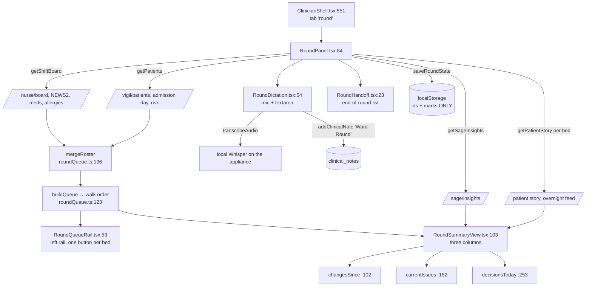
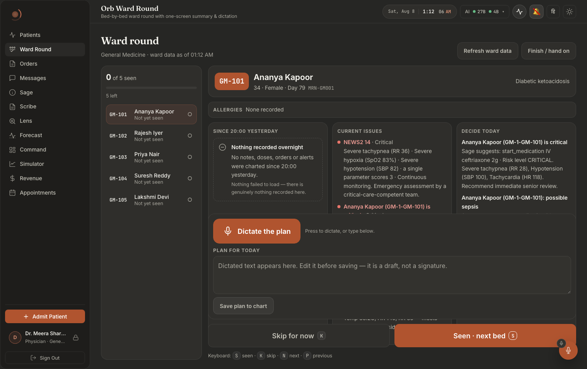
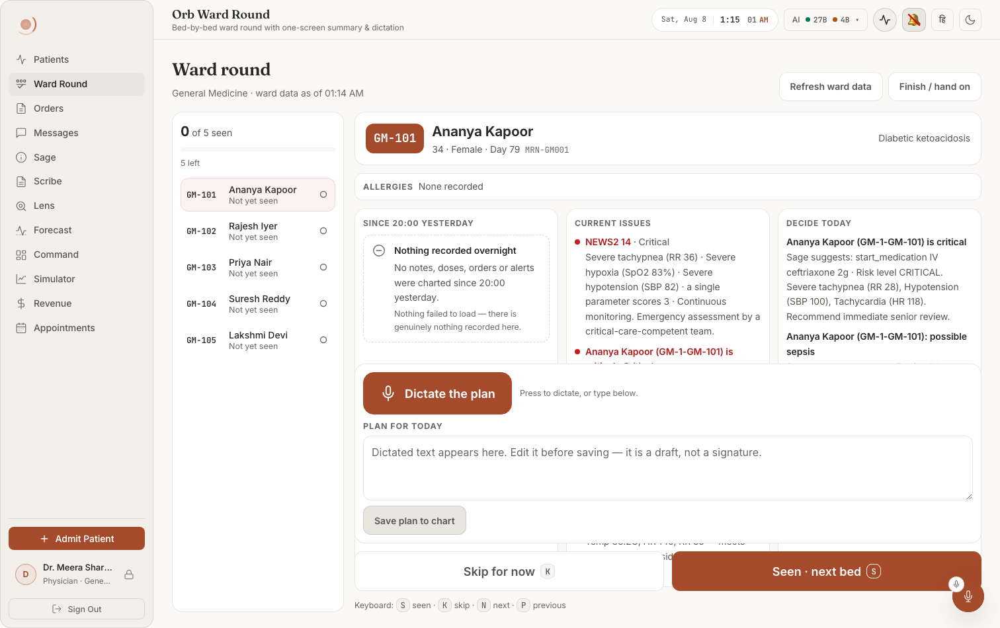
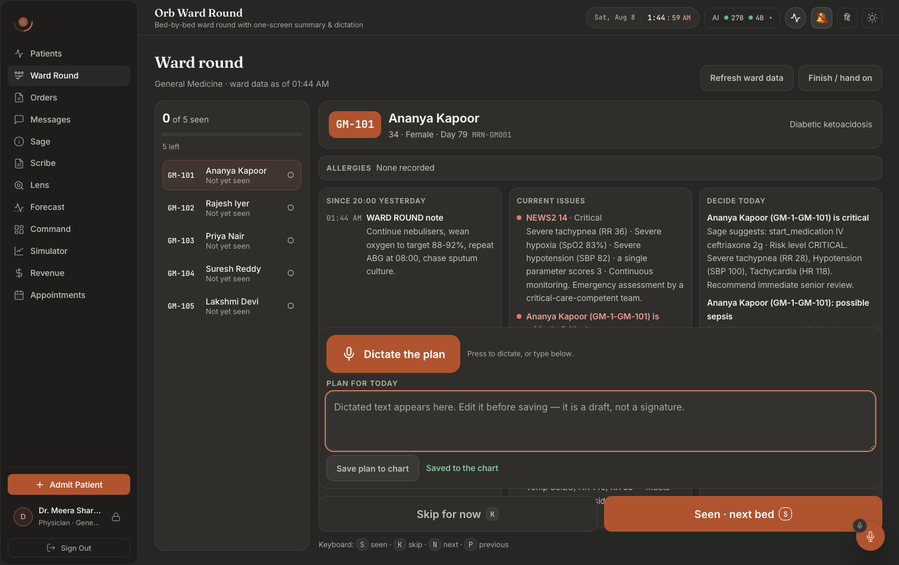
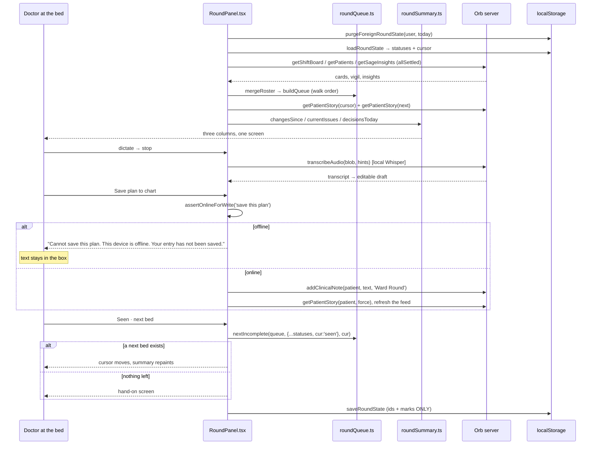

# Ward round mode: a queue Orb drives, one screen, ninety seconds a bed

Built 2026-08-09.

**Open with the constraint, because every line of this subsystem is downstream of it.** A doctor is standing at a bed with a tablet in one hand and roughly **ninety seconds** for this patient. She cannot type. She cannot scroll. She cannot switch tabs. She will be interrupted, a bleep, a nurse, a crash call, and she will come back to the round twenty minutes later and need to know exactly where she was.

The panel's own module docstring states it in the first five lines (`src/pages/panels/RoundPanel.tsx:1-31`), and the five decisions that follow from it are:

1. **A QUEUE, not a list.** Orb drives the sequence bed by bed in **walk order**, tracks seen / skipped / not-yet-reached, and is **resumable**, because a ward round is interrupted constantly. The rules live in a React-free module (`src/components/round/roundQueue.ts`) so they can be tested exhaustively.
2. **One screen, no tabs.** What changed overnight, what is wrong now, what has to be decided today, three columns, side by side, no scrolling of the page.
3. **Voice is the primary input for the plan**, not a convenience. The record button is the biggest target on the screen and the transcript lands in an *editable* box, because dictation is a draft, never a signature.
4. **44px minimum touch targets, nothing hover-only.** Enforced by a test that reads the stylesheet (`src/pages/panels/RoundPanel.test.tsx:335`), because a control quietly styled at 32px is invisible on a desktop and only bites a gloved thumb on a ward tablet.
5. **Loading, empty and error are three visually different shapes.** A blank panel that might mean "no data" and might mean "failed to load" is a clinical hazard: one means "there is nothing to report", the other means "we could not find out", and on a round that difference decides whether the doctor walks away.

**The sharpest decision in the chapter, stated up front.** This panel **refuses** to save a dictated plan when the tablet is offline, rather than queueing it (`src/pages/panels/RoundPanel.tsx:363-405`). `addClinicalNote` routes through the offline mutation queue and would resolve as if the note had been filed, but that queue is deleted wholesale at sign-out, and **a ward round ends in a sign-out**: the tablet goes back on the trolley for the next clinician. The note would be destroyed before the wi-fi returned, silently, and the plan the next shift reads would simply not exist. So there is no `'queued'` save state anywhere in this subsystem, `SaveState` (`src/components/round/RoundDictation.tsx:34`) has four values and none of them is a promise Orb cannot keep.

---

## Purpose and neighbors

**Jargon:**

| Term | Meaning in Orb |
|---|---|
| **Queue** | The roster ordered into the physical walk down the corridor. `RoundPatient[]`, built by `mergeRoster` (`roundQueue.ts:136`). |
| **Cursor** | The bed the clinician is standing at. One patient id, or null. |
| **Status** | `pending` (not yet reached), `skipped` (deliberately deferred, still owed), `seen` (complete). Only `seen` completes a patient (`roundQueue.ts:52`). |
| **Walk order** | Natural bed sort, "GM-9" before "GM-10", not the string sort that puts "GM-10" first. `compareBeds` (`roundQueue.ts:97`). |
| **Overnight window** | The period the change feed covers: since the last 20:00 handover, in **local** wall-clock time. `overnightWindow` (`roundSummary.ts:84`). |
| **Issue** | Something wrong with the patient right now, worst first. Includes *absence of data*, no observations is an issue, not a clean bill. |
| **Decision** | Something this round has to decide: an unverified medication, an open Sage suggestion, or "no plan documented today yet". |
| **Draft** | Dictated or typed plan text, held **in memory only**, never on disk. |
| **Hand-on** | The end-of-round artefact: who was not finished, and whether they were skipped or never reached. |
| **Degraded** | One of the two rosters (or Sage) failed. The round still runs, with a persistent strip naming what is missing. |

**Neighbors:** guide 01-app-shell (`ClinicianShell` tab registration, `PanelErrorBoundary`, lazy chunks), guide 07-vigil (`getPatients`, risk score and drivers), guide 09-sage (`getSageInsights`, the insight state machine), guide 10-sage-proactive-ambient (`SageRuntimeContext`, the microphone claim and the cloud-speech posture), guide 11-scribe (`transcribeAudio`, the local Whisper endpoint), guide 22-handoff-ipass (the nurse-side end-of-shift artefact this one deliberately does not duplicate), guide 28-offline-pwa-downtime (`assertOnlineForWrite`, the read-only offline contract), guide 27-design-system (`--tap-min`, the status text/fill tokens, the no-opacity rule), guide 15-pharmacy-verify (`medications[].unverified`, which becomes a "decide today" line).

---

## File map

| File | Lines | Role |
|---|---:|---|
| `src/pages/panels/RoundPanel.tsx` | 719 | The panel. Owns all state, the roster, story and reasoned-assessment loaders, the queue actions, the keyboard, the offline refusal, and the three top-level phase branches (loading `:495`, error `:503`, empty `:515`). |
| `src/components/round/roundQueue.ts` | 363 | **No React, no fetching, no clinical text.** Bed ordering, the two-pass "next bed" rule, progress, hand-on list, and the whole persistence/purge story. |
| `src/components/round/roundSummary.ts` | 324 | **No React.** Decides what earns a line on a screen that does not scroll: the overnight window, the change feed, issues, decisions, day count. Classifies server-computed fields; never scores a patient itself. |
| `src/components/round/RoundSummaryView.tsx` | 251 | The one-screen summary, patient header, allergy strip, three columns, each owning its own loading/empty/failed state, and Sage's reasoned assessment collapsed underneath. |
| `src/components/round/RoundDictation.tsx` | 362 | The mic button, the retry-held audio, the editable plan box, the save button. |
| `src/components/round/RoundQueueRail.tsx` | 109 | The left rail: progress bar and one 44px `<button>` per bed, status by icon **and** word. |
| `src/components/round/RoundHandoff.tsx` | 86 | The end-of-round screen: unsaved plans first, then who is still owed a visit. |
| `src/components/round/RoundStates.tsx` | 122 | `RoundLoading` (`:18`), `RoundEmpty` (`:31`), `RoundError` (`:66`), `RoundDegraded` (`:106`), four deliberately different shapes. |
| `src/components/round/Round.css` | 1150 | The whole visual layer, namespaced `.round-*`, in the lazy chunk. Tap floors, the three-column grid, per-column scroll with a themed scroll shadow, the tablet breakpoints. |
| `src/pages/panels/RoundPanel.test.tsx` | 345 | The behavioural spec: walk order, skip-and-return, resume, foreign-round purge, the four states, 44px, keyboard. |
| `src/pages/panels/RoundPanel.offline.test.tsx` | 100 | Pins the refuse-don't-queue decision. |
| `src/pages/panels/RoundPanel.dictation.attack.test.tsx` | 209 | Pins the cross-bed dictation boundary, three ways the previous patient's audio could reach this patient's chart. |
| `src/components/round/roundQueue.test.ts` | 280 | Bed order, next/previous, progress, persistence, roster churn. |
| `src/components/round/roundSummary.test.ts` | 264 | The window, the feed cap, "absence of data is a finding", the NEWS2 pass-through. |
| `src/pages/ClinicianShell.tsx` | n/a | Tab registration (`:59`), lazy import (`:276`), the panel branch (`:735-738`), role tab order (`:189`, `:194-196`). |

*Left: the queue rail in walk order with progress. Centre: the patient header, the allergy strip, and the three columns. Below: the dictate block and the two oversized round actions.*

---

## How it works

### Flow 1: mounting a round

1. `ClinicianShell` renders `<RoundPanel />` inside a `PanelErrorBoundary` when the `round` tab is selected (`src/pages/ClinicianShell.tsx:551-555`). The panel is **lazily imported** (`src/pages/ClinicianShell.tsx:120`) so `Round.css` and the whole subsystem stay out of the main bundle.
2. The mount effect (`src/pages/panels/RoundPanel.tsx:276`) runs three things in order: **purge** every other clinician's and every other day's round from this device (`purgeForeignRoundState`), **restore** this clinician's round for today (`loadRoundState`), then load the ward data.
3. `loadRoster` (`src/pages/panels/RoundPanel.tsx:159`) fires **three requests in parallel through `Promise.allSettled`**, the ward board, the patient board, and Sage insights, so one failure cannot cancel the others.
4. `mergeRoster` fuses the two rosters and `buildQueue` sorts them into the corridor walk.
5. The reconcile effect (`src/pages/panels/RoundPanel.tsx:290`) drops marks for patients who have left the ward and points the cursor at a bed that still exists.
6. The prefetch effect (`src/pages/panels/RoundPanel.tsx:315`) loads the current patient's story **and the next one's**, so the walk between beds is off the critical path.
7. The panel takes focus (`src/pages/panels/RoundPanel.tsx:457`) so `S` / `K` / `N` / `P` work without a click.

### Flow 2: ninety seconds at a bed

1. `RoundSummaryView` renders the patient header, the **allergy strip** (always on screen, and it says UNKNOWN rather than showing nothing), then the three columns.
2. **Since 08:00 PM yesterday**, `changesSince` returns the five newest in-window events and a `hidden` count that is **printed, never swallowed** (`src/components/round/RoundSummaryView.tsx:165-170`).
3. **Current issues**, `currentIssues` returns NEWS2 (with the server's band, plus a single-parameter-3 escalation), overdue observations, overdue medications, and open Sage insights, worst first. A patient with no data gets a **warning**, never an empty list.
4. **Decide today**, unverified medications, Sage suggestions carrying their provenance, and "No plan documented today yet".
5. The doctor presses the big red mic, speaks, presses stop. The audio goes to the **local** Whisper endpoint; the transcript appends to an editable textarea.
6. **Save plan to chart** writes an `addClinicalNote` with doc type `Ward Round` (`src/pages/panels/RoundPanel.tsx:82`, `:382`).
7. **Seen · next bed** marks the patient and advances. If a draft is still unsaved, the mark is **blocked** with a two-button choice (`src/pages/panels/RoundPanel.tsx:652-680`).

### Flow 3: the end of the round

1. `markAndAdvance` computes the next bed *before* writing the status, from a hypothetical status map (`src/pages/panels/RoundPanel.tsx:351`). When there is no next bed, it opens the hand-on screen instead of parking the doctor on a patient she has just finished under a button that now does nothing.
2. `savePlan(patientId, thenMarkSeen=true)` reproduces the identical ending (`src/pages/panels/RoundPanel.tsx:388-400`), completing the last bed must end the round the same way whichever button did it.
3. `RoundHandoff` lists **unsaved drafts first**, in a `role="alert"` block, then everyone still owed a visit tagged *Skipped* or *Not reached*. Every row is a button back into the round.

---

## Function-by-function

### File: `src/components/round/roundQueue.ts`: the sequence

The module docstring (`:1-24`) names the three load-bearing rules: bed order is the walk, skip must be usable, resume is the default but the tablet is shared.

#### `RoundPatient` / `RoundStatus` / `RoundState` / `RoundProgress`: `roundQueue.ts:34` / `:52` / `:54` / `:62`
**Signature:** four interfaces/types.
**Does:** The shapes the whole subsystem passes around. `RoundPatient` is the merged patient, identity, bed, ward, diagnosis, admission date, risk. `RoundStatus` is exactly three strings.
**On screen:** `RoundPatient.bed` and `.name` are the two lines of every rail button (`RoundQueueRail.tsx:95-97`); `.age`, `.sex`, `.mrn`, `.diagnosis` are the patient header (`src/components/round/RoundSummaryView.tsx:115-129`); `.admission_date` becomes "Day 4".
**Why `RoundStatus` has three values and not two:** `skipped` and `pending` render as different words and different icons in the rail (`RoundQueueRail.tsx:15-19`) and as different tags on the hand-on screen (`RoundHandoff.tsx:70-72`). "Deliberately deferred" and "never got there" are different handovers.
**Breaks if you change it:** collapse `skipped` into `pending` and `nextIncomplete`'s two-pass rule loses its meaning, the round would re-offer the patient who is in radiology immediately, every time, and stall there.

#### `ROUND_STATE_PREFIX`: `roundQueue.ts:72`
**Signature:** `'orb_round_v1:'`
**Does:** The localStorage namespace. Every stored round key starts with it.
**On screen:** nothing.
**Why it exists:** `purgeForeignRoundState` scans localStorage for exactly this prefix. It is the only way the purge can find rounds it did not write.
**Breaks if you change it:** bump the string and every device silently stops resuming (harmless), but rounds written under the **old** prefix become unpurgeable and sit on the shared tablet forever, which is the disclosure this whole design exists to prevent.

#### `statusOf`: `roundQueue.ts:74`
**Signature:** `(statuses, id) -> RoundStatus`
**Does:** Reads a mark, defaulting to `'pending'`.
**On screen:** decides the icon, the word and the CSS modifier on every rail button.
**Why it exists:** absence of a key means not-yet-seen. Centralising the default means nothing else has to remember that.
**Breaks if you change it:** default to `'seen'` and a fresh round opens claiming every patient is done.

#### `bedTokens` / `compareBeds`: `roundQueue.ts:84` / `:97`
**Signature:** `(bed) -> (string|number)[]` / `(a, b) -> number`
**Does:** Splits "GM-10" into `["gm-", 10]` so digit runs compare as numbers, then compares token by token.
**On screen:** **the order of the rail, top to bottom, and therefore the order the round walks.** This is the single most physically consequential function in the chapter.
**How it works:** empty beds sort **last** (`:100`), an empty string wins a plain sort, which would open the round on a patient with no bed to walk to. Numbers precede letters at the same position (`:112`), so "4" comes before "4A".
**Breaks if you change it:** revert to `localeCompare` and the round becomes GM-1, GM-10, GM-11, GM-2, the doctor walks the corridor four times. Pinned by `roundQueue.test.ts:65-86`.

#### `buildQueue`: `roundQueue.ts:123`
**Signature:** `(patients) -> RoundPatient[]`
**Does:** Sorts by bed, then by id as a tiebreak.
**On screen:** the rail order and the first bed the panel opens on.
**Why the id tiebreak:** two patients in the same bed (a mid-transfer overlap) would otherwise sort unstably and the rail would reshuffle between renders.
**Breaks if you change it:** dropping the tiebreak makes the queue order non-deterministic across refreshes, so "position 7 of 12" in the rail's `aria-label` stops meaning anything.

#### `mergeRoster`: `roundQueue.ts:136`
**Signature:** `(cards: NursePatientCard[], vigil: Patient[]) -> RoundPatient[]`
**Does:** Fuses the two department-scoped rosters into one queue. The ward board wins on clinical fields; the patient board supplies admission date, risk score, risk level and drivers, which the ward board does not carry (`:163-170`).
**On screen:** **the entire queue.** Every rail button, and every patient header.
**Why it exists, and this is the load-bearing paragraph:** each roster is a separate request and one can fail while the other succeeds. A patient present in only **one** of them still gets a bed on the round. Dropping them because the other request failed would mean a network blip silently removes a patient from the doctor's round, the worst possible failure mode for this screen.
**Breaks if you change it:** switching to an inner join means a Vigil hiccup deletes patients from a ward round with no message anywhere. Pinned by `roundQueue.test.ts:243-254`.
**Gotchas:** neither request sends a scope, both derive the cohort from the authenticated user's `permissions.department_scope` server-side, so this client **cannot widen one** (stated at `src/pages/panels/RoundPanel.tsx:18-22`).

#### `walkFrom`: `roundQueue.ts:196`
**Signature:** `function*(queue, fromId) -> Generator<RoundPatient>`
**Does:** Yields the queue circularly, starting just after `fromId`.
**On screen:** nothing directly, it is the traversal both passes of `nextIncomplete` use.
**Why circular:** the round wraps to the top rather than dead-ending at the last bed, so a doctor who started in the middle of the corridor still gets offered the beds behind her.
**Breaks if you change it:** make it linear and the round ends at the last bed with pending patients still above the cursor, silently.

#### `nextIncomplete`: `roundQueue.ts:212`
**Signature:** `(queue, statuses, fromId) -> string | null`
**Does:** The next bed to walk to, or null when the round is finished.
**On screen:** **what "Seen · next bed" and "Skip for now" actually do** (`src/pages/panels/RoundPanel.tsx:351`), what `N` does (`:434`), and which patient gets prefetched (`:318`). A null return is what opens the hand-on screen (`:360`).
**How it works, two passes on purpose:** the first looks only for beds never reached, so skipping a patient moves the round **on**. The second returns to skipped beds once nothing else is pending, that is what stops a skip from quietly becoming a patient nobody saw. The second pass excludes `fromId` (`:221`) so "next" from a bed you just skipped is never that same bed.
**Breaks if you change it:** a single-pass "next incomplete" hands the skipped patient straight back, and the doctor cannot get past the empty bed. Merge the passes the other way and skipped patients get revisited before unseen ones, which walks the corridor backwards. Pinned by `roundQueue.test.ts:99-126`.

#### `previousInQueue`: `roundQueue.ts:227`
**Signature:** `(queue, fromId) -> string | null`
**Does:** One step back through the **physical** order, ignoring status.
**On screen:** the `P` shortcut (`src/pages/panels/RoundPanel.tsx:439`).
**Why status is ignored:** this is a correction, "I marked the wrong patient", so it must reach a bed already marked seen. `nextIncomplete` deliberately cannot.
**Breaks if you change it:** filter it by status and there is no way back to a patient you just mis-marked, on a screen with no undo.

#### `progressOf`: `roundQueue.ts:236`
**Signature:** `(queue, statuses) -> RoundProgress`
**Does:** Counts seen / skipped / pending, derives `remaining = skipped + pending` and `complete`.
**On screen:** the rail head, "**7** of 12 seen", the progress bar fill, and "5 left · 2 skipped" (`RoundQueueRail.tsx:59-79`); the resumed strip's ": 7 already seen" (`src/pages/panels/RoundPanel.tsx:567`); the hand-on subtitle (`RoundHandoff.tsx:32-36`); and the "Round complete" empty state (`src/pages/panels/RoundPanel.tsx:707`).
**Why `complete` requires `queue.length > 0`:** an empty ward would otherwise report a completed round.
**Breaks if you change it:** counting skipped as complete makes the progress bar lie about a deferred patient, which is precisely the patient the hand-on list exists for.

#### `handoffList`: `roundQueue.ts:260`
**Signature:** `(queue, statuses) -> {patient, status}[]`
**Does:** Everyone not `seen`, in walk order, each carrying why.
**On screen:** the "Still to be seen" list on the hand-on screen (`RoundHandoff.tsx:64-77`), each row tagged **Skipped** (amber) or **Not reached** (info).
**Why it exists:** at the end of a round the useful artefact is not "12 patients seen", it is the short list of people who still need a doctor.
**Breaks if you change it:** sort it by status instead of walk order and the incoming doctor gets a list she cannot walk.

#### `todayKey`: `roundQueue.ts:274`
**Signature:** `(now = new Date()) -> "YYYY-MM-DD"` from **local** calendar fields
**Does:** The date half of the storage key.
**On screen:** nothing visible, but it decides whether the resumed banner appears at all.
**Why local and not UTC:** a round belongs to a shift and the tablet's clock is the shift's clock. IST is +05:30, so a 04:00 ward round is still "yesterday" in UTC and a UTC-derived key would roll over mid-round.
**Breaks if you change it:** use `toISOString().slice(0,10)` and an early-morning Indian ward round splits across two keys, the doctor's progress vanishes halfway through and cannot be recovered, because the old key is then a "foreign" round and gets purged on the next mount.

#### `roundStateKey`: `roundQueue.ts:279`
**Signature:** `(userId, dateKey) -> string`
**Does:** `orb_round_v1:<user>:<date>`.
**On screen:** nothing.
**Breaks if you change it:** the format is what makes "this clinician, today" the single key the purge keeps. Put the date first and a user-scoped purge becomes impossible.

#### `saveRoundState`: `roundQueue.ts:283`
**Signature:** `(state: RoundState) -> void`
**Does:** Writes `{userId, dateKey, cursor, statuses}` to localStorage.
**On screen:** nothing at write time; it is what makes the "Resumed your round from earlier today" strip appear after a reload.
**Why the explicit field list and not a spread (`:289-294`):** this is **the guarantee that no clinical text can ever be written to the device by accident**. A spread would happily persist whatever a future refactor added to the state object.
**Why the empty `catch` (`:296`):** storage full or disabled (private mode). The round still works in memory; only resume-after-reload is lost, which is better than a crash mid-round.
**Breaks if you change it:** persisting `drafts`, the obvious "improvement", puts free clinical text about a named patient on a shared ward tablet's disk. Pinned by `roundQueue.test.ts:206`, which asserts no names, beds or clinical text are stored.

#### `loadRoundState`: `roundQueue.ts:302`
**Signature:** `(userId, dateKey) -> RoundState | null`
**Does:** Restores a round, validating it belongs to this user and this day (`:308`) and whitelisting each status value (`:310-312`).
**On screen:** the restored rail marks, the restored cursor, and the "Resumed your round from earlier today" strip.
**Why the per-value validation:** a hand-edited or half-written localStorage entry could otherwise inject a status string that renders as `undefined` in the rail's `STATUS_WORD` lookup.
**Breaks if you change it:** drop the `userId`/`dateKey` check and a colleague's round is restored under this doctor's name, she would be told patients were seen when she has not seen them. Remove the `try/catch` (`:319`) and one corrupt payload makes the panel throw on mount, permanently, with no way out except clearing site data.

#### `purgeForeignRoundState`: `roundQueue.ts:332`
**Signature:** `(userId, dateKey) -> void`
**Does:** **Deletes** every stored round except this clinician's round for today.
**On screen:** nothing, deliberately invisible. Its effect is that a colleague's round is never restored.
**Why erase rather than ignore:** a ward tablet passes between doctors. Leaving yesterday's or a colleague's round on disk discloses **which patients a named clinician visited**, which is itself PHI-adjacent disclosure regardless of whether Orb ever reads it back.
**Breaks if you change it:** switching to read-time filtering ("just don't restore it") leaves the data on the device. Pinned by `roundQueue.test.ts:184-200` and by the panel test at `RoundPanel.test.tsx:144`.

#### `reconcileStatuses`: `roundQueue.ts:353`
**Signature:** `(queue, statuses) -> Record<string, RoundStatus>`
**Does:** Drops marks for patients no longer on the roster.
**On screen:** the rail count and "N left", a discharged patient stops counting toward "remaining".
**Why it exists:** patients are discharged and admitted mid-round. A patient admitted mid-round simply has no mark, which reads as not-yet-seen, which is correct.
**Breaks if you change it:** keep the stale marks and "3 left" includes people who went home. The panel guards the rewrite with a key-count comparison (`src/pages/panels/RoundPanel.tsx:294`) so an unchanged roster does not produce a new object and an infinite render loop.

---

### File: `src/components/round/roundSummary.ts`: what earns a line

The docstring (`:1-22`) states the two rules: **no invented clinical scoring** (every clinical judgement is a field the server computed) and **absence of data is a finding, not a clean bill**.

#### `HANDOVER_HOUR` / `CLOSED_INSIGHT_STATES` / `DOCUMENTATION_TYPES` / `SEVERITY_RANK`: `src/components/round/roundSummary.ts:41` / `:44` / `:47` / `:81`
**Signature:** `20` / `Set(['dismissed','acted','resolved','superseded'])` / `Set(['note','scribe'])` / `{critical:0, warning:1, info:2}`
**Does:** The four constants the module's judgement is made of.
**On screen:** `HANDOVER_HOUR` is printed through `formatClinicalTime`, so the first column's heading reads "Since 08:00 PM yesterday", on the same 12-hour clock as the rows under it. `SEVERITY_RANK` is the order of the issues list. `CLOSED_INSIGHT_STATES` decides which Sage flags appear at all.
**Breaks if you change it:** move `HANDOVER_HOUR` to 22 and a 21:00 event silently drops out of "what changed overnight". Add a state to `CLOSED_INSIGHT_STATES` that Sage does not actually use and every insight in that state disappears from the round with no trace. Drop `'scribe'` from `DOCUMENTATION_TYPES` and a doctor who dictated through Scribe is still told "No plan documented today yet".

#### `startOfLocalDay` / `sameLocalDay`: `src/components/round/roundSummary.ts:83` / `:87`
**Signature:** `(Date) -> Date` / `(a, b) -> boolean`
**Does:** Local-midnight helpers.
**On screen:** they decide whether the window label says "today" or "yesterday", whether a note counts as today's plan, and the "Day N" number.
**Breaks if you change it:** anything UTC-based here shifts every one of those by 5½ hours in India.

#### `overnightWindow`: `src/components/round/roundSummary.ts:97`
**Signature:** `(now) -> {start: Date, sinceLabel: string}`
**Does:** The period the change feed covers, back to the most recent 20:00, which is yesterday's for a morning round and today's after 20:00.
**On screen:** **the first column's heading, verbatim**, "Since 08:00 PM yesterday" (`src/components/round/RoundSummaryView.tsx:136-138`), and the empty-state sentence "No notes, doses, orders or alerts were charted since 08:00 PM yesterday." (`:150`). The label used to be a 24-hour "20:00", which sat over rows printed as "06:40 AM" (`src/components/round/roundSummary.ts:89-90`).
**Why the label is a field and not a format call at the render site:** the doctor must know **exactly** what period the feed covers rather than trusting a vague "recent". "Recent" on a clinical screen is an invitation to assume.
**Breaks if you change it:** compute the boundary in UTC and in IST it lands at 01:30, mid-round, so the feed would start excluding the evening the doctor is asking about. Pinned by `roundSummary.test.ts:71-83`.

#### `changesSince`: `src/components/round/roundSummary.ts:113`
**Signature:** `(story, window, limit = 6) -> {events, hidden}`
**Does:** In-window events, newest first, capped. `hidden` is what the cap removed.
**On screen:** the first column's list (`src/components/round/RoundSummaryView.tsx:154-164`), one row per event with a time and a title, and, when `hidden > 0`, the line "**3 more events overnight: open the full chart to see them.**" (`:165-170`). The view calls it with `limit = 5` (`:108`), not the default.
**How it works:** an event with **no timestamp is dropped** (`:109`) rather than dated to now. Timestamps are parsed with `parseUTC` (`src/lib/datetime.ts:17`), because bare SQLite timestamps have no zone and reading them as local time shifts every overnight event by the offset.
**Why `hidden` exists at all:** "3 more overnight" and "nothing else happened" are **different clinical facts**, and a screen that does not scroll must never silently truncate.
**Breaks if you change it:** returning a bare array removes the only signal that the column is incomplete. Defaulting an undated event to `now` puts an event of unknown age at the top of "what changed overnight". Pinned by `roundSummary.test.ts:98-125`.

#### `openInsightsFor`: `src/components/round/roundSummary.ts:135`
**Signature:** `(patientId, insights) -> SageInsight[]`
**Does:** Filters the whole-ward insight list down to this patient's open ones.
**On screen:** the Sage rows in **both** the issues column and the decisions column.
**Why it takes a nullable id:** `decisionsToday` may be called with no card at all, and returning nothing is correct there.
**Breaks if you change it:** drop the `patient_id` equality and another patient's Sage flag renders under this patient's name at a bedside, a cross-patient safety display error, and the sort of thing the ward would (correctly) never trust the panel again after.

#### `currentIssues`: `src/components/round/roundSummary.ts:165`
**Signature:** `(card: NursePatientCard | null, insights) -> RoundIssue[]`, sorted critical → warning → info
**Does:** Everything wrong with this patient right now.
**On screen:** the **middle column**. Each issue is a coloured dot, a bold label, the severity **word** (`src/components/round/RoundSummaryView.tsx:195`, the word as well as the colour), and a detail line.
**How it works, in order:**
1. **No card at all** (`:158-168`) → a single warning, "No ward data for this patient, Observations, medications and scores could not be matched to this bed. Check the chart directly."
2. **No NEWS2** (`:170-178`) → "No observations recorded, This patient has no scored observation set. That is missing data, not a normal result. It does not mean the patient is stable."
3. **NEWS2 present** (`:179-201`) → severity comes from the **server's** band (`critical` → critical, `elevated` → warning). The `single_param_3` rule can only **raise** it, never lower it (`:186`). The detail line joins the server's drivers, "a single parameter scores 3", "SpO₂ Scale 2" and the board's `obs_response`.
4. Overdue observations (`:203`), with the last set rendered through `formatUTCDateTime`, the comment at `:209-210` records that the raw column once printed `2026-08-01T19:07:35.972867+00:00` to a doctor mid-round.
5. Overdue medications (`:217`), naming the drugs.
6. Open Sage insights (`:230`), each detail prefixed with the time its numbers were read ("At 06:40 AM: …", `datedDetail`). A vitals insight (deterioration, trajectory, sepsis) whose numbers are older than the card's latest observation is dropped (`overtakenByLatestObs`, `:138`), because the newer set no longer supports it: it once printed "SpO2 falling to 91%" beside a chart reading 97.
**Why the empty list is so tightly constrained:** it returns empty **only** when the server actually scored the patient and found nothing. An empty list on a clinical screen reads as "nothing wrong", and the product has already been bitten by this once (`src/components/errorStates.test.tsx`).
**Breaks if you change it:** return `[]` when `card` is null and a patient the ward board did not carry renders as "No active issues", a confident all-clear derived from a missing row. Re-derive NEWS2 here instead of passing the server's through and you get a second, subtly different implementation that disagrees with the nurse's screen at 3am. Pinned by `roundSummary.test.ts:127-226`.

#### `decisionsToday`: `src/components/round/roundSummary.ts:282`
**Signature:** `(card, insights, hasPlanToday) -> RoundDecision[]`
**Does:** What this round has to decide.
**On screen:** the **third column**. Three sources:
- an **unverified** medication (`:260-268`) → "Amoxicillin 500mg PO, AI-extracted and not yet verified by a pharmacist. It cannot be given until it is."
- an open Sage insight with a suggested action (`:270-284`) → "**Sage suggests:** Review medication cefepime · At 06:40 AM: …". The action code goes through `humaniseEnum` and is never printed raw, and the same overtaken-vitals filter as `currentIssues` applies. The provenance travels with the suggestion, because this is **Sage proposing, not Orb instructing**, and the doctor must see that at a glance.
- no plan documented (`:286-293`) → "No plan documented today yet, Dictate the plan below: this round is the record."
**Why `hasPlanToday` is a parameter and not derived here:** the caller can also feed in a plan saved **seconds ago in this very round**, before the story feed has caught up (`src/pages/panels/RoundPanel.tsx:474-478`, using the `planSaved` map).
**Why it is deliberately short:** a list of "consider reviewing" items is noise at a bedside. Only concrete, actionable things get a line.
**Breaks if you change it:** derive `hasPlanToday` internally from the story and the "No plan documented today yet" line stays on screen for several seconds after the doctor saved her plan, which teaches her the save did not work.

#### `documentedToday`: `src/components/round/roundSummary.ts:331`
**Signature:** `(story, now) -> boolean`
**Does:** Has a `note` or `scribe` event been written for this patient today?
**On screen:** it is the **only** thing that removes the "No plan documented today yet" line from the third column.
**Why doses and orders do not count (stated at `:298-301`):** treating a patient is not the same as reviewing one, and conflating them silences the prompt on **exactly the patients who are being managed but not seen**.
**Breaks if you change it:** widen `DOCUMENTATION_TYPES` to include `medication` or `order` and the round stops asking for a plan on the sickest patients on the ward, who are the ones with the most orders. Pinned by `roundSummary.test.ts:279-292`.

#### `admissionDay`: `src/components/round/roundSummary.ts:342`
**Signature:** `(admissionDate, now) -> number | null`
**Does:** Ward day number, admission date is **day 1**, counted the way a whiteboard counts it.
**On screen:** the "Day 4" segment of the patient header meta line (`src/components/round/RoundSummaryView.tsx:123`). Null renders nothing at all rather than "Day null".
**How it works:** the difference between local midnights, not elapsed 24-hour blocks, so the count turns over at midnight.
**Breaks if you change it:** use elapsed hours and a patient admitted at 23:00 is still "Day 1" at lunchtime the next day, disagreeing with every whiteboard on the ward. Pinned by `roundSummary.test.ts:294-305`.

---

### File: `src/components/round/RoundStates.tsx`: four shapes, on purpose

The docstring (`:1-15`) is the whole rationale: a blank region on a clinical screen is a hazard, because "there is nothing to report" and "we could not find out" look identical when both render as nothing. Each state gets a distinct **shape**, not just distinct words.

#### `RoundLoading`: `RoundStates.tsx:18`
**Signature:** `({label, lines = 3}) -> JSX`
**Does:** Animated grey skeleton bars of decreasing width, with `role="status"`, `aria-busy` and `aria-live="polite"`.
**On screen:** three places, the whole-panel "Loading the ward round…" with 4 bars (`src/pages/panels/RoundPanel.tsx:498`), "Opening the next bed…" (`src/pages/panels/RoundPanel.tsx:712`), and "Loading overnight events…" inside the first column (`src/components/round/RoundSummaryView.tsx:140`).
**Why skeleton bars and not a spinner:** the bars occupy the shape the content will occupy, so the screen does not jump, and, more importantly, they are **obviously in progress** rather than obviously blank.
**Breaks if you change it:** rendering `null` while loading is exactly the hazard the file exists to prevent. Dropping `aria-busy` removes the only announcement a screen-reader user gets that the round is still arriving. Its animation is disabled under `prefers-reduced-motion` (`Round.css:1141-1145`).

#### `RoundEmpty`: `RoundStates.tsx:31`
**Signature:** `({title, detail, icon?, reassurance = 'Nothing failed to load, there is genuinely nothing recorded here.'}) -> JSX`
**Does:** An outlined card with a neutral circle-minus icon, a title, an explanation, and, by default, an explicit sentence saying **this is not a failure**.
**On screen:** five uses. "No patients to round on" (`src/pages/panels/RoundPanel.tsx:519`), "Round complete" (`src/pages/panels/RoundPanel.tsx:707`), "Nothing recorded overnight" (`src/components/round/RoundSummaryView.tsx:149`), "No active issues" (`src/components/round/RoundSummaryView.tsx:183`), "Nothing outstanding" (`src/components/round/RoundSummaryView.tsx:210`).
**Why `reassurance` is overridable to `null`:** pass `null` where the empty state is an **achievement** rather than an absence of clinical data. "Round complete" does it (`src/pages/panels/RoundPanel.tsx:709`), telling a doctor who just finished her round that nothing failed to load is noise.
**Breaks if you change it:** remove the reassurance line and "No active issues" becomes indistinguishable from a failed issues computation. Style it like `.round-state--error` and "nothing to report" reads as "something went wrong", which sends a doctor to a chart she does not need to open.

#### `RoundError`: `RoundStates.tsx:66`
**Signature:** `({title, message, onRetry?, retryLabel = 'Retry'}) -> JSX`
**Does:** `role="alert"`, a warning-triangle icon, the **real** error text, a Retry button, and the sentence that matters most.
**On screen:** the whole-panel failure (`src/pages/panels/RoundPanel.tsx:506`) and the overnight column's own failure (`src/components/round/RoundSummaryView.tsx:142`).
**The sentence (`:90-93`):** *"This is a display failure, not an all-clear. Do not read the missing information as normal, check the chart directly."*
**Why the real message is shown:** a generic "Something went wrong" gives the doctor nothing to tell IT and nothing to judge severity by.
**Breaks if you change it:** dropping that warning sentence is the entire difference between this and `RoundEmpty`, the two would then differ only by icon colour, and colour alone fails on a sunlit ward tablet. Dropping `role="alert"` removes the only screen-reader announcement that a clinical column failed.

#### `RoundDegraded`: `RoundStates.tsx:106`
**Signature:** `({message, onRetry?}) -> JSX`
**Does:** A compact, **persistent** strip for a partial failure: the round is usable, but one source is missing and the doctor must know which.
**On screen:** three uses, all naming exactly what is gone, "Ward board unavailable (…). Scores, medications and allergies are missing from this round." (`src/pages/panels/RoundPanel.tsx:580`), "Patient board unavailable (…). Admission day and risk level are missing from this round." (`src/pages/panels/RoundPanel.tsx:586`), and inside the issues column, "Sage surveillance flags could not be loaded. This list may be incomplete." (`src/components/round/RoundSummaryView.tsx:179`).
**Why it is a strip and not a modal:** it has to stay on screen for the whole round without blocking it. A dismissible toast would vanish before the doctor reached the bed where it mattered.
**Breaks if you change it:** make it dismissible, or make it a one-shot toast, and a doctor rounds for forty minutes on a screen that is quietly missing every allergy. Naming the *consequence* rather than the endpoint is the point, "board request failed" tells a clinician nothing.

---

### File: `src/components/round/RoundQueueRail.tsx`: the queue made visible

#### `STATUS_WORD`: `RoundQueueRail.tsx:15`
**Signature:** `Record<RoundStatus, string>`, `'Seen'`, `'Skipped, still owed'`, `'Not yet seen'`
**Does:** The words next to each bed.
**On screen:** the second line of every rail button, **and** part of each button's `aria-label`.
**Why "Skipped, still owed" and not "Skipped":** the whole reason `skipped` is a separate status is that it is a debt. The word carries that; a colour cannot.
**Breaks if you change it:** shorten it to "Skipped" and the rail stops communicating that the round is not finished until those beds are revisited.

#### `StatusMark`: `RoundQueueRail.tsx:21`
**Signature:** `({status}) -> JSX`, tick / skip-arrow / hollow circle
**Does:** The status icon, `aria-hidden` because the word already carries the meaning.
**On screen:** the right-hand glyph on every rail row.
**Why icon **and** word:** colour-blind clinicians and a sunlit ward window both defeat a colour-only cue (`:9-10`). The colour is applied on top, through `--status-ok-text` / `--status-warn-text` (`Round.css:328-331`).
**Breaks if you change it:** collapse to colour alone and the rail becomes unreadable in exactly the two conditions ward tablets live in.

#### `RoundQueueRail`: `RoundQueueRail.tsx:53`
**Signature:** `({queue, statuses, cursor, progress, onSelect}) -> JSX`
**Does:** The whole left rail.
**On screen, element by element:**
- **"7 of 12 seen"** (`:59-62`) with the number in bold.
- **The progress bar** (`:65-74`), a real `role="progressbar"` with `aria-valuenow/min/max` and a spoken label, filled by percentage (`:54`, `:73`).
- **"5 left · 2 skipped"** (`:75-79`), `aria-live="polite"` so a keyboard or screen-reader user hears progress move after every action without hunting for it. Reads "Every bed seen" at zero.
- **One `<button>` per bed** (`:88-102`), bed number in mono, patient name, status word, status icon. `aria-current="true"` marks where the doctor is standing; the `aria-label` (`:93`) is the full sentence "Bed GM-4, Anita Rao, Not yet seen. Position 3 of 12."
**Why a real `<button>` and not a clickable div:** it is a navigation control, so it must be reachable by Tab and activated by Enter or Space. `Round.css:258-273` gives it `min-height: var(--tap-min)`, 44px, for a gloved thumb.
**Breaks if you change it:** a div with an `onClick` removes keyboard access to every bed in the round. Removing `aria-current` removes the only non-visual signal of where the round is. Below 900px the rail flips to a horizontal scrolling strip above the summary (`Round.css:1108-1126`) so the bedside content keeps full width.

---

### File: `src/components/round/RoundSummaryView.tsx`: one screen, three questions

#### `LoadPhase`: `src/components/round/RoundSummaryView.tsx:34`
**Signature:** `'loading' | 'ready' | 'error'`
**Does:** The per-patient story's phase. Exported and re-used as the roster phase in the panel (`src/pages/panels/RoundPanel.tsx:55`, `:96`).
**On screen:** it selects which of `RoundLoading` / `RoundError` / the content renders in the first column, and which of the three whole-panel branches renders.
**Breaks if you change it:** collapsing `error` into `ready` with an empty array makes a failed story render as "Nothing recorded overnight", the exact confusion `RoundStates.tsx` exists to prevent. Pinned by `RoundPanel.test.tsx:322`.

#### `SEVERITY_CLASS`: `src/components/round/RoundSummaryView.tsx:54`
**Signature:** `{critical:'danger', warning:'warn', info:'info'}`
**Does:** Maps clinical severity onto the design system's status tokens.
**On screen:** the dot colour and the title colour of every issue row (`Round.css:621-626`).
**Breaks if you change it:** map `critical` to `warn` and the most dangerous row on the screen renders amber. The severity **word** is printed alongside (`:195`), which is what stops a mapping bug from being silent.

#### `AllergyStrip`: `src/components/round/RoundSummaryView.tsx:63`
**Signature:** `({card}) -> JSX`
**Does:** The allergy row. Three distinct renders.
**On screen:** a full-width strip directly under the patient header (`:131`), always present:
- **no card** (`:64-73`) → `role="alert"`, "Allergies, **Unknown, ward data unavailable. Check the chart before prescribing.**"
- **empty list** (`:74-81`) → "Allergies, None recorded"
- **allergies present** (`:82-100`) → red/amber chips, **severe first** (`:82-84`), each showing substance and reaction.
**Why unknown says UNKNOWN (`:11-13`):** an empty allergy row reads as "no allergies" to anyone about to prescribe. That is the wrong way to fail, and it is a distinction that a rendering shortcut ("just map the array") destroys.
**Breaks if you change it:** render nothing when `card` is null and the strip silently claims a patient has no allergies because a roster request failed. Drop the severe-first sort and an anaphylaxis chip can end up below three mild ones on a narrow tablet.

#### `RoundSummaryView`: `src/components/round/RoundSummaryView.tsx:103`
**Signature:** `({patient, card, storyPhase, story, storyError, onRetryStory, insights, insightsFailed, hasPlanToday, assessment, now}) -> JSX`
**Does:** The one-screen summary. It computes nothing clinical, it calls the five pure functions (`:107-111`) and lays the results out.
**On screen:**
- **The patient header** (`:115-129`), bed number in a mono badge, name as an `<h2>`, meta line "62 · F · Day 4" plus MRN, and the diagnosis right-aligned.
- **The allergy strip** (`:131`).
- **The three-column grid** (`:133`), "Since 08:00 PM yesterday", "Current issues", "Decide today".
- **Sage's reasoned assessment** (`:243-248`), only when `assessment` carries a heading and text (`hasAssessment`, `:59`). It sits **below** the three columns, collapsed in a `
` whose summary line is the server's heading verbatim, and is keyed by patient and assessment id so an opened block never stays open for the next bed. The comment at `:228-242` records why it is collapsed: rendered open it squeezed the three columns to 0px on exactly the sickest patients.
**How each column fails independently (`:15-17`):** the overnight feed is a **separate request** from the ward board, so it can fail on its own, and when it does that column shows `RoundError` with a Retry, instead of rendering as a quiet night. The issues column shows a `RoundDegraded` strip when Sage failed but still renders the rest of the issues.
**Why the three columns scroll individually rather than the block scrolling as one (`Round.css:494-497`):** all three headings stay on screen while a long column is read, which is the whole claim the panel makes about itself. `Round.css:498-541` documents the scroll-shadow affordance and why it had to be derived from `--text-primary`, the previous hardcoded `rgba(0,0,0,0.14)` was literally invisible on the night theme, so on two of the three themes Orb ships the "there is more below" cue did not exist, and the Current issues column routinely holds 690px of text in a 164px box.
**Breaks if you change it:** compute NEWS2, or any severity, here instead of in `roundSummary.ts` and the frontend acquires a second clinical scorer. Give the three columns one shared loading state and a slow story request blanks the issues column, which never needed it. Remove `.round-summary { overflow: hidden }` (`Round.css:345-352`) and the bug documented at `Round.css:337-344` returns, the columns overflow `.round-main` and the opaque dictation block paints over the bottom ~340px of all three, clipping "Current issues" mid-sentence on a page that does not scroll.

---

### File: `src/components/round/RoundDictation.tsx`: voice as the primary input

The docstring (`:1-21`) states the PHI posture: transcription is **always** the local Whisper endpoint on the appliance, and nothing else listens. Until 4 October 2026 the browser's Web Speech API, which streams microphone audio to a cloud recogniser, could drive a live "Hearing…" preview line when the deployment posture permitted cloud speech (its output never entered the note). It was removed when Orb was ruled strictly offline, and there is no setting that turns it back on.

#### `SaveState`: `RoundDictation.tsx:34`
**Signature:** `'idle' | 'saving' | 'saved' | 'error'`
**Does:** The save button's four states.
**On screen:** the button label ("Save plan to chart" / "Saving…"), the green "Saved to the chart" (`:351-353`), and the red inline error (`:354-358`).
**Why there is deliberately no `'queued'` (`:26-33`):** there used to be. Offline, the API client queued the note and this said "held on this tablet and sent when it reconnects". The first half was true and the second was not, the queue is deleted wholesale at sign-out, and a ward round ends by handing the tablet on. A promise Orb cannot keep about a plan the next shift is relying on is worse than a refusal.
**Breaks if you change it:** re-adding `'queued'` re-adds the lie. Pinned by `RoundPanel.offline.test.tsx:68`, which asserts both that `addClinicalNote` was never called and that no `.round-dictate__queued` element exists.

#### `mmss`: `RoundDictation.tsx:48`
**Signature:** `(seconds) -> "M:SS"`
**Does:** Formats the recording timer.
**On screen:** the mic button's own label while recording, "**Stop · 0:47**".
**Why on the button:** the elapsed time has to be where the thumb already is. A doctor who does not know she is still recording is a doctor whose next conversation ends up in a chart.
**Breaks if you change it:** move the timer off the button and the only remaining recording cue is the red fill plus a pulsing dot, both of which fail in sunlight and under `prefers-reduced-motion` (`Round.css:1141-1145`).

#### `teardownCapture`: `RoundDictation.tsx:76`
**Signature:** `useCallback(() => void)`
**Does:** Stops the timer, stops every media track, and **releases the shared microphone claim**.
**On screen:** the recording indicator disappears; the tablet's OS microphone indicator goes out.
**Why `releaseMic('round')` matters:** the microphone is a single shared resource arbitrated by `SageRuntimeContext` (`claimMic` at `src/contexts/SageRuntimeProvider.tsx:18`). Failing to release it means Sage's voice input is dead for the rest of the session with no error anyone can act on.
**Breaks if you change it:** drop the track stop and the browser keeps the mic open, a hot microphone on a ward, carried from bed to bed.

#### `appendToDraft`: `RoundDictation.tsx:81`
**Signature:** `(text) -> void`
**Does:** Appends a transcript to the existing draft on a new line, via `draftRef` so it reads the current value rather than a stale closure.
**On screen:** the text that appears in the "Plan for today" textarea after a dictation.
**Why append and not replace:** a doctor dictates in bursts, one sentence, look at the chart, another sentence. Replacing would delete the first.
**Breaks if you change it:** read `draft` from props instead of `draftRef` and a second dictation overwrites the first, because the callback captured the empty string.

#### `runTranscription`: `RoundDictation.tsx:88`
**Signature:** `async (blob) -> void`
**Does:** Sends the audio to the local Whisper endpoint with the patient's name and diagnosis as hints, and appends the transcript.
**On screen:** "Transcribing on this appliance…" (`:296`), then either text in the box, or the amber error block.
**How the three outcomes read:** a transcript appends; an **empty** transcript says "Nothing was transcribed from that recording. Try again, closer to the microphone."; a thrown error says "Transcription failed: … **The recording is still here, retry, or type the plan.**"
**Why the failure message names the held recording:** `lastBlobRef` (`:72`) keeps the audio so a failed transcription can be retried without asking the doctor to say it all again, "the single most infuriating way to lose a ward round".
**Breaks if you change it:** pass `skipCorrection = true` (the third argument, currently `false` at `:99`) and the transcript loses the accuracy pass. Discard `lastBlobRef` on failure and the Retry button at `:318-326` has nothing to retry, so it renders and does nothing.

#### `stopRecording`: `RoundDictation.tsx:107`
**Signature:** `() -> void`
**Does:** Stops the recorder, assembles the chunks into one `audio/webm` blob, and either rejects it as too short or sends it to transcription.
**On screen:** the button flips from "Stop · 0:47" back to "Transcribing…", the red recording dot vanishes.
**The 800-byte floor (`:122`):** below that, "That recording was too short to transcribe.", a mis-tap should say so rather than produce a silent failed request.
**Breaks if you change it:** remove the floor and every accidental double-tap costs a round trip to Whisper and returns an empty transcript, which reads to the doctor as "the microphone is broken".

#### `startRecording`: `RoundDictation.tsx:135`
**Signature:** `async () -> void`
**Does:** Claims the mic, gets a stream, starts a `MediaRecorder`, and starts the timer.
**On screen:** the button turns red and becomes "Stop · 0:00"; "Recording" with a pulsing dot appears. No text appears while the doctor speaks; the transcript arrives when she stops.
**The rule the comment at `:135-142` states:** **every exit from this function must leave a message on screen.** Before it, three separate paths could end a click with nothing at all, `navigator.mediaDevices` absent, the second `new MediaRecorder(stream)` throwing outside any `try`, and `recorder.start()` throwing. All three rejected an async callback nobody awaited, so "Dictate the plan" produced no UI change, no error and no network request. **A control that looks broken because it says nothing is worse than one that admits what it cannot do.** The five guarded exits now are: local ASR not installed (`:146`), mic held by Sage (`:155`), no secure context (`:160`), permission denied (`:170`), recorder unstartable (`:190`).
**Why the mimeType fallback (`:182-187`):** Safari and some tablet browsers reject the explicit `audio/webm`, so a bare `new MediaRecorder(stream)` is tried second.
**Why there is no live preview:** the preview used the browser's Web Speech API, gated on a `cloudSpeechAllowed` posture flag. Browser speech was removed on 4 October 2026 (Orb is strictly offline), so the local Whisper pass is the only recogniser. The first guarded exit, local ASR not installed, is what tells the doctor up front, with a clear message, that dictation cannot run here.
**Breaks if you change it:** let any of those five paths return silently and the mic button becomes a control that does nothing, which a doctor will press three times and then abandon. Do not add a browser recogniser back for a preview: it sends PHI off the appliance.

#### The unmount / patient-change effect: `RoundDictation.tsx:237`
**Signature:** `useEffect(cleanup, [patientId, releaseMic])`
**Does:** Tears down the recorder, the timer and the stream when the component unmounts **or the patient changes**. It nulls `recorder.onstop` first (`:241`) so a stop triggered by leaving the bed does not fire a transcription.
**On screen:** walking to the next bed silently ends any recording; the next bed opens with a clean, idle mic.
**Why this is a safety boundary and not a cleanup nicety:** combined with `key={currentPatient.id}` on the component (`src/pages/panels/RoundPanel.tsx:639`), it is what stops the previous patient's dictation state walking to the next bed. Without the key React keeps **one** dictation instance across the whole round, and its transient state, a failed-transcription notice, the held audio behind "Retry transcription", the transcribing lock, travels with the doctor. Retrying there would transcribe the **previous** patient's recording into **this** patient's plan.
**Breaks if you change it:** remove the key or the cleanup and you get all three failures at once. All three are pinned as attacks: `RoundPanel.dictation.attack.test.tsx:131` (previous transcript must not appear in the next plan), `:162` (the Retry button must not follow), `:188` (the mic must still work at the next bed while the previous transcript is in flight).

#### The render: `RoundDictation.tsx:261-361`
**On screen, element by element:**
- **The mic button** (`:264-287`), `min-height: 64px` (`Round.css:767`), the biggest target on the screen, press-to-start / press-to-stop with `aria-pressed`. **Not** hold-to-talk, which fails with gloves and fails the moment the tablet is put down.
- **The status line** (`:289-306`), `aria-live="polite"`, "Recording", "Transcribing on this appliance…", or the idle hint. When `localAsrAvailable === false` the idle hint says so **before the doctor speaks** (`:299-303`): "Local speech recognition is not installed on this appliance, type the plan below."
- **The error block** (`:315-328`), `role="alert"`, with the Retry-transcription button when held audio exists.
- **The plan textarea** (`:330-340`), labelled "Plan for today", placeholder *"Dictated text appears here. Edit it before saving, it is a draft, not a signature."*
- **The save row** (`:342-359`), disabled while busy or empty, with the saved/error feedback beside it.
**Breaks if you change it:** make the mic hold-to-talk and a gloved hand cannot use it. Make the transcript non-editable and dictation becomes a signature. Disable the textarea when ASR is unavailable and the fallback path, which is fully functional and saves to the chart identically, disappears.

---

### File: `src/pages/panels/RoundPanel.tsx`: the panel

#### `ROUND_DOC_TYPE`: `src/pages/panels/RoundPanel.tsx:82`
**Signature:** `'Ward Round'`
**Does:** The doc type on every note this panel writes.
**On screen:** in the patient's chart and story feed, where a ward-round plan is labelled distinctly from a generic progress note.
**Why:** so a ward-round plan is identifiable in the chart afterwards, by a human or by a query.
**Breaks if you change it:** change the string and historical round notes stop matching new ones; anything filtering on it splits into two populations.

#### State: `src/pages/panels/RoundPanel.tsx:90-144`
**Does:** Everything the panel owns. Grouped deliberately:
- `now` (`:90`), **the clock is read once per mount** so every derived value on screen (the overnight window, the day count, "documented today") agrees with itself. `refresh` re-reads it (`:408`).
- Roster: `rosterPhase`, `rosterError`, `cards`, `vigil`, `insights`, `boardFailed`, `vigilFailed`, `insightsFailed`, `department`, `asOf` (`:96-105`).
- Progress: `statuses`, `cursor`, `resumed`, `showHandoff`, `hydratedRef` (`:108-112`).
- Stories: `stories` plus a mirror ref and an in-flight `Set` (`:115-118`).
- Sage's reasoned assessment: `assessments` (+ ref), an in-flight `Set`, and `preparedRef`, the patients this round has already asked Sage about, one ask per patient per round (`:120-132`).
- Dictation: `drafts` (+ ref), `saveStates`, `saveErrors`, `planSaved`, `seenBlocked` (`:135-144`).
**On screen:** `department` and `asOf` are the header subtitle, "General Medicine · ward data as of 08:14" (`:546-549`). `boardFailed` / `vigilFailed` are the two degraded strips. `resumed` is the resume banner.
**Why `planSaved` exists separately (`:140-142`):** so "No plan documented today" clears **immediately** after a save instead of waiting for the story feed to come back.
**Why `storiesRef` and `draftsRef` exist:** the callbacks below need the current value without re-creating themselves on every keystroke, which would remount handlers mid-dictation.
**Breaks if you change it:** read `new Date()` at each render and the overnight window boundary can move between the heading and the feed, so the heading claims a window the list does not match. Drop `planSaved` and the third column contradicts the green "Saved to the chart" message sitting right above it.

#### `queue` / `cardById` / `progress`: `src/pages/panels/RoundPanel.tsx:146` / `:147` / `:152`
**Signature:** three `useMemo`s.
**Does:** The merged walk-ordered queue, a patient-id → ward-board-row index, and the progress counts.
**On screen:** `queue` is the rail and the summary; `cardById` is what supplies `card` to `RoundSummaryView` (`:614`), and `?? null` there is what makes a missing ward-board row render as the visible warning rather than a crash; `progress` is the rail head and the hand-on subtitle.
**Breaks if you change it:** memoising `queue` on the wrong dependencies makes the rail rebuild on every keystroke in the plan box, which loses focus mid-sentence. Using `cardById.get(...)!` instead of `?? null` turns a missing row into a runtime error inside a `PanelErrorBoundary`, the whole round replaced by a crash card.

#### `loadRoster`: `src/pages/panels/RoundPanel.tsx:159`
**Signature:** `useCallback(async (quiet = false) => void, [])`
**Does:** Loads the ward board, the patient board and Sage insights **in parallel with `Promise.allSettled`**, and records each outcome separately.
**On screen:** everything. Success → the round. One roster failing → the round plus a degraded strip naming exactly what is missing. Sage failing → the round plus a degraded strip inside the issues column. **Both** rosters failing → the whole-panel `RoundError`.
**How it works:** the two rosters fail independently and **either one alone is enough to run a round** (`:170-172`). Only losing both is fatal, anything less degrades with a visible warning rather than emptying the ward. A `quiet` load (`:156-158`) is the refresh after a patient is admitted elsewhere in the shell (`useDataChanged`, `:211-212`): it shows no loading screen, which would unmount the round and any dictation in progress, and a request that fails keeps what is on screen.
**Why `allSettled` and not `all`:** `Promise.all` rejects on the first failure and discards the successful responses, so a Sage hiccup would blank an otherwise perfectly usable round.
**Breaks if you change it:** switch to `Promise.all` and one failing request costs the doctor the entire round. Treat a single roster failure as fatal and a Vigil restart empties the ward mid-round. Pinned by `RoundPanel.test.tsx:301`.

#### `loadStory`: `src/pages/panels/RoundPanel.tsx:214`
**Signature:** `useCallback(async (patientId, force = false) => void, [])`
**Does:** Loads one patient's story feed, with an in-flight guard and a ready-cache short-circuit.
**On screen:** the first column ("Since 08:00 PM yesterday"), through `storyPhase` / `story` / `storyError`.
**How it works:** `storyInflightRef` (`:216`) prevents duplicate requests for the same patient; `!force && phase === 'ready'` (`:217`) means walking back to a bed does not refetch; the loading state **keeps the previous events** (`:222`) so a refresh does not blank the column it is refreshing.
**Why `force` exists:** two callers need a refetch despite a cached ready state, the column's own Retry button (`:618`) and the post-save refresh (`:387`).
**Breaks if you change it:** drop the in-flight guard and the prefetch effect (which re-runs on every status change) fires duplicate story requests per bed, each of which is a **PHI-read-audited** server call, so the audit log fills with phantom reads. Clear `events` on the loading transition and every refresh flashes the column empty.

#### The mount effect: `src/pages/panels/RoundPanel.tsx:276`
**Signature:** `useEffect(..., [userId, dateKey, loadRoster])`
**Does:** Purge, restore, mark hydrated, load.
**On screen:** whether the "Resumed your round from earlier today: N already seen" banner appears, and the rail's restored marks.
**Why the order is fixed:** purge **before** restore, so a colleague's round is gone from the device before anything reads it back. `hydratedRef.current = true` (`:284`) is set before the loads so the persist effect below cannot fire against an empty state.
**Breaks if you change it:** restore before purge and there is a window where a colleague's round is in memory. Move the purge to a later effect and it may never run on a mount that errors early.

#### The reconcile effect: `src/pages/panels/RoundPanel.tsx:290`
**Signature:** `useEffect(..., [rosterPhase, queue])`
**Does:** Re-keys restored marks against the live roster and repoints the cursor at a bed that still exists.
**On screen:** the rail count after a discharge, and which bed the panel opens on.
**Why `statuses` is deliberately not a dependency (`:300-303`, with an explicit eslint-disable):** this only needs to run when the **roster** changes, and including `statuses` would re-point the cursor on every mark, the doctor would be teleported to a different bed each time she pressed "Seen".
**Why the key-count comparison at `:294`:** returning the previous object when nothing changed avoids an endless setState loop, since `reconcileStatuses` always builds a new object.
**Breaks if you change it:** add `statuses` to the dependency array and the round becomes unusable in the most confusing possible way, every mark jumps the cursor. Remove the identity check and the panel re-renders forever.

#### The persist effect: `src/pages/panels/RoundPanel.tsx:308`
**Signature:** `useEffect(..., [userId, dateKey, cursor, statuses])`
**Does:** Writes the round state on every change, guarded on `hydratedRef`.
**On screen:** nothing at write time; it is why a reload resumes.
**Why the hydration guard:** without it, the empty initial state would overwrite a round that is still being restored, the resume feature would delete exactly the data it exists to restore.
**Breaks if you change it:** remove the guard and every reload wipes the round it was meant to bring back.

#### The prefetch effect: `src/pages/panels/RoundPanel.tsx:315`
**Signature:** `useEffect(..., [cursor, queue, statuses, loadStory])`
**Does:** Loads the current bed's story **and the next bed's**.
**On screen:** it is why the first column is usually already populated when the doctor arrives at the next bed, rather than showing a skeleton for the first two seconds of a ninety-second visit.
**Why prefetching is a design decision, not an optimisation:** the walk between beds is dead time. Spending it on a request is free; spending the doctor's ninety seconds on it is not.
**Breaks if you change it:** remove the prefetch and every bed starts with a loading column. Prefetch the whole queue instead and you fire N PHI-read-audited requests on mount for patients the doctor may never reach.

#### The reasoned-assessment loaders and effects: `src/pages/panels/RoundPanel.tsx:245` / `:269` / `:325` / `:487`
**Does:** `loadAssessment` (`:245`) reads whatever Sage assessment already exists for a bed, a database read with no model call; `prepareAssessment` (`:269`) asks Sage to generate one and never waits. The effect at `:325` reads this bed's and asks for this bed's **and the next bed's**, so generation (about 46 s) happens while the doctor is still at the previous patient. The effect at `:487` quietly re-reads on the `ASSESSMENT_RECHECK_MS` schedule while this bed has none, and stops once one arrives.
**On screen:** the collapsed assessment under the three columns (`RoundSummaryView`), or nothing at all.
**Why failures are silent:** this is an optional second opinion. A failed read is stored as `null` (`:257-258`) and renders exactly like "there is not one"; a refused or failed prepare is swallowed (`:272`). `preparedRef` makes it one ask per patient per round, and `refresh` deliberately does not clear it (`:410-413`).
**Breaks if you change it:** surface the failures and an optional draft nobody asked for interrupts the round. Clear `preparedRef` on refresh and every tap of "Refresh ward data" spends another 46 s of the single background slot per patient. Pinned by `RoundPanel.test.tsx:438-529`.

#### `goTo`: `src/pages/panels/RoundPanel.tsx:335`
**Signature:** `useCallback((patientId | null) => void)`
**Does:** Moves the cursor, clearing the unsaved-plan block.
**On screen:** clicking any rail button, pressing `N` or `P`, and clicking a row on the hand-on screen (`:596`).
**Why it clears `seenBlocked`:** the warning is about the patient you were standing at. Carrying it to the next bed would name the wrong patient.
**Breaks if you change it:** not clearing it leaves an alert about Anita Rao on Rahul Menon's screen.

#### `markAndAdvance`: `src/pages/panels/RoundPanel.tsx:341`
**Signature:** `useCallback((status: 'seen' | 'skipped') => void)`
**Does:** Marks the current patient and moves to the next bed, or ends the round.
**On screen:** **the two big buttons at the bottom of every bed**, "Skip for now" (K) and "Seen · next bed" (S) (`:682-699`), and the `S`/`K` shortcuts.
**How it works, and the two decisions inside it:**
1. **Marking SEEN is blocked by an unsaved plan** (`:343-350`). Seen is the completion signal, so it may not happen while dictated text is still sitting on the tablet. **Skipping is not blocked**, a skip explicitly means "coming back".
2. **The next bed is computed from a hypothetical status map** `{...statuses, [cursor]: status}` (`:351`), *before* the state update, so the just-marked patient is correctly excluded. Reading `statuses` after `setStatuses` would use the stale value.
3. **No next bed ends the round on the hand-on screen** (`:359-360`). The comment at `:354-358` states why: leaving the doctor parked on the patient she just finished, with a "Seen · next bed" button that now does nothing, reads as a stuck screen, and the one artefact the end of a round has to produce is the hand-on list.
**Breaks if you change it:** compute `next` from the un-hypothesised `statuses` and "Seen" hands the same patient straight back. Block skipping as well as seeing and a doctor with a half-dictated plan cannot leave a bed at all. Drop the `else setShowHandoff(true)` and the round dead-ends silently on the last patient. Pinned by `RoundPanel.test.tsx:142`, `:155` and `:206`.

#### `savePlan`: `src/pages/panels/RoundPanel.tsx:363`
**Signature:** `useCallback(async (patientId, thenMarkSeen = false) => void)`
**Does:** Saves the dictated plan as a `Ward Round` clinical note, then refreshes the story and, optionally, completes the patient.
**On screen:** the "Save plan to chart" button inside `RoundDictation`, wired through `onSave` (`:647`), and the "Save plan and mark seen" button inside the blocked-warning box (`:663`). Success → the green "Saved to the chart", the textarea clears, the "No plan documented today yet" decision disappears. Failure → the red inline message with the doctor's text still in the box.
**How it works:**
1. `assertOnlineForWrite('save this plan')` (`:381`, `src/lib/offline/writeGuard.ts:57`) **before** the API call. The comment at `:369-380` is the fullest statement of the refuse-don't-queue decision in the codebase.
2. `addClinicalNote(patientId, text, ROUND_DOC_TYPE)` (`:382`).
3. Mark saved, set `planSaved`, **clear the draft**, clear the block, force-refresh the story (`:383-387`).
4. If `thenMarkSeen`, reproduce `markAndAdvance`'s ending exactly, including the hand-on screen on the last bed (`:388-400`), the comment at `:391-397` explains that completing the last bed has to end the round the same way whichever button did it.
**Breaks if you change it:** remove `assertOnlineForWrite` and an offline save silently queues a note that gets destroyed at sign-out, the plan the next shift reads simply would not exist. Clear the draft **before** the await and a failed save loses the doctor's text. Let this path only stop advancing instead of opening the hand-on screen and saving a plan on the final patient parks her under a button that does nothing. Pinned by `RoundPanel.offline.test.tsx:68` and `RoundPanel.test.tsx:219`.

#### `refresh`: `src/pages/panels/RoundPanel.tsx:407`
**Signature:** `useCallback(() => void)`
**Does:** Re-reads the clock, drops every cached story and every held reasoned assessment, reloads the roster. It keeps `preparedRef`, so a refresh does not ask Sage again for patients already asked about.
**On screen:** the header's "Refresh ward data" button (`:552-554`), the "Check again" button on the empty ward (`:527-529`), the Retry on the whole-panel error (`:509`), and the Retry on both degraded strips (`:581`, `:587`).
**Why it clears `stories`:** a refresh that kept cached stories would repaint a fresh roster next to overnight feeds fetched an hour ago.
**Why it re-reads `now`:** so a round that has been open since 07:00 does not still be computing "Day 4" and the overnight window against a stale clock at 11:00.
**Breaks if you change it:** keep the stories and the header says "ward data as of 11:02" above events that stop at 07:00. It deliberately **does not** clear `statuses`, a refresh must not erase the round.

#### `onKeyDown`: `src/pages/panels/RoundPanel.tsx:422`
**Signature:** `useCallback((e: React.KeyboardEvent<HTMLDivElement>) => void)`
**Does:** `S` = seen, `K` = skip, `N` = next, `P` = previous.
**On screen:** the printed legend under the buttons (`:701-703`) and the small key caps inside the two big buttons (`:689`, `:697`).
**Why it is bound to the panel root and not to `window` (`:419-421`):** this panel **stays mounted (hidden)** when the clinician switches tabs, the shell toggles `display`, not the tree (`src/pages/ClinicianShell.tsx:552`). A window-level listener would let a stray "n" typed in Messages silently advance the round.
**The two other guards:** modifier keys and already-defaulted events are ignored (`:423`); any event from an `INPUT`, `TEXTAREA`, `SELECT` or contenteditable is ignored (`:424-428`), so typing "skip antibiotics" in the plan box does not skip three patients.
**Breaks if you change it:** move it to `window` and the round advances from other panels. Drop the input guard and dictating a plan mutates the queue under the doctor. Pinned by `RoundPanel.test.tsx:360` and `:375`.

#### The focus effect: `src/pages/panels/RoundPanel.tsx:457`
**Signature:** `useEffect(..., [rosterPhase])`
**Does:** Focuses the panel root once the roster is ready, with `preventScroll`.
**On screen:** nothing visible, `.round-panel:focus` has `outline: none` and only `:focus-visible` draws a ring (`Round.css:29-36`), but it is what makes the shortcuts live **without a click**.
**Why `preventScroll`:** focusing a `tabIndex={-1}` container otherwise scrolls it into view and shifts the layout the instant the round appears.
**Breaks if you change it:** remove it and every doctor must tap the background before `S` works, which nobody will discover.

#### `currentPatient` / `currentStory` / `currentAssessment` / `unsavedDrafts` / `hasPlanToday`: `src/pages/panels/RoundPanel.tsx:463` / `:467` / `:468` / `:469` / `:474`
**Does:** The five derived render inputs.
**On screen:** `currentPatient` is the entire centre column, null renders either "Round complete" or "Opening the next bed…" (`:705-713`). `currentAssessment` is the collapsed Sage assessment under the columns, or nothing. `unsavedDrafts` is the red "Dictated but not saved" block on the hand-on screen. `hasPlanToday` is what removes the "No plan documented today yet" decision, it prefers the in-round `planSaved` flag and falls back to `documentedToday`.
**Breaks if you change it:** derive `hasPlanToday` only from the story and the decision line lingers for seconds after a save. Compute `unsavedDrafts` from `queue` alone rather than intersecting with `drafts` and the hand-on screen warns about patients with nothing pending.

#### The three phase branches: `src/pages/panels/RoundPanel.tsx:495` / `:503` / `:515`
**Does:** Loading, error and empty, each returning early with a **visually different** whole-panel state.
**On screen, and this is the requirement made concrete:**
- **Loading** (`:495-501`) → four animated skeleton bars under "Loading the ward round…".
- **Error** (`:503-513`) → the alert card, the real message, "This is a display failure, not an all-clear", and a Retry.
- **Empty** (`:515-533`) → an outlined card, "No patients to round on", the department named where known, "There are no admitted patients in **General Medicine** right now.", plus "Nothing failed to load", plus a "Check again" button.
**Why the department is named:** "no patients in your scope" is a sentence a doctor cannot verify. "No patients in General Medicine" is one she can.
**Breaks if you change it:** render the same component for two of them and you have built the exact hazard this chapter opens with. All three are pinned separately: `RoundPanel.test.tsx:261`, `:278`, `:288`.

#### The header: `src/pages/panels/RoundPanel.tsx:543-563`
**On screen:** "Ward round" as an `<h1>`, the subtitle "General Medicine · ward data as of 08:14", and two buttons: **Refresh ward data** and **Finish and hand over**.
**Why "Finish and hand over" is always available:** the round can end at any time, the doctor is bleeped away, and the hand-on list must be reachable without completing every bed.
**Breaks if you change it:** hide it until the round is complete and an interrupted round produces no artefact, which is the case it was built for.

#### The resumed strip: `src/pages/panels/RoundPanel.tsx:565-576`
**On screen:** `role="status"`, "Resumed your round from earlier today: 7 already seen." with a **Start over** button that clears every mark and returns to the first bed.
**Why Start over is right there:** a restored round that is wrong (the doctor is starting a genuinely new round) must be discardable in one tap, at the moment the doctor notices.
**Breaks if you change it:** bury Start over in a menu and a stale resume silently under-counts the round; make it `role="alert"` and a normal, expected resume interrupts a screen reader every morning.

#### The seen-blocked box: `src/pages/panels/RoundPanel.tsx:652-680`
**On screen:** `role="alert"`, "There is a dictated plan for Anita Rao that has not been saved. Marking the patient seen would leave it on this tablet only.", with **two** buttons: "Save plan and mark seen" (primary) and "Discard plan and mark seen" (quiet).
**Why two buttons and not a confirm dialog:** both outcomes are legitimate and the doctor should not have to guess which one "OK" means. The discard path explicitly clears the draft first (`:671`) so the block cannot re-trigger.
**Breaks if you change it:** offer only "Save" and a doctor with a genuinely unwanted draft cannot leave the bed. Offer only "Discard" and the safe path costs an extra tap, so nobody takes it.

---

### Registration: `src/shellConfig.tsx` and `src/pages/ClinicianShell.tsx`

#### The nav entry: `src/shellConfig.tsx:398`
**Signature:** `{id: 'round', label: 'Ward Round', pillar: 'Ward Round', icon: …}`
**Does:** The sidebar item.
**On screen:** the "Ward Round" tab, with an icon drawn as **beds along a corridor walked in order** (`:400-404`), the comment says it: the round is a route, not a list. Localised at `src/i18n/locales/en.json:21` and `hi.json:21`, with the description "Bed-by-bed ward round with one-screen summary & dictation" (`en.json:52`).
**Breaks if you change it:** the `id` is also the `Tab` union member (`src/shellConfig.tsx:31`), the panel `id`/`aria-labelledby` pair (`src/pages/ClinicianShell.tsx:552`) and the `shouldRenderPanel` key. Renaming it in one place breaks the tab-panel association silently, the panel renders, but screen readers lose the relationship.

#### The lazy import and the panel branch: `src/pages/ClinicianShell.tsx:120` / `:551-555`
**Does:** Loads the panel and its CSS on demand, wrapped in a `PanelErrorBoundary`.
**On screen:** the round itself. Note the branch keeps the panel **mounted and hidden** (`display: 'none'`) once visited, which is exactly why `onKeyDown` is bound to the panel root rather than to `window`.
**Breaks if you change it:** import it eagerly and 1,200 lines of round CSS plus the whole subsystem land in the main bundle for every user including nurses, who do not have this tab. Remove the error boundary and a render error in one column takes down the shell.

#### Role tab order: `src/shellConfig.tsx:674` (doctors), `:856` (surgeons)
**Does:** Ward Round sits **third** for doctors, after Today and the patient roster, and **second** for surgeons, after the roster. Nurses do not get the item at all.
**On screen:** the vertical position of the "Ward Round" item in the left sidebar. The app opens on each role's `home` (`getLandingTab`, `:1015`), which is `today` for doctors (`:833`) and `vigil` for surgeons (`:854`), so tab order no longer decides the landing panel.
**Why (stated at `:662-671`):** a doctor is not always rounding, it is roughly an hour of a long day, so the round is one tap away and never the thing the app opens on.
**Breaks if you change it:** set a role's `home` to `round`, or add a deployment `home` override for it, and the round becomes the landing tab for every doctor, all day.

---

## Cross-subsystem contracts

| Contract | Producer | Consumer | Breaks how |
|---|---|---|---|
| `NursePatientCard`, `news2`, `obs_overdue`, `meds_overdue`, `medications[].unverified`, `allergies[]` | `src/api/nurse.ts:113`, `/nurse/board` (guide 22) | `currentIssues` (`src/components/round/roundSummary.ts:152`), `decisionsToday` (`:253`), `AllergyStrip` | a renamed field silently produces "No active issues", a confident all-clear from a missing key |
| `Patient`, `admission_date`, `risk_score`, `risk_level` | `src/api/client.ts:754`, `/vigil/patients` (guide 07) | `mergeRoster` (`roundQueue.ts:163-168`) | a missing `admission_date` drops "Day N" from the header |
| `SageInsight.state` + `severity` | `src/api/client.ts:1038` (guide 09) | `CLOSED_INSIGHT_STATES` (`src/components/round/roundSummary.ts:33`), `SEVERITY_CLASS` | a new closed state Orb does not know keeps resolved insights on the round forever |
| `StoryEvent.timestamp` as bare UTC | `src/api/client.ts:1811` | `changesSince` via `parseUTC` (`src/lib/datetime.ts:17`) | parsing as local time shifts every overnight event by the offset |
| `transcribeAudio(blob, hints, skipCorrection)` | `src/api/client.ts:1287` (guide 11) | `runTranscription` (`RoundDictation.tsx:99`) | a changed signature could silently skip the accuracy pass |
| `claimMic` / `releaseMic` / `localAsrAvailable` | `src/contexts/SageRuntimeProvider.tsx:18`, `:25`, `:35` (guide 10) | `startRecording` (`RoundDictation.tsx:155`), `teardownCapture` (`RoundDictation.tsx:85`) | a lost release leaves Sage's voice input dead for the session |
| `assertOnlineForWrite` throwing `OfflineWriteRefusedError` | `src/lib/offline/writeGuard.ts:57`, `:17` (guide 28) | `savePlan` (`src/pages/panels/RoundPanel.tsx:381`) | a guard that stops throwing re-enables the silent queue |
| `addClinicalNote(patient, text, 'Ward Round')` | `src/api/client.ts:1546` | `savePlan` (`src/pages/panels/RoundPanel.tsx:382`) | the doc type is the only thing marking a plan as a round plan in the chart |
| `--tap-min: 44px` | `src/index.css:119` (guide 27) | every `.round-btn` / `.round-mic` / `.round-rail__item` / `.round-handoff__row` | `RoundPanel.test.tsx:335` reads the stylesheet and fails the build if any control declares less |
| `Tab = 'round'` | `src/shellConfig.tsx:31` | the nav entry, `shouldRenderPanel`, the `aria-labelledby` pair | renaming in one place silently breaks the tab-panel association |

---

## Rebuild notes

1. **Put the sequence rules in a React-free module.** `roundQueue.ts` has no React, no fetching and no clinical text, which is why 280 tests can pin every edge of the walk order and the skip rule.
2. **Sort beds the way a person walks, not the way a computer sorts strings.** Empty beds last.
3. **Skip must move the round on.** Two passes: never-reached first, skipped only when nothing else remains, and never hand back the bed you just left.
4. **Compute the next bed from a hypothetical status map before you set state.** The post-update value is not available yet, and reading the stale one hands the same patient back.
5. **Persist the thinnest thing that works, with an explicit field list.** IDs and marks, never a spread, never clinical text.
6. **Erase other people's rounds from the device, do not merely ignore them.** A shared tablet makes "which patients did Dr X visit" a disclosure.
7. **Derive the day key from the local calendar.** UTC rolls over mid-round at IST.
8. **Never let two data sources be an inner join.** Either roster alone is enough to run a round; only losing both is fatal.
9. **Loading, empty, error and degraded get four different shapes.** Say out loud, in the empty state, that nothing failed to load, and in the error state, that this is not an all-clear.
10. **Absence of data is a finding.** No observations produces a warning, never a clean bill.
11. **Never re-score clinically in the frontend.** Classify and order the server's fields. A second NEWS2 implementation is what disagrees with the nurse's screen at 3am.
12. **Show what you truncated.** "3 more overnight" and "nothing else happened" are different clinical facts.
13. **Key the dictation component by patient.** It is a safety boundary, not a render optimisation, held audio, error notices and transcribing locks must not walk to the next bed.
14. **Refuse an offline write; never queue one you will delete at sign-out.**
15. **Every exit from an async click handler must leave a message on screen.** A control that says nothing is worse than one that admits what it cannot do.
16. **44px floor, enforced by a test that reads the CSS.** jsdom does no layout, so a measured assertion would be a fake.
17. **Bind panel shortcuts to the panel root, not to `window`,** when the shell keeps panels mounted and hidden.
18. **End the round somewhere visible.** No next bed must produce the hand-on list, whichever button got there.

---

## Discrepancies and open questions

1. **`RoundSummaryView`'s feed limit disagrees with `changesSince`'s default.** The function defaults to `limit = 6` (`src/components/round/roundSummary.ts:105`) but the view calls it with `5` (`src/components/round/RoundSummaryView.tsx:108`). Harmless, `hidden` is computed from whichever is used, but the default is dead in production and the test at `roundSummary.test.ts:98` exercises a cap the ward never sees.

2. **`statusOf` is imported into the panel but never called there.** `src/pages/panels/RoundPanel.tsx:67` imports it; only `RoundQueueRail` actually uses it. Cosmetic, but it is a dead import surviving in a hot file.

3. **The plan is written as a note; it is not an order.** A round plan saved here is a `Ward Round` clinical note and nothing more, it does not create orders, does not resolve the Sage insights listed in "Decide today", and does not mark an unverified medication as reviewed. Those decisions are surfaced on this screen and actioned elsewhere. A doctor who dictates "stop the cefepime" has documented an intention, not stopped a drug.

4. **Nothing writes an audit event from the round *as a round*.** Every underlying call is audited server-side, `getPatientStory` is a PHI read, `addClinicalNote` is a write, but there is no "Dr X rounded on ward Y, 12 patients, 09:10–10:05" record. The round exists only as its side effects. Compare guide 34's `_audit_set`, which exists precisely because per-item rows do not answer a bundle-level question.

5. **The hand-on list is not handed on.** `RoundHandoff` renders on the doctor's own tablet and is not sent, saved, or connected to the I-PASS handover (guide 22). Closing the panel loses it. The unsaved-draft warning is honest about this ("Reloading this page will lose them") but the "Still to be seen" list has the same property and does not say so.

6. **Round progress is per-device, not per-clinician.** `saveRoundState` writes to `localStorage`, so a doctor who picks up a second tablet starts from zero, and the purge on that second device does not know about the first. Resume is a device feature wearing a clinician's name.

7. **`insightsFailed` is a boolean, not a message.** Both rosters carry the real error text into their degraded strips; Sage's failure is reduced to a flag (`src/pages/panels/RoundPanel.tsx:103`, `:196`) and the strip says only "could not be loaded". Nothing on screen tells the doctor whether Sage is down or her session expired.

8. **No live feedback while dictating (was: the Web Speech preview is silent about being off).** The browser Web Speech preview was removed on 4 October 2026, so the only cue while she speaks is the timer and the pulsing "Recording" dot. That is honest, but a microphone that is not picking her up still looks the same as one that is until she stops. A local audio-level meter (Scribe's streaming hook already computes one) would close this without sending anything off the appliance.

9. **The no-scroll guarantee is a landscape-tablet guarantee.** Below 900px the panel switches to `overflow-y: auto` (`Round.css:1133-1138`), stated plainly in the CSS comment: at that width the round genuinely does not fit in one viewport, so it scrolls rather than clipping clinical content.

10. **`obs_response` is folded into the NEWS2 detail line without a label** (`src/components/round/roundSummary.ts:192`). The ward board's escalation guidance ("Urgent review by clinician") arrives joined by a bullet after the NEWS2 drivers, so it reads as another driver rather than as a recommended action.
