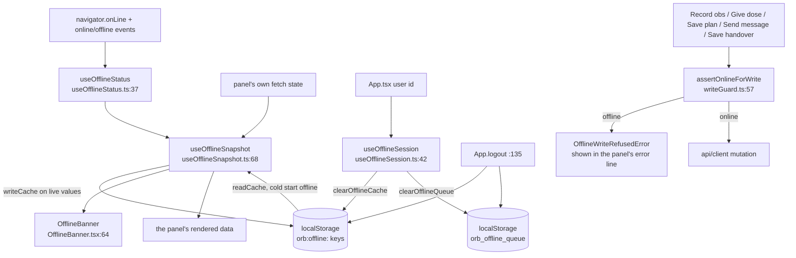
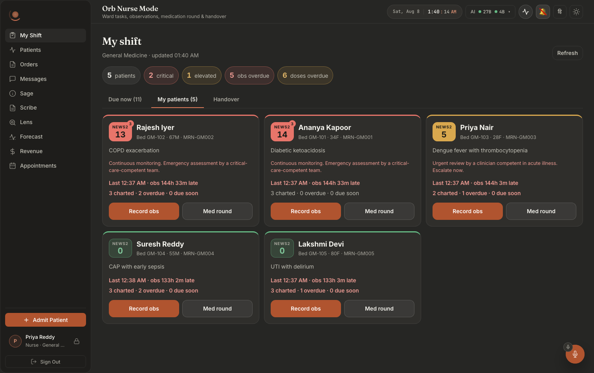
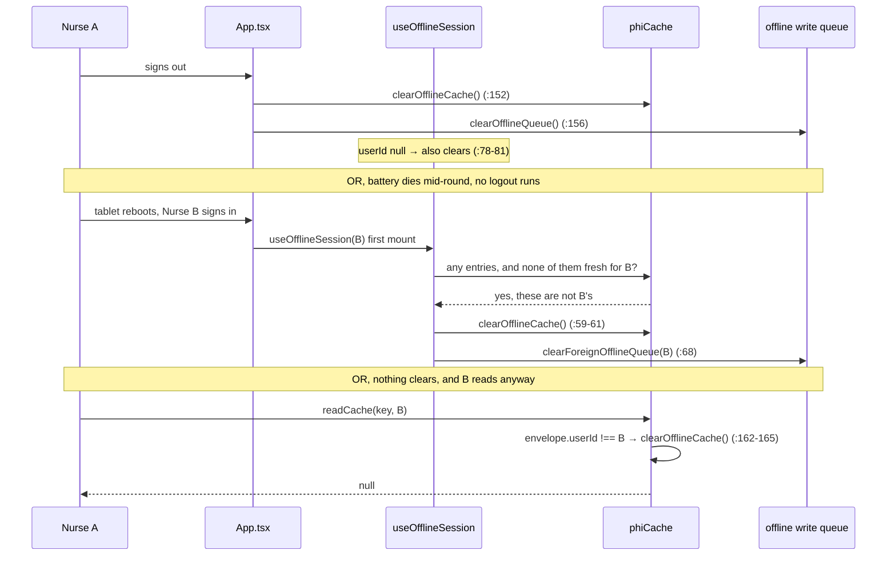

# The offline read cache: keeping the chart, refusing the write

Built 2026-08-09.

A ward tablet loses wi-fi in a corridor, a lift lobby, a side room with thick walls. Orb's answer has two halves and they are not symmetrical:

- **Reads keep working.** The shift board, the drug chart, the patient chart are mirrored to the device and served back when the network is gone, **always labelled with how old they are.**
- **Writes are refused.** Not queued. Not deferred. Refused, in words, while the clinician is still holding the tablet.

**Read-only is the whole design, and the reason is reconciliation.** Offline writes on a drug chart mean two nurses can chart the same patient while both disconnected, the same dose, the same observation set, the same "not given, patient refused", and when the wi-fi returns something has to decide which of those two records is the truth. There is no safe automatic answer to that on a drug chart. Last-write-wins silently destroys a charted dose. Keep-both produces a double administration in the eMAR. Ask-a-human asks them hours later, about a decision neither of them can now reconstruct. Read-only sidesteps the entire problem: **nothing is ever written offline, so nothing ever has to be reconciled.** The module docstring states it plainly (`src/lib/offline/writeGuard.ts:4-8`).

**The four bounds `phiCache` enforces**, from its own docstring (`src/lib/offline/phiCache.ts:6-16`):

| Bound | Rule | Where |
|---|---|---|
| **OWNERSHIP** | Every entry is stamped with the user who wrote it. A read by anyone else does not merely miss, it **wipes the device.** | `phiCache.ts:154-165` |
| **AGE** | An entry older than one shift (12 h) is refused and dropped. A future-dated entry is refused too. | `phiCache.ts:167-173` |
| **SIZE** | 2,000,000 string units, evicted oldest-first, so the cache cannot grow until the browser starts throwing quota errors mid-round. | `phiCache.ts:229-250` |
| **HONESTY** | A read returns **how old** the data is, so the caller cannot accidentally present a copy as live. | `phiCache.ts:42-48` |

**And the one that matters most: THE CACHE MUST CLEAR ON LOGOUT AND ON USER SWITCH.** A shared ward tablet that keeps the previous nurse's patients hands one clinician another clinician's PHI, names, diagnoses, NEWS2 scores, the whole drug chart. That is a leak wearing a performance feature's clothes. It is enforced in three independent places, because there are three different ways a device changes hands and only one of them runs a clean sign-out:

1. **Sign-out**, `App.logout` clears synchronously (`src/AppRoot.tsx:104`).
2. **User switch and sign-out again**, `useOfflineSession` watches the user ID, not the call site (`src/hooks/useOfflineSession.ts:78-81`).
3. **Crash recovery**, the battery died mid-round and no logout ever ran; the next mount asks whether anything on the device belongs to the person now holding it (`useOfflineSession.ts:59-61`).

**And `writeGuard`'s rule, stated once so it cannot be softened:** a refused write must **never** imply a queue or a later sync. "We'll send it when you're back" is the sentence that makes someone walk away from an unrecorded dose. The refusal message is asserted against that in a test, it must not contain the word "queue" and must not contain "will sync" (`src/lib/offline/writeGuard.test.ts:44-47`).

---

## Purpose and neighbors

**Jargon:**

| Term | Meaning in Orb |
|---|---|
| **Envelope** | What actually goes into localStorage: `{data, savedAt, userId}` (`phiCache.ts:34-40`). The stamps are the feature; the data is the payload. |
| **Snapshot** | What a panel renders. `{data, source, savedAt, online, unreachable}` (`useOfflineSnapshot.ts:45-54`). Every offline-aware panel reads the snapshot, never its own raw state. |
| **Source** | `'live'` (safe unlabelled), `'cache'` (must be rendered with the banner), `'none'` (nothing to show, say so) (`useOfflineSnapshot.ts:37-43`). |
| **`liveFailed`** | The panel's own fetch failure. Covers "wi-fi is fine, the appliance is down", which `navigator.onLine` cannot see (`useOfflineSnapshot.ts:61-62`). |
| **`unreachable`** | `online && liveFailed`. Different sentence for the clinician: "Can't reach Orb", not "you are offline" (`useOfflineSnapshot.ts:103`, banner text at `OfflineBanner.tsx:83`). |
| **Refusal** | `OfflineWriteRefusedError`, thrown before any network call is attempted (`writeGuard.ts:17-31`). |
| **The write queue** | A **separate** localStorage store (`orb_offline_queue`) owned by `api/client.ts`. It still exists; every UI write path now refuses before reaching it. See "Discrepancies". |

**Neighbors:** guide 28-offline-pwa-downtime (the service worker, the app shell, downtime procedure), guide 02-api-client (`apiFetch`, `getUser`, `offlineMutate` and the write queue), guide 01-app-shell (`ClinicianShell`'s pending/sync-failed chips), guide 33-pin-on-device-identity (why a shared tablet signs *out* on idle rather than locking, `src/AppRoot.tsx:113-120`), guide 07-vigil (the board and chart that consume the snapshot), guide 22-handoff-ipass (the handover write that refuses), guide 27-design-system (`OfflineBanner.css`).

*The shift board with a live connection. `OfflineBanner` sits directly under the view tabs (`src/pages/panels/nurse/NursePanel.tsx:274`) and renders **nothing** while the view is live, which is why it is not in this screenshot. A banner that is always present is a banner nobody reads (`OfflineBanner.tsx:22-23`).*

---

## File map

| File | Lines | Role |
|---|---:|---|
| `src/lib/offline/phiCache.ts` | 250 | The store and its four bounds. `writeCache` (`:95`), `readCache` (`:142`), `clearOfflineCache` (`:184`), `newestCachedAt` (`:206`), `evictOldest` (`:229`). No React, no fetch, pure localStorage. |
| `src/lib/offline/writeGuard.ts` | 83 | The read-only half. `OfflineWriteRefusedError` (`:17`), `offlineRefusalMessage` (`:43`), `assertOnlineForWrite` (`:57`), `isOfflineWriteRefused` (`:64`). |
| `src/hooks/useOfflineStatus.ts` | 85 | `useOfflineStatus` (`:37`), online + `offlineSince`; `useOnReconnect` (`:76`), fire a refetch on the `online` event. |
| `src/hooks/useOfflineSnapshot.ts` | 131 | Turns a panel's `data` state into a labelled snapshot. Imports `readCache`/`writeCache` (`:2`), it is the only thing that *reads or writes* cached values, though not the only importer of the module. |
| `src/hooks/useOfflineSession.ts` | 83 | Ties both PHI stores to one clinician's session: sign-out, user switch, crash recovery. |
| `src/components/OfflineBanner.tsx` | 136 | The staleness label. `ageInWords` (`:47`), `clockTime` (`:60`), the component (`:64`). |
| `src/components/OfflineBanner.css` | 79 | `.offline-banner` (`:14`) and its parts. |
| `src/App.tsx` | n/a | Mounts `useOfflineSession` (`:105`); `logout` clears both stores synchronously (`:163`, `:167`). |
| `src/api/client.ts` | n/a | The **other** PHI store. `clearOfflineQueue` (`:526`), `clearForeignOfflineQueue` (`:543`), `queueRequest` (`:552`), `offlineMutate` (`:588`), `processOfflineQueue` (`:625`). |
| `src/lib/offline/phiCache.test.ts` | 143 | The bounds as a spec: ownership, age, size, clearing, `newestCachedAt`. |
| `src/lib/offline/writeGuard.test.ts` | 58 | Including the "no queue, no sync" wording assertion (`:44-47`). |
| `src/hooks/useOfflineSnapshot.test.tsx` | 158 | Live vs cache vs none, the unreachable case, reconnect. |
| `src/hooks/useOfflineSession.test.tsx` | 123 | Logout, switch, crash boot, for **both** stores. |
| `src/components/OfflineBanner.test.tsx` | 115 | Tests the **words**, not the layout. |
| `src/api/offlineQueueOwnership.test.ts` | 144 | The write queue's leak and misattribution failures. |
| `src/pages/panels/nurse/nurseOffline.test.tsx` | 296 | What a nurse actually sees when the wi-fi dies mid-round. |
| `src/pages/panels/offlineWriteRefusal.test.tsx` | 171 | Relay + ward round: the last two writes that pretended to succeed. |
| `src/pages/panels/RoundPanel.offline.test.tsx` | 100 | A ward-round plan typed with no connection must not be taken. |
| `src/components/vigil/AdministerModal.offline.test.tsx` | 80 | A dose that was never charted must never look charted. |

**The consumers:**

| Surface | What it does | Line |
|---|---|---|
| `VigilPanel` ward board | `useOfflineSnapshot('vigil:patients', …)` | `VigilPanel.tsx:82`, banner `:295` |
| `VigilPanel` patient chart | `useOfflineSnapshot('vigil:patient:{id}', …)` | `VigilPanel.tsx:435`, banner `:1166` |
| `NursePanel` shift board | `useOfflineSnapshot('nurse:board', …)` | `NursePanel.tsx:136`, banner `:274` |
| `MedRoundSheet` drug chart | receives the board snapshot as a prop | `MedRoundSheet.tsx:39`, banner `:116` |
| `ObsEntrySheet` | receives the board snapshot as a prop | `ObsEntrySheet.tsx:67`, banner `:351` |
| `AdministerModal`, chart a dose | `assertOnlineForWrite('chart this dose')` | `AdministerModal.tsx:85` |
| `ObsEntrySheet`, record obs | `assertOnlineForWrite('record these observations')` | `ObsEntrySheet.tsx:281` |
| `HandoverSheet`, save handover | `assertOnlineForWrite('save this handover')` | `HandoverSheet.tsx:91` |
| `RoundPanel`, save plan | `assertOnlineForWrite('save this plan')` | `RoundPanel.tsx:301` |
| `RelayPanel`, send message | `assertOnlineForWrite('send this message')` | `RelayPanel.tsx:292` |
| `VigilPanel`, save note | `assertOnlineForWrite('save this note')` | `VigilPanel.tsx:691` |

---

## How it works

### Flow 1: a live render, and the mirror

1. The panel fetches as it always did and holds the result in its own state (`livePatients`, `liveBoard`, `liveData`).
2. It passes that state to `useOfflineSnapshot` and renders **the snapshot**, never the raw state (`NursePanel.tsx:136-140`, `VigilPanel.tsx:82-86`).
3. `trustLive` is `online && !liveFailed && live != null` (`useOfflineSnapshot.ts:85`). When it flips true with a new value, the hook stamps `liveAtRef` with `Date.now()` (`:86-89`), this is "when the server actually answered".
4. An effect mirrors that value to localStorage through `writeCache(key, live, userId)` (`useOfflineSnapshot.ts:94-97`).
5. The snapshot comes back `source: 'live'`, and `OfflineBanner` renders **null** (`OfflineBanner.tsx:77`).

### Flow 2: the wi-fi drops with the panel already loaded

1. The browser fires `offline`; `useOfflineStatus` sets `online = false` and stamps `offlineSince` **once** (`useOfflineStatus.ts:47-50`).
2. `trustLive` goes false. The panel's React state still holds the board, **this is the dangerous case, and the reason the hook exists at all.** Without it the panel would keep rendering a twenty-minute-old NEWS2 with nothing on screen to say so (`useOfflineSnapshot.ts:21-25`).
3. The hook returns that in-memory value as `source: 'cache'`, dated with the last **live** timestamp (`useOfflineSnapshot.ts:117-120`).
4. `OfflineBanner` appears with `role="alert"`, and says two things: *"Showing the shift board saved at 14:32, 21 minutes old"* and *"Nothing can be recorded until you reconnect… they are never held back to send later"* (`OfflineBanner.tsx:103-107`, `:120-123`).

### Flow 3: cold start in a dead zone

1. The nurse opens Orb where there is no signal. The panel has no data at all.
2. `online` is false, so the hook skips the loading-state branch (`useOfflineSnapshot.ts:110-112`) and finds nothing in memory (`:117`).
3. It calls `readCache(key, userId)` (`useOfflineSnapshot.ts:126`). **This is the read the cache exists for.**
4. `readCache` applies ownership and age. A `null` here means *"nothing this nurse may see"*, not merely *"nothing"* (`useOfflineSnapshot.ts:124-125`).
5. Hit → `source: 'cache'` with the real `savedAt`. Miss → `source: 'none'`, and the banner says *"There is **no saved copy** of the shift board on this device"* plus, if the device has anything at all for this user, *"This device last heard from Orb at 13:58"* via `newestCachedAt` (`OfflineBanner.tsx:87`, `:111-117`).

### Flow 4: a write is attempted offline

1. The clinician taps **Given** / **Record** / **Save plan** / **Send**.
2. The call site calls `assertOnlineForWrite('<action in her words>')` **inside its own `try`**, before any API function is reached (`ObsEntrySheet.tsx:281`, `AdministerModal.tsx:85`).
3. `isOnline()` is false, so `OfflineWriteRefusedError` is thrown (`writeGuard.ts:58`).
4. The catch block lands it in the same error line every other failure uses, so it needs no special rendering (`ObsEntrySheet.tsx:293-297`).
5. She reads: *"Cannot record these observations, this device is offline. Your entry has not been saved. Reconnect and enter it again."* (`writeGuard.ts:44-47`).
6. Her typed text stays where it was. The obs draft is still in localStorage; the round plan is still in the textarea; the handover note is still under its key.

### Flow 5: the device changes hands

---

## Function-by-function

### File: `src/lib/offline/phiCache.ts`

#### `OFFLINE_CACHE_PREFIX` / `CACHE_MAX_AGE_MS` / `CACHE_MAX_BYTES`: `phiCache.ts:25` / `:28` / `:32`
**Signature:** `'orb:offline:'` / `12 * 60 * 60 * 1000` / `2_000_000`
**Does:** The namespace and the two numeric bounds.
**On screen:** `CACHE_MAX_AGE_MS` is what decides whether a cold-start-offline panel shows a chart or shows *"There is no saved copy"*. The other two drive nothing visible.
**Why the prefix exists:** so `clearOfflineCache` is **exact**. Orb keeps other things in localStorage, the theme (`orb_theme`), nurse obs drafts (`orb:nurse:obs-draft:*`), the write queue (`orb_offline_queue`). A wipe that took the theme with it would be an annoyance; a wipe that took a half-entered observation set would destroy work. `phiCache.test.ts:110-123` pins exactly that.
**Why 12 hours:** one shift. Past that, a cached chart belongs to a different set of patients and a different set of decisions.
**Breaks if you change it:** shortening the prefix to `orb:` would make `clearOfflineCache` delete the nurse's in-progress observations at every sign-out. Raising `CACHE_MAX_AGE_MS` past a shift means a nurse coming on at 08:00 can be served the night nurse's 20:00 board, correctly labelled "12 hours old", but present, and a label is weaker protection than an absence.

#### `CacheEnvelope` / `CacheHit`: `phiCache.ts:34` / `:42`
**Signature:** `{data, savedAt, userId?}` / `{data, ageMs, savedAt}`
**Does:** The stored shape and the returned shape.
**On screen:** `CacheHit.savedAt` becomes the clock time in the banner; `ageMs` is the honesty bound in machine-readable form.
**Why `userId` is optional on the envelope but mandatory in practice:** an entry **without** it was written by an older build that had no ownership rule. It is **refused, never guessed at** (`:37-39`, enforced at `:158-161`). Defaulting an unstamped entry to the current user would be exactly the leak the stamp exists to prevent, an entry written by nurse A under the old build, read by nurse B under the new one.
**Breaks if you change it:** returning only `data` from `readCache` and dropping `ageMs`/`savedAt` removes the caller's ability to date the copy, and the banner has nothing true to print. That is the HONESTY bound, and it is the one a caller can silently discard.

#### `storage`: `phiCache.ts:50`
**Signature:** `() -> Storage | null`
**Does:** Returns `localStorage`, or `null` if it is unavailable.
**On screen:** nothing directly, but a `null` here degrades every panel to `source: 'none'`, so the banner says "no saved copy on this device".
**Why the try/catch:** Safari in private mode **throws on access** rather than returning null (`:55`). Without the catch, opening Orb in a private window would throw inside a render.
**Breaks if you change it:** removing the guard turns an unusual browser mode into a white screen.

#### `cacheKeys` / `readEnvelope`: `phiCache.ts:60` / `:71`
**Signature:** `() -> string[]` / `(key) -> CacheEnvelope<T> | null`
**Does:** Enumerate this module's keys; parse and shape-check one entry.
**On screen:** nothing.
**Gotchas:** `readEnvelope` **deletes** a corrupt entry rather than throwing (`:80-85`), a half-written record from a tab killed mid-write must not throw into a render. A shape check on `savedAt` (`:78`) means an entry that parses but has no timestamp is treated as a miss, not as age-zero.
**Breaks if you change it:** letting `JSON.parse` throw propagates into `useOfflineSnapshot`, which is called during render, one corrupt byte on the device would blank the ward board.

#### `writeCache`: `phiCache.ts:95`
**Signature:** `(key, data, userId, savedAt = Date.now()) -> boolean`
**Does:** Stores one envelope for one user. Returns `false` when nothing was stored.
**On screen:** **nothing at the moment it runs.** It drives what a *later* offline cold start can show. A `false` return is invisible today, see Discrepancies.
**How it works:**
1. No storage or **no signed-in user → refuse** (`:104`). An unowned entry is exactly what the ownership rule exists to reject, so the module will not create one.
2. Serialise; non-serialisable (circular) → `false` (`:108-112`).
3. A single value larger than the whole cap → `false` **outright** (`:117`). Evicting everything and still overflowing helps nobody.
4. `setItem`; on quota failure, `evictOldest(serialised.length)` and try once more (`:120-130`).
5. `evictOldest(0)` on the way out, to trim the cache back under the cap now that this entry is in it (`:132`).
**Why the caller must treat `false` as meaningful:** the docstring says it explicitly (`:91-94`), `false` means "offline reading will not work for this", not "silent success".
**Breaks if you change it:** dropping the `!userId` check writes unowned entries that `readCache` then refuses forever, the cache would appear to work and never serve anything. Removing the oversize check (`:117`) makes one large chart evict the entire ward board and then fail anyway.
**Gotchas:** `serialised.length` is **UTF-16 code units, not bytes.** For a ward of Devanagari or Tamil names the two differ, and most browsers charge quota per code unit, so this measures the same thing the browser does, but the constant's name is misleading. See Discrepancies.

#### `readCache`: `phiCache.ts:142`
**Signature:** `(key, userId, now = Date.now()) -> CacheHit<T> | null`
**Does:** Returns a cached value, **and takes the entry away**, whenever it cannot be trusted: wrong owner, unstamped, expired, future-dated, or corrupt.
**On screen:** this is the cold-start-offline read. A hit paints the ward board or the drug chart under the banner; a `null` paints *"There is no saved copy of the shift board on this device, so there is nothing to show."*
**How it works, in order:**
1. No storage or no `userId` → null (`:148`).
2. Missing/corrupt envelope → null (`:151-152`).
3. **Unstamped → remove that entry and refuse** (`:158-161`).
4. **Owned by someone else → `clearOfflineCache()`, wiping the whole device** (`:162-165`).
5. **Age.** `ageMs < 0` (clock moved, or tampering) or `> CACHE_MAX_AGE_MS` → remove and refuse (`:169-173`).
**Why a foreign entry wipes everything rather than hiding one key, this is the load-bearing paragraph:** if the tablet has changed hands, **every** entry on it belongs to the previous nurse too. Hiding one while leaving the rest would be the leak (`:154-157`). The wipe is not punishment for a bad read; it is the correct inference from the read. One foreign entry is evidence about the device, not about that key.
**Why a future stamp is refused rather than clamped to zero:** its age is *unknowable*, so it cannot be honestly labelled, and the banner's entire value is that its number is true (`:167-168`).
**Breaks if you change it:** turn the wipe into a per-key `removeItem` and nurse B reading one stale key leaves nurse A's other five patients sitting on the device for the rest of the shift. Clamp a negative age to zero and the banner confidently prints "less than a minute old" over data of unknown vintage, worse than showing nothing, because it actively invites her to act on it.

#### `clearOfflineCache`: `phiCache.ts:184`
**Signature:** `() -> number` (how many entries were removed)
**Does:** Removes every entry this module owns. Nothing else.
**On screen:** nothing visible, which is the point. The next thing the arriving nurse sees is her own empty state, not somebody else's ward.
**Why it exists:** the docstring is unambiguous, *"MUST be called on logout and on user switch, that is the difference between a shared tablet and a PHI leak"* (`:178-181`).
**Called from:** `App.logout` (`src/AppRoot.tsx:104`), `useOfflineSession` on switch/sign-out (`useOfflineSession.ts:79`), `useOfflineSession` on a crash boot (`:60`), and `readCache` itself on a foreign entry (`phiCache.ts:163`). **Four call sites, three of them proactive and one reactive**, because a single call site is a single thing to forget.
**Breaks if you change it:** widening the key filter takes the nurse's obs draft and the theme with it (`phiCache.test.ts:110-123` fails). Narrowing it, or adding a "keep the current user's entries" optimisation, reintroduces the leak the whole hook exists to close, because on a switch the "current user" at the moment of the call is ambiguous by definition.

#### `cacheEntryCount` / `cacheBytes`: `phiCache.ts:192` / `:196`
**Signature:** `() -> number` / `() -> number`
**Does:** How many entries, and how large.
**On screen:** **nothing.** Neither is rendered anywhere. `cacheEntryCount` is the crash-recovery probe in `useOfflineSession.ts:59`; `cacheBytes` exists only for the size test (`phiCache.test.ts:97`).
**Breaks if you change it:** `cacheEntryCount` returning 0 for a non-empty cache silently disables crash recovery, the "battery died mid-round" wipe stops happening, and nothing on screen changes to tell you.

#### `newestCachedAt`: `phiCache.ts:206`
**Signature:** `(userId, now = Date.now()) -> number | null`
**Does:** When **this user's** freshest still-valid entry was saved, across every key on the device.
**On screen:** the second sentence of the banner's no-copy state, *"This device last heard from Orb at 13:58."* (`OfflineBanner.tsx:87`, printed at `:114-116`).
**Why it exists:** so a view with no copy **of its own** can still tell the nurse something true about the device. Without it, opening a patient chart she has never opened offline says only "nothing here", which is indistinguishable from a broken cache.
**How it works:** applies the same ownership and age filters as `readCache` (`:213-215`), but **does not delete** anything it rejects. It is a query, and it is called from a render.
**Breaks if you change it:** making it wipe on a foreign entry (matching `readCache`) would put a device wipe inside a React render, on a component that re-renders every 20 seconds while degraded (`OfflineBanner.tsx:40`, `:71-75`). Dropping the age filter makes the banner cite a timestamp for data that has already expired and can no longer be served.

#### `evictOldest`: `phiCache.ts:229`
**Signature:** `(incomingBytes: number) -> void`
**Does:** Deletes oldest-first until the cache fits under `CACHE_MAX_BYTES`.
**On screen:** nothing, but it decides which chart is still there on the next dead-zone read.
**Why oldest-first and not LRU, a deliberate, documented choice (`:221-227`):** age is *already* the trust boundary here, so the entry closest to expiry is the one with the least value left. LRU would also require **writing on every read**, and on a synchronous store that costs a render.
**Gotchas:** an unparseable envelope sorts as `savedAt: 0` (`:238`) and is therefore evicted **first**, corrupt entries are the cheapest thing to lose. The `incomingBytes` parameter is only non-zero on the quota-retry path (`:124`), because on the success path the new entry is already counted in the store.
**Breaks if you change it:** switching to newest-first eviction inverts the cache into a store of exactly the data that is about to expire. Removing the cap altogether trades a bounded cache for `QuotaExceededError` mid-round, which surfaces as a `false` from `writeCache` that nothing currently reports (see Discrepancies).

---

### File: `src/lib/offline/writeGuard.ts`

#### `OfflineWriteRefusedError`: `writeGuard.ts:17`
**Signature:** `class OfflineWriteRefusedError extends Error`; fields `isOfflineWriteRefused = true`, `action`
**Does:** The refusal, as a throwable.
**On screen:** its `.message` is what the clinician reads, in whichever error line the calling panel already uses, the red strip on the obs sheet, the modal's `role="alert"` error (`AdministerModal.tsx:129`), Relay's `sendError`, the round panel's per-patient save error.
**Why the boolean discriminator exists (`:18-20`):** `instanceof` quietly stops working across bundle boundaries and realms. A branded field survives both. `Object.setPrototypeOf` in the constructor (`:29`) restores the chain when this compiles down to ES5, where extending a built-in otherwise breaks `instanceof` too, belt and braces, because the cost of misclassifying this error is showing the clinician the wrong sentence.
**Breaks if you change it:** drop `isOfflineWriteRefused` and `isOfflineWriteRefused()` starts returning `false` for real refusals wherever bundling has split the class, the refusal renders as a generic "something went wrong", which is the one message that does *not* tell her to write it down.

#### `offlineRefusalMessage`: `writeGuard.ts:43`
**Signature:** `(action: string) -> string`
**Does:** Produces exactly: *"Cannot {action}, this device is offline. Your entry has not been saved. Reconnect and enter it again."*
**On screen:** **this is the most consequential string in the subsystem.** It is the whole user-facing surface of the read-only decision.
**Why it says three things and not two:** *what* she tried to do, *that* the device is offline, and, the part that matters, **that nothing was saved.** The middle clause alone would be a status report; the third clause is an instruction.
**Why it must never imply a queue (`:38-41`):** read-only was chosen precisely so nothing sits on the tablet pretending it will land later. *"We'll send it when you're back"* is the sentence that makes someone walk away from an unrecorded dose. She does not chart it again, and the record simply never exists.
**Breaks if you change it:** adding "we'll retry automatically", even truthfully, for some future queued path, is the failure mode. `writeGuard.test.ts:44-47` asserts the message contains neither `"queue"` nor `"will sync"`, so that edit fails a test rather than shipping.

#### `assertOnlineForWrite`: `writeGuard.ts:57`
**Signature:** `(action: string) -> void`; throws
**Does:** One line at the top of every write. Throws if there is no connection.
**On screen:** nothing when it passes; the error line when it does not.
**Why `action` is in the clinician's words:** the parameter doc is explicit (`:53-56`), it is *shown to her*, so it must read as an action, not as an endpoint name. Compare the six real call sites: "chart this dose", "record these observations", "save this handover", "save this plan", "send this message", "save this note".
**Why it is called inside the panel's own `try`:** so the refusal lands in the same error line every other failure uses, and so any in-flight latch the panel holds is released and she can simply tap again once she is back in range (`ObsEntrySheet.tsx:278-280`).
**Breaks if you change it:** call it *outside* the try in a panel that latches on submit (`ObsEntrySheet.tsx:268-271` sets `inFlightRef`), and the sheet deadlocks, she is refused once and the button never works again for that entry. `nurseOffline.test.tsx:267` pins the opposite behaviour: the guard is not a latch, and the same sheet records normally once back online.

#### `isOfflineWriteRefused`: `writeGuard.ts:64`
**Signature:** `(error: unknown) -> error is OfflineWriteRefusedError`
**Does:** Tells this refusal apart from a genuine server error.
**On screen:** **nothing today, no application code calls it.** `grep` finds it only in `writeGuard.test.ts:39`. Every call site currently renders `e.message` directly, which happens to produce the right words because the refusal's message is already clinician-facing.
**Why it exists anyway:** one is *"try again when you're back"* and the other is *"something is wrong"* (`:61-63`). Any surface that wants to style the two differently, a retry affordance on one, a support prompt on the other, needs this rather than a string match.
**Breaks if you change it:** nothing today. That is worth knowing before relying on it.

#### `isOnline`: `writeGuard.ts:80`
**Signature:** `() -> boolean` (module-private)
**Does:** `navigator.onLine !== false`, with an SSR/test fallback of `true`.
**On screen:** nothing directly.
**Why the weakness is acceptable, and this is a genuinely subtle argument (`:69-79`):** `navigator.onLine` reports whether there is a network *interface*, not whether Orb's appliance is reachable. **A tablet on ward wi-fi with the server down reads as ONLINE here.** That is fine, because this guard **fails in the safe direction**: the write proceeds, the real request is made, and the real error surfaces. What this guard exists to catch is the unambiguous case, no network at all, where the request would otherwise hang and then fail confusingly, a long way from the action.
**Breaks if you change it:** make it stricter (a health ping, a timeout heuristic) and you have introduced a way to refuse a write that *would have succeeded*. On a drug chart, a false refusal costs a nurse a walk to the nurses' station; a false *acceptance* costs a charted dose. Only the first is recoverable, which is why this errs the way it does.

---

### File: `src/hooks/useOfflineStatus.ts`

#### `OfflineStatus`: `useOfflineStatus.ts:26`
**Signature:** `{online: boolean, offlineSince: number | null}`
**Does:** The connection, and when it dropped.
**On screen:** `online` reaches the banner through the snapshot; **`offlineSince` reaches nothing.** No component reads it today.

#### `readOnline`: `useOfflineStatus.ts:32`
**Signature:** `() -> boolean` (module-private)
**Does:** Same reading as `writeGuard.isOnline`, deliberately duplicated rather than imported, see Discrepancies.

#### `useOfflineStatus`: `useOfflineStatus.ts:37`
**Signature:** `() -> OfflineStatus`
**Does:** Subscribes to the browser's `online`/`offline` events.
**On screen:** every appearance and disappearance of `OfflineBanner`, on every panel.
**How it works:**
- Initial state from `navigator.onLine`, with `offlineSince` stamped immediately if the app opens offline (`:38-41`).
- `goOffline` stamps **only the first drop**, `setOfflineSince(prev => prev ?? Date.now())` (`:50`). The browser fires `offline` repeatedly while an interface flaps, and restamping would keep resetting an "offline for N minutes" reading back to zero (`:47-49`).
- A mount-time reconciliation (`:56`): the interface can change between the first render and the effect attaching, a tablet waking from sleep with a slow first paint, so the hook re-reads and fires the appropriate handler once.
**Why events and not a poll (`:22-24`):** the browser fires on the actual interface transition. Polling `navigator.onLine` would just re-read the same value on a timer, at the cost of a wakeup.
**Why the asymmetry is documented in the type's own docstring (`:12-20`):** `online === false` is **trusted**, there is no network, nothing can be written and nothing fresh read. `online === true` is **not trusted as proof of anything**. That asymmetry is why `liveFailed` exists at all.
**Breaks if you change it:** remove the `prev ?? ` and a flapping ward access point makes `offlineSince` unusable, every reconnect attempt resets the clock. Remove the mount-time reconciliation (`:56`) and a tablet that woke up offline renders one pass as online, which is exactly the render a nurse looks at first.

#### `useOnReconnect`: `useOfflineStatus.ts:76`
**Signature:** `(callback: (() => void) | undefined) -> void`
**Does:** Runs a callback the moment the `online` event fires.
**On screen:** the board and chart refetching by themselves when the nurse walks back into signal, which is what makes the banner *disappear* without her touching anything (`VigilPanel.tsx:84`, `:436`; `NursePanel.tsx:138`).
**Why it is separate from the status hook, and why the ref (`:69-74`):** the thing a panel wants on reconnect is a *side effect*, and it must not depend on the identity of the closure the caller happens to pass this render. A fresh closure per render would tear the listener down and re-attach it constantly, **and could miss the event in between.**
**Breaks if you change it:** put `callback` in the effect's dependency array and you reintroduce exactly that race, on the one event the whole recovery path depends on. `useOfflineSnapshot.test.tsx:131-140` pins that the callback fires exactly once on reconnect.

---

### File: `src/hooks/useOfflineSnapshot.ts`

#### `SnapshotSource`: `useOfflineSnapshot.ts:37`
**Signature:** `'live' | 'cache' | 'none'`
**Does:** The three states a view can be in, with the rendering obligation written into the type's own comments: `live` is safe unlabelled; `cache` **must** be rendered with `OfflineBanner` beside it; `none` must say so, because *"an empty ward reads as 'no patients'"* (`:38-43`).
**Breaks if you change it:** collapsing `none` into `cache` with null data makes a device that has never cached anything indistinguishable from one whose copy expired, different sentences, different actions.

#### `OfflineSnapshot` / `OfflineSnapshotOptions`: `useOfflineSnapshot.ts:45` / `:56`
**Signature:** `{data, source, savedAt, online, unreachable}` / `{userId?, liveFailed?, onReconnect?}`
**Does:** The contract between the hook, the panels and the banner.
**On screen:** `OfflineBanner` destructures four of the five fields at `OfflineBanner.tsx:65`.
**Gotchas:** `userId` uses `options.userId !== undefined ? options.userId : getUser()?.id ?? null` (`:74`), an **explicit `null` is honoured**, so a caller can deliberately disable caching, while omitting the option falls back to the signed-in user. That three-way distinction is why it is not written as `??`.

#### `useOfflineSnapshot`: `useOfflineSnapshot.ts:68`
**Signature:** `<T>(key, live: T | null | undefined, options) -> OfflineSnapshot<T>`
**Does:** Answers the one question a panel cannot answer for itself: **is what I am about to render live, or is it a copy?**
**On screen:** everything. `snapshot.data` is what five surfaces render; `snapshot.source` decides whether the banner exists; `snapshot.savedAt` is the clock time in it.
**How it works, in the order the code branches:**
1. `trustLive = online && !liveFailed && live != null` (`:85`). On a *new* live value, stamp `liveAtRef` (`:86-89`). Both refs, not state, this is metadata about a render, not a trigger for one, and setting state here would loop on every poll (`:80-81`).
2. Mirror to the device, but **only on a genuinely live value** (`:94-97`).
3. `trustLive` → `source: 'live'` (`:99-101`).
4. `unreachable = online && liveFailed` (`:103`).
5. **Online, not failing, no data yet → `source: 'none'`, not cache** (`:110-112`). This is an ordinary load in progress.
6. Offline with data still in memory → `source: 'cache'` with the last live timestamp (`:117-120`).
7. Offline with nothing in memory → `readCache` (`:125-128`).
8. Otherwise `source: 'none'` (`:130`).
**Why step 1 is the whole feature (`:21-25`):** React state survives a wi-fi drop. Without this hook the panel keeps rendering the board it fetched before the drop, indefinitely, with no label. **The most likely stale-as-live bug is not a cache read, it is the absence of one.**
**Why step 2 refuses to write a replayed or null value (`:26-30`):** writing null would overwrite a good copy with nothing on an offline mount; writing back a value the hook is itself replaying would keep refreshing `savedAt`, so the copy would never appear to age, the banner would say "2 minutes old" forever. `useOfflineSnapshot.test.tsx:102-111` pins the `savedAt` case exactly.
**Why step 5 is not "serve the cache while loading", and this is the sharpest judgement in the file (`:106-109`):** serving the cache during an ordinary load would put an offline label on a screen that is about to be live. Do that a few times a shift and **the nurse learns to ignore the label**, which is the one thing that must never happen to it. The panel's own loading state covers this render.
**Why step 6 prefers memory over the cache (`:114-116`):** it is the same data (the cache was written from it) without a JSON parse, and if the cache write failed on quota, it is the only copy left.
**Breaks if you change it:** promote `liveAtRef` to state and the hook re-renders its panel on every poll tick. Make step 2 unconditional and a nurse who opens Orb offline overwrites her good copy with `null` on the first render. Make step 5 serve the cache and you spend the banner's credibility on false alarms. Drop the `userId` guard at `:125` and `readCache` is called with an empty string, which it refuses, the cold-start read silently stops working with no error anywhere.
**Gotchas:** the `live !== lastLiveRef.current` comparison at `:86` is **identity-based**. A panel that refetches into a new object every poll re-stamps correctly; a panel that mutates its state object in place would never re-stamp, and its "saved at" would freeze at the first response. Also: because `live` is in the effect deps (`:97`), every new live identity performs a synchronous `JSON.stringify` + `setItem` of the whole payload, on Vigil's board that is the entire ward, on every poll.

---

### File: `src/hooks/useOfflineSession.ts`

#### `useOfflineSession`: `useOfflineSession.ts:42`
**Signature:** `(userId: string | null | undefined) -> void`
**Does:** Ties **both** on-device PHI stores, the read cache and the write queue, to one clinician's session.
**On screen:** **nothing, ever.** It is invisible by design. Its entire output is the absence of the previous nurse's patients on the next nurse's screen.
**Mounted at:** `src/AppRoot.tsx:125`, once, with `user?.id ?? null`.
**How it works:** a `previous` ref (`:43`) distinguishes three cases.
- **First run** (`prior === undefined`, `:50`), a mount, which is **also every page refresh and every cold boot after a crash**. There is no previous ID in memory to compare against, so it asks the *cache* instead: `cacheEntryCount() > 0 && (!current || newestCachedAt(current) === null)` → wipe (`:59-61`). Entries present but none of them this user's fresh data means the device is carrying somebody else's PHI, or expired PHI. Either way it goes.
- Then `clearForeignOfflineQueue(current)` (`:68`), the queue carries its own author per entry, so it is judged **exactly** rather than all-or-nothing: this user's pending writes survive a page refresh mid-shift, anybody else's do not survive the boot.
- **Sign-out or switch** (`prior !== current`, `:78`), both stores go, unconditionally (`:79-80`).
**Why the crash case needs its own branch, and this is the case most implementations miss:** sign-out and switch both have a *transition* to observe. A flat battery has none. The app simply boots with a cache from a session that has no code path left to end it. The only available question at that moment is "do these entries belong to whoever is holding the tablet now?", and the hook answers it with `phiCache`'s **own** ownership and age rules rather than a second copy of them (`:24-28`).
**Why it uses `newestCachedAt` rather than reading a key:** `newestCachedAt` applies ownership *and* age without deleting anything, so the probe is side-effect free until the decision is made.
**Why the dropped-queue warning is a `console.warn` and not a toast (`:64-67`):** *the person who would be told is not the person who queued them.* Telling **this** nurse that work she never did was discarded is a confusing alarm about somebody else's shift.
**Why both stores live in one hook (`:35-40`):** the write queue was surviving every handover and then replaying on whoever was signed in next, the previous nurse's note filed under this nurse's name. Binding both here means **one place to check rather than two places to forget.**
**Breaks if you change it:** move the queue clearing out and you restore a silent misattribution path that no cache test would catch. Guard the first-run branch on `current` being non-null and a tablet that boots to the login screen keeps the last nurse's whole bay cached until someone signs in. Replace `newestCachedAt` with a "did any key parse" check and an expired cache from the *same* nurse would be wiped unnecessarily, annoying, not dangerous, while a *foreign* fresh cache could survive if the ownership rule drifted. `useOfflineSession.test.tsx` pins all six cases: own cache kept, logout, switch, crash-boot-under-new-user, boot-with-nobody-signed-in, and refresh-for-the-same-nurse.

---

### File: `src/components/OfflineBanner.tsx`

#### `TICK_MS`: `OfflineBanner.tsx:40`
**Signature:** `20_000`
**Does:** How long the age reading may drift before a re-render.
**Why:** *"'3 minutes old' that is really 9 minutes is its own small lie"* (`:39`).
**Gotchas:** the interval runs **only while degraded** (`:71-75`), a live view has nothing to age, and an always-on 20-second timer on every panel is a wakeup Orb does not need.

#### `ageInWords`: `OfflineBanner.tsx:47`
**Signature:** `(ms: number) -> string`, exported, and tested
**Does:** "less than a minute old", "21 minutes old", "1 hour 5 minutes old".
**On screen:** the bolded age in the banner's first line (`:105`).
**Why the format is what it is (`:42-46`):** never a bare decimal ("1.4 hours"), which reads as a *measurement* rather than a warning; never a rounded-up "an hour ago" that could hide 90 minutes.
**Breaks if you change it:** rounding up is the failure. A nurse comparing "an hour old" against a 4-hourly obs schedule reaches a different conclusion than one reading "1 hour 47 minutes old".

#### `clockTime`: `OfflineBanner.tsx:60`
**Signature:** `(savedAt: number) -> string`, `toLocaleTimeString`, hour and minute
**Does:** The wall-clock form of the same fact.
**Why both forms:** the clock time is what she can compare **against her watch and against the obs chart on the wall**; the age is what she can reason about without arithmetic. Neither replaces the other.

#### `OfflineBanner`: `OfflineBanner.tsx:64`
**Signature:** `({snapshot, what, onRetry?}) -> JSX | null`
**Does:** The staleness label. *"The most important twenty words on the screen"* (`:8`).
**On screen:** a `role="alert"` strip above the content it qualifies, in five places (Vigil board and chart, nurse shift board, drug chart, obs sheet).
**How it works:**
- **Renders `null` when live** (`:77`). *"A banner that is always present is a banner nobody reads"* (`:23`).
- Heading branches on `unreachable` (`:83`): **"Can't reach Orb, not live"** vs **"Offline, not live"**. Two different problems with two different fixes, call IT, or walk to the nurses' station, so they get different words (`:79-82`).
- `source === 'cache'` → the clock time and the age, or, if `savedAt` is null, *"When it was saved is **unknown**, so treat every value on this screen as out of date"* (`:95-109`).
- `source === 'none'` → *"There is **no saved copy** of the {what} on this device"*, plus the device-wide `newestCachedAt` line if there is one (`:110-118`).
- **Always**, in both branches: *"Nothing can be recorded until you reconnect. Observations, doses, notes and handovers are refused outright, they are never held back to send later, so enter them again once you are back."* (`:120-123`). **This is the read-only contract, printed on the screen.**
- Optional **Try again** button (`:124-131`), *"worth offering when the connection may already be back but nothing has re-fetched yet"* (`:32-34`).
**Why `role="alert"` (`:18-20`):** it is not ambient status. It **changes what the reader is allowed to conclude from everything below it.**
**Why `what` is in the clinician's vocabulary:** it reads as "Showing the shift board saved at 14:32" (`:29-31`). Compare the five real values: "patient board", "patient chart", "shift board", "drug chart", "patient details".
**Breaks if you change it:** drop `role="alert"` and a screen-reader user gets no announcement that the chart under it is a copy. Render it always (even live) and it becomes furniture. Delete the "never held back to send later" sentence and the screen stops carrying the one thing that stops a nurse walking away from an unrecorded dose. Move it *below* the content and it stops qualifying what she has already read, Vigil's chart has an explicit comment about placing it above for exactly this reason (`VigilPanel.tsx:1164-1165`).
**Gotchas:** the no-copy line calls `newestCachedAt(getUser()?.id ?? '')` **directly** (`:87`), reading the signed-in user from `api/client` rather than the `userId` the snapshot was built with. For every real surface those are the same value; for a caller that passed an explicit `userId` they are not, and the device-newest sentence would then describe a different user's cache. Passing `''` when nobody is signed in is safe, `newestCachedAt` refuses an empty id (`phiCache.ts:208`).

---

### File: `src/api/client.ts`: the other PHI store

This is not part of the read cache, but `useOfflineSession` imports two functions from it and the chapter is dishonest without it. `api/client` keeps an **offline write queue** in localStorage under `orb_offline_queue`: free clinical text, patient ids, dose payloads.

#### `clearOfflineQueue`: `src/api/client.ts:549`
**Signature:** `() -> number`
**Does:** Drops every queued write.
**Called from:** `App.logout` (`src/AppRoot.tsx:108`) and `useOfflineSession` on switch/sign-out (`useOfflineSession.ts:80`).
**On screen:** the pending-count chip in the shell (`src/pages/ClinicianShell.tsx:463`, `:469`) drops to zero on its next two-second poll (`:342`).

#### `clearForeignOfflineQueue`: `src/api/client.ts:566`
**Signature:** `(userId: string | null) -> OfflineRequest[]`
**Does:** Drops queued writes that do **not** belong to `userId`; `null` drops all. Returns them, so the caller decides whether anyone needs telling.
**Why:** a replay is sent on the **current** session's cookie, so a write queued by the last nurse would be filed against this one, *her name on another clinician's note or dose, with nothing on screen to reveal it* (`src/api/client.ts:631-635`). Same rule `phiCache` applies to reads: **a queued write is replayed for its author or not at all.**
**On screen:** when called from `processOfflineQueue` (`:650`) it dispatches `orb:offline-sync-failed` (`:654`), which the shell renders as a `role="alert"` badge, "N queued action(s) failed to sync. Please re-enter" (`src/pages/ClinicianShell.tsx:445-449`). When called from `useOfflineSession` on a boot it is silent, deliberately.

#### `offlineMutate`: `src/api/client.ts:611`
**Signature:** `(path, body, offlineResult, method, key?) -> Promise<T>`
**Does:** With no connection, **queues the request and returns the caller's optimistic result** (`:619-622`). It is a module-private `async function`, not exported.
**On screen:** nothing today, every one of its three callers is now guarded by `assertOnlineForWrite` at the UI layer, so offline it is never reached. It remains the mechanism the guards exist to keep unreachable. **See Discrepancies; this is the largest open tension in the subsystem.**
**Its three callers:** `sendMessage` (`:1378`), `addClinicalNote` (`:2144`), `administerMedication` (`:2347`).

---

## Cross-subsystem contracts

| Contract | Producer | Consumer | Breaks how |
|---|---|---|---|
| `OfflineSnapshot` shape | `useOfflineSnapshot.ts:45` | `OfflineBanner.tsx:65`, `MedRoundSheet.tsx:39`, `ObsEntrySheet.tsx:67` | a renamed `source` value silently stops the banner rendering; the cached view then looks live |
| `orb:offline:` key prefix | `phiCache.ts:25` | `clearOfflineCache` (`:184`), and every other localStorage user in Orb | widen it and sign-out deletes the nurse's in-progress obs draft |
| Envelope `userId` stamp | `writeCache` (`phiCache.ts:106`) | `readCache` (`phiCache.ts:162`), `newestCachedAt` (`phiCache.ts:213`), `useOfflineSession.ts:59` | stop stamping and all three ownership checks fail open at once |
| `getUser()?.id` | `src/api/client.ts:159` | `useOfflineSnapshot.ts:74`, `OfflineBanner.tsx:87`, `src/AppRoot.tsx:125` | a user object without a stable `id` makes every entry unreadable on the next mount |
| `orb_offline_queue` + `userId` per entry | `queueRequest` (`src/api/client.ts:552`) | `clearForeignOfflineQueue` (`:543`), `useOfflineSession.ts:68`, `readOfflineQueueCount` (`src/pages/ClinicianShell.tsx:40`) | an unstamped entry is dropped rather than misattributed |
| `orb:offline-sync-failed` event | `src/api/client.ts:654`, `:719` | `src/pages/ClinicianShell.tsx:339` | rename it and a permanently-failed replay stops being reported to anyone |
| `navigator.onLine` semantics | the browser | `writeGuard.ts:80`, `useOfflineStatus.ts:32`, `src/api/client.ts:596` | three independent readers; a change in interpretation must land in all three |
| `SHARED_DEVICE_IDLE_MS` sign-out | `src/AppRoot.tsx:40`, `:113-120` (guide 33) | the whole queue-lifetime argument | lengthen it and "the queue dies before the wi-fi returns" stops being true, but the refusals are still correct |

---

## Rebuild notes

1. **Read-only, and say why out loud.** Two nurses charting the same patient offline is a reconciliation problem with no safe automatic answer. Not building writes is cheaper than building a merge nobody can defend.
2. **Stamp every cached entry with its owner.** An unstamped entry is refused, never attributed to a guess.
3. **A foreign entry wipes the device, not the key.** One foreign entry is evidence about the *device*.
4. **Clear on sign-out, on user switch, and on a cold boot after a crash.** Three paths, because only one of them runs a clean sign-out. A single call site is a single thing to forget.
5. **Bound the age at one shift and refuse future timestamps.** Data whose age is unknowable cannot be honestly labelled.
6. **Return the age, not just the data.** It is what makes a wrong label impossible rather than merely discouraged.
7. **Downgrade what the panel already holds.** The most likely stale-as-live bug is the *absence* of a cache read, not a cache read.
8. **Never serve the cache during an ordinary load.** A false offline label spends the banner's credibility, and it only has one budget.
9. **Never write the cache from a value you are replaying.** Otherwise the copy never appears to age.
10. **Refuse at the call site, before the API function is reachable**, and put the refusal in the panel's existing error line so it needs no special rendering.
11. **The refusal names the action, says nothing was saved, and never mentions a queue.** Test the wording, not just the throw.
12. **Bind the write queue's lifetime to the session too.** The read cache is only half the PHI on the device.

---

## Discrepancies and open questions

1. **`api/client.ts` still documents the opposite policy, in two places.** `sendMessage` (`src/api/client.ts:1069-1072`) and `addClinicalNote` (`:1547-1548`) each carry a comment saying the write is safe to queue offline and syncs on reconnect. `administerMedication` no longer does: its comment (`:1739-1762`) now says the online guard is load-bearing, because the allergy interlock and the dose guard run on that endpoint and a queued dose could never show a nurse their refusal. Every UI call site of the three refuses first (`src/pages/panels/RelayPanel.tsx:490`, `src/pages/panels/RoundPanel.tsx:381`, `src/pages/panels/VigilPanel.tsx:1227`, `src/components/vigil/AdministerModal.tsx:269`), so the two queue-friendly comments describe a path that is no longer reachable from the app, but a new surface calling `addClinicalNote` and reading its comment would get the queued behaviour and believe it was intended. **The read-only rule is enforced at the call sites, not structurally.** The obvious hardening is to move `assertOnlineForWrite` inside `offlineMutate` (or delete the offline branch), which would make the guarantee impossible to bypass by omission.

2. **`writeCache` returning `false` is invisible.** The docstring is explicit that a caller should treat `false` as "offline reading will not work for this" (`phiCache.ts:91-94`), and `useOfflineSnapshot.ts:96` ignores the return value entirely. A quota failure on a large ward board therefore produces a device that silently has no copy, discovered only in the dead zone, as "no saved copy of the shift board".

3. **`CACHE_MAX_BYTES` is measured in JS string length, not bytes.** `phiCache.ts:117` and `:239` both use `.length`, which counts UTF-16 code units. Browsers generally charge localStorage quota per code unit too, so the cap behaves consistently, but at 2,000,000 units that is roughly **4 MB** of an origin quota the comment itself puts at "~5 MB" (`:30-31`). "Staying well under it" may not be true. Worth measuring on the actual pilot tablets before the cap is trusted.

4. **`offlineSince` is computed and never used.** `useOfflineStatus.ts:29-30` maintains it carefully, including the flap-resistant first-drop stamp (`:47-50`), and no component reads it. The banner dates the *data*, not the outage.

5. **`isOfflineWriteRefused` has no application caller.** Only `writeGuard.test.ts:39` uses it. Every panel renders `e.message` directly, which works only because the refusal's message happens to be clinician-ready. A surface that wants to treat the two error classes differently has the helper waiting.

6. **`navigator.onLine` is read in three places with three private helpers**, `writeGuard.ts:80`, `useOfflineStatus.ts:32`, and `src/api/client.ts:596` (inline). They agree today. The two hook-side copies are documented as intentional (the modules are independently usable), but a change to how "online" is judged has to land in all three or the guard and the banner will disagree on screen.

7. **The wipe-on-foreign-read in `readCache` (`phiCache.ts:162-165`) is a backstop that rarely fires.** `useOfflineSnapshot` only reads the cache on the cold-start-offline path (`useOfflineSnapshot.ts:125-128`), and `useOfflineSession` normally wipes on mount before any panel gets there. It fires if a session change is somehow not observed by the hook, which is exactly the case it is for. It is not dead code; it is just not the primary defence, and a test that only exercises `readCache` would over-report how well the primary path works.

8. **No cross-tab coordination on the wipe.** `clearOfflineCache` removes keys from `localStorage`, so a second Orb tab in the same browser sees the removal via the storage event only if something listens, nothing does. A second tab holding a rendered board in React state would keep showing it after a wipe in the first tab. On the target device (one tablet, one full-screen app) this does not arise; on a shared desktop with two tabs it could.

9. **The cache is not encrypted.** Stated plainly in the module docstring (`phiCache.ts:19-20`): localStorage is chosen for being synchronous, so a render can decide what to show without a loading flash, and universally available, and *"it is NOT encrypted, which is exactly why the age and wipe rules above are tight"*. Anything with filesystem access to the tablet can read the cached PHI. The mitigations are device-level (kiosk mode, full-disk encryption, MDM), not application-level, and they are not in this repo.

10. **`useOfflineSnapshot`'s docstring claims a monopoly it no longer has.** *"The one consumer of lib/offline/phiCache"* (`useOfflineSnapshot.ts:7`) was true when written; there are now four importers, `useOfflineSnapshot.ts:2`, `useOfflineSession.ts:2`, `OfflineBanner.tsx:3`, `AppRoot.tsx:6`. The *spirit* still holds (it is the only place that reads or writes a cached **value**; the other three only clear or query metadata), but the sentence as written would mislead someone auditing where PHI can leave the cache.

11. **A cached view offers no way to see *which* fields are stale.** The banner dates the whole snapshot. A board where one patient's vitals were fetched 20 minutes ago and another's 2 minutes ago is labelled with a single age, the oldest honest one, since `savedAt` is the timestamp of the whole payload. That is the safe direction, but it means the label can overstate staleness for part of the view, and a nurse who notices that will trust the label less.
