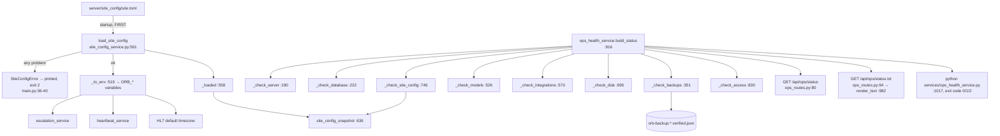
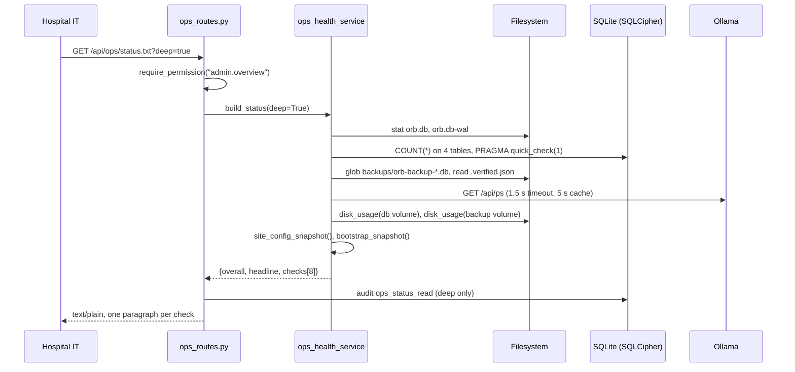

# Ops health and site configuration: telling one person, on site, what is wrong and what to do

Built 2026-08-09.

**Read this if you are the hospital's IT person and Orb is in your building.** You are the whole
support tier. Orb ships with **no remote support by design**, nobody at the vendor can dial in and
look at your appliance, and there is no telemetry channel that would let them. That single decision
is what shapes every file in this chapter. Everything that can go wrong with this machine has to be
legible **to you, standing in front of it, at 03:00, without reading Python and without ringing
anyone.**

Two files carry that weight:

- **`server/services/ops_health_service.py`**, the status page. Eight questions, answered in
  sentences, each unhappy answer carrying the thing to *do* about it.
- **`server/services/site_config_service.py`**, the one file your hospital edits (ward names,
  departments, escalation ladder, two operational thresholds), validated so hard that a bad value
  **stops the server** and names the file and the line.

**The two claims this chapter makes, up front, because they are the two a CIO will test:**

1. **No PHI appears anywhere on the status surface.** Not a patient name, not a hospital number, not
   an identifier that leads to one. Counts, ages, sizes, department names, configuration, that is
   all. This is not a promise in a comment; `server/tests/test_ops_health.py` seeds a patient called
   `"Zzyzx Testpatient Confidential"` with MRN `MRN-OPS-PHI-0001` and asserts the string appears
   nowhere in the JSON (`:149`), nowhere in the text rendering (`:158`), and nowhere in the offline
   collector (`:169`). The reason is blunt: **the status page is the single thing in this product
   most likely to be photographed and sent to a WhatsApp group while somebody asks for help.**

2. **A malformed site configuration file STOPS STARTUP, naming the file and the line.** It does not
   fall back to a default, and it does not apply the half it understood. This rule was bought with a
   real incident: a setting in `.env` was written with a **blank value**, every reader in the
   codebase treated blank as falsy, a live safety switch was therefore **off**, and no log line, no
   health check and no startup message said so. The key was present, so the setting looked applied.
   `site_config_service.py:18-20` states the resulting rule in one line: *present-but-empty is an
   error*, never a default, never a falsy, never a shrug.

**The sharpest thing on the page, also up front.** Question 3 is not "is there a backup". It is
**"is there a backup, and did it actually VERIFY"**, because "is there a backup" was already
answerable, and was already answered wrongly. For fourteen consecutive nights this appliance wrote
**zero-byte** backup files, passed its own integrity gate (an empty database is a perfectly valid
database), **pruned the real backups to make room for the empty ones**, and reported success every
time (`ops_health_service.py:20-32`, and the full post-mortem at `scripts/backup.sh:5-26`). So a
backup counts as verified here **only** when something opened it, checked it, found real clinical
rows in it, and left a signed, dated receipt beside it. A file with no receipt is reported as
exactly that: **present, unproven.**

---

## Purpose and neighbors

**Jargon:**

| Term | Meaning in Orb |
|---|---|
| **Check** | One of the eight questions. A dict with `key`, `title`, `status`, `status_label`, `summary`, `what_to_do`, `notes`, `detail` (`ops_health_service.py:151`). |
| **Status** | Exactly three values: `ok` / `attention` / `urgent` (`:71-73`). Rendered as "Working" / "Needs attention" / "Urgent" (`:75`). Three, not nine, because a nine-point severity scale is a thing to interpret rather than a thing to act on. |
| **Overall** | The worst of the eight (`build_status`, `:931-935`). |
| **Deep** | The opt-in mode that costs real work: a structure check on the database and a department reconciliation against admissions. Off by default so a dashboard can poll cheaply. |
| **Receipt** | A `orb-backup-<stamp>.verified.json` file sitting beside a backup, schema `orb.backup.verification/1` (`:80`), saying something opened that backup and found real rows. **The proof.** |
| **Site config** | `server/site_config/site.toml`. TOML, read once at startup, validated hard. Absent is fine; malformed is fatal. |
| **Department vs ward** | A **department** is a clinical service ("General Medicine"). A **ward** is a bed-number prefix ("GM-1"). Every permission check in Orb keys on the **department**. Putting a bed prefix in the department field silently un-scopes patient access, three separate leaks have been paid for on this exact confusion (`site_config_service.py:72-76`). |
| **env_conflicts** | Settings written in **both** `site.toml` and `.env`. The **file wins**, and the override is reported rather than applied silently. |



**Neighbors:** guide 03-auth-rbac (`require_permission("admin.overview")`, the single gate on both
endpoints), guide 05-audit-chain (`log_audit_event`; only the *deep* read is audited), guide
25-admin-panel (the `admin.overview` permission is shared with the governance dashboard and the
backup routes), guide 32-escalation-chain (`escalation_service.tier_policy()` consumes
`ORB_ESCALATION_TIERS`, which this loader writes), guide 30-harness-and-ci
(`tests/test_event_loop_discipline.py` is why the two routes are plain `def`), guide
04-database-schema (`db_session`, SQLCipher at rest), guide 26-ai-infrastructure (Ollama, the model
tiers `_probe_models` asks about).

---

## File map

| File | Lines | Role |
|---|---:|---|
| `server/services/ops_health_service.py` | 1028 | The whole status page: eight collectors, the assembly, the terminal renderer, and a `__main__` entry point with a meaningful exit code. **Never raises.** No database writes. |
| `server/routes/ops_routes.py` | 107 | Two endpoints, `GET /api/ops/status` (`:80`) and `GET /api/ops/status.txt` (`:94`). Both `admin.overview`. Both plain `def`. Only `deep=true` is audited (`_audit_deep_read`, `:55`). |
| `server/services/site_config_service.py` | 659 | The site file: schema-as-data (`_SCHEMA`, `:169`), a line index over the raw text (`_LineIndex`, `:215`), the validator (`_validate`, `:407`), the translation to `ORB_*` (`_to_env`, `:519`), and the public loader (`load_site_config`, `:561`). |
| `server/site_config/site.example.toml` | 132 | The annotated template. Every setting a site may vary, with the default and the reason written next to it in English. **`site.toml` itself is not in the repo**, you create it. |
| `server/site_config/README.md` | 28 | The three rules for everything in `site_config/`: a malformed file stops the server, editing needs a restart, nothing here is a safety override. |
| `server/main.py` | n/a | Loads the site config **first, before `import config`** (`:35-40`); mounts the ops router (`:95`, `:731`); serves the unauthenticated liveness probe `/api/health` (`:873`) and the admin-only `/api/health/access` (`:900`). |
| `server/tests/test_ops_health.py` | 293 | The behavioural spec, including the three no-PHI assertions and the four backup-receipt states. |
| `server/tests/test_site_config.py` | 332 | The refusal spec. Every refusal test asserts the error names the **file**, and most assert the exact **line number**. |
| `install.sh` | 262 | One-command installer: venv, deps, secrets, dev TLS cert, migrations, first admin, frontend build. Idempotent, safe to re-run. |
| `setup-mac.sh` | 313 | The Apple Silicon developer path: uv + Python 3.12, deps, `.env` (dev profile), Ollama model pulls, seed data. |
| `run-orb.sh` | 56 | Start the stack. Refuses without `.env` or the venv (`:18-19`). |
| `scripts/backup.sh` | 248 | The verified nightly backup: snapshot → size floor → open-and-count-rows → media tar → off-box copy → **rotate last**. |
| `scripts/install-backup-schedule.sh` | 473 | Installs `backup.sh` as a macOS LaunchAgent, with a preflight that runs the job's own access path *through launchd*. |
| `scripts/restore-drill.sh` | 275 | Proves a backup restores, on a scratch copy, without touching the live database. |
| `scripts/standby-restore.sh` | 393 | Restores the primary's newest backup onto the second Mac. Refuses to run on the primary. |
| `scripts/install-standby-schedule.sh` | 240 | Schedules that on the standby, and **refuses to install on the primary** (`:103-115`). |

> **There is no screen for any of this.** Grep `src/` for `ops` and you get nothing: no React
> component, no `src/api/ops.ts`, no admin tab. The status page's "screen" is a terminal, a `curl`,
> or an admin's browser pointed straight at `/api/ops/status.txt`. That is stated plainly in every
> "On screen" line below, because the absence is itself the fact you need to know.

---

## How it works

### Flow 1: startup, and the config that can stop it

1. `server/main.py:35` imports `load_site_config` **before `import config`**. That ordering is
   load-bearing and the comment at `:23-34` says why: this loader translates the file into `ORB_*`
   environment variables, and `config.py` binds several of them **at import time**. Load it any
   later and you apply half of a hospital's settings and silently drop the rest.
2. `load_site_config()` (`site_config_service.py:561`) looks for `ORB_SITE_CONFIG_FILE`, else
   `server/site_config/site.toml`.
3. **No file → not an error.** You get an empty `SiteConfig` with `present=False` and Orb runs on
   shipped defaults (`:576-578`). Making the file mandatory would turn a lever into ceremony, and
   ceremony gets copy-pasted wrong.
4. A file → read, parse with `tomllib`, then `_validate` (`:407`) checks **every** table and key
   against `_SCHEMA` (`:169`).
5. Anything wrong raises `SiteConfigError`. `main.py:38-40` catches it, **prints the message with
   no traceback**, and exits with code **2**. The person reading that message is hospital IT, not
   the author.
6. On success, `_to_env` (`:519`) writes the `ORB_*` variables. Where a variable was already set in
   `.env`, **the file wins**, the conflict is recorded in `cfg.env_conflicts` and logged at WARNING
   (`:610-619`), and it later shows up as a note on the status page.

**Nothing is applied on the way to an exception.** Validation completes in full before a single
environment variable is written (`:566-569`, proven by `test_a_bad_file_never_half_applies`,
`test_site_config.py:305`). A half-applied config is worse than none, because it looks applied.

### Flow 2: somebody asks "is this thing healthy?"

1. `GET /api/ops/status` (`ops_routes.py:80`) or `GET /api/ops/status.txt` (`:94`), both behind
   `require_permission("admin.overview")`.
2. `build_status(deep)` (`ops_health_service.py:916`) walks `_COLLECTORS` (`:904`) in order and
   calls each one.
3. **Every collector is wrapped in its own `try`** (`:926-929`). A collector that throws becomes
   `_broken(...)` (`:168`), an `attention` check that says, in words, *"Orb could not check this.
   That does not mean it is broken, it means nobody knows."* It never vanishes from the page,
   because an absent check reads as a healthy one.
4. `overall` is the worst of the eight; the headline is built from how many are urgent and how many
   need attention (`:936-946`).
5. JSON goes back as-is; the `.txt` route hands the same payload to `render_text` (`:982`).
6. If `deep=true`, one audit row is written (`_audit_deep_read`, `ops_routes.py:55`). The shallow
   read is **not** audited, it is what a dashboard polls, and auditing every poll would bury the
   rows that matter.

### Flow 3: the same answer with no browser and no network

```
$ cd server
$ ../server/.venv/bin/python services/ops_health_service.py
$ ../server/.venv/bin/python services/ops_health_service.py --deep --json
```

`__main__` (`:1017-1028`) prints the same report and **exits 0 / 1 / 2** for ok / attention / urgent,
so a scheduled job can act on it. This path talks to no HTTP server, needs no login, and is the one
that still works when the browser, the frontend build or the network is the thing that is broken.



---

## Function-by-function

### File: `server/services/ops_health_service.py`

#### The module docstring: `ops_health_service.py:1-54`
**Does:** States the audience (one on-site IT person, no vendor to ring), lists the eight questions
(`:14-18`), explains why question 3 is phrased "and DID IT VERIFY" (`:20-32`), asserts the no-PHI
property (`:34-40`), and names the relationship to `heartbeat_service` (`:42-49`).
**Why it matters operationally:** `:46-49` records a contract you can rely on, where a threshold
exists, this module reads **the same environment variable the heartbeat reads**
(`ORB_HEARTBEAT_BACKUP_MAX_AGE_H`, `ORB_HEARTBEAT_DISK_MIN_PCT`; the heartbeat's copies are at
`heartbeat_service.py:537-538`). Retune one and you have retuned both. If you ever see the status
page and the outbound heartbeat disagree about staleness, that contract has been broken.
**Breaks if you change it:** the line that matters most is `:51`, **NEVER RAISES**. A status page
that can throw is a status page that goes blank during the incident it exists for.

#### Status vocabulary: `:71-75`
**Signature:** `OK = "ok"` (`:71`), `ATTENTION = "attention"` (`:72`), `URGENT = "urgent"` (`:73`),
`_RANK` (`:74`), `_LABEL` (`:75`).
**Does:** Three levels, and the human labels for them.
**On screen:** `_LABEL` is what you read, "Working", "Needs attention", "Urgent", in the JSON as
`status_label`, and in the text view as the uppercase overall line (`render_text`, `:995`).
**Why three:** an operator triaging at 3 a.m. can act on "urgent / needs attention / fine". Nine
levels are a thing to interpret.
**Breaks if you change it:** `_RANK` is what makes `overall` the worst check (`:931-935`) and what
becomes the process exit code at `:1028`. Add a fourth level without adding it to `_RANK` and
`build_status` raises a `KeyError` **inside** the function that promises never to raise, the one
place in this file where a mistake takes the whole page down instead of one check.

#### `VERIFICATION_SCHEMA` and the backup filename constants: `:80`, `:82-84`
**Signature:** `VERIFICATION_SCHEMA = "orb.backup.verification/1"`; `_BACKUP_PREFIX =
"orb-backup-"`; `_BACKUP_SUFFIX = ".db"`; `_RECEIPT_SUFFIX = ".verified.json"`.
**Does:** Names the file pattern this module looks for, and the schema of the proof-of-verification
receipt.
**On screen:** indirectly, the entire Backups check turns on whether a matching receipt exists.
**Why versioned:** `:78-79` explains it. A future check (a restore rehearsal, an off-box
confirmation) will want to add fields, and an old receipt must not be misread as a new one.
`_read_receipt` compares only the part before the `/` (`:346`), so `orb.backup.verification/2`
would still be accepted as a receipt while allowing new fields.
**Breaks if you change it:** rename `_BACKUP_PREFIX` and the whole Backups check reports "no
backup at all" while the backups sit there, the loudest possible false alarm. Change
`_RECEIPT_SUFFIX` and every existing receipt becomes invisible, so every verified backup silently
downgrades to "present, unproven".

#### `_PROCESS_START`: `:86`
**Signature:** `time.time()` at import.
**Does:** Records when this Python process started.
**On screen:** the Orb server check's *"It has been up for 4 hours."*
**Gotcha:** it is **module import time**, not machine boot and not the appliance's install date. A
short uptime after an unexplained restart is a real signal; a short uptime right after you restarted
it deliberately is not.

#### `_MODEL_CACHE_TTL_S` / `_model_cache`: `:92` / `:93`
**Does:** Holds the answer from the AI engine for 5 seconds.
**On screen:** nothing visible, but it is why refreshing the status page twice does not cost two
network probes.
**Why 5 seconds:** long enough that a dashboard poll is cheap, short enough that an operator who has
just run `ollama serve` sees the change within a few seconds (`:88-91`).
**Breaks if you change it:** raise it to minutes and you will restart the AI engine, refresh, and be
told it is still down, which teaches you to distrust the page.

#### `_env` / `_env_float`: `:99` / `:103`
**Signature:** `(name, default="") -> str` / `(name, default: float) -> float`
**Does:** Read an environment variable, stripped. `_env_float` falls back to the default on anything
unparseable rather than raising.
**On screen:** nothing directly.
**Gotcha:** `_env` treats a **blank** variable as absent, `(os.getenv(name) or default).strip()`.
That is exactly the behaviour the site config file exists to abolish, and it is why operational
thresholds belong in `site.toml` (where blank is a startup error) rather than in `.env` (where blank
is silence).

#### `_server_dir` / `_db_path` / `_backup_dir`: `:110` / `:114` / `:118`
**Signature:** `() -> Path` each.
**Does:** Where the database and the backups live. `ORB_DB_PATH` overrides the database, defaulting
to `server/orb.db`; `ORB_BACKUP_DIR` overrides the backups, defaulting to **`<repo root>/backups`**, 
the same directory `scripts/backup.sh` writes to and `restore-drill.sh` / `standby-restore.sh` read
from. Anchored to `_server_dir().parent`, deliberately **not** to `_db_path().parent`.
**On screen:** the backup directory is printed in the Backups check's `detail.directory`; the
database file name (not its full path) in `detail.file`.
**Breaks if you change it:** ⚠️ Anchoring this to the *database* path instead of the repo root is
how the 2026-08-15 diverged-directories defect happened, and it is worth knowing because the failure
was invisible from this page. This module used to default to `<db parent>/backups`, which on the
stock layout is `server/backups/`, while `scripts/backup.sh` wrote to `<repo>/backups/`. Both
directories existed for a fortnight and each half of the system believed its own:

- the status page graded a directory nothing wrote to, reporting *"there is no backup of this
  hospital's data at all"* with last night's backup one directory up;
- worse in the other direction, the admin **create backup** button
  (`routes/backup_routes.py`) also wrote to `server/backups/`, so one click could turn this check
  **green** while the real backup directory rotted untouched;
- `heartbeat_service._backup_dir()` was already anchored to the repo root, so the heartbeat and this
  page reported different answers about the same appliance;
- and the restore drill selected a **schema-v4** backup from that stale directory when the build
  ships v32, 28 migrations of silent loss, certified as `RESULT: PASS`.

All five resolvers now derive the same path, and
`server/tests/test_warm_standby.py::test_every_backup_dir_resolver_agrees` fails if any of them
drifts. `test_moving_the_database_does_not_move_the_backup_dir` pins the specific mistake: setting
`ORB_DB_PATH` must never relocate where backups are looked for. Setting `ORB_BACKUP_DIR` explicitly
in `.env` is still supported and still overrides every resolver, but it is no longer *needed* to
disambiguate. The quarantined stale artefacts are described in `stale-backups/README.md`.

#### `_bytes_human` / `_age_human`: `:123` / `:135`
**Signature:** `(int|float|None) -> str` / `(float|None) -> str`
**Does:** Sizes and durations as a person would say them out loud. `None` becomes the literal string
`"unknown"`.
**On screen:** every size and age you read, *"12.4 GB"*, *"3 hours"*, *"less than a minute"*.
`_age_human` deliberately never says seconds past a minute (`:136`).
**Breaks if you change it:** these strings are embedded mid-sentence in the summaries. Returning
`"4.0 hours"` where the sentence reads "is {x} old" is cosmetic; returning `None` breaks the f-string
into the word "None" in front of an operator during an incident.

#### `_check`: `:151`
**Signature:** `(key, title, status, summary, *, what_to_do=None, detail=None, notes=None) -> dict`
**Does:** Builds one check. This shape is the contract every consumer reads.
**On screen:** `title` is the heading; `summary` is the sentence; `notes` are the bulleted asides;
`what_to_do` is the indented **WHAT TO DO** block in the text view (`render_text`, `:1003-1006`).
**Why `what_to_do` is separate from `summary`:** so it can be *enforced*.
`test_every_check_is_written_for_a_human` (`test_ops_health.py:121`) asserts that any check whose
status is not `ok` **has** a `what_to_do`, and that every summary ends in a full stop, a sentence,
not a field dump.
**Breaks if you change it:** drop `what_to_do` from a failing branch and that test fails, by design.
Rename `status_label` and the text renderer's headline line goes blank.

#### `_broken`: `:168`
**Signature:** `(key, title, exc) -> dict`
**Does:** Turns a crashed collector into an `attention` check reading *"Orb could not check this.
That does not mean it is broken, it means nobody knows."*
**On screen:** that sentence, plus `WHAT TO DO: Run the on-site check from a terminal for the full
reason: ./scripts/orb.sh status`.
**Why it exists:** stated at `:172-173`, it reports that Orb could not find out, *which is itself
actionable*, rather than vanishing from the page and letting absence read as health.
**Breaks if you change it:** it puts only `type(exc).__name__` in `detail`, deliberately, not the
message, because an exception message can contain a file path or a row value. Widening it to
`str(exc)` is the most plausible route by which PHI or a secret reaches this page.
**Gotcha:** ⚠️ the command it tells you to run, `./scripts/orb.sh status`, **does not exist in this
repository.** See "Discrepancies" below. The equivalent that does work today is
`server/.venv/bin/python server/services/ops_health_service.py`.

#### `_check_server`: `:190`
**Signature:** `() -> dict` (the `deep` flag is discarded by the lambda at `:905`)
**Does:** Answers "is Orb running", and, more usefully, **"is it in hospital mode or developer
mode"**.
**On screen:** *"Orb is running and answering. It has been up for 6 hours."* `detail` carries
`uptime_seconds`, `version`, `profile`, `process_id`.
**How it works:** reads `ORB_DEPLOYMENT_PROFILE` (default `prod`, `:191`). Anything other than
`prod` returns **attention** with *"Orb is running … but it is in DEVELOPER mode, not hospital
mode"*, and tells you the exact line to change (`:204-209`).
**Why the profile check is here and not buried:** developer mode relaxes several protections a
hospital needs. An appliance that has been running for four months in `dev` because somebody copied
a laptop `.env` is a real and quiet failure; this is the surface that catches it.
**Breaks if you change it:** a status page that can be reached at all already proves the process is
alive, so if you remove the profile branch, this check degenerates into a tautology and costs a
line on the page for nothing.

#### `_check_database`: `:222`
**Signature:** `(deep: bool) -> dict`
**Does:** Four escalating questions about the patient database: does the file exist, can we open it,
(deep only) is its internal structure intact, and **is it encrypted on disk**.
**On screen:** on a healthy appliance, *"The database is open and healthy, holding 214 patient
record(s) in 96.3 MB. It is encrypted on disk."* On an unhealthy one, one of three **urgent**
paragraphs.
**How it works:**
1. **Missing file** (`:227`) → urgent. The advice is the important part: *"Do NOT let staff carry on
   entering data, it has nowhere to go."*
2. Size, and the size of the pending-writes sidecar (`:240-243`).
3. Reads `ORB_DB_ENCRYPTION_KEY` and `ORB_UPLOAD_ENCRYPTION_KEY` presence (`:245-248`), **presence
   only, never the value.**
4. Opens the database and counts rows in `patients`, `admissions`, `users`, `audit_logs`
   (`:254-262`). A table that cannot be counted records `-1` rather than failing the whole check.
5. **Deep only:** `PRAGMA quick_check(1)` (`:267`). Bounded on purpose, the thorough check reads
   every page and can take minutes on a large database, *which is not something a status page may do
   to a live ward* (`:264-266`).
6. **Cannot open** (`:275`) → urgent, and the advice names the real cause first: a missing or
   changed `ORB_DB_ENCRYPTION_KEY`, and the fact that a genuinely lost key means the data is not
   recoverable.
7. **Not encrypted** (`:303`) → urgent: *"Anyone who takes this machine can read every patient
   record on it."*
8. **Uploads not encrypted** → a `note`, not a status change (`:317-321`): scans and voice
   recordings are stored unencrypted while the database is encrypted.
**Why the row counts are safe:** they are counts. `counts` never holds a name, an id or a row.
**Breaks if you change it:** adding a `SELECT` that returns a **row** rather than a `COUNT` is how
PHI gets onto this page. The three no-PHI tests would catch a patient name, but only because the
fixture uses an unmistakable one, they cannot catch a field you invent tomorrow.
**Gotcha:** the encryption check tests only whether the **environment variable is set**, not whether
the file on disk is actually SQLCipher-encrypted. A key present in `.env` while the database is
still plaintext would report "encrypted on disk" wrongly. In practice step 4 catches the inverse
case (key wrong → cannot open), which is the more common one.

#### `_read_receipt`: `:335`
**Signature:** `(backup: Path) -> dict | None`
**Does:** Finds and parses the proof-of-verification file beside a backup:
`orb-backup-20260807-020000.db` → `orb-backup-20260807-020000.verified.json` (`:337`).
**On screen:** nothing directly; it decides whether the Backups check says "checked successfully" or
"no record that it was ever checked".
**How it works, four ways to return `None`, all silent by design:** no file (`:338-339`),
unparseable JSON (`:340-343`), not a dict (`:344`), wrong schema family (`:346`). A corrupt receipt
must read as *no proof*, never as *proof of failure*, those are different states and the second
one is urgent.
**Breaks if you change it:** make a malformed receipt return `{"ok": False}` and a truncated file
turns a healthy nightly backup into a red **urgent** alarm at 03:00.
**Gotcha, the big one:** ⚠️ **nothing in this repository writes this file.** Grep for
`verified.json` and you find `ops_health_service.py:84` and the two test fixtures
(`test_ops_health.py:224`, `:242`) and nothing else. `scripts/backup.sh` *does* verify, thoroughly,
at `:134-166`, but it prints its findings to the log and does not leave a receipt.
`scripts/standby-restore.sh:107` writes a receipt, but a different one, in a different shape, at a
different path (`server/ops/standby/last-restore.json`). **On a real appliance today, the Backups
check therefore reports `attention`, "present, unproven", even after a perfectly successful,
fully verified nightly backup.** See "Discrepancies".

#### `_check_backups`: `:351`
**Signature:** `() -> dict`
**Does:** The question the fourteen-night incident rewrote: is there a backup, how old is it, **and
did it verify**.
**On screen:** one of five paragraphs, in this order:
1. **No files at all** (`:370`) → **urgent**: *"There is no backup of this hospital's data at all.
   If this machine fails right now, everything on it is gone."* Advice: take one, then schedule it.
2. **A receipt that says it FAILED** (`:412`) → **urgent**, and the docstring calls this *the most
   dangerous state on this page, because a scheduled job is running and reporting into the void*
   (`:410-411`). Advice: *"stop using this machine for new patients until it succeeds, there is
   nothing to fall back to."*
3. **No receipt** (`:427`) → **attention**: *"Orb has NO record that it was ever checked, so nobody
   can promise it would restore."* The advice explicitly names the benign cause: *"Backups taken
   from the admin screen do not leave a receipt, that is why this says 'unchecked' rather than
   'broken'."*
4. **Verified but stale** (`:449`) → **attention**: older than `ORB_HEARTBEAT_BACKUP_MAX_AGE_H`
   (default 36 hours, `:353`). The phrasing is careful, *"It was checked successfully when it was
   made, so it is usable, it is just out of date."*
5. **Verified and fresh** (`:484`) → **ok**, with the proof quoted from the receipt: *"It contains
   214 patient record(s) and 88,301 history entries."*
**Two `notes` that fire only on the happy path:** no off-box destination configured (`:464-471`), 
*"A fire, a theft or a dead disk takes the backups with the original"*, and a missing
`*-uploads.tar` beside the newest backup (`:472-477`), *"Restoring it would give you notes that
refer to images which no longer exist."*
**Why 36 hours:** with a nightly backup, 36 hours means "we have missed one night"
(`site.example.toml:126-128`).
**Breaks if you change it:** collapse states 3 and 5, treat "a file exists" as "a backup exists", 
and you have rebuilt the exact bug that destroyed fourteen nights of backups.
`test_backup_without_a_receipt_is_not_reported_as_verified` (`test_ops_health.py:195`) exists to stop
that specific edit.

#### `_probe_models`: `:495`
**Signature:** `(timeout: float = 1.5) -> dict` with keys `reachable`, `configured`, `loaded`,
`not_loaded`
**Does:** Asks the local AI engine (Ollama) which models are **resident in memory right now**, via
`GET {base}/api/ps`.
**On screen:** feeds `_check_models`. `detail` on the Medical AI check is this dict verbatim.
**How it works:** reads `ORB_OLLAMA_BASE_URL` (default `http://localhost:11434`), `ORB_LLM_MODEL`
(default `medgemma:27b`) and `ORB_AMBIENT_LLM_MODEL`, de-duplicated (`:503-505`). **Every** failure
connection refused, timeout, bad JSON, is swallowed into `reachable: False` (`:520-521`).
**Why the explicit empty proxy handler** (`:513`): the comment at `:510-512` is worth reading twice.
Python's default URL opener asks the operating system for proxy settings, and **on macOS that call
can hang with no timeout at all**, the `timeout=` argument does not cover it. A status page must
not be able to hang. This is a hard-won line.
**Breaks if you change it:** remove the `ProxyHandler({})` and, on a Mac in a hospital network with
an unreachable proxy configuration, the status page stops responding entirely, during the incident
it exists for.
**Gotcha:** it reads the **raw environment variable**, while the running application uses
`config.LLM_MODEL`, which `config._resolve_llm_model` (`config.py:112-130`) may have **silently
substituted** for an installed variant when the configured model was not pulled. So the Medical AI
check can name a model the application is not actually using.

#### `_check_models`: `:526`
**Signature:** `() -> dict`
**Does:** Three states, and the important thing is that only one of them is bad.
**On screen:**
- **Engine not answering** (`:530`) → **urgent**, with the scope stated precisely so you do not
  over-react: *"Sage, dictation and image reading will all fail; the rest of Orb, charts,
  observations, medications, alerts, keeps working normally."* Advice: `ollama serve`.
- **Engine up, nothing loaded** (`:545`) → **attention**: *"The first question a doctor asks will
  take about a minute to answer; everything after that will be fast."* Advice begins *"Nothing is
  broken."*
- **Loaded** (`:559`) → **ok**: *"loaded and warm (2 of 2 model(s) in memory)"*.
**Why it matters clinically:** this is the one check where the correct operator response is
sometimes "do nothing". A page that shouts about a cold model is a page whose warnings get ignored.
**Breaks if you change it:** promote the "not loaded" state to urgent and you generate a red alert
every morning before the first ward round.

#### `_check_integrations`: `:570`
**Signature:** `() -> dict`
**Does:** Are the bedside monitor feeds connected and delivering, and, the loudest branch, 
**is this appliance generating fake observations?**
**On screen:**
- **Simulation mode** (`:586`) → **attention**: *"Orb is generating FAKE observations for
  demonstration. Nothing on screen came from a real patient."* This branch runs **before** anything
  else, so a demo appliance cannot ever read as a live one.
- **No feed configured, none expected** (`:598`) → **ok**: *"observations are the ones nurses type
  in. That is a supported way to run Orb."* With a note that connecting the monitors would let Orb
  notice a deterioration between rounds.
- **Feeds configured, none running** (`:623`) → **urgent**, and the advice leads with the clinical
  action: *"Tell the ward to chart observations manually until this is fixed."*
- **Running but erroring** (`:639`) → **attention**.
- **Monitors enabled in settings but no feed started** (`:658`) → **attention**.
- **Healthy** (`:670`) → **ok**, with a note counting feeds that have connected but never delivered
  a reading (`:651-656`), *"usually means the monitor is switched off or is pointed at the wrong
  address."*
**How it reads the feeds:** `services.vitals_source.registry.registry.status()` (`:578-579`), which
returns `{count, sources[], kinds[]}` and is documented as **no PHI** at
`server/services/vitals_source/registry.py:94`. Each source contributes `running` and a `stats` dict
carrying `last_error` and `last_reading_at`.
**Breaks if you change it:** the registry import is wrapped (`:582-584`) because it is optional at
import time; unwrap it and a deployment without the vitals stack takes the whole status page's
integration check into `_broken`. More seriously, if you ever surface `stats` verbatim into
`detail`, check first what a vendor driver puts in `last_error`, an HL7 parse failure message can
contain a patient identifier.
**Gotcha:** the feed identifiers in `quiet` and `errored` are `source.get("id")`, device/feed ids,
not patient ids. They are counted, not listed, in `detail` (`:619-621`).

#### `_volume`: `:680`
**Signature:** `(path: Path) -> dict` with `free_bytes`, `total_bytes`, `free`, `free_percent`
**Does:** Free space on the volume holding a path, walking **up to six parents** until it finds
something that exists (`:682-685`), so it still answers for a backup directory that has not been
created yet.
**On screen:** the numbers in the Storage space check.
**Breaks if you change it:** if none of the six parents exists, `shutil.disk_usage` raises and the
whole Storage check becomes `_broken`. Six is enough for any sane layout.

#### `_check_disk`: `:695`
**Signature:** `() -> dict`
**Does:** Checks **two** volumes, the one holding the database and the one holding the backups, 
and reports the worse of them.
**On screen:**
- **Critical** (`:706`) → **urgent** when free space is below a quarter of the warning level **or
  under 2 GB**. The advice is an ordered list of what is safe to delete, ending with *"Do not delete
  anything under the uploads folder, those are patient scans and recordings."*
- **Low** (`:722`) → **attention**, below `ORB_HEARTBEAT_DISK_MIN_PCT` (default 10%).
- **Fine** (`:735`) → **ok**, quoting both volumes.
**Why two volumes:** on this appliance they are usually the same disk, but the moment a site points
`ORB_BACKUP_DIR` at an external drive they diverge, and a full backup drive is a silent backup
failure.
**Why the 2 GB floor:** the comment at `:704-705`, below that, writes start failing outright,
**including the audit trail, which must never fail to record**.
**Breaks if you change it:** ⚠️ there is a real latent bug here. `free_percent` is rounded to one
decimal (`:691`), and both the ranking (`:700-701`) and the comparison (`:702`) use
`... or 100.0`. A volume that rounds to **exactly `0.0`** is falsy, so it is substituted with
`100.0` and treated as *empty of problems rather than empty of space*. On a large backup array
(say 50 TB with 20 GB free = 0.04%) the percentage rounds to 0.0 **and** `free_bytes` clears the
2 GB floor, so the check reports *"There is plenty of room"* on a volume that is 99.96% full. On the
common small-disk case the 2 GB floor still catches it. If you touch this function, replace the
`or 100.0` with an explicit `is None` test.

#### `_check_site_config`: `:746`
**Signature:** `(deep: bool) -> dict`
**Does:** Is this hospital's own configuration file loaded, and does it agree with reality?
**On screen:**
- **No file** (`:754`) → **attention**, and the wording is careful not to call it broken: *"it is
  running on the defaults Orb ships with, including the standard escalation timings, which may not
  match this hospital."* The advice is the literal `cp` command from `site.example.toml`
  (`:761-766`).
- **Departments in the database that the file does not declare** (deep only, `:801`) → **attention**:
  *"Patients are admitted under department names this hospital's settings file does not list:
  Cardiolgy (3 patient(s)). Staff recorded under the listed spelling will not see those patients."*
- **Healthy** (`:818`) → **ok**: *"Settings loaded for Example General Hospital: 3 department(s),
  4 ward(s). Alerts escalate Ward nurse → Duty registrar → Consultant / attending."*
**The deep department reconciliation** (`:782-799`) is the most operationally valuable thing on this
page and the comment at `:779-781` says why: **staff see patients by department, so a department the
file never declared is a ward whose staff may be looking at an empty screen while the patients sit
in the database.** It is a `GROUP BY department` over **active admissions only**, comparing
lower-cased names, and it returns **department names and counts, never a patient**.
**`env_conflicts`** (`:770-776`) becomes a note: *"N setting(s) are written in both the site settings
file and the machine settings file. The site settings file wins. Remove the duplicates from `.env`
so there is one place to look."*
**Breaks if you change it:** make the missing-file case `urgent` and every correctly-configured
default deployment goes red, `test_site_config_check_reports_absence_without_calling_it_broken`
(`test_ops_health.py:263`) pins that. Make the department query select `name` instead of
`department` and you have put patient names on the status page.

#### `_check_access`: `:830`
**Signature:** `() -> dict`
**Does:** Can anyone still sign in as an administrator, and is anyone still using a password Orb
shipped with?
**On screen:**
- **A shipped password is still in use** (`:845`) → **urgent**: *"Anyone who has read the manual can
  sign in as them and open patient records."*
- **No administrator at all** (`:859`) → **urgent**: *"Nobody can add staff, reset a password, or
  change any setting from the screen."* Advice ends with the sentence that matters, 
  *"There is no way to do this over the network, by design."*
- **Admins but none with a second factor** (`:872`) → **attention**.
- **Scan not finished** (`:885`) → **attention**: *"Refresh this page in a minute."*
- **Clean** (`:893`) → **ok**.
**How it works:** reads the **cached** snapshot from `services.bootstrap_service.bootstrap_snapshot()`
(`:831-833`), which is populated on a daemon thread at boot. It never triggers a bcrypt sweep, so
this check cannot be used to make the appliance do minutes of work per request.
**Why the ordering is what it is:** a default credential outranks a missing admin, because in the
`prod` profile a default-credential account is **deactivated**, which can itself empty the admin
roster (`bootstrap_service.py`, and `main.py:503-510`). Reporting "no admin" without reporting
"because we just disabled one holding a shipped password" would send you down the wrong path.
**Breaks if you change it:** `detail` carries counts and `state` only, never a user id, never a
name, never a hash. `weak` may arrive as a **list** of account ids from `bootstrap_service`, and
`:837` deliberately reduces it to `len(...)` before it goes anywhere near the payload. Passing the
list through would put staff identifiers on the most screenshot-prone page in the product.

#### `_COLLECTORS`: `:904-913`
**Signature:** a tuple of `(key, title, callable(deep) -> dict)`
**Does:** The eight questions, **in the order they are printed**.
**On screen:** the order of the page: server, database, backups, models, integrations, disk, site
config, access.
**Why the lambdas:** six collectors do not take `deep`, so they are wrapped
(`lambda deep: _check_server()`) rather than given a parameter they would ignore. Only
`_check_database` and `_check_site_config` are passed directly.
**Breaks if you change it:** the order is deliberate, it runs from "is it on" outwards to "is it
configured and secured", which is the order a person triages in. It is also the order a screenshot
gets cropped in, so put nothing important at the bottom that is not already at the top.
`test_status_shape` (`test_ops_health.py:107`) asserts all eight keys are present.

#### `build_status`: `:916`
**Signature:** `(deep: bool = False) -> dict`
**Does:** The whole status page as data. **Blocking. Never raises.**
**On screen:** everything. The returned dict is what both endpoints serve.
**How it works:** run every collector inside its own `try` (`:926-929`); worst status wins (`:931-934`);
build the headline (`:936-946`); stamp `generated_utc`, `site_name` (from the site config), `version`
(`ORB_VERSION`, default `0.1.0`) and `deep`.
**The headline is the only sentence most people read:** *"2 thing(s) need dealing with now, and 1
more need attention soon."* / *"Orb is working. 1 thing(s) need attention soon."* / *"Orb is working
normally. Nothing needs attention."*
**Breaks if you change it:** every blocking thing in this function, filesystem walks, a database
open, a network probe, is why `ops_routes.py` declares its handlers as plain `def`. If you make
`build_status` `async`, or call it from an `async` handler without a threadpool, you put a
whole-disk scan on the event loop and **freeze every ward screen in the hospital for as long as it
takes** (`ops_routes.py:17-23`). `tests/test_event_loop_discipline.py` enforces the rule across
every route module.

#### `_MARK` / `_wrap` / `render_text`: `:966` / `:969` / `:982`
**Signature:** `dict[str, str]` / `(text, width, indent) -> list[str]` / `(payload, width=78) -> str`
**Does:** The same answer, for someone at a keyboard with no browser. `[ ok ]` / `[ !! ]` / `[FAIL]`
markers, an 78-column wrap that respects existing newlines so the indented commands in `what_to_do`
survive.
**On screen:** this **is** the screen. A banner with the site name, the date and the version; the
headline; then one block per check, marker, title, wrapped summary, bulleted notes, and an indented
`WHAT TO DO:` section. It closes with two pointers (`:1008-1013`):
`./scripts/orb.sh status --json` and `docs/OPERATIONS.md`.
**Why it matters most:** the docstring at `:985-987` says it, this is what an engineer sees over a
remote shell, what gets pasted into an email, and what the installer prints when it refuses to
proceed. Text survives a broken browser, a broken frontend build and a broken network.
**Breaks if you change it:** `_wrap` splits on `\n` first (`:971`) precisely so a multi-line
`what_to_do` keeps its command on its own line. Reflow everything into one paragraph and the
commands an operator is meant to copy become unreadable.
**Gotcha:** ⚠️ both closing pointers name things that do not exist in this repository, 
`scripts/orb.sh` and `docs/OPERATIONS.md`. See "Discrepancies".

#### `__main__`: `:1017-1028`
**Signature:** `--json`, `--deep`; exits `0` / `1` / `2`
**Does:** The offline entry point. Runs the same collectors with no HTTP server, no login and no
frontend.
**On screen:** the terminal.
**Why the exit code:** `raise SystemExit(_RANK[report["overall"]])` (`:1028`), 0 fine, 1 attention,
2 urgent, so a cron job or a launchd task can act on it without parsing anything.
**Breaks if you change it:** this is the path that works when the API does not. It is also the path
`test_offline_snapshot_carries_no_patient_identity` (`test_ops_health.py:169`) holds to the same
no-PHI standard as the HTTP one, *because a shell script's output ends up in a log file that gets
emailed.*

---

### File: `server/routes/ops_routes.py`

#### The module docstring: `ops_routes.py:1-37`
**Does:** Four decisions, each with its reason: why the endpoints exist (`:3-6`), why they are
admin-only (`:12-15`), why they are `def` and not `async def` (`:17-23`), why only the deep read is
audited (`:25-28`), and why there is no per-patient or per-ward variant (`:30-36`).
**The line to remember:** *"A clinician must not be able to read the appliance's disk headroom,
model state or integration status; none of it helps them treat a patient and all of it helps
somebody casing the machine."*

#### `router`: `:52`
**Signature:** `APIRouter(prefix="/api/ops", tags=["ops"])`; mounted at `main.py:731`.
**Does:** Two routes under `/api/ops`.
**On screen:** nothing. No frontend module imports these.

#### `_audit_deep_read`: `:55`
**Signature:** `(request, user, surface: str) -> None`
**Does:** Writes one `system_administration` / `ops_status_read` audit row saying somebody ran the
deep appliance check, from which surface (`"json"` or `"text"`), with the actor, role, path, method
and client IP.
**On screen:** the Admin panel's Audit Logs tab, as *"Deep operations status read (text)"*.
**Why it never raises** (`:58-60`): *"a status page that 500s because the audit write failed is a
status page that is useless in precisely the situation it exists for."* The whole call is inside a
`try/except` that logs a warning (`:76-77`).
**Breaks if you change it:** make it fail-closed and a full audit disk turns your only diagnostic
tool off at the exact moment the disk is the problem. Audit the shallow read too and a dashboard
polling every 30 seconds writes 2,880 rows a day into the chain a compliance reviewer has to read.

#### `GET /api/ops/status`: `:80` (`ops_status`)
**Signature:** `(request, deep: bool = False, user = Depends(require_permission("admin.overview")))`
→ the `build_status` payload
**Does:** The appliance's own health, as JSON.
**On screen:** **nothing in Orb's own interface today.** No React component fetches it. In practice
you reach it with `curl`, a browser, or a monitoring tool.
**Permission:** `admin.overview`, the same permission that guards the governance dashboard, user
management and backups. Held by the `admin` role only (`server/permissions.py:156`).
`test_status_is_admin_only` (`test_ops_health.py:101`) asserts an anonymous caller gets 401/403 and a
**nurse** gets 403.
**Breaks if you change it:** widening this to any clinician hands every ward user the appliance's
disk headroom, integration topology and admin-account posture. Nothing on this page helps treat a
patient.

#### `GET /api/ops/status.txt`: `:94` (`ops_status_text`)
**Signature:** same guard, `response_class=PlainTextResponse`, `media_type="text/plain;
charset=utf-8"` (`:106-107`)
**Does:** The same answer, as plain text.
**On screen:** the text renderer's output, in a browser tab or a terminal.
**Why it exists** (`:99-102`): *"the moment somebody needs it most is the moment the browser, the
front end build or the network is the thing that is broken. Text survives all three and can be
pasted into a message unchanged."*
**Breaks if you change it:** `test_text_view_carries_no_patient_identity` (`test_ops_health.py:158`)
asserts both the no-PHI property **and** that the content type really is `text/plain`. Return
`application/json` by accident and every terminal that renders it becomes unreadable.

---

### File: `server/services/site_config_service.py`

#### The module docstring: `site_config_service.py:1-49`
**Does:** States the three rules (`:16-25`) and the one counter-rule (`:27-29`), explains how the
file reaches the rest of the server (`:31-38`), and justifies TOML (`:45-48`).
**The three rules, verbatim in spirit:**
1. **Present-but-empty is an error.** Never a default, never a falsy, never a shrug. *If a value is
   there it must mean something.*
2. **An unrecognised key is an error.** A typo that is ignored is a setting the operator believes is
   applied and is not, the same failure wearing a different hat. Errors name the near-miss (*"did
   you mean …"*) because the realistic cause is a fat finger at 2 a.m., not sabotage.
3. **Every error names the file and the line.** An operator on a hospital floor with no vendor on
   site can only fix what the message points at.
**The counter-rule:** **no file is fine.** An appliance with no `site.toml` boots on shipped
defaults. *"Making the file mandatory would turn a lever into ceremony, and ceremony gets
copy-pasted wrong."*
**Why TOML and not YAML or JSON** (`:45-48`): `tomllib` is in the Python standard library (no new
dependency on an appliance that must install offline), its parser reports the **line number** of a
syntax error, and comments survive, the file is meant to be read by the next person, not just
parsed.

#### `DEFAULT_PATH` / `ORB_SITE_CONFIG_FILE`: `:66`
**Signature:** `server/site_config/site.toml`, overridable by environment variable (`:573`).
**Does:** Where the file lives.
**On screen:** the resolved path is `snapshot["file"]`, which appears in the Site settings check's
`detail`.
**Why the override:** tests, and sites that keep configuration in their own managed repository.
**Note:** `site.toml` is **not** in the repository, only `site.example.toml`. A fresh appliance
therefore reports "no site settings file" until you copy it.

#### `_NEWS2_MAX`: `:70`
**Signature:** `20`
**Does:** Bounds `news2_threshold` and `entry_min_news2`.
**Why:** the comment says it, *"NEWS2 is a 0-20 aggregate. A threshold above it can never fire,
which is a ward where nothing escalates, configured by accident, discovered by outcome."*
**Breaks if you change it:** raise it and you re-open the door to a threshold of 50, which is a ward
whose alerts are silently off.

#### `_BED_PREFIX_RE`: `:76`
**Signature:** `^[A-Za-z]{1,4}[-_ ]?\d+[A-Za-z]?$`, matches "GM-1", "ICU2", "SU 3a"
**Does:** Detects a **ward** name written where a **department** name belongs, and refuses the file.
**On screen:** the startup refusal, with a worked example in the hint (`:445-450`).
**Why it exists, read this if you read nothing else in this file** (`:72-75`): a department is a
clinical service, a ward is a bed prefix, **every PHI scope in this codebase keys on the former**,
and putting a bed prefix in the department field is how a scope stops scoping. *Three leaks this
project has already paid for.*
**Breaks if you change it:** loosen it and a site whose departments are genuinely named like bed
prefixes gets through, and their staff silently stop seeing their own patients, with no error
anywhere.

#### `SiteConfigError`: `:79`, `__init__` `:88`, `_render` `:104`
**Signature:** `(path, problem, *, line=None, source_line=None, hint=None)`
**Does:** The refusal. `str()` is the **whole multi-line message** on purpose (`:83-85`), the
caller prints it and exits, with no formatting logic at the call site.
**On screen:** this, on the console, and nothing else, because the server does not start:

```
Orb will not start: the site configuration file is not valid.

  File:    /opt/orb/server/site_config/site.toml
  Line 11:  news2_treshold = 6
  Problem: 'news2_treshold' is not a setting Orb knows about in [escalation].
  Hint:    Did you mean 'news2_threshold'?
           Settings allowed here: escalate_on_single_parameter_3, news2_threshold, relay_notify, scan_lookback_minutes, tiers

  Nothing from this file was applied. Fix the line above and start Orb again.
  Orb also runs with NO site configuration file at all, on shipped defaults.
```

**Why the last two lines exist** (`:119-120`): they answer the two questions an operator has at
02:00, *did it apply half of my file?* (no) and *can I get the appliance up right now?* (yes,
rename the file).
**Breaks if you change it:** `test_site_config.py:179` asserts the error text contains the file
path. Drop `File:` from the render and every refusal test fails, deliberately.

#### `SiteConfig`: `:126`; `wards` `:141`; `department_for_ward` `:146`
**Signature:** a dataclass: `path`, `present`, `site_name`, `timezone`, `departments`, `escalation`,
`operations`, `env_overrides`, `env_conflicts`, `errors`.
**Does:** The validated file, plus everything the ops surface needs to describe it.
**On screen:** `site_name` is the banner on the text status page (`render_text`, `:991`);
`departments` and `wards` are counted in the Site settings summary.
**`wards`** (`:141`) flattens every bed prefix from every department, in file order.
**`department_for_ward`** (`:146`) answers "which clinical service owns this bed prefix".
**Gotcha:** `department_for_ward` has **no caller** in the codebase today, its docstring describes
the ops-page use case, but `_check_site_config` compares department names directly rather than
mapping wards. It is built and unused.
**`errors`** is not a list of failures, it is a list of **accepted-but-noteworthy** things, the only
current member being "the last escalation tier has a timeout, which Orb ignores" (`:494-498`). They
surface as `notes` on the status page.

#### `_SCHEMA`: `:169`
**Signature:** `dict[table_name, dict[key_name, spec]]`, spec = `{type, min?, max?, required?}`
**Does:** The **entire** file format, as data. Five tables: `site` (`:170`), `departments` (`:174`),
`escalation` (`:178`), `escalation.tiers` (`:184`), `operations` (`:190`).
**On screen:** it decides which files load at all, and it is what the "unknown key" hint lists back
to you.
**Why data and not code** (`:163-164`): so the unknown-key error can list what **was** allowed, and
so adding a setting is one line rather than a new branch in a validator.
**What a site may safely vary, in full, this is the answer to "what can we change?":**

| Table | Key | Type | Range | What it does |
|---|---|---|---|---|
| `[site]` | `name` | text | **required** | The hospital's name. Appears on the status page so an engineer knows which appliance they are looking at. |
| `[site]` | `timezone` | text | IANA name | How Orb reads a bedside timestamp that carries no offset. Becomes `ORB_HL7_DEFAULT_TZ`. |
| `[[departments]]` | `name` | text | **required**, not a bed prefix, unique | A clinical service. **Every permission check keys on this string.** |
| `[[departments]]` | `wards` | list of text | non-empty, each ward in one department only | Bed-number prefixes belonging to that service. |
| `[escalation]` | `news2_threshold` | whole number | 1–20 | The NEWS2 score at which Orb starts an escalation. Ships at 5 (RCP "urgently inform the medical team"). |
| `[escalation]` | `escalate_on_single_parameter_3` | true/false | n/a | Escalate when any single vital sign scores 3, even if the total is low. |
| `[escalation]` | `scan_lookback_minutes` | whole number | 5–1440 | On restart, how far back to look for observations that never escalated. |
| `[escalation]` | `relay_notify` | true/false | n/a | Whether escalations also go out over Relay. |
| `[[escalation.tiers]]` | `role` | text | **required** | Who is called. Orb knows `nurse`, `registrar`, `consultant`; any other word addresses a role by name. |
| `[[escalation.tiers]]` | `label` | text | n/a | What staff see on screen. Defaults to `role.title()`. |
| `[[escalation.tiers]]` | `timeout_minutes` | number | 1–720 | How long this tier has before the alert climbs. **Required on every tier except the last.** |
| `[[escalation.tiers]]` | `entry_min_news2` | whole number | 1–20 | An alert this severe **starts** here rather than at the bottom rung. |
| `[operations]` | `backup_max_age_hours` | number | 1–720 | How old the newest backup may get before the status page calls it stale. Default 36. |
| `[operations]` | `disk_min_free_percent` | number | 1–90 | Free-space level at which the status page warns. Default 10. |

**Note what is *not* on that list.** No clinical protocol, no drug rules, no permission mapping, no
secrets, no model choice. Those are either code, or `server/site_config/order_sets.json` (guide 34),
or `.env`.
**Breaks if you change it:** adding a key here without adding a reader in `_to_env` (`:519`) creates
a setting an operator can write, that validates cleanly, and that **does nothing**, the exact
failure this whole module exists to prevent, rebuilt from the inside.

#### `_ARRAY_TABLES` / `_TYPE_NAMES`: `:197` / `:199`
**Does:** Which tables are `[[repeatable]]` rather than `[single]`; and the English name of each
type, `"a whole number"`, `"true or false"`, `"a list of quoted names, e.g. [\"GM-1\", \"GM-2\"]"`.
**On screen:** `_TYPE_NAMES` is what appears in the error: *"'news2_threshold' must be a whole
number, not 'six'."*
**Why English and not Python type names:** the reader is hospital IT. `"must be int"` is a message
written for the author.

#### `_LineIndex`: `:215`; `table` `:247`; `key` `:250`; `text` `:253`
**Signature:** `_LineIndex(raw_text)`, then `.table(name, index)`, `.key(table, key, index)`,
`.text(line)`
**Does:** Records which line each table header and each `key =` sits on, so a **semantic** complaint
("50 is out of range") can point at a line.
**On screen:** the `Line 11:` row of every refusal.
**Why it exists** (`:218-223`): `tomllib` hands back a plain dict with no positions. A syntax error
gets a line from the parser; a *semantic* error has no line unless we find it ourselves.
**How it works:** two regexes (`:211-212`), skipping blanks and comments, tracking the current table
and the **occurrence index** of repeated tables so the second `[[departments]]` block gets its own
line numbers (`:238-241`). `key()` falls back to the table header's line when the key itself cannot
be found (`:251`), an approximate line beats no line.
**Breaks if you change it:** it is *deliberately* simple and **must never raise** (`:222`). It does
not handle inline tables, multi-line arrays or dotted keys, and it does not need to: a miss degrades
to an error with no line number, which is still a correct error. Making it "properly" parse
positions is how this class starts throwing inside the error path.

#### `_fail`: `:262`
**Signature:** `(path, idx, table, key, problem, *, occurrence=0, hint=None) -> SiteConfigError`
**Does:** Builds a `SiteConfigError` with the line looked up for you. **Returns** it; callers
`raise` it.
**On screen:** every refusal in this module goes through here.

#### `_suggest`: `:272`
**Signature:** `(name, options) -> str`
**Does:** *"Did you mean 'news2_threshold'?"* plus the **full** list of settings allowed in that
table.
**Why both** (`:273-275`): the near-miss fixes the common case in one read; the full list fixes the
case where the operator was guessing at a name that never existed.
**How it works:** `difflib.get_close_matches(..., n=1, cutoff=0.6)`.
**Breaks if you change it:** drop the full list and a genuine mis-guess (`escalate_after = 10`) gets
a refusal with no route to the right answer.

#### `_check_value`: `:285`
**Signature:** `(path, idx, table, key, value, spec, occurrence=0) -> Any`
**Does:** One value against its spec. Raises on anything wrong; returns the cleaned value.
**On screen:** the `Problem:` line of most refusals.
**How it works, in order:**
1. **Rule 1 first** (`:294-303`): a string that is present but blank is refused with the sentence
   that names the incident, *"A setting that is written down but left blank is the failure this
   file exists to prevent, Orb will not guess what you meant."* The hint tells you the two valid
   moves: give it a value, **or delete the line entirely to use Orb's default.**
2. An empty list is likewise refused (`:304-310`).
3. `str` → must be a string, returned stripped (`:312-316`).
4. `bool` → must be a real boolean, *"no quotes"* (`:318-322`).
5. `int` / `number` → **`bool` is explicitly excluded** (`:325-328`), because `bool` is an `int`
   subclass in Python and `news2_threshold = true` must not silently become `1`. Then the range
   check (`:332-340`), whose error carries `_range_hint`.
6. `str_list` → every entry must be a non-blank string; entries are stripped (`:343-354`).
**Breaks if you change it:** the blank check at `:294` is **the** regression guard for this whole
subsystem, pinned by `test_blank_value_is_refused_not_defaulted` (`test_site_config.py:183`), which
asserts the exact line number. Move it below the type checks and a blank string starts passing the
`str` branch as `""`.

#### `_range_hint`: `:359`
**Signature:** `(table, key) -> str | None`
**Does:** Explains **why** a bound is where it is, for four keys.
**On screen:** the `Hint:` line under an out-of-range refusal, e.g. *"NEWS2 is a 0-20 aggregate
score. A threshold above 20 can never be reached, so nothing would ever escalate."* and *"A tier
that waits longer than 12 hours is not an escalation."*
**Why it exists** (`:360-361`): *"An operator who is told 'out of range' and not told why will pick
the nearest legal number and move on."*
**Breaks if you change it:** losing the NEWS2 hint means the next person to type `news2_threshold =
50` will type `20` instead, which is a ward that escalates approximately never, arrived at
"legally".

#### `_check_table`: `:374`
**Signature:** `(path, idx, table, data, occurrence=0) -> dict`
**Does:** Every key in one table, against that table's schema, then the required-key sweep.
**How it works:** nested array-of-tables names (`escalation.tiers` seen from `escalation`) are
allowed through and validated separately (`:379-382`). An unrecognised key raises with
`_suggest` (`:388-394`). A missing required key raises with *"Add a line: name = ..."* (`:396-403`).
**Breaks if you change it:** if the `nested` calculation stops recognising `tiers`, a perfectly valid
`[[escalation.tiers]]` block starts being refused as an unknown key in `[escalation]`, a refusal
that points at the right line for entirely the wrong reason.

#### `_validate`: `:407`
**Signature:** `(path, raw_text, doc) -> SiteConfig`
**Does:** The whole file, in the order a person reads it, and it is the function that encodes the
site-specific safety rules.
**How it works:**
1. **Unknown top-level table** (`:413-421`). Same reasoning as an unknown key: `[esclation]` parses
   fine and applies nothing.
2. **`[site]`** (`:424-433`). A file with no `[site]` section is refused with *"Orb cannot tell which
   hospital this appliance belongs to"* and a copy-pasteable two-line fix.
3. **`[[departments]]`** (`:436-471`), with three refusals that are all scoping rules:
   - a department **named like a bed prefix** (`:441-451`), the hint gives the fix verbatim:
     `name = "General Medicine"` / `wards = ["GM-1"]`;
   - a **duplicate department**, naming the line the first one was on (`:452-458`);
   - a **ward claimed by two departments** (`:460-470`), *"A bed prefix belongs to exactly one
     department. With two owners, which staff may see a patient in that bed has no answer, and Orb
     would have to pick one."*
4. **`[escalation]`** and the tier ladder (`:474-510`):
   - **a non-final tier with no `timeout_minutes` is refused** (`:481-490`), *"Without a timeout
     this tier never hands on, so an unanswered alert stops here and the tiers below it are
     unreachable."*
   - **a final tier that has one is accepted, cleared, and reported** (`:491-499`) as a note, because
     an operator who set it expects it to do something.
   - the last tier's timeout is forced to `None` (`:507-508`).
5. **`[operations]`** (`:513`).
6. Builds `env_overrides` (`:515`), **but does not apply them.** Application happens in
   `load_site_config`, after validation has fully succeeded.
**Breaks if you change it:** the tier rules are the ones with a patient at the end of them. Allowing
a middle tier with no timeout gives you an escalation ladder that silently terminates two rungs
early, every alert that reaches that tier and is not answered stops there, forever, and the
consultant is never called. `test_non_final_tier_without_timeout_is_refused`
(`test_site_config.py:245`) exists for exactly that.

#### `_to_env`: `:519`
**Signature:** `(cfg) -> dict[str, str]`
**Does:** Translates the validated file into the `ORB_*` variables the **existing** readers already
consult.
**On screen:** nothing, but it is why editing `site.toml` actually changes behaviour.
**The mapping, in full:**

| File setting | Environment variable | Read by |
|---|---|---|
| `escalation.tiers` | `ORB_ESCALATION_TIERS` (JSON array) | `escalation_service.tier_policy()` |
| `escalation.news2_threshold` | `ORB_ESCALATION_NEWS2_THRESHOLD` | `escalation_service` |
| `escalation.escalate_on_single_parameter_3` | `ORB_ESCALATION_ON_SINGLE_PARAM_3` | `escalation_service` |
| `escalation.scan_lookback_minutes` | `ORB_ESCALATION_SCAN_LOOKBACK_MINUTES` | `escalation_service` |
| `escalation.relay_notify` | `ORB_ESCALATION_RELAY_NOTIFY` | `escalation_service` |
| `operations.backup_max_age_hours` | `ORB_HEARTBEAT_BACKUP_MAX_AGE_H` | `heartbeat_service:537`, `ops_health_service:353` |
| `operations.disk_min_free_percent` | `ORB_HEARTBEAT_DISK_MIN_PCT` | `heartbeat_service:538`, `ops_health_service:696` |
| `site.timezone` | `ORB_HL7_DEFAULT_TZ` | `config.HL7_DEFAULT_TZ` |

**Why a translation and not a second source of truth** (`:520-525`): `escalation_service` keeps being
the **only** thing that interprets a tier ladder; `heartbeat_service` keeps being the **only** thing
that interprets a staleness threshold. Forking a second reader is the precise mistake that produced
the nurse-board scope hole, a surface growing its *own* idea of a value beside the existing one.
**The timezone note is not decoration** (`:548-550`): an HL7 timestamp with no UTC offset is read in
this zone, and getting it wrong once stamped **every reading 5.5 hours into the future** in a
UTC+05:30 hospital.
**Breaks if you change it:** change a variable name here without changing the reader and the file
becomes decorative, the operator edits timings, the ward escalates on the old ones, and nothing
reports a problem. `test_escalation_tiers_are_exported_in_the_shape_the_service_reads`
(`test_site_config.py:101`) defends this by feeding the produced JSON to the **real**
`escalation_service.tier_policy()` parser.

#### `_loaded` / `load_site_config` / `current_site_config`: `:558` / `:561` / `:631`
**Signature:** `SiteConfig` / `(path=None, *, apply_env=True) -> SiteConfig` / `() -> SiteConfig`
**Does:** The public entry point and the process-wide result.
**On screen:** everything on the Site settings check, plus the site name in the status banner.
**How it works:**
1. Resolve the target: explicit argument → `ORB_SITE_CONFIG_FILE` → `DEFAULT_PATH` (`:572-574`).
2. **Missing file → `present=False`, no error** (`:576-578`).
3. Unreadable → `SiteConfigError` naming the OS reason and suggesting `ls -l` (`:582-587`).
4. Invalid TOML → `SiteConfigError` that **lifts the line number out of `tomllib`'s message**
   (`:591-605`) and puts it on its own line beside the offending text, with a hint naming the three
   realistic causes: a missing closing bracket on a `[section]` header, a value that needs quotes,
   or a stray character pasted from a word processor.
5. Validate in full (`:607`).
6. **Only then** apply the environment variables (`:609-619`), recording and logging every conflict.
7. Park the result in `_loaded`, log the accepted-but-noteworthy items, and log a one-line summary
   (`:621-627`).
**Breaks if you change it:** the ordering in steps 5 and 6 is the guarantee. `:564-567` states it, 
*"NOTHING is applied on the way to that exception … A half-applied config is worse than none: it
looks applied."* Move the `apply_env` loop above `_validate` and a file that fails on its last line
leaves the process running with the first half of a hospital's settings applied.
**Operational note:** **there is no hot reload.** Nothing watches the file. Editing `site.toml`
requires a restart, and `site.example.toml:10-12` says why in one sentence: *"the escalation ladder
a nurse saw at the start of her shift is the one that applies at the end of it."*

#### `site_config_snapshot`: `:636`
**Signature:** `() -> dict`
**Does:** A plain, PHI-free description of the configuration for the ops surface: `present`, `file`,
`site_name`, `timezone`, `department_count`, `departments`, `wards`, `escalation_tiers`, `notes`,
`env_conflicts`.
**On screen:** the entire `detail` block of the Site settings check, and the escalation ladder in its
summary: *"Alerts escalate Ward nurse → Duty registrar → Consultant / attending."*
**Why department and ward names are allowed here** (`:640-642`): they are hospital structure, *"they
are on the signs in the corridor"*, but nothing derived from a patient row belongs here.
**Breaks if you change it:** `test_snapshot_has_no_secrets` (`test_site_config.py:321`) sweeps the
whole serialised snapshot for the substrings `key`, `secret`, `password`, `token` (excluding the
`file` path, which pytest names after the test). Adding a field that carries any of those fails the
build.

---

### File: `server/site_config/site.example.toml`: the template you copy

**Shape:** 132 lines, mostly comments. `[site]` (`:33`), three `[[departments]]` blocks (`:56`, `:60`,
`:64`), `[escalation]` (`:70`), three `[[escalation.tiers]]` (`:106`, `:112`, `:118`),
`[operations]` (`:125`).

**To use it:**

```
cp server/site_config/site.example.toml server/site_config/site.toml
$EDITOR server/site_config/site.toml
# restart Orb
```

**The header is written for you, not for the author** (`:1-27`). It states in plain words: this is
the one file a hospital edits; Orb reads it once at startup and editing it does not change a running
Orb; **if anything in here is wrong, Orb does not start**, and it prints the file, the line, what is
wrong and what it expected; leaving a value blank is an error rather than a way to turn something
off, *to go back to Orb's default, delete the whole line*; a misspelled setting name is an error;
and you do not need this file at all.

**The department/ward explanation** (`:44-55`) is the paragraph to read before editing anything:
*"Orb decides who may open which patient's record by DEPARTMENT. A nurse recorded under 'General
Medicine' sees the General Medicine patients and nobody else's. If you put a bed prefix where the
department name belongs, staff stop seeing their own patients."*

**The escalation ladder** (`:87-104`) documents each tier field and closes with the rule the
validator enforces: *"The LAST tier has no timeout: there is nobody above them. The alert stays open
and visible until somebody answers it."*

**`[operations]` is fenced off** (`:123-124`): *"These change WHEN ORB WARNS YOU. They do not change
what Orb does clinically."*

**Breaks if you change it:** this file is the documentation. If you add a key to `_SCHEMA` and not
here, the only way a site learns the setting exists is by reading Python.

---

### Install and upgrade: the scripts under `scripts/` and at the repo root

#### `install.sh`: the one-command install
**Signature:** `./install.sh` · `--backend-only` / `--skip-frontend` · `--help`
**Does:** Nine steps, in order: preflight (`:51-82`), Python venv (`:85-92`), backend dependencies
(`:100-111`), **secrets** (`:114-149`), dev TLS certificate (`:152-168`), database migrations
(`:171-180`), **first admin account** (`:183-210`), frontend build (`:213-221`), backup guidance
(`:224-232`), and a printed next-steps block (`:235-262`).
**On screen:** a coloured terminal transcript. `[info]` / `[ ok ]` / `[warn]` / `[fail]` (`:30-33`).
**Idempotent, and it says so** (`:5-9`): it never overwrites `.env`, an existing secret or an
existing TLS certificate. Re-running is safe.
**The step that matters most is the admin account** (`:183-210`). Migrations alone leave **no account
anyone can sign in with**, `init_db` seeds only the `system` row, whose placeholder hash can never
verify, and the user-creation API requires an already-authenticated admin. So `create_admin.py`'s
**exit code 2** ("there is NO admin and this run did not create one") is treated as a **hard install
failure**, not a warning (`:194-203`), with the reason spelled out: *"an appliance in that state
boots, serves, and cannot be signed into by anybody, discovered on go-live morning, at a bedside."*
**Breaks if you change it:** demote that exit-2 branch to a `warn` and it scrolls past in a 400-line
install transcript. The generated `.env` is `chmod 600` (`:121`, `:147`) and contains four freshly
generated secrets including `ORB_DB_ENCRYPTION_KEY`, **if that key is lost, every backup is
permanently unreadable.** Escrow it somewhere that does not depend on this machine.
**Gotcha:** ⚠️ `install.sh` does **not** create `site.toml`, does not mention it, and does not run
the status check at the end. A freshly installed appliance therefore boots on shipped escalation
timings and reports "Site settings: no site settings file" on its first status read. See
"Discrepancies".

#### `setup-mac.sh` / `run-orb.sh`: the developer path
**Does:** `setup-mac.sh` (`:1-25`) is the Apple Silicon path: uv + Python 3.12, deps, frontend build,
a **dev-profile** `.env` including `ORB_DB_ENCRYPTION_KEY` (so the seeded database is encrypted from
birth, `:14-18`), Ollama model pulls (~21 GB, skippable), migrations and seed data. `run-orb.sh`
starts the stack, refusing without `.env` or the venv (`:18-19`), and starts Ollama if it is
installed and not answering (`:27-31`).
**On screen:** terminal transcripts.
**Breaks if you change it:** `setup-mac.sh` writes `ORB_DEPLOYMENT_PROFILE=dev`. An appliance set up
this way and then put in front of patients will show **"Orb is running … but it is in DEVELOPER
mode"** on the status page (`ops_health_service.py:200`), which is precisely what that branch is
for. Do not "fix" it by silencing the check.

#### `scripts/backup.sh`: the verified nightly backup
**Signature:** `./scripts/backup.sh` · `--offsite <dir>` · `--retain <n>`. Exit `0` ok · `1`
precondition failed · `2` **backup unverifiable (nothing rotated)**.
**Does:** Snapshot the database, prove the snapshot is real, archive the media, copy off-box, and
only then rotate.
**On screen:** a `[backup]` transcript, and, via the receipt it *should* write, the Backups check.
**How it works, and the order is the design:**
1. Preconditions (`:87-101`): a Python that has `sqlcipher3` (only the venv does), the database file,
   and `ORB_DB_ENCRYPTION_KEY`.
2. Snapshot via `server/scripts/backup_db.py` with `--retain-days 0` (`:111-113`), **its own pruning
   is disabled, because two independent pruners would race.**
3. A new file must actually have appeared (`:115-119`).
4. **Size floor** (`:124-128`): under 1 MiB the file is **deleted** and the run fails. *"The cheap
   check that would have caught the zero-byte regression on its own."*
5. **Open it and count rows** (`:134-166`): decrypt with the same key derivation `database.py` uses
   (`:142-144`, deriving it differently here *"would fail to open a perfectly good backup and report
   a false disaster"*), `PRAGMA integrity_check`, then assert `patients`, `vitals`, `audit_logs` and
   `users` each have at least one row (`:157`). **An empty-but-valid database must fail this.**
6. Media archive (`:181-197`): `server/uploads/` into a `-uploads.tar` beside the backup.
   Non-fatal by design, *"a verified database backup is still worth keeping, and failing the whole
   run would tempt an operator to disable the job."*
7. Off-box copy (`:202-216`), with a **warning printed when no off-site destination is set**:
   *"this backup lives only on the appliance it protects."*
8. **Rotation last** (`:223-235`), keeping the newest `ORB_BACKUP_RETAIN` (default 14), pruning each
   database with its matching media tar so a restore can never mix images from one night with a
   chart from another.
**Why the `mapfile` note at `:219-222` is worth your time:** macOS ships bash 3.2, which has no
`mapfile` builtin, the previous version used it, so **on the Mac Studio this product actually ships
on, rotation aborted every single run.**
**Breaks if you change it:** move rotation above verification and you have rebuilt the fourteen-night
incident exactly. The `|| true` in `list_backups` (`:83`) is load-bearing under `set -euo pipefail`:
without it, an empty glob on the very first run aborts the script when nothing is wrong at all.
**Gotcha:** ⚠️ this script verifies thoroughly and **writes no `.verified.json` receipt**, so
`ops_health_service._read_receipt` finds nothing and the status page reports the backup as
unproven. The verification result exists only in the log.

#### `scripts/install-backup-schedule.sh`: making it happen without anyone remembering
**Signature:** `--hour` / `--minute` / `--offsite` / `--retain` / `--with-drill` / `--run-now` /
`--skip-preflight` / `--uninstall`. Exit `0` ok · `1` precondition · `2` the job did not load.
**Does:** Installs `backup.sh` as a macOS **LaunchAgent** at 02:30 daily, optionally with a monthly
restore drill.
**On screen:** a `[schedule]` transcript ending in a report block (`:418-440`) naming the job label,
plist path, schedule, command, and log path.
**The LaunchAgent-vs-LaunchDaemon decision is documented at `:9-51` and you should read it before
changing it.** Short version: a daemon runs as root and would have to read `ORB_DB_ENCRYPTION_KEY`
out of a chmod-600 `.env`, concentrating the key and the ciphertext it protects under one
compromise; it would also write root-owned backups into a user-owned repo, breaking rotation. The
agent runs as the operator, so *"what you test is what runs at 02:30"*. **The cost is stated
honestly** (`:43-51`): the agent only runs while that user is logged in, so **you must configure the
Mac for automatic login and re-verify it after every OS update.**
**The key is never written into the plist** (`:53-56`), the job shells out to `. ./.env`, so
`ORB_DB_ENCRYPTION_KEY` lives in exactly one place on disk. A plist is world-readable by default.
**The preflight (`:308-340`) is the best thing in this file.** macOS TCC protects `~/Documents`,
`~/Desktop`, `~/Downloads` and iCloud Drive from processes without Full Disk Access, and a launchd
job is exactly such a process. With the repo under `~/Documents` the job **loads, reports healthy in
`launchctl list`, and then fails every single night** with `getcwd: Operation not permitted`.
Nothing else is wrong. So the installer runs the job's own access path **through launchd**, at
install time, *"because only launchd sees what launchd sees."*
**Breaks if you change it:** skip the preflight and you get a scheduled backup that is silently,
permanently, invisibly dead, the same class of bug as the zero-byte backup. `plutil -lint` before
loading (`:294`) turns a malformed plist into a clear message rather than a cryptic load failure.

#### `scripts/restore-drill.sh`: turning "we have backups" into a fact
**Signature:** `./scripts/restore-drill.sh [backup path]` · `--keep-scratch`. Exit `0` PASS · `1`
could not run the drill · `2` **FAIL**.
**Does:** Proves a backup restores, **without touching the live database**. Five checks (`:12-28`):
newest backup selected, copied to scratch, opened with the real key, `PRAGMA integrity_check`, real
row counts, and the **audit hash-chain linkage**, each row's `prev_hash` must equal the previous
row's `row_hash`.
**On screen:** a `[drill]` transcript of PASS/FAIL lines.
**Why it works on a copy** (`:16-19`): opening a SQLCipher database creates `-wal`/`-shm` sidecars
next to it and can write to the file itself. *"A drill that mutates the artefact it is validating is
not a drill."*
**Three refusals worth knowing:** it refuses to drill against the live database, comparing
**absolute** paths on both sides (`:100-107`); it refuses when the scratch volume lacks 2× the file
size (`:120-125`); and if you pass `--keep-scratch` it prints, in your face, that the scratch copy
*"contains DECRYPTABLE PHI"* and gives you the `rm -rf` (`:129-131`).
**Why the audit-chain check is the compliance artefact:** *"a backup whose chain is broken restores
into something indistinguishable from a tampered record."*
**Breaks if you change it:** the `trap cleanup EXIT INT TERM` (`:137`) is what stops a Ctrl-C leaving
a decrypted copy of the patient record in `/tmp`.

#### `scripts/standby-restore.sh` + `scripts/install-standby-schedule.sh`: the second Mac
**Does:** `standby-restore.sh` restores the primary's newest backup onto a second machine every
night; `install-standby-schedule.sh` schedules it at 03:30, **after** the primary's 02:30 backup so
it collects the same night's snapshot (`install-standby-schedule.sh:25-26`).
**On screen:** `[standby]` transcripts, plus a JSON receipt at
`server/ops/standby/last-restore.json`.
**Two guards against the disaster this script could cause:**
- `standby-restore.sh:154-174` **refuses to run on the primary**, using two independent probes, a
  live HTTP listener on `/api/health`, and a `-wal` sidecar modified in the last 300 seconds. Either
  is enough to stop. Override is `ORB_STANDBY_FORCE=1`, and it is deliberately awkward.
- `install-standby-schedule.sh:103-115` **refuses to install on the primary**, for the same reason
  stated bluntly: *"Installing it here would destroy a day of ward charting every night at 03:30."*
  Override is `--i-know-this-is-the-primary`.
**The receipt** (`standby-restore.sh:107-124`) is written on **every** exit path, success or failure,
because *"a missing receipt and a failed receipt must look different: the first means 'this box never
ran the job', the second means 'it ran and could not'."* Note this is **not** the
`.verified.json` receipt the ops health page looks for, different shape, different path, different
consumer.
**The install is atomic** (`:331-354`): stage the copy **on the same filesystem** as the destination
so `mv` is a rename rather than a copy, keep one generation back as `orb.db.previous` (*"a standby
that restores a subtly bad night over the only good one is a standby that made things worse"*), then
remove stale `-wal`/`-shm` sidecars, which otherwise make SQLite read a WAL describing a different
file.
**The two-key consequence, stated in both scripts:** the database is encrypted under
`ORB_DB_ENCRYPTION_KEY` and the uploads under `ORB_UPLOAD_ENCRYPTION_KEY`. **The standby needs
both.** `install-standby-schedule.sh:98-101` warns when the second is missing: the database will
restore, but Lens images and Scribe audio will be unreadable.
**Breaks if you change it:** weaken either primary guard and the failure mode is a nurse discovering,
mid-shift, that a day of charting is gone.

---

## Cross-subsystem contracts

| Contract | Producer | Consumer | Breaks how |
|---|---|---|---|
| `ORB_HEARTBEAT_BACKUP_MAX_AGE_H`, `ORB_HEARTBEAT_DISK_MIN_PCT` | `site_config_service._to_env` (`:542-545`) | `heartbeat_service:537-538`, `ops_health_service:353`, `:696` | fork one reader and the status page and the outbound heartbeat disagree about the same appliance |
| `ORB_ESCALATION_TIERS` (JSON array of `{tier, role, label, timeout_minutes, entry_min_news2}`) | `_to_env` (`:530`) | `escalation_service.tier_policy()` | the file becomes decorative, the operator edits timings, the ward escalates on the old ones |
| `ORB_HL7_DEFAULT_TZ` | `_to_env` (`:551`) | `config.HL7_DEFAULT_TZ` | bedside timestamps land hours in the future; it has happened |
| Receipt schema `orb.backup.verification/1` (`ops_health_service:80`) | **nobody today**, intended: `scripts/backup.sh` | `_read_receipt` (`:335`) | with no producer, every verified backup reports as unproven |
| Backup filename `orb-backup-*.db` + `*-uploads.tar` | `scripts/backup.sh:64-65`, `:185` | `_check_backups` (`:365`, `:396`), `restore-drill.sh:53-54`, `standby-restore.sh:79-80`, `:364` | rename the prefix in one place and the status page reports "no backups at all" |
| `ORB_BACKUP_DIR` | operator `.env` | all five resolvers: `config.BACKUP_DIR`, `ops_health_service._backup_dir` (`:118`), `heartbeat_service._backup_dir`, `routes/backup_routes._out_dir`, `scripts/backup_db._resolve_out_dir`, plus `backup.sh:60`, `restore-drill.sh:71`, `standby-restore.sh:81` | all default to `<repo>/backups` since 2026-08-15; `test_every_backup_dir_resolver_agrees` fails if one drifts |
| `admin.overview` | `permissions.py:95`, granted to `admin` at `:156` | both ops endpoints, `/api/health/access` (`main.py:900`), backup routes, governance dashboard | widening it hands the appliance's weak points to every clinician |
| `bootstrap_snapshot()` keys (`admins_active`, `admins_with_mfa`, `default_credential_accounts`, `state`) | `bootstrap_service:482` | `_check_access` (`:833-843`) | a renamed key silently degrades the access check to "not finished checking yet" |
| `registry.status()` → `{count, sources[{running, stats{last_error, last_reading_at}}]}` | `vitals_source/registry.py:93` | `_check_integrations` (`:578-621`) | a shape change makes every feed read as "never delivered a reading" |
| Sync `def` route handlers | `ops_routes.py:80`, `:94` | FastAPI threadpool; `tests/test_event_loop_discipline.py` | an `async def` here puts a whole-disk scan on the event loop and freezes every ward screen |

---

## Rebuild notes

1. **Write the status page for one named person**, the on-site IT staffer with no vendor to ring, 
   and let that decide the vocabulary. Three severity levels, sentences not field dumps, and a
   `what_to_do` on everything that is not fine. Enforce it in a test.
2. **A collector that fails must still print a sentence.** `_broken` says "nobody knows", which is
   actionable. A check that disappears reads as a check that passed.
3. **The whole page must never raise.** Wrap every collector individually; the one function that can
   still take the page down is the one that indexes `_RANK`.
4. **"A file exists" is not "a backup exists."** Require a receipt from something that opened it and
   counted real clinical rows. Report present-without-proof as its own state, distinct from both
   healthy and failed.
5. **Verify before you rotate.** Never prune a good backup to make room for one you have not proven.
6. **No PHI on the ops surface, and prove it with a test that seeds an unmistakable name** and
   asserts its absence from every rendering, JSON, text, and the offline path.
7. **Ship a text rendering with a meaningful process exit code.** The moment it is needed most is the
   moment the browser, the build or the network is the problem.
8. **One documented config file per site, validated hard.** Present-but-empty is an error. An
   unknown key is an error. Every error names the file and the line.
9. **Translate the file into the existing readers' variables; never fork a second source of truth.**
10. **Validate completely, then apply.** A half-applied configuration is worse than none, because it
    looks applied.
11. **No file at all must be fine.** A mandatory config file is ceremony, and ceremony gets
    copy-pasted wrong.
12. **Explain the bound, not just the breach.** "Out of range" makes an operator pick the nearest
    legal number; "NEWS2 tops out at 20, so nothing would ever escalate" makes them pick the right
    one.
13. **Read the same threshold the alerting path reads.** A status page that disagrees with the
    heartbeat is worse than either alone.
14. **Refuse dangerous installs by probing, not by asking.** The standby installer curls
    `/api/health` and stops if anything answers.

---

## Discrepancies and open questions

1. **⚠️ Nothing writes the verification receipt.** `ops_health_service.py:29` states that
   `scripts/backup.sh` writes one. It does not. The only occurrences of `verified.json` in the whole
   repository are the constant at `:84` and two test fixtures (`test_ops_health.py:224`, `:242`).
   `scripts/backup.sh` performs the verification correctly and thoroughly (`:134-166`) but leaves
   its result only in the log. **Consequence today: on a real appliance the Backups check reports
   `attention`, "Orb has NO record that it was ever checked", after every successful verified
   nightly backup, forever.** The fix is small (have `backup.sh` emit the JSON on success and on
   failure) and would make the page's most important claim true.

2. **⚠️ The receipt's timestamp field does not match.** `_read_receipt`'s consumer reads
   `receipt.get("verified_utc")` (`:404`), while the test fixture writes `verified_unixtime`
   (`test_ops_health.py:216`). Nothing catches it because the test only asserts the status, not the
   `checked_at` value. Whoever writes the producer must pick one and align all three.

3. **⚠️ `./scripts/orb.sh` does not exist.** It is named as the remedy in **seventeen** places, 
   `_broken` (`:181`), the missing-database advice (`:235`), the damaged-structure advice (`:297-298`),
   the unencrypted-database advice (`:310`), the no-backup advice (`:377-378`), the failed-backup
   advice (`:419`), the unverified-backup advice (`:442`), the stale-backup advice (`:458-459`),
   the AI-engine advice (`:540`), the feeds advice (`:632`, `:665`), the accounts advice (`:853`),
   the create-admin advice (`:866`), and the footer of every text rendering (`:1010`). None of those
   commands can be run today. The working equivalents are
   `server/.venv/bin/python server/services/ops_health_service.py`, `./scripts/backup.sh`,
   `./scripts/install-backup-schedule.sh` and `server/scripts/create_admin.py`. This is tracked
   work, not an oversight, "One-command install/upgrade script" is an open item.

4. **⚠️ `docs/OPERATIONS.md` does not exist**, though `render_text` points every operator at it
   (`:1011`).

5. **✅ FIXED 2026-08-15, the default backup directory used to disagree between components.**
   `ops_health_service._backup_dir` defaulted to `<db parent>/backups` (= `server/backups` on the
   stock layout) while `scripts/backup.sh` wrote to `<repo>/backups`. Both directories really
   existed and had diverged for a fortnight: `server/backups/` held five **schema-v4** artefacts
   from 2026-08-01 while every real nightly backup landed in `<repo>/backups`. The restore drill
   selected from the stale one and certified a database that predated **28 migrations**.
   All five resolvers now derive `<repo>/backups` from `config.BACKUP_DIR`, the stale artefacts are
   quarantined (`stale-backups/README.md`), and three tests in
   `server/tests/test_warm_standby.py` hold the line, 
   `test_every_backup_dir_resolver_agrees`, `test_moving_the_database_does_not_move_the_backup_dir`
   and `test_no_stale_backup_directory_shadows_the_canonical_one`. Setting `ORB_BACKUP_DIR`
   explicitly still works and still overrides everything, but is no longer needed.

6. **⚠️ A volume at exactly 0.0% free is scored as 100% free.** `_check_disk` uses
   `free_percent or 100.0` in both the ranking (`:701`) and the comparison (`:702`), and
   `free_percent` is rounded to one decimal (`:691`). On a large volume where the rounded percentage
   hits `0.0` while `free_bytes` still clears the 2 GB floor, the check reports "plenty of room".
   The 2 GB floor covers the small-disk case, so this is an edge case, but it is an edge case on
   the check that guards the audit trail.

7. **There is no user interface for any of this.** No `src/api/ops.ts`, no admin tab, no component.
   The endpoints exist and are correct; the surface a hospital would actually click is not built.
   Everything in this chapter is reached by `curl`, a browser URL, or the command line.

8. **The status page names a model the application may not be using.** `_probe_models` reads
   `ORB_LLM_MODEL` from the environment (`:504`) while the running code uses `config.LLM_MODEL`,
   which `config._resolve_llm_model` (`config.py:112-130`) may have substituted for an installed
   variant when the configured model was not pulled.

9. **`install.sh` never mentions `site.toml`.** It generates `.env`, runs migrations and creates an
   admin, but nothing prompts the installer to create the site configuration file, and nothing runs
   a status check at the end. A freshly installed appliance therefore runs on shipped escalation
   timings and says so only if somebody thinks to look.

10. **`server/site_config/README.md` documents only `order_sets.json`**, its table (`:7-9`) has no
    row for `site.toml`, even though `site.toml` is loaded from the same directory and is governed by
    the same three rules the README states.

11. **`SiteConfig.department_for_ward` (`:146`) has no caller.** Its docstring describes the ops-page
    use case, but `_check_site_config` compares department names directly rather than mapping a ward
    to its owner.

12. **The encryption check tests the key's presence, not the file's format.**
    `_check_database:245-247` reads whether `ORB_DB_ENCRYPTION_KEY` is set. A key present alongside
    a still-plaintext database would report "encrypted on disk" incorrectly. The inverse (key wrong,
    database encrypted) is caught, because the database then fails to open.

13. **No hot reload, anywhere.** Editing `site.toml` needs a restart, and that is deliberate
    (`site.example.toml:10-12`). But there is also no "reload settings" action, no file watcher, and
    no way for the status page to tell you that the file on disk now differs from the one this
    process loaded.

14. **The deep department reconciliation is opt-in.** It runs only with `deep=true`
    (`_check_site_config:783`), which nothing polls by default. A hospital with a misspelled
    department, patients invisible to their own ward's staff, will not learn it from a routine
    status read.
