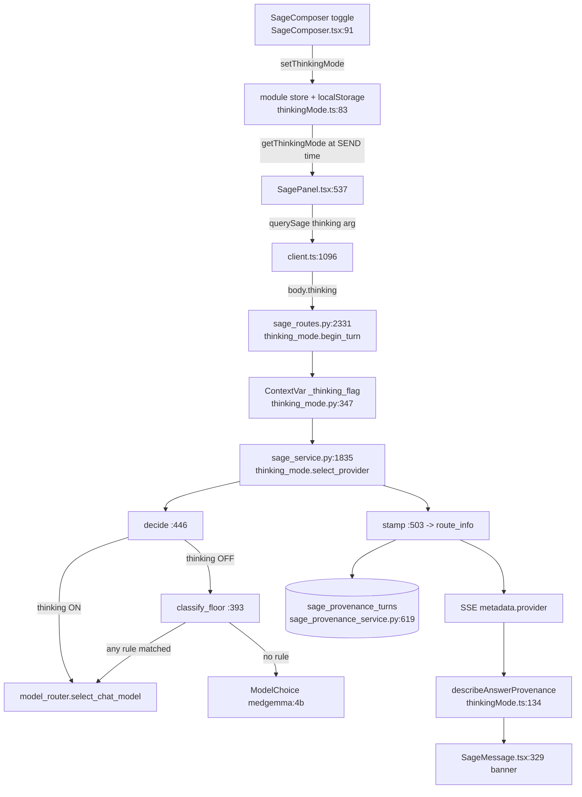
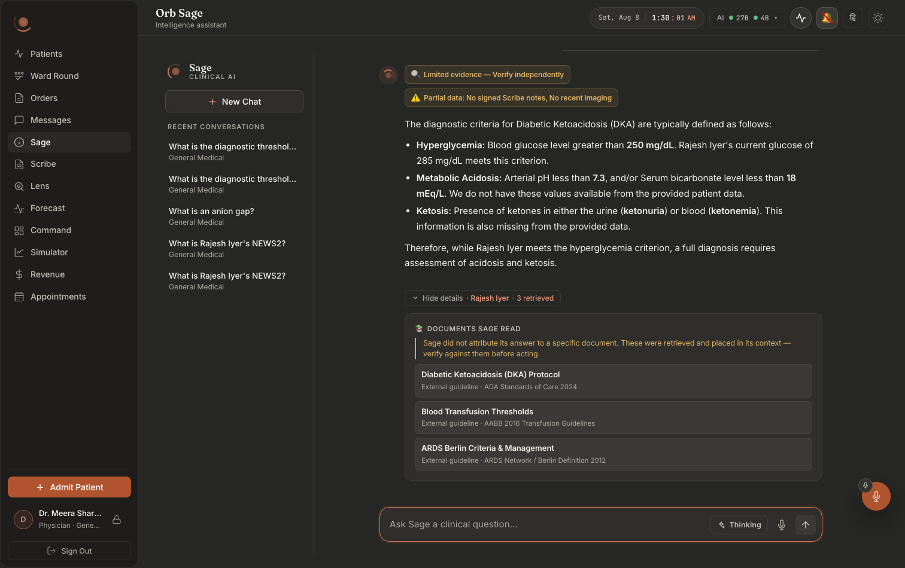
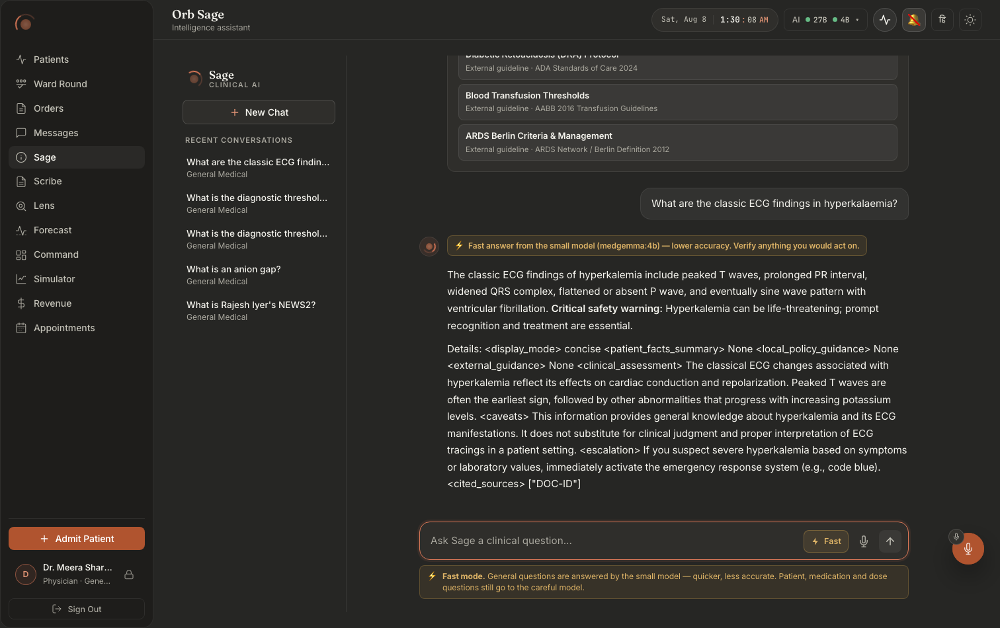
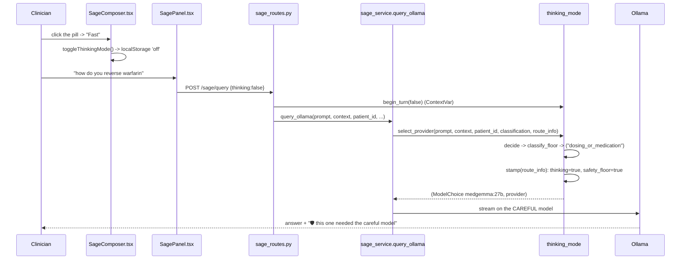

# Thinking mode: one toggle a doctor understands, and the floor underneath it

Built 2026-08-05. Verified against the code on 2026-08-09.

**Thinking mode** is a single control in the Sage composer. It says `Thinking` or it says `Fast`, and it decides which model reads the next question:

```
thinking ON   ->  medgemma:27b   (config.LLM_MODEL), the careful model
thinking OFF  ->  medgemma:4b    (config.THINKING_FAST_MODEL), the fast model
```

That is the whole feature as a clinician experiences it. It is not the whole design.

**The safety floor is the design.** Even with the toggle set to Fast, three classes of question are routed back to the careful 27B: anything about a specific patient, anything about a medication or a dose, and anything about a score Orb computes itself. This is not caution for its own sake, the 4B was measured on this appliance, on Orb's own prompts, getting exactly these questions dangerously wrong. The measurements are in `server/services/thinking_mode.py:52-95` and are reproduced in full below, because a floor whose justification is not written down is a floor somebody deletes.

**The risk gradient runs backwards, and this is the single most important sentence in the chapter.** The 4B did not fail on hard reasoning. It failed hardest on the *simplest* questions, single-fact drug recall, the kind of question a junior doctor fires off in a corridor without thinking. Compressed memory is exactly what a small model does not have. So the intuition "use the small model for the easy stuff" is inverted here, and any design that follows that intuition is unsafe.

**Three properties the module exists to guarantee**, taken from its own docstring (`server/services/thinking_mode.py:8-23`):

1. **The default is ON.** An absent flag, a `null`, an unparseable string, an old client that predates the feature, all of it resolves to the careful model. There is exactly one way to get the 4B: ask for it explicitly.
2. **The floor overrides the toggle.** Env-gated by `ORB_FAST_MODE_SAFETY_FLOOR`, defaults on.
3. **The clinician is never unsure which brain answered.** Every decision is stamped into `route_info`, which the Sage route already ships to the client as `metadata.provider`. A silent substitution, in either direction, is the failure mode this feature is built to prevent.

---

## Purpose and neighbors

**Jargon:**

| Term | Meaning in Orb |
|---|---|
| **Careful tier / careful model** | `config.LLM_MODEL`, `medgemma:27b` by default. What every turn got before this feature existed. |
| **Fast tier / fast model** | `config.THINKING_FAST_MODEL`, `medgemma:4b` by default. Resolved at import, and it resolves *to the careful model* when the 4B is not pulled. |
| **The toggle / the thinking flag** | The clinician's request, a boolean. Client store → request body → `ContextVar` → `decide()`. |
| **The safety floor** | Three rules that force the careful tier regardless of the toggle. `_FLOOR_RULES` (`thinking_mode.py:98`). |
| **Floor rule** | One of `patient_specific`, `dosing_or_medication`, `orb_computed_score`. |
| **`ThinkingDecision`** | The frozen dataclass carrying what was asked, what was decided, which rules fired, and a sentence written for a doctor (`thinking_mode.py:409`). |
| **Stamping** | Writing the decision into the `route_info` dict as `thinking_*` / `safety_floor_*` keys (`stamp`, `:503`). |
| **`safety_floor_unsatisfied`** | The floor demanded the careful model and the appliance served something else. The one combination that must never be silent. |
| **Residency routing** | The pre-existing "the 27B was evicted, answer on the ambient tier and say so" behaviour (`services/model_router.select_chat_model`). Thinking mode delegates to it unchanged for careful turns. |



**Neighbors:** guide 09-sage (`query_ollama`, `get_relevant_context`, the scope configs), guide 26-ai-infrastructure (`model_router`, `llm_providers`, residency and the ambient tier), guide 37-sage-provenance (`sage_provenance_turns` stores the thinking columns for every turn), guide 07-vigil (NEWS2, the deterministic score rule 3 protects), guide 14-helix (`drug_safety_service`, which seeds the drug vocabulary), guide 27-design-system (the status-text tokens the toggle and the banners use).

---

## File map

| File | Lines | Role |
|---|---:|---|
| `server/services/thinking_mode.py` | 611 | The whole policy. Floor rules and their measured justification (`:52-95`), the per-request `ContextVar`, `resolve_thinking_flag`, `classify_floor`, `decide`, `stamp`, and the single integration hook `select_provider` (`:535`). |
| `server/config.py` | 505 | The five knobs and the tier resolution: `LLM_MODEL` (`:132`), `THINKING_DEFAULT_ON` (`:161`), `THINKING_FAST_MODE_ENABLED` (`:167`), `_resolve_fast_model` (`:172`), `THINKING_FAST_MODEL` (`:201`), `FAST_MODE_SAFETY_FLOOR` (`:213`). |
| `server/routes/sage_routes.py` | n/a | Binds the flag for the turn: `from services import thinking_mode` (`:7`), `begin_turn` (`:1556`), and `_prov_no_model_route_info` (`:1479`) for exits where no model ever runs. |
| `server/services/sage_service.py` | n/a | The one call site: `select_provider` (`:1335`) replaced the two lines that used to pick model and provider; `info.update(lane=…)` follows at `:1337`. |
| `server/services/sage_provenance_service.py` | n/a | Persists `thinking`, `thinking_requested`, `thinking_tier`, `thinking_reason`, `safety_floor`, `safety_floor_rules`, `safety_floor_unsatisfied` into `sage_provenance_turns` (`:607-625`). |
| `src/api/thinkingMode.ts` | 177 | The client half: the persisted store (`:68-104`), the `SageProvenance` shape (`:29`), and `describeAnswerProvenance` (`:134`), the function that turns a stamped answer into one readable line. |
| `src/api/client.ts` | n/a | `querySage`'s `thinking?: boolean` parameter (`:916`) and the request body (`:931-935`). |
| `src/pages/panels/SagePanel.tsx` | n/a | The only caller that passes the toggle, read at send time (`:513`). |
| `src/components/sage/SageComposer.tsx` | 178 | The control itself (`:91-115`) and the standing fast-mode notice (`:166-175`). |
| `src/components/sage/SageMessage.tsx` | n/a | Renders the per-answer provenance banner (`:329-341`), next to but separate from the residency-downgrade banner (`:318-323`). |
| `src/components/sage/Sage.css` | n/a | `.sage-think-toggle` (`:433`), the loud OFF state (`:467`), `.sage-fast-notice` (`:481`), `.sage-banner--floor` (`:291`). |
| `server/tests/test_thinking_mode.py` | 527 | The behavioural spec. Default-on, every measured failure, the env var proved through a fresh interpreter (`:259`), the labelling, and the quantity-seeking regression block (`:494-527`). |
| `src/components/sage/SageComposer.test.tsx` | 87 | Pins legibility: a visible label, `role="switch"`, and a standing notice that also states the floor. |
| `src/api/thinkingMode.test.ts` | n/a | Pins the defaulting rule and every branch of `describeAnswerProvenance`. |
| `server/dev_tools/measure_thinking_mode.py` | 314 | The measurement harness. Runs Orb's own retrieval and prompts against both tiers, one tier at a time. |
| `server/ops/thinking_mode_measurements.json` | 86 | The stored speed numbers. |
| `server/ops/fast_model_contract_check.json` | 146 | Whether each tier emitted Orb's answer marker. The 4B mostly did not. |



*Thinking ON. The pill in the composer reads **Thinking**, quiet and bordered. No banner on the answer, the ordinary case says nothing, deliberately.*



*Fast mode armed. Three visible changes: the pill reads **Fast** in warning amber; a standing strip under the composer states the mode **and the floor**; and the answer itself carries "⚡ Fast answer from the small model (medgemma:4b), lower accuracy. Verify anything you would act on." Note also what the 4B did to that answer, the raw `<display_mode>` / `<caveats>` / `<cited_sources>` scaffolding leaked into the visible text. See "What fast mode actually costs" below.*

---

## The safety floor, and the measurements that justify it

This section is the reason the chapter exists. Everything here is recorded at `server/services/thinking_mode.py:52-95` and pinned by tests at `server/tests/test_thinking_mode.py:151-195`.

### What medgemma:4b did on this appliance

**Wrong on 40% of simple single-fact drug/dose recall.** Not vague, not hedged, confidently wrong, in the shape a clinician would act on. Two recorded failures:

- **It offered protamine to reverse warfarin.** Protamine reverses *heparin*. Warfarin is reversed with vitamin K and PCC. A clinician who follows that answer gives a drug that does nothing while the patient keeps bleeding. **This question contains no dose and no number at all**, which is why the floor triggers on any medication question, not only on questions with a quantity in them (`_DRUG_NAMES`, `thinking_mode.py:261`).
- **It recommended a 4 mL/kg fluid bolus for sepsis.** The correct initial bolus is 30 mL/kg. That is one seventh of the fluid, in the condition where under-resuscitation kills. **This failure carries a unit and a number but names no drug**, which is why the floor also triggers on a bare clinical quantity (`_DOSE_QUANTITY`, `:170`).

**It fabricated patient data on 3 of 8 chart turns.** Invented vitals, invented history. A 37.5% fabrication rate on the exact task, "tell me about this patient", that a ward round runs dozens of times a day. This is why *any* question with a patient in scope goes to the careful model regardless of the toggle. The failure mode is not "a slightly worse answer"; it is a made-up chart.

**It fabricated a NEWS2 trigger that contradicted Orb's own logic.** Orb computes NEWS2 deterministically in `services/vigil_service`. A clinician who asks Sage "why did this escalate?" and gets an invented threshold does not merely get a wrong answer, they lose trust in the deterministic score that was *right*, which is the one part of Orb that must never be second-guessed. This is rule 3, and the module deliberately calls it out separately (`thinking_mode.py:81-88`) so it can be reasoned about, and removed, independently of the founder's original two rules.

### Why the gradient runs backwards

Every one of those failures is a *simple* question. None of them require multi-step reasoning. Single-fact recall, which drug reverses which anticoagulant, what number goes in a bolus, is precisely what a 4-billion-parameter model's compressed memory does not reliably hold. A large model's advantage over a small one is not only reasoning depth; a great deal of it is simply having the fact.

The practical consequence: **you cannot route by apparent difficulty.** "It's just a quick question" is the exact input class the fast model is worst at. The floor is written in terms of *subject matter*, patient, drug, Orb-computed score, never in terms of question complexity.

### The asymmetry that sets the tuning

The floor is deliberately over-inclusive (`thinking_mode.py:90-91`). A false positive costs the clinician seconds. A false negative costs them a wrong dose. That is not a close call, so every ambiguous rule is written wide. The counterweight is a test list of ordinary general-knowledge questions that must *not* trip the floor (`test_thinking_mode.py:197-213`), because a floor that catches everything makes the toggle a placebo, and a placebo toggle is worse than no toggle: it implies a speed choice the clinician is not actually getting.

### The three rules

| Rule | Fires on | Implemented by |
|---|---|---|
| `patient_specific` | An explicit `patient_id`; a governance classification saying PHI or patient-scoped; a chart block in the assembled prompt; or patient deixis in the words. | `classify_floor` `:408-424`, `_PATIENT_DEIXIS` `:114`, `_CONTEXT_PATIENT_MARKERS` `:133` |
| `dosing_or_medication` | A dose word, a quantity-seeking phrase, a bare clinical quantity, or any drug or drug-class name. | `_DOSE_WORDS` `:137`, `_DOSE_QUANTITY` `:170`, `_DRUG_NAMES` `:259` |
| `orb_computed_score` | NEWS2, early-warning scores, escalation triggers, sepsis bundles, "why did Orb/Vigil escalate". | `_ORB_COMPUTED` `:266` |

### The quantity-seeking rule: a gap found by measurement, after shipping

This is documented in the code at `thinking_mode.py:144-156` and pinned at `test_thinking_mode.py:494-511`, and it is the clearest example in the codebase of a rule that looked complete and was not.

The first implementation gated the "how much" family behind `how much do|should|of` and `how many <unit>`. Both forms require the asker to *already have* a unit or an auxiliary verb in the sentence. So:

> **"How much fluid in sepsis?"**

went to the fast model. It names no drug, so `_DRUG_NAMES` misses it. It contains no number, so `_DOSE_QUANTITY`, which matches a digit followed by a unit, cannot possibly match it: **a question asking for a quantity contains no quantity.** And it did not fit the narrow "how much do/should/of" shapes, so `_DOSE_WORDS` missed it too. All three rules had a hole in the same place.

That is the exact question the 4B answered "4 mL/kg" to, where the answer is 30 mL/kg.

The fix broadened the rule to the bare interrogatives (`:155-156`):

```
how much\b | how many\b | how fast\b | how quickly\b |
what (?:rate|volume|amount|concentration|strength)\b
```

The reasoning recorded alongside it: in a clinical assistant, "how much / how many / what rate / what volume" is a quantity request essentially always, and quantity is the single thing the small model is measurably worst at. A false floor costs a few seconds; a false pass costs a dosing error.

The regression list that now guards it, "How much adrenaline in anaphylaxis?", "How many units of insulin?", "How fast do I run the noradrenaline?", "What volume of Hartmann's?", sits beside a second list proving the broadening did **not** swallow ordinary definitions ("Define septic shock", "What is an anion gap?", "How is sepsis diagnosed?") at `test_thinking_mode.py:513-527`. Both lists are required. One without the other tunes the rule blind.

**The general lesson, which is the same one guide 30 draws about green test suites:** this hole was not found by reading the code, and it could not have been. It was found by running real questions through the shipped implementation and reading the answers. The rule looked complete because every failure it was written against was covered.

---

## How it works

### Flow 1: import time, on the appliance

1. `config.py:197` resolves `LLM_MODEL`, asking Ollama which models are pulled (`_installed_model_names`, `:155`), falling back to any installed medgemma variant.
2. `config.py:266` resolves `THINKING_FAST_MODEL` through `_resolve_fast_model` (`:237`). The fallback chain deliberately errs *toward the careful model*: the preferred fast tag if pulled → a distinct ambient tier if an operator declared one → otherwise `LLM_MODEL` itself, printing a line that says fast mode will produce "no speed win, but no wrong answers".
3. `thinking_mode.py:39-45` imports those five values **by value**. Changing an env var therefore requires a server restart; nothing re-reads it.
4. `_build_drug_vocabulary()` (`:232`) runs at import, unioning the ward drug list (`_EXTRA_DRUG_TERMS`, `:186`) with `drug_safety_service`'s own class tables, and compiles one longest-first alternation into `_DRUG_NAMES` (`:261`).

### Flow 2: a turn, thinking ON

1. The composer's pill reads **Thinking**. `src/pages/panels/SagePanel.tsx:537` passes `getThinkingMode()` (true) into `querySage`.
2. `src/api/client.ts:1130` sends `thinking: true` in the body.
3. `sage_routes.py:2331` calls `begin_turn(body.get("thinking"))`, setting the request's `ContextVar`.
4. `sage_service.query_ollama` calls `select_provider` (`sage_service.py:1835`); `decide` (`thinking_mode.py:569-575`) returns the careful tier immediately, **without running the classifier at all**, and delegates model choice to `model_router.select_chat_model()` so residency behaviour is preserved bit for bit.
5. `stamp` writes `thinking=True`, `thinking_tier="careful"`, `safety_floor=False`.
6. `describeAnswerProvenance` returns `null`. **No banner.** The ordinary case is silent.

### Flow 3: a turn, thinking OFF, floor fires

1. The pill reads **Fast**, in amber, and the standing strip is up.
2. `begin_turn(false)`, `decide` reaches `thinking_mode.py:588` and calls `classify_floor`.
3. A rule matches. The turn is routed to the careful model, `floor_fired=True`, `floor_rules=(…)`, and `reason` is assembled by `_floor_sentence` (`:544`) into a doctor-readable sentence: *"Fast mode was on, but this question involves a medication or a dose, so this one was answered by the careful model."*
4. `select_provider` (`thinking_mode.py:677-680`) logs the **rule names only, never the query**, that log line would otherwise carry PHI.
5. The client renders the reassurance banner: *"🛡️ Fast mode is on, but this one needed the careful model (medgemma:27b) because it involves a medication or a dose."* Info tokens, not amber, the guardrail worked (`Sage.css:287-295`).

### Flow 4: a turn, thinking OFF, no rule matches

The 4B answers, and the answer carries *"⚡ Fast answer from the small model (medgemma:4b), lower accuracy. Verify anything you would act on."*

### Flow 5: the floor could not be honoured

The floor demanded the careful model, and residency served something smaller because the 27B was evicted. `stamp` sets `safety_floor_unsatisfied=True` (`thinking_mode.py:634`), and the client's **first** branch (`src/api/thinkingMode.ts:144`) produces a danger-toned warning naming both models. This is the only case where a clinician has been told "this needed the careful model" and did not get it.



---

## Function-by-function

### File: `server/config.py`: the five knobs

#### `LLM_MODEL` / `_resolve_llm_model`: `config.py:258` / `:177`
**Signature:** `str` / `(preferred: str) -> str`
**Does:** Names the careful tier. Falls back to any installed medgemma variant if the configured tag is not pulled, matching on the **base name**.
**On screen:** it is the model name printed inside every provenance banner, "Fast mode is on, but this one needed the careful model (**medgemma:27b**)", and the `27B` chip in the header AI panel.
**Breaks if you change it:** modules do `from config import LLM_MODEL` **by value**, so this must resolve at import. Making it lazy means a missing model 404s every AI feature with no visible error.

#### `AMBIENT_LLM_MODEL`: `config.py:264`
**Signature:** `str`, defaults to `LLM_MODEL`
**Does:** The cheap tier for non-interactive background work.
**On screen:** nothing directly, but it is the **second** candidate in the fast-tier fallback chain (`:191-193`), so on a site that declared an ambient tier, thinking-OFF quietly rides on the model the operator already chose.
**Breaks if you change it:** point it at a model that is not pulled and thinking-OFF resolves to it anyway when Ollama is unreachable (`:192`, `installed is None`), and every fast turn 404s.

#### `THINKING_DEFAULT_ON`: `config.py:287`
**Signature:** `bool`, from `ORB_THINKING_DEFAULT`, default `"on"`
**Does:** What an absent or unparseable flag resolves to.
**On screen:** nothing renders it. It is the value every non-Sage caller silently gets, the ward narrator, background summarisers, the Scribe demographics extraction.
**Breaks if you change it:** setting it off means an old client, a scripted caller or a dropped JSON field quietly downgrades a clinician's answer to the model that is wrong 40% of the time on drug recall. The floor still stands above it (`test_thinking_mode.py:85-92`), but the general lane goes fast by default for everybody, including callers that have no toggle to notice it.

#### `THINKING_FAST_MODE_ENABLED`: `config.py:293`
**Signature:** `bool`, from `ORB_FAST_MODE_ENABLED`, default true
**Does:** The panic switch. Off pins every Sage turn to the careful model regardless of what any client sends.
**On screen:** **nothing today.** The server honours it (`fast_mode_available`, `:390`), but the composer still renders the toggle and the clinician still sees "Fast". See discrepancy 1.
**Breaks if you change it:** turning it off is the correct response to a site deciding the fast lane is not for them, but until the availability flag reaches the UI, the ward will believe fast mode is on and be quietly served careful answers.

#### `_resolve_fast_model`: `config.py:298`
**Signature:** `(preferred: str) -> str`
**Does:** Picks the model that serves thinking-OFF, erring toward the careful one: preferred if pulled → a distinct ambient tier → otherwise `LLM_MODEL`.
**On screen:** the model name in the fast-answer banner, and the `4B` chip in the header AI panel.
**Gotchas, this is the subtle one:** matching is **exact on the tag**, unlike `_resolve_llm_model`, which matches the base name. Base-name matching here would happily return `"medgemma:4b"` on a box that only has `medgemma:27b` pulled, and every fast turn would 404 (`:218-221`).
**Breaks if you change it:** invert the fallback direction, degrade to *anything smaller* rather than to the careful model, and an unavailable fast tier turns into either a 404 or a wrong answer. Both are worse than a slow correct one.

#### `THINKING_FAST_MODEL`: `config.py:327`
**Signature:** `str`, from `ORB_FAST_MODEL`, default `medgemma:4b`
**Does:** The fast tier's resolved name.
**On screen:** printed inside the fast-answer banner (`thinkingMode.ts:172`).
**Breaks if you change it:** when this equals `LLM_MODEL`, `fast_mode_available()` goes False and the whole toggle becomes inert, by design, but see discrepancy 1 for what the clinician sees.

#### `FAST_MODE_SAFETY_FLOOR`: `config.py:339`
**Signature:** `bool`, from `ORB_FAST_MODE_SAFETY_FLOOR`, default `"1"` → **on**
**Does:** Arms the floor. Setting it to `0` makes fast mode answer everything, including dosing and patient questions.
**On screen:** stamped out as `safety_floor_enabled` on every answer's provenance, and persisted per turn, but **nothing in the UI reads it**. A ward cannot tell from the screen whether the floor is armed.
**Why it is a switch at all:** the founder must be able to remove it without a code change, and a site that has measured its own fast model may legitimately not need it.
**Breaks if you change it:** setting `0` on a ward with real patients accepts all four measured failures as reachable through the UI. `config.py:268-277` says so in the file, and `thinking_mode.py:93-95` repeats it at the definition, deliberately, so nobody reaches the env var without passing the reasons.

---

### File: `server/services/thinking_mode.py`: the policy

#### `TIER_CAREFUL` / `TIER_FAST`: `thinking_mode.py:49` / `:50`
**Signature:** `"careful"` / `"fast"`
**Does:** The two tier names.
**On screen:** `thinking_tier` reaches the client typed as `ThinkingTier` (`src/api/thinkingMode.ts:21`) and the string `'fast'` is what triggers the ⚡ banner (`:168`).
**Breaks if you change it:** rename either string and the client's `p.thinking_tier === 'fast'` check silently stops matching, a fast answer would then render with no banner at all, which is the exact silent substitution this module exists to prevent. The column is also persisted (`sage_provenance_service.py:619-624`), so a rename splits historical rows.

#### The floor's justification comment: `thinking_mode.py:52-95`
**Does:** Records the measurements. Not code.
**On screen:** nothing.
**Why it exists:** it is the only thing standing between a future engineer and `ORB_FAST_MODE_SAFETY_FLOOR=0`. A guardrail with no written reason is a guardrail that gets removed by someone optimising latency.
**Breaks if you delete it:** the switch stays, the reason goes, and the next person to read `config.py:278` sees a boolean with no cost attached.

#### `_FLOOR_RULES`: `thinking_mode.py:98`
**Signature:** `dict[str, str]`, rule name → one clause a clinician reads
**Does:** Names the three rules and supplies their human phrasing.
**On screen:** the clause after "because" in the floor banner. The client keeps a **mirror** of this map at `src/api/thinkingMode.ts:109-113`.
**Gotchas:** the mirror is a second copy, matched by string key. Add a rule server-side and the client's `.map(...).filter(Boolean)` (`:152-154`) silently drops it from the sentence, the banner still appears, just without that reason.
**Breaks if you change it:** rename a key and the banner loses its explanation while the routing still changes. A clinician then sees the careful model used for no stated reason, which reads as a bug.

#### `_PATIENT_DEIXIS`: `thinking_mode.py:116`
**Signature:** compiled regex
**Does:** Matches language that only resolves against an open chart: "this patient", "bed 4", "mrn …", and bare third-person pronouns.
**On screen:** nothing directly; it decides which model answers.
**Why it is deixis and not "patient":** matching the abstract word would send the entire general-knowledge lane careful ("what are the signs of sepsis in a patient?"), and the toggle would become a placebo (`:111-115`).
**Gotchas, verified 2026-08-09 by running the compiled pattern:** the bare pronouns `he|him|his|she|her|they|them|their` mean textbook questions with generic third-person phrasing also trip rule 1. `"how do statins work in the elderly and do they lower mortality"` and `"what do you give patients when they present with chest pain"` both match. So the real fast lane is narrower than the composer's notice implies. That is the intended direction of error, but it should be measured, not assumed.
**Breaks if you change it:** dropping the pronouns widens the fast lane and reopens the follow-up case ("what is *his* creatinine trend") that `test_thinking_mode.py:107-124` pins.

#### `_CONTEXT_PATIENT_MARKERS`: `thinking_mode.py:135`
**Signature:** `("PATIENT:", "NO MATCHING PATIENT")`
**Does:** Detects that the **assembled prompt** carries a chart block, by matching the first line the chart builder emits.
**On screen:** nothing; it is why the floor catches **sticky anchoring**.
**Why it exists, this is the killer case:** a follow-up like *"what is driving that?"* carries no `patient_id`, no name and no pronoun, but Sage's retrieval layer has attached the chart anyway. The request looks general; the prompt is patient-specific. Matching the prompt is the only evidence available (`test_thinking_mode.py:133-140`).
**Breaks if you change it:** change the chart builder's first line in `sage_service` (`context["demographics"]`) without changing this tuple, and every sticky-anchored follow-up starts reaching the 4B, the model that fabricated patient data on 3 of 8 chart turns. Nothing fails loudly; the floor just stops firing.

#### `_DOSE_WORDS`: `thinking_mode.py:139`
**Signature:** compiled regex
**Does:** Dose vocabulary (`dose`, `bolus`, `titrate`, `bd/tds/qds`, `per kg`), prescribing verbs, generic medication nouns, and, since 2026-08-05, the quantity-seeking interrogatives (`:155-156`).
**On screen:** nothing directly.
**Why the broadening happened:** the "How much fluid in sepsis?" gap, documented in the comment at `:144-156` and in the section above.
**Breaks if you change it:** narrow the interrogatives back to their original `how much do|should|of` shape and the sepsis-bolus question walks straight past the floor again. `test_thinking_mode.py:494-511` is the guard.

#### `_DOSE_QUANTITY`: `thinking_mode.py:172`
**Signature:** compiled regex, a number with a clinical unit, or a rate like `mg/kg`, `ml/hr`
**Does:** Catches a bare quantity that names no drug.
**On screen:** nothing directly.
**Why it exists:** the 4 mL/kg sepsis failure names no drug at all (`test_thinking_mode.py:178-181`).
**Gotchas:** it matches a **present** number. It structurally cannot catch a question *asking* for one, that is `_DOSE_WORDS`'s job, and the reason the two rules must both exist.

#### `_EXTRA_DRUG_TERMS`: `thinking_mode.py:186`
**Signature:** `tuple[str, ...]`, roughly 150 ward drug names plus spoken drug-class names
**Does:** Ward vocabulary the pharmacology layer does not need but Sage is asked about.
**On screen:** nothing directly.
**Why the class names are in it (`:215-227`):** *"what is the mechanism of action of beta blockers"* names no molecule and carries no dose, and is squarely a medication question. Without the spoken class names, rule 2 has a hole the width of pharmacology teaching.
**Breaks if you change it:** removing "protamine" or "vitamin k" removes the floor from the exact recorded failure.

#### `_build_drug_vocabulary`: `thinking_mode.py:232`
**Signature:** `() -> frozenset[str]`
**Does:** Unions the local list with `drug_safety_service._DRUG_CLASS_PATTERNS` and `_ALLERGEN_CLASS_TERMS`, then drops any term shorter than 3 characters.
**On screen:** nothing.
**Why it reads the pharmacology layer defensively:** that module opens a DB session at call time but not import time, and if its private tables are renamed this must degrade to "a slightly smaller list", never to an import error on the Sage hot path (`:231-237`).
**Why the 3-character floor:** a one- or two-character term put into an alternation with `\b` guards would match inside ordinary words. None exist today; the filter keeps it that way (`:247-249`).
**Breaks if you change it:** make the `except` narrower and a rename in `drug_safety_service` takes down every Sage turn at import, not just the drug rule.

#### `_DRUG_NAMES`: `thinking_mode.py:261`
**Signature:** compiled alternation over the vocabulary, **longest-first**, with a trailing `s?`
**Does:** Matches a free-text drug or drug-class mention.
**On screen:** nothing directly.
**Why longest-first, and why `s?` (`:253-258`):** longest-first makes the reported match the specific one rather than a prefix. The `s?` is what makes the class names work in the plural a clinician actually uses, without it, `\b` after "blocker" refuses to match "blockers", and the commonest phrasing of a medication question walks past the floor.
**Breaks if you change it:** sort it any other way and specific compounds lose to their own prefixes; drop the `s?` and "statins", "opioids", "beta blockers" all stop matching.
**Gotchas:** the vocabulary is static and English. A drug named in another language matches nothing.

#### `_ORB_COMPUTED`: `thinking_mode.py:320`
**Signature:** compiled regex, NEWS2, early-warning scores, escalation triggers, sepsis bundles, "why did Orb/Vigil escalate"
**Does:** Rule 3.
**On screen:** produces the clause *"it is about a score Orb computes itself"* in the floor banner.
**Why it is separate from the other two:** it protects Orb's own determinism rather than the patient directly. A fabricated NEWS2 threshold discredits the score that was correct. It is called out separately so a site can reason about it, and remove it, independently (`:81-88`).

#### `_thinking_flag`: `thinking_mode.py:347`
**Signature:** `ContextVar[bool | None]`, default `None`
**Does:** Carries the request's flag from the route (which sees the body) to `query_ollama` (which does not), without threading a parameter through a file this change does not own.
**On screen:** nothing.
**Why the transport is safe (`:286-292`):** Starlette handles each request in its own task and a task copies the context at creation, so one request cannot read another's value. The failure mode if that ever changed would be a **leaked "thinking OFF"**, a downgrade nobody asked for. Two guards make that harmless: the var carries **only the boolean, never the classification**, and `select_provider` re-derives the floor from the live prompt in flight. Even a leaked OFF cannot route a patient or dosing question to the 4B.
**Breaks if you change it:** cache the *decision* here instead of the flag and that second guard disappears, a leaked context would then carry a leaked "no floor needed".

#### `resolve_thinking_flag`: `thinking_mode.py:353`
**Signature:** `(raw: object) -> bool`
**Does:** Normalises whatever the client sent. `None`, a missing key, `"maybe"`, `{}`, `[]`, everything ambiguous resolves to `THINKING_DEFAULT_ON`. Only an explicit `False`, `0`, `"false"`, `"off"`, `"fast"`, `"no"` buys the fast model (`_TRUTHY`/`_FALSY`, `:295-296`).
**On screen:** nothing directly; it is why an old client cannot be downgraded.
**Breaks if you change it:** make the fall-through return `False` and every caller that omits the field, every programmatic caller, every older client, is silently moved to the fast model. `test_thinking_mode.py:57-65` parametrises both directions.

#### `begin_turn` / `end_turn`: `thinking_mode.py:376` / `:385`
**Signature:** `(raw: object) -> Token` / `(token: Token) -> None`
**Does:** Records the request's flag; restores it.
**On screen:** nothing.
**Gotchas:** the route deliberately keeps no reset token (`sage_routes.py:2328-2330`), the ContextVar dies with the request task. `end_turn` exists for tests that share one context; the suite's autouse fixture resets the var precisely because a leaked flag would make the default-is-ON tests pass or fail depending on ordering (`test_thinking_mode.py:34-51`).
**Breaks if you change it:** call `begin_turn` anywhere outside a per-request task, a shared worker, a background loop, and one caller's fast-mode choice becomes another's.

#### `current_thinking_flag`: `thinking_mode.py:393`
**Signature:** `() -> bool`
**Does:** This request's flag, or the configured default when nothing was set.
**On screen:** its value is also read directly by `sage_routes._prov_no_model_route_info` (`:1489`) so that a turn refused before any model ran still records what the clinician had chosen.
**Why "nothing was set" means the default:** the un-integrated callers, the ward narrator, background summarisers, Scribe's demographics extraction, never go through `begin_turn`. They must not be moved onto the fast model merely because this feature exists (`test_thinking_mode.py:78-82`).
**Breaks if you change it:** default to `False` here and every background LLM consumer in Orb silently switches tiers.

#### `ThinkingDecision`: `thinking_mode.py:409`, `.thinking` at `:431`
**Signature:** frozen dataclass, `requested_thinking`, `tier`, `model`, `floor_fired`, `floor_rules`, `floor_enabled`, `fast_mode_available`, `reason`
**Does:** The whole decision as one immutable value, including a sentence written for a doctor rather than for a log.
**On screen:** every field except `floor_enabled` reaches the client through `stamp`; `reason` is the only one that is **computed and shipped but never rendered** (see discrepancy 2).
**Gotchas:** `requested_thinking` and `.thinking` are deliberately different questions, "what did the clinician ask for" versus "what did they get". The floor banner exists exactly because those two can disagree (`test_thinking_mode.py:339-350`).
**Breaks if you change it:** collapse the two into one boolean and the answer can no longer say "you asked for fast, and here is why you did not get it".

#### `fast_mode_available`: `thinking_mode.py:436`
**Signature:** `() -> bool` → `THINKING_FAST_MODE_ENABLED and THINKING_FAST_MODEL != LLM_MODEL`
**Does:** Is there a real fast lane on this appliance?
**On screen:** stamped as `thinking_available` (`:629`) and typed on the client (`src/api/thinkingMode.ts:44`), **and read by nothing.** The docstring says "the toggle should not be offered when this is False"; no code implements that today.
**Breaks if you change it:** make it always true and a box without the 4B pulled routes fast turns to a model tag that is not there.

#### `classify_floor`: `thinking_mode.py:447`
**Signature:** `(query, patient_id=None, classification=None, context=None) -> tuple[str, ...]`
**Does:** Returns which rules this turn trips, in `_FLOOR_RULES` order. Pure, no I/O, no DB, no event loop.
**On screen:** the returned names become `safety_floor_rules`, which the client turns into the "because …" clause.
**How the patient signal is derived, in order (`:408-424`):** an explicit `patient_id` → the governance classification (duck-typed on `contains_phi` / `query_class`, so this module never hard-depends on `ai_governance`'s class shape) → chart markers in the assembled context → deixis in the words.
**Why every argument is optional:** each one only ever *adds* signal, so a caller with less information gets a floor that fires **at least as often**, never less often (`:401-403`). The text rules alone catch every measured failure.
**Breaks if you change it:** make any argument mandatory and a caller that cannot supply it stops classifying at all. Add a DB read and this stops being callable from the hot path.

#### `_floor_sentence`: `thinking_mode.py:544`
**Signature:** `(rules) -> str`
**Does:** Joins the matched rules' clauses into readable English ("A, B and C").
**On screen:** the middle of the server-side `reason` string.
**Gotchas:** the client builds the *same* sentence independently from `safety_floor_rules` (`thinkingMode.ts:151-165`), because it renders `reason` nowhere. Two sentence builders, one contract.

#### `decide`: `thinking_mode.py:553`
**Signature:** `(query, patient_id=None, classification=None, context=None, thinking=None) -> ThinkingDecision`
**Does:** The policy, in four branches and in this order: thinking ON → careful, no classification run at all (`:462`); no fast lane available → careful with an honest reason (`:470`); floor rules matched → careful, `floor_fired=True` (`:481`); otherwise → fast (`:491`).
**On screen:** everything downstream.
**Why the ON branch skips the classifier:** a banner saying "this needed the careful model" on a turn the clinician explicitly asked to be careful is noise (`test_thinking_mode.py:216-222`).
**Gotchas:** `FAST_MODE_SAFETY_FLOOR` is consulted at `:588` as a **module-level constant imported by value**. Flipping the env var needs a restart; tests monkeypatch the module attribute, and there is a separate fresh-interpreter test (`test_thinking_mode.py:259-323`) that proves the wire from `ORB_FAST_MODE_SAFETY_FLOOR` to that branch actually exists, because a test that only patches the constant cannot tell a working env var from a typo'd one.
**Breaks if you change it:** reorder the branches so the floor runs before the availability check and a box with no fast tier starts reporting `floor_fired=True` on questions that were never going anywhere else.

#### `stamp`: `thinking_mode.py:610`
**Signature:** `(route_info: dict | None, decision, served_model: str | None = None) -> dict`
**Does:** Writes ten `thinking_*` / `safety_floor_*` keys into the dict the Sage route ships as `metadata.provider`.
**On screen:** **this is the function that makes the feature visible at all.** Everything the clinician reads about which brain answered is derived from these keys.
**How `safety_floor_unsatisfied` works (`:634`):** `decision.floor_fired and served != LLM_MODEL`. `served_model` is the model that will *actually* run the turn, after residency has had its say, so the floor demanding the careful model and residency being unable to supply it is detectable and cannot be silent.
**Why the keys are namespaced:** `query_ollama` calls `info.update(lane=…, provider=…, model=…, downgraded=…, preferred_model=…)` immediately afterwards (`sage_service.py:1837-1839`). A collision would let the routing label silently overwrite the clinician's label. `test_thinking_mode.py:371-377` asserts the two key sets are disjoint.
**Breaks if you change it:** drop `safety_floor_unsatisfied` and the one genuinely dangerous case, told careful, served small, renders as an ordinary floor reassurance banner.

#### `select_provider`: `thinking_mode.py:642`
**Signature:** `async (query, context=None, patient_id=None, classification=None, route_info=None, thinking=None) -> (ModelChoice, ChatProvider)`
**Does:** The single integration point. Decides, resolves the provider, stamps, logs.
**On screen:** indirectly, everything.
**How residency differs by tier (`:549-555`):** the careful tier delegates to `model_router.select_chat_model()` **unchanged**, preserving `downgraded` and the existing eviction behaviour bit for bit. The fast tier builds `ModelChoice(model, False, model)` directly and **never downgrades**, it *is* the small tier, there is nothing smaller to fall back to, and a 3 GB load is seconds rather than the ~80 s that motivated the residency router in the first place.
**Why it returns a provider too:** the bug it prevents is `local_provider` (bound to the 27B) being used to serve a fast-tier turn. `provider_for_model` (`services/llm_providers.py:151`) returns the cached handle for the chosen tag, and `test_thinking_mode.py:383-398` asserts `provider.model` equals `choice.model`.
**The PHI rule (`:568-573`):** the floor-fired log line prints the **rule names and the model names only**. It never prints the query. That line would otherwise be a PHI leak into the application log on every patient question asked in fast mode.
**Breaks if you change it:** return only a `ModelChoice` and the caller must re-derive the provider, which is exactly how a fast-tier decision ends up being served by the 27B handle, producing a "fast answer" banner over a careful answer. Add the query to the log line and Orb writes PHI to disk outside the audit chain.

#### The integration note: `thinking_mode.py:684-718`
**Does:** Records the two edits this module needs in files it does not own, with exact line numbers and exact replacement text.
**On screen:** nothing.
**Status:** **both edits have landed.** `sage_routes.py:2331` calls `begin_turn`; `sage_service.py:1835` calls `select_provider`. The note is now historical, and `test_thinking_mode.py:465-481` is the thing that notices if it rots, it passes in both the un-integrated and integrated states and fails only when neither is true.
**Gotchas:** the note's line numbers ("1308", "1328-1329") are as of 2026-08-05 and are already stale relative to today's file. Read the note as prose, not as a map.

---

### The call sites, in files `thinking_mode` does not own

#### `begin_turn` in the query route: `server/routes/sage_routes.py:2331` (import at `:8`)
**Does:** Binds `body.get("thinking")` for the whole turn, immediately after `effective_patient_id` is resolved.
**On screen:** nothing itself; it is what makes the composer's toggle mean anything.
**Gotchas, the voice lane is deliberately excluded.** `/sage/voice` never calls `begin_turn`, so a spoken turn takes the default (careful) until voice grows a control of its own (`:1927-1928`). That is a real behavioural difference between typing and speaking the same question.
**Breaks if you change it:** move it after the pre-LLM safety gate and a refused turn records no toggle position. Add it to the voice handler without adding a visible control and a clinician gets fast answers from a surface with no way to see or change the setting.

#### `_prov_no_model_route_info`: `server/routes/sage_routes.py:2254`
**Signature:** `() -> dict` → `{"thinking_requested": …}`
**Does:** Supplies a minimal `route_info` for the exits where no model is ever selected, a pre-LLM refusal, a retrieval failure.
**On screen:** nothing. It exists for the provenance row.
**Why it is read here and not later (`:1483-1486`):** the ContextVar belongs to the request's task, and a streaming generator is not guaranteed to be iterated inside it. Read it in the request's own context or you read the default.
**Breaks if you change it:** move this read into the generator and every refused turn records "thinking ON" regardless of what the clinician chose.

#### `select_provider` in `query_ollama`: `server/services/sage_service.py:1835`
**Does:** Replaced the two lines that used to pick the model and the provider.
**On screen:** everything; this is where the tier choice becomes real.
**Gotchas:** `route_info=info` is passed **before** `info.update(lane=…, model=…)` at `:1361-1364`. The order matters only because the key sets must stay disjoint, see `stamp`.
**Breaks if you change it:** revert to `select_chat_model()` and the toggle becomes decorative: the client still sends `thinking`, the route still binds it, and nothing reads it. Nothing fails; every answer is just careful. That is the safe direction of failure, and it is deliberate.

#### The provenance row: `server/services/sage_provenance_service.py:607-625`
**Does:** Persists `model_requested` (`thinking_model` falling back to `model`), `model_served`, `thinking`, `thinking_requested`, `thinking_tier`, `thinking_reason`, `safety_floor`, `safety_floor_rules`, `safety_floor_unsatisfied` into `sage_provenance_turns`, `INSERT OR IGNORE` into an append-only table.
**On screen:** the Sage provenance surfaces in the admin panel (guide 37).
**Why it matters here:** this is the only durable record of which model answered which question. The banner is transient; a reviewer asking "was this dose answer from the 4B?" months later needs the row.
**Breaks if you change it:** drop the thinking columns and a fast-mode answer becomes indistinguishable, after the fact, from a careful one.

---

### File: `src/api/thinkingMode.ts`: the client store and the provenance reader

The module header states why the store exists at all: the toggle lives in the composer, but its value is needed in `querySage`, two components away and outside React's tree, and it must survive a reload so a clinician who chose fast mode is not silently reset.

#### `STORAGE_KEY`: `thinkingMode.ts:18`
**Signature:** `'orb_sage_thinking'`
**On screen:** nothing. Change it and every clinician's saved preference resets to ON, which is the safe direction, but it is a silent reset.

#### `ThinkingTier` / `SageProvenance`: `thinkingMode.ts:21` / `:29`
**Does:** Mirror the server's `route_info`. `lane`/`provider`/`model`/`downgraded`/`preferred_model` come from `query_ollama`; the `thinking_*` / `safety_floor_*` fields come from `stamp`. **All optional**, an older server sends neither.
**Breaks if you change it:** these are the only compile-time link between the two halves. Rename a field here without renaming it in `stamp` and the banner logic reads `undefined`, no type error, no banner.

#### `readStoredThinkingMode`: `thinkingMode.ts:68`
**Signature:** `() -> boolean` → `localStorage.getItem(KEY) !== 'off'`
**Does:** Reads the persisted preference, defaulted.
**Why it is exported (`:59-67`):** so the defaulting rule can be tested directly rather than by re-importing the module under a cache-busting specifier, a trick that works at runtime and does not typecheck.
**Gotchas:** **only the exact string `'off'` turns thinking off.** A missing key, a cleared profile, a corrupted value, a storage exception in private mode, a different app version, every one resolves to ON, matching `resolve_thinking_flag` on the server.
**Breaks if you change it:** invert the comparison (`=== 'on'`) and a cleared profile now means fast mode. Same bug as the server's fall-through, on the other side of the wire.

#### `getThinkingMode` / `setThinkingMode` / `toggleThinkingMode`: `thinkingMode.ts:79` / `:83` / `:93`
**Does:** Read, write-and-notify, flip. `setThinkingMode` writes localStorage inside a `try` and notifies listeners regardless, so private mode degrades to session-only rather than throwing.
**On screen:** `setThinkingMode` is what repaints the pill and raises or clears the standing notice; `getThinkingMode` is read by `src/pages/panels/SagePanel.tsx:537` at send time.
**Breaks if you change it:** let the storage exception escape and clicking the toggle throws inside a click handler in private browsing.

#### `subscribeThinkingMode`: `thinkingMode.ts:99`
**Signature:** `(fn) -> unsubscribe`
**Does:** The subscribe half of `useSyncExternalStore`.
**On screen:** without it the pill would not repaint when the value changes.
**Breaks if you change it:** return a non-stable unsubscribe or forget to delete the listener and every composer remount leaks a subscriber.

#### `FLOOR_RULE_TEXT`: `thinkingMode.ts:109`
**Signature:** `Record<string, string>`, the client mirror of `_FLOOR_RULES`
**On screen:** the "because …" clause in the floor banner.
**Breaks if you change it:** a server rule with no entry here is dropped from the sentence by the `.filter(Boolean)` at `:154`. The banner appears with fewer reasons, or with none.

#### `AnswerProvenanceNotice`: `thinkingMode.ts:115`
**Signature:** `{kind: 'fast' | 'floor' | 'unsatisfied', icon, text}`
**Does:** `kind` drives the banner tone, `'fast'` informational, `'floor'` reassuring, `'unsatisfied'` a warning the clinician must not miss.
**On screen:** `SageMessage.tsx:332-335` maps it to `sage-banner--warning` / `--floor` / `--danger`.
**Breaks if you change it:** add a fourth kind without a branch there and it falls through to the amber warning styling, a reassurance rendered as an alarm.

#### `describeAnswerProvenance`: `thinkingMode.ts:134`
**Signature:** `(p: SageProvenance | null | undefined) -> AnswerProvenanceNotice | null`
**Does:** Decides what, if anything, to tell the clinician about which model answered. **Worst case first** (`:141`): floor fired *and* unsatisfied → a ⚠️ danger line naming both models. Then floor fired → a 🛡️ reassurance line with the reasons (`:151`). Then `thinking_tier === 'fast'` → a ⚡ line naming the small model (`:168`). Otherwise `null`.
**On screen:** the single line above the answer bubble in Sage, visible in the fast-mode screenshot.
**Why `null` for the ordinary case:** thinking on, careful model, nothing to report. A banner on every answer becomes wallpaper, and wallpaper is not read.
**Why the residency banner is left alone (`:130-133`):** `SageMessage.tsx:318` already renders "🪫 Answered by the smaller model, the 27B is not loaded". That answers a different question, an appliance fact, and both can be true at once.
**Breaks if you change it:** reorder the branches so `safety_floor` is tested before `safety_floor_unsatisfied` and the dangerous case renders as reassurance: the clinician reads "good, it noticed" on a turn where the floor was *not* honoured. That ordering is the single most consequential four lines in this file.

---

### File: `src/api/client.ts`: putting the flag on the wire

#### `querySage`'s `thinking` parameter: `src/api/client.ts:1096`, parameter at `:1104-1112`, body at `:1127-1131`
**Signature:** `thinking?: boolean`; body sends `thinking: thinking ?? true`
**Does:** Sends the flag explicitly on every Sage request.
**On screen:** nothing directly.
**Why it is a parameter and not a global read of the store (`:1104-1111`):** `querySage` is also used programmatically, ScribePanel's demographics extraction over patient documentation. A clinician's chat preference must not silently re-route a structured extraction to the model that fabricated patient data on 3 of 8 chart turns. **Only the Sage chat surface passes its toggle; every other caller gets careful.**
**Why it is always sent even though omitting it means the same thing (`:1123-1126`):** an omitted field also resolves to careful on the server, but sending the real value keeps the audit record unambiguous about what the clinician chose.
**Breaks if you change it:** read the store inside `querySage` instead and every programmatic caller inherits the chat toggle. That is the exact bug the parameter exists to prevent, and it would be invisible, the extraction would just get quietly worse.

#### The send-time read: `src/pages/panels/SagePanel.tsx:537`
**Does:** Passes `getThinkingMode()` into `querySage`.
**Why at send time (`:534-536`):** the question uses the toggle as it stands when Enter is pressed, not as it was when the panel last rendered.
**Breaks if you change it:** capture it in a `useState` at mount and a clinician who flips the toggle then immediately sends gets the previous setting, with a banner that correctly reports the model, contradicting the pill they are looking at.

---

### File: `src/components/sage/SageComposer.tsx`: the control

#### `SageComposer`: `SageComposer.tsx:22`
**Signature:** `({query, setQuery, onSend, onStop, isStreaming, voiceMode, toggleVoiceMode, voiceRecording, startVoiceRecording, stopVoiceRecording, isSpeaking}) -> JSX`
**Does:** The whole composer: textarea, thinking pill, voice button, send/stop button, and the standing fast-mode notice.
**On screen:** the bar at the bottom of the Sage panel in both screenshots.

#### The store subscription: `SageComposer.tsx:40`
**Signature:** `useSyncExternalStore(subscribeThinkingMode, getThinkingMode, () => true)`
**Does:** Reads the module store reactively.
**Gotchas:** the third argument is the SSR/first-paint snapshot and it is hard-coded `true`, "assume the safe default". A first paint that guessed `false` would flash "Fast" at a clinician who had never chosen it.
**Breaks if you change it:** return `getThinkingMode` as the server snapshot and hydration reads `localStorage` during SSR.

#### `handleInput` / `handleKeyDown` / the reset effect: `SageComposer.tsx:46` / `:54` / `:63`
**Does:** Textarea autosize to a 200 px cap, Enter-to-send with Shift+Enter for newline, and height reset when the query is cleared.
**On screen:** the growing textarea.
**Breaks if you change it:** nothing to do with thinking mode; listed so the file is fully covered.

#### The thinking toggle button: `SageComposer.tsx:91-115`
**Signature:** `<button role="switch" aria-checked={thinking} aria-label="Thinking mode">` with a class of `sage-think-toggle--on` or `--off`, an icon, and a text label at `:114`
**Does:** Flips the store on click.
**On screen, this is the control:** a labelled pill at the right of the composer, reading **Thinking** or **Fast**. In the ON screenshot it is quiet and bordered; in the OFF screenshot it is amber.
**Why a labelled pill and not an icon (`:84-90`):** an icon-only control would leave the clinician guessing which brain is about to answer, which is the one thing this feature exists to prevent. And the **OFF state is deliberately the loud one**, a fast answer is the state that needs explaining, not the careful one. `Sage.css:463-474` uses warning tokens, not accent tokens, because it is a caution rather than a highlight.
**The tooltips (`:98-102`) carry the floor:** the OFF title reads *"FAST MODE, general answers come from the small model (quicker, less accurate). Patient and medication questions still use the careful model."*
**Breaks if you change it:** drop `role="switch"` / `aria-checked` and a screen-reader user cannot tell the state at all, `SageComposer.test.tsx:44-45` pins it. Replace the label with an icon and `SageComposer.test.tsx:50-58` fails, which is the point: that test asserts the *label* changes, not just the icon.

#### The standing fast-mode notice: `SageComposer.tsx:166-175`
**Signature:** rendered only when `!thinking`; `role="status"`, `aria-live="polite"`
**Does:** *"**Fast mode.** General questions are answered by the small model, quicker, less accurate. Patient, medication and dose questions still go to the careful model."*
**On screen:** the amber strip under the composer in the OFF screenshot.
**Why it exists, and why it names the floor (`:160-165`):** the per-answer banner says what happened *after* the fact; this says what is about to happen, so a clinician typing already knows which brain will read it. It states the floor because "fast mode is on" **without** "except for patient and drug questions" is a half-truth that would make the floor look like a bug the first time it fires. `SageComposer.test.tsx:60-70` asserts all three claims are present.
**Breaks if you change it:** remove the floor sentence and the first floor banner a clinician sees reads as a malfunction. Remove `role="status"` and the mode change is silent to assistive tech.

---

### File: `src/components/sage/SageMessage.tsx`: the per-answer banner

#### The provenance banner: `SageMessage.tsx:329-341`
**Does:** Calls `describeAnswerProvenance(message.metadata.provider)`, returns `null` for the ordinary case, otherwise renders one `sage-banner` with the notice's icon and text, toned by `kind`.
**On screen:** the single line directly above the answer text, "⚡ Fast answer from the small model (medgemma:4b)…" in the OFF screenshot.
**Why it sits beside the residency banner (`:324-328`, banner at `:318-323`):** that one says "the 27B is not loaded" (an appliance fact); this one says what the toggle and the floor did (a clinical-effort fact). Both can be true at once, and a clinician needs both.
**Breaks if you change it:** merge the two banners and one of the two facts disappears in the case where they disagree, which is exactly the `safety_floor_unsatisfied` case.

---

### File: `src/components/sage/Sage.css`: the tokens

| Selector | Line | What it does on screen |
|---|---:|---|
| `.sage-think-toggle` | `:433` | 34 px pill on the same baseline as the icon buttons. **No opacity anywhere**, both states are carried by status *text* tokens, per the design system's no-opacity rule. |
| `.sage-think-toggle--on` | `:454` | Quiet: secondary text, subtle border. Reads as "normal", not as a feature. |
| `.sage-think-toggle--off` | `:467` | Loud: warning text over a 12% warning wash. A clinician glancing at the composer can tell without clicking. |
| `.sage-think-toggle:focus-visible` | `:475` | Gold 2 px outline. |
| `.sage-fast-notice` | `:481` | The standing strip: warning tokens, 0.76 rem. |
| `.sage-banner--floor` | `:291` | **Info** tokens, not amber. The floor firing is reassurance, "good, it noticed", not a warning that something went wrong. |
| `@media (max-width: 520px)` | `:499` | The pill keeps its label on narrow tablets; the voice button gives up the space, because the label is the entire point of the control. |

---

## How a clinician tells which model answered

The module's third stated property is that nobody is ever unsure. There are **four** independent signals, and they are deliberately at different times:

| When | Signal | Source |
|---|---|---|
| Before typing | The pill reads `Thinking` or `Fast`, and the OFF state is amber | `SageComposer.tsx:114`, `Sage.css:467` |
| Before typing | The standing strip states the mode **and the floor** | `SageComposer.tsx:166-175` |
| On hover | The tooltip repeats both in full sentences | `SageComposer.tsx:98-102` |
| On the answer | One banner: ⚡ fast, 🛡️ floor fired, ⚠️ floor unsatisfied, or nothing at all for an ordinary careful answer | `thinkingMode.ts:134`, `SageMessage.tsx:329` |
| Afterwards, forever | `sage_provenance_turns` rows carrying tier, requested tier, reason and floor rules | `sage_provenance_service.py:607-625` |

The rule shaping all of them: **the ordinary case is silent, and every departure from it speaks.** A banner on every answer becomes wallpaper. A banner on none of them makes substitution invisible. The one case that must never be silent is the floor firing and not being honoured, and that is why it is the first branch tested.

---

## What fast mode actually costs: the speed measurements

Measured 2026-08-05 by `server/dev_tools/measure_thinking_mode.py`, stored at `server/ops/thinking_mode_measurements.json`. The harness runs Orb's **own** retrieval, Orb's own prompt assembly and Orb's own per-scope sampling options, then streams the identical payload to both tiers, the only variable is the model name (`measure_thinking_mode.py:1-29`).

| Case | Tier | TTFT | First readable words | Total |
|---|---|---:|---:|---:|
| a. simple definition | `medgemma:4b` | 328 ms | **never streamed** | 1,903 ms |
| a. simple definition | `medgemma:27b` | 519 ms | **699 ms** | 7,535 ms |
| b. general clinical | `medgemma:4b` | 308 ms | **never streamed** | 5,704 ms |
| b. general clinical | `medgemma:27b` | 364 ms | **544 ms** | 16,457 ms |
| c. patient question | `medgemma:4b` | 309 ms | **never streamed** | 14,377 ms |
| c. patient question | `medgemma:27b` | 373 ms | **567 ms** | 51,709 ms |

"Never streamed" means the 4B emitted **no `NOACT|`/`ACT|` answer marker**, so Orb's fail-closed streaming gate never opened and the answer arrived in one lump at `total`. `server/ops/fast_model_contract_check.json` shows this directly: the 27B emitted the marker at position 0 on all 9 runs; the 4B emitted it on 4 of 9 and, when it did, hundreds of characters late.

**The consequence is uncomfortable and should be stated plainly.** On case (b), a general clinical question, the exact traffic the fast lane is supposed to serve, the careful model puts readable text on screen in **544 ms**, and the fast model shows nothing until **5,704 ms**. On these prompts, thinking-OFF is roughly **ten times slower to first readable words**, despite winning on raw TTFT, because it does not honour the answer contract that lets Orb stream safely. The fast-mode screenshot above shows the second half of the same defect: the 4B's raw `<display_mode>` / `<caveats>` / `<cited_sources>` scaffolding leaking into the visible answer.

Two caveats, both honest: the measurement predates the harness's `effective_first_words_ms` fallback (`measure_thinking_mode.py:278-282`), so the stored 4B rows carry `wall_ms: null` rather than a filled number; and case (c) is floored to the careful model in production anyway, so its row is informational only.

### Update, 2026-09-07: the "never streamed" column was a defect, and it is fixed

Everything above is the measurement as taken. What it was measuring turned out to
be a bug in Orb, not a property of the model worth living with, and it was fixed
the same day. Full write-up in
[`docs/perf/FAST_LANE_MARKER_2026-09-07.md`](../perf/FAST_LANE_MARKER_2026-09-07.md).

The root cause, isolated on a two-line system prompt with one rule in it: **the
4B obeys a format rule only when it is the last thing in the prompt.** 0/5 from
the system message, 0/5 placed before the question in the user turn, 5/5 placed
after it; the 27B obeys it 3/3 from the system message. Recency, not prompt
length. Ollama's gemma3 template folds the system text into the front of the
first user turn, so "the end of the system prompt" is still in front of the
question.

Restating the marker after the question does work (up to 14/15 on the real
prompts) and was not shipped: it is probabilistic where the problem is
deterministic, it would have to be conditional on the model since the careful
tier already complies, and the two tiers deliberately share one prompt prefix.
Prefilling the marker through `/api/chat` is not available at all, because that
same gemma3 template closes a trailing assistant message with `<end_of_turn>`
and opens a fresh model turn.

What shipped instead: **Orb emits the gate marker itself for any model that was
not measured to emit one** (`sage_service.server_asserts_marker`,
`MarkerAnswerStreamer.assert_marker`, switch `ORB_SAGE_MARKER_SOURCE` =
`auto`|`model`|`server`). The mutation decision was always Orb's, made
deterministically by `detect_mutation_intent` and carried in as
`mutation_locked`; the model's marker was a second opinion this lane had never
once offered. An `ACT|` at the head of a reply still locks the stream, so the
second opinion is kept where it exists.

Re-measured on the same three questions, same harness, one tier resident at a
time:

| Case | Tier | First readable words, before | after | Total, after |
|---|---|---:|---:|---:|
| a. simple definition | `medgemma:4b` | **never streamed** | **131 ms** | 2,087 ms |
| b. general clinical | `medgemma:4b` | **never streamed** | **56 ms** | 3,085 ms |
| c. patient question | `medgemma:4b` | **never streamed** | **57 ms** | 10,677 ms |
| a. simple definition | `medgemma:27b` | 699 ms | 533 ms | 9,856 ms |
| b. general clinical | `medgemma:27b` | 544 ms | 331 ms | 19,562 ms |
| c. patient question | `medgemma:27b` | 567 ms | 374 ms | 47,048 ms |

On every fast-tier row `first_words_ms` now equals `ttft_ms` exactly, so the gate
opens on the first chunk and costs nothing of its own. The paragraph above about
case (b) reverses: thinking OFF puts readable text on screen in **56 ms** where
thinking ON takes **331 ms**. The careful tier's own rows also moved, on a
codepath this change does not touch, so read them as machine and month
variance rather than as an effect.

Two corrections to the paragraphs above while this is being amended. The 4B
marker count is quoted there as "4 of 9"; the stored artifact for that run
(`server/ops/fast_model_contract_check_2026-09-07_1320.json`) records **0 of 9**,
and a wider 15-run re-run found 0/15 leading with 5/15 emitted hundreds of
characters late, so the "hundreds of characters late" half was right and the
count was not. And `measure_thinking_mode.py` now applies the production marker
policy rather than assuming the model emits one, so a "never" in this table
again would be a real regression rather than a known limitation.

### Update, 2026-09-07: toggling back ON was not clean either

The toggle is not stateless, because the conversation is not. The fast tier emits
no marker, so the turn it stores in `sage_conversations` has none, and Sage
replays the previous assistant turn verbatim on the lanes that carry the marker
contract, on purpose: this model copies its own last output, and a markerless
precedent makes it drop the contract. So a clinician who asked one question with
thinking OFF and the next with it ON handed the careful model a markerless
example of its own voice, and the careful turn stopped streaming too. The
toggle's cost outlived the turn it was set for.

Measured on `medgemma:27b`, one follow-up, 5 runs per arm, twice, before and
after the fix. `ORB_SAGE_HISTORY_MARKER=off` is the rollback switch, shown here
because it reproduces the defect on the shipped code:

| History in front of the careful model | before | rollback `off` | shipped |
|---|---:|---:|---:|
| none | 10 / 10 | 10 / 10 | 10 / 10 |
| a careful turn, marker intact | 10 / 10 | 10 / 10 | 10 / 10 |
| **a fast turn, no marker** | **5 / 10** | **4 / 10** | **10 / 10** |

Fixed by synthesizing the marker Orb had already concluded belonged there, gated
on the turn's recorded action state. Both gates that can lock a turn are
consulted: the model's `ACT|`, and `detect_mutation_intent` on the query, which
is the only one that fires on the fast lane.

A MUTATION turn needed its own answer, because its stored content is the
narration the model drafted and not the safe message the clinician read, and no
marker can honestly open the former. It is now replayed as the latter, under
`ACT|`, which measured better than `NOACT|` on both the benign and the mutation
follow-up. Switches: `ORB_SAGE_HISTORY_MARKER` = `auto` (default) | `off` for
the whole repair, `ORB_SAGE_HISTORY_MUTATION_MARKER` = `act` | `noact` | `off`
for that marker. Section 7a of the write-up has the full reasoning and both
measurements; harness `dev_tools/check_history_marker_replay.py`.

**The operational hazard the harness found (`measure_thinking_mode.py:170-191`):** the first version of the script asked for the fast tier while a concurrently-running Orb server held the 27B pinned (`ORB_OLLAMA_KEEP_ALIVE`, `config.py:344`, default `1h`). Ollama's scheduler **wedged**, the runner went idle, `/api/ps` kept answering, and every `/api/chat`, including for the already-resident 27B, hung indefinitely until `ollama serve` was restarted. A narrower version of the same hazard makes a fresh 27B request return `500` for ~30 s after the 4B is released (`:144-149`). This is a real risk for a two-tier appliance, not a quirk of the harness: **a two-tier deployment must not treat a single 500 from Ollama as "the model is gone".**

---

## Cross-subsystem contracts

| Contract | Producer | Consumer | Breaks how |
|---|---|---|---|
| `body.thinking` | `src/api/client.ts:1130` | `sage_routes.py:2331` | drop the field and every turn silently becomes careful (safe, but the toggle lies) |
| `route_info` keys `thinking_*` / `safety_floor_*` | `stamp` (`thinking_mode.py:610`) | `SageProvenance` (`thinkingMode.ts:29`), `sage_provenance_service.py:619` | rename one and the banner or the stored column goes blank with no type error |
| key-space disjointness with `lane/provider/model/downgraded/preferred_model` | `stamp` | `sage_service.py:1837` | a collision silently overwrites the clinician's label with the routing label |
| `_FLOOR_RULES` names | `thinking_mode.py:98` | `FLOOR_RULE_TEXT` (`thinkingMode.ts:109`) | an unmirrored rule is dropped from the "because …" clause |
| `PATIENT:` first line of the chart block | `sage_service` context builder | `_CONTEXT_PATIENT_MARKERS` (`:133`) | change the prefix and sticky-anchored follow-ups reach the 4B, silently |
| `_DRUG_CLASS_PATTERNS` / `_ALLERGEN_CLASS_TERMS` | `services/drug_safety_service` (guide 14) | `_build_drug_vocabulary` (`:230`) | a rename degrades the drug rule to the local list only, caught by nothing |
| `ModelChoice(model, downgraded, preferred)` | `model_router.py:58` | `select_provider` (`:563`) | field reorder makes the fast tier construct a downgraded choice |
| `provider_for_model(model) is local_provider` for the primary tier | `llm_providers.py:151` | the whole test suite's inference fakes | if the primary tier stopped resolving to that singleton, most Sage tests would pass while covering nothing (`test_thinking_mode.py:442-449`) |
| the leading `NOACT\|` / `ACT\|` answer marker | whoever `server_asserts_marker(scope, model)` says: the model on the careful tier, Orb itself on any model not measured to emit one | `MarkerAnswerStreamer` in `sage_routes.py` | it is a two-hop contract and both hops are silent if broken: `query_ollama` must stamp `marker_asserted` into `route_info` BEFORE its first yield, and the route must read it before the first `feed()`. Drop either and the fast lane goes back to withholding the whole answer until the last token, with every unit test still green. `test_sage_streaming.py` pins the wiring for that reason |
| a replayed mutation turn opens with `ACT\|` | `_history_mutation_marker` (`sage_service.py`, default `act`) | Sage's second opinion on a mutation request the clinician typed as an imperative | set `ORB_SAGE_HISTORY_MUTATION_MARKER=noact` and the second opinion goes quiet on exactly the imperatives floor rule 4 routes to the careful model, measured 10/10. Since 2026-10-03 the app logs one WARNING at boot for this setting (and for `ORB_FAST_MODE_SAFETY_FLOOR=0` and `ORB_SAGE_HISTORY_MARKER=off`), from `thinking_mode.log_safety_setting_warnings`, pinned by `tests/test_sage_guard_gaps.py`. There is still no banner on the ward: rule 4 still fires and still routes correctly, so there the only symptom is a gate that stopped collecting an opinion |

---

## Rebuild notes

1. **Default to the careful model, and make every ambiguous input resolve there.** `None`, `""`, `"maybe"`, a dict, a missing key, an old client. One explicit falsy value is the only path to the small model, on both sides of the wire.
2. **Never route by apparent difficulty.** Route by subject matter. The small model is worst at the questions that look easiest.
3. **Write the measurements next to the switch that disables them.** `config.py:268-277` and `thinking_mode.py:52-95` both point at the same reasons, so nobody reaches the env var without passing them.
4. **Derive the floor from the prompt in flight, not from a cached decision.** That is what makes a leaked transport flag harmless.
5. **Make the floor over-inclusive, then pin a general-knowledge list that must not trip it.** Both tests are required; either alone tunes the rule blind.
6. **A quantity-seeking question contains no quantity.** Any dose rule built only on "number + unit" has a hole exactly where the most dangerous question lives.
7. **One decision function, pure, no I/O.** Policy you can test without an event loop, a GPU or a database gets tested.
8. **Stamp the decision into the response and namespace the keys.** The label must not be overwritable by the routing layer that runs immediately afterwards.
9. **Say nothing for the ordinary case and something for every departure.** Including, especially, the case where the floor could not be honoured.
10. **Log the rule names, never the query.** A safety log line on a patient question is a PHI leak if it quotes the input.
11. **Degrade an unavailable fast tier toward the careful model**, never toward a 404 and never toward "whatever is smaller".
12. **Measure the tier swap, not just the tiers.** Pinning one model while requesting another wedged Ollama hard enough to need a restart.

---

## Discrepancies and open questions

1. **`fast_mode_available()` is computed, stamped and never read by the UI, and this produces a genuine silent substitution.** On a box where `medgemma:4b` was never pulled, `_resolve_fast_model` (`config.py:237`) resolves the fast tier to `LLM_MODEL`. `decide` (`thinking_mode.py:577-586`) then returns tier `careful` with `floor_fired=False` and the reason *"Fast mode is not available on this appliance"*. `stamp` writes `thinking_tier="careful"` and `safety_floor=False`. `describeAnswerProvenance` therefore falls through **all three branches and returns `null`**, no banner. Meanwhile the composer still shows the amber **Fast** pill and the standing strip still says "General questions are answered by the small model". The clinician is told fast mode is on, is served careful answers, and nothing on screen contradicts it. `thinking_available` exists in the payload and is typed at `thinkingMode.ts:44`; nothing consumes it. The same applies to `ORB_FAST_MODE_ENABLED=0`. Closing this needs either the composer reading availability (there is no endpoint for it today) or `describeAnswerProvenance` gaining a fourth branch on `thinking_available === false`.

2. **`decision.reason` is never rendered.** The server writes a full clinician-facing sentence (`:467`, `:477`, `:487`, `:495`), ships it as `thinking_reason`, and persists it. The client builds its own sentence from `safety_floor_rules` instead (`thinkingMode.ts:151-165`). Two sentence builders that must agree; only one is on screen. The server's is the one stored in the audit row.

3. **The voice lane has no toggle and never binds the flag.** `/sage/voice` does not call `begin_turn`, so a spoken question always takes the default. Deliberate and documented (`sage_routes.py:2326-2327`, `thinking_mode.py:695-697`), but it means the same question typed and spoken can be answered by different models with no indication.

4. **The floor is English-only regex.** `_DRUG_NAMES`, `_DOSE_WORDS` and `_PATIENT_DEIXIS` are English patterns over an English drug vocabulary. Orb ships i18n (guide 29). A dosing question typed in another language trips no rule and reaches the 4B with the floor armed and reporting nothing.

5. **Rule 1 is wide enough to eat a good share of the fast lane.** Verified 2026-08-09 by running the compiled `_PATIENT_DEIXIS`: generic third-person phrasing in textbook questions matches. `"how do statins work in the elderly and do they lower mortality"` and `"what do you give patients when they present with chest pain"` both classify as `patient_specific`. Correct direction, unmeasured magnitude, nobody has counted what fraction of real fast-mode traffic actually reaches the 4B.

6. ~~**The fast tier does not honour Orb's answer-marker streaming contract.**~~ **CLOSED 2026-09-07**, and both numbers in the original entry were wrong: the stored artefact records **0 of 9**, not 4 of 9, and the latency consequence is fixed rather than open. Orb now emits the gate marker itself for any model not measured to emit one, and the replay path no longer lets a markerless stored turn take the contract off the careful lane. See the two `Update, 2026-09-07` sections above. What is genuinely still open from this entry is narrower and is listed as 11.

7. **The stored measurement artefact is one revision behind its harness.** `thinking_mode_measurements.json` has no `streamed` or `effective_first_words_ms` keys and carries `wall_ms: null` on every 4B row; the script now fills those (`measure_thinking_mode.py:278-282`). Re-running it would complete the table.

8. **No admin surface for any of the five knobs.** `ORB_THINKING_DEFAULT`, `ORB_FAST_MODE_ENABLED`, `ORB_FAST_MODEL`, `ORB_FAST_MODE_SAFETY_FLOOR` and `ORB_LLM_MODEL` are import-time env reads. There is no screen showing whether the floor is armed on this appliance, and no endpoint that reports it. A CIO asking "is the floor on in our deployment?" is answered from a shell, not from Orb.

9. **The floor's precision has never been measured against real ward traffic.** Every rule is justified by failures it was written *against*. The quantity-seeking gap proves the method's limit: the rules looked complete until real questions were run through them. `sage_provenance_turns` now stores `safety_floor_rules` on every turn, so the pilot can answer this from data rather than from intuition, nothing reads those rows for this purpose yet.

10. ~~**A mutation turn still costs the turn after it its marker.**~~ **CLOSED 2026-09-07**, and it was worse than this entry said: measured, that turn did not weaken the contract on a mutation follow-up, it lost it outright, 0 of 10. A mutation turn is now replayed as the `safe_user_message` the clinician actually read rather than the narration the model drafted and Orb overrode, which removes the objection to giving it a marker. Which marker was measured on both a benign and a mutation follow-up: `ACT|` wins on both axes (0 of 10 false ACT on the benign one, 10 of 10 second opinion kept on the mutation one) where `NOACT|` silenced the model's own ACT 10 of 10. Switch `ORB_SAGE_HISTORY_MUTATION_MARKER` = `act` (default) | `noact` | `off`. Section 7a (i) of the write-up.

11. **Two independently-maintained rule name lists.** `_FLOOR_RULES` (server) and `FLOOR_RULE_TEXT` (client) are matched by string only. No test asserts they agree.
