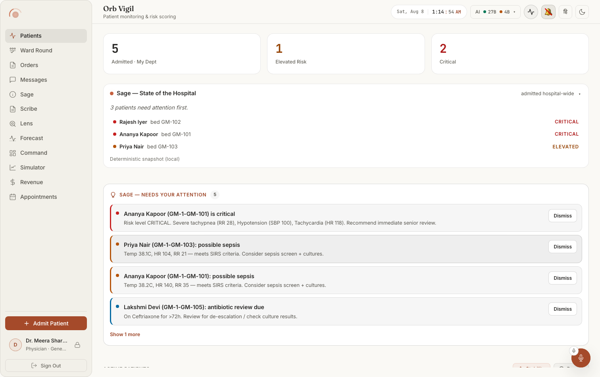
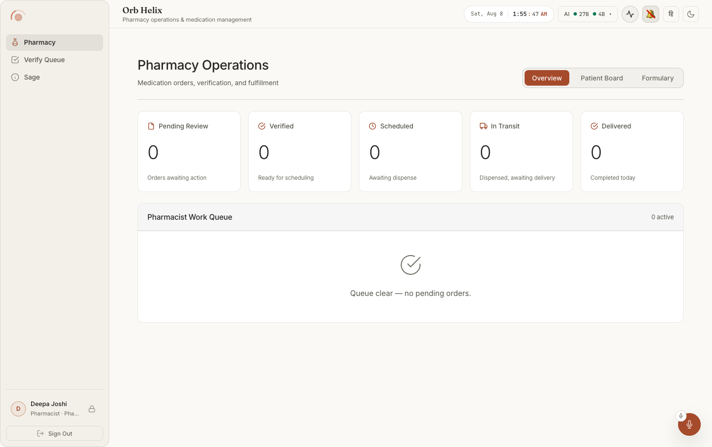
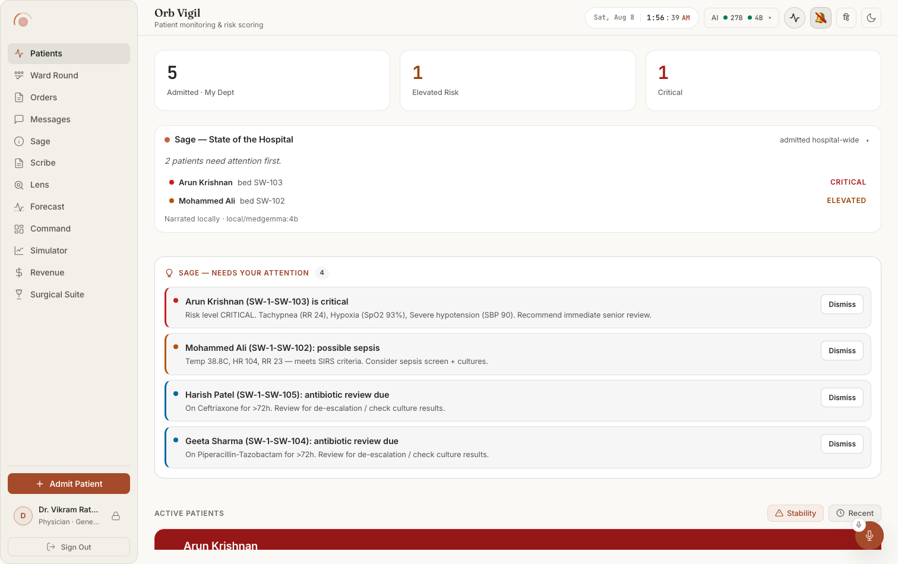

# Screen map 01: The application shell

Everything on this page is present on **every** clinician screen. It is the frame:
the left sidebar, the top bar, the panel region between them, and the four global
overlays that float above all of it (Sage orb, command palette, shortcut sheet,
the two shell modals).

**Entry point:** `src/pages/ClinicianShell.tsx` (830 lines). It is mounted by
`src/AppRoot.tsx:182` for the route `/dashboard/*`, and only when
`user && user.role !== 'patient'`, a patient is redirected to `/bridge`
(`PatientShell`), which is a different frame entirely and is not covered here.

**Styles:** `src/pages/ClinicianShell.css` (963 lines). That file owns the shell
frame *and* the AI-status chip; module styles live elsewhere by rule
(`ClinicianShell.css:13-18`).

**Three providers wrap the whole shell** (`ClinicianShell.tsx:536-538`):
`ActivePatientProvider`, `ActiveViewProvider`, `SageRuntimeProvider`. Anything
below reading "from context" reads from one of these.

---

## What the frame looks like

**Notice the frame, not the content.** The sidebar is one scrolling column of nav items with
**Admit Patient** and the user card pinned to its foot as a separate block. The top bar
carries the pillar title and subtitle on the left and, on the right, the clock, the
AI-status chip (`AI ● 27B ● 4B ▾`, the only shell element `ClinicianShell.css` owns outside
the frame) and four icon buttons. The Sage orb floats bottom-right, *over* the panel rather
than inside it, which is why it survives every tab change. Dark twin:
`doc001-01-after-login-dark.png`.

### The sidebar is the RBAC surface: count the items

**Notice** that a pharmacist gets **three** nav items, Pharmacy, Verify Queue, Sage, and
no Admit Patient button at all. Nothing is greyed out; the other nine items do not exist.
That is `getAccessibleTabs()` (`ClinicianShell.tsx:189-202`) rendered.

**Notice** the same frame with a third list: the surgeon has **Surgical Suite** at the foot
where the admin has Admin, and no My Shift. Compare `nur001-01-after-login-light.png`, where
**My Shift** is *first*, the landing screen is `accessibleTabs[0]`, so the role changes
which screen you arrive on, not only what you can reach.

> The command palette, the shortcut sheet and both shell modals, four of the global
> overlays documented below, have no screenshot in this repo. See
> [`docs/screenshots/INDEX.md`](../../screenshots/INDEX.md).

---

## Table of contents

- [How the frame is laid out](#how-the-frame-is-laid-out)
- [Which nav items each role sees (RBAC)](#which-nav-items-each-role-sees-rbac)
- [Sidebar elements](#sidebar-elements), 11
- [Top bar elements](#top-bar-elements), 20
- [The panel region and its states](#the-panel-region-and-its-states), 4
- [Global floating surfaces](#global-floating-surfaces), 8
- [Cross-cutting behaviours](#cross-cutting-behaviours)
- [Traps and gotchas found while reading this code](#traps-and-gotchas-found-while-reading-this-code)
- [Reverse map contributions](#reverse-map-contributions)

---

## How the frame is laid out

`ClinicianShell.tsx:540` renders `
`, a flex row
(`ClinicianShell.css:21-27`) with two children:

| Region | Element | CSS | Geometry |
|---|---|---|---|
| Left rail | `<aside className="shell__sidebar glass">` (`:541`) | `.shell__sidebar` (`css:30-44`) | `position: fixed`, `left:0 top:0 bottom:0`, `width: var(--sidebar-w)`, `z-index:10`, background `--bg-secondary`, 1px right border |
| Everything else | `<main className="shell__main">` (`:610`) | `.shell__main` (`css:264-278`) | `margin-left: var(--sidebar-w)`, `height:100vh`, column flex, background `--bg-primary` |

`main` itself splits into two:

| Sub-region | Element | CSS |
|---|---|---|
| Top bar | `<header className="shell__header">` (`:611`) | `css:281-290`, `min-height: var(--topbar-h)`, one row, `space-between`, hairline bottom border |
| Panel region | `<section className="shell__body">` (`:713`) | `css:537-547`, `flex:1`, `padding: var(--page-y) var(--page-x)`, `overflow:hidden` |

The sidebar itself is `justify-content: space-between` with two stacked groups:
`.shell__sidebar-top` (logo + nav, `:542`, scrollable, scrollbar width forced to
0 at `css:56-58`) and `.shell__sidebar-bottom` (`:571`, admit button + user card
+ sign-out, pinned to the bottom above a hairline top border).

### Responsive collapse: what disappears at which width

`ClinicianShell.css:679-833`.

- **≤1024px:** sidebar narrows to `--sidebar-w-rail`. Every text label vanishes:
  `.shell__nav-label`, `.shell__admit-patient span`, `.shell__logout span` and
  the whole `.shell__user-info` block are set `display:none` (`css:709-714`). You
  are left with icons in 44×44 hit targets; the `title` attribute is the only
  remaining name. Page gutter drops to 20px.
- **≤768px:** the sidebar stops being a rail. `.shell` becomes `flex-direction:
  column` and `.shell__sidebar` becomes a **sticky horizontal top bar**
  (`css:743-763`) with the nav scrolling sideways. `.shell__user-card` is
  `display:none` entirely (`css:809-811`), the signed-in name and role are gone
  on a phone. `.shell__main` loses its left margin, and the header wraps to two
  rows.

---

## Which nav items each role sees (RBAC)

**The decision is made in exactly one function:**
`getAccessibleTabs(role, department)`, `src/pages/ClinicianShell.tsx:182-205`.

It returns an ordered `Tab[]`. Two things flow from that array:

1. `visibleTabs = TABS.filter(tab => accessibleTabs.includes(tab.id))`
   (`:309`), what the rail renders. **Order on screen comes from `TABS`
   (`:25-180`), not from `getAccessibleTabs`.** The role array only decides
   *membership*; the visual order is always the `TABS` declaration order
   (shift, helix, pharmacy-verify, vigil, round, orders, relay, sage, scribe,
   lens, forecast, command, capacity, coding, appointments, surgical-suite,
   admin).
2. `accessibleTabs[0]` is the **landing tab** (`:312`, `:316`), and *that* is
   taken from `getAccessibleTabs` order, so it can differ from the topmost item
   in the rail.

| Role | Tabs returned (`:188-203`) | Lands on |
|---|---|---|
| `doctor`, dept not Surgery | vigil, round, orders, relay, sage, scribe, lens, forecast, command, capacity, coding, appointments | Patients |
| `doctor`, dept `Surgery`/`General Surgery` | same but `surgical-suite` replaces `appointments` | Patients |
| `nurse` | shift, vigil, orders, relay, sage, scribe, lens, forecast, coding, appointments | My Shift |
| `admin` | vigil, relay, sage, forecast, command, capacity, coding, appointments, admin | Patients |
| `pharmacist` | helix, pharmacy-verify, sage | Pharmacy |
| `surgeon` (safety net, `:188-189`) | vigil, round, relay, sage, scribe, lens, forecast, surgical-suite | Patients |
| anything else / null | vigil, relay | Patients |

Consequences you can see:

- A **nurse never sees** Ward Round, Command, Simulator, Surgical Suite, Admin,
  Pharmacy, or Verify Queue.
- A **pharmacist sees three items only**, and additionally loses the Admit
  Patient button (`:572`, the one explicitly role-gated control in the sidebar).
- **Admin cannot see** My Shift, Ward Round, Orders, Scribe, Lens, Pharmacy or
  Verify Queue. Admin is the only role that sees the shield-icon **Admin** item.
- A blank/unknown role degrades to a two-item rail rather than an empty one.
  `:312` additionally falls back to `'vigil'` if the array were ever empty, so
  `activeTab` can never initialise `undefined`.

**This filter is a UX filter, not the security boundary.** Nothing here stops a
crafted request. Enforcement is per-endpoint on the server via
`require_permission(...)` (`server/permissions.py:376`), which audits every
denial to the hash chain before raising 403 (`permissions.py:396-424`), reading
the role→permission map at `server/permissions.py:104-162`.

The same `accessibleTabs` array is handed to the keyboard layer at `:820` and
re-checked on both navigation buses (`:339`, `:457`), so a chord, a deep link, or
a Sage jump cannot open a tab the rail is hiding.

---

## Sidebar elements

### Orb logo mark

**Where:** very top-left of the sidebar, above the nav rail.
**Rendered by:** `src/pages/ClinicianShell.tsx:543`, 
`
<OrbLogo size={32} />
`; the mark itself is
`src/components/OrbLogo.tsx:4-9`, two divs (`orb-logo__ring`, `orb-logo__core`).
**Data from:** nothing, `size` is the only prop, hard-coded to 32.
**API:** none.
**Server:** none.
**Change this →** It is a **spinning ring plus a pulsing core**, not an image:
`OrbLogo.css` gives the ring `border-top-color: var(--accent-gold)` /
`border-right-color: var(--orb-ring-2)` on a 3s `orb-spin` loop, and the core a
radial gradient `--accent-warm → --accent-deep` on a 3s `pulse-soft`. Change
`--accent-gold` and the visible arc of the ring changes colour on every screen.
Pass a different `size` at `:543` and the whole mark scales (the core is 50% of
it). Padding is `4px 10px 0` (`css:60-64`), collapsing to `4px 0 0` on the ≤1024
rail. It never disappears, it has no conditional.

### Pillar navigation rail

**Where:** the vertical stack of icon+label buttons filling the upper sidebar.
**Rendered by:** `src/pages/ClinicianShell.tsx:544-568`, a `<nav
className="shell__nav" role="tablist" aria-label="Orb pillars"
aria-orientation="vertical">` mapping `visibleTabs`.
**Data from:** `visibleTabs` (`:309`) ← `TABS` (`:25-180`) filtered by
`accessibleTabs` (`:308`) ← `getAccessibleTabs(user?.role, user?.department)`;
`user` comes from `useAuth()` (`:306`), which reads `AuthContext` in
`src/App.tsx:32-38`, restored from localStorage on boot (`AppRoot.tsx:53-56`).
**API:** none, the rail is computed entirely client-side from the stored user.
**Server:** none directly. The user object was minted at login and the role
inside it is what the server also enforces against.
**Change this →** Add an entry to `TABS` and to at least one role array in
`getAccessibleTabs` and a new button appears in the rail at the `TABS` position
(add to only one of the two and nothing appears, `visibleTabs` is an
intersection). Remove a tab id from a role array and that role's button vanishes
on next login *and* their `g`-chord for it stops working. Reorder
`getAccessibleTabs` for a role and the **landing tab** changes without the rail
re-ordering at all. The rail scrolls when it overflows (`css:46-54`) with the
scrollbar hidden.

### Nav item (one per pillar)

**Where:** each row in the rail, an 18px line icon then a label, left-aligned.
**Rendered by:** `src/pages/ClinicianShell.tsx:551-567`, `<button role="tab"
aria-selected aria-controls={`panel-${tab.id}`} id={`nav-${tab.id}`}>` with
`{tab.icon}` (`:564`) and `{t(`nav.${tab.id}`)}`
(`:565`).
**Data from:** `tab.icon` is inline JSX SVG defined per-tab in `TABS`
(`:28-32` for My Shift, `:36-40` Pharmacy, `:45-47` Verify Queue, `:53-55`
Patients, `:62-65` Ward Round, `:71-73` Orders, `:79-81` Messages, `:87-90`
Sage, `:96-101` Scribe, `:107-111` Lens, `:117-120` Forecast, `:126-128`
Command, `:134-136` Simulator, `:142-144` Revenue, `:150-156` Appointments,
`:162-169` Surgical Suite, `:176` Admin). The label text is the i18n key
`nav.<id>` from `src/i18n/locales/en.json` (`nav` block) and `hi.json`.
**API:** none.
**Server:** none.
**Change this →** Edit `nav.vigil` in `en.json` from "Patients" to anything else
and the second rail item's text changes immediately in English, while Hindi
still reads whatever `hi.json` says. Replace the `<path>` in a tab's `icon` and
only that row's glyph changes, icons are 18×18 via `.shell__nav-item svg`
(`css:87-93`) regardless of the `width="20"` on the SVG element itself. On
hover, the row picks up `--bg-glass` and the icon lifts from `--text-muted` to
`--text-secondary` (`css:95-102`). The label disappears at ≤1024px (`css:709`)
leaving a centred icon in a 44px square.

### Active nav item indicator

**Where:** the one nav row that is currently selected.
**Rendered by:** `src/pages/ClinicianShell.tsx:558`, 
`` className={`shell__nav-item ${activeTab === tab.id ? 'shell__nav-item--active' : ''}`} ``;
paired with `aria-selected={activeTab === tab.id}` (`:555`) and
`tabIndex={activeTab === tab.id ? 0 : -1}` (`:557`).
**Data from:** `activeTab` state (`:312`). It is set from five places:
direct click (`:559`), arrow-key roving focus (`:446-451` →
`src/lib/tablist.ts:19-42`), the `orb:goto-tab` window event
(`:337-339` and again via `onGotoTab` at `:455-460`), and `useEffect`-driven
initial value.
**API:** none.
**Server:** none.
**Change this →** There is **no bar, pill or chevron**, the active state is
three property changes on the row itself (`css:104-112`): text goes to
`--text-primary`, background to `--bg-glass-hover`, weight to 550, and the icon
alone goes to `--accent-text`. Change `--bg-glass-hover` and every active nav
row across the product re-tints. Delete the `--active` branch at `:558` and the
current tab becomes visually indistinguishable from the rest while still being
the only one in the Tab order (because `tabIndex` is separate at `:557`).
Because `tabIndex` is `-1` on inactive rows, pressing Tab lands on the rail
exactly once; Arrow/Home/End then move *and activate* (`tablist.ts:38-41` calls
`setActive` then focuses the next `nav-<id>`).

### Nav item hover tooltip

**Where:** native browser tooltip on hovering any nav row.
**Rendered by:** `src/pages/ClinicianShell.tsx:562`, 
`` title={`${t(`nav.${tab.id}`)} · Orb ${tab.pillar}`} ``.
**Data from:** the i18n label plus the untranslated `pillar` string from `TABS`.
**API:** none. **Server:** none.
**Change this →** Hovering "Patients" shows `Patients · Orb Vigil`. Edit
`pillar: 'Vigil'` at `:51` and both this tooltip **and the page title in the top
bar** change, because `:614` reads the same field. The tooltip is the only way
to read a nav item's name on the ≤1024px icon rail. `aria-label` (`:561`) is the
translated label only, screen readers do not hear the pillar name.

### Admit Patient button

**Where:** bottom section of the sidebar, directly above the user card. Full
width, filled with the accent colour, the only solid-filled control in the rail.
**Rendered by:** `src/pages/ClinicianShell.tsx:572-580`, guarded by
`{user?.role !== 'pharmacist' && (...)}`; a `+` icon (`:574-577`) plus
`{t('shell.admitPatient')}` (`:578`). `id="btn-admit-patient"`.
**Data from:** `user.role` from `useAuth()`; label from `shell.admitPatient`
("Admit Patient"). Clicking sets `isAdmittingPatient` (`:326`, `:573`).
**API:** none until submitted, then `POST /api/admissions/admit` via
`admitPatient()` (`src/api/client.ts:647-652`) called from
`src/components/AdmitPatientModal.tsx:172`.
**Server:** `server/routes/admission_routes.py:53-70` `process_admission`,
gated on `require_permission("patient.write")`, delegating to
`server/services/admission_service.py:11` `admit_patient`.
**Change this →** Change `!== 'pharmacist'` at `:572` and the button appears or
vanishes for that role; nothing else in the sidebar is role-gated. Clicking
opens the full-screen Admit Patient modal (see below), the **only** thing this
button does directly. Its fill is `--accent-deep` with `--btn-primary-text`
(`css:132-147`); change `--accent-deep` and this is the control that visibly
moves first. Its text disappears at ≤1024px (`css:710`), leaving a `+` in a
44px square. **Known mismatch:** the button is shown to nurses and admins, but
neither role holds `patient.write` (`server/permissions.py:117-134`,
`:140-157`), pressing Submit in the modal returns 403 and the modal renders
the server's message in its error strip rather than admitting anyone.

### User avatar disc

**Where:** bottom of the sidebar, left of the name. A 32px circle with one
letter.
**Rendered by:** `src/pages/ClinicianShell.tsx:582`, 
`
{user?.name?.charAt(0)}
`.
**Data from:** `user.name` from `AuthContext`.
**API:** none. **Server:** none.
**Change this →** It is the **first character of the name, verbatim**, no
initials logic, no uppercasing in JS. A lowercase seeded name renders a
lowercase letter. Styling is `--accent-glow` fill, `--border-focus` hairline,
`--accent-text` glyph (`css:177-190`). If `user.name` is empty the circle
renders empty (not a placeholder). It disappears together with the whole user
card at ≤768px (`css:809-811`).

### User name

**Where:** bottom of the sidebar, first line of the two-line user block.
**Rendered by:** `src/pages/ClinicianShell.tsx:584`, 
`{user?.name}`.
**Data from:** `user.name` from `AuthContext` ← localStorage via
`getUser()` (`src/AppRoot.tsx:53-56`, `src/api/client.ts`).
**API:** none at render time; the value was set at login.
**Server:** the login route that minted the user object (out of scope here).
**Change this →** Truncates with an ellipsis rather than wrapping
(`css:200-207`, `white-space:nowrap; text-overflow:ellipsis`), a long name
silently clips at the rail width. Hidden entirely at ≤1024px (`.shell__user-info`
is `display:none`, `css:712`) and the whole card is gone at ≤768px.

### Role · department line

**Where:** bottom of the sidebar, second line under the name, e.g.
"Physician · Cardiology".
**Rendered by:** `src/pages/ClinicianShell.tsx:585`, 
`{roleLabel} · {user?.department}`.
**Data from:** `roleLabel` is computed at `:431-435`: `surgeon` is first
normalised to `doctor` (`:431`), then only `doctor|nurse|admin|pharmacist` map
to their own key and everything else falls to `staff` (`:432-434`), then
`t('role.<key>')` resolves through `en.json` `role` (`doctor: "Physician"`,
`nurse: "Nurse"`, `admin: "Administrator"`, `pharmacist: "Pharmacist"`,
`staff: "Staff"`). `user.department` is printed raw.
**API:** none. **Server:** none.
**Change this →** Rename `role.doctor` in `en.json` and every doctor's sidebar
reads the new word. A user with no department shows the separator followed by
nothing, "Physician · ". An unrecognised role reads "Staff", which is the
visible tell that the backend emitted a role Orb does not model. Same truncation
and same responsive disappearance as the name.

### Security (padlock) button

**Where:** bottom of the sidebar, at the right edge of the user card, a small
28px padlock, no border.
**Rendered by:** `src/pages/ClinicianShell.tsx:587-597`, `<button
className="shell__user-security" id="btn-mfa-enroll" title={t('shell.security')}>`
with a padlock SVG (`:594-596`).
**Data from:** label from `shell.security` ("Security & MFA"). Click sets
`isEnrollingMfa` (`:327`, `:589`), which mounts `MfaEnrollmentModal` at `:811`.
**API:** on open, `POST /api/auth/mfa/enroll/begin`
(`src/components/MfaEnrollmentModal.tsx:79-82`); then `POST
/api/auth/mfa/enroll/confirm` (`:126-130`) or `POST /api/auth/mfa/disable`
(`:154-157`).
**Server:** `server/routes/auth_routes.py:635-660` `mfa_enroll_begin`,
`:663` `mfa_enroll_confirm`, `:696` MFA disable.
**Change this →** It has **no icon state**, it looks identical whether or not
MFA is enrolled; the only way to find out is to press it and see which view the
modal opens on. On hover it turns `--accent-text` on a light `--bg-glass` fill
(`css:234-237`; the comment at `css:231-233` explains the lighter fill is
deliberate to hold 4.5:1 contrast). The button survives the ≤1024px collapse
(only `.shell__user-info` is hidden) but goes at ≤768px with the card.

### Sign Out button

**Where:** the very bottom of the sidebar, full width, outlined.
**Rendered by:** `src/pages/ClinicianShell.tsx:599-606`, `<button
className="shell__logout" onClick={logout} id="btn-logout">` with a
door/arrow SVG and `{t('shell.signOut')}`.
**Data from:** `logout` from `useAuth()` → `src/AppRoot.tsx:81-109`.
**API:** none directly; `logout` calls `clearToken()`, `deauthenticateSocket()`,
`clearNurseDrafts()`, `clearOfflineCache()` and `clearOfflineQueue()`.
**Server:** none synchronously, the session cookie is simply no longer sent.
**Change this →** Pressing it wipes four client-side stores in one go, then
`user` becomes null and `AppRoot.tsx:182` redirects to `/login/staff`, so the whole
shell unmounts. Visible side effects beyond the redirect: any queued offline
writes are discarded (see the sync badges below, a pending count is destroyed,
not flushed), and any half-typed nurse observation draft is gone. Hover turns
the button red-tinted (`--status-danger-text` on an 8% danger fill,
`css:257-261`), the only red control in the frame. Its text disappears at
≤1024px leaving the icon.

---

## Top bar elements

Order left-to-right: title block, then a right-hand cluster
(`.shell__header-right`, `css:321-328`, `gap:8px`, `z-index:20`) containing, 
sync badge (conditional) → clock → AI chip → Pulse → alert bell → keyboard →
language → theme.

### Page title

**Where:** top-left of the top bar, the large line.
**Rendered by:** `src/pages/ClinicianShell.tsx:613-615`, 
`<h1 className="shell__page-title">Orb {TABS.find(t => t.id === activeTab)?.pillar}</h1>`.
**Data from:** `activeTab` state, looked up against `TABS[].pillar`.
**API:** none. **Server:** none.
**Change this →** It reads "Orb Vigil", "Orb Ward Round", "Orb Nurse Mode" and
so on, **the pillar name, not the nav label**, so the rail can say "Patients"
while the title says "Orb Vigil". This is intentional and is the same string as
the nav tooltip. It is **not translated**: the literal `Orb ` prefix and the
`pillar` field are English regardless of the language toggle (note that the
arrow parameter `t` at `:614` shadows the i18n `t`, so translating it here would
need renaming that parameter). Edit `pillar` on a `TABS` entry and both the
title and the tooltip change. Long titles clip with an ellipsis
(`css:307-309`); the font is `--font-display` at 1.15rem/560 with variable-font
settings `'SOFT' 0, 'WONK' 0, 'opsz' 22` (`css:299-306`).

### Page subtitle

**Where:** directly under the title, small and muted.
**Rendered by:** `src/pages/ClinicianShell.tsx:616`, 
`{t(`subtitle.${activeTab}`)}`.
**Data from:** the `subtitle` block of `src/i18n/locales/en.json` /
`hi.json`, keyed by tab id, e.g. `vigil: "Patient monitoring & risk scoring"`,
`round: "Bed-by-bed ward round with one-screen summary & dictation"`.
**API:** none. **Server:** none.
**Change this →** Unlike the title, this **is** translated, flipping the
language toggle changes it and leaves the title alone, which is the visible
asymmetry in the header. Add a tab without adding `subtitle.<id>` and the raw
key string `subtitle.newtab` prints on screen. Clips with an ellipsis
(`css:316-318`).

### Offline badge: "Offline · saved copy, read-only"

**Where:** leftmost item of the right-hand header cluster, a pill with a pulsing
amber dot.
**Rendered by:** `src/pages/ClinicianShell.tsx:632-638`, the second branch of
the four-way badge chain, `
` with `` and
`t('status.offlineCaching')`.
**Data from:** `isOffline` state (`:469`), initialised from `!navigator.onLine`
and updated by `window` `online`/`offline` listeners (`:510-511`, `:519-520`);
`pendingCount` must be 0 for this wording.
**API:** none, pure browser connectivity.
**Server:** none.
**Change this →** Appears the moment the browser reports offline with an empty
write queue. The dot pulses on a 2s `pulse-offline` opacity loop
(`css:344-356`); the pill is amber (`--status-warn-text` on a 9% warn fill with
a 26% warn border, `css:331-342`). It disappears the instant the browser fires
`online` **and** the queue is empty. If the queue is non-empty this branch never
renders, the next one wins.

### Offline badge: "Offline · N pending"

**Where:** same slot.
**Rendered by:** `src/pages/ClinicianShell.tsx:635-637`, the ternary inside the
offline branch selecting `t('status.offlinePending', { count: pendingCount })`.
**Data from:** `pendingCount` (`:472`), read from `localStorage['orb_offline_queue']`
by `readQueueCount()` (`:483-491`) and refreshed by a **2-second poll**
(`:524`) plus the online/offline handlers. The queue itself is written by
`src/api/client.ts:391-399` `queueRequest` under the same key
(`client.ts:346`).
**API:** none for the badge; the queued entries are replayed later against their
original endpoints.
**Server:** none for the badge.
**Change this →** Chart something while offline and this number ticks up within
2 seconds. Change `CHECK` interval at `:524` and the number lags accordingly.
Sign out and the count vanishes because `logout` calls `clearOfflineQueue`
(`AppRoot.tsx:108` → `client.ts:365-369`), the writes are destroyed, not sent.

### Syncing badge: "Syncing · N pending"

**Where:** same slot, amber.
**Rendered by:** `src/pages/ClinicianShell.tsx:639-643`, 
`shell__offline-badge shell__offline-badge--syncing`, shown when **online** but
`pendingCount > 0`.
**Data from:** same `pendingCount` poll. The drain is driven by
`processOfflineQueue` in `src/api/client.ts` (registered on `window` `online` at
`client.ts:567`), which removes each entry only after the server confirms it
(`client.ts:552`).
**API:** each queued request replays against its own original endpoint, carrying
its original `Idempotency-Key` (`client.ts:525`).
**Server:** whatever route the queued write targeted.
**Change this →** Watching this number fall to zero is the visible proof the
queue drained; at zero it is replaced by the green Synced badge for 3 seconds.
Its colour class currently only re-states `--status-warn-text`
(`css:359-361`), so it looks identical to the offline badge apart from the word
"Syncing".

### Synced badge: "✓ Synced"

**Where:** same slot, green, briefly.
**Rendered by:** `src/pages/ClinicianShell.tsx:444-448`, 
`shell__offline-badge--synced` with `✓`.
**Data from:** `justSynced` (`:473`), set true in `refresh()` when the count
transitions from >0 to 0 (`:500-504`) and cleared by a **3000 ms** timer
(`:503`), or immediately if new items queue (`:505`) or the browser goes offline
(`:511`).
**API:** none. **Server:** none.
**Change this →** It is a three-second confirmation, then it is gone and the
header shows no badge at all. It flips the pill to `--status-ok-text` on an
`--status-ok` tint, **stops the dot animating** (`css:371-374`), and fades in
over 300ms (`css:368`). Change the `3000` at `:503` to hold it longer.

### Sync-failed badge

**Where:** same slot, and it **outranks all three above** (it is the first
branch of the chain).
**Rendered by:** `src/pages/ClinicianShell.tsx:619-631`, 
`shell__offline-badge shell__offline-badge--failed`, `role="alert"`,
`aria-live="assertive"`, text `t('status.syncFailed', { count: syncFailed })` →
"N queued action(s) failed to sync, please re-enter".
**Data from:** `syncFailed` counter (`:479`), incremented by the
`orb:offline-sync-failed` window event handler (`:513-517`, listener registered
at `:521`). That event is dispatched from `src/api/client.ts:562` when a replay
fails permanently (a 4xx that will never succeed, `client.ts:530-537`) and from
`client.ts:494` when the queue held writes belonging to a **different** signed-in
user and they were dropped (`client.ts:485-495`).
**API:** none, it reports on failed replays of other endpoints.
**Server:** the endpoint that rejected the replay (any 4xx).
**Change this →** This is the one header badge that means "something you thought
you saved was NOT saved". It renders red (`--status-danger` tint and border,
`css:383-393`) and, unlike the others, **never clears itself**, only the ✕
below removes it. Its `aria-live="assertive"` makes a screen reader interrupt.

### Sync-failed dismiss ✕

**Where:** inside the red failure pill, at its right end.
**Rendered by:** `src/pages/ClinicianShell.tsx:623-630`, `<button
className="shell__offline-dismiss" onClick={() => setSyncFailed(0)}>` with the
literal glyph `✕`, `title`/`aria-label` from `status.syncFailedDismiss`.
**Data from:** sets `syncFailed` back to 0.
**API:** none. **Server:** none.
**Change this →** Pressing it removes the red pill entirely and the header falls
through to whichever of the other three badges applies (usually none). It does
**not** re-queue or retry anything, the failed writes are already gone from
localStorage. 18×18, hover lifts it (`css:395-417`).

### Clock: date

**Where:** right-hand header cluster, left half of the clock chip.
**Rendered by:** `src/components/ClockWidget.tsx:37`, 
`{formatDate(time)}`, mounted at
`ClinicianShell.tsx:450`.
**Data from:** `time` state (`ClockWidget.tsx:5`) advanced by a **1-second**
`setInterval` (`:7-12`); formatted with
`toLocaleDateString('en-US', { weekday:'short', month:'short', day:'numeric' })`
(`:28-31`).
**API:** none, browser clock only.
**Server:** none. This is **not** server time; a wrong workstation clock shows a
wrong date here while server timestamps stay correct.
**Change this →** Renders like `Sun, Aug 9`. The `'en-US'` locale is hard-coded
at `:30`, so the language toggle does **not** localise it. Hovering the whole
chip shows `time.toLocaleString()` as a native tooltip (`:36`).

### Clock: time, seconds, AM/PM

**Where:** right half of the clock chip, after a thin divider.
**Rendered by:** `src/components/ClockWidget.tsx:39-44`, four spans:
`__time` (`h:mm`), `__seconds-dot` (a literal `:`), `__seconds` (`ss`),
`__ampm`.
**Data from:** `formatTime()` (`:14-26`), 12-hour, zero-padded minutes and
seconds, hour 0 rendered as 12.
**API:** none. **Server:** none.
**Change this →** The seconds tick visibly once per second, this is the only
constantly-animating text in the frame. Remove the interval at `:8-10` and the
clock freezes at mount time. To show 24-hour time you must edit `formatTime`;
there is no setting.

### AI status chip

**Where:** right-hand header cluster, immediately after the clock. Reads
`AI` then one short tag per model (e.g. `27B`, `4B`) each with a status dot,
then a `▾` caret.
**Rendered by:** `src/components/AiStatusChip.tsx:120-141`, a button whose
class is `ai-status-chip--warm` or `--cold` (`:121`), with `__label` "AI"
(`:127`), one `__model` span per model (`:129-134`), and `__caret` `▾` (`:140`).
Mounted at `ClinicianShell.tsx:451`.
**Data from:** `health` state (`:30`), from `GET {API_BASE}/health/models`
polled **every 60 s** (`:37-57`). `allWarm` (`:112`) requires the engine
reachable *and* every model warm. `shortTag()` (`:111`) takes the text after the
`:` in the model name, uppercased.
**API:** `GET /api/health/models`.
**Server:** `server/main.py:920-956` `health_models`, authenticated
(`get_current_user`), queries Ollama's `/api/ps` with a 3s timeout, and returns
`{ollama_reachable, models[{model, role, warm, detail{size_vram}, impacts}]}`.
`role` is `"primary"` for `LLM_MODEL` and `"ambient"` otherwise; `impacts` comes
from the `MODEL_IMPACTS` table at `server/main.py:963-976`.
**Change this →** **The entire chip disappears when the fetch fails or has not
returned yet**, `AiStatusChip.tsx:109` is `if (!health) return null`, and the
`catch` at `:45-47` sets `health` back to null. So a server outage removes the
chip rather than showing an error. Change `LLM_MODEL`/`AMBIENT_LLM_MODEL` in
server config and the number of tags changes. A model that leaves Ollama's
resident set turns its dot from warm to cold within 60 seconds. The chip is
34px tall with `cursor: default` (`ClinicianShell.css:836-850`) even though it
is clickable.

### AI status chip: "OFFLINE" pill

**Where:** in place of the model tags, inside the same chip.
**Rendered by:** `src/components/AiStatusChip.tsx:135-139`, the `else` of
`health.ollama_reachable`, a single cold `__model` span reading `OFFLINE`.
**Data from:** `ollama_reachable: false`, set by the server when the `/api/ps`
call to Ollama throws (`server/main.py:942-943`).
**API / Server:** as above.
**Change this →** Stop the Ollama process and, within one poll cycle, the chip
stops listing models and shows a single cold `OFFLINE` tag, the fastest visual
signal in the product that inference is down. The chip itself stays (the API
still answered); only a failed call to *Orb* removes the chip.

### AI configuration popover

**Where:** anchored under the AI chip, right-aligned, 372px wide
(`ClinicianShell.css:878-884`: `position:absolute; top: calc(100% + 8px); right: 0`).
**Rendered by:** `src/components/AiStatusChip.tsx:143-228`, 
`
`.
Inside it:
- head: `Local AI models` + engine pill reading **"Engine running"** or
  **"Engine unreachable"** (`:145-150`);
- error strip `ai-config__error` (`:152`), only when a load/unload failed;
- one row per model (`:154-191`) showing a warm/cold dot, the full model name,
  and a meta line reading `Primary, clinical reasoning & vision` or
  `Ambient, background classification` followed by `loaded, N.N GB` or
  `not loaded` (`:161-165`; `gb()` at `:17-20` prints `, ` for a missing size);
- **admin only**: `Load` / `Unload` buttons (`:167-184`), whose captions swap to
  `Loading…` / `Unloading…` while busy;
- **everyone else**: a read-only `Ready` / `Not loaded` state word (`:186-188`);
- unload confirmation block (`:193-220`): "Unload &lt;model&gt;?", the memory it
  frees, a bulleted list of the clinical features that stop working, a
  reassurance that nothing is deleted, then Cancel / `Unload model`;
- footer (`:222-226`) whose sentence differs for admins vs everyone else.
**Data from:** `open` (`:31`), `busy` (`:32`), `error` (`:33`), `confirming`
(`:34`); `canManage = getUser()?.role === 'admin'` (`:116`). The impact bullets
are `confirming.impacts` straight from the API.
**API:** `POST /api/health/models/load` and `POST /api/health/models/unload`
(`:82-87`).
**Server:** `server/main.py:1012-1041` `load_model` and
`server/main.py:1044+` `unload_model`, both `require_permission("admin.overview")`.
`_resolve_configured_model` (`main.py:996-1009`) refuses any model that is not a
configured tier with a 400. Unload waits for the model to actually leave
`/api/ps` before answering (`main.py:1070-1079`), and both invalidate the model
router's residency cache (`main.py:979-989`).
**Change this →** The impact bullets a clinician reads before freeing 17 GB are
edited in **`server/main.py:963-976`**, not in the frontend. Give a non-admin
the `admin.overview` permission and the state words turn into buttons. Closing
is by outside click or Escape (`:61-77`), there is no close button. A 403 from
the server is rendered in the red error strip via the message-unwrapping ladder
at `:90-99` (which exists because RBAC returns a structured `detail` object and
printing it raw showed `[object Object]`).

### Pulse trigger button

**Where:** right-hand header cluster, after the AI chip, a 36px round button
with a lightning/pulse polyline.
**Rendered by:** `src/components/PulseWidget.tsx:175-193`, 
`` className={`pulse-trigger ${isOpen ? 'pulse-trigger--active' : ''}`} ``,
`id="btn-pulse"`, `title="Orb Pulse, Environmental Intelligence"`. Mounted at
`ClinicianShell.tsx:452`.
**Data from:** local `isOpen` (`:47`).
**API:** none on the button itself.
**Server:** none.
**Change this →** It is round (`--radius-full`, `css:10-24`) while its
neighbours are 34px squares with `--radius-sm`, the one shape outlier in the
header. Active/hover both tint it `--status-info`. Clicking toggles the panel
and, on first open, triggers a **browser geolocation prompt** (`:107-111`).

### Pulse alert badge

**Where:** small dot pinned to the top-right of the Pulse button.
**Rendered by:** `src/components/PulseWidget.tsx:186-192`, rendered only when
`pulseData && pulseData.alert_count > 0`; class gains
`pulse-trigger__badge--moderate` when the top alert's severity is `moderate`.
**Data from:** `pulseData.alert_count` and
`pulseData.active_alerts[0].severity` (`:158`).
**API:** `GET /api/pulse/dashboard?lat=…&lon=…` (`:118-121`).
**Server:** `server/routes/pulse_routes.py:30-40` `pulse_dashboard`, gated on
`require_permission("forecast.read")`, delegating to
`server/services/pulse_service.py:586` `get_pulse_dashboard`, which fans out to
weather / AQI / CDC flu / FDA recalls concurrently and sorts the merged
`clinical_flags` by severity (`pulse_service.py:592-627`).
**Change this →** Red by default (`--status-danger`) with a 2s glow animation,
amber (`--status-warn`) when the worst active alert is only `moderate`
(`css:39-52`). **It never appears until the panel has been opened once**, 
`pulseData` is only fetched while `isOpen` (`:130-134`), so a clinician who never
opens Pulse never sees a badge. A **pharmacist gets a 403** here
(`forecast.read` is not in their permission set,
`server/permissions.py:135-139`), which surfaces as the panel's error text, and
the badge stays hidden.

### Pulse panel

**Where:** floating overlay pinned under the header at `top:64px; right:24px`,
380px wide, max height `100vh - 88px` (`css:68-86`), over a click-catching
backdrop.
**Rendered by:** `src/components/PulseWidget.tsx:196-407`. Sections in order:
- header: "Orb Pulse" title with a sun-like icon (`:202-213`), and a location
  button showing `Locating...` or the city label (`:214-224`);
- **loading:** spinner + "Fetching environmental data..." (`:229-233`), only
  while `loading && !pulseData`;
- **error:** `pulse-error` with the thrown message (`:234-235`), only while
  `error && !pulseData`;
- Active Clinical Alerts list with a per-severity triangle or circle icon
  (`:239-264`), each row clickable into a detail view;
- **empty state:** a tick icon and "No active environmental alerts"
  (`:266-274`);
- Weather: big °C figure, emoji + description, "Feels like … · …% humidity", and
  a 7-day forecast strip whose first column is labelled "Today" (`:279-320`);
- Air Quality: the AQI number colour-mapped by `getAqiColorClass` (`:160-170`)
  over category and `US AQI · PM2.5: …` (`:325-340`);
- Flu Surveillance: "&lt;level&gt; Activity" plus `ILI: N%` and, when the source
  string contains "Estimate", the suffix " (seasonal estimate)" (`:345-363`);
- FDA recalls: first three items, product / reason / classification chip
  (`:366-382`);
- footer: "Inbound only · Zero patient data transmitted" and a `Refresh`
  button (`:388-395`);
- an overlaying `PulseDetail` view when a row is clicked (`:398-404`).
**Data from:** `pulseData` (`:48`), `loading` (`:49`), `error` (`:50`),
`location` (`:51-54`, persisted to `localStorage['orb_pulse_location']`,
defaulting to Mumbai at `:44`), `geoStatus` (`:55`).
**API:** `GET /api/pulse/dashboard?lat&lon`; the city name comes from a
**direct browser call to nominatim.openstreetmap.org** (`:83-85`), the one
outbound request in the shell that does not go through Orb.
**Server:** as above.
**Change this →** Auto-refreshes every 15 minutes while open (`:137-141`);
Escape closes the detail view first and the panel second (`:144-155`). Each
weather/AQI/flu/recall block is individually conditional, so a feed that returns
null simply removes its section and leaves a stray `pulse-divider` behind. The
severity icons hard-code `stroke="var(--status-danger)"` / `var(--status-warn)`
(`:246`, `:252`) rather than inheriting, so they ignore the surrounding text
colour.

### Critical-alert bell

**Where:** right-hand header cluster, after Pulse, a 34px square matching the
theme toggle.
**Rendered by:** `src/components/AlertPermissionButton.tsx:111-129`, one
button, `className={`shell__icon-toggle${active ? ' shell__icon-toggle--on' : ''}`}`,
rendering `<BellOn />` (`:27-33`) or `<BellOff />` (a bell with a diagonal
slash, `:35-44`). Mounted at `ClinicianShell.tsx:453`.
**Data from:** `perm` (`:56`) read from `Notification.permission` and re-read on
window focus (`:62-66`); `muted` (`:57`) from
`isAlertSoundMuted()` → `localStorage['orb-alert-sound'] === 'muted'`
(`src/services/criticalAlerts.ts:27-33`).
**API:** none. **Server:** none, this is browser permission plus a localStorage
flag.
**Change this →** Four visible states, all decided at `:95-109`:
- permission never asked → slashed bell, tooltip "Enable critical-alert
  notifications"; clicking raises the browser permission prompt (`:71-77`);
- granted and unmuted → **plain bell in `--accent-text` with a `--border-focus`
  border** (`ClinicianShell.css:475-478`); clicking mutes;
- granted and muted → slashed bell, normal colour; clicking unmutes;
- denied → slashed bell, **button disabled** with the flat disabled token trio
  (`ClinicianShell.css:481-486`), tooltip "Notifications blocked, enable
  notifications in browser settings".
**The whole button disappears** when the browser has no Notification API at all
(`:68`, `if (perm === 'unsupported') return null`).
What it actually governs: `initCriticalAlerts()` (called once at
`ClinicianShell.tsx:361`, defined at
`src/services/criticalAlerts.ts:293-309`) subscribes to `surgery:emergency_intake`,
`message:new` and `vitals:update` on the shared socket. When one arrives **and
the tab is hidden or unfocused** (`criticalAlerts.ts:210-223`) it raises a browser
notification, plays a two-tone WebAudio chime (`:74-110`, suppressed by the mute
flag) and flashes `document.title` to
`⚠ N critical alerts, Orb` once a second until the window regains focus
(`:122-165`). Muting silences only the chime; the title flash and the toast
continue.

### Keyboard shortcuts button

**Where:** right-hand header cluster, after the bell, a small keyboard glyph.
**Rendered by:** `src/pages/ClinicianShell.tsx:457-470`, `<button
className="shell__icon-toggle" onClick={showShortcuts} id="btn-shortcuts"
title="Keyboard shortcuts (?)">`.
**Data from:** none. `showShortcuts` is `src/lib/orbBus.ts:29-31`, which
dispatches the window event `orb:show-shortcuts`.
**API:** none. **Server:** none.
**Change this →** Pressing it opens the shortcut sheet described below; the
button holds no state and never highlights. It exists purely because a keyboard
layer whose only entry point is a keystroke is undiscoverable (the comment at
`orbBus.ts:16-19` says so). Its title and
`aria-label` are **hard-coded English**, the only header control that skips
i18n.

### Language toggle

**Where:** right-hand header cluster, second from the right, a text button
reading `हि` or `EN`.
**Rendered by:** `src/pages/ClinicianShell.tsx:471-479`, `<button
className="shell__lang-toggle" id="btn-lang-toggle">` whose child is
`{i18n.language === 'hi' ? 'EN' : 'हि'}` (`:478`).
**Data from:** `i18n.language` from `useTranslation()` (`:307`). The click
handler `toggleLanguage` (`:437-439`) calls `i18n.changeLanguage`, flipping
between `hi` and `en`.
**API:** none. **Server:** none, the bundles are
`src/i18n/locales/en.json` and `hi.json`, shipped with the app.
**Change this →** The glyph shows the language you would switch **to**, not the
one you are in. One press re-renders every `t(...)` string in the frame, nav
labels, subtitle, badge text, admit/sign-out/security labels, role name, while
leaving the **page title, the clock, the Pulse panel and the shortcut sheet in
English** (none of them route through `t`). The button is `min-width:34px` and
grows with its text (`css:489-506`).

### Theme toggle

**Where:** the rightmost control in the top bar.
**Rendered by:** `src/components/ThemeToggle.tsx:14-43`, a component (mounted
at `src/pages/ClinicianShell.tsx:480`) that computes
the next theme in the cycle, then renders `<button className="shell__theme-toggle"
id="btn-theme-toggle">` containing one of three SVGs: a **sun** when currently
dark (`ThemeToggle.tsx:23-29`), a **moon** when currently light
(`ThemeToggle.tsx:32-34`), a
**moon-with-stars** when currently night (`ThemeToggle.tsx:37-40`).
**Data from:** the `useTheme` hook (`src/lib/theme.ts:104-119`), initialised from
`localStorage['orb-theme']`, falling back to the legacy key `orb_theme`, then to
the `data-theme` attribute App.tsx already applied, then `'dark'` (`theme.ts:27-54`).
`toggleTheme` (`theme.ts:117`) advances through `THEME_ORDER = ['dark','light','night']`
(`theme.ts:10`). The tooltip is `t('shell.themeSwitchTo', { theme: t(`theme.${nextTheme}`) })`
(`ThemeToggle.tsx:17`) → e.g. "Switch to Night Shift".
**API:** none. **Server:** none.
**Change this →** It is a **three-way cycle**, not a binary switch: dark → light
→ night → dark, and the icon always names where you are, while the tooltip names
where you are going. The `applyTheme` swap (`src/lib/theme.ts:90-102`) does four things in one
synchronous task: adds `orb-theme-switching` to `<html>`, sets `data-theme`,
**forces a reflow by reading `root.offsetHeight`**, then removes the class, 
this is load-bearing. The long comment at `theme.ts:56-89` records what breaks without
it: flipping light→night left 12 of 34 painted elements frozen on the old
theme, including the entire nav rail, the Admit Patient button, the clock chip
and the Pulse trigger, because their `transition` lists include `background` and
the underlying custom property changed mid-interpolation. It then writes
`orb-theme`, deletes the legacy `orb_theme` key, and dispatches
`theme-changed` (`theme.ts:101`) so non-CSS painters (the Aurora WebGL canvas) repaint.
Remove that dispatch and the background stays in the old theme while everything
else changes.

---

## The panel region and its states

### Panel region (the tabpanel wrappers)

**Where:** the whole area below the top bar and right of the sidebar.
**Rendered by:** `src/pages/ClinicianShell.tsx:484-612`, 
`<section className="shell__body">` containing one `<Suspense>` and, inside it,
eighteen fixed conditional wrappers (plus one per installed hospital module,
`:596-610`) of the shape
`
`} role="tabpanel" aria-labelledby={`nav-<id>`}
style={{ display: activeTab === '<id>' ? 'contents' : 'none' }}>` around
`<PanelErrorBoundary label="<id>"><XPanel /></PanelErrorBoundary>`
(`:490-610`).
**Data from:** `shouldRenderPanel(tab)` (`:181`) = `accessibleTabs.includes(tab)
&& visitedTabs.has(tab)`. `visitedTabs` starts as a one-element set (`:167`) and
grows on every tab change (`:177-180`).
**API / Server:** each panel owns its own; the shell makes no request here.
**Change this →** Two behaviours you can observe:
1. **Mount-on-first-view.** A panel's subtree does not exist until its tab has
   been opened once, so nothing you have not visited is fetching or polling at
   login. Open a tab once and it stays mounted forever after, merely hidden, so
   switching away and back preserves its scroll position, filters and in-flight
   edits.
2. `display: 'contents'` (not `block`) is used for the active panel, so the
   wrapper adds **no box of its own** and the panel's own flex layout inherits
   `.shell__body` directly. Change it to `block` and every panel's internal
   full-height layout collapses.
The page gutter is owned here and nowhere else (`css:521-536` records that eight
panels had each added their own, making the first line of content land anywhere
from x=260 to x=292 between tabs).

### "Loading panel..."

**Where:** fills the panel region while a lazily-imported panel chunk downloads.
**Rendered by:** `src/pages/ClinicianShell.tsx:485`, the `<Suspense
fallback={
Loading panel...
}>`.
**Data from:** React Suspense; the panels are `lazy()` imports declared at
`:115-131`.
**API:** the browser's fetch of the JS chunk. **Server:** the static file server.
**Change this →** Visible for a moment on the first visit to each tab on a cold
cache, and essentially never afterwards. **`.orb-panel-loading` has no CSS rule
anywhere in the codebase**, it renders as unstyled default-size text at the top
of the gutter. One fallback covers all seventeen panels, so a slow chunk blanks
the region rather than the individual tab.

### Panel error state

**Where:** centred in the panel region, replacing whatever panel threw.
**Rendered by:** `src/pages/ClinicianShell.tsx:261-269`, inside
`PanelErrorBoundary.render`: `
` with the sentence
"This panel hit an error and couldn't be shown." and a **Reload panel** button
(`:265-267`) that calls `this.reset` (`:255`).
**Data from:** `state.hasError`, set by `getDerivedStateFromError` (`:238-243`).
**API:** none. **Server:** none.
**Change this →** Because each panel has its own boundary (`:717`, `:722`, …
one per tab) a bad payload in a **hidden background panel** fails in place
instead of blanking the whole shell, which matters here specifically because
panels stay mounted after their first visit. "Reload panel" only clears the
error flag and re-renders; it does not refetch anything itself. The class
`.orb-panel-error` also has no stylesheet rule, the padding and centring are the
inline style at `:263`.

### "Updating to the latest version..."

**Where:** same place as the loading fallback.
**Rendered by:** `src/pages/ClinicianShell.tsx:257-260`, the `state.updating`
branch of the same boundary.
**Data from:** `isStaleChunkError(error) && chunkReloadAllowed()` (`:242`).
`STALE_CHUNK_RE` (`:220`) matches Chrome/Edge, Firefox and Safari phrasings of a
failed dynamic import plus Vite's CSS-preload failure.
`chunkReloadAllowed()` (`:231-234`) checks the `orb:chunk-reload-at` sessionStorage
timestamp against a 30-second window (`:225`).
**API:** none. **Server:** the static asset server that no longer has the old
hashed chunk.
**Change this →** After a deploy, a tab still running the old `index.html` asks
for chunk hashes that no longer exist. Instead of an error the clinician sees
this quiet line and the page reloads once (`:250-253`). If the reload fails
again inside 30 seconds, a genuine outage rather than a deploy, the window
guard stops the loop and the normal error card above is shown instead.

---

## Global floating surfaces

These four siblings sit outside `<main>` (`ClinicianShell.tsx:615-633`) and are
present on every tab.

### Sage floating orb

**Where:** fixed bottom-right corner, `bottom:24px; right:24px`, z-index 9990
(`src/components/sage/SageFloatingAssistant.css:3-10`).
**Rendered by:** `src/components/sage/SageFloatingAssistant.tsx:818-836`, a
`<button className="sage-fab__orb">` containing `sage-fab__orb-visual` plus
either a **stop square** while speaking (`:825-827`) or a **microphone** while
listening/dormant (`:829-834`). The wrapper carries a state class:
`` `sage-fab sage-fab--${state}` `` (`:778`). Mounted at
`ClinicianShell.tsx:633` with `activeTab={activeTab}`.
**Data from:** `state` (`:34`), one of `dormant | listening | processing |
speaking`; `viewTab` from `ActiveViewContext`; `micOwner` and
`cloudSpeechAllowed` from `SageRuntimeContext`.
**API:** on submit, `POST /api/sage/voice` (SSE) via
`querySageVoice` (`src/api/client.ts:1032-1053`); the governance posture comes
from `GET /api/sage/ai-posture` (`client.ts:992-994`) fetched once by
`SageRuntimeProvider` (`src/contexts/SageRuntimeProvider.tsx:10-16`).
**Server:** `server/routes/sage_routes.py:2506-2526` `sage_voice_query`
(`require_permission("sage.query")`), and
`server/routes/sage_routes.py:2782-2788` `get_ai_posture` →
`server/services/ai_governance.py:342-364` `ai_posture`.
**Change this →** On the **Sage tab only** the orb lifts to `bottom:96px`
(`:775` sets `onSageTab`, `.sage-fab--raised` at `css:14-16`) so it stops
covering the composer's send button. Its title changes with state (`:821`):
"Ask Sage" / "Sage is listening" / "Stop". Clicking while dormant starts
listening; clicking while speaking cancels TTS and returns to dormant
(`:450-521`). **If the deployment has not approved cloud speech, clicking does
not open the mic at all**, it shows an explanatory card instead (`:455-472`),
because `cloud_speech_allowed` is false until the server says otherwise and the
default is fail-closed (`SageRuntimeProvider.tsx:35`). The orb also greys and
suspends when another surface owns the mic (`:84-85`), which is the visible
consequence of SagePanel voice mode or Scribe dictation being active.

### Sage listening rings and "Listening..." label

**Where:** concentric expanding rings around the orb, with a small caption above
it.
**Rendered by:** `src/components/sage/SageFloatingAssistant.tsx:780-786` (three
`sage-fab__ring` divs) and `:789-791`
(`
Listening...
`), both gated on
`state === 'listening'`.
**Data from:** `state`; the ring amplitude is driven by a CSS custom property
`--audio-level` written from a live WebAudio analyser
(`stopAudioAnalysis` clears it at `:101-103`, `startAudioAnalysis` at `:106-120`
opens the mic stream).
**API:** none directly. **Server:** none.
**Change this →** Rings and caption appear only in the listening state and
vanish the instant a query is submitted (a 1.2s silence timer submits
automatically, `:420-430`) or after 5 seconds of initial silence, which drops
straight back to dormant (`:439-447`). Both strings are hard-coded English.

### Sage answer card

**Where:** floats directly above the orb, bottom-right.
**Rendered by:** `src/components/sage/SageFloatingAssistant.tsx:794-815`, 
`sage-fab__card`, with:
- header dot + title reading **"Thinking"** while processing and **"Sage"**
  otherwise (`:798-800`);
- the active patient's name as a chip when one is open (`:801-803`);
- the recognised query text (`:806`);
- a shimmer placeholder while processing with no tokens yet (`:807-809`);
- the streamed response text (`:810-812`).
**Data from:** `queryText` / `responseText` state; `activePatientName` from
`ActivePatientContext`; `cardDismissing` adds the exit class (`:795`).
**API / Server:** as for the orb, `POST /api/sage/voice` streams tokens.
**Change this →** The patient chip is the visible proof that the voice question
was scoped to a patient; it disappears when no patient is open, and with it goes
the patient context that `buildWireViewContext`
(`src/contexts/ActiveViewContext.tsx:49-69`) attaches to the request. Note the
card is also reused for the **privacy refusal** message when cloud speech is
disallowed (`:459-461`), auto-dismissing after 6 seconds (`:463-470`).

### Sage hotword toggle

**Where:** a 24px disc clipped to the top-left corner of the orb
(`css:243-256`, `position:absolute; top:-6px; left:-6px`).
**Rendered by:** `src/components/sage/SageFloatingAssistant.tsx:839-852`, 
`` className={`sage-fab__toggle ${isEnabled && cloudSpeechAllowed ? 'sage-fab__toggle--active' : ''}`} ``
around a small mic SVG.
**Data from:** `useSageHotword()` (`:405` → `src/hooks/useSageHotword.ts:8-27`),
whose state is persisted in `localStorage['orb_sage_hotword']` and **defaults to
OFF** (`useSageHotword.ts:14-17`), the comment there records why: leaving it on
meant every shell streamed ward-room audio to a cloud recogniser without
consent.
**API:** none directly; it decides whether continuous recognition runs
(`:528`).
**Server:** `cloud_speech_allowed` from `/api/sage/ai-posture` is the outer gate.
**Change this →** Its `title`/`aria-label` is the state (`:407-411`): "Enable
&quot;Sage&quot; hotword", "Disable …", or, when the posture forbids cloud
speech, "Voice input disabled by privacy posture (cloud speech egress not
approved)", in which case clicking does nothing at all (`:841` wraps the call in
`if (cloudSpeechAllowed)`). Turn it on and saying "Sage" anywhere in the product
wakes the orb without a click.

### Command palette (Cmd/Ctrl-K patient search)

**Where:** a modal overlay centred over the whole screen; nothing on screen
until summoned.
**Rendered by:** `src/components/CommandPalette.tsx:161-261`, mounted once at
`ClinicianShell.tsx:625`. `:156` is `if (!open) return null`, so it contributes
nothing until opened. Parts:
- search icon + input with placeholder **"Search patients by name, MRN, bed, or
  diagnosis…"** (`:177-204`);
- an `Esc` keycap chip (`:205`);
- **loading:** a list row reading "Searching…" (`:216-220`);
- **empty:** `No admitted patients match "<query>".` (`:221-225`);
- result rows (`:226-256`): a coloured risk dot, the patient name, the diagnosis,
  then MRN and `Bed <n>`.
**Data from:** `open` toggled by a global Cmd/Ctrl-K keydown listener
(`:60-69`); `query`; `results`; `activeIndex`; `loading`. Search is debounced
200 ms (`:93-108`) and short-circuits below 2 characters (`:84-88`). Stale
responses are discarded via a sequence ref (`:91`, `:98`).
Risk dot colour: `riskColor()` (`:29-33`), `critical` → `--status-danger`,
`elevated` → `--status-warn`, anything else → a 75% mix of `--status-ok`.
**API:** `GET /api/search/patients?q=…` (`:95-97`).
**Server:** `server/routes/search_routes.py:26-124` `search_patients`, 
`require_permission("patient.read_all")`, **and** scoped to the caller's
department via `department_scope(user)` (`search_routes.py:46`, defined at
`server/permissions.py:192-219`). It returns at most 12 admitted patients, ranks
exact id > MRN > name (`search_routes.py:80-85`), escapes SQL-LIKE wildcards
(`:50`), and audits the read with `log_phi_read`
(`server/permissions.py:319`) **only when there was at least one match**
(`search_routes.py:107-122`).
**Change this →** Enter opens the highlighted patient by dispatching
`orb:goto-tab {tab:'vigil'}` then `orb:open-patient` (`:120-132`), so you visibly
land on the Patients tab with that chart open. Arrow keys move the highlight
(`:140-149`); hovering a row also moves it (`:233`). Because the endpoint is
department-scoped, **the same query typed by two nurses on different wards
returns different patients**, that scoping was added deliberately (the module
docstring at `search_routes.py:10-16` records that its absence let any ward nurse
enumerate the hospital-wide census). A **pharmacist gets 403** and therefore an
always-empty palette, since `patient.read_all` is not in their set.

### Keyboard shortcuts sheet

**Where:** a centred dialog over a full-screen backdrop, portalled to
`document.body`.
**Rendered by:** `src/components/KeyboardShortcuts.tsx:142-210` (via
`createPortal`), mounted at `ClinicianShell.tsx:631` with
`accessibleTabs={accessibleTabs}` and `onGoto={handleShortcutGoto}`. `:140` is
`if (!open) return null`. Parts:
- title **"Keyboard shortcuts"** and the subtitle "Press `g` then a letter.
  Shortcuts are off while you are typing and while a dialog is open."
  (`:154-158`);
- a `×` close button (`:160-162`);
- a **"Go to"** group listing one row per shortcut this role can reach
  (`:166-184`), each showing two keycaps `g` + letter and a label;
- an **empty state** "No navigation shortcuts apply to your role." (`:178-182`);
- an **"Anywhere"** group (`:186-205`) listing `⌘/Ctrl` + `K` → "Find a patient
  by name, MRN or bed", `?` → "This list", and `Esc` → "Close a dialog".
**Data from:** `visibleNavShortcuts(accessibleTabs)` (`:137` →
`src/lib/shortcuts.ts:94-96`) filtering `NAV_SHORTCUTS`
(`shortcuts.ts:24-32`): `g p` Patients, `g r` Ward Round, `g o` Orders,
`g m` Messages, `g s` Sage, `g t` My Shift, `g h` Pharmacy. `modifierLabel()`
(`shortcuts.ts:101-103`) prints `⌘` on Apple platforms, `Ctrl` elsewhere.
Opening is driven by `onShowShortcuts` (`:59` → `orbBus.ts:33-37`) or the `?`
key (`:97-102`).
**API:** none. **Server:** none.
**Change this →** The list is **role-filtered**: a pharmacist sees only `g s`
(Sage) and `g h` (Pharmacy) because `resolveNavKey` refuses a tab the role
cannot reach (`shortcuts.ts:86-91`). Add an entry to `NAV_SHORTCUTS` and it
appears both in this sheet and as a working chord, but only for roles whose
`accessibleTabs` contains the tab. Chords are suppressed while typing
(`isTypingTarget`, `shortcuts.ts:51-62`, which also covers `contentEditable`
surfaces like the Relay composer and Scribe editor), while any
`[role="dialog"][aria-modal="true"]` is open (`isModalOpen`,
`shortcuts.ts:74-76`), when any modifier is held
(`KeyboardShortcuts.tsx:65`), and when another surface already called
`preventDefault` on the key (`KeyboardShortcuts.tsx:76-79`, which is what stops
`g s` on the Ward Round from marking a bed **seen** and navigating to Sage at the
same time). The prefix disarms after 1500 ms (`shortcuts.ts:40`).

### Admit Patient modal

**Where:** full-screen backdrop with a large centred card.
**Rendered by:** `src/components/AdmitPatientModal.tsx:227-...`, mounted at
`ClinicianShell.tsx:615-620` when `isAdmittingPatient` is true. Visible parts:
- header "Admit Patient" with subtitle "Create clinical admission record across
  Orb modules" and a `×` close (`:233-238`);
- a **seven-tab strip**, Identity, Admission, Clinical, History, Vitals, Notes,
  Review (`:245-267`), each non-Review tab carrying a small completeness
  indicator that turns `--complete` when that tab's required fields are filled
  (`:262-264`, validity computed at `:141-145`);
- the per-tab forms, including chip inputs for allergies, comorbidities,
  medications and isolation precautions (`:389-397`, `:474`), each with a "Type
  … and press Enter…" placeholder;
- on success with a portal credential, a **replacement card**: "Patient admitted
  ✓", the warning "Give the patient their one-time Bridge portal login now, it
  cannot be shown again.", a monospace Login ID and one-time password, a **Copy
  credentials** button and **Done** (`:188-225`).
**Data from:** `formData` (`:100-119`), `activeTab`, `credential` (`:175-177`),
`error`, `isSubmitting`.
**API:** `POST /api/admissions/admit` via `admitPatient()`
(`src/api/client.ts:647-652`).
**Server:** `server/routes/admission_routes.py:53-70` `process_admission`
(`require_permission("patient.write")`) → `server/services/admission_service.py:11`
`admit_patient`.
**Change this →** On success the shell's `onSuccess` handler at
`ClinicianShell.tsx:618` calls **`window.location.reload()`**, the whole app
reloads, every panel remounts, and any unsaved state elsewhere is lost. That is
the most visible consequence of pressing Submit. Editing the required-field sets
at `:141-145` changes which tab indicators go green and whether Submit is
enabled. If the server refuses (403 for a nurse/admin, 500 wrapped by
`admission_routes.py:67-70`), the message is rendered in the modal's error strip
and the modal stays open.

### MFA enrolment modal

**Where:** full-screen backdrop with a centred card.
**Rendered by:** `src/components/MfaEnrollmentModal.tsx:166-...`, mounted at
`ClinicianShell.tsx:622` when `isEnrollingMfa` is true. It has six views
(`:31`) and picks its title from them (`:177-181`): "Set up two-factor
authentication", or "Two-factor authentication" for the disable path.
- **loading:** "Preparing your authenticator setup…" (`:188-190`);
- **error:** the red `mfa-modal__error` strip plus a lone Close button
  (`:186`, `:192-198`);
- **enroll:** a numbered three-step list (`:202-206`), a **Setup key** in
  4-character groups with a Copy button that flips to "Copied" for 1.5 s
  (`:208-218`, grouping at `:36-39`, copy timer at `:106-114`), the full
  **Provisioning URI** with its own Copy, a hint line "Account: <issuer> ·
  algorithm SHA1 · 6 digits · 30s period", a 6-digit numeric **Verification
  code** input, then Cancel / **Enable MFA** (whose caption becomes "Verifying…"
  while busy) (`:220-259`);
- **enrolled:** "✓ Two-factor authentication is now enabled." plus an
  explanation, and, only on the pre-login ticket path, a warning to wait for
  the next code because the one just used cannot be replayed (`:263-284`);
- **disable:** password + authenticator code, ending in a danger-styled
  confirm (`:289-330`);
- **disabled:** "Two-factor authentication has been disabled." (`:332+`).
**Data from:** `view`, `enroll` (the begin response), `error`, `busy`, `copied`.
Opened from the shell there is **no** `enrollTicket`, so `ticketAuth` is
undefined (`:56-58`) and the normal session cookie is used.
**API:** `POST /api/auth/mfa/enroll/begin` (`:79-82`), `POST
/api/auth/mfa/enroll/confirm` (`:126-130`), `POST /api/auth/mfa/disable`
(`:154-157`).
**Server:** `server/routes/auth_routes.py:635-660` `mfa_enroll_begin` (rotates a
pending secret, leaves `totp_enabled = 0`), `:663` `mfa_enroll_confirm` (verifies
one live code and flips the flag; `consume_totp` burns it), `:696` disable.
**Change this →** Which view you land on is decided by the server's answer to
`enroll/begin`: a 400 with the exact message `MFA already enabled` flips the
modal to the **disable** flow (`:89-90`); anything else shows the error view. So
the padlock button is a single control with two entirely different faces. There
is **no QR code**, the deliberate trade-off recorded at `:49-52` is a copyable
secret plus the `otpauth://` URI, avoiding a new npm dependency.

---

## Cross-cutting behaviours

**The navigation bus.** `src/lib/orbBus.ts` defines three window CustomEvents:
`orb:goto-tab` (`:12`), `orb:open-patient` (`:13`), `orb:show-shortcuts` (`:18`).
The shell listens for the first two at `ClinicianShell.tsx:336-357` and again for
goto-tab through `onGotoTab` at `:455-460`. **Both listeners re-check
`accessibleTabs`** (`:339`, `:457`), so RBAC is enforced once, in one place, no
matter who is driving. Keyboard chords deliberately go through the same bus
rather than calling `setActiveTab` (`:467` and the comment at `:461-466`) so a
shortcut cannot become a second door into a tab.

**The open-patient replay.** When the command palette jumps to a patient it
fires goto-tab then open-patient synchronously, but on the very first jump
VigilPanel has not mounted yet. `:342-350` re-dispatches `orb:open-patient` after
200 ms, with a re-entrancy guard (`:341`, `:343`) so the replay cannot loop.
Visible symptom if you remove it: the first Cmd-K jump lands on the Patients tab
with no chart open, the second works.

**Roving tab focus.** `handleNavKeyDown` (`:446-451`) is
`rovingTabKeyDown(visibleTabs.map(t => t.id), activeTab, setActiveTab, id =>
'nav-'+id)` from `src/lib/tablist.ts:19-42`: Arrow/Home/End move **and**
activate, and focus follows to the `nav-<id>` element. The same helper is used
by NursePanel's shift strip so the two cannot drift (`tablist.ts:16-17`).

**Active view publication.** `ViewTabSync` (`:296-303`) is a render-less
component that pushes `activeTab` into `ActiveViewContext` and clears any stale
panel selection on every tab change. That is how the Sage orb knows which screen
you are on and includes it in `view_context` on `/api/sage/voice`.

---

## Traps and gotchas found while reading this code

1. **`TABS[].label` is dead.** Every entry declares `label` (`:27`, `:35`, …)
   but the rail renders `t('nav.'+tab.id)` (`:565`). Editing `label` changes
   nothing on screen; edit `src/i18n/locales/en.json` instead.
2. **The page title is not translated.** `:614` builds `Orb ` + `pillar` as a
   literal. Also note the arrow parameter `t` there shadows the i18n `t`.
3. **`.orb-panel-loading` and `.orb-panel-error` have no CSS.** Both loading and
   error states in the panel region render unstyled (`orb-panel-error` gets its
   padding from an inline style at `:263`).
4. **Nav order ≠ landing order.** The rail is ordered by `TABS`; the landing tab
   is `accessibleTabs[0]`. For a doctor these agree; change either array
   independently and they diverge.
5. **Admit Patient is visible to roles that cannot use it.** UI gate is
   `role !== 'pharmacist'` (`:572`); server gate is `patient.write`, which only
   `doctor`/`clinician` hold (`server/permissions.py:105-116`).
6. **The AI chip vanishes on failure rather than showing an error**
   (`AiStatusChip.tsx:109`), so "no chip" and "never loaded" look identical.
7. **The Pulse badge cannot appear before the panel is opened once**, the
   dashboard is only fetched while `isOpen` (`PulseWidget.tsx:130-134`).
8. **Two theme storage keys exist (fixed).** Boot and the App-level
   system-preference listener used to read the legacy `orb_theme` alone, which
   the shell deletes after its first theme press, so the listener overrode an
   explicit choice. Both now read through `storedTheme()` (`theme.ts:27`), which
   reads `orb-theme` and falls back to `orb_theme` (`AppRoot.tsx:46`, `:143`).
9. **The offline queue is polled, not evented** (`:524`, 2 s) because
   `client.ts` mutates localStorage in the same tab and the `storage` event only
   fires for other tabs. Counts can lag reality by up to two seconds.
10. **Sign-out destroys queued offline writes** (`AppRoot.tsx:108`), and the count in
    the header disappears without ever syncing.

---

## Reverse map contributions

- `src/pages/ClinicianShell.tsx::ClinicianShell` → Pillar navigation rail; Nav item; Active nav item indicator; Nav item hover tooltip; Admit Patient button; User avatar disc; User name; Role · department line; Security (padlock) button; Sign Out button; Page title; Page subtitle; Offline badge, saved copy read-only; Offline badge, N pending; Syncing badge; Synced badge; Sync-failed badge; Sync-failed dismiss ✕; Keyboard shortcuts button; Language toggle; Theme toggle; Panel region (tabpanel wrappers); "Loading panel..." fallback
- `src/pages/ClinicianShell.tsx::getAccessibleTabs` → Pillar navigation rail; Nav item; Keyboard shortcuts sheet (Go to list); Landing tab on sign-in
- `src/pages/ClinicianShell.tsx::PanelErrorBoundary` → Panel error state; "Reload panel" button; "Updating to the latest version..."
- `src/pages/ClinicianShell.tsx::isStaleChunkError` → "Updating to the latest version..."
- `src/pages/ClinicianShell.tsx::chunkReloadAllowed` → "Updating to the latest version..."; Panel error state
- `src/pages/ClinicianShell.tsx::ViewTabSync` → Sage answer card (patient/tab context); Sage floating orb
- `src/pages/ClinicianShell.css` → Sidebar rail geometry; Active nav item indicator; Admit Patient button fill; User card; Sign Out button; Top bar row; Page title; Page subtitle; Offline/sync badges; Header icon buttons; Language toggle; Theme toggle; Panel region gutter; AI status chip; AI configuration popover; Responsive icon-rail (≤1024px); Responsive top-bar (≤768px)
- `src/components/OrbLogo.tsx::OrbLogo` → Orb logo mark
- `src/components/OrbLogo.css` → Orb logo mark (spinning ring, pulsing core)
- `src/components/ClockWidget.tsx::ClockWidget` → Clock, date; Clock, time seconds and AM/PM
- `src/components/ClockWidget.tsx::formatTime` → Clock, time seconds and AM/PM
- `src/components/ClockWidget.tsx::formatDate` → Clock, date
- `src/components/AiStatusChip.tsx::AiStatusChip` → AI status chip; AI status chip OFFLINE pill; AI configuration popover; Engine running / Engine unreachable pill; Load and Unload buttons; Ready / Not loaded state words; Unload confirmation with impact list; AI config error strip; AI config footer
- `src/components/AiStatusChip.tsx::gb` → AI configuration popover (loaded size, memory freed)
- `src/components/AlertPermissionButton.tsx::AlertPermissionButton` → Critical-alert bell
- `src/components/AlertPermissionButton.tsx::readPermission` → Critical-alert bell (disappears when unsupported; disabled when denied)
- `src/components/PulseWidget.tsx::PulseWidget` → Pulse trigger button; Pulse alert badge; Pulse panel; Pulse location button; Pulse loading state; Pulse error state; Pulse no-alerts empty state; Pulse weather block; Pulse 7-day forecast strip; Pulse air-quality block; Pulse flu block; Pulse FDA recalls block; Pulse footer and Refresh
- `src/components/PulseWidget.tsx::getAqiColorClass` → Pulse air-quality block (AQI number colour)
- `src/components/PulseWidget.css` → Pulse trigger button; Pulse alert badge; Pulse panel
- `src/components/CommandPalette.tsx::CommandPalette` → Command palette; Command palette search input; Esc keycap chip; Command palette "Searching…" row; Command palette empty state; Command palette result rows
- `src/components/CommandPalette.tsx::riskColor` → Command palette result rows (risk dot)
- `src/components/CommandPalette.tsx::selectPatient` → Command palette result rows (jump to Patients tab)
- `src/components/KeyboardShortcuts.tsx::KeyboardShortcuts` → Keyboard shortcuts sheet; Go to shortcut rows; Shortcut sheet empty state; Anywhere shortcut rows; Shortcut sheet close button
- `src/components/MfaEnrollmentModal.tsx::MfaEnrollmentModal` → MFA enrolment modal; MFA loading view; MFA error view; MFA setup key and Copy; MFA provisioning URI and Copy; MFA verification code input; MFA enrolled confirmation; MFA disable form; MFA disabled confirmation
- `src/components/MfaEnrollmentModal.tsx::groupSecret` → MFA setup key (4-character groups)
- `src/components/AdmitPatientModal.tsx::AdmitPatientModal` → Admit Patient modal; Admit modal seven-tab strip; Admit modal tab completeness indicators; Admit modal chip inputs; Admit modal error strip; One-time Bridge credential card; Copy credentials button
- `src/components/AdmitPatientModal.tsx::ChipInput` → Admit modal chip inputs
- `src/components/sage/SageFloatingAssistant.tsx::SageFloatingAssistant` → Sage floating orb; Sage listening rings; Sage "Listening..." label; Sage answer card; Sage query text; Sage thinking shimmer; Sage response text; Sage patient chip; Sage hotword toggle; Sage privacy-refusal card
- `src/components/sage/SageFloatingAssistant.css` → Sage floating orb position; Sage raised position on the Sage tab; Sage hotword toggle disc
- `src/hooks/useSageHotword.ts::useSageHotword` → Sage hotword toggle
- `src/hooks/useFocusTrap.ts::useFocusTrap` → Keyboard shortcuts sheet; MFA enrolment modal; Admit Patient modal
- `src/lib/orbBus.ts::gotoTab` → Active nav item indicator; Panel region
- `src/lib/orbBus.ts::openPatient` → Command palette result rows
- `src/lib/orbBus.ts::showShortcuts` → Keyboard shortcuts button; Keyboard shortcuts sheet
- `src/lib/orbBus.ts::onGotoTab` → Active nav item indicator; Panel region
- `src/lib/orbBus.ts::onShowShortcuts` → Keyboard shortcuts sheet
- `src/lib/tablist.ts::rovingTabKeyDown` → Nav item; Active nav item indicator
- `src/lib/shortcuts.ts::NAV_SHORTCUTS` → Keyboard shortcuts sheet (Go to rows)
- `src/lib/shortcuts.ts::visibleNavShortcuts` → Keyboard shortcuts sheet (Go to rows); Shortcut sheet empty state
- `src/lib/shortcuts.ts::resolveNavKey` → Active nav item indicator (chord navigation)
- `src/lib/shortcuts.ts::isTypingTarget` → Keyboard shortcuts sheet (subtitle promise); chord suppression
- `src/lib/shortcuts.ts::isModalOpen` → chord suppression under Admit Patient modal, MFA modal, shortcut sheet
- `src/lib/shortcuts.ts::modifierLabel` → Keyboard shortcuts sheet (⌘/Ctrl keycap)
- `src/lib/a11y.ts::activatable` → Pulse alert rows; Pulse weather block; Pulse air-quality block; Pulse flu block; Pulse FDA recall rows
- `src/services/criticalAlerts.ts::initCriticalAlerts` → Critical-alert bell (what it governs); browser alert toast; alert chime; tab-title flash
- `src/services/criticalAlerts.ts::isAlertSoundMuted` → Critical-alert bell (muted state)
- `src/services/criticalAlerts.ts::toggleAlertSoundMuted` → Critical-alert bell (click to mute/unmute)
- `src/services/criticalAlerts.ts::flashTitle` → Tab title "⚠ N critical alerts, Orb"
- `src/services/criticalAlerts.ts::playChime` → Critical-alert chime
- `src/contexts/SageRuntimeContext.tsx::SageRuntimeProvider` → Sage floating orb (suspended/greyed); Sage hotword toggle (disabled by posture); Sage privacy-refusal card
- `src/contexts/ActiveViewContext.tsx::ActiveViewProvider` → Sage answer card (screen context); Sage floating orb raised position
- `src/contexts/ActiveViewContext.tsx::buildWireViewContext` → Sage answer card (patient/tab context sent with the question)
- `src/contexts/ActivePatientContext.tsx::ActivePatientProvider` → Sage patient chip
- `src/App.tsx::App` → Sign Out button; User name; Role · department line; User avatar disc; whole shell mount/redirect
- `src/api/client.ts::apiFetch` → Command palette result rows; Pulse panel error state; MFA modal error strip; Admit Patient modal error strip
- `src/api/client.ts::admitPatient` → Admit Patient modal submit; One-time Bridge credential card
- `src/api/client.ts::querySageVoice` → Sage response text; Sage thinking shimmer
- `src/api/client.ts::getSageAiPosture` → Sage hotword toggle; Sage privacy-refusal card
- `src/api/client.ts::clearOfflineQueue` → Offline badge, N pending (destroyed on sign-out)
- `src/api/client.ts::clearForeignOfflineQueue` → Sync-failed badge
- `src/api/client.ts::processOfflineQueue` → Syncing badge; Synced badge; Sync-failed badge
- `src/i18n/locales/en.json` → Nav item labels; Page subtitle; Role · department line; Admit Patient button; Sign Out button; Security button; Offline/sync badge text; Theme toggle tooltip; Language toggle tooltip
- `src/i18n/locales/hi.json` → Nav item labels; Page subtitle; Role · department line; Admit Patient button; Sign Out button; Security button; Offline/sync badge text
- `server/main.py::health_models` → AI status chip; AI status chip OFFLINE pill; AI configuration popover model rows
- `server/main.py::MODEL_IMPACTS` → AI configuration popover unload-confirmation impact list
- `server/main.py::load_model` → AI configuration popover Load button
- `server/main.py::unload_model` → AI configuration popover Unload button; Unload confirmation
- `server/main.py::_resolve_configured_model` → AI configuration popover error strip
- `server/main.py::_invalidate_router_cache` → AI status chip warm/cold dots after a load or unload
- `server/routes/search_routes.py::search_patients` → Command palette result rows; Command palette empty state
- `server/permissions.py::department_scope` → Command palette result rows (which patients appear)
- `server/permissions.py::require_permission` → Command palette empty state for pharmacists; Pulse panel error for pharmacists; AI configuration popover Load/Unload for non-admins; Admit Patient modal error strip
- `server/permissions.py::log_phi_read` → Command palette result rows (audited disclosure)
- `server/permissions.py::ROLE_PERMISSIONS` → Command palette result rows; Pulse panel; AI configuration popover Load/Unload buttons; Admit Patient modal submit
- `server/routes/pulse_routes.py::pulse_dashboard` → Pulse alert badge; Pulse panel; Pulse weather block; Pulse air-quality block; Pulse flu block; Pulse FDA recalls block
- `server/services/pulse_service.py::get_pulse_dashboard` → Pulse alert badge; Pulse panel Active Clinical Alerts; Pulse no-alerts empty state; Pulse weather block; Pulse air-quality block; Pulse flu block; Pulse FDA recalls block
- `server/routes/sage_routes.py::get_ai_posture` → Sage hotword toggle; Sage privacy-refusal card; Sage floating orb (mic gate)
- `server/routes/sage_routes.py::sage_voice_query` → Sage response text; Sage thinking shimmer
- `server/services/ai_governance.py::ai_posture` → Sage hotword toggle; Sage privacy-refusal card
- `server/routes/admission_routes.py::process_admission` → Admit Patient modal submit; One-time Bridge credential card; Admit Patient modal error strip
- `server/services/admission_service.py::admit_patient` → One-time Bridge credential card (Login ID, one-time password)
- `server/routes/auth_routes.py::mfa_enroll_begin` → MFA setup key; MFA provisioning URI; MFA disable view (via "MFA already enabled")
- `server/routes/auth_routes.py::mfa_enroll_confirm` → MFA enrolled confirmation; MFA error strip
