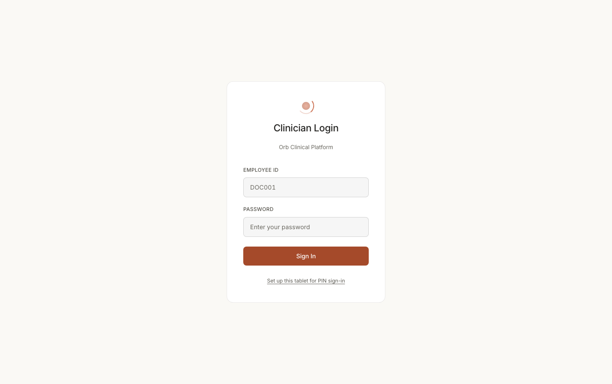
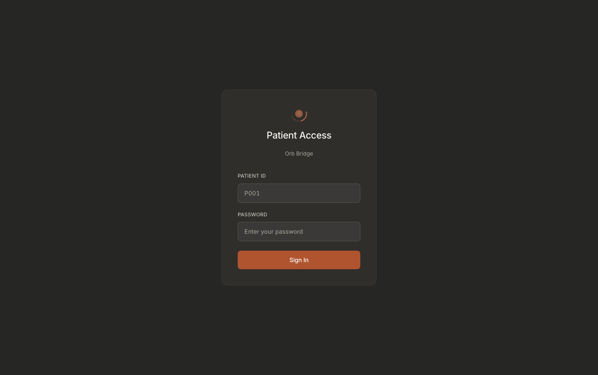

# Screen map: The login screen

One card, centred on an empty canvas. It is the only screen an unauthenticated
person can reach, and it wears four different faces depending on what the server
has already told it:

| Face | When | What you see |
|---|---|---|
| **Staff password** | default, `/login/staff` | Employee ID + Password |
| **Patient** | `/login/patient` | Patient ID + Password |
| **PIN pad** | this browser is a bound ward tablet | Employee ID + 4-digit PIN |
| **Tablet setup** | you tapped "Set up this tablet…" | one big paste box |

On top of any of those, an **authenticator-code step** can take over the form,
and a full-screen **MFA enrolment modal** can cover the whole page.

**Route:** `/login/:mode`, `src/AppRoot.tsx:235`. If a user is already in context the
route redirects instead of rendering (same line), so a signed-in person can never
see this screen.
**Component:** `src/pages/Login.tsx` (whole file is one default-exported
`Login()` function, line 11).
**Styles:** `src/pages/Login.css`, plus `.glass-card` (`src/index.css:379`) and
`.animate-slide-up` (`src/index.css:498`) from the global sheet.

---

## What it looks like



**Notice** the two hints the card gives before you type: the Employee ID placeholder is a
real-shaped id (`DOC001`), not the word "username", and the "Set up this tablet for PIN
sign-in" link under the button is the *only* route to the tablet-binding face. Dark twin:
`adm001-00-login-dark.png`.



**Notice** exactly what changes between two faces of the same card: the title
("Patient Access / Orb Bridge"), the first field's label and placeholder (**Patient ID**,
`P001`), and the *absence* of the tablet-setup link. Card, mark, spacing and button are the
same elements.

> The five role-prefixed login captures (`adm001-`, `doc001-`, `doc004-`, `nur001-`,
> `pha001-`) are pixel-identical, the card cannot know who is about to sign in. The PIN
> pad, the tablet-setup paste box, the authenticator step and the MFA-enrolment modal have
> no screenshot at all: four of the six faces above are unphotographed. See
> [`docs/screenshots/INDEX.md`](../../screenshots/INDEX.md).

---

## The page canvas

**Where:** everything. The full viewport behind the card.
**Rendered by:** `src/pages/Login.tsx:260`, `<div className="login">`.
**Data from:** nothing. Static wrapper.
**API:** none.
**Server:** none.
**Change this →** `.login` (`src/pages/Login.css:4-10`) is `min-height: 100vh` +
flex centring. Remove `align-items: center` and the card sticks to the top of the
window instead of floating in the middle. There is no background image or
gradient here, the page colour is whatever `--bg-*` the theme sets on `body`,
so the login screen follows the light/dark toggle without owning any colour of
its own.

## The card

**Where:** the single panel in the middle of the screen, max 440px wide.
**Rendered by:** `src/pages/Login.tsx:263`, 
`<div className="login__card glass-card animate-slide-up">`.
**Data from:** none.
**API:** none.
**Server:** none.
**Change this →** three classes stack here. `.login__content`
(`Login.css:12-18`) caps the width at `440px`, raise it and the card gets wider
on desktop. `.login__card` (`Login.css:43-45`) is the `40px` inner padding.
`.glass-card` (`index.css:379-386`) supplies the actual surface: opaque
`--bg-surface`, a 1px `--border-subtle` hairline, `--radius-lg` corners. Despite
the name there is no blur, this is the flat "Quiet Clinical" card. Dropping
`glass-card` leaves the form floating on bare background with no border.
`animate-slide-up` (`index.css:498`) is the 0.25s entrance; remove it and the
card simply appears.

## Orb logo mark

**Where:** top-centre of the card, above the title. A 40px circle with a
rotating arc around a glowing core.
**Rendered by:** `src/pages/Login.tsx:265`, `<OrbLogo size={40} />`, which is
`src/components/OrbLogo.tsx:3-10` (a `.orb-logo` box with a `__ring` and a
`__core` div).
**Data from:** the literal `size={40}` prop. Nothing dynamic.
**API:** none.
**Server:** none.
**Change this →** `src/components/OrbLogo.css:8-16` spins the ring (`orb-spin`,
3s linear infinite, coloured `--accent-gold` on top and `--orb-ring-2` on the
right). `:18-24` pulses the core with a radial gradient from `--accent-warm` to
`--accent-deep`. Change `size={40}` at `Login.tsx:265` and both halves scale
together (the core is `50%` of the box). This is the only moving thing on the
screen; killing the two `animation:` lines makes the login screen completely
static.

## Card title: "Clinician Login" / "Patient Access"

**Where:** directly under the logo, centred, 1.5rem.
**Rendered by:** `src/pages/Login.tsx:266-268`, 
`{isPatient ? t('login.patientAccess') : t('login.clinicianLogin')}`.
**Data from:** `isPatient`, set once at `Login.tsx:16` from the URL:
`const isPatient = mode === 'patient'`, where `mode` is the `:mode` route param
(`Login.tsx:12`). The text itself comes from i18next.
**API:** none.
**Server:** none.
**Change this →** the strings live in `src/i18n/locales/en.json:72-73`
("Clinician Login" / "Patient Access") and `src/i18n/locales/hi.json` ("चिकित्सक
लॉगिन" / "मरीज़ पहुंच"). Editing en.json changes the heading immediately.
Language is chosen by `detectInitialLanguage()` in `src/i18n/index.ts` from
`localStorage['orb_lang']`, defaulting to `en`, there is **no language switcher
on this screen**, so a Hindi login page only appears if the tablet already
switched language from inside the app. Note the URL is the only switch: visiting
`/login/patient` flips the title *and* every field below it.

## Card subtitle: "Orb Clinical Platform" / "Orb Bridge"

**Where:** one line under the title, small and muted.
**Rendered by:** `src/pages/Login.tsx:269-271`, 
`{isPatient ? t('login.bridge') : t('login.clinicalPlatform')}`.
**Data from:** same `isPatient` flag; strings at
`src/i18n/locales/en.json:74-75`.
**API:** none.
**Server:** none.
**Change this →** `.login__card-subtitle` (`Login.css:62-65`) is 0.875rem in
`--text-muted`. This is the only place the product name "Orb Bridge" appears
before a patient signs in.

## Tablet name badge

**Where:** a small pill under the subtitle, e.g. "Ward GM-1 trolley". **Only on
a bound ward tablet.**
**Rendered by:** `src/pages/Login.tsx:274-276`, 
`{device?.enrolled && !isPatient && (<p className="login__device-badge">{device.label}</p>)}`.
**Data from:** `device` state (`Login.tsx:30`), set by the effect at
`Login.tsx:42-51` which calls `getDeviceStatus()` on mount and never runs for
`/login/patient` (early `return` at line 43).
**API:** `GET /api/auth/device`, `src/api/deviceAuth.ts:36-42`. That helper
**swallows its own errors** and returns `{ enrolled: false }`, so a server that
cannot answer produces no badge and no error banner.
**Server:** `server/routes/auth_routes.py:1449` `device_status()`. It reads the
HttpOnly `orb_device` cookie via `auth.extract_device_token`
(`server/auth.py:271-286`), resolves it with `auth.load_active_device`
(`server/auth.py:300-322`, a single SHA-256 index probe against
`enrolled_devices WHERE secret_hash = ? AND revoked_at IS NULL`), and returns
`{enrolled, device_id, label, department, session_minutes}`. The `label` you see
is the `enrolled_devices.label` column. A cookie that no longer resolves is
actively *deleted* (`auth_routes.py:1466-1467`) so a revoked tablet stops
re-sending a dead credential.
**Change this →** revoke the tablet in admin (`POST /api/auth/devices/{id}/revoke`,
`auth_routes.py:1047`) and on the next page load the badge vanishes, the PIN pad
is replaced by the password form, and the "Set up this tablet for PIN sign-in"
link reappears. Rename the device and the badge text changes with no frontend
change at all. `session_minutes` is returned by the server but **never rendered**
nothing on this screen tells the nurse her tablet session is 15 minutes long.
Styling: `.login__device-badge` (`Login.css:197-204`) is a pill, hairline border,
`--radius-full`, `--text-secondary`, 0.75rem.

---

## Error banner

**Where:** between the card header and the first field. A red-tinted strip the
full width of the card. Absent until something fails.
**Rendered by:** `src/pages/Login.tsx:279`, 
`{error && <div className="login__error">{error}</div>}`.
**Data from:** the `error` string state (`Login.tsx:21`). It is set in eleven
places and cleared at the start of every submit (`Login.tsx:115`, `135`, `150`).
**API:** whichever call failed.
**Server:** see the error table below.
**Change this →** `.login__error` (`Login.css:136-145`) is a
`color-mix(--status-danger 10%)` fill with a 28% border and `--status-danger-text`
type, the no-opacity house rule, so it stays legible in both themes. It has **no
`role="alert"`**, so a screen reader is not told when it appears (the MFA modal's
equivalent at `MfaEnrollmentModal.tsx:186` does have one). It disappears the
moment any submit starts, or when you tap either of the toggle links (which call
`setError('')` at `Login.tsx:448` and `:471`).

### Which server response produces which message

Every message below travels the same path: FastAPI raises `HTTPException`, the
body is `{"detail": "..."}`, and `apiFetch` (`src/api/client.ts:195-268`) turns
`detail` into `new Error(detail).message`. `handleLogin`'s catch
(`Login.tsx:173-209`) then either branches on the exact string or shows it raw.

| Seen in the banner | HTTP | Server line | Cause |
|---|---|---|---|
| `Invalid credentials` | 401 | `auth_routes.py:441` | Unknown employee ID **or** wrong password, one message for both, on purpose |
| `Account temporarily locked after too many failed attempts. Try again later.` | 429 | `auth_routes.py:415` | 8 failures on this account (`ACCOUNT_MAX_FAILURES`, `:83`), 15-min lock |
| `Too many login attempts. Please try again in 15 minutes.` | 429 | `auth_routes.py:393` | 5 attempts from this IP in 15 min (`MAX_LOGIN_ATTEMPTS`, `:40`) |
| `Account deactivated. Contact an administrator.` | 403 | `auth_routes.py:456` | `users.is_active = 0`. Checked **after** the password is verified |
| `Invalid authenticator code, check the 6-digit code and try again.` | 401 | `auth_routes.py:527` (`Invalid MFA code`) | Rewritten client-side at `Login.tsx:182-183` |
| *(no banner, the code field appears instead)* | 401 | `auth_routes.py:502` (`mfa_required`) | Password right, TOTP not supplied |
| *(no banner, the enrolment modal opens)* | 403 | `auth_routes.py:490-494` (`mfa_enrollment_required`) | Role in `ORB_MFA_REQUIRED_ROLES` with no TOTP factor yet |
| `This account needs an authenticator app before signing in, but the enrolment ticket did not reach the browser…` | 403 | same, but the `X-MFA-Enrollment-Ticket` header was stripped | `Login.tsx:199-203` |
| `Enter your staff ID.` / `Enter your 4-digit PIN.` / `Enter the 6-digit code…` / `Please enter your password.` / `Paste the full setup code from the administrator.` | n/a | n/a | Client-side guards, `Login.tsx:219, 227, 231, 240, 250`, no request is sent |
| `Invalid staff ID or PIN` | 401 | `auth_routes.py:1601` | Unknown staff ID **or** wrong PIN, one message for both, on purpose |
| `This tablet is not set up for PIN sign-in. Use your password.` | 401 | `auth_routes.py:1520-1524` | Rewritten at `Login.tsx:128`; also flips the form back to password |
| `This tablet is temporarily locked after too many failed PINs. Sign in with your password, or ask an administrator to clear it.` | 429 | `auth_routes.py:1542-1546` | 15 failed PINs on this **device** (`DEVICE_SWEEP_MAX_FAILURES`, `:157`) |
| `Your PIN is temporarily locked after too many failed attempts. Sign in with your password, or ask an administrator to clear it.` | 429 | `auth_routes.py:1578-1582` | 5 failed PINs on this **account** (`DEVICE_PIN_MAX_FAILURES`, `:155`) |
| `PIN sign-in is not available for this account. Use your password.` | 403 | `auth_routes.py:1631-1634` | Role is `patient` or is in `ORB_MFA_REQUIRED_ROLES` |
| `This device credential is not valid.` | 401 | `auth_routes.py:1426` | Bad/revoked tablet setup code |
| `Too many attempts. Please try again in 15 minutes.` | 429 | `auth_routes.py:1410` | IP limiter on the bind endpoint |

### The identical-by-design messages: do not "improve" these

Four deliberate ambiguities are load-bearing security properties. Making any of
them more specific would turn this screen into a staff-roster oracle.

1. **`Invalid credentials` covers both "no such employee ID" and "wrong
   password"**, `auth_routes.py:425` is a single branch
   (`if not user or not password_ok`) producing one 401 at `:441`. Splitting it
   into "unknown user" and "wrong password" would let anyone with a browser
   enumerate every employee ID in the hospital.

2. **The *timing* is equalised too.** `auth_routes.py:424` calls
   `verify_password_ct(credentials.password, user["password_hash"] if user else None)`
   note it runs *before* the `if not user` test, deliberately. `verify_password_ct`
   (`server/auth.py:186-211`) always performs one bcrypt op, hashing against
   `_DUMMY_BCRYPT_HASH` when there is no user. The docstring records the measured
   leak this closed: real ≈223 ms vs fake ≈2.5 ms, a 90x fully-separable gap.
   Restoring the "obvious" short-circuit (`if not user: raise`) re-opens it while
   leaving the visible message unchanged, the bug would be invisible on screen.

3. **`Invalid staff ID or PIN` covers both cases on the PIN path**, 
   `auth_routes.py:1584-1601`, with the same constant-work treatment via
   `verify_device_pin_ct` (`server/auth.py:215-247`), which burns a bcrypt for
   an unknown user, a user with no PIN set, *and* a corrupt hash. The ordering
   comment at `auth_routes.py:1482-1487` is explicit: the constant-work check at
   `:1309` runs **before** the account-lock branch at `:1312`, because returning
   "locked" early would both confirm the account exists and skip the bcrypt,
   re-opening the oracle through a side door.

4. **The post-authentication gates are checked last, on purpose.** "Account
   deactivated" (`:442`), the MFA-role gate (`:462`), and the PIN role gate
   (`:1372`) all sit *after* password/PIN verification, so an unauthenticated
   prober cannot use them to learn which IDs are deactivated or privileged
   (comments at `:438-441` and `:1353-1355`).

**One documented asymmetry.** On the password path the per-account lockout is
checked at `auth_routes.py:407`, *before* `verify_password_ct` at `:424`. A locked
account therefore returns 429 quickly, while an unknown ID returns 401 after a
full bcrypt, so lockout state is distinguishable from non-existence on
`/auth/login` in a way it is not on `/auth/pin-login` (where the lock check is
deliberately after verification). Recorded here as a fact about the two paths, not
as a change to make.

Also worth knowing: `GET /api/auth/device` returns only the tablet's *own* label,
never the staff list. The comment at `auth_routes.py:1454-1457` says why, a
name-picker would be friendlier, but a stolen tablet would then hand over the
ward's roster. That is why staff type their own ID even on the PIN pad.

---

## Face 1: Staff password form (the default)

Shown when: not `/login/patient`, no bound tablet (or the user tapped "Use my
password instead"), not mid-MFA, not in tablet setup. The `else` arm at
`Login.tsx:367-394`.

### "EMPLOYEE ID" label

**Where:** first label in the form, uppercase, small, muted.
**Rendered by:** `src/pages/Login.tsx:370`, `{t('login.employeeId')}`.
**Data from:** `src/i18n/locales/en.json:76` → `"Employee ID"`.
**API/Server:** none.
**Change this →** `.login__label` (`Login.css:79-85`) forces
`text-transform: uppercase` and `letter-spacing: 0.02em`, the JSON string is
sentence case; the CSS is what makes it shout. Note this label has **no
`htmlFor`** (unlike the PIN and TOTP labels), so clicking it does not focus the
input and `getByLabelText` will not find it in tests.

### Employee ID input

**Where:** directly under that label. Placeholder `DOC001`.
**Rendered by:** `src/pages/Login.tsx:371-379`, `id="input-employee-id"`,
`type="text"`, `placeholder="DOC001"`.
**Data from:** `identifier` state (`Login.tsx:18`), written by the inline
`onChange` at `:376`.
**API:** sent as `employee_id` in the `POST /api/auth/login` body
(`Login.tsx:165`).
**Server:** `auth_routes.py:398-400`, a bare
`SELECT * FROM users WHERE id = ?`. The employee ID **is** the `users.id`
primary key.
**Change this →** it goes grey and unclickable when `disabled={mfaRequired}`
(`:372`), that is what freezes the credentials while the code step is up. Change
the placeholder and you change the only hint a new doctor gets about the ID
format. There is no `autoComplete` here (the PIN variant has
`autoComplete="username"`), so browser password managers do not reliably offer to
fill this pair.

### "PASSWORD" label + password input

**Where:** the second field.
**Rendered by:** `src/pages/Login.tsx:382` (label, `t('login.password')`) and
`:383-391` (input, `id="input-password"`, `type="password"`, placeholder from
`t('login.passwordPlaceholder')` = "Enter your password").
**Data from:** `password` state (`Login.tsx:19`), written at `:388`.
**API:** `POST /api/auth/login` → `password` (`Login.tsx:166`).
**Server:** `auth_routes.py:424` `verify_password_ct` → `server/auth.py:186`.
On success, if the stored hash is not bcrypt (`:530`), it is silently rehashed
and upgraded in place (`:531-539`), invisible on screen, but it means the first
login after a legacy import writes to the DB.
**Change this →** strings at `en.json:78-79`. Both this and the ID field are
`.login__input` (`Login.css:87-96`): 14×16px padding, `--bg-glass` fill, hairline
border. Focus (`:103-106`) swaps the border to `--border-focus` and adds a 3px
`--accent-glow` ring, a flat ring, not a glow, per the design rule.

---

## Face 2: Patient form

Shown when the URL is `/login/patient`. `Login.tsx:340-366`.

### "PATIENT ID" label + input

**Where:** first field. Placeholder `P001`.
**Rendered by:** `src/pages/Login.tsx:343` (label, `t('login.patientId')` →
`en.json:77` "Patient ID") and `:339-347` (input, `id="input-registration"`).
**Data from:** the same `identifier` state as the staff form.
**API:** `POST /api/auth/login`, `employee_id` field, patients and staff share
one endpoint (`models/user.py:10-12` documents this: "`employee_id` is the
clinician employee ID or, for patients, their patient ID").
**Server:** `auth_routes.py:366` `login()`, same handler.
**Change this →** identical styling to the staff field; only the label, the
placeholder and the element `id` differ.

### Patient password input

**Where:** second field, masked.
**Rendered by:** `src/pages/Login.tsx:356-364`, `id="input-dob"`,
`type="password"`.
**Data from:** the `dob` state (`Login.tsx:20`). The name is a fossil: this was
once a date-of-birth field, and `Login.css:109-111` still carries a
`input[type="date"]` calendar-icon fix for a date input that no longer exists.
**API:** submitted as the `password` at `Login.tsx:253`, `handleLogin(identifier, dob)`.
**Server:** same `auth_routes.py:366`.
**Change this →** the guard at `Login.tsx:248-252` refuses to submit an empty
value with "Please enter your password." The comment above it records why that
guard exists: the field used to default-fill the literal `'patient123'`, which
was a server-valid shared secret and therefore a PHI auth bypass. Removing the
guard does not just soften validation, it is the seam where that bug lived.

---

## Face 3: PIN pad (bound ward tablet)

Shown when `pinMode` is true. That flag is computed at `Login.tsx:71`:

```
const pinMode = usePin && !!device?.enrolled && !isPatient && !mfaRequired && !showDeviceSetup
```

`usePin` (`:31`) is switched on automatically by the device-status effect
(`:48`, `if (status.enrolled) setUsePin(true)`), so on an enrolled tablet the
PIN pad is what a nurse sees first, not the password form. Everything else in
that expression is a veto: never for patients, never mid-MFA, never over the
setup form.

### "EMPLOYEE ID" label + staff-ID input (PIN variant)

**Where:** first field on the PIN pad. Placeholder `NUR001`.
**Rendered by:** `src/pages/Login.tsx:305-307` (label, `htmlFor="input-pin-id"`)
and `:308-317` (input, `id="input-pin-id"`, `autoComplete="username"`,
`autoFocus`).
**Data from:** `identifier` state, shared with the other two forms.
**API:** `POST /api/auth/pin-login` → `employee_id`
(`src/api/deviceAuth.ts:70-73`).
**Server:** `auth_routes.py:1478` `pin_login()`, lookup at `:1550-1552`.
**Change this →** this variant *does* have `htmlFor` and `autoFocus`, so the
cursor lands here on load and a tap on the label focuses the box. Removing
`autoFocus` costs a tap on every sign-in, on the screen the whole PIN feature
exists to make fast.

### "PIN" label + PIN input

**Where:** second field. Masked, placeholder `••••`, big centred monospace
digits.
**Rendered by:** `src/pages/Login.tsx:320` (label, a hardcoded English `PIN`,
**not** translated) and `:321-333` (input, `id="input-pin"`, `type="password"`,
`inputMode="numeric"`, `maxLength={8}`).
**Data from:** `pin` state (`Login.tsx:32`). The `onChange` at `:329` strips
every non-digit and truncates to 8, 
`e.target.value.replace(/\D/g, '').slice(0, 8)`, so typing `a1b2c3` leaves
`123` on screen before anything is sent (asserted by
`src/pages/Login.pin.test.tsx:149-156`).
**API:** `POST /api/auth/pin-login` → `pin`. The device credential is **not** in
this body; it rides as the HttpOnly `orb_device` cookie
(`src/api/deviceAuth.ts:64-67`, `models/user.py:20-29`).
**Server:** `auth_routes.py:1479`. In order: IP limiter (`:1243`), device must
resolve (`:1254-1274`), device-wide sweep lock (`:1277-1296`), constant-work
`verify_device_pin_ct` (`:1309`), per-account PIN lock (`:1312-1332`), verdict
(`:1334-1351`), then the deactivated (`:1356`) and role (`:1372`) gates. Success
mints a short session, `create_token(..., auth_method="pin", expires_in_minutes=DEVICE_PIN_SESSION_MINUTES)`
at `:1392-1396`, cookie max-age matched at `:1397-1400`.
`DEVICE_PIN_SESSION_MINUTES` defaults to 15 (`server/auth.py:66`,
`ORB_DEVICE_PIN_SESSION_MINUTES`).
**Change this →** `.login__code-input` (`Login.css:152-161`) is what makes this
look like a PIN pad rather than a text box: centred, `0.55em` letter-spacing,
1.35rem, tabular monospace, with the left padding nudged by `calc(16px + 0.55em)`
so the trailing letter-space does not push the digits off-centre. Raise
`maxLength` past 8 and the server's `_PIN_FORMAT` (`auth_routes.py:167`, `^\d{4,8}$`)
still refuses it at PIN-set time. Note the same class is shared with the
authenticator-code field.

### PIN hint: "Your PIN identifies you personally…"

**Where:** small muted text under the PIN box.
**Rendered by:** `src/pages/Login.tsx:334-337`, wired to the input by
`aria-describedby="pin-hint"` (`:332`).
**Data from:** hardcoded English in the JSX.
**API/Server:** none.
**Change this →** `.login__hint` (`Login.css:206-210`). This sentence is the
entire behavioural argument for the feature, everything you do is recorded under
your name, never share it. Delete it and the screen no longer says why sharing a
PIN is different from sharing a password. It is **not** in the i18n bundle, so it
stays English on a Hindi tablet.

---

## Face 4: Tablet setup form

Shown when `showDeviceSetup` is true (`Login.tsx:36`, toggled by the button at
`:464-478`). It takes over the whole field area, `Login.tsx:282-301`.

### "Tablet setup code" label

**Where:** the only label in this face.
**Rendered by:** `src/pages/Login.tsx:284-286`, `htmlFor="input-device-secret"`.
Hardcoded English, sentence case in source but rendered uppercase by
`.login__label`.

### Setup-code paste box

**Where:** a 3-row textarea, monospace, resizable.
**Rendered by:** `src/pages/Login.tsx:287-296`, `id="input-device-secret"`,
`rows={3}`, `autoFocus`, placeholder "Paste the one-time code from the
administrator".
**Data from:** `deviceSecret` state (`Login.tsx:37`), component state only, 
never persisted (asserted by `src/pages/Login.pin.test.tsx:158-179`, which checks
the raw secret never appears in `localStorage`).
**API:** `POST /api/auth/device/bind`, `src/api/deviceAuth.ts:49-55`.
**Server:** `auth_routes.py:1156` `bind_device()`. Unauthenticated on purpose
(`:1147-1150`: the secret *is* the credential, and this runs on a tablet before
any person signs in), rate-limited by the same per-IP limiter, resolved through
`load_active_device`, and on success `set_device_cookie`
(`server/auth.py:289-293`) writes the HttpOnly `orb_device` cookie.
**Change this →** it is a `<textarea>`, not an `<input>`, and
`Login.css:212-221` says why: the secret is a 43-character token
(`generate_device_secret` = `secrets.token_urlsafe(32)`, `server/auth.py:252-254`)
and a single-line field truncates it out of sight, which is how it gets pasted
half-copied. Swap it to an `<input>` and you reintroduce that failure. The client
guard at `Login.tsx:218-221` refuses anything under 16 characters with "Paste the
full setup code from the administrator.", matching `DeviceBindBody`'s
`min_length=16` (`models/user.py:42`).

### Setup hint: "An administrator enrols this tablet once…"

**Where:** under the paste box.
**Rendered by:** `src/pages/Login.tsx:297-300`, tied in by
`aria-describedby="device-setup-hint"` (`:295`).
**Change this →** same `.login__hint` style. It is the only place the screen
explains that the code is exchanged and not kept.

**On success** (`handleBindDevice`, `Login.tsx:137-151`): `device` is replaced,
the secret is wiped from state, the setup form closes and `usePin` flips true, 
so the screen lands directly on the PIN pad with the new tablet badge showing.

---

## The authenticator-code step (MFA / TOTP)

### What triggers it

`handleLogin` posts to `/api/auth/login`. If the account has `totp_enabled` and
no code was supplied, the server raises **401 `mfa_required`**
(`auth_routes.py:496-502`). Note the comment at `:499-501`: this deliberately
does **not** count toward the IP lockout, it is a normal two-step flow, not a
guess. The catch at `Login.tsx:175-181` matches that exact string, stashes the
credentials in `mfaCreds` and sets `mfaRequired`, which reveals the field and
disables the ID/password inputs.

`mfaCreds` (`Login.tsx:60`) holds the credentials rather than re-reading the form
on resubmit, so the second call replays exactly what the password step already
verified (comment at `:53-57`).

### "AUTHENTICATOR CODE" label + 6-digit input

**Where:** appears below the (now greyed) credential fields, above the submit
button.
**Rendered by:** `src/pages/Login.tsx:396-417`. Label at `:398`
(`htmlFor="input-totp"`), input at `:399-412`, `id="input-totp"`,
`inputMode="numeric"`, `autoComplete="one-time-code"`, `maxLength={6}`,
placeholder `000000`, `autoFocus`.
**Data from:** `totpCode` state (`Login.tsx:59`); `onChange` at `:408` strips
non-digits and caps at 6.
**API:** the *same* `POST /api/auth/login`, resubmitted at `Login.tsx:243` as
`handleLogin(mfaCreds.id, mfaCreds.pw, code)`, which adds `totp_code` to the body
(`:167`).
**Server:** `auth_routes.py:503`, `consume_totp(user["id"], user["totp_secret"], code)`.
That function (`:275-300`) is not a plain TOTP check: it verifies the code via
`services/mfa_service.py:69` `verify_code_step` **and** enforces single use by
requiring the time-step to be strictly greater than `users.totp_last_step`
(RFC 6238 §5.2). A replayed code fails even though it is arithmetically valid.
**Change this →** `autoComplete="one-time-code"` is what makes iOS/Android offer
the SMS/authenticator code above the keyboard. `.login__code-input` gives it the
same centred monospace treatment as the PIN. `.login__field--mfa`
(`Login.css:148-150`) explicitly sets `animation: none`, the field appears
instantly rather than sliding in.

### MFA hint: "Enter the 6-digit code from your authenticator app to finish signing in."

**Where:** under the code box.
**Rendered by:** `src/pages/Login.tsx:413-415`, `aria-describedby="mfa-hint"`.
**Change this →** `.login__mfa-hint` (`Login.css:163-167`), 0.78rem muted.

### "Use a different account" link

**Where:** centred under the submit button, underlined, link-styled. Only during
the code step.
**Rendered by:** `src/pages/Login.tsx:429-438`, `onClick` calls `resetMfa()`
(`:73-79`) then clears the error.
**Data from:** `mfaRequired`.
**API/Server:** none, purely local.
**Change this →** `.login__mfa-cancel` (`Login.css:169-189`): transparent, no
border, `--text-secondary`, underlined at 3px offset; hover darkens to
`--text-primary`, `:disabled` fades to `--text-muted` with `not-allowed`. Clicking
it re-enables the ID/password fields and returns you to a blank password step, 
it does **not** tell the server anything, so the half-finished login simply
expires on its own.

### A wrong code

**Server:** `auth_routes.py:503-527`. A bad code calls `record_login_attempt`
*and* `_record_account_failure` (`:513`), the comment at `:505-512` records why:
without it, an attacker holding a phished password could brute-force the 6-digit
code forever by rotating IPs, since only the per-IP limiter fired. Eight wrong
codes now lock the account exactly like eight wrong passwords.
**On screen:** the banner reads "Invalid authenticator code, check the 6-digit
code and try again." (`Login.tsx:183`), the code field stays up with its previous
value, and after eight tries the message switches to the account-lockout 429.

---

## The MFA self-enrolment modal

### What triggers it

A password that is **correct** on an account whose role is in
`ORB_MFA_REQUIRED_ROLES` (`server/config.py:63-65`) but which has no TOTP factor.
The server refuses the session with **403 `mfa_enrollment_required`**
(`auth_routes.py:490-494`) and attaches a short-lived enrolment ticket in the
`X-MFA-Enrollment-Ticket` response header (`:316`, minted at `:328-343`, 10-minute
TTL, signed with a key *derived from* `JWT_SECRET` so `decode_token` rejects it
everywhere else, `:321-325`).

`apiFetch` lifts that header onto the thrown error at `src/api/client.ts:222-223`
(`(permError as any).mfaEnrollTicket`). `Login.tsx:184-204` reads it into
`enrollTicket`, which mounts the modal at `:480-503`.

The reason this path exists is written at `Login.tsx:185-188`: "Contact your
administrator" was a dead end on a fresh appliance, where this **is** the only
administrator.

### Modal backdrop

**Where:** covers the entire viewport, dimming the login card behind it.
**Rendered by:** `src/components/MfaEnrollmentModal.tsx:167`, 
`<div className="mfa-modal-backdrop" onClick={onClose}>`.
**Change this →** `MfaEnrollmentModal.css:1-10`: `position: fixed; inset: 0;
z-index: 1000;` over `rgba(0,0,0,0.55)`. Clicking it closes the modal (the panel
itself stops propagation at `:174`). The panel is focus-trapped by
`useFocusTrap` (`:71`), whose escape handler also calls `onClose`.

### Modal title: "Set up two-factor authentication"

**Where:** top-left of the modal.
**Rendered by:** `src/components/MfaEnrollmentModal.tsx:177-181`. It reads
"Two-factor authentication" instead in the `disable`/`disabled` views, which are
unreachable from the login screen, since disabling requires a real session
(`:89-96` sends a pre-login caller to the `error` view instead).
**Change this →** `id="mfa-modal-title"` is the `aria-labelledby` target at
`:173`; renaming the element without updating both breaks the dialog's
accessible name.

### Modal close "×"

**Where:** top-right corner.
**Rendered by:** `src/components/MfaEnrollmentModal.tsx:182`, 
`aria-label="Close"`, `onClick={onClose}`.
**Change this →** `onClose` (`Login.tsx:492-506`) is where the flow branches: if
`enrolled` was latched it clears the ticket and drops you onto the **code step**
with your credentials intact, so you only type the next code; if not, it clears
`mfaCreds` and returns you to a clean password step.

### Loading state: "Preparing your authenticator setup…"

**Where:** modal body, immediately on open.
**Rendered by:** `src/components/MfaEnrollmentModal.tsx:188-190`, `view === 'loading'`.
**API:** `POST /api/auth/mfa/enroll/begin`, fired by the effect at `:75-104` with
`Authorization: Bearer <ticket>` (`:56-58`, `:81`).
**Server:** `auth_routes.py:640` `mfa_enroll_begin()`, behind
`_enrolment_principal` (`:599-632`), the only dependency in the app that accepts
an enrolment ticket, and it re-checks the live `users` row for existence,
`is_active` and `token_version`, so deactivating a user revokes their outstanding
ticket. It generates a secret, stores it with `totp_enabled` still 0 (`:651-655`),
and returns `{secret, otpauth_uri, issuer}`.
**Change this →** this text is what fills the modal for the duration of one
round-trip. If `begin` fails the view flips to `error` and only a "Close" button
(`:192-198`) remains.

### Enrolment steps list

**Where:** the numbered 1-2-3 at the top of the enrol view.
**Rendered by:** `src/components/MfaEnrollmentModal.tsx:202-206`, open your
authenticator app / add an account by **manual key entry** / enter the 6-digit
code.
**Change this →** there is no QR code anywhere in this modal, deliberately
(`:49-52`: no new npm dependency was approved for a QR renderer). Step 2 is the
whole workaround; softening "manual key entry" leaves the user hunting for a QR
that does not exist.

### "Setup key" + the grouped secret + Copy

**Where:** a monospace block, secret shown in groups of four, with a Copy button
on the right.
**Rendered by:** `src/components/MfaEnrollmentModal.tsx:208-218`. The grouping is
`groupSecret()` (`:36-39`), which guards against a missing secret so a malformed
response can never throw during render, the modal is mounted outside any panel
error boundary (`:34-35`).
**Data from:** `enroll.secret` from `/mfa/enroll/begin`.
**Change this →** the Copy button's label swaps to "Copied" for 1500ms
(`:106-114`, `:216`). If `navigator.clipboard` is unavailable the catch is silent
nothing changes on screen, and the value stays selectable by hand.

### "Provisioning URI" + Copy

**Where:** below the setup key.
**Rendered by:** `src/components/MfaEnrollmentModal.tsx:220-230`.
**Data from:** `enroll.otpauth_uri`, built by
`services/mfa_service.py:103` `provisioning_uri(secret, account, issuer)`. The
account name is `registration_number ?? name ?? id` (`auth_routes.py:663`).

### Issuer line: "Account: … · algorithm SHA1 · 6 digits · 30s period."

**Where:** one muted line under the URI.
**Rendered by:** `src/components/MfaEnrollmentModal.tsx:231-233`.
**Data from:** `enroll.issuer` = `MFA_ISSUER` (`server/config.py:61`, default
"Orb Hospital OS", override `ORB_MFA_ISSUER`).
**Change this →** the three constants after it are hardcoded text in the JSX but
they mirror real values in `services/mfa_service.py:24-26` (`_DIGITS = 6`,
`_PERIOD = 30`, `_ALGORITHM = "SHA1"`). Change the service and this line silently
starts lying.

### "Verification code" input + Cancel + "Enable MFA"

**Where:** bottom of the enrol view.
**Rendered by:** `src/components/MfaEnrollmentModal.tsx:235-259`. The input is
`id="mfa-confirm-code"`, 6 digits, `autoFocus`. The primary button reads
"Verifying…" while `busy` (`:257`).
**API:** `POST /api/auth/mfa/enroll/confirm` (`:126-130`) with the same ticket.
**Server:** `auth_routes.py:668` `mfa_enroll_confirm()`, rejects if already
enabled (`:668`), if no secret was staged (`:671`), or if `consume_totp` fails
(`:673`, → 400 "Invalid code"), then flips `totp_enabled = 1` (`:677`) and writes
an `mfa_enrolled` audit event (`:681-692`).
**Change this →** a failure sets the modal's own error strip (`:186`, which
*does* carry `role="alert"`) and leaves the form up. Success flips to the
`enrolled` view and fires `onEnrolled` → `setEnrolled(true)` on the login screen
(`Login.tsx:491`).

### Success view + the "wait for the next code" warning

**Where:** replaces the form after a successful confirm.
**Rendered by:** `src/components/MfaEnrollmentModal.tsx:263-285`. A green check
line (`:265`), a muted explanation (`:266-268`), and, only when
`enrollTicket` is set, i.e. only in this pre-login flow, a bolded warning
(`:269-278`). The final button reads "Continue to sign in" instead of "Done"
(`:281`).
**Change this →** that warning exists because `consume_totp` burns the code just
used to confirm enrolment, so reusing it to sign in fails with "Invalid MFA code"
which reads like broken setup rather than working anti-replay (`:270-273`).
Deleting the warning does not change any behaviour; it changes whether the first
sign-in after enrolment looks like a bug. Equally load-bearing is
`Login.tsx:488-491`: `onEnrolled` only *records* success, because clearing the
ticket there would unmount the modal instantly and this whole screen would never
be seen.

---

## Submit button

**Where:** full-width, below the fields. The only filled button on the screen.
**Rendered by:** `src/pages/Login.tsx:419-427`, `id="btn-login"`,
`type="submit"`, `disabled={loading}`.
**Data from:** four-way label, in this precedence (`:420-426`):

| Label | Condition | i18n |
|---|---|---|
| `Signing in…` | `loading` | `login.signingIn`, `en.json:81` |
| `Set up this tablet` | `showDeviceSetup` | hardcoded |
| `Verify code` | `mfaRequired` | hardcoded |
| `Sign In` | otherwise | `login.signIn`, `en.json:80` |

**API:** `onSubmit` → `handleSubmit` (`Login.tsx:215-257`), which routes to
`handleBindDevice`, `handlePinLogin`, or `handleLogin` depending on the same four
faces, running its client-side guard for each first.
**Server:** `/api/auth/device/bind`, `/api/auth/pin-login`, or `/api/auth/login`.
**Change this →** `loading` (`Login.tsx:22`) is set true at the top of all three
handlers and false in their `finally` blocks (`:132-134`, `:148-150`,
`:210-212`), so the button re-enables even when the request throws. Styling:
`.login__submit` (`Login.css:113-134`), solid `--accent-deep`,
`--btn-primary-text`, no border; hover swaps to `--btn-gradient-hover`; active is
a `brightness(0.96)` press. There is **no spinner**, the changed label is the
entire pending affordance, so shortening "Signing in…" removes the only signal
that anything is happening during a ~200ms bcrypt.

## "Use my password instead" / "Use my PIN" toggle

**Where:** centred link under the submit button. **Only on a bound tablet.**
**Rendered by:** `src/pages/Login.tsx:444-454`, guarded by
`!isPatient && !mfaRequired && !showDeviceSetup && device?.enrolled`. Label
flips at `:452`.
**Data from:** `usePin` (`Login.tsx:31`). The click handler (`:448`) toggles it
and clears `pin`, `password` and `error` together, so switching modes never
carries a half-typed credential across.
**API/Server:** none.
**Change this →** this link is the whole reason a PIN lockout is survivable. The
comment at `:440-443` states the rule: a locked PIN must degrade to "use your
password", never to "you are out of the record mid-shift". Tightening its
condition (say, hiding it while a PIN lock is active) would strand a nurse. It
disappears entirely on a browser that is not an enrolled tablet, because there is
no PIN to toggle to. `src/pages/Login.pin.test.tsx:94-102` pins this behaviour.

## "Set up this tablet for PIN sign-in" / "Back to sign in" toggle

**Where:** the lowest link on the card.
**Rendered by:** `src/pages/Login.tsx:464-478`, guarded by
`!isPatient && !mfaRequired && (showDeviceSetup || !device?.enrolled)`. Label
flips at `:476`.
**Data from:** `showDeviceSetup` (`Login.tsx:36`); the click handler (`:468-472`)
toggles it and clears both the pasted secret and the error.
**API/Server:** none directly.
**Change this →** the `showDeviceSetup ||` half of that condition is load-bearing
and is documented as such at `:456-463`. The device-status fetch is async, so a
tap on this button *before* it resolves opens the setup form on a browser that
then turns out to be enrolled; gating purely on `!device?.enrolled` made the way
back vanish at that moment and stranded the user in the setup form with only a
page reload to escape. `src/pages/Login.pin.test.tsx:127-147` reproduces exactly
that race. An enrolled tablet never advertises this link, so the ward device does
not invite re-enrolment.

---

## States

### While the device check is in flight

`device` is `null` (`Login.tsx:30`), so `pinMode` is false and the **staff
password form** renders. There is no skeleton and no spinner, the password form
is the honest default, and it silently becomes the PIN pad if
`getDeviceStatus()` comes back `enrolled: true`. On a personal laptop nothing
ever changes.

### While a request is in flight

The submit button reads "Signing in…" and is disabled; both toggle links are
disabled too (`disabled={loading}` at `:430`, `:444`, `:468`), so a slow bcrypt
cannot be interrupted into a half-switched form. The input fields stay editable.

### Empty state

There is no empty state, the form is the content. The nearest equivalent is a
tablet whose enrolment was revoked: the badge, PIN pad and toggle all vanish
together on the next load, and the setup link reappears.

### When the request fails

The error banner appears above the form and the fields keep their values, with
two exceptions: `handlePinLogin` clears the PIN box on any failure
(`Login.tsx:120`, `setPin('')`), and a "not enrolled" failure additionally
rewrites `device` to `{enrolled: false}` and turns `usePin` off (`:126-128`), so
the screen falls back to the password form in the same tick.

### When the network is down

`apiFetch` does not catch a thrown `fetch`, the rejection surfaces as
`err.message` (typically "Failed to fetch") and lands in the generic `else` at
`Login.tsx:205-209`, so the banner shows the browser's own wording. The device
check is the exception: `getDeviceStatus` catches everything and returns
`{ enrolled: false }` (`src/api/deviceAuth.ts:39-41`), so an appliance that
cannot answer shows an ordinary login rather than an error.

### A 401 here does not trigger the "session expired" modal

`apiFetch` normally treats any 401 as a dead session, it fires
`orb:session-expired` and replaces the server's message with a flat "Session
expired" (`src/api/client.ts:204-206`, `122-125`). All four sign-in endpoints are
exempted by `UNAUTHENTICATED_AUTH_PATHS` (`src/api/client.ts:136-141`:
`/auth/login`, `/auth/pin-login`, `/auth/device`, `/auth/device/bind`).
`src/api/pinLogin401.test.ts` documents both faults that exemption fixes: the
expiry flag latching on a mistyped PIN and then throwing the re-auth modal over
the dashboard the nurse *did* reach, and the screen showing "Session expired"
instead of a message it could act on.

### When the user lacks permission

There is no RBAC on this screen, it is the pre-auth surface. The nearest thing
is the PIN role gate (403 "PIN sign-in is not available for this account. Use your
password.", `auth_routes.py:1631-1634`): a PIN must not become the back door
around a TOTP mandate, and patients never use ward tablets. The banner says
exactly what to do, and the password link is right there.

### After a successful sign-in

`applyLoginResponse` (`Login.tsx:83-104`) normalizes the role, a server role of
`surgeon` becomes `doctor` with department defaulted to `Surgery` (`:88-92`), so
an unmapped role cannot fall through to a stripped-down tab set in
`ClinicianShell`. It then calls `login(user)` from `AuthContext`
(`src/AppRoot.tsx:93-99`) and navigates to `/bridge` for patients, `/dashboard` for
everyone else (`Login.tsx:103`). The screen unmounts.
`authMethod: 'pin'` (`:83`, `:113`) is the flag that shortens the idle timer from
15 minutes to 2 and makes a tablet **sign out** rather than lock
(`src/AppRoot.tsx:41-42`, `:131-147`), asserted by
`src/pages/Login.pin.test.tsx:104-125`.

### Dead style worth knowing about

`.login__back` (`src/pages/Login.css:20-41`) styles a fixed 44px round back
button at the top-left. **Nothing renders it**, no `login__back` appears
anywhere in `src/`. Likewise `Login.css:109-111` patches the calendar icon of an
`input[type="date"]` that no longer exists (the patient field is now
`type="password"`, `Login.tsx:358`).

---

## Reverse map contributions

- `src/pages/Login.tsx::Login` → page canvas; login card; Orb logo mark; card title; card subtitle; tablet name badge; error banner; employee ID label; employee ID input; password label; password input; patient ID label; patient ID input; patient password input; PIN-variant employee ID label; PIN-variant staff ID input; PIN label; PIN input; PIN hint; tablet setup code label; setup-code paste box; setup hint; authenticator code label; authenticator code input; MFA hint; "Use a different account" link; submit button; submit pending label "Signing in…"; submit label "Set up this tablet"; submit label "Verify code"; submit label "Sign In"; "Use my password instead" / "Use my PIN" toggle; "Set up this tablet for PIN sign-in" / "Back to sign in" toggle; all client-side validation messages
- `src/pages/Login.css` → page canvas; login card; card title; card subtitle; tablet name badge; error banner; all field labels; all text inputs and their focus ring; PIN input digit styling; authenticator code input digit styling; setup-code paste box; PIN hint; setup hint; MFA hint; submit button; both link-style toggle buttons; unused back button style
- `src/index.css` → login card surface (`.glass-card`); login card entrance animation (`.animate-slide-up`)
- `src/components/OrbLogo.tsx::OrbLogo` → Orb logo mark
- `src/components/OrbLogo.css` → Orb logo mark ring rotation; Orb logo mark core pulse
- `src/components/MfaEnrollmentModal.tsx::MfaEnrollmentModal` → modal backdrop; modal title; modal close button; modal error strip; "Preparing your authenticator setup…" loading text; error-view Close button; enrolment steps list; "Setup key" label; grouped setup secret; setup-key Copy button; "Provisioning URI" label; provisioning URI value; URI Copy button; issuer/algorithm hint line; "Verification code" label; verification code input; modal Cancel button; "Enable MFA" button and its "Verifying…" pending label; enrolled success line; enrolled explanation; "wait for the next code" warning; "Continue to sign in" button
- `src/components/MfaEnrollmentModal.tsx::groupSecret` → grouped setup secret
- `src/components/MfaEnrollmentModal.css` → modal backdrop dimming and centring
- `src/components/MfaEnrollmentModal.tsx` (via `src/hooks/useFocusTrap.ts::useFocusTrap`) → modal focus trap and Escape-to-close
- `src/api/deviceAuth.ts::getDeviceStatus` → tablet name badge; PIN pad visibility; "Set up this tablet for PIN sign-in" link visibility
- `src/api/deviceAuth.ts::bindDevice` → setup-code paste box submit outcome; tablet name badge after enrolment
- `src/api/deviceAuth.ts::pinLogin` → PIN input submit outcome; "Invalid staff ID or PIN" banner; PIN lockout banners; "This tablet is not set up for PIN sign-in" banner
- `src/api/client.ts::apiFetch` → error banner text for every server-side failure; MFA enrolment modal trigger (lifts `X-MFA-Enrollment-Ticket`)
- `src/api/client.ts::UNAUTHENTICATED_AUTH_PATHS` → error banner showing the real reason instead of "Session expired"; suppression of the session-expired modal after a mistyped PIN
- `src/api/client.ts::setUser` → post-login user cache consumed by the shell
- `src/api/client.ts::authenticateSocket` → realtime socket handshake after sign-in
- `src/App.tsx::App` → login route rendering and the redirect that hides this screen from a signed-in user; idle timeout length driven by `authMethod`
- `src/i18n/locales/en.json` → card title; card subtitle; employee ID label; patient ID label; password label; password placeholder; submit "Sign In"; submit "Signing in…"
- `src/i18n/locales/hi.json` → Hindi variants of the same eight strings
- `src/i18n/index.ts::detectInitialLanguage` → which language every translated label on this screen renders in
- `server/routes/auth_routes.py::login` → "Invalid credentials" banner; "Account temporarily locked…" banner; "Too many login attempts…" banner; "Account deactivated…" banner; authenticator code step (401 `mfa_required`); "Invalid authenticator code…" banner; MFA enrolment modal (403 `mfa_enrollment_required` + ticket header); successful sign-in and redirect
- `server/routes/auth_routes.py::device_status` → tablet name badge; PIN pad vs password form on first load
- `server/routes/auth_routes.py::bind_device` → "This device credential is not valid." banner; "Too many attempts…" banner; tablet name badge appearing after setup
- `server/routes/auth_routes.py::pin_login` → "Invalid staff ID or PIN" banner; "This tablet is not set up for PIN sign-in" banner; "This tablet is temporarily locked after too many failed PINs" banner; "Your PIN is temporarily locked…" banner; "PIN sign-in is not available for this account" banner; "Account deactivated…" banner on the PIN path; 15-minute PIN session
- `server/routes/auth_routes.py::mfa_enroll_begin` → "Preparing your authenticator setup…" loading text; grouped setup secret; provisioning URI; issuer hint line
- `server/routes/auth_routes.py::mfa_enroll_confirm` → "Enable MFA" outcome; enrolled success view; modal error strip on a bad code
- `server/routes/auth_routes.py::_enrolment_principal` → whether the enrolment modal can load at all before a session exists
- `server/routes/auth_routes.py::issue_mfa_enroll_ticket` → MFA enrolment modal availability (the `X-MFA-Enrollment-Ticket` header)
- `server/routes/auth_routes.py::consume_totp` → "Invalid authenticator code…" banner on a replayed code; the "wait for the next code" warning's reason for existing
- `server/routes/auth_routes.py::is_ip_rate_limited` → "Too many login attempts…" and "Too many attempts…" banners
- `server/routes/auth_routes.py::_account_is_locked` → "Account temporarily locked after too many failed attempts" banner
- `server/routes/auth_routes.py::_record_account_failure` → how many wrong passwords or codes it takes before the lockout banner appears
- `server/routes/auth_routes.py::_locked_until` → both PIN lockout banners
- `server/routes/auth_routes.py::_record_pin_failure` → how many wrong PINs it takes before each PIN lockout banner appears
- `server/routes/auth_routes.py::_clear_pin_failures` → a correct PIN resetting the lockout counters
- `server/auth.py::verify_password_ct` → "Invalid credentials" banner and its constant response time
- `server/auth.py::verify_device_pin_ct` → "Invalid staff ID or PIN" banner and its constant response time
- `server/auth.py::load_active_device` → tablet name badge; PIN pad availability; "This device credential is not valid." banner
- `server/auth.py::extract_device_token` → tablet name badge; PIN sign-in succeeding on this browser
- `server/auth.py::set_device_cookie` → PIN pad persisting across reloads after tablet setup
- `server/auth.py::clear_device_cookie` → tablet name badge disappearing after revocation
- `server/auth.py::generate_device_secret` → the 43-character length the setup paste box is sized for
- `server/auth.py::set_session_cookies` → session persistence after sign-in; PIN session cookie lifetime
- `server/auth.py::create_token` → `authMethod`-driven short tablet session
- `server/auth.py::DEVICE_PIN_SESSION_MINUTES` → PIN session length (returned to the screen as `session_minutes`, currently unrendered)
- `server/services/mfa_service.py::generate_secret` → grouped setup secret
- `server/services/mfa_service.py::provisioning_uri` → provisioning URI value
- `server/services/mfa_service.py::verify_code_step` → authenticator code acceptance or rejection
- `server/config.py::MFA_REQUIRED_ROLES` → whether the MFA enrolment modal ever appears; "PIN sign-in is not available for this account" banner
- `server/config.py::MFA_ISSUER` → issuer name in the modal's hint line and in the provisioning URI
- `server/models/user.py::UserLogin` → employee ID field; password field; authenticator code field
- `server/models/user.py::PinLogin` → PIN-variant staff ID field; PIN field
- `server/models/user.py::DeviceBindBody` → setup-code paste box minimum length
- `server/models/user.py::UserOut` → the name, role and department carried into the shell after sign-in
- `server/services/audit_service.py::log_audit_event` → no visible element on this screen; every outcome above is recorded
