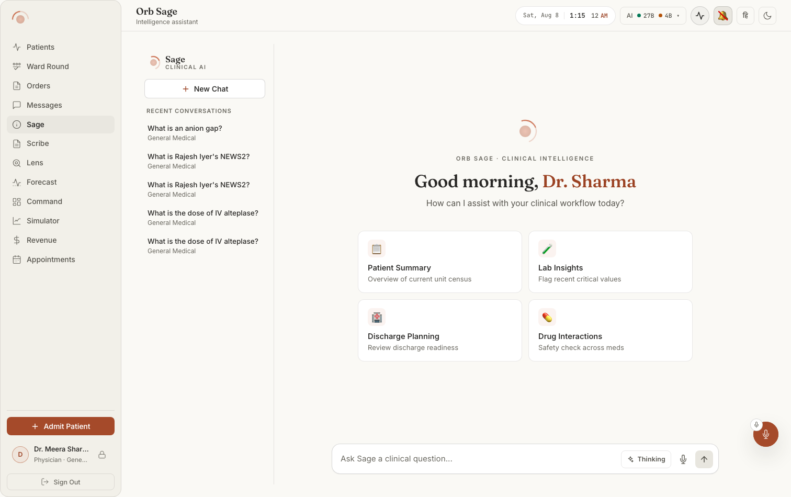
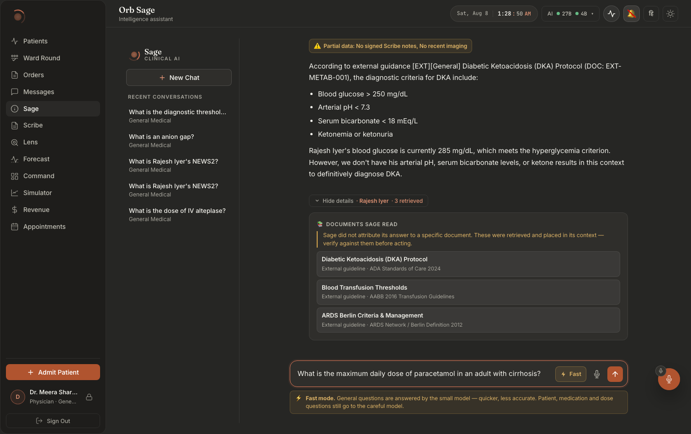
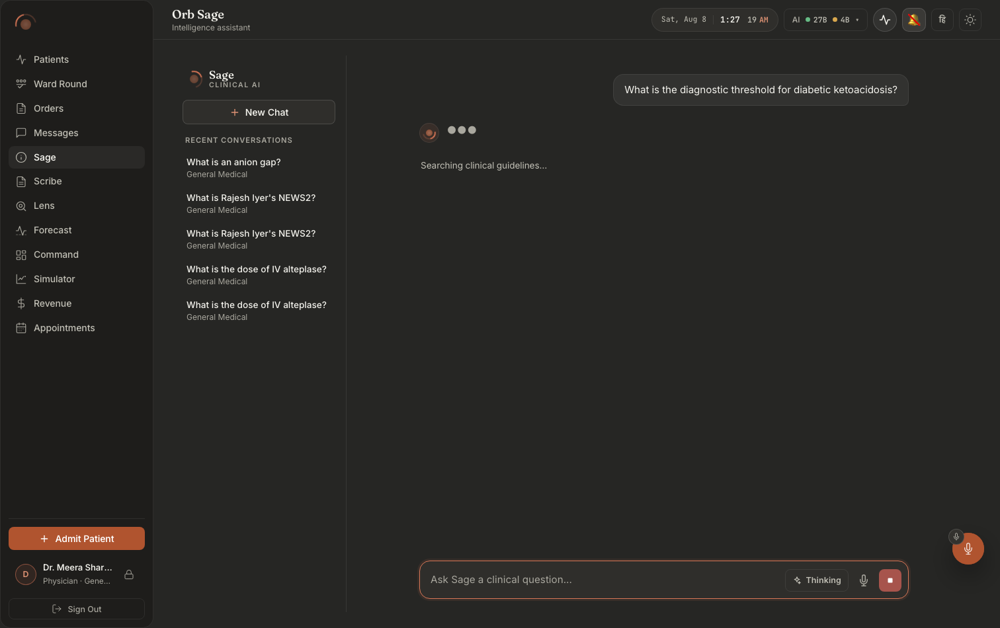
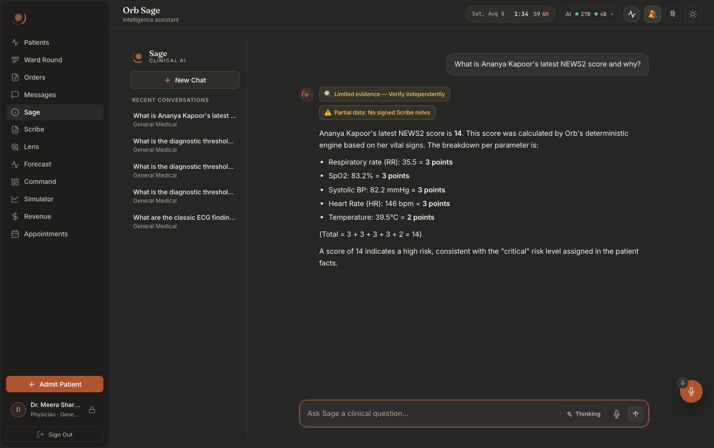
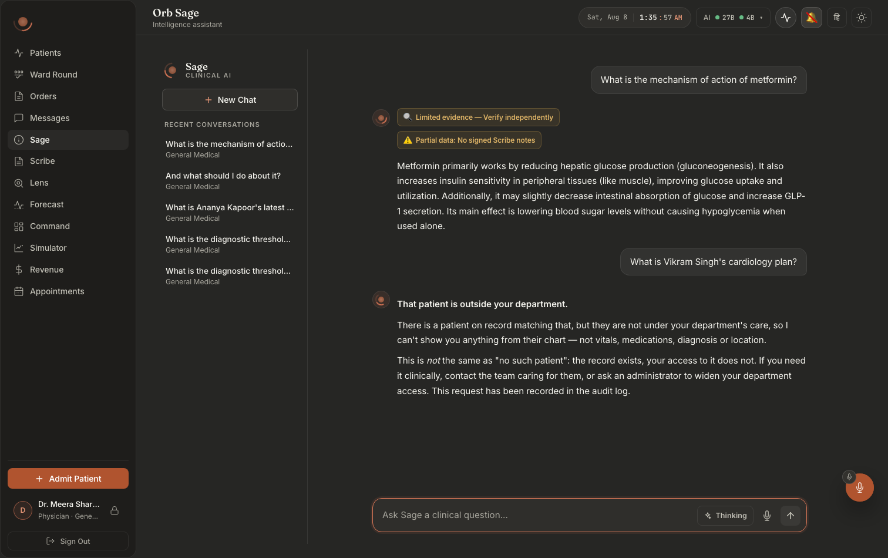

# Screen map 03: Sage (the AI assistant panel)

**What this is.** An index of every visible thing on the Sage screen, and the exact code that
puts it there. Read an entry, then go to the file:line it names. Every citation in this file was
opened and checked at that line.

**How to get to this screen.** Left nav → **Sage** (nav id `sage`, label `Sage`, pillar `Sage`,
declared at `src/pages/ClinicianShell.tsx:92`). The panel is mounted lazily at
`src/pages/ClinicianShell.tsx:478` (`const SagePanel = lazy(...)`) and rendered inside a tab panel
at `src/pages/ClinicianShell.tsx:826-829`:

```
{shouldRenderPanel('sage') && (
  <div id={`panel-sage`} role="tabpanel" aria-labelledby={`nav-sage`} ...>
    <PanelErrorBoundary label="sage"><SagePanel userName={user?.name} /></PanelErrorBoundary>
```

The tab is visible to **doctor, clinician, nurse, admin and pharmacist**, see the per-role tab
lists at `src/pages/ClinicianShell.tsx:382-395`. Note `case 'pharmacist': return ['helix',
'pharmacy-verify', 'sage']` at line 202: for a pharmacist, Sage is one of only three screens.

**Layout in one sentence.** A fixed 264px history sidebar on the left
(`.sage-sidebar`, `src/components/sage/Sage.css:17-24`), and everything else is one vertical
column on the right, scrolling message list on top, composer pinned at the bottom
(`.sage-main`, `Sage.css:152-162`). The message list, the stage-status line and the composer all
align to one 740px reading column, `--sage-col`, declared once at `Sage.css:160`.

The root element is `<div className="sage-workspace animate-fade-in">` at
`src/pages/panels/SagePanel.tsx:823`.

---

## What it looks like



**Notice the composer, not the greeting.** The **Thinking** toggle sits *inside* the
composer, to the left of the mic, so the model lane is chosen per message at the moment of
asking rather than in a settings screen. Behind it, the 264px history rail lists each recent
conversation with its scope ("General Medical") printed underneath the title. Dark twin:
`doc001-06-sage-dark.png`.



**Notice** the guardrail strip and what sits under it. Above the answer: the amber
"Partial data: No signed Scribe notes, No recent imaging" chip. Below it: the disclosure row
`Hide details · Rajesh Iyer · 3 retrieved`, then the **DOCUMENTS SAGE READ** drawer, which
opens with an admission rather than a citation, *"Sage did not attribute its answer to a
specific document. These were retrieved and placed in its context, verify against them
before acting."* Then read the three titles it actually retrieved: for a DKA question it
pulled a DKA protocol **and** Blood Transfusion Thresholds **and** ARDS Berlin Criteria.
`sage-01-general-thinkingON-dark.png` is the same lane one turn later, with both guardrail
chips visible at once.



**Notice** that the streaming state is two elements, not a spinner: a three-dot pulse and a
named stage line ("Searching clinical guidelines…"), with the composer's send button
swapped for a stop square.



**Notice** that the NEWS2 answer shows its own arithmetic, one line per parameter with the
points it contributed, then the total in brackets, and credits the score to *"Orb's
deterministic engine"*, not to the model. That sentence is the difference between a citation
and a claim.



**Notice** the refusal is three separate statements: the record exists, your access does
not, and *"This is **not** the same as 'no such patient'"*, followed by the line that the
attempt has been written to the audit log. `sage-12-leaktest-dark.png` is the control: a
pure pharmacology question returns pharmacology and no patient data.
`sage-11-followup-dark.png` shows a bare follow-up ("And what should I do about it?")
keeping the patient context and citing a local policy by id, `LOC-SAFE-007`.

> ⚠ **Do not use `sage-02-general-thinkingOFF-dark.png` as an example of the fast lane.**
> It records a live defect: the XML contract (`<display_mode>`, `<patient_facts_summary>`,
> `<caveats>`, `<cited_sources> ["DOC-ID"]` …) is printed into the visible answer body. The
> lane's amber "Fast answer from the small model (medgemma:4b)" banner and its routing
> footer are correct in that capture; the answer is not. See
> [`docs/screenshots/INDEX.md`](../../screenshots/INDEX.md).

---

# 1. The history sidebar (left rail)

Rendered by `src/components/sage/SageHistorySidebar.tsx`, mounted from
`src/pages/panels/SagePanel.tsx:824-839`.

### Orb mark + "Sage" wordmark + "Clinical AI"
**Where:** top-left corner of the screen, above the New Chat button.
**Rendered by:** `src/components/sage/SageHistorySidebar.tsx:21-27`, 
`<OrbLogo size={26} />`, then `<span className="sage-sidebar__brand-name">Sage</span>` and
`<span className="sage-sidebar__brand-sub">Clinical AI</span>`.
**Data from:** nothing. Both strings are literals in the JSX.
**API:** none.
**Server:** none.
**Change this →** edit the literal at `SageHistorySidebar.tsx:24` and the wordmark changes; the
display font and the `SOFT 0, WONK 0, opsz 22` variation come from
`Sage.css:44-51`. There is no state that hides this, it is always on screen while the Sage tab
is active.

### "New Chat" button
**Where:** top of the sidebar, full width, directly under the wordmark.
**Rendered by:** `src/components/sage/SageHistorySidebar.tsx:28-33`, a `<button
className="sage-new-chat-btn">` containing a plus-cross SVG (two `<line>` elements) and the text
`New Chat`.
**Data from:** the `onNewChat` prop, supplied inline at `src/pages/panels/SagePanel.tsx:827-838`.
**API:** it calls `getSageHistory()` via `refreshHistory` (`SagePanel.tsx:837` → `:315-323`) →
`GET /api/sage/history`.
**Server:** `server/routes/sage_routes.py:2482-2490` `get_history` →
`server/services/sage_service.py:3115-3139` `list_conversation_turns`.
**Change this →** clicking it does four visible things in order
(`SagePanel.tsx:831-837`): (1) any in-flight answer stops mid-word, the abort at line 831 kills
the stream and the partial text stays where it is until (3) wipes it; (2) the thread id is
re-minted (`conversationIdRef.current = newConversationId()`, line 835, generator at
`SagePanel.tsx:24-30`), so the *server* also forgets, see `get_conversation_history`
(`sage_service.py:3073-3112`), which returns `[]` for an unknown thread id; (3) the message area
is replaced by the greeting/quick-action empty state and the composer text clears; (4) the
Recent Conversations list re-reads from the server, so the question you just asked appears there.
It does **not** delete anything, the comment at `SagePanel.tsx:828-830` says so and the handler
issues no DELETE.

### "Recent Conversations" group label
**Where:** sidebar, small uppercase grey label above the list of past questions.
**Rendered by:** `src/components/sage/SageHistorySidebar.tsx:46`, 
`<div className="sage-history-group-label">Recent Conversations</div>`.
**Data from:** none (literal). It is inside the `recentChats.length === 0 ? … : …` ternary at
`SageHistorySidebar.tsx:37-66`, so it only exists when there is at least one item.
**Change this →** it disappears entirely the moment the list is empty; you get the empty state
below instead. Style at `Sage.css:91-99`.

### A recent-conversation row: the question text
**Where:** sidebar list, the bold-ish first line of each row.
**Rendered by:** `src/components/sage/SageHistorySidebar.tsx:57-59`, 
`<span className="sage-history-item__title">{chat.content || "Empty chat"}</span>`, inside a real
`<button type="button">` (`:51-56`). The comment at `:48-50` records why it is a button and not a
div: as a `<div onClick>` the whole list was skipped by Tab and keyboard users could not get back
to a past conversation.
**Data from:** the `recentChats` prop. Built at `src/pages/panels/SagePanel.tsx:783-787`:
`historyList` → keep only `role === 'user'` → `.slice(-5)` → `.reverse()`. So it is **the last
five questions you typed, newest first**, not five conversations.
`historyList` is set by `refreshHistory` at `SagePanel.tsx:315-323`, which runs on mount
(`:327`) and again in `submitQuery`'s `finally` (`:546`).
**API:** `GET /api/sage/history` (`src/api/client.ts:1023-1025`).
**Server:** `server/routes/sage_routes.py:2482-2490` → `server/services/sage_service.py:3115-3139`
`list_conversation_turns`, `SELECT role, content, conversation_id, timestamp FROM
sage_conversations WHERE user_id = ? ORDER BY timestamp DESC LIMIT ?` with `limit=20`.
**Change this →** ask a question and this list gains a row as soon as the stream closes (the
`refreshHistory()` at `SagePanel.tsx:546`). Raise the `.slice(-5)` at `:786` and more rows show.
The rows can only ever be your own, the SQL is `WHERE user_id = ?`. Because the server LIMIT is
20 *turns* (user + assistant interleaved) and the client then filters to users only, the sidebar
can show fewer than five rows even on a busy day.

### A recent-conversation row: the grey preview line
**Where:** directly under the question text in each sidebar row.
**Rendered by:** `src/components/sage/SageHistorySidebar.tsx:60-62`, 
`{chat.metadata?.patient_name ? \`Patient: ${chat.metadata.patient_name}\` : "General Medical"}`.
**Data from:** `chat.metadata`, which `list_conversation_turns` **never returns**, its row
projection at `server/services/sage_service.py:3131-3138` emits `role`, `content`,
`conversation_id`, `timestamp` and nothing else.
**Change this →** today this line always reads **"General Medical"**, for every row, including
rows about a named patient. To make the patient name appear you would add `metadata` (or a
`patient_name`) to the projection at `sage_service.py:3131-3138`; the client-side branch already
exists and needs no change. Documented here because it looks like a bug and reads like one.

### Sidebar empty state
**Where:** the whole sidebar body, where the list would be.
**Rendered by:** `src/components/sage/SageHistorySidebar.tsx:37-43`, a rounded speech-bubble SVG
plus `No recent conversations.<br/>Start by asking Sage anything.`
**Data from:** `recentChats.length === 0`.
**Change this →** it shows for a brand-new user, and for anyone whose last 20 stored turns
contain no `role === 'user'` row. It vanishes on the first `refreshHistory()` after a question is
answered. Style `Sage.css:137-149`.

---

# 2. The empty state (main area, before the first question)

Rendered by `src/components/sage/SageEmptyState.tsx`, mounted at
`src/pages/panels/SagePanel.tsx:843`, guarded by
`const isLanding = messages.length === 0` (`SagePanel.tsx:818`) and `!voiceMode` (`:842`).

### Orb logo, eyebrow, greeting, subtitle
**Where:** centred in the main area.
**Rendered by:**
- logo, `src/components/sage/SageEmptyState.tsx:27-29`, `<OrbLogo size={44} />`
- eyebrow, `:30`, `Orb Sage · Clinical Intelligence`
- greeting, `:31`, `{greeting}, <em>{displayName}</em>`
- subtitle, `:32`, `How can I assist with your clinical workflow today?`

**Data from:** `greeting` is computed locally at `SageEmptyState.tsx:18-23` from
`new Date().getHours()`, `<12` → "Good morning", `<17` → "Good afternoon", else "Good evening".
`displayName` at `:17` is `userName ? \`Dr. ${userName.split(' ').pop()}\` : 'Doctor'`, i.e. the
**last word** of the name, so "Aarav Mehta" renders as "Dr. Mehta". `userName` comes down as a
prop from `ClinicianShell.tsx:828` (`user?.name`).
**API:** none, no request is made to build this.
**Change this →** change the hour thresholds at `SageEmptyState.tsx:19-22` and the greeting flips
at a different time of day; the panel does not re-render on the hour, so the greeting is fixed at
the moment the panel mounted. If `userName` is absent the line reads "Good morning, *Doctor*".
The whole block disappears the instant `messages.length` becomes non-zero, which happens
synchronously inside `submitQuery` (`SagePanel.tsx:444-449`), so it vanishes on the keystroke that
sends, not when the answer arrives.
*(Note: `SagePanel.tsx:187-193` computes an identical `displayName`/`greeting` pair that nothing
in that file renders, the empty state owns its own copy. Editing the SagePanel copy changes
nothing on screen.)*

### The four quick-action cards
**Where:** a grid under the subtitle, in the middle of an otherwise empty main area.
**Rendered by:** `src/components/sage/SageEmptyState.tsx:34-46`, `QUICK_ACTIONS.map` producing a
`<button className="sage-suggestion">` with three stacked children: `__icon` (`:41`), `__title`
(`:42`), `__desc` (`:43`).
**Data from:** the module-level `QUICK_ACTIONS` array at `SageEmptyState.tsx:4-9`. Verbatim:

| Icon | Title | Desc (grey second line) | Query actually sent |
|---|---|---|---|
| 📋 | Patient Summary | Overview of current unit census | "Give me a brief summary of all active patients and their current status." |
| 🧪 | Lab Insights | Flag recent critical values | "What are the most recent lab results across all patients? Highlight any abnormal values." |
| 🏥 | Discharge Planning | Review discharge readiness | "Which patients are closest to discharge? What criteria still need to be met?" |
| 💊 | Drug Interactions | Safety check across meds | "Review current medications for all active patients and flag any potential drug interactions." |

**API:** clicking calls `onQuickAction(action.query)` (`:39`) → `handleQuickAction`
(`SagePanel.tsx:776-778`) → `submitQuery` → `POST /api/sage/query`.
**Server:** `server/routes/sage_routes.py:1505-1506` `sage_query`.
**Change this →** the label you see is `action.label`, but the text that reaches the model is
`action.query`, they are different strings and editing one does not touch the other. Because
these queries all say "all active patients", they land on the broad/aggregate retrieval lane
(`server/services/sage_service.py:2211-2213`), which means the answer arrives as plain prose with
**no source chips**, see the `sources if scope == "quick" else []` at
`sage_routes.py:1875`. Add a fifth entry to the array and a fifth card appears with no other
change.

### Voice-mode landing screen
**Where:** replaces the four cards when you turn on voice mode with no messages yet.
**Rendered by:** `src/pages/panels/SagePanel.tsx:844-850`, `<OrbLogo size={48} />`, the title
**"Voice Mode"**, the subtitle **"Sage is ready to listen."**, and a fourth muted line that shows
`voiceStatus` when set (`:849`).
**Data from:** `isLanding && voiceMode` (`:844`); `voiceStatus` state set throughout the recording
lifecycle (`SagePanel.tsx:573`, `:583`, `:589-593`, `:600`, `:630`, `:668`, `:683`, `:690`,
`:695`, `:702`, `:709`, `:712`, `:732`).
**Change this →** the muted line is the only progress a clinician gets on the voice landing
screen, and it cycles through *"Starting voice mode…" → "Requesting microphone…" → "Listening…" →
"Processing…" → "Transcribing with Whisper AI…" → "Sending to Sage…"*. There is no browser
speech recognition (removed 4 October 2026, Orb is strictly offline), so listening is local
transcription and the clinician taps to stop. When the local speech engine is not installed,
voice mode says so up front instead of recording.

---

# 3. The message list

**Where:** the scrolling area between the top of the main column and the composer.
**Rendered by:** `src/pages/panels/SagePanel.tsx:852`, 
`<div className="sage-messages" ref={messagesBoxRef} onScroll={handleMessagesScroll}>`, with the
map at `:853-866` and a zero-height scroll anchor `<div ref={messagesEndRef} />` at `:874`.
**Data from:** `messages` state (`SagePanel.tsx:194`), an array of
`{ role, content, metadata? }`.
**Change this →** the list only exists when `messages.length > 0`; otherwise the empty state
takes the whole area (the ternary at `:842-876`). Gap between turns is `24px`
(`Sage.css:170`); the column is centred and capped at `var(--sage-col)` by `.sage-msg`
(`Sage.css:176-183`), and each turn animates in with a 0.25s 6px rise
(`sage-msg-enter`, `Sage.css:185-188`).

### Which messages are hidden
**Rendered by:** `src/pages/panels/SagePanel.tsx:854-856`:
```
const isActiveStreaming = m.role === 'assistant' && !m.content && streaming && i === messages.length - 1;
const isEmpty = m.role === 'assistant' && !m.content.trim();
if (isEmpty && !isActiveStreaming) return null;
```
**Change this →** an assistant turn with no text is **invisible**. That is what makes the typing
dots appear (`isActiveStreaming` keeps the empty placeholder alive) and it is also what makes a
failed turn *vanish*: see "Retrieval failure" below.

### User bubble
**Where:** right-aligned, a soft rounded rectangle, max 82% of the column width.
**Rendered by:** `src/components/sage/SageMessage.tsx:284` (`sage-msg sage-msg--user`) → `:291`
(`sage-msg__content`) → `:353` (`sage-msg__bubble`) → `:357`, the markdown renderer.
For `role === 'user'`, `visibleText` is `message.content` **unmodified**, the ternary at
`SageMessage.tsx:267-269` only sanitizes assistant text.
**Data from:** pushed into `messages` at `SagePanel.tsx:446` the moment you press send.
**Change this →** the bubble surface, border and the squared bottom-right corner come from
`Sage.css:223-231`. The avatar is deliberately suppressed for the user
(`Sage.css:193`, `.sage-msg--user .sage-msg__avatar { display: none; }`) so both roles sit on the
same column edges.

### Assistant avatar (the small Orb)
**Where:** a 30px circle to the left of every assistant turn.
**Rendered by:** `src/components/sage/SageMessage.tsx:285-289`, rendered only when
`isAssistant`, containing `<OrbLogo size={20} />`.
**Change this →** the accent glow ring is `Sage.css:195-207`. Removing the `isAssistant` guard at
`:285` would put an orb next to your own questions too.

### Assistant answer text
**Where:** the prose body of an assistant turn, no bubble, drawn straight on the canvas
(`Sage.css:233-237` zeroes the background/border/padding for `--assistant`).
**Rendered by:** `src/components/sage/SageMessage.tsx:357`, 
`<div className="sage-markdown"><ReactMarkdown remarkPlugins={[remarkGfm]}>{visibleText}</ReactMarkdown></div>`.
**Data from:** `visibleText`, `SageMessage.tsx:267-269`:
`structured?.concise_answer || sanitizeAssistantContent(message.content)`.
- `message.content` is the concatenation of every SSE `content` chunk, assembled in
  `src/api/client.ts:959-962` and written into the last message at
  `SagePanel.tsx:480-484`.
- `structured` is `message.metadata?.structured` (`SageMessage.tsx:263`), merged in at
  `SagePanel.tsx:496-500` from the `structured_response` SSE event.
- `sanitizeAssistantContent` (`SageMessage.tsx:16-51`) strips ```` ```xml ```` fences, and if the
  text contains `<concise_answer>` / `<clinical_assessment>` extracts just that block, truncating
  at a sibling tag when the closing tag never arrived (`:31-38`), and returning `''`, a blank
  bubble, while the safe blocks have not started streaming (`:49-50`).
**API:** `POST /api/sage/query` (`src/api/client.ts:900-973`).
**Server:** `server/routes/sage_routes.py:1505` `sage_query`; the text itself is emitted at
`sage_routes.py:1853` (incremental), `:1869` (whole-answer fallback for prose scopes) and `:2186`
(buffered turns). Generation is `server/services/sage_service.py:1285-1370` `query_ollama`.
**Change this →** **the visible text can change once, after the stream finishes.** While tokens
arrive you are reading `sanitizeAssistantContent(message.content)`; when the
`structured_response` event lands (`sage_routes.py:2191`), `structured.concise_answer` takes over
at `SageMessage.tsx:268` and the paragraph is replaced. On a mutation turn that replacement is the
whole point, the server has rewritten the answer (`sage_routes.py:2032`,
`parsed_json["concise_answer"] = safe_user_message`). Markdown styling (tables, code, headings,
links) is `Sage.css:789-812`; `remarkGfm` at `SageMessage.tsx:4` is what makes pipe tables render.

### Typing dots (●●●)
**Where:** where the answer will be, immediately after you press send.
**Rendered by:** `src/components/sage/SageMessage.tsx:354-355`, 
`{isStreaming && !visibleText ? (<span style={{ color: 'var(--text-muted)', letterSpacing: '0.1em' }}>●●●</span>) : (…)}`.
**Data from:** `isStreaming` prop = `isActiveStreaming` (`SagePanel.tsx:854`, `:862`).
**Change this →** the dots disappear on the **first sanitized character**, not the first token, 
because `visibleText` becomes non-empty only once the server releases something, and the server
holds everything back until the fast-contract marker is known
(`MarkerAnswerStreamer`, `sage_routes.py:913-1025`, especially the `wait_marker` state at
`:977-993`). On a mutation turn the dots stay up for the *entire* generation: `mutation_locked`
puts the streamer in state `locked` at `sage_routes.py:968` and `feed` returns `""` forever
(`:972-974`).
*(There is a `.sage-msg__caret` blinking-cursor style at `Sage.css:249-257`, nothing renders it.
It is dead CSS; the dots are the only streaming indicator.)*

### Stage indicator: "Searching clinical guidelines…" / "Generating with local MedGemma…"
**Where:** a muted, slowly pulsing line at the very bottom of the message list, under the
in-progress answer.
**Rendered by:** `src/pages/panels/SagePanel.tsx:867-873`:
```
{streaming && streamStage && (
  <div className="sage-stage-status" role="status" aria-live="polite">
    {streamStage === 'retrieving'
      ? 'Searching clinical guidelines…'
      : 'Generating with local MedGemma, this can take a minute or two…'}
```
**Data from:** `streamStage` state (`SagePanel.tsx:199`), set by the `onStage` callback passed to
`querySage` at `SagePanel.tsx:507-509`, cleared in `finally` at `:537`.
**API:** the SSE `stage` events. Client dispatch: `src/api/client.ts:956-958`.
**Server:** `server/routes/sage_routes.py:1745` yields `{'stage': 'retrieving'}` before retrieval,
and `:1823` yields `{'stage': 'generating', 'retrieval_ms': …}` after it. Retrieval itself is
`_prepare_context` (`sage_routes.py:1613-1689`) run on a worker thread
(`await _aio.to_thread(_prepare_context)`, `:1748`) so it cannot block the event loop.
**Change this →** the line pulses between `--text-muted` and `--text-secondary` rather than fading
alpha (`Sage.css:298-313`), deliberately, so it stays legible at the quiet end of the cycle. It
disappears the moment `streaming` goes false (`SagePanel.tsx:536`). The *voice* lane never shows
it: `querySageVoice` has no `onStage` parameter (`src/api/client.ts:1032-1039`) and the voice
route emits no `stage` events (`sage_routes.py:2567-2611`).

### Scroll behaviour: following the stream
**Where:** not an element; the behaviour of `.sage-messages`.
**Rendered by:** three pieces in `src/pages/panels/SagePanel.tsx`:
- `stickToBottomRef` (`:225`), the pin flag, starts `true`.
- `isNearBottom` (`:227-233`), `el.scrollHeight - el.scrollTop - el.clientHeight < 48`. The
  48px slack is documented at `:230-231`: a reader a line or two off the end still counts as "at
  the bottom".
- `handleMessagesScroll` (`:235`), wired to `onScroll` at `:852`; sets the pin on every scroll
  event.
- the effect (`:240-244`), `useLayoutEffect`, dependencies `[messages, streaming]`, which fires
  on every token because `messages` is replaced per chunk (`:481-484`). It sets
  `el.scrollTop = el.scrollHeight` **only if** `stickToBottomRef.current`.
**Change this →** scroll up mid-answer and following stops instantly; the text keeps arriving
below the fold and nothing yanks you back. Scroll back to within 48px of the bottom and following
resumes on the next token. Sending a new question re-pins unconditionally
(`stickToBottomRef.current = true`, `:456`) plus a one-off smooth `scrollIntoView` on
`messagesEndRef` after 50ms (`:458-460`). The header comment at `:214-224` records why this is
`useLayoutEffect` and not `useEffect`, so the scroll lands in the same frame as the paint and the
text does not visibly jump. Selecting a past conversation also scrolls to the end
(`loadConversation`, `:803-805`).

---

# 4. Banners above an assistant answer

All six live in one flex column at `src/components/sage/SageMessage.tsx:293-342`, rendered only
when `isAssistant && message.metadata`. Each is a small pill,
`width: fit-content`, `Sage.css:261-271`. They stack, several can be true at once.

### "⏸ Stopped by user"
**Where:** above the (partial) answer text.
**Rendered by:** `src/components/sage/SageMessage.tsx:295-299`, class
`sage-banner sage-banner--stopped`.
**Data from:** `message.metadata.status === 'stopped'`, written client-side in the abort branch of
`submitQuery` at `src/pages/panels/SagePanel.tsx:524`.
**Server:** none, the server never sends this; it is purely the client's record of your click.
**Change this →** press Stop **after** some text has arrived and you get the partial answer with
this grey pill on top. Press Stop **before** any text arrives and you lose your own question too:
`SagePanel.tsx:521-522` returns `updated.slice(0, -2)`, dropping both the empty assistant turn and
the user turn that preceded it. Style `Sage.css:282-286`.

### "⚠️ High-Risk Query: Verify with attending"
**Where:** first red pill above the answer.
**Rendered by:** `src/components/sage/SageMessage.tsx:301-304`, class `sage-banner--danger`.
**Data from:** `message.metadata.escalation`.
**API/Server:** the metadata SSE event, `server/routes/sage_routes.py:2188`. The field is
`has_escalation`, computed at `sage_routes.py:2125`: the retrieval-time `escalation` flag OR the
model's own `<escalation>` block being something other than "none"/"none.". For the prose scopes
it is forced to `bool(escalation) if scope == "quick" else False`
(`sage_routes.py:1877`).
**Change this →** it turns red-on-red-tint (`Sage.css:272-276`) and it also forces the details
panel open, because `has_escalation` is one of the four `should_expand` conditions at
`sage_routes.py:2129-2135`. A safety refusal always carries `escalation: True`
(`sage_routes.py:1575`), so refusals show this banner.

### "🔍 Limited evidence: Verify independently"
**Where:** amber pill above the answer.
**Rendered by:** `src/components/sage/SageMessage.tsx:306-309`, class `sage-banner--warning`.
**Data from:** `message.metadata.confidence === 'low' && !actionState`, it is suppressed when an
action card is showing, so a drafted order does not carry two competing warnings.
**Server:** `final_confidence` at `server/routes/sage_routes.py:2115-2118`. It starts as the
retrieval confidence from `_get_guideline_context`
(`server/services/sage_service.py:2935-2961`, which calls
`retrieval_calibration.classify_confidence` on the fused signals) and is **downgraded to "low"**
whenever the model cited something that was not retrieved (`sage_routes.py:2116-2118`). An empty
result set or a "none" calibration also returns `"low"`
(`sage_service.py:2946-2947`, `:2967-2968`), and any retrieval exception returns `"low"`
(`sage_service.py:3052-3054`).
**Change this →** this is the closest thing Sage has to a confidence display; there is **no
numeric score anywhere on this screen**. Make retrieval return nothing relevant and this appears
and the details panel auto-opens (`final_confidence == "low"` is a `should_expand` condition,
`sage_routes.py:2132`).

### "⚠️ Partial data: <fields>"
**Where:** amber pill, below the confidence pill when both fire.
**Rendered by:** `src/components/sage/SageMessage.tsx:310-314`, 
`Partial data: {message.metadata.data_completeness.missing.join(', ')}`.
**Data from:** `metadata.data_completeness.missing.length > 0 && metadata.patient_context_used &&
!actionState`.
**Server:** `sage_routes.py:2168`, `patient_context_dict["completeness"]`, assembled by
`server/services/sage_service.py:1773` `_assemble_patient_context`.
**Change this →** it names the missing chart channels inline, comma-separated, so the pill grows
with the number of gaps. It requires a patient to be in scope, on a general question
`patient_context_used` is false (`sage_routes.py:2164`) and the banner cannot appear. It also
forces the details panel open via `has_missing_critical` (`sage_routes.py:2126`, `:2133`).

### "🪫 Answered by the smaller model (…): … is not loaded. Verify before acting."
**Where:** amber pill above the answer.
**Rendered by:** `src/components/sage/SageMessage.tsx:318-323`.
**Data from:** `message.metadata.provider?.downgraded`; the text interpolates
`provider.model` and `provider.preferred_model`.
**Server:** `route_info` is filled in `server/services/sage_service.py:1337-1340`:
`info.update(lane="local", provider=provider.name, model=choice.model,
downgraded=choice.downgraded, preferred_model=choice.preferred)`. `choice` comes from
`thinking_mode.select_provider` (`server/services/thinking_mode.py:535-574`), which delegates the
careful tier to `model_router.select_chat_model()` (`thinking_mode.py:565`). It ships to the UI as
`metadata.provider` (`sage_routes.py:2170`).
**Change this →** this is an **appliance fact**, "the 27B has been evicted from memory". Evict
the primary model and every subsequent answer wears this pill. It is independent of the thinking
toggle, and the comment at `SageMessage.tsx:315-317` and `:324-328` explains that both this pill
and the provenance pill below can be true at once.

### The "which brain answered" pill (fast / floor / unsatisfied)
**Where:** last pill in the stack, directly above the answer text.
**Rendered by:** `src/components/sage/SageMessage.tsx:329-341`, an IIFE that calls
`describeAnswerProvenance(message.metadata.provider)` and maps `notice.kind` to a tone:
`unsatisfied` → `sage-banner--danger`, `floor` → `sage-banner--floor`, anything else →
`sage-banner--warning`.
**Data from:** `src/api/thinkingMode.ts:134-177` `describeAnswerProvenance`. It returns `null`
i.e. **no pill at all**, for the ordinary case (thinking on, careful model). Otherwise, in
priority order:

| Condition | kind | icon | Text a clinician reads |
|---|---|---|---|
| `safety_floor && safety_floor_unsatisfied` (`thinkingMode.ts:141-149`) | `unsatisfied` | ⚠️ | "This question needed the careful model, but *<preferred_model>* was not available, answered by *<model>*. Verify before acting." |
| `safety_floor` (`:151-166`) | `floor` | 🛡️ | "Fast mode is on, but this one needed the careful model (*<model>*) because *<reasons>*." |
| `thinking_tier === 'fast'` (`:168-174`) | `fast` | ⚡ | "Fast answer from the small model (*<model>*), lower accuracy. Verify anything you would act on." |

The `<reasons>` clauses come from `FLOOR_RULE_TEXT` at `thinkingMode.ts:109-113`: `patient_specific`
→ "it is about a specific patient", `dosing_or_medication` → "it involves a medication or a
dose", `orb_computed_score` → "it is about a score Orb computes itself". They are joined with
commas and a final "and" at `thinkingMode.ts:157-160`.
**Server:** every `provider` field is stamped by `server/services/thinking_mode.py:503-529`
`stamp()`, `thinking`, `thinking_requested`, `thinking_tier`, `thinking_model`,
`thinking_available`, `thinking_reason`, `safety_floor`, `safety_floor_rules`,
`safety_floor_enabled`, `safety_floor_unsatisfied`. The decision itself is
`thinking_mode.decide()` (`:446-497`), and the floor rules are matched by `classify_floor`
(`:393-434`).
**Change this →** this is **the** answer to "which model answered me". Turn the composer toggle
off and ask a general question → the ⚡ pill. Turn it off and ask about a patient or a dose → the
🛡️ pill in calm blue (`Sage.css:291-295`; the comment at `:287-290` says this is reassurance, not
a warning). If the floor demanded the careful model and the appliance could not load it →
`safety_floor_unsatisfied` goes true at `thinking_mode.py:527` and the pill turns red. Leave the
toggle on and no pill renders at all.

---

# 5. The chart-action card

**Where:** above the answer bubble, a bordered card, when Sage has drafted a chart change.
**Rendered by:** `src/components/sage/SageMessage.tsx:180-251` `SageActionCard`, mounted at
`:346-348`, `{isAssistant && actionState && !isStreaming && <SageActionCard … />}`.
**Data from:** `message.metadata.action_state` (`SageMessage.tsx:264`).
**Server:** built in the action-state policy override at
`server/routes/sage_routes.py:1967-2029`, triggered when
`is_deterministic_mutation || is_model_mutation` (`:1972`).
`is_deterministic_mutation` is `detect_mutation_intent(query)`
(`sage_routes.py:1594`, function at `server/services/sage_service.py:784`); `is_model_mutation`
is the model's own `<action_intent>` / `ACT|` marker being non-"None" (`sage_routes.py:1968-1969`).

### Card header: icon + title
**Rendered by:** `src/components/sage/SageMessage.tsx:220-222`, 
`⚕️` and `Chart Action: {actionState.action_type.replace(/_/g, ' ').toUpperCase()}`.
**Change this →** the title is derived from the server's `action_type`, so `add_medication`
renders as **"Chart Action: ADD MEDICATION"** and the generic path renders **"Chart Action: CHART
MUTATION"** (`sage_routes.py:2014`).

### Status badge
**Rendered by:** `src/components/sage/SageMessage.tsx:223`, config table at `:205-214`.

| `status_code` | Badge text | Class → colour |
|---|---|---|
| `request_drafted` | **Drafted** | `--warning` (`Sage.css:740-744`) |
| `not_in_helix_database` | **Not Available in Pharmacy** | `--danger` (`Sage.css:745-749`) |
| `clinician_approved_and_sent_to_helix` | **Sent to Pharmacy** | `--success` (`Sage.css:750-754`) |
| `unsupported` | **Not Executed** | `--unsupported` (`Sage.css:735-739`) |
| `failed` | **Failed** | `--danger` |
| anything else | **Unknown** | `--unsupported` |

**Data from:** `localStatus` state (`SageMessage.tsx:181`), initialised from
`actionState.status_code` and then mutated locally by the approve handler (`:196`, `:199`).
**Server:** `request_drafted` and `not_in_helix_database` are chosen at
`sage_routes.py:1993` / `:2005` on the result of `_match_medication`
(`sage_routes.py:1220`, run off-loop at `:1983`); `unsupported` at `:2026` for any non-medication
mutation.
**Change this →** the whole card's border also turns green when the status reaches
`clinician_approved_and_sent_to_helix` (`SageMessage.tsx:219`,
`borderColor: … 'var(--status-ok)'`).

### Patient row / Medication row
**Rendered by:** `src/components/sage/SageMessage.tsx:226-229` (Patient, always) and `:230-235`
(Medication, only when `actionState.requested_payload?.medication` exists).
**Server:** `target_patient` is derived at `sage_routes.py:1978` by splitting the assembled
demographics line, `patient_context_dict["demographics"].split(',')[0].replace('PATIENT: ', '')`
and falls back to the literal string `"Unknown"` when no chart was in scope.
**Change this →** ask for a medication with no patient open and the card reads **"Patient:
Unknown"**.

### Footer message
**Rendered by:** `src/components/sage/SageMessage.tsx:238`, `{actionState.safe_detail_message}`.
**Server:** the literals at `sage_routes.py:1995` ("Action available but requires explicit
clinician approval before sending to Helix."), `:2007` ("Medication not found in formulary.") and
`:2028` ("Direct execution not supported. Clinician review required.").

### "Approve & Send to Helix" button
**Where:** bottom-right of the card.
**Rendered by:** `src/components/sage/SageMessage.tsx:239-247`, gated on
`localStatus === 'request_drafted'`. Label flips to **"Sending..."** while `isApproving`
(`:246`), and the button is `disabled` during the call (`:242`).
**Data from:** `handleApprove` (`SageMessage.tsx:186-203`) builds the payload from
`actionState.target_patient` and `requested_payload.{medication,dose,route,frequency}`.
**API:** `approveHelixOrder`, `src/api/client.ts:1884-1889` → `POST /api/helix/orders/approve`.
**Server:** `server/routes/helix_routes.py:171-196` `approve_helix_order`, behind
`require_permission("helix.write")`. It runs the drug-safety gate first
(`helix_routes.py:177-183` `enforce_medication_safety`) and then
`helix_service.create_order(...)` (`:122-129`).
**Change this →** on success the badge flips to green **"Sent to Pharmacy"** and the button
disappears (the `localStatus === 'request_drafted'` guard stops matching). On any thrown error
the badge flips to red **"Failed"** (`SageMessage.tsx:199`), including a 403 for a role without
`helix.write`, and including the 428 the safety gate raises for an unacknowledged severe alert.
There is no toast and no error text on screen; the badge is the only signal.

### The de-emphasised answer under an action card
**Rendered by:** `src/components/sage/SageMessage.tsx:353`, when `actionState && !isStreaming`
the bubble takes inline `color: var(--text-secondary)`, `fontSize: '0.9em'`,
`background: var(--bg-glass)`, `border: none`, `padding: '12px'`.
**Change this →** the comment at `:351-352` is load-bearing: opacity was removed here because it
dimmed the text along with the surface and pushed it under AA contrast. Colour tokens carry the
de-emphasis instead. If you reintroduce `opacity` here, `scripts/check-contrast.mjs` is the gate
that should catch it.

---

# 6. "Show details": citations, sources and the evidence trail

**Where:** a small chevron button under the answer, and the panel it opens.
**Rendered by:** `src/components/sage/SageMessage.tsx:124-175` `SageDetailsExpander`, mounted at
`:363-375`.
**Mount condition (`:363`):** `isAssistant && !isStreaming && (detailSections.length > 0 ||
(message.metadata?.sources?.length ?? 0) > 0)`. It also returns `null` internally at `:129` when
both are empty.
**Change this →** the comment at `:361-362` records the rule: the expander opens for a turn with
no detail sections but real retrieved sources, so the evidence trail is never unreachable.

### "Show details" / "Hide details" button + chevron
**Rendered by:** `src/components/sage/SageMessage.tsx:135-155`. The chevron is a `<polyline>`
rotated `90deg` when expanded (`:137`).
**Data from:** local `expanded` state (`:125`), initialised to `defaultExpanded` = `isDetailed` =
`message.metadata.display_mode === 'detailed'` (`SageMessage.tsx:271-272`).
**Server:** `final_display_mode` at `server/routes/sage_routes.py:2135`. It is "detailed" when any
of four things is true (`:2129-2134`): the model asked for detailed, `has_escalation`,
`final_confidence == "low"`, or `has_missing_critical`. The comment at `:2122-2123` states the
rule, the model's `display_mode` is advisory, the app makes the final call.
**Change this →** the panel **auto-opens** on exactly those four conditions. On an ordinary
high-confidence answer it starts closed and the clinician must click.

### The patient chip on the details button
**Rendered by:** `src/components/sage/SageMessage.tsx:141-146`, `· {patientName}` plus
` (discharged)` when `patientSource === 'discharged'`.
**Data from:** `showPatientChip` at `:131`, `patientContextUsed && patientName && queryScope !==
'GENERAL_MEDICAL'`.
**Server:** `patient_name` (`sage_routes.py:2166`), `patient_context_used` (`:2164`),
`patient_source` (`:2167`, from `patient_context_dict["source_of_truth"]`), `query_scope`
(`:2163`).
**Change this →** the chip is normally accent-coloured; for a discharged patient it turns amber
(`var(--status-warn)`, `SageMessage.tsx:142`) and gains the "(discharged)" suffix, that is how a
clinician spots that Sage answered from a closed chart.

### The source-count chip
**Rendered by:** `src/components/sage/SageMessage.tsx:148-154`:
`citationBasis === 'model_cited' ? \`${citedCount ?? sources.length} cited\` : \`${sources.length} retrieved\``.
**Data from:** `metadata.citation_basis` and `metadata.cited_count`.
**Server:** `citation_basis` is decided at `server/routes/sage_routes.py:2087-2092`, 
`model_cited` when the model named documents that were actually retrieved, `retrieved` when
documents were retrieved but the model attributed nothing, `none` when nothing was retrieved.
`cited_count` is `len(valid_cited_sources)` (`:2159`), and `valid_cited_sources` is the model's
list intersected with what retrieval returned (`:2073`).
**Change this →** the wording changes with the basis, and that is deliberate: the comment at
`:149-150` says "Count what is true. When the model attributed nothing, saying '3 sources' would
claim an attribution that never happened." The chip disappears when `sources` is empty.

### The detail sections (Patient Facts, Local Policy, …)
**Where:** inside the opened panel, each with an emoji, a title and a body.
**Rendered by:** `src/components/sage/SageMessage.tsx:159-169`; the list is built at `:274-281`:

| Icon | Title | Source field on `structured` |
|---|---|---|
| 📋 | Patient Facts | `patient_facts_summary` |
| 🏥 | Local Policy | `local_policy_guidance` |
| 📚 | External Guidance | `external_guidance` |
| ⚕️ | Clinical Assessment | `clinical_assessment` |
| ⚠️ | Caveats | `caveats` |
| 🚨 | Escalation | `escalation` |

**Data from:** `message.metadata.structured`, i.e. the `structured_response` SSE event
(`sage_routes.py:2191`). Sections whose content is empty or one of `none`, `none.`,
`no patient context.`, `no local policy retrieved.`, `no external guidance retrieved.` are
filtered out at `SageMessage.tsx:281`.
**Body rendering:** `dangerouslySetInnerHTML` at `:166`, fed by `formatForDisplay`
(`SageMessage.tsx:64-74`) which escapes `& < >`, converts `- `/`* ` bullets to `•`, `**x**` to
`<strong>`, `*x*` to `<em>`, newlines to `<br/>`, and then runs `DOMPurify.sanitize` with
`ALLOWED_TAGS: ['strong','em','br']` (`:73`).
**Change this →** a section vanishes when the model writes "None." into it. The
`ALLOWED_TAGS` allowlist at `:73` is the XSS boundary for model output on this screen, widening
it means model text can emit those tags.

### Sources block: title, caveat, list
**Rendered by:** `src/components/sage/SageMessage.tsx:87-122` `SageSources`, mounted at `:170`.
- **Title** (`:97-99`): `📚 Sources Sage cited` when `citationBasis === 'model_cited'`, otherwise
  `📚 Documents Sage read`.
- **Caveat paragraph** (`:100-106`), shown only when `citationBasis === 'retrieved'`: "Sage did
  not attribute its answer to a specific document. These were retrieved and placed in its context
  verify against them before acting."
- **Ordering** (`:91-93`): cited documents first, then by descending `fusion_score`.
- **Each row** (`:108-118`): `__title` = `s.title || s.document_id`; `__meta` = the trust-tier
  label, then ` · {s.source}`, then ` · synthetic` when `s.is_synthetic`; and a `cited` badge
  (`:116`) when `s.cited`.
- **Trust-tier labels** (`SageMessage.tsx:80-85`): 1 → *Hospital policy*, 2 → *Hospital
  formulary*, 3 → *External guideline*, 4 → *Reference*; unknown tiers fall back to
  `s.source_type` then the literal `Source`.

**Data from:** `metadata.sources`, projected at `server/routes/sage_routes.py:2144-2157`, every
retrieved document, each carrying `document_id`, `title`, `source`, `source_type`, `trust_tier`,
`is_synthetic`, `category`, `fusion_score` and a boolean `cited`.
**Server:** the documents come from `_get_guideline_context`
(`server/services/sage_service.py:2935-3051`) via `clinical_knowledge.search_guidelines`
(`:2769-2774`, `limit` from `ORB_SAGE_GUIDELINES`, default 3). Fabricated citations are stripped
before the wire at `sage_routes.py:2112` (`parsed_json["cited_sources"] = list(valid_cited_sources)`)
the comment at `:2094-2111` records the measurement: of 4 citations the model produced, 3 were
invented identifiers.
**Change this →** raise `ORB_SAGE_GUIDELINES` and more rows appear here. A cited row gets the
`sage-source--cited` treatment (`Sage.css:681-683`) plus the small `cited` pill
(`Sage.css:699-706`). The prose scopes send `sources: []` (`sage_routes.py:1875`), so a
census/aggregate answer has no sources block at all and the expander does not render unless the
model produced detail sections.

---

# 7. The composer

Rendered by `src/components/sage/SageComposer.tsx`, mounted at
`src/pages/panels/SagePanel.tsx:845-858`. It sits below the message list, inside
`.sage-composer-wrapper` (`Sage.css:316-321`) which is centred on the same reading column.

### The text box
**Where:** the wide input at the bottom of the screen.
**Rendered by:** `src/components/sage/SageComposer.tsx:72-81`. Placeholder: **"Ask Sage a clinical
question..."** (`:75`). `rows={1}`.
**Data from:** `query` state in SagePanel (`SagePanel.tsx:195`), passed down as a prop.
**Change this →**
- It **auto-grows** as you type, capped at 200px: `handleInput` at `SageComposer.tsx:46-52` sets
  `height = 'auto'` then `Math.min(scrollHeight, 200) + 'px'`. It collapses back on clear
  (`:63-67`, and again in SagePanel at `:441-442`).
- **Enter sends, Shift+Enter newlines**, `handleKeyDown`, `SageComposer.tsx:54-61`. Enter is
  ignored while `isStreaming` (`:57`).
- It is **disabled** while recording in voice mode (`disabled={voiceMode && voiceRecording}`,
  `:79`), the box greys out and you cannot type over your own dictation.
- The whole composer gets a focus ring via `:focus-within` (`Sage.css:334-338`).

### Thinking / Fast toggle pill
**Where:** the leftmost control in the row of buttons at the right end of the composer.
**Rendered by:** `src/components/sage/SageComposer.tsx:91-115`, a `<button role="switch"
aria-checked={thinking} aria-label="Thinking mode">` with class
`sage-think-toggle--on` / `--off`, an SVG (sparkles when on `:105-108`, a lightning bolt when off
`:110-112`) and a **visible text label** `{thinking ? 'Thinking' : 'Fast'}` at `:114`.
**Tooltips** (`:98-102`):
- ON, "Thinking mode ON, answers come from the careful model (slower, more accurate). Click for
  fast answers."
- OFF, "FAST MODE, general answers come from the small model (quicker, less accurate). Patient
  and medication questions still use the careful model. Click to think again."

**Data from:** `useSyncExternalStore(subscribeThinkingMode, getThinkingMode, () => true)` at
`SageComposer.tsx:40-44`. The store is `src/api/thinkingMode.ts`, value at `:76`, read at
`:79-81`, written at `:83-91`, toggled at `:93-96`, persisted to `localStorage` key
`orb_sage_thinking` (`:18`, `:86`). **Only the exact string `'off'` turns it off**
(`readStoredThinkingMode`, `:68-74`), a missing key, a cleared profile, a corrupt value or a
storage exception all resolve to ON.
**API:** the value is read **at send time**, not at render time, `getThinkingMode()` is passed as
the `thinking` argument to `querySage` at `src/pages/panels/SagePanel.tsx:513`, and shipped in the
request body at `src/api/client.ts:934` (`thinking: thinking ?? true`).
**Server:** `server/routes/sage_routes.py:1556` `thinking_mode.begin_turn(body.get("thinking"))`
binds it to the request's ContextVar; `resolve_thinking_flag`
(`server/services/thinking_mode.py:299`) defaults an absent/invalid flag to ON;
`decide()` (`:446-497`) picks the tier; `select_provider` (`:535-574`) picks the model.
**Change this →** the OFF state is deliberately the loud one (comment at `SageComposer.tsx:84-90`):
the pill turns warning-toned (`Sage.css:467-474`) and reads **Fast**, and the standing notice
below appears. Because the value is read at send time, flipping the toggle mid-composition
changes the model for the message you are about to send. This toggle is **not** a security
boundary, the header comment at `thinkingMode.ts:14-15` says the server never trusts it beyond
"the clinician would prefer speed", and the floor is enforced server-side at
`thinking_mode.py:481-489`. If the appliance has no distinct fast model,
`fast_mode_available()` returns False (`thinking_mode.py:382-390`) and every turn is served by the
careful model regardless of the pill.

### Fast-mode standing notice
**Where:** a full-width line immediately below the composer box.
**Rendered by:** `src/components/sage/SageComposer.tsx:166-175`, `⚡` plus
"**Fast mode.** General questions are answered by the small model, quicker, less accurate.
Patient, medication and dose questions still go to the careful model." It carries
`role="status" aria-live="polite"` (`:167`).
**Data from:** `!thinking`.
**Change this →** it appears the instant you click the pill to Fast and disappears the instant you
click back. The comment at `:160-165` explains the split: the per-answer banner says what happened
*after* the fact, this says what is about to happen. Style `Sage.css:481-494`.

### Voice-mode toggle (microphone icon)
**Where:** middle button of the three-button cluster.
**Rendered by:** `src/components/sage/SageComposer.tsx:118-127`; gains
`sage-btn-icon--active` when `voiceMode` (`:119`, style `Sage.css:377-382`). Title flips between
"Voice mode" and "Switch to text" (`:121`).
**Data from:** `toggleVoiceMode` (`src/pages/panels/SagePanel.tsx:724-752`).
**Change this →** turning it **on** (`:728-734`) cancels any TTS, clears the timer,
sets the status to "Starting voice mode…" and auto-starts recording after 300ms. Turning it
**off** (`:735-751`) force-kills every mic resource: interval,
`MediaRecorder` (with `onstop` nulled first so the pending Whisper call is abandoned) and all
`MediaStream` tracks. If there are no messages yet, the main area also swaps to the "Voice Mode"
landing screen (`SagePanel.tsx:844`).

### Send button
**Where:** rightmost button; an upward arrow.
**Rendered by:** `src/components/sage/SageComposer.tsx:151-156`, the `else` branch of the
three-way at `:130-156`. `disabled={!query.trim()}`.
**Change this →** it is **greyed and unclickable while the box is empty**
(`Sage.css:401-405`), turns solid accent when there is text (`Sage.css:383-398`), and it is
**replaced**, not merely disabled, by the Stop button whenever `isStreaming` is true, and by the
record/stop button whenever `voiceMode` is true.

### Stop button
**Where:** same slot as Send, during an answer.
**Rendered by:** `src/components/sage/SageComposer.tsx:130-135`, a filled square
(`<rect x="6" y="6" width="12" height="12" rx="2">`), class `sage-btn-stop`, title "Stop
generating".
**Data from:** `onStop` → `handleStop` (`src/pages/panels/SagePanel.tsx:554-560`):
`abortControllerRef.current.abort()`, `setStreaming(false)`, `cancelTTS()`.
**Change this →** see the "Stopped by user" banner above for what you then see. The abort also
propagates into `querySage`'s `fetch(..., { signal })` (`src/api/client.ts:943`), which is what
lets the server notice via `await request.is_disconnected()` at `sage_routes.py:1833` and record
the turn as cancelled (`sage_routes.py:2348`, `"cancelled": bool(cancelled)`).

### Voice record / stop button
**Where:** same slot as Send, while voice mode is on and nothing is streaming.
**Rendered by:** `src/components/sage/SageComposer.tsx:136-149`. Shows a **filled square** with
`sage-btn-stop` while recording, a **microphone glyph** with `sage-btn-send` otherwise;
titles "Stop recording" / "Start recording".
**Data from:** `voiceRecording` state, `startVoiceRecording` (`SagePanel.tsx:563-658`) and
`stopVoiceRecording` (`:660-722`).
**API:** on stop, `transcribeAudio(blob, \`Specific names and context: ${patientNamesHint}\`, true)`
(`SagePanel.tsx:686`) → `src/api/client.ts:1086-1108` → `POST /api/scribe/transcribe`.
**Server:** `server/routes/scribe_routes.py:310-318` `transcribe`, behind
`require_permission("scribe.create_draft")`.
**Change this →** the recording pipeline is one capture: a `MediaRecorder` feeding **local
Whisper**, the only recogniser. Until 4 October 2026 a browser `SpeechRecognition` could run
alongside it for live preview text and a 2-second silence auto-stop when the posture allowed
cloud speech; it was removed when Orb was ruled strictly offline and cannot be switched on. When
the posture reports the local engine is not installed (`localAsrAvailable` false), the button
refuses up front with a clear message rather than recording audio that could never be
transcribed.
After transcription the text is run through `correctClinicalSpelling`
(`SagePanel.tsx:133-141`) against the ~60-entry `CLINICAL_CORRECTIONS` map at `:92-130`, so a
Whisper "meropinem" is sent as **"Meropenem"**. A quick tap under 1.5s is dropped
silently (`:676-681`). If Whisper fails there is no browser transcript to fall back on; the
clinician is told and can record again or type.

### Microphone-contention and error status lines
**Where:** the voice status line (landing screen) or the floating HUD.
**Rendered by:** the `voiceStatus` string; strings at
`src/pages/panels/SagePanel.tsx:567` ("Microphone is in use by another Sage surface."),
`:589` ("Mic blocked, allow in browser settings."),
`:590` ("Mic busy, close other apps using mic and retry."),
`:591` ("No mic detected by browser, check System Preferences > Sound."),
`:592` (`Mic error [<name>]: <message>` for anything else),
`:702` ("No speech detected."), `:712` ("Transcription failed.").
**Data from:** `claimMic('sage-panel')` (`SagePanel.tsx:566`) from
`src/contexts/SageRuntimeProvider.tsx:18`, the shared mic lock across this panel, Scribe and
Ward Round dictation (the floating orb is text-only and never takes it). `localAsrAvailable`
comes from the AI posture (`posture.local_asr_available`).
**Change this →** each of these self-clears on a timer: 2.5s for the contention message
(`:568`), 5s for mic errors (`:594`), 2s for the no-speech/failure messages (`:703`, `:713`).
Note the first `getUserMedia` failure is retried once after 500ms with the status "Retrying mic
access…" (`:582-584`) before any error text is shown.

### Floating voice HUD ("Listening... 0:07")
**Where:** a small elevated card pinned 100px from the bottom and 40px from the right edge of the
main area, over the message list.
**Rendered by:** `src/pages/panels/SagePanel.tsx:862-869`, inline styles, `zIndex: 10`. First
line: `Listening... {formatTime(voiceElapsed)}` while recording, `Transcribing...` while
transcribing (`:865`).
**Data from:** `voiceElapsed` ticked once a second by the interval at `SagePanel.tsx:651`;
`formatTime` at `:743` renders `m:ss`.
**Mount condition (`:892`):** `voiceMode && (voiceRecording || voiceTranscribing) && !isLanding`
so it only exists once a conversation has started; on the landing screen the status text at
`:849` does this job instead.
**Change this →** until 4 October 2026 a second line showed `voiceLiveText`, the browser
`SpeechRecognition` interim result. Browser speech was removed, so the HUD shows only the timer
line. Do not bring a browser recogniser back for a preview: it sends ward audio off the appliance.

---

# 8. Refusals, failures and permission states

### Out-of-department refusal ("That patient is outside your department.")
**Where:** as the assistant's answer text, in the normal prose position.
**Rendered by:** the ordinary markdown path, `src/components/sage/SageMessage.tsx:357`. It is
markdown, so `**That patient is outside your department.**` renders as a bold first line.
**Data from:** the SSE `content` event.
**API:** `POST /api/sage/query`.
**Server:** `server/routes/sage_routes.py:1797-1821`. The model is **never invoked**, the text is
streamed verbatim from `OUT_OF_SCOPE_NOTICE`
(`server/services/sage_service.py:1478-1487`), whose full wording is:

> **That patient is outside your department.**
> There is a patient on record matching that, but they are not under your department's care, so I
> can't show you anything from their chart, not vitals, medications, diagnosis or location.
> This is *not* the same as "no such patient": the record exists, your access to it does not. If
> you need it clinically, contact the team caring for them, or ask an administrator to widen your
> department access. This request has been recorded in the audit log.

The decision is made in `get_relevant_context` at `sage_service.py:2176-2208`, which returns
`(OUT_OF_SCOPE_NOTICE, "simple", [], "high", False, None, "OUT_OF_SCOPE")` at `:2208` after
writing a **fail-closed** security audit row (`_audit_out_of_scope`, `sage_service.py:1490-1530`,
deliberately not wrapped in try/except, see `:2199-2202`).
**Change this →** the accompanying metadata (`sage_routes.py:1799`) sets
`confidence: 'high'`, `escalation: false`, `sources: []`, `patient_context_used: false`, so this
answer shows **no banners, no source chips and no details expander**. It is bare prose, on
purpose. The comment at `sage_routes.py:1790-1796` states why the model is bypassed: "a PHI
boundary must not be enforced by asking a 4B model to please decline". The view-context debug line
is also explicitly suppressed on this path (`sage_routes.py:1674`, `if view_line and _qscope !=
"OUT_OF_SCOPE"`) after it was observed leaking onto the top of this refusal in the browser on
2026-08-03.

### Harm-intent and prompt-injection refusals
**Where:** same position, as the assistant's answer.
**Server:** `server/routes/sage_routes.py:1568-1591`. `_safety_refusal` (`:42-47`) matches the
query against `_HARM_INTENT` (`:20-25`) or `_INJECT_INTENT` (`:26-33`) and short-circuits before
the model runs. The two texts, verbatim from `:34-39`:
- harm, "I can't help with anything intended to harm a patient. If you have a genuine clinical
  safety concern, please escalate to the senior clinician on duty or the on-call team
  immediately."
- injection, "I can't follow instructions that ask me to ignore my role or safety rules, reveal
  my configuration, or output arbitrary text. I'm Orb Sage, I can help with clinical questions
  about your patients."

**Change this →** the metadata at `sage_routes.py:1575` carries `'escalation': True`, so **the red
"High-Risk Query, Verify with attending" banner appears above a refusal**. There are no sources
and no details expander. The same gate runs on the voice lane (`sage_routes.py:2536-2548`).

### "Order placed" and other fabricated confirmations: what you never see
**Server:** `FORBIDDEN_PHRASE_PATTERNS` at `server/routes/sage_routes.py:59-107` is stripped from
the answer unconditionally (`:2068-2069`), from the streamed segments
(`_strip_forbidden_streaming`, applied through `SentenceStreamSanitizer` at `:1732`, `:1739`) and
from the voice lane (`:2582`).
**Change this →** if the model writes "I have added Paracetamol. Order placed. Done." you see the
sentence with all three removed. On a mutation turn the whole answer is replaced by
`safe_user_message` instead (`:2032`). This is the invisible half of the screen, nothing renders
it, and its absence is the feature.

### Connection failure
**Where:** as the assistant's answer text.
**Rendered by:** `src/pages/panels/SagePanel.tsx:530-534`, the message content is replaced with
**"Connection failed. Ensure local models are running and responsive."**
**Data from:** the `catch` in `submitQuery`, for any error whose `name` is not `AbortError`.
**Change this →** this one string covers *every* non-abort failure, including a **403** from
`handleResponseError` (`src/api/client.ts:278-284`) for a role without `sage.query`, and any
thrown `data.error` on the voice lane (`src/api/client.ts:1072`). A permission problem therefore
reads as a connectivity problem. If you want them distinguished, branch on `e.status === 403` at
`SagePanel.tsx:530`.

### Retrieval failure: the answer that isn't there
**Server:** `server/routes/sage_routes.py:1749-1768` catches a retrieval exception and yields
`{'error': 'Guideline retrieval failed, please retry.'}` followed by `{'done': True}`.
**Client:** `querySage`'s SSE loop (`src/api/client.ts:950-969`) handles `stage`, `content`,
`metadata` and `structured_response`, **it has no `error` branch**. So `fullResponse` stays empty,
`onChunk` never fires, and the assistant message keeps `content: ''`.
**Change this →** on screen: the stage line disappears, the typing dots disappear, and **nothing
replaces them**, the empty assistant turn is filtered out by `isEmpty && !isActiveStreaming` at
`SagePanel.tsx:855-856`, leaving your question sitting alone with no reply and no error. To
surface it, add an `if (data.error) throw new Error(data.error)` to the loop at
`src/api/client.ts:950-969` (the voice client already does exactly this at `:1072`), which would
route it into the "Connection failed" path above.

### Pharmacist / limited-role states
**Where:** invisible; it is the absence of a console error.
**Rendered by:** the guard at `src/pages/panels/SagePanel.tsx:301`, `if (canSeeWardList())` around
the `getPatients()` prefetch.
**Data from:** `canSeeWardList()` at `src/lib/roles.ts:23-25`, whose allowlist is
`['doctor','clinician','nurse','admin']` (`roles.ts:11`).
**API:** `GET /api/vigil/patients` (`src/api/client.ts:614-616`).
**Change this →** for a pharmacist the patient-name hint for Whisper stays at its default
`'Orb Hospital'` (`SagePanel.tsx:277`) and dictation is slightly worse at names, nothing else
changes and nothing is shown. The comment at `SagePanel.tsx:297-301` records why the guard exists:
the unconditional call threw two uncaught 403s into the console on every pharmacist login.
Separately, a pharmacist has no `scribe.create_draft`, so `POST /api/scribe/transcribe`
(`server/routes/scribe_routes.py:317`) 403s, which surfaces as the status line
**"Transcription failed."** (`SagePanel.tsx:712`) and nothing else.

---

# 9. Things on the wire that nothing draws

Useful to know before you go looking for them on screen.

- **`metadata.timing`**, `retrieval_ms`, `ttft_ms`, `first_content_ms`, `total_ms`
  (`server/routes/sage_routes.py:2171-2176`). Shipped every turn, rendered nowhere.
- **`metadata.local_policy_found`** (`sage_routes.py:2169`), computed from the trust tiers, never
  read by the UI; the tier labels in the sources list carry the same information.
- **`metadata.query_scope`** (`:2163`), read only as a *condition* for the patient chip
  (`SageMessage.tsx:131`), never displayed.
- **`isSpeaking`**, computed in SagePanel (`:863`) and declared in `SageMessage`'s props
  (`SageMessage.tsx:257`, destructured at `:260`) but **never used in the body**. There is no
  "Sage is speaking" indicator on the bubble; the only speaking cue is the composer's mic state
  and the `getVoiceHint()` string at `SagePanel.tsx:809-816` (which is itself computed and not
  rendered by any element on this screen).
- **`.sage-msg__caret`** (`Sage.css:249-257`), a blinking caret style with no JSX using it.

---

## Reverse map contributions

- `src/pages/ClinicianShell.tsx::ClinicianShell` → Sage nav tab; Sage tab panel mount; userName prop feeding the greeting
- `src/pages/panels/SagePanel.tsx::SagePanel` → Sage workspace root; message list; message list scroll container; user bubble mount; assistant turn mount; stage indicator (retrieving/generating); voice-mode landing screen; floating voice HUD; "Listening... m:ss" timer; "Connection failed" answer text; "Stopped by user" metadata flag; empty-assistant-turn suppression; composer mount; history sidebar mount
- `src/pages/panels/SagePanel.tsx::newConversationId` → New Chat thread reset (server-side history forgetting)
- `src/pages/panels/SagePanel.tsx::submitQuery` → typing dots; streaming answer text; stage indicator; "Stopped by user" banner; "Connection failed" answer text; disappearance of question+placeholder on early Stop; Recent Conversations refresh
- `src/pages/panels/SagePanel.tsx::isNearBottom` → follow-the-stream scroll behaviour
- `src/pages/panels/SagePanel.tsx::handleMessagesScroll` → follow-the-stream scroll behaviour
- `src/pages/panels/SagePanel.tsx::refreshHistory` → Recent Conversations list; sidebar empty state
- `src/pages/panels/SagePanel.tsx::loadConversation` → recent-conversation row click behaviour; scroll-to-end after load
- `src/pages/panels/SagePanel.tsx::startVoiceRecording` → "Listening…" status; mic-contention status; mic error statuses; voice HUD timer; refusal when the local speech engine is not installed
- `src/pages/panels/SagePanel.tsx::stopVoiceRecording` → "Processing…" status; "Transcribing with Whisper AI…" status; "No speech detected."; "Transcription failed."
- `src/pages/panels/SagePanel.tsx::toggleVoiceMode` → voice-mode toggle active state; "Voice Mode" landing screen; "Starting voice mode…" status
- `src/pages/panels/SagePanel.tsx::correctClinicalSpelling` → corrected drug spellings in the sent question
- `src/pages/panels/SagePanel.tsx::handleStop` → Stop button behaviour; "Stopped by user" banner
- `src/pages/panels/SagePanel.tsx::handleQuickAction` → quick-action card click behaviour
- `src/components/sage/SageHistorySidebar.tsx::SageHistorySidebar` → Orb mark + "Sage" wordmark; "Clinical AI" sub-label; "New Chat" button; "Recent Conversations" group label; recent-conversation row title; recent-conversation row preview line; sidebar empty state
- `src/components/sage/SageEmptyState.tsx::SageEmptyState` → empty-state Orb logo; "Orb Sage · Clinical Intelligence" eyebrow; time-of-day greeting; "How can I assist…" subtitle; Patient Summary card; Lab Insights card; Discharge Planning card; Drug Interactions card
- `src/components/sage/SageComposer.tsx::SageComposer` → composer text box and placeholder; auto-growing textarea; Enter-to-send; thinking/fast toggle pill; toggle tooltips; fast-mode standing notice; voice-mode toggle; send button; stop button; voice record/stop button
- `src/components/sage/SageMessage.tsx::SageMessage` → assistant avatar; user bubble; assistant answer text; typing dots; banner stack container; details expander mount; action card mount; de-emphasised bubble under an action card
- `src/components/sage/SageMessage.tsx::sanitizeAssistantContent` → visible answer text during streaming; blank bubble before safe blocks arrive
- `src/components/sage/SageMessage.tsx::formatForDisplay` → detail-section body text (bold/italic/bullets/line breaks)
- `src/components/sage/SageMessage.tsx::SageDetailsExpander` → "Show details"/"Hide details" button; chevron rotation; patient chip; "(discharged)" suffix; "N cited"/"N retrieved" chip; Patient Facts / Local Policy / External Guidance / Clinical Assessment / Caveats / Escalation sections
- `src/components/sage/SageMessage.tsx::SageSources` → "Sources Sage cited" title; "Documents Sage read" title; retrieved-only caveat paragraph; source row title; source row meta (trust tier · source · synthetic); "cited" badge; cited-first ordering
- `src/components/sage/SageMessage.tsx::SageActionCard` → action card; "Chart Action: …" title; Drafted badge; Not Available in Pharmacy badge; Sent to Pharmacy badge; Not Executed badge; Failed badge; Patient row; Medication row; footer detail message; "Approve & Send to Helix" button; "Sending..." label; green card border on success
- `src/components/sage/Sage.css` → sidebar width and hairline; reading-column width; message gap and enter animation; user bubble surface; assistant avatar ring; banner tones (danger/warning/stopped/floor); stage-status pulse; composer surface and focus ring; think-toggle on/off tones; fast-notice strip; quick-action cards; details panel; source rows and cited badge; action-card badges; markdown typography
- `src/api/client.ts::querySage` → streaming answer text; stage indicator; banner metadata; details expander data; source chips
- `src/api/client.ts::querySageVoice` → spoken answer text in voice mode
- `src/api/client.ts::getSageHistory` → Recent Conversations list; sidebar empty state
- `src/api/client.ts::transcribeAudio` → dictated question text
- `src/api/client.ts::getPatients` → Whisper patient-name hint (dictation accuracy only)
- `src/api/client.ts::approveHelixOrder` → "Approve & Send to Helix" button; Sent to Pharmacy badge; Failed badge
- `src/api/client.ts::handleResponseError` → "Connection failed" answer text (403/other errors)
- `src/api/thinkingMode.ts::describeAnswerProvenance` → ⚡ fast-answer banner; 🛡️ safety-floor banner; ⚠️ floor-unsatisfied banner
- `src/api/thinkingMode.ts::getThinkingMode` → thinking/fast toggle state at send time
- `src/api/thinkingMode.ts::toggleThinkingMode` → thinking/fast pill label and tone; fast-mode standing notice
- `src/api/thinkingMode.ts::readStoredThinkingMode` → thinking/fast pill state after reload
- `src/contexts/ActiveViewContext.tsx::buildWireViewContext` → patient chip on the details button (via server-side patient resolution); patient-scoped answers without naming the patient
- `src/contexts/SageRuntimeContext.tsx::SageRuntimeProvider` → "Microphone is in use by another Sage surface." status; local-transcription listening status
- `src/lib/roles.ts::canSeeWardList` → absence of pharmacist 403 console errors; Whisper patient-name hint
- `server/routes/sage_routes.py::sage_query` → streaming answer text; stage indicator; all six banners; details expander; source chips; action card; refusal texts
- `server/routes/sage_routes.py::_safety_refusal` → harm-intent refusal text; prompt-injection refusal text; High-Risk Query banner on a refusal
- `server/routes/sage_routes.py::MarkerAnswerStreamer` → when the typing dots give way to text; fully-buffered (dots-only) mutation turns
- `server/routes/sage_routes.py::SentenceStreamSanitizer` → absence of fabricated "order placed"/"Done." confirmations in streamed text
- `server/routes/sage_routes.py::_strip_forbidden` → absence of fabricated confirmations in the final answer and clinical assessment
- `server/routes/sage_routes.py::parse_fast_response` → answer text and detail sections on the fast contract
- `server/routes/sage_routes.py::_strip_contract_scaffolding` → readable answer text when the model ignores the output contract
- `server/routes/sage_routes.py::_match_medication` → Drafted vs Not Available in Pharmacy badge
- `server/routes/sage_routes.py::get_history` → Recent Conversations list
- `server/routes/sage_routes.py::sage_voice_query` → spoken answer tokens; voice-lane refusal text
- `server/services/sage_service.py::get_relevant_context` → out-of-department refusal text; source chips; "Limited evidence" banner; "Partial data" banner; patient chip
- `server/services/sage_service.py::OUT_OF_SCOPE_NOTICE` → out-of-department refusal text
- `server/services/sage_service.py::_audit_out_of_scope` → out-of-department refusal (fail-closed audit precondition)
- `server/services/sage_service.py::_get_guideline_context` → source rows; trust-tier labels; "Limited evidence" banner
- `server/services/sage_service.py::_assemble_patient_context` → "Partial data" banner; patient chip; Patient Facts section; action-card Patient row
- `server/services/sage_service.py::query_ollama` → streaming answer text; "Answered by the smaller model" banner
- `server/services/sage_service.py::detect_mutation_intent` → action card on a chart-change request; dots-only (fully buffered) turn
- `server/services/sage_service.py::list_conversation_turns` → Recent Conversations row titles; "General Medical" preview line
- `server/services/sage_service.py::get_conversation_history` → New Chat genuinely starting a new thread
- `server/services/thinking_mode.py::decide` → ⚡ fast banner; 🛡️ floor banner
- `server/services/thinking_mode.py::classify_floor` → floor-banner reason clauses ("it is about a specific patient", "it involves a medication or a dose", "it is about a score Orb computes itself")
- `server/services/thinking_mode.py::stamp` → all provenance banners; "Answered by the smaller model" banner fields
- `server/services/thinking_mode.py::select_provider` → which model answered; downgrade banner
- `server/services/thinking_mode.py::fast_mode_available` → thinking/fast toggle having no effect on an appliance with one model
- `server/routes/helix_routes.py::approve_helix_order` → "Sent to Pharmacy" badge; "Failed" badge
- `server/routes/scribe_routes.py::transcribe` → dictated question text; "Transcription failed." status
