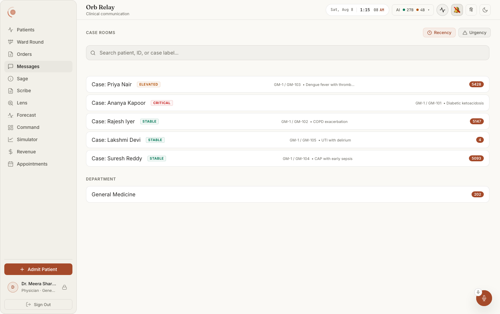
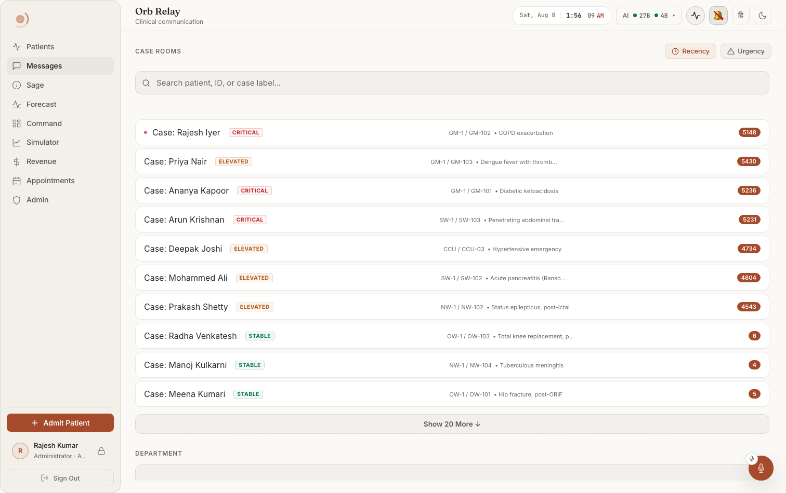

# Screen map 04: Relay: the channel list and alerts rail

**What this screen is.** The landing view of the Messages tab. It is a single scrolling
column: a sort header at the top, then an "Action Required" alerts rail, a search box, the
case-room list, and a Department list. Tapping any row swaps this whole view out for the
message thread (documented separately), the list and the thread are two branches of one
ternary, so nothing on this page survives into the thread.

**How to reach it.** Sidebar → **Messages** (nav id `relay`, label "Messages", pillar "Relay",
`src/pages/ClinicianShell.tsx:84`). The shell mounts the panel inside
`<div id="panel-relay" role="tabpanel">` at `src/pages/ClinicianShell.tsx:822-824`, wrapped in
`<PanelErrorBoundary label="relay">`. The panel is lazy-loaded
(`src/pages/ClinicianShell.tsx:477`) and, once mounted, is **never unmounted**, the shell
hides inactive tabs with `display: none`, which is why this panel polls rather than refetching
on mount.

**The one root element.** `<div className="relay-panel animate-fade-in">`, 
`src/pages/panels/RelayPanel.tsx:465`. The list view is the `!selectedChannel` branch,
`RelayPanel.tsx:466-508`. `animate-fade-in` is a 0.25s fade
(`src/index.css:497`); `.relay-panel` is a column flexbox that fills the panel area
(`src/pages/Relay.css:11-17`).

---

## What it looks like



**Notice the reading order inside a row**: the acuity chip sits immediately after the case
name (CRITICAL / ELEVATED / STABLE), the ward + bed + diagnosis strip is pushed right of it
in small grey text, and the count badge is hard right. The Department room ("General
Medicine") is a *separate* list below the case rooms under its own `DEPARTMENT` heading, 
not a row in the same list. Dark twin: `doc001-05-relay-dark.png`.



**Notice** how the same component becomes a different screen once the scope widens: ten
rooms across five wards, ordered by acuity, with a **Show 20 More ↓** button at the foot.
The two chips top-right (Recency / Urgency) are the only control over that order.

> The count badges in these captures read in the thousands (5428, 5147, 5093). Those are not
> plausible unread counts for a five-bed ward, treat them as suspect, and see
> [`docs/screenshots/INDEX.md`](../../screenshots/INDEX.md) before quoting them.

---

## Region 1: the sort header (top strip)

### "CASE ROOMS" heading

**Where:** Very top-left of the panel, above the scrolling area, on the same row as the two
sort chips.
**Rendered by:** `src/pages/panels/RelayPanel.tsx:469`, 
`<span className="orb-section-title">Case Rooms</span>`, inside
`<div className="relay-chat__sort-header">` (`RelayPanel.tsx:468`).
**Data from:** Nothing. Hard-coded English string; there is no i18n call anywhere in this panel.
**API:** None.
**Server:** None.
**Change this →** The words render **uppercase, small, muted and letter-spaced**, 
`.orb-section-title` applies `text-transform: uppercase`, `font-size: 0.75rem`,
`color: var(--text-muted)`, `letter-spacing: 0.07em` (`src/pages/ClinicianShell.css:608-614`).
So editing it to "Case rooms" changes nothing visible. It disappears only if you delete the
span. Note this heading is why the first `<CaseList>` below is passed `title=""`, see the
comment at `RelayPanel.tsx:493-494`; restoring a title there prints "CASE ROOMS" twice.

### "Recency" sort chip

**Where:** Top-right, the left of the two chips. A clock icon then the word "Recency".
**Rendered by:** `src/pages/panels/RelayPanel.tsx:471-478`. The clock is an inline 14×14 SVG
(circle + hour hand polyline) at `RelayPanel.tsx:476`. `title="Sort by Recency"` gives the
native browser tooltip.
**Data from:** `sortBy` state (`RelayPanel.tsx:45`, default `'recency'`). The chip's own
`onClick` sets it (`RelayPanel.tsx:473`). The class is
`` `sort-btn ${sortBy === 'recency' ? 'sort-btn--active' : ''}` ``.
**API:** None, sorting is entirely client-side.
**Server:** None. (The server *does* send an ordering, see "What the server orders by" below, 
but the client re-sorts and discards it for case rooms.)
**Change this →** When active the chip gets an accent tint: `background: var(--accent-glow)`,
`color: var(--accent-text)`, `border-color: var(--accent-glow-strong)`
(`src/pages/ClinicianShell.css:653-657`); inactive is `var(--bg-glass)` with muted text
(`ClinicianShell.css:632-644`). Clicking it re-orders **both** lists below by
`last_activity` newest-first (`RelayPanel.tsx:429-432` for case rooms,
`RelayPanel.tsx:456-460` for department). Rooms with no messages have `last_activity` null →
`new Date(0)` → they sink to the bottom. These chips are styled in `ClinicianShell.css`, not
`Relay.css`, deliberately: Vigil renders them too and `Relay.css` is inside a lazy chunk
(comment at `src/pages/Relay.css:111-113`).

### "Urgency" sort chip

**Where:** Top-right, immediately right of Recency. A warning-triangle icon then "Urgency".
**Rendered by:** `src/pages/panels/RelayPanel.tsx:479-486`; triangle SVG at
`RelayPanel.tsx:484`.
**Data from:** Same `sortBy` state; `onClick` sets `'urgency'` (`RelayPanel.tsx:481`).
**API:** None.
**Server:** None.
**Change this →** Case rooms re-sort by **`alert_count + unread_count`, highest first**, ties
broken by `last_activity` (`RelayPanel.tsx:434-440`). Concretely: a room with 3 unread and 1
alert (priority 4) jumps above a room that was messaged five seconds ago with everything read
(priority 0). **The Department list does not re-sort**, the `urgency` branch at
`RelayPanel.tsx:461` returns the unsorted list, so Department falls back to the order the
server sent (risk level, then `last_activity`, then name). That asymmetry is visible: switch to
Urgency and the top list reshuffles while the bottom one twitches into a different order and
then stays put.

---

## Region 2: the alerts rail ("Action Required")

Everything in this region comes from `src/components/relay/AlertsSection.tsx`, mounted at
`src/pages/panels/RelayPanel.tsx:490`:

```
<AlertsSection key={alertsKey} onSelectChannel={setSelectedChannel} channels={channels} />
```

The `key` is load-bearing. `alertsKey` is `channels.map(c => `${c.id}:${c.alert_count || 0}`).join('|')`
(`RelayPanel.tsx:449-452`). AlertsSection fetches **once per mount** (`useEffect(..., [])` at
`AlertsSection.tsx:15-17`), so changing the key remounts it and forces a refetch, which
happens exactly when a channel's alert count changes, not on every 30-second poll tick.

### "⚠️ ACTION REQUIRED" heading

**Where:** First thing inside the scrolling area, above the search box.
**Rendered by:** `src/components/relay/AlertsSection.tsx:70-72`, an `<h2 class="orb-section-title">`
containing `<span className="relay-alert-icon">⚠️</span>` then the text.
**Data from:** Nothing; it renders only if the whole section renders (see states below).
**API:** None directly.
**Server:** None.
**Change this →** Renders uppercase and muted (`orb-section-title`,
`src/pages/ClinicianShell.css:608-614`). The `relay-alert-icon` class has **no CSS rule
anywhere**, it is a bare emoji at inherited size. The entire heading vanishes when there are
no targeted alerts, because the component returns `null` before reaching it
(`AlertsSection.tsx:49`, `:66`).

### An alert row

**Where:** Directly under the Action Required heading, one full-width card per alert, stacked
with 6px gaps.
**Rendered by:** `src/components/relay/AlertsSection.tsx:95-108`, 
`<button className="relay-channel-item glass-card relay-alert-item">`.
**Data from:** The `alerts` state array (`AlertsSection.tsx:11`), set in `loadAlerts`
(`AlertsSection.tsx:24`), then passed through the surgery-id dedupe at
`AlertsSection.tsx:53-64`.
**API:** `GET /api/relay/alerts`, `getAlerts()` at `src/api/client.ts:782-784`.
**Server:** `list_alerts` at `server/routes/relay_routes.py:84-87`
(`Depends(require_permission("relay.read"))`) → `get_user_alerts(user["id"], user["role"])` at
`server/services/relay_service.py:570-641`.
**Change this →** The row is tinted red rather than neutral:
`border: 1px solid color-mix(... --status-danger 28% ...)` and
`background: color-mix(... --status-danger 10% ...)`, both `!important` to beat the base
`.relay-channel-item` hover (`src/components/relay/RelayComponents.css:8-15`); hover deepens to
45% / 16%. To make a row **disappear**: resolve or escalate the alert (the service skips
`status in ["resolved","escalated"]`, `relay_service.py:611-612`), let it age past 48 hours
(`relay_service.py:597`), or stop being one of its targets. To make one **appear**: post a
message with `message_type='alert'` whose JSON content sets `is_structured: true` and targets
you.

### The red pulsing dot on an alert row

**Where:** Left edge of each alert row, vertically centred, before the title.
**Rendered by:** `src/components/relay/AlertsSection.tsx:101`, 
`<span className="relay-channel-item__alert-dot relay-alert-dot--urgent" />`.
**Data from:** Nothing conditional, every alert row gets one.
**API / Server:** As the row above.
**Change this →** 8×8px (up from the base 6×6), solid `var(--status-danger)`, and it **pulses**
`animation: pulse-soft 2s ease-in-out infinite` inherited from
`src/pages/Relay.css:69-75`, with the size and colour overridden at
`src/components/relay/RelayComponents.css:18-22`. Removing the `relay-alert-dot--urgent` class
shrinks it back to 6px but keeps the pulse; removing both classes removes the dot entirely.

### The alert title

**Where:** The bold first line inside an alert row.
**Rendered by:** `src/components/relay/AlertsSection.tsx:103`, 
`<span className="relay-alert-title">{title}</span>`, where
`title = isStructured ? payload.title : 'Alert'` (`AlertsSection.tsx:83`).
**Data from:** `JSON.parse(alert.content).title` (`AlertsSection.tsx:77`).
**API:** `GET /api/relay/alerts`.
**Server:** `relay_service.py:626-635` returns the raw `content` column verbatim; the title is
whatever the alert's author put in the JSON. For surgical alerts that author is
`server/routes/surgery_routes.py` (the payload also carries `surgery_id`, `patient_id`,
`action_required`).
**Change this →** Renders 0.95rem, weight 700, `var(--text-primary)`
(`src/components/relay/RelayComponents.css:30-34`). The literal fallback string `'Alert'` is
effectively **dead**: `get_user_alerts` already skips any payload without `is_structured`
(`relay_service.py:609-610`), so a non-structured alert never reaches this component. If a row
ever does show the bare word "Alert", the server filter has been changed.

### The alert description line

**Where:** The smaller second line inside an alert row, under the title.
**Rendered by:** `src/components/relay/AlertsSection.tsx:104`, 
`<span className="relay-alert-desc">{desc}</span>`, where
`desc = isStructured ? payload.action_required : alert.content` (`AlertsSection.tsx:84`).
**Data from:** `payload.action_required` from the parsed alert JSON.
**API / Server:** As above.
**Change this →** 0.8rem, `var(--text-secondary)`, line-height 1.4
(`RelayComponents.css:36-40`). There is **no truncation and no line clamp**, a long
`action_required` string wraps and grows the row as tall as it needs. This is the same string
that reappears inside the thread's structured-alert card at `RelayPanel.tsx:651`.

### The "→" arrow on an alert row

**Where:** Far right of each alert row.
**Rendered by:** `src/components/relay/AlertsSection.tsx:107`, 
`<span className="relay-alert-arrow">→</span>`.
**Data from:** Nothing.
**API / Server:** None.
**Change this →** Coloured `var(--status-danger-text)`, the *text-safe* danger token, not the
fill token, at 1.2rem bold (`src/components/relay/RelayComponents.css:42-46`). It is a plain
text glyph, so changing `font-size` is the only way to resize it.

### Where an alert row takes you

**Where:** The whole row is one `<button>`; there is no separate link.
**Rendered by:** `onClick={() => onSelectChannel(targetChannelId)}` at
`src/components/relay/AlertsSection.tsx:98`; `onSelectChannel` is `setSelectedChannel`
(`RelayPanel.tsx:490`).
**Data from:** `targetChannelId` starts as `alert.channel_id` (`AlertsSection.tsx:86`) but is
**redirected to the patient's case room** when the payload carries a `patient_id` and a
matching case room exists in the `channels` prop (`AlertsSection.tsx:87-92`).
**API:** None on click. (The thread then loads via `GET /api/relay/channels/{id}/messages`.)
**Server:** The redirect target is only as good as the `channels` list, which is scoped by
`get_channels_for_user`, so an alert about a patient outside your department resolves to the
alert's own channel, not to a case room you cannot see.
**Change this →** Clicking replaces the entire list view with the thread
(`RelayPanel.tsx:466`). Because the list branch unmounts, **AlertsSection unmounts too**, and
remounts (refetching) when you press Back. That is the only reliable way the rail refreshes
after you act on an alert: resolving an alert rewrites the message's JSON `status` but leaves
`message_type='alert'`, so `alert_count`, and therefore `alertsKey`, does not change, and a
resolved alert keeps sitting in the rail until you navigate into a room and back (or the app
reloads).

### Alerts rail: loading state

**Where:** Where the Action Required block would be.
**Rendered by:** `src/components/relay/AlertsSection.tsx:33`, `if (loading) return null;`
**Data from:** `loading` state, `true` on mount (`AlertsSection.tsx:12`), cleared in the
`finally` of `loadAlerts` (`AlertsSection.tsx:29-30`).
**Change this →** **Nothing is drawn**, no spinner, no skeleton. The search box sits directly
under the sort header until the fetch returns, then the rail pops in above it and pushes
everything down. Every remount (i.e. every change to `alertsKey`) replays that pop.

### Alerts rail: failure state ("Alerts could not be loaded.")

**Where:** In place of the whole Action Required block.
**Rendered by:** `src/components/relay/AlertsSection.tsx:34-48`, a `<p>` at 0.85rem,
`var(--text-muted)`, inside `<div className="orb-section relay-alerts-section">`.
**Data from:** `loadError` state (`AlertsSection.tsx:13`), set `true` in the `catch` at
`AlertsSection.tsx:25-27` (which also logs `[Relay] Failed to load alerts:`).
**API:** Any non-2xx from `GET /api/relay/alerts`.
**Server:** A 403 here means the caller lacks `relay.read`
(`server/routes/relay_routes.py:85`, `server/permissions.py:385+`); the denial is written to
the audit chain before the 403 is raised.
**Change this →** The clinician sees one muted sentence and an underlined **Retry** link
(`AlertsSection.tsx:39-44`, inline-styled as a borderless button with
`text-decoration: underline`, `color: var(--text-secondary)`). Retry calls `loadAlerts` again,
which first flips back to the loading state, so the sentence disappears for a beat and returns
if the call fails again. Note the message deliberately does not say *why*; the error text is
console-only.

### Alerts rail: empty state

**Where:** Nowhere, the block is absent.
**Rendered by:** Two early returns: `AlertsSection.tsx:49` (`alerts.length === 0`) and
`AlertsSection.tsx:66` (everything was removed by the dedupe).
**Data from:** An empty array from `GET /api/relay/alerts`.
**Change this →** No "no alerts" reassurance is ever shown. On a quiet ward the screen opens
straight onto the search box. If you want an all-clear line, it goes at
`AlertsSection.tsx:49`.

### The de-duplication that hides rows

**Where:** Invisible, but it changes what you see.
**Rendered by:** `src/components/relay/AlertsSection.tsx:51-64`.
**Data from:** `JSON.parse(alert.content).surgery_id`, the first alert for a given
`surgery_id` wins, the rest are dropped.
**Change this →** The same surgical alert is posted into both the department channel and the
case room; without this filter the rail shows it **twice**. Rows whose content fails to parse
are kept (the `catch` at `AlertsSection.tsx:60-63` logs and falls through to `return true`).

---

## Region 3: search

All of this is `src/components/relay/RelaySearch.tsx`, mounted at
`src/pages/panels/RelayPanel.tsx:491` as `<RelaySearch onSearch={setSearchQuery} />`.

### The search field

**Where:** Between the alerts rail and the case-room list, full width.
**Rendered by:** `src/components/relay/RelaySearch.tsx:26-32`, an `<input type="text">` inside
`<div className="relay-search-input-wrapper glass">` (`RelaySearch.tsx:21`), inside
`.relay-search-container` (`RelaySearch.tsx:20`).
**Data from:** Local `query` state (`RelaySearch.tsx:9`), updated `onChange`
(`RelaySearch.tsx:31`). It is pushed up to the panel through a **150 ms debounce**
(`RelaySearch.tsx:12-17`) into `searchQuery` (`RelayPanel.tsx:46`).
**API:** None, this filters the already-loaded array.
**Server:** None.
**Change this →** Typing narrows the **case-room list only** after ~150 ms. The filter is
case-insensitive `includes` over four fields: `name`, `patient_id`, `mrn`, `diagnosis`
(`RelayPanel.tsx:419-427`). The **Department list is not filtered at all**, `deptChannels`
(`RelayPanel.tsx:454-462`) never reads `searchQuery`, so typing a patient name leaves every
department channel on screen. Filtering to zero matches swaps the list for the
"No case rooms found." empty state.

### The search placeholder

**Where:** Grey text inside the empty field.
**Rendered by:** `src/components/relay/RelaySearch.tsx:29`, 
`placeholder="Search patient, ID, or case label..."`.
**Change this →** Coloured `var(--text-muted)`
(`src/components/relay/RelayComponents.css:83-85`). It disappears on the first keystroke. The
wording under-sells the filter, `mrn` and `diagnosis` are searched too
(`RelayPanel.tsx:423-425`).

### The magnifier icon

**Where:** Left inside the search field.
**Rendered by:** `src/components/relay/RelaySearch.tsx:22-25`, inline 16×16 SVG (circle +
diagonal line).
**Change this →** `color: var(--text-muted)`, `flex-shrink: 0`
(`RelayComponents.css:69-72`), so it never squashes as the field narrows. It is decorative and
non-interactive, clicking it does not focus the input.

### The clear (×) button

**Where:** Right inside the search field. **Only present while the field has text.**
**Rendered by:** `src/components/relay/RelaySearch.tsx:33-37`, guarded by `{query && ...}`.
**Data from:** The same local `query` state; `onClick` sets it to `''`.
**Change this →** A 24×24 circular hit area, muted, that fills with `var(--bg-glass-hover)`
and brightens to `var(--text-primary)` on hover (`RelayComponents.css:87-100`). Pressing it
empties the field, and 150 ms later the full case-room list returns. It vanishes the instant
the field is empty.

### The field's focus ring

**Where:** The whole search field.
**Rendered by:** `.relay-search-input-wrapper:focus-within`
(`src/components/relay/RelayComponents.css:64-67`).
**Change this →** The **wrapper**, not the input, owns the focus indicator: the border becomes
`var(--border-focus)` and the fill lifts to `var(--bg-glass-hover)`. The input itself has
`outline: none` (`RelayComponents.css:81`), deleting the `:focus-within` rule leaves keyboard
users with no visible focus at all.

---

## Region 4: the case-room list

Rendered by `src/components/relay/CaseList.tsx`, mounted twice. First instance
(`RelayPanel.tsx:495-499`): `title=""`, `channels={caseRooms}`, default empty message. Second
instance (`RelayPanel.tsx:501-506`): `title="Department"`, `channels={deptChannels}`,
`emptyMessage="No department channels found."`.

### A channel row

**Where:** The main body of the screen, full-width cards stacked 6px apart, under the search
box (case rooms) and under the "DEPARTMENT" heading (department channels).
**Rendered by:** `src/components/relay/CaseList.tsx:39`, 
`<button key={ch.id} className="relay-channel-item glass-card" onClick={() => onSelectChannel(ch.id)}>`.
**Data from:** `visibleChannels` (`CaseList.tsx:20`), a slice of the `channels` prop, which is
`caseRooms` / `deptChannels` derived from the panel's `channels` state
(`RelayPanel.tsx:34`). `channels` is set in exactly two places: `loadChannels`
(`RelayPanel.tsx:205-207`) and the optimistic unread-zeroing in `loadMessages`
(`RelayPanel.tsx:244`).
**API:** `GET /api/relay/channels`, `getChannels()` at `src/api/client.ts:778-780`.
**Server:** `list_channels` at `server/routes/relay_routes.py:78-81` →
`get_channels_for_user(user["id"], user["role"])` at
`server/services/relay_service.py:12-224`.
**Change this →** The row is a flex bar, `padding: 14px 16px`, name-block left and unread badge
right (`src/pages/Relay.css:44-55`), on the `glass-card` surface, flat
`var(--bg-surface)` with a hairline `var(--border-subtle)` and `--radius-lg`
(`src/index.css:379-386`). Hover changes the **fill only** (`var(--bg-glass-hover)`,
`Relay.css:58-60`) and the border (`index.css:390-392`); nothing lifts or glows, that is the
"Quiet Clinical" rule. Clicking swaps the whole screen for the thread. A row disappears when
the server stops returning it: patient discharged (`relay_service.py:109-110`), case room with no
patient and no messages (`relay_service.py:105-106`), a department that no longer matches yours
(`relay_service.py:111-119`), or a DM you were removed from (`relay_service.py:189-190`).

### The red pulsing dot on a channel row

**Where:** Leftmost item in the row, before the channel name. Absent on most rows.
**Rendered by:** `src/components/relay/CaseList.tsx:41`, 
`{ch.has_alert && <span className="relay-channel-item__alert-dot" />}`.
**Data from:** `ch.has_alert` (`Channel` interface, `src/api/client.ts:670`).
**API:** `GET /api/relay/channels`.
**Server:** `server/services/relay_service.py:221`, `"has_alert": (r["alert_count"] or 0) > 0`,
where `alert_count` is the subquery at `relay_service.py:62-73`: messages in this channel with
`message_type = 'alert'` and `timestamp > datetime('now', '-24 hours')`.
**Change this →** A 6×6 `var(--status-danger)` circle that **pulses on a 2s loop**
(`src/pages/Relay.css:69-75`). Its presence shifts the name 10px right (the info row's `gap`,
`Relay.css:62-66`). It **disappears 24 hours after the last alert message**, whether or not
anyone acted on the alert, resolving an alert does not clear this dot, because resolution
rewrites the message content, not its `message_type`. Widening the `-24 hours` window in
`relay_service.py:72` makes dots persist longer on the list.

### The channel name

**Where:** The main line of the row, after the alert dot.
**Rendered by:** `src/components/relay/CaseList.tsx:42`, 
`<span className="relay-channel-item__name">{ch.name}</span>`.
**Data from:** `ch.name` → `relay_service.py:208`, the `channels.name` column.
**API:** `GET /api/relay/channels`.
**Server:** `get_channels_for_user`, `server/services/relay_service.py:12-224`.
**Change this →** 1rem, weight **400** (`src/pages/Relay.css:77-80`), deliberately not bold;
the row's emphasis comes from the badge and the risk chip, not the name. There is no truncation
rule on it, so a very long room name wraps and makes the row taller. It is also the string the
search box matches first (`RelayPanel.tsx:422`).

### The risk chip: "CRITICAL" / "ELEVATED" / "STABLE"

**Where:** Immediately right of the channel name, on the same line, a small outlined pill.
**Rendered by:** `src/components/relay/CaseList.tsx:43-50`. The label is computed at
`CaseList.tsx:34-36` and the colour at `CaseList.tsx:31-33`.
**Data from:** `ch.risk_level` (`src/api/client.ts:665`, typed
`'critical' | 'elevated' | 'stable'`).
**API:** `GET /api/relay/channels`.
**Server:** `relay_service.py:214` reads `rs.level` from the LEFT JOIN at
`relay_service.py:88-92`, the **latest** `risk_scores` row per patient
(`WHERE id IN (SELECT MAX(id) FROM risk_scores GROUP BY patient_id)`).
**Change this →** Three outcomes, and they are colour-coded by token:
`critical` → `var(--status-danger)`, `elevated` → `var(--status-warn)`, **anything else
truthy** → the label "STABLE" in `var(--status-ok)`. All three render as
`fontSize: 0.65rem`, `fontWeight: 700`, `letterSpacing: 0.5px`, with a 20%-mix border and a
5%-mix background of that same colour (`CaseList.tsx:44-49`). The chip **disappears entirely**
when `risk_level` is null/empty, `riskLabel` is `null` and the `{riskLabel && ...}` guard at
`CaseList.tsx:43` skips it. That is what a patient with no risk score, or a department channel
(no patient at all), looks like: name, nothing after it. Note the label text is *derived*, not
sent, the server sends `'stable'` lowercase and the component uppercases it as a literal.

### The ward / bed line

**Where:** Second line of the row, small and muted, under the name.
**Rendered by:** `src/components/relay/CaseList.tsx:53-57`, inside the flex row opened at
`CaseList.tsx:52`. Renders `ward`, plus ` / bed` only when `bed` is set.
**Data from:** `(ch as any).ward` and `(ch as any).bed`. These *are* declared on the `Channel`
interface (`src/api/client.ts:662-663`), the `as any` casts are unnecessary but harmless.
**API:** `GET /api/relay/channels`.
**Server:** `relay_service.py:213-214` ← `p.ward`, `p.bed` from the
`LEFT JOIN patients p ON c.patient_id = p.id` (`relay_service.py:87`).
**Change this →** 0.7rem `var(--text-muted)`. It renders as e.g. `GM-1 / 4`. It **disappears**
when `ward` is falsy, including for every department channel, which has no patient join. Do
not confuse `ward` with department: `ward` is a bed prefix like "GM-1" while department is a
name like "General Medicine", and that difference is exactly what broke case-room scoping once
(see the comment at `relay_service.py:162-167`).

### The diagnosis line

**Where:** Same second line, to the right of ward/bed, prefixed with a bullet: `• Sepsis`.
**Rendered by:** `src/components/relay/CaseList.tsx:58-63`.
**Data from:** `ch.diagnosis` (`src/api/client.ts:661`).
**API:** `GET /api/relay/channels`.
**Server:** `relay_service.py:212` ← `p.diagnosis` from the patients join.
**Change this →** This one **is** clamped: `maxWidth: 160`, `overflow: hidden`,
`textOverflow: 'ellipsis'`, `whiteSpace: 'nowrap'` (`CaseList.tsx:61`), a long diagnosis
truncates with "…" at 160px rather than wrapping. Raising `maxWidth` lets more text through and
can push the row onto a second line (the parent has `flexWrap: 'wrap'`, `CaseList.tsx:52`). It
disappears when `diagnosis` is null. It is also searchable (`RelayPanel.tsx:425`).

### The unread badge

**Where:** Far right of the row, vertically centred, a filled pill with a number.
**Rendered by:** `src/components/relay/CaseList.tsx:68-75`, guarded by `ch.unread_count > 0`.
**Data from:** `ch.unread_count` (`src/api/client.ts:666`).
**API:** `GET /api/relay/channels`; cleared by `POST /api/relay/channels/{id}/read`
(`markChannelRead`, `src/api/client.ts:798-800`).
**Server:** The count is the correlated subquery at `server/services/relay_service.py:55-58`:
messages in this channel where `m.sender_id != <me>` **and** `read_by NOT LIKE '%<me>%'`.
Clearing is `mark_read` at `server/routes/relay_routes.py:101-110` →
`mark_channel_read(channel_id, user_id)` at `server/services/relay_service.py:748-789`, which
appends the user id to each message's `read_by` JSON array.
**Change this →** `font-size: 0.7rem`, weight 600, `padding: 2px 8px`, filled
`var(--accent-deep)` with `var(--btn-primary-text)` text and a full radius
(`src/pages/Relay.css:82-89`). **Capped at "99+"** (`CaseList.tsx:73`), the exact number is
still available as the native tooltip, `title={`${ch.unread_count} unread`}`
(`CaseList.tsx:71`). It **disappears the moment you open the room**: `loadMessages`
optimistically rewrites that channel's `unread_count` to 0 in local state
(`RelayPanel.tsx:244`) before the server call, then persists it fire-and-forget
(`RelayPanel.tsx:245`), so if `markChannelRead` fails, the badge is gone until the next
30-second poll brings it back. Your own posts never count (the `sender_id != ?` clause); that
clause is what stopped rooms displaying 5,000+ unread (comment at `relay_service.py:48-54`).
Because the badge also feeds the Urgency sort (`RelayPanel.tsx:436-437`), clearing it can make
the row drop down the list while you are looking at it.

### "Show N More ↓" / "Show Less ↑"

**Where:** A full-width dashed button at the bottom of a list, only when that list has more
than 10 channels.
**Rendered by:** `src/components/relay/CaseList.tsx:80-87`, guarded by `isTruncated`
(`CaseList.tsx:17`, `channels.length > DEFAULT_LIMIT` with `DEFAULT_LIMIT = 10` at
`CaseList.tsx:16`). Label text at `CaseList.tsx:85`.
**Data from:** Local `expanded` state (`CaseList.tsx:13`), which drives the slice at
`CaseList.tsx:20`.
**API / Server:** None, every channel is already in memory; this is pure truncation.
**Change this →** Renders as a **dashed** outline button (`border: 1px dashed
var(--border-glass)`, `src/components/relay/RelayComponents.css:103-115`) that fills and
brightens on hover. The label counts the hidden rows: 14 channels reads "Show 4 More ↓".
Pressing it reveals the rest and flips the label to "Show Less ↑". **It resets to collapsed
whenever you open a room and come back**, selecting a channel unmounts the whole list branch
(`RelayPanel.tsx:466`), destroying this local state. Each list has its own independent
`expanded` (two component instances), so expanding case rooms does not expand Department.

### Case-room list: empty state ("No case rooms found.")

**Where:** In place of the list, a dashed box with centred muted text.
**Rendered by:** `src/components/relay/CaseList.tsx:26-27`, 
`<div className="relay-empty-state">{emptyMessage}</div>`. The default string is the parameter
default at `CaseList.tsx:12`.
**Data from:** `channels.length === 0` on the filtered `caseRooms` array.
**Change this →** 32px vertical padding, centred, `var(--text-muted)`, dashed
`var(--border-glass)` border on `var(--bg-glass)`
(`src/components/relay/RelayComponents.css:123-131`). Three different situations produce this
identical box and the screen does not distinguish them: (1) the very first render before
`getChannels` resolves, `channels` starts as `[]` (`RelayPanel.tsx:34`) and there is **no
loading state for the channel list at all**; (2) `getChannels` **failed**, `loadChannels`
swallows the error into `console.error` (`RelayPanel.tsx:206`) and leaves `channels` empty, so
a 403 or a dead server looks exactly like an empty ward; (3) the search query matched nothing.
If you want a distinguishable failure, `RelayPanel.tsx:206` is the line to change.

### "DEPARTMENT" heading

**Where:** Below the case-room list, above the department channels.
**Rendered by:** `src/components/relay/CaseList.tsx:24`, 
`{title && <span className="orb-section-title">{title}</span>}`, with `title="Department"`
passed at `RelayPanel.tsx:502`.
**Change this →** Uppercase, muted, letter-spaced (`ClinicianShell.css:608-614`). It renders
**even when the department list is empty**, the `title &&` guard is outside the
`channels.length === 0` branch, so on a screen with no department channels you get the heading
followed by the "No department channels found." box. Passing `title=""` (as the case-room
instance does, `RelayPanel.tsx:496`) removes it.

### Department list: empty state ("No department channels found.")

**Where:** Under the DEPARTMENT heading.
**Rendered by:** `src/components/relay/CaseList.tsx:26-27` with `emptyMessage` supplied at
`RelayPanel.tsx:505`.
**Server:** Department visibility is decided at `server/services/relay_service.py:111-119`, the
channel name is matched against `users.department`, case-insensitively, by substring in either
direction, plus two explicit special cases: `surgery` sees `Surgery`, and `anesthesiology` also
sees `Surgery`. `admin` skips the branch and sees them all.
**Change this →** A clinician whose `users.department` is empty sees this box and **no
department channels at all**, the `elif` chain at `relay_service.py:113-119` has no fallback
branch. (Contrast with case rooms, where an empty department means *unscoped* and shows
everything, `relay_service.py:143-147`.)

---

## The scroll container

**Where:** Everything below the sort header.
**Rendered by:** `src/pages/panels/RelayPanel.tsx:489`, 
`<div className="relay-panel__channel-scroll">`.
**Change this →** `flex: 1; overflow-y: auto` with a **28px gap** between the four children
(alerts rail, search, case list, department list) and `padding-right: 4px` so the scrollbar
does not sit on the cards (`src/pages/Relay.css:27-34`). The sort header is *outside* it and
therefore does not scroll away. Changing `gap` here changes the spacing between all four
regions at once.

---

## The alert Confirm / Escalate buttons

These are what an alert row leads to. They render in the **thread**, on the structured-alert
card, not on the list screen, the alerts rail itself has no action buttons, only navigation.
Documented here because they are the other half of the alert loop.

### "Confirm" / "Escalate" on a structured alert

**Where:** Inside the message thread, at the bottom of a structured alert card.
**Rendered by:** `src/pages/panels/RelayPanel.tsx:661-674` (Confirm at `:661-667`, Escalate at
`:668-674`), inside the `payload.status ? ... : ...` ternary at `RelayPanel.tsx:654`.
**Data from:** `resolvingAlertId` state (`RelayPanel.tsx:51`) drives the disabled/busy styling;
`handleResolveAlert` (`RelayPanel.tsx:368-386`) sets it.
**API:** `POST /api/relay/alerts/{message_id}/resolve` with `{action: 'confirm'|'escalate'}`, 
`resolveAlert()` at `src/api/client.ts:786-791`.
**Server:** `resolve_alert` at `server/routes/relay_routes.py:1200-1222`
(`Depends(require_permission("relay.send"))`) → `_apply_alert_resolution` at
`server/routes/relay_routes.py:1110-1152`, which re-checks
`can_access_channel(user["id"], user["role"], channel_id)`
(`relay_routes.py:1125-1126`), rejects an already-processed alert
(`relay_routes.py:1121-1122`), and writes with a **compare-and-swap** on the exact content it
read (`relay_routes.py:1138-1143`) so two clinicians racing cannot overwrite each other. It
then emits `message:update` into the channel room (`relay_routes.py:1220`).
**Change this →** While a resolve is in flight both buttons go disabled, Confirm's fill becomes
`var(--btn-disabled-bg)` and the cursor becomes `wait`. On success the panel reloads the thread
(`RelayPanel.tsx:379`) and the two buttons are **replaced** by a green line reading
`✓ Confirmed by <name>` or `✓ Escalated by <name>` (`RelayPanel.tsx:654-657`), because
`payload.status` is now set. Everyone else in the room sees the same swap live, via the
`message:update` socket event handled at `RelayPanel.tsx:135-137`. The alert also leaves the
Action Required rail (server-side filter, `relay_service.py:611-612`), but only after the rail
refetches, which for a resolve performed inside the thread means when you press Back.

### Alert failure line

**Where:** Directly under the Confirm/Escalate pair.
**Rendered by:** `src/pages/panels/RelayPanel.tsx:676-680`, keyed by message id in
`alertErrors` (`RelayPanel.tsx:52`).
**Data from:** The rejected promise's message, stored at `RelayPanel.tsx:382`.
**Change this →** A red-tinted strip: `color-mix(... --status-danger 10% ...)` background,
`var(--status-danger)` text, 2px danger left border. The most common text is
**"Alert already processed"**, the 400 raised at `relay_routes.py:1122` or `:1143` when
someone else got there first. The buttons re-enable, so the clinician can see what happened
rather than watching a dead button.

---

## Which channels a user sees at all: the access-control boundary

**The single function that decides:**
`get_channels_for_user(user_id, user_role)`, `server/services/relay_service.py:12-224`.

This is not a sidebar query. Its own docstring says so (`relay_service.py:15-20`): every read
of Relay message content authorises by asking whether the channel appears in this list.

- **REST, per-channel:** `can_access_channel(user_id, user_role, channel_id)` at
  `server/services/relay_service.py:257-267` is defined *in terms of* the list, it is the
  named single-channel form, deliberately not a second SELECT. Used at
  `relay_routes.py:96-97` (messages), `:107-108` (mark read), `:1125-1126` (alert resolve).
- **Websocket:** `_user_can_access_channel` at `server/ws/realtime.py:678-692` calls the same
  function through `run_db`, so socket room membership matches HTTP visibility
  (`realtime.py:704-709` denies `join_channel`).
- **The second door:** `get_user_alerts` at `server/services/relay_service.py:570-641` is a
  message-read path that does **not** go through the list, it scans every alert row in the
  hospital. It re-applies the DM membership rule itself (`relay_service.py:598-600`) so a
  private conversation cannot be read out through the alerts rail.

**The rule per channel type** (`relay_service.py:22-28`, enforced at `:111-203`):

| Type | Rule | Line |
|---|---|---|
| `department` | Channel name matched against `users.department`, substring either direction, case-insensitive; `surgery`/`anesthesiology` both see `Surgery`; `admin` sees all | `relay_service.py:111-119` |
| `case_room` | `admissions.department` (active admission) must equal the user's department; a room whose department is **not derivable** stays visible; empty user department or `admin` = unscoped | `relay_service.py:138-170` |
| `direct` | Explicit rows in `channel_members` only. **No admin bypass**, an administrator must be added to the thread on the record | `relay_service.py:172-190` |
| anything else | **Withheld**, with a warning log, fail closed | `relay_service.py:192-203` |

Case rooms are additionally dropped when the patient is `discharged`
(`relay_service.py:109-110`) or when the room has neither a patient nor any messages
(`relay_service.py:105-106`).

**Who can open the screen at all.** Both list endpoints require `relay.read`
(`relay_routes.py:79`, `:85`); resolving an alert requires `relay.send`
(`relay_routes.py:1204`). `relay.read` + `relay.send` are granted to `doctor` (and its alias
`clinician`), `nurse` and `admin`, and **not** to `pharmacist` or `patient`
(`server/permissions.py:110`, `:125`, `:146`, `:158-165`). The tab is also hidden for those
roles client-side (`src/pages/ClinicianShell.tsx:393-396`, pharmacist gets
`['helix','pharmacy-verify','sage']`), so a pharmacist never sees a Messages tab; the 403 is
the backstop, not the UX.

**What a lack of permission looks like on this screen:** the alerts rail shows
"Alerts could not be loaded." with a Retry link, and the channel lists show their ordinary
empty states, because `loadChannels` swallows the 403 (`RelayPanel.tsx:206`). Nothing says
"you are not allowed".

---

## How the list stays current

**Where:** Invisible; it is why numbers change without you doing anything.
**Rendered by:** `useVisiblePolling(loadChannels, 30000)`, `src/pages/panels/RelayPanel.tsx:215`,
hook at `src/hooks/useVisiblePolling.ts:18-60`.
**Change this →** Every 30 seconds the whole channel list refetches, so unread badges, risk
chips, alert dots and the ordering all update in place. Polling **stops while the browser tab
is hidden** and fires an immediate refresh when you come back
(`useVisiblePolling.ts:43-51`), so switching away and back visibly snaps the list to current.
There is no socket push for the list: the server emits `message:new` only into channel rooms,
which a client joins only while that room is open (comment at `RelayPanel.tsx:209-214`). Also
note pressing Back from a thread calls `loadChannels()` immediately
(`RelayPanel.tsx:515`), that is why the list looks refreshed the instant you return.

### What the server orders by (and why you rarely see it)

`get_channels_for_user` returns rows ordered `critical → elevated → everything else`, then
`last_activity DESC NULLS LAST`, then `c.name` (`server/services/relay_service.py:95-100`). The
client then re-sorts both lists (`RelayPanel.tsx:429-441`, `:456-460`), so this ordering is
**only ever visible in the Department list while "Urgency" is selected**, the one branch that
returns the array untouched (`RelayPanel.tsx:461`).

---

## Fields the server sends that this screen never draws

Worth knowing before you go looking for them:

- **`last_message`**, computed at `relay_service.py:59-61` (the newest message's content) and
  typed at `src/api/client.ts:667`, but **no component renders it**. There is no message
  preview under a channel name on this screen. It is used server-side only, to decide whether
  an orphaned case room should be dropped (`relay_service.py:105-106`).
- **`last_activity`**, `relay_service.py:74-75`, typed at `client.ts:668`. Used only as the
  **sort key** (`RelayPanel.tsx:431`, `:439`, `:458`). **No timestamp is displayed on a channel
  row**, timestamps appear only inside a thread (`formatTime`, `RelayPanel.tsx:23-25`).
- **`alert_count`**, `relay_service.py:62-73`, typed at `client.ts:669`. Never printed as a
  number. It contributes to the Urgency sort (`RelayPanel.tsx:436-437`) and to the `alertsKey`
  remount trigger (`RelayPanel.tsx:449-452`); its only visual expression is the boolean
  `has_alert` dot.
- **`risk_score`** (the numeric score, `relay_service.py:213`, `client.ts:664`), only the
  `risk_level` band is shown, never the number.
- **`patient_id`** and **`mrn`** (`relay_service.py:210-211`), not displayed on a row; `mrn`
  and `patient_id` are searched (`RelayPanel.tsx:423-424`), and `patient_id` decides whether
  the Sage sidebar appears in the thread (`RelayPanel.tsx:740-742`).

Adding any of these to a row is a change in `src/components/relay/CaseList.tsx` alone, the
data is already on the client.

---

## Reverse map contributions

- `src/pages/panels/RelayPanel.tsx::RelayPanel` → Relay panel root (fade-in container); "CASE ROOMS" sort-header heading; Recency sort chip; Urgency sort chip; channel scroll container; alerts rail mount point and remount key; search mount point; case-room list mount point; Department list mount point; Confirm button on a structured alert; Escalate button on a structured alert; alert resolved line ("✓ Confirmed/Escalated by …"); alert inline failure line
- `src/pages/panels/RelayPanel.tsx::loadChannels` → channel row; channel name; risk chip; ward/bed line; diagnosis line; unread badge; red alert dot on a channel row; case-room empty state; department empty state
- `src/pages/panels/RelayPanel.tsx::loadMessages` → unread badge (optimistic clear on open)
- `src/pages/panels/RelayPanel.tsx::caseRooms` → case-room list ordering; case-room search filtering; case-room empty state
- `src/pages/panels/RelayPanel.tsx::deptChannels` → Department list ordering
- `src/pages/panels/RelayPanel.tsx::alertsKey` → alerts rail refresh/remount behaviour
- `src/pages/panels/RelayPanel.tsx::handleResolveAlert` → Confirm button; Escalate button; alert inline failure line
- `src/components/relay/CaseList.tsx::CaseList` → channel row; red alert dot on a channel row; channel name; risk chip (CRITICAL/ELEVATED/STABLE); ward/bed line; diagnosis line; unread badge; "Show N More ↓" / "Show Less ↑" button; "No case rooms found." empty state; "No department channels found." empty state; "DEPARTMENT" section heading
- `src/components/relay/AlertsSection.tsx::AlertsSection` → "⚠️ ACTION REQUIRED" heading; alert row; urgent pulsing dot; alert title; alert description; "→" arrow; alerts loading state (renders nothing); "Alerts could not be loaded." message; alerts Retry link; alerts empty state (renders nothing); alert-row navigation target
- `src/components/relay/AlertsSection.tsx::loadAlerts` → alert row; alert title; alert description; "Alerts could not be loaded." message
- `src/components/relay/RelaySearch.tsx::RelaySearch` → search field; search placeholder; magnifier icon; clear (×) button; search focus ring
- `src/components/relay/RelayComponents.css::.relay-alert-item` → alert row (red tint and hover)
- `src/components/relay/RelayComponents.css::.relay-alert-dot--urgent` → urgent pulsing dot on an alert row
- `src/components/relay/RelayComponents.css::.relay-alert-title` → alert title
- `src/components/relay/RelayComponents.css::.relay-alert-desc` → alert description
- `src/components/relay/RelayComponents.css::.relay-alert-arrow` → "→" arrow on an alert row
- `src/components/relay/RelayComponents.css::.relay-search-input-wrapper` → search field; search focus ring
- `src/components/relay/RelayComponents.css::.relay-search-icon` → magnifier icon
- `src/components/relay/RelayComponents.css::.relay-search-input` → search field text; search placeholder
- `src/components/relay/RelayComponents.css::.relay-search-clear` → clear (×) button
- `src/components/relay/RelayComponents.css::.relay-expand-btn` → "Show N More ↓" / "Show Less ↑" button
- `src/components/relay/RelayComponents.css::.relay-empty-state` → "No case rooms found." empty state; "No department channels found." empty state
- `src/pages/Relay.css::.relay-panel` → Relay panel root
- `src/pages/Relay.css::.relay-panel__channel-scroll` → channel scroll container (28px region gaps)
- `src/pages/Relay.css::.relay-channel-list` → channel row stacking; alert row stacking
- `src/pages/Relay.css::.relay-channel-item` → channel row; alert row (base layout and hover fill)
- `src/pages/Relay.css::.relay-channel-item__alert-dot` → red pulsing dot on a channel row; urgent dot on an alert row (base)
- `src/pages/Relay.css::.relay-channel-item__name` → channel name
- `src/pages/Relay.css::.relay-channel-item__badge` → unread badge
- `src/pages/Relay.css::.relay-chat__sort-header` → sort header strip
- `src/pages/ClinicianShell.css::.orb-section-title` → "CASE ROOMS" heading; "DEPARTMENT" heading; "⚠️ ACTION REQUIRED" heading
- `src/pages/ClinicianShell.css::.sort-btn` → Recency sort chip; Urgency sort chip
- `src/pages/ClinicianShell.css::.sort-btn--active` → active state of the Recency/Urgency chips
- `src/pages/ClinicianShell.css::.relay-chat__sort-controls` → sort chip pair layout
- `src/pages/ClinicianShell.tsx::getAccessibleTabs` → whether the Messages tab (and therefore this whole screen) exists for the signed-in role
- `src/pages/ClinicianShell.tsx::ClinicianShell` → Messages nav item and icon; the `panel-relay` tabpanel wrapper that keeps this screen mounted
- `src/index.css::.glass-card` → channel row surface; alert row surface
- `src/index.css::.animate-fade-in` → Relay panel entry fade
- `src/index.css::@keyframes pulse-soft` → pulsing of the channel alert dot and the urgent alert dot
- `src/api/client.ts::getChannels` → channel row; channel name; risk chip; ward/bed line; diagnosis line; unread badge; red alert dot on a channel row
- `src/api/client.ts::getAlerts` → alert row; alert title; alert description; urgent dot; "→" arrow
- `src/api/client.ts::markChannelRead` → unread badge (persisted clear)
- `src/api/client.ts::resolveAlert` → Confirm button; Escalate button; alert resolved line
- `src/api/client.ts::apiFetch` → "Alerts could not be loaded." message; alert inline failure line; silent-empty channel lists on failure
- `src/hooks/useVisiblePolling.ts::useVisiblePolling` → unread badge refresh; red alert dot refresh; risk chip refresh; channel row ordering refresh
- `server/routes/relay_routes.py::list_channels` → channel row; channel name; risk chip; ward/bed line; diagnosis line; unread badge; red alert dot on a channel row
- `server/routes/relay_routes.py::list_alerts` → alert row; alert title; alert description; urgent dot; "→" arrow
- `server/routes/relay_routes.py::mark_read` → unread badge (clearing)
- `server/routes/relay_routes.py::resolve_alert` → Confirm button; Escalate button; alert resolved line; removal of an alert row from the rail
- `server/routes/relay_routes.py::_apply_alert_resolution` → alert resolved line; "Alert already processed" inline failure line
- `server/services/relay_service.py::get_channels_for_user` → which channel rows exist at all; channel name; risk chip; ward/bed line; diagnosis line; unread badge; red alert dot on a channel row; case-room empty state; department empty state; Department list ordering under Urgency
- `server/services/relay_service.py::get_user_alerts` → alert row; alert title; alert description; alerts empty state
- `server/services/relay_service.py::mark_channel_read` → unread badge (clearing)
- `server/services/relay_service.py::can_access_channel` → whether an alert row or channel row can be opened at all
- `server/permissions.py::ROLE_PERMISSIONS` → whether the channel lists and the alerts rail load at all; "Alerts could not be loaded." message for a role without relay.read
- `server/permissions.py::require_permission` → 403 behind the "Alerts could not be loaded." message and the silently empty channel lists
- `server/ws/realtime.py::_user_can_access_channel` → whether opening a channel row yields live messages (socket room join)
