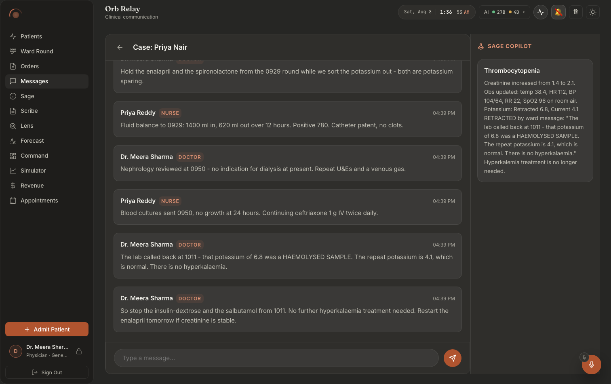
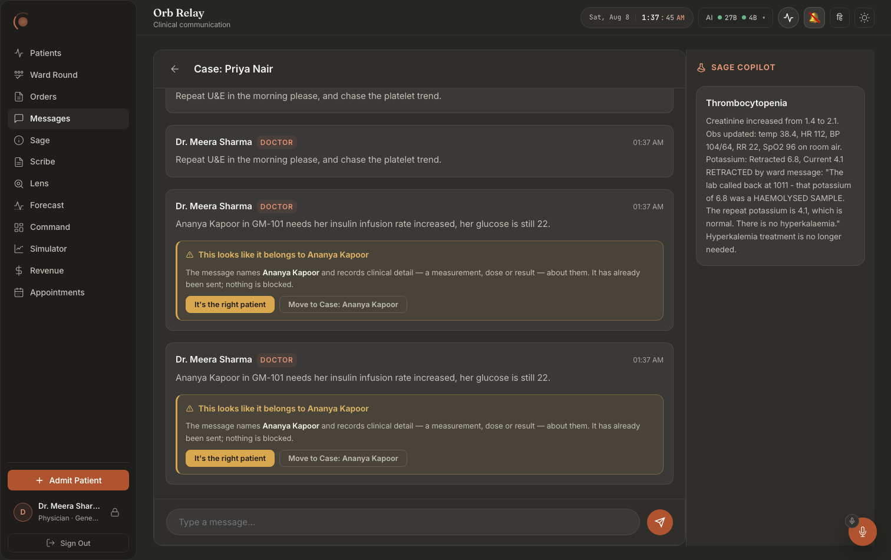

# Screen map 05: Relay: the open message thread

**What this is.** An index of every visible thing on the Relay screen *after* you have opened a
room, and the exact code that puts it there. Read an entry, then go to the file:line it names.
Every citation below was opened and checked at that line.

**Scope.** This file documents the **open thread only**, the right-hand side of Relay. The room
list, the sort chips, the alerts section, the search box and the case/department lists are the
*other* half of the same component and are **not** covered here (they live behind the
`!selectedChannel` branch at `src/pages/panels/RelayPanel.tsx:466-508`).

---

## What it looks like



**Notice** the role chip beside every sender name (`DOCTOR`, `NURSE`), the thread makes
who-said-it structural rather than a matter of recognising a name, and the right-hand
**SAGE COPILOT** rail, which is a standing case summary, not a second chat. It has already
absorbed the retracted potassium result from the messages on the left and states the current
value with the retraction quoted inside it.



**Notice the sentence inside the amber panel before you notice the buttons**: *"It has
already been sent; nothing is blocked."* The interlock names the patient it believes the
message belongs to, offers **It's the right patient** / **Move to Case: …**, and does not
gate the send. This is a correction affordance, not a guard.

> ⚠ Both captures also record a defect: the message renders twice, and in
> `relay-03-wrongroom-dark.png` each duplicate carries its **own** warning panel, so the
> interlock is offered twice for one message. `relay-02-sent-dark.png` shows the same
> duplication on an ordinary send. See
> [`docs/screenshots/INDEX.md`](../../screenshots/INDEX.md).

---

## How to get here

Relay renders `RelayPanel` (`src/pages/panels/RelayPanel.tsx:33`). The whole panel is one
component with a hard fork in its return:

```
src/pages/panels/RelayPanel.tsx:466
{!selectedChannel ? (   … room list …   ) : (   … THIS SCREEN …   )}
```

`selectedChannel` is a `useState<string | null>` declared at `RelayPanel.tsx:35`. It is set by
clicking a room in the list (`onSelectChannel={setSelectedChannel}` passed to `AlertsSection` at
`:490` and to both `CaseList`s at `:498` and `:503`), and cleared by the back arrow at `:515`.
**There is no URL for a thread**, reloading the page returns you to the room list.

## Layout in one sentence

A flex row (`.relay-room-container`, inline styles at `RelayPanel.tsx:510`) holding two things:
the thread column on the left (`.relay-chat`, `:511`, `flex: 1`, `minWidth: 400px`, styled at
`src/pages/Relay.css:92-102`) and, only for a patient-linked room, a fixed 320px Sage sidebar on
the right (`RelayPanel.tsx:740-742`, styled at
`src/components/relay/SageAmbientSidebar.module.css:2-15`).

The thread column is itself a vertical stack: header, scrolling message list, typing line, send
error, composer.

---

# 1. Thread header

### Back arrow
**Where:** top-left of the thread column, a 32×32 square holding a left-pointing arrow.
**Rendered by:** `src/pages/panels/RelayPanel.tsx:515-517`, 
`<button className="relay-chat__back" onClick={() => { setSelectedChannel(null); loadChannels() }}>`
wrapping an inline SVG (`<path d="M19 12H5M12 19l-7-7 7-7"/>`).
**Data from:** nothing. It only writes state.
**API:** its `onClick` calls `loadChannels()` (`RelayPanel.tsx:205-207`) → `getChannels()`
(`src/api/client.ts:778-780`) → `GET /api/relay/channels`.
**Server:** `server/routes/relay_routes.py:78-81` `list_channels` →
`server/services/relay_service.py:11` `get_channels_for_user`.
**Change this →** clicking it replaces this entire screen with the room list. The refetch is
deliberate: unread counts and `last_message` for every *other* room went stale while you were in
here, so without it you would return to a list showing login-time numbers. Remove the
`loadChannels()` call and the room list would still render, it would just be wrong (stale unread
badges, wrong ordering under "Recency"). Styling: `Relay.css:124-137`; hover swaps background to
`--bg-glass-hover` and text to `--text-primary`.

### Room title
**Where:** immediately right of the back arrow, 1.1rem semibold, takes all remaining width.
**Rendered by:** `RelayPanel.tsx:518`, 
`<span className="relay-chat__title">{channels.find(c => c.id === selectedChannel)?.name}</span>`.
**Data from:** the `channels` array (`RelayPanel.tsx:34`), set by `loadChannels` at `:206` and
re-set every 30 seconds by `useVisiblePolling(loadChannels, 30000)` at `:215`.
**API:** `GET /api/relay/channels`.
**Server:** `server/routes/relay_routes.py:78-81` → `server/services/relay_service.py:11`
`get_channels_for_user` (the `name` column of the `channels` row).
**Change this →** this is a **lookup, not a stored value**. If `channels` has not loaded yet, or
the open channel is not in it, the title renders **empty**, the header shows only the back arrow.
That is the visible symptom of an out-of-scope channel: `get_channels_for_user` scopes case rooms
by `admissions.department`, so a room the user can no longer see loses its title while the thread
below it may still be painted. Styling `Relay.css:139-144`; the header hairline is
`Relay.css:116-122`.

---

# 2. The message list

**Container.** `RelayPanel.tsx:520`, 
`<div className="relay-chat__messages" ref={messagesContainerRef} onScroll={handleMessagesScroll}>`.
Styled at `Relay.css:151-159`: `flex: 1`, `overflow-y: auto`, `overscroll-behavior: contain`,
24px/20px padding, a 20px gap between bubbles. On tablet (≤768px) padding drops to 16px/12px and
the gap to 14px (`Relay.css:468-475`).

The list has three mutually exclusive top-level states, chosen by the ternary at
`RelayPanel.tsx:521`: loading → error → messages.

### "Loading messages…"
**Where:** top-left of the message area, plain text, nothing else on screen.
**Rendered by:** `RelayPanel.tsx:521`, `<div className="orb-panel-loading">Loading messages…</div>`.
**Data from:** `loadingMsgs` (`RelayPanel.tsx:38`), set `true` at `:233` and cleared at `:260`
inside `loadMessages`.
**API:** `GET /api/relay/channels/{channel_id}/messages` via `getMessages`
(`src/api/client.ts:793-795`).
**Server:** `server/routes/relay_routes.py:90-98` `get_messages` →
`server/services/relay_service.py:584` `get_channel_messages`.
**Change this →** this text is what a clinician stares at on a slow ward link. Note that
`.orb-panel-loading` **has no CSS rule anywhere in `src/`**, it renders as default body text, no
spinner, no animation. Adding a rule for it would change this state on six other panels too
(`ClinicianShell.tsx:259`, `:714`, `AppointmentsPanel.tsx:77`, `VigilPanel.tsx:298`, `:1060`,
`ForecastPanel.tsx:186`, `SurgicalSuitePanel.tsx:407`). It disappears the instant `loadMessages`
reaches its `finally` at `:260`, **but only if the response still owns the request** (`owns()`,
`:231`): a stale response for a channel you have already left never clears the flag, because the
newer request owns it and will clear it itself.

### Thread-load error box ("This thread did not load.")
**Where:** replaces the whole message list, left-aligned, max 460px wide, red-tinted card.
**Rendered by:** `RelayPanel.tsx:522-526`, a `<div className="relay-thread-error" role="alert">`
containing:
* `<strong>This thread did not load.</strong>` (`:523`)
* `<span>Nothing is shown rather than the previous thread's messages. {msgError}</span>` (`:524`)
* `<button className="relay-thread-error__retry">Retry</button>` (`:525`)
**Data from:** `msgError` (`RelayPanel.tsx:39`), set at `:258` from
`(err as Error)?.message || 'Could not load this thread.'`, cleared at `:235` on every new load.
**API:** the failed `GET /api/relay/channels/{id}/messages`. The message text is whatever
`apiFetch` threw, for a 403 that is the FastAPI `detail`, "Not authorized to access this
channel" (`server/routes/relay_routes.py:97`), surfaced through the structured-403 branch at
`src/api/client.ts:210-225`.
**Server:** `server/routes/relay_routes.py:90-98`; the authorisation gate is
`can_access_channel` (`server/services/relay_service.py:244`).
**Change this →** the second sentence is the entire point of this box: it tells the reader the
blank pane is deliberate. The failure it replaced left the **previous** channel's messages sitting
under the **new** channel's title (see the comment block at `RelayPanel.tsx:218-229`). Deleting
the `setMessages([])` at `:235` brings that back. **Retry** re-runs `loadMessages(selectedChannel)`
and the box disappears the moment a load succeeds. Styling `Relay.css:164-190`: 10% `--status-danger`
fill, 28% border, `--status-danger-text` label; the Retry chip is a neutral glass button
(`Relay.css:179-190`).

### Empty thread
**Where:** the whole message area.
**Rendered by:** nothing. `messages.map(...)` at `RelayPanel.tsx:528` over an empty array emits no
nodes.
**Data from:** `messages` (`RelayPanel.tsx:36`).
**Change this →** **there is no empty state on this screen.** A room with zero messages shows a
blank scroll pane with the composer under it, visually identical to a thread that finished loading
and to one where every message was filtered out. If you want "No messages yet", it goes at `:527`
as a third branch of the ternary; there is no other place it can live.

---

# 3. A message bubble (the ordinary case)

**Rendered by:** `RelayPanel.tsx:620-621`, 
`<div key={m.id} className={\`relay-msg ${m.message_type === 'alert' ? 'relay-msg--alert' : ''} ${m.message_type === 'system' ? 'relay-msg--system' : ''}\`}>`.
**Data from:** one element of `messages`; the array is written in four places, `loadMessages`
(`:241`), the optimistic send (`:316`), the send response merge (`:329-331`), the post-send refresh
(`:350`) and the socket handlers (`:120-137`).
**API/Server:** `GET /api/relay/channels/{id}/messages` →
`server/services/relay_service.py:584-614` `get_channel_messages` (a `SELECT * FROM messages`
ordered newest-first inside a subquery, then re-ordered ascending).
**Change this →** `.relay-msg` is `Relay.css:208-217`: flat glass card, hairline border, 16px
padding, `slide-up 0.3s` entry animation. `.relay-msg--alert` (`Relay.css:220-223`) tints it 10%
`--status-danger` with a 28% border, **the one thing in Relay allowed to shout**.
`.relay-msg--system` is applied at `:621` but **has no CSS rule in `Relay.css`**, a system message
looks exactly like an ordinary one today.

### Sender name
**Where:** first item in the bubble's header row.
**Rendered by:** `RelayPanel.tsx:623`, `<span className="relay-msg__sender">{m.sender_name}</span>`.
**Data from:** `messages.sender_name`, a denormalised column written at send time
(`server/services/relay_service.py:826-830`, from `user["name"]` at
`server/routes/relay_routes.py:413`).
**Change this →** because the name is **copied into the row at send time**, renaming a user in
admin does **not** retitle their old messages. Styling `Relay.css:231-235`.

### "AUTO" badge
**Where:** immediately right of the sender name, small uppercase pill with a hairline box.
**Rendered by:** `RelayPanel.tsx:624-630`, rendered only `{m.is_bot && ...}`, with
`title="Automated / AI-generated message, not a clinician"` and
`aria-label="Automated bot message"`.
**Data from:** `Message.is_bot` (`src/api/client.ts:685`).
**API:** the messages GET.
**Server:** `server/services/relay_service.py:610`, 
`"is_bot": bool(r["is_bot"]) if "is_bot" in r.keys() else False`. Written at insert time by
`send_message` (`relay_service.py:826-830`, `1 if is_bot else 0`); bots pass `is_bot=True`, e.g.
the surgery system messages at `server/routes/surgery_routes.py:443-446` and `:476-479`.
**Change this →** this badge is the only thing separating a Vigil/Lab/Lens bot post from a
clinician's. It disappears the moment `is_bot` is false or the column is missing (old rows default
to `False` at `relay_service.py:610`, so **pre-migration bot posts render with no badge**).
Styling `Relay.css:250-261`, including `cursor: help` so the tooltip is discoverable.

### Role chip
**Where:** after the sender name (and after AUTO, if present).
**Rendered by:** `RelayPanel.tsx:631`, `<span className="relay-msg__role">{m.sender_role}</span>`.
**Data from:** `messages.sender_role`, written from `user["role"]` at
`server/routes/relay_routes.py:414`.
**Change this →** `Relay.css:237-246` uppercases it, tints it with `--accent-glow` and colours it
`--accent-text`. The value is raw, `doctor`, `nurse`, `ai`, `system`, there is **no display-name
mapping**, so a new role id appears verbatim on every message it sends.

### Timestamp
**Where:** far right of the header row (pushed there by `margin-left: auto`).
**Rendered by:** `RelayPanel.tsx:632`, `<span className="relay-msg__time">{formatTime(m.timestamp)}</span>`.
**Data from:** `formatTime` at `RelayPanel.tsx:23-25` →
`parseUTC(ts).toLocaleTimeString([], { hour: '2-digit', minute: '2-digit' })`.
`parseUTC` is `src/lib/datetime.ts:17`.
**Server:** the `timestamp` column, defaulted by SQLite at insert
(`server/services/relay_service.py:826-830` does not pass it).
**Change this →** it shows **time only, never a date**. A message from last Tuesday reads "09:14",
identical to one from this morning, and there are no day separators anywhere in this list. Adding a
date would be a change to `formatTime` at `:24` and would affect every bubble including the
surgical-alert card (`:578`). Styling `Relay.css:263-267`; below 600px `margin-left: auto` is
dropped and the header wraps (`Relay.css:480-481`).

### "queued" marker
**Where:** last item in the header row, tiny italic muted text.
**Rendered by:** `RelayPanel.tsx:636-641`, `{m.id < 0 && <span … title="Queued offline, will
send when the connection returns">queued</span>}`.
**Data from:** a negative `id`, minted by the offline branch of `sendMessage`
(`src/api/client.ts:881`, `id: -Date.now()`) when `offlineMutate` sees `!navigator.onLine`
(`src/api/client.ts:436-439`).
**Change this →** **this state is very nearly unreachable on this screen, on purpose.**
`handleSend` calls `assertOnlineForWrite('send this message')` at `RelayPanel.tsx:292` *before*
the optimistic bubble exists, and that guard reads the same `navigator.onLine`
(`src/lib/offline/writeGuard.ts:80-83`). So the only way to see "queued" is for the connection to
drop **between** `RelayPanel.tsx:292` and `client.ts:436`. The dead-looking branch is kept because
the negative-id contract is also what stops the post-send refresh from running
(`RelayPanel.tsx:345-346`), deleting the badge without deleting that check would leave a queued
message silently unlabelled.

### Message body text
**Where:** the paragraph under the header row.
**Rendered by:** `RelayPanel.tsx:686`, a `<p className="relay-msg__content">` whose
`dangerouslySetInnerHTML` is
`DOMPurify.sanitize(formatMessage(content), { ALLOWED_TAGS: ['strong','em','br','code','span'], ALLOWED_ATTR: ['class'] })`.
**Data from:** `m.content` (`RelayPanel.tsx:531`).
**Formatting:** `formatMessage` at `RelayPanel.tsx:14-21`, turns leading `-`/`*` into `•`,
HTML-escapes `& < >`, then converts `**bold**` → `<strong>` and `*italic*` → `<em>`.
**Server:** the `content` column, written verbatim by
`server/services/relay_service.py:826-830`.
**Change this →** widen `ALLOWED_TAGS` at `:686` and you widen the XSS surface on the one screen
where anyone in the hospital can type. `Relay.css:269-281` carries a load-bearing rule:
`overflow-wrap: anywhere`, **not** `break-word`. Only `anywhere` contributes to min-content width,
and without it a single unbroken token (an accession number, a pasted URL) blew the thread out to
a measured 18,985px of scrollWidth inside a 596px pane, pushing every other message off-screen.

### "(alert could not be fully displayed)"
**Where:** directly under the message text, small italic muted.
**Rendered by:** `RelayPanel.tsx:687-691`, gated on `alertParseFailed`.
**Data from:** `alertParseFailed`, set at `RelayPanel.tsx:561`, and **only** in the `catch` at
`:556`, i.e. only when the content both *looks like JSON* (`looksLikeJson`, `:544`, content starts
with `{`) and fails `JSON.parse`.
**Change this →** the discrimination at `:544` is the whole point. Alert content arrives in two
dialects, structured JSON (Vigil cards) and plain prose (the Vigil/Lab/Lens bots). Before
`looksLikeJson` existed, **every prose bot alert** carried this caveat, training clinicians to
ignore it. Broaden the condition and that returns.

---

# 4. Structured alert card (a Vigil alert with Confirm / Escalate)

Entered when `m.message_type === 'alert'`, the content parses, and `payload.is_structured` is true
(`RelayPanel.tsx:546-550`). Rendered inside the ordinary bubble, replacing the text paragraph:
`{isStructuredAlert ? <div className="relay-structured-alert"> … }` at `RelayPanel.tsx:643-644`.
`.relay-structured-alert` has **no CSS rule**, the card's whole appearance comes from the parent
`.relay-msg--alert` tint plus the inline styles below.

### Alert title
**Where:** first line of the card, semibold, accent-coloured.
**Rendered by:** `RelayPanel.tsx:645`, `{payload.title}`, `color: var(--accent-text)`.
**Data from:** the JSON body of the message row.

### "Patient: … (MRN: …)"
**Where:** second line.
**Rendered by:** `RelayPanel.tsx:647`, `<strong>Patient:</strong> {payload.patient_name} (MRN: {payload.mrn})`.
**Change this →** both values come from the stored JSON, not from a live patient lookup, an alert
card keeps showing the name it was written with even after a merge or correction.

### "Procedure: …"
**Where:** third line, present only when `payload.procedure_name` is set.
**Rendered by:** `RelayPanel.tsx:648`.

### "OR: … at …"
**Where:** next line, present only when `payload.operating_room` is set; the ` at {scheduled_time}`
suffix appears only when `payload.scheduled_time` is also set.
**Rendered by:** `RelayPanel.tsx:649`.

### Action-required box
**Where:** an indented block at the bottom of the detail section, warm-tinted with a gold left rule.
**Rendered by:** `RelayPanel.tsx:650-652`, `background: color-mix(in srgb, var(--status-warn) 10%,
transparent)`, `borderLeft: '2px solid var(--accent-gold)'`, content `{payload.action_required}`.

### "✓ Confirmed by … / ✓ Escalated by …"
**Where:** replaces the two buttons once the alert has been acted on. Green-tinted strip.
**Rendered by:** `RelayPanel.tsx:654-657`, 
`✓ {payload.status === 'resolved' ? 'Confirmed' : 'Escalated'} by {payload.resolved_by || 'User'}`.
**Data from:** `payload.status` / `payload.resolved_by`, written server-side into the message
content.
**Server:** `server/routes/relay_routes.py:1128-1129`, 
`content["status"] = "resolved" if payload.action == "confirm" else "escalated"` and
`content["resolved_by"] = user["name"]`.
**Change this →** the presence of `payload.status` is the **only** thing that hides the buttons
(`:654`). It reaches an already-open thread through the `message:update` socket event
(`server/routes/relay_routes.py:1220`, handled at `RelayPanel.tsx:135-137`), so a colleague
confirming on another device swaps your buttons for this strip without a refresh.

### "Confirm" button
**Where:** bottom-left of the card, filled.
**Rendered by:** `RelayPanel.tsx:661-667`.
**Data from:** `resolvingAlertId` (`RelayPanel.tsx:51`) drives the busy look, when it equals
`m.id` the background becomes `--btn-disabled-bg`, the label `--btn-disabled-text`, the cursor
`wait`, and `disabled` is set (`:662`, `:664`).
**API:** `resolveAlert(m.id, 'confirm')` (`src/api/client.ts:786-791`) →
`POST /api/relay/alerts/{message_id}/resolve`.
**Server:** `server/routes/relay_routes.py:1200-1222` `resolve_alert` →
`server/routes/relay_routes.py:1110-1152` `_apply_alert_resolution` (a compare-and-swap:
`UPDATE messages SET content = ? WHERE id = ? AND content = ?` at `:1138-1141`, so the loser of a
race gets "Alert already processed" rather than silently overwriting the winner's attribution) and
`server/routes/relay_routes.py:1155-1197` `_emit_alert_acknowledged` for the shadow log.
**Change this →** on success the handler re-runs `loadMessages(selectedChannel)`
(`RelayPanel.tsx:379`), so the whole thread reloads and this card comes back wearing the green
"✓ Confirmed by …" strip. Note the guard at `:369`: `if (resolvingAlertId) return` is **global**,
not per-alert, while one alert is resolving, the buttons on *every other* alert in the thread do
nothing when clicked (they do not look disabled, because the styling at `:662` compares against
`m.id`).

### "Escalate" button
**Where:** beside Confirm, ghost outline.
**Rendered by:** `RelayPanel.tsx:668-674`.
**API/Server:** same endpoint with `action: 'escalate'`; server sets `content["status"] =
"escalated"` (`relay_routes.py:1128`) and additionally writes an `outcome.candidate` shadow row
(`relay_routes.py:1184-1193`), deliberately a *candidate*, never a confirmed outcome, so Orb
cannot supply both halves of its own lead-time metric.
**Change this →** the visible difference from Confirm is one word in the green strip.

### Alert inline error
**Where:** under the two buttons, red-tinted with a 2px left rule.
**Rendered by:** `RelayPanel.tsx:676-680`, gated on `alertErrors[m.id]`.
**Data from:** `alertErrors`, a `Record<number, string>` (`RelayPanel.tsx:52`), written at
`:382` from `err?.message || 'Could not resolve alert. Please try again.'`, and cleared for that
alert id at `:371-375` when the action is retried.
**Change this →** typical texts are "Alert already processed" (`relay_routes.py:1122`, `:1143`) and
"Not authorized to act on this channel" (`relay_routes.py:1126`). It never clears on its own, only
a fresh attempt on the same alert removes it.

---

# 5. Surgical alert card (targeted to one person)

Entered when `m.message_type === 'surgical_alert'` and the content parses
(`RelayPanel.tsx:552-555`). This card **returns early** at `:565-618`, it does *not* render the
ordinary bubble, so it has **no AUTO badge, no queued marker and no wrong-room warning strip.**

### Card frame
**Where:** in the message flow, unmistakably red.
**Rendered by:** `RelayPanel.tsx:568-574`, `className="relay-msg relay-msg--surgical-alert"` plus
inline `borderLeft: '3px solid var(--status-danger)'` and a two-stop `linear-gradient` of 14% → 4%
`--status-danger`. `.relay-msg--surgical-alert` has **no CSS rule**; the appearance is entirely
inline.

### "⚠ Surgical Alert"
**Where:** first item of the card header, danger-red.
**Rendered by:** `RelayPanel.tsx:576`, occupies the `.relay-msg__sender` slot.

### Sender name (in the role slot)
**Where:** second item of the header, styled as the uppercase role chip.
**Rendered by:** `RelayPanel.tsx:577`, `<span className="relay-msg__role">{m.sender_name}</span>`.
**Change this →** note the **inversion**: on this card the *name* wears the role chip's styling.
For alerts generated by the surgery module the sender name is `Sage Ambient`
(`server/routes/surgery_routes.py:476-479`), so the chip reads `SAGE AMBIENT`.

### Timestamp
**Rendered by:** `RelayPanel.tsx:578`, same `formatTime` as every other bubble.

### Alert text
**Where:** the bold line under the header.
**Rendered by:** `RelayPanel.tsx:581`, `{payload.text}`, weight 600, `--text-primary`.
**Server:** written as JSON at `server/routes/surgery_routes.py:469-474`, e.g.
`"SAGE SUGGESTION: Re-routing assignment to available {role_name}."`.

### "Role: …"
**Where:** small muted line under the alert text, only when `payload.role` is set.
**Rendered by:** `RelayPanel.tsx:582-586`.
**Server:** `server/routes/surgery_routes.py:473`, `"role": assignment['role_name']`.

### "✓ Confirm" / "✕ Decline" buttons
**Where:** bottom of the card, side by side. **Visible only to the targeted user.**
**Rendered by:** `RelayPanel.tsx:588-607`, inside `{isTargetUser && (() => { … })()}`.
**Data from:** `isTargetUser` at `:566`, `currentUser?.id === payload.target_user_id`, where
`currentUser` is `getUser()` (`src/api/client.ts:108`) read at `RelayPanel.tsx:536`.
`busy` at `:589` is `respondingSurgeryId === payload.surgery_id` (`RelayPanel.tsx:55`).
**API:** `surgicalTeamResponse(payload.surgery_id, 'confirm' | 'decline')`
(`src/api/client.ts:1755-1760`) → `POST /api/surgery/{surgery_id}/team-response`.
**Server:** `server/routes/surgery_routes.py:403-486` `surgical_team_response`. It rejects
anything that is not exactly `confirm` or `decline` with a 422 (`:411-412`), updates
`surgery_team_assignments.status` (`:429-432`), and posts a **system message** back into this same
case room (`:441-446`) reading `SYSTEM: {name} ({role}) has {confirmed|declined} the surgical
assignment.` A decline may additionally insert a replacement `surgical_alert`
(`:454-479`), but only under `DEMO_MODE` and only after the fallback user is existence-checked.
**Change this →** everyone else in the room sees this card with **no buttons at all**. On success
`handleSurgicalResponse` re-runs `loadMessages` (`RelayPanel.tsx:403`), so the new SYSTEM message
appears immediately below. While in flight both buttons go `--btn-disabled-text` with
`cursor: wait` (`:594`, `:601`), the guard at `:393` (`if (!surgeryId || respondingSurgeryId)
return`) exists because the endpoint has **no already-responded guard**, so a double-tap would post
twice.

### Surgical inline error
**Where:** under the two buttons.
**Rendered by:** `RelayPanel.tsx:608-612`, gated on `surgicalErrors[payload.surgery_id]`
(`RelayPanel.tsx:56`, written at `:406-409`).
**Change this →** likely texts: "User not assigned to this surgery"
(`server/routes/surgery_routes.py:425`), "Surgery not found" (`:417`), or the 422 detail from
`:412`.

### Legacy `ambient_action` messages (invisible)
**Rendered by:** nothing, `RelayPanel.tsx:530` returns `null` for
`m.message_type === 'ambient_action'`.
**Change this →** these rows still exist in the database and still count toward unread badges on
the room list, but they render as **nothing at all** in the thread. Removing the early return at
`:530` would resurrect deprecated Stage-2 cards with no styling behind them.

---

# 6. Wrong-room warning strip

`src/components/relay/RoomFitWarning.tsx`, mounted from `RelayPanel.tsx:701-706`:

```
{roomFit[m.id] && roomFit[m.id].resolution !== 'auto_cleared' && (
  <RoomFitWarning flag={roomFit[m.id]} onResolved={updated => setRoomFit(...)} />
)}
```

**Where the flags come from, three independent paths into `roomFit` (`RelayPanel.tsx:60`):**

1. **With the thread.** `getRoomFitFlags(channelId)` at `RelayPanel.tsx:249-254` →
   `src/api/client.ts:803-805` → `GET /api/relay/channels/{id}/room_fit` →
   `server/routes/relay_routes.py:651-686` `list_room_fit_flags` →
   `server/services/room_fit_service.py:1474-1483` `get_flags_for_channel`. A failure here is
   caught and logged only (`RelayPanel.tsx:254`), **the thread still renders, without its flags**.
2. **With the send response.** `sent.room_fit` at `RelayPanel.tsx:336-339`. The server attaches it
   at `server/routes/relay_routes.py:440-442`, after the insert and after the broadcast, the
   detector can never delay, refuse or lose a message.
3. **By socket.** `relay:room_fit` (`RelayPanel.tsx:143-146`) and `relay:room_fit_resolved`
   (`:147-150`), emitted room-scoped at `server/routes/relay_routes.py:579`, `:642-646` and `:809`.

**Server, in order:** `_run_room_fit` (`relay_routes.py:460-514`) → `check_message`
(`room_fit_service.py:1044-1205`, the deterministic pass; band is set at `:1184-1193`) →
`_room_fit_publish` (`relay_routes.py:517-580`) → `persist_flag`
(`room_fit_service.py:1389-1437`). A `review` band says **nothing** on screen and is handed to the
4B adjudicator (`relay_routes.py:504-507` → `_room_fit_adjudicate_later` at `:608-648`), which can
only **promote** it to a visible flag, it can never invent one.

### Warning strip: the open state
**Where:** attached **under** the message it is about, inside the same bubble. Amber, with a 3px
amber left rule.
**Rendered by:** `src/components/relay/RoomFitWarning.tsx:75`, 
`<div className="room-fit" role="alert" aria-live="polite">`.
**Change this →** styled at `src/pages/Relay.css:499-509`. The colour choice is deliberate and
documented at `Relay.css:485-498`: `--status-warn`, **not** `--status-danger`, because Relay
already spends danger-red on Vigil and surgical alerts, and borrowing that register for a
documentation heuristic is how a ward learns to scroll past red.

### "⚠" icon
**Rendered by:** `RoomFitWarning.tsx:77`, `<span className="room-fit__icon" aria-hidden="true">⚠</span>`.
Styled `Relay.css:517-521`, coloured `--status-warn-text`.

### Headline
**Where:** beside the ⚠.
**Rendered by:** `RoomFitWarning.tsx:78`, text computed at `:69-72`:
* `This looks like it belongs to {suspected_patient_name}`, when the server named a patient;
* `This may belong to a different patient`, when it did not.
**Data from:** `flag.suspected_patient_name` (`src/api/client.ts:710`).
**Server:** set at `server/services/room_fit_service.py:1199-1201`, and only when exactly one
unambiguous patient resolved. It can also be **stripped per reader**: `list_room_fit_flags` blanks
`suspected_patient_name`, `suspected_patient_id`, `suggested_channel_id`/`_name` and forces
`ambiguous = true` when the suggested room is outside *this reader's* channel list
(`server/routes/relay_routes.py:678-685`).
**Change this →** that redaction is why the same flag can show a name to the sender and the
generic headline to a colleague in another department.

### Body paragraph
**Where:** under the headline.
**Rendered by:** `RoomFitWarning.tsx:81-94`. Assembled from up to three parts:
* with a matched surface (`:82-86`):
  `The message names <strong>{flag.matched_surface}</strong> and records clinical detail, a
  measurement, dose or result, about them.`
* without one (`:87-89`): `The message records clinical detail about another patient.`
* plus, when `flag.ambiguous && !who` (`:90-92`):
  `More than one patient could be meant, so no destination is suggested.`
* always ending (`:93`): `It has already been sent; nothing is blocked.`
**Data from:** `flag.matched_surface`, recovered in the **author's own casing** from the raw text
at `server/services/room_fit_service.py:1172` (`_original_casing`), because matching runs on
lower-cased normalised text and "the message names siddharth nair" reads like a bug.
**Change this →** the closing clause is the design in one sentence: warn, never block. Styling
`Relay.css:529-539`.

### "It's the right patient" button (the override)
**Where:** first action, filled amber, **the primary control**.
**Rendered by:** `RoomFitWarning.tsx:97-104`. Label swaps to `Recording…` while `busy ===
'confirmed_correct'` (`:103`); both buttons are `disabled` whenever `busy !== null` (`:101`).
**API:** `resolveRoomFit(flagId, 'confirmed_correct')` (`src/api/client.ts:811-824`) →
`POST /api/relay/room_fit/{flag_id}/resolve`.
**Server:** `server/routes/relay_routes.py:717-810` `resolve_room_fit_flag` →
`server/services/room_fit_service.py:1550-1575` `resolve_flag` (a compare-and-swap on
`resolution = 'open'`, so a second clinician gets a 409 "This warning has already been resolved").
The override is audited as `room_fit.overridden` at `relay_routes.py:784-807`.
**Change this →** the amber fill is deliberate (`Relay.css:565-578`): a nurse who already knows the
answer must reach the fastest, most obvious control. On success `onResolved` replaces the flag in
`roomFit` (`RelayPanel.tsx:704`) and the strip **re-renders as the quiet resolved record**, it
never disappears. `--status-on-fill` (`Relay.css:571`) is the token that keeps the label legible on
the amber fill; there is no opacity anywhere in this component by rule.

### "Move to {room}" button
**Where:** second action, ghost outline. **Rendered only when `flag.suggested_channel_id` is set**
(`RoomFitWarning.tsx:106`).
**Rendered by:** `RoomFitWarning.tsx:107-118`. Label is
`Move to {flag.suggested_channel_name || who}`, or `Moving…` while busy. Tooltip (`:112`):
`Posts a copy into that room. This message stays here, marked as moved.`
**API:** `resolveRoomFit(flagId, 'redirected')`.
**Server:** `server/routes/relay_routes.py:747-780`. It re-checks that *this* resolver may post in
the destination (`:754-755`), **claims the flag before moving** (`:765-767`, with the reasoning at
`:759-764`: two people tapping at once must not both post a copy into a second patient's room),
copies the text via `_room_fit_redirect_txn` (`:689-714`) and broadcasts the copy into the target
room (`:780`).
**Change this →** an ambiguous match shows **no button at all**, a confidently wrong destination
turns one wrong-chart entry into two (`RoomFitWarning.tsx:22-24`). The original message is never
deleted or edited.

### Warning inline error
**Where:** last line of the strip, red with a 2px left rule.
**Rendered by:** `RoomFitWarning.tsx:121`, gated on local `error` state (`:34`, written at `:47`
from `err?.message || 'Could not record that. Please try again.'`).
**Change this →** typical texts: "This warning has already been resolved"
(`relay_routes.py:744`, `:770`), "Not authorized to post in that room" (`:755`), "No destination
room for this warning" (`:750`). Styling `Relay.css:592-599`.

### Resolved strip (the permanent record)
**Where:** same slot, but neutral grey, a single row, no buttons.
**Rendered by:** `RoomFitWarning.tsx:54-66`, taken when `flag.resolution` is set and is not
`'open'` (`:37`). Shows a `✓` (`:63`) and one of three labels (`:55-60`):
* `Checked, confirmed as the right patient by {resolved_by_name}`
* `Moved to {suggested_channel_name || 'another room'} by {resolved_by_name}`
* `Warning withdrawn automatically`
The ` by {name}` suffix is omitted when `resolved_by_name` is null.
**Data from:** `flag.resolution` / `flag.resolved_by_name`, from
`server/services/room_fit_service.py:1440-1471` `flag_row_to_dict`.
**Change this →** it stays visible forever, on purpose: "flagged, and the nurse confirmed it was
correct" is exactly what the reader inheriting this record next week needs
(`RoomFitWarning.tsx:12-16`). Styling `Relay.css:603-617`, neutral surface, no amber, muted text,
so a closed flag stops competing for attention.

### Auto-cleared flag → **nothing renders**
**Where:** the strip vanishes entirely.
**Rendered by:** the guard at `RelayPanel.tsx:701`, 
`roomFit[m.id].resolution !== 'auto_cleared'`.
**Server:** `server/services/room_fit_service.py:1495-1524` `auto_clear_flag` sets
`band='clear', resolution='auto_cleared'`, but **only** `WHERE … resolution = 'open'` (`:1513`),
so a clinician who already answered beats a model that answered later. The retraction is pushed by
`relay:room_fit_resolved` (`server/routes/relay_routes.py:642-646`), handled at
`RelayPanel.tsx:147-150`.
**Change this →** this is the third case of the resolved branch: `RoomFitWarning.tsx:60` *does*
have a "Warning withdrawn automatically" label, but the parent never mounts the component for an
`auto_cleared` flag, so **that string is currently unreachable**. Remove the `auto_cleared` test at
`RelayPanel.tsx:701` and every model-retracted warning would start showing that grey line instead
of disappearing. The database row is kept either way, a warning shown and then withdrawn is
evidence about the detector's own precision (`room_fit_service.py:1498-1502`).

---

# 7. Typing indicator

### "{Name} is typing…" / "{A}, {B} and others are typing…"
**Where:** a thin italic line between the message list and the composer.
**Rendered by:** `RelayPanel.tsx:712-715`, 
`<div className="relay-chat__typing" role="status" aria-live="polite" …>`, with the text chosen
inline at `:714`: one name → `${name} is typing…`; more → the first two joined by `, `, plus
` and others` when there are more than two, then ` are typing…`.
**Data from:** `typingUsers` (`RelayPanel.tsx:48`), maintained by `handleTyping`
(`:160-170`): it ignores events for other channels (`:161`), ignores your own id
(`:162-163`, via `getUser()`), appends the name, and sets a **4-second** per-name timer (`:166-169`)
that removes it again. All timers are cleared and the list emptied on unmount or channel change
(`:193-196`), and on socket disconnect (`:179`).
**Outbound:** `emitTyping` (`RelayPanel.tsx:265-271`) fires on every keystroke
(`onChange` at `:728`) but is throttled to **once per 1.5s** by `typingEmitRef` (`:72`, `:268`).
**API:** socket event, not HTTP.
**Server:** `server/ws/realtime.py:407-424` `typing`, it re-checks channel authorisation via
`_user_can_access_channel` (`:416`, which calls the same `get_channels_for_user` as REST,
`realtime.py:363-377`), **re-derives the sender identity from the session rather than trusting
client fields** (`:418-423`), and re-broadcasts with `skip_sid=sid` so you never see yourself.
**Change this →** `.relay-chat__typing` has **no CSS rule**, its entire appearance is the inline
style at `:713` (2px/16px/4px padding, 0.72rem, `--text-muted`, italic). The line occupies zero
height when nobody is typing, so the composer shifts up and down by ~14px as people type; giving it
a fixed height would stop that. The name shown is `session["name"]` from the server
(`realtime.py:422`), so it cannot be spoofed by the sending client.

---

# 8. Offline-refusal message

### "Cannot send this message: this device is offline. Your entry has not been saved. Reconnect and enter it again."
**Where:** a red-tinted band sitting **directly above the composer**, with the user's un-sent text
still in the box below it.
**Rendered by:** `RelayPanel.tsx:717-721`, 
`<div className="relay-chat__send-error" role="alert">{sendError}</div>`.
**Data from:** `sendError` (`RelayPanel.tsx:44`). Written at `:294` in the `catch` around
`assertOnlineForWrite('send this message')` (`:292`). Cleared in three places: on every keystroke
(`:728`), on a successful pre-flight (`:297`), and on **opening any channel** (`:116`).
**Text source:** `offlineRefusalMessage` at `src/lib/offline/writeGuard.ts:43-48`, the literal is
`Cannot ${action}, this device is offline. Your entry has not been saved. Reconnect and enter it
again.`, with `action` supplied as `'send this message'`.
**API:** none, this refusal happens **before any request**, and before the optimistic bubble
exists.
**Change this →** this is the most consequential string on the screen. The reasoning is at
`RelayPanel.tsx:277-290`: `sendMessage` would otherwise queue the text and resolve with a pending
copy that renders as a sent message, "bed 4 deteriorating, please review" appearing sent while
nobody has been called. The queue is *not* a safe fallback here because it is deleted wholesale at
sign-out and a PIN session on a shared ward tablet signs itself out after two minutes idle. The
wording must never imply a later sync (`writeGuard.ts:33-42`). Clearing it at `:116` on channel
change is also deliberate: a refusal belongs to the message that was refused, and carrying it into
another patient's room would put "your entry has not been saved" above a room where nothing was
attempted. Styling `Relay.css:196-205`, loud on purpose, because the failure it replaced was a
message that *looked* sent.

---

# 9. The composer

### Text input
**Where:** bottom of the thread column, full-width pill.
**Rendered by:** `RelayPanel.tsx:723-732`, `<input ref={inputRef} type="text"
placeholder="Type a message…" className="relay-chat__text-input" disabled={sending}>`.
**Data from:** `newMessage` (`RelayPanel.tsx:37`). `onChange` (`:728`) does three things at once:
sets the value, clears `sendError`, and calls `emitTyping()`. `onKeyDown` (`:729`) sends on
**Enter without Shift**.
**Change this →** the whole row is `.relay-chat__input glass` (`:722`), styled `Relay.css:288-296`
with a top hairline and **no rounding** (it is flush to the panel bottom). The field itself is
`Relay.css:298-307`; the focus state is a **border + fill shift**, not an outline, because
`index.css` suppresses the inner outline for composer fields (`Relay.css:308-314`). While
`sending` is true the field is `disabled`, the placeholder stays but typing does nothing. There
is no character counter, no attachment control and no multiline support: `type="text"` means Shift
+Enter inserts nothing.

### Send button (paper plane)
**Where:** right of the input, a 44px filled circle.
**Rendered by:** `RelayPanel.tsx:733-737`, `<button className="relay-chat__send"
onClick={handleSend} disabled={sending}>` wrapping the plane SVG (`<line>` + `<polygon>`).
**Data from:** `sending` (`RelayPanel.tsx:40`), set at `:318` and cleared at `:362`.
**API:** `sendMessage(selectedChannel, content)` (`src/api/client.ts:871-892`) → `offlineMutate`
(`client.ts:428-445`) → `POST /api/relay/channels/{id}/messages` **with an `Idempotency-Key`
header** minted per call at `client.ts:435`.
**Server:** `server/routes/relay_routes.py:383-443` `post_message` →
`server/services/relay_service.py:778-853` `send_message`. The route authorises by looking the
channel up in `get_channels_for_user` (`relay_routes.py:405-408`) and reuses that same list as the
detector's PHI boundary. It broadcasts `message:new` at `:434`, queues Sage Ambient observation at
`:437-438`, then runs the wrong-room check at `:440`.
**Change this →** styling `Relay.css:316-340`: flat `--accent-deep` fill, no glow, no lift; hover
is a background swap, active is `brightness(0.96)`, disabled swaps to the flat `--btn-disabled-*`
trio with `cursor: not-allowed`. **What you see when you press it:** the bubble appears
*instantly*, an optimistic message with a temporary `id: Date.now()` and a `client_key`
(`RelayPanel.tsx:304-316`), the input clears (`:317`) and focus is kept (`:321`). If the request
throws, the bubble is **removed** (`:359`) and your text is **restored to the box** (`:360`) so you
can retry. There is no error banner for a failed send, the restored text *is* the signal.

**Why sent messages do not appear twice.** Three paths race: the optimistic bubble, the
`message:new` socket echo, and the POST response. `claimOptimistic`
(`src/lib/messageMerge.ts:75-92`) lets the socket echo recognise its own optimistic bubble by
sender+content and replace it **in place** (keeping its scroll position), and `mergeById`
(`messageMerge.ts:51-64`) guarantees one entry per id whatever order they land in. Break either and
every sent message renders twice, each copy carrying its own wrong-room warning card
(`messageMerge.ts:1-24`).

---

# 10. Sage ambient sidebar

`src/components/relay/SageAmbientSidebar.tsx`, mounted at `RelayPanel.tsx:740-742`.

### The sidebar's presence
**Where:** a 320px column on the right of the thread. Below 900px it becomes an absolutely
positioned slide-over drawer (`SageAmbientSidebar.module.css:265-281`).
**Rendered by:** `RelayPanel.tsx:740-742`, 
`{channels.find(c => c.id === selectedChannel)?.patient_id && <SageAmbientSidebar channelId={selectedChannel} />}`.
**Change this →** **a department channel never gets a sidebar**, the whole thread simply runs
full width. The test is `patient_id` on the *channel list row*, so if `channels` has not loaded the
sidebar is absent even for a case room until the next poll tick.

**Both feeds, fetched together** at `SageAmbientSidebar.tsx:20-40` via `Promise.all`:
* `getSageMemory(channelId)` (`src/api/client.ts:826-828`) →
  `GET /api/relay/channels/{id}/sage_memory` → `server/routes/relay_routes.py:176-207`
  `get_sage_memory` (a direct `SELECT * FROM sage_room_memory WHERE room_id = ?`, returning `None`
  when there is no row).
* `getSageActions(channelId)` (`client.ts:830-832`) →
  `GET /api/relay/channels/{id}/sage_actions` → `server/routes/relay_routes.py:210-251`
  `get_sage_actions` (joins the newest `sage_handoffs` row per action at `:225-227`).

**Live refresh:** `sage:memory_update` (`SageAmbientSidebar.tsx:59`, emitted at
`server/services/sage_ambient_service.py:1983`) triggers a full refetch; `sage:action_update`
(`:60`, emitted at `server/routes/relay_routes.py:378`) refetches actions only.

### "Connecting to Sage..."
**Where:** centred in the sidebar, pulsing.
**Rendered by:** `SageAmbientSidebar.tsx:82-89`, taken when `loading && !memory`.
**Change this →** the pulse is `.loading` → `@keyframes pulse` at
`SageAmbientSidebar.module.css:254-261` (a 2s opacity cycle). Because the condition is
`loading && !memory`, a *refresh* of an already-loaded sidebar never shows this, the old content
stays on screen until the new arrives.

### Load-failure state
**Where:** the sidebar keeps its "Sage Copilot" header; the body becomes a centred message and a
Retry button.
**Rendered by:** `SageAmbientSidebar.tsx:93-108`:
* header `Sage Copilot` (`:96`)
* `<div className={styles.failState} role="alert">` (`:97`) with the paragraph (`:98-101`):
  `Sage Copilot could not load for this room. This is a display failure, it does not mean there
  are no risk flags.`
* `Retry` button (`:102-104`), calling `fetchMemory` again.
**Data from:** `failed` (`:17`), set at `:36` in the `catch`.
**Change this →** this state exists because of the one failure mode this panel must never have.
Before it, a failed fetch left `memory` null, the visibility check at `:111` returned `null`, and
the whole panel simply was not there, **indistinguishable from "Sage has flagged no risks"**
(`:30-36`). Styling `SageAmbientSidebar.module.css:283-298`, which deliberately occupies the same
slot the risk flags would.

### Hidden state (no sidebar at all)
**Rendered by:** `SageAmbientSidebar.tsx:111-113`, returns `null` when there is no memory row, or
when the row has no `discussion_summary`, no actions **and** no `risk_flags`.
**Change this →** a patient room with a quiet Sage renders as if the sidebar did not exist and the
thread takes the full width. This is why the failure state above had to be built separately.

### "Sage Copilot" header
**Where:** top of the sidebar, uppercase accent text with a graduation-cap SVG.
**Rendered by:** `SageAmbientSidebar.tsx:125-130`.
**Change this →** styling `SageAmbientSidebar.module.css:28-43`.

### Current concern
**Where:** first line of the summary block.
**Rendered by:** `SageAmbientSidebar.tsx:134`, `{memory.current_concern}`, inside the block at
`:132-137` which appears only when `current_concern` *or* `discussion_summary` is set.
**Server:** `server/routes/relay_routes.py:199` returns `row["current_concern"]`; it is written by
`sage_ambient_service` and **only overwritten when the classifier volunteers a `concern_update`**
a 4B that returns `concern_update: null` leaves the old headline standing
(`server/services/sage_ambient_service.py:321-324`). A retraction message clears it deterministically
instead (`sage_ambient_service.py:1692-1707`), and it **clears** rather than rewrites, because a
missing headline is quiet while a wrong one is dangerous (`sage_ambient_service.py:1692-1696`).
**Change this →** styling `SageAmbientSidebar.module.css:53-58`.

### Discussion summary
**Rendered by:** `SageAmbientSidebar.tsx:135`, `<p className={styles.summaryText}>`.
**Server:** `relay_routes.py:199` `row["discussion_summary"]`.
**Change this →** `SageAmbientSidebar.module.css:60-65`.

### "Risk Flags" section title
**Where:** above the risk cards, uppercase muted, with a warning-triangle SVG.
**Rendered by:** `SageAmbientSidebar.tsx:141-144`. The whole section is gated on
`validRisks.length > 0` (`:139`).
**Change this →** `validRisks` is computed at `:118`, 
`(memory.risk_flags || []).filter(r => r.confidence >= CONFIDENCE_THRESHOLD_RISK)` with
`CONFIDENCE_THRESHOLD_RISK = 0.80` (`:10`). **This one number decides whether a risk card is on
screen at all.**

### Risk card
**Where:** stacked under the section title, each with a 3px amber left rule.
**Rendered by:** `SageAmbientSidebar.tsx:148`, 
`<div className={\`${styles.card} ${styles.riskCard} ${stale ? styles.stale : ''}\`}>`.
**Change this →** `.card` is `SageAmbientSidebar.module.css:80-92`, `.riskCard` adds
`border-left: 3px solid var(--status-warn)` (`:124-126`).

### "Risk Detected" title
**Rendered by:** `SageAmbientSidebar.tsx:150`. A fixed literal, it never carries the risk's own
name.

### "Active" / "Stale" badge
**Where:** right of "Risk Detected".
**Rendered by:** `SageAmbientSidebar.tsx:151-153`, 
`{stale ? 'Stale' : 'Active'}`, with the class swapping between `styles.staleBadge` and
`styles.riskBadge`.
**Data from:** `stale` at `:146`, `isStale(risk.updated_at)`, defined at `:116` as
`(now - new Date(dateStr).getTime()) > STALE_THRESHOLD_MS` with `STALE_THRESHOLD_MS = 30 * 60 *
1000` (`:11`). `now` is captured once per render at `:115`.
**Change this →** at 30 minutes the badge flips from amber "Active"
(`SageAmbientSidebar.module.css:128-131`) to neutral "Stale" (`:146-149`) and the card gets
`filter: saturate(0.85)` (`:140-144`), **not** an opacity, which had dragged the body text under
the 3:1 contrast floor. Because `now` is read at render time, the flip only happens on the next
re-render (a socket update, or a re-mount), not on a timer.

### Risk detail text
**Rendered by:** `SageAmbientSidebar.tsx:155`, `<p className={styles.cardBody}>{risk.detail}</p>`.

### "Signal: …" (risk rationale)
**Where:** a smaller line under the detail, only when `risk.rationale` is set.
**Rendered by:** `SageAmbientSidebar.tsx:156-160`.

### **How a retracted value stops rendering as active**
This is the safety-critical behaviour of this sidebar, and it is entirely server-side.

`risk_flags` is **append-only**, `_merge_risk` (`server/services/sage_ambient_service.py:1569`)
adds or updates, and nothing in the codebase deletes a flag
(`sage_ambient_service.py:325-329`). So once a critical potassium is charted at confidence ≥ 0.80
it would render as "Risk Detected / **Active**" for the rest of the admission, and no classifier
output could take it down.

The fix is deterministic and text-driven: `_retire_retracted_risk_flags`
(`server/services/sage_ambient_service.py:439-467`), called from the ingest path at
`:1690`. When a message contains a retraction marker, it:
* extracts the *distinguishing tokens* naming what is withdrawn (`_retraction_subjects`, `:427-436`
  a clinical word of ≥ 4 letters, or a decimal number, minus stopwords; this narrowness is what
  stops "the lab rang about the sample" from clearing every card in the room);
* requires an intersection with the flag's own `detail` + `rationale` tokens (`:457-459`);
* then sets `retracted = True`, `retracted_at`, `prior_confidence`, `retraction_note` and, 
  the load-bearing line, **`confidence = 0.0`** (`:461-465`).

The flag row is **never deleted** (`:442-447`): the evidence and the fact of its withdrawal are both
part of the record. What removes it from the screen is arithmetic: `0.0 < 0.80`, so the filter at
`SageAmbientSidebar.tsx:118` drops it and the card **stops rendering entirely**, it does not turn
grey, it does not say "retracted", it is simply gone. The docstring at
`sage_ambient_service.py:445-447` cites `SageAmbientSidebar.tsx` by name for exactly this reason.

**Change this →** raise `CONFIDENCE_THRESHOLD_RISK` at `SageAmbientSidebar.tsx:10` and you hide
live risks; lower it below zero and **retracted values come back to life on the sidebar**. A
re-merge is also blocked server-side so a replayed message cannot resurrect a zeroed card at 0.85
(`_risk_already_charted`, `sage_ambient_service.py:1100-1131`, especially the retracted branch at
`:1126-1129`). Note `CONFIDENCE_THRESHOLD_SUGGESTION = 0.75` at `:9` is
**declared and never used**, suggested actions are filtered by *state*, not confidence (`:120`).

### "Suggested Actions" section title
**Where:** below the risk flags, uppercase muted with a lightning-bolt SVG.
**Rendered by:** `SageAmbientSidebar.tsx:169-172`; the section is gated on
`activeActions.length > 0` (`:167`), where `activeActions` is
`actions.filter(a => ['suggested','acknowledged'].includes(a.state))` (`:120`).

### Action card title
**Where:** top-left of each suggested-action card.
**Rendered by:** `SageAmbientSidebar.tsx:179`, 
`{intent.action_type.replace(/_/g, ' ').toUpperCase()}`.
**Change this →** `start_medication` renders as `START MEDICATION`. There is no lookup table, so a
new `action_type` shows up as its raw identifier with underscores swapped for spaces.

### Action state badge
**Where:** right of the title.
**Rendered by:** `SageAmbientSidebar.tsx:180-182`, `{stale ? 'Stale' : intent.state}`, class
switching between `styles.staleBadge` and `styles.suggestionBadge`.
**Change this →** `.suggestionBadge` (`SageAmbientSidebar.module.css:135-138`) uses
`--accent-glow`, **not** `--accent-glow-strong`, the note at `:133-134` records that the weaker
wash is what lifts `--accent-text` to 3.91:1 in dark. The label is the raw state string
(`suggested`, `acknowledged`), uppercased by CSS (`:112`).

### "Target: …"
**Rendered by:** `SageAmbientSidebar.tsx:184`, `<p className={styles.cardBody}>Target: {intent.target}</p>`.

### "Signal: …" (action rationale)
**Rendered by:** `SageAmbientSidebar.tsx:185-189`, only when `intent.rationale` is set.

### "Acknowledge" button
**Where:** first of three buttons in the action row. **Only rendered while
`intent.state === 'suggested'`** (`SageAmbientSidebar.tsx:191`).
**Rendered by:** `:192-195`. Label becomes `...` while `isProcessing` (`:175`,
`loadingActionId === intent.id`).
**API:** `transitionSageAction(channelId, intent.id, 'acknowledged', intent.version)`
(`src/api/client.ts:834-839`) → `POST /api/relay/channels/{id}/sage_actions/{action_id}/transition`.
**Server:** `server/routes/relay_routes.py:350-379` `transition_sage_action` →
`:253-303` `_transition_action`.
**Change this →** after it succeeds the card stays in "Suggested Actions" (because
`acknowledged` is in the `activeActions` filter at `:120`) but the badge changes to `ACKNOWLEDGED`
and **the Acknowledge button disappears**, leaving Dismiss and Confirm.

### "Dismiss" button
**Rendered by:** `SageAmbientSidebar.tsx:196-198`.
**Server:** `_transition_action` (`relay_routes.py:253-303`); a dismissal writes a
`sage_action_events` row (`:284-289`) **and** an `action.declined` shadow event
(`:302` → `_emit_action_resolution` at `:306-317` → `_emit_action_outcome` at `:320-347`). The
comment at `:294-299` is worth reading: the decline is the valuable row, because everything else in
Orb records only what a clinician accepted.
**Change this →** the card moves out of "Suggested Actions" and into **"Handled Actions"**
(`:121`), losing all three buttons.

### "Confirm" button
**Where:** third button, the only filled one.
**Rendered by:** `SageAmbientSidebar.tsx:199-201`.
**Server:** `relay_routes.py:350-379`. On `confirmed` it additionally calls
`create_and_dispatch_handoff` (`:369-370`) and, for a surgery, `emit_team_alerts_live`
(`:374-376`), which is what produces the **surgical alert cards in section 5** of this document.
**Change this →** styling `SageAmbientSidebar.module.css:200-217`: flat `--accent-deep` fill with
a token label, and its own `:disabled` rule that overrides the ghost one above it (a muted label
left sitting on the clay fill was exactly the pairing the contrast audit flagged). Visibly, the
card jumps to "Handled Actions" and usually grows a handoff badge.

### Transition-failure alert
**Where:** a **native browser `alert()` dialog**, not an in-panel message.
**Rendered by:** `SageAmbientSidebar.tsx:75`, `alert(err.message || 'Failed to update action')`,
followed by a refetch at `:76`.
**Change this →** this is the only `alert()` on the screen. Typical texts: "Action was modified
concurrently. Please refresh." (409, `relay_routes.py:281`), "Cannot transition from a resolved
state" (`:268`), "Cannot confirm a failed action" (`:270`), "Not authorized" (`:359`). Note the
permission: `relay.execute_action` (`:355`) is held by **doctors only**, see
`server/permissions.py:110` versus `:125` (nurse) and `:146` (admin). A nurse sees all three
buttons and gets a 403 dialog on every one of them.

### "Handled Actions" section title
**Where:** bottom of the sidebar, uppercase muted with a tick SVG.
**Rendered by:** `SageAmbientSidebar.tsx:211-214`; gated on `handledActions.length > 0` (`:209`),
where `handledActions` is `actions.filter(a => ['dismissed','confirmed'].includes(a.state))`
(`:121`).

### Handled card
**Rendered by:** `SageAmbientSidebar.tsx:217`, `.card .handledCard`. Shows only the title row and
`Target: {intent.target}` (`:243`); **no rationale, no buttons.**
**Change this →** `.handledCard` (`SageAmbientSidebar.module.css:219-228`) makes the surface
transparent and drops the title to `--text-secondary`.

### Handoff badge
**Where:** left of the state badge on a handled card, only when `intent.handoff` exists.
**Rendered by:** `SageAmbientSidebar.tsx:221-237`. Four texts, built inline at `:228-235` from
`intent.handoff.status` and a module label mapped at `:230`
(`helix` → `Helix`, `admissions` → `Transfer`, `scribe` → `Scribe`, anything else verbatim):
* `Sent to {mod}`, `accepted`, green (`SageAmbientSidebar.module.css:234-237`)
* `{mod} handoff pending`, `pending`, neutral (`:239-242`)
* `{mod} handoff failed`, `failed`, red (`:244-247`)
* `Charted only`, `accepted` with `downstream_ref_id = 'charted-only'`, amber (`.handoffChartedOnly`): on the chart for review, no pharmacy order; `error_summary` renders beneath as `.handoffChartedNote` (added 2026-10-03)
* `Blocked`, `blocked`, red (`.handoffBlocked`): the drug-safety screen stopped a medication order; `error_summary` renders beneath as `.handoffReason` (role=alert). Non-blocking screen alerts render under any other status as "Drug-safety alerts when confirmed", and `safety.coverage_note` as a muted line (added 2026-10-02)
* `Unsupported route`, anything else (`:249-252`)
**Data from:** the `handoff` object assembled server-side at
`server/routes/relay_routes.py:235-242` from the newest `sage_handoffs` row per action.
**Change this →** this badge is the only place in Relay that shows whether a confirmed Sage action
actually reached the downstream module. If the LEFT JOIN at `relay_routes.py:225-227` returns
nothing, the keys are stripped at `:243-248` and **no badge renders at all**, a dispatched action
and a never-dispatched one look identical.

### Handled state badge
**Rendered by:** `SageAmbientSidebar.tsx:238-240`, `{intent.state}` in a neutral pill
(`src/components/relay/SageAmbientSidebar.module.css:229-232`), so `CONFIRMED` or `DISMISSED`.

---

# 11. Scroll behaviour

This is behaviour, not a control, but it is the thing clinicians notice most.

**The rule:** the thread pins to the bottom on new messages **only if the reader is already
there**.

* `stickToBottomRef` (`RelayPanel.tsx:79`) holds whether the reader is parked at the live end.
* `isNearBottom` (`:81-85`) defines "there" as
  `scrollHeight - scrollTop - clientHeight < 48`, a 48px tolerance.
* `handleMessagesScroll` (`:87-89`) updates the ref on every scroll event; it is wired to the
  container at `:520`.
* `scrollToBottom(force = false)` (`:94-103`) **returns early** when not sticking (`:95`), and
  otherwise sets `scrollTop = scrollHeight` inside a `requestAnimationFrame` (`:98-101`).
* The effect at `:203` runs it on every change to `messages`.
* Opening a channel force-resets the ref to `true` (`:111`), so you always land at the live end of
  a newly opened room regardless of where you were parked in the last one.

**Change this →** delete the guard at `:95` and you restore the original behaviour, described at
`:74-78`: Relay scrolled to the bottom **unconditionally on every socket push**, which yanks a
nurse off whatever she was reading the instant anyone else types, worst on a busy ward round,
which is exactly when threads move fastest and when scrolling back to check a dose matters most.
The container's `overscroll-behavior: contain` (`Relay.css:154`) is what stops that scrolling from
chaining to the page behind it.

---

# 12. Live-update plumbing (what makes this screen change without a refresh)

Registered in one effect keyed on `selectedChannel` (`RelayPanel.tsx:107-200`), all torn down at
`:185-198`.

| Socket event | Handler | What you see |
|---|---|---|
| `message:new` | `RelayPanel.tsx:119-134` | a new bubble appears; your own echo claims its optimistic bubble instead of doubling it |
| `message:update` | `:135-137` | a structured alert swaps its buttons for the green "✓ Confirmed by …" strip |
| `relay:room_fit` | `:143-146` | an amber wrong-room strip appears under a message, possibly seconds later |
| `relay:room_fit_resolved` | `:147-150` | the strip turns into the grey resolved record, or vanishes (`auto_cleared`) |
| `typing` | `:160-170` | the italic "… is typing…" line |
| `connect` | `:176-178` | nothing visible, but it re-emits `join_channel`, without which live messages silently stop after any network blip |
| `disconnect` | `:179` | the typing line clears |

**Server side:** the socket room is entered by `join_channel`
(`server/ws/realtime.py:380-396`), which admits a socket **only after**
`_user_can_access_channel` → the same `get_channels_for_user` the REST layer uses
(`realtime.py:363-377`). That single gate is what makes the room-scoped `relay:room_fit`
broadcast safe even though it carries a suspected patient's **name**, see the corrected reasoning
at `server/routes/relay_routes.py:555-578`. Narrowing the channel list narrows socket membership
automatically; there is no second rule to keep in sync.

**The known gap, documented there:** rooms persist until leave/disconnect, so a patient transferred
between departments mid-session keeps their existing readers until those readers reconnect.

---

# 13. Permission and error states, summarised

| What fails | Where the user sees it | Code |
|---|---|---|
| No `relay.read` | thread never opens; the room list is empty | `server/permissions.py:110`, `:125`, `:146` |
| Channel out of scope (403 on messages) | red "This thread did not load." box | `relay_routes.py:96-97` → `RelayPanel.tsx:522-526` |
| Room-fit flags fail to load | thread renders **without** any warning strips, silently | `RelayPanel.tsx:254` |
| Sage memory/actions fail | "could not load … it does not mean there are no risk flags" + Retry | `SageAmbientSidebar.tsx:93-108` |
| No `relay.execute_action` (nurse/admin) | native `alert()` on Acknowledge/Dismiss/Confirm | `relay_routes.py:355` → `SageAmbientSidebar.tsx:75` |
| Alert already resolved by someone else | inline red line under the alert buttons | `relay_routes.py:1122` → `RelayPanel.tsx:676-680` |
| Room-fit flag already resolved | inline red line in the warning strip | `relay_routes.py:744` → `RoomFitWarning.tsx:121` |
| Not assigned to the surgery | inline red line under the surgical buttons | `surgery_routes.py:425` → `RelayPanel.tsx:608-612` |
| Device offline | red band above the composer, text preserved | `writeGuard.ts:43-48` → `RelayPanel.tsx:717-721` |
| Send fails for any other reason | **no banner**, the bubble vanishes and the text returns to the box | `RelayPanel.tsx:356-360` |
| Session expired (401) | handled globally, not on this screen | `src/api/client.ts:204-206` |

---

## Reverse map contributions

- `src/pages/panels/RelayPanel.tsx::RelayPanel` → thread/room-list fork; room container split; thread column; back arrow; room title; message list scroll container; "Loading messages…"; thread-load error box; Retry button; absent empty state; message bubble; sender name; AUTO bot badge; role chip; timestamp; "queued" marker; message body text; "(alert could not be fully displayed)" caveat; structured alert card; alert title; Patient/MRN line; Procedure line; OR/scheduled-time line; action-required box; "✓ Confirmed/Escalated by" strip; Confirm button; Escalate button; alert inline error; surgical alert card frame; "⚠ Surgical Alert" label; surgical sender chip; surgical timestamp; surgical alert text; "Role:" line; "✓ Confirm" button; "✕ Decline" button; surgical inline error; hidden legacy ambient_action messages; wrong-room strip mount; auto-cleared flag suppression; typing indicator line; offline-refusal band; composer text input; send button; Sage sidebar mount and its absence on department channels
- `src/pages/panels/RelayPanel.tsx::formatMessage` → bullet conversion; bold and italic in message body text
- `src/pages/panels/RelayPanel.tsx::formatTime` → message timestamp; surgical-alert timestamp
- `src/pages/panels/RelayPanel.tsx::loadMessages` → "Loading messages…"; thread-load error box; blank list on a failed load; unread-badge clearing; wrong-room strips loaded with the thread
- `src/pages/panels/RelayPanel.tsx::loadChannels` → room title; Sage sidebar presence
- `src/pages/panels/RelayPanel.tsx::handleSend` → offline-refusal band; optimistic bubble; input clearing and restoration; wrong-room strip on your own send
- `src/pages/panels/RelayPanel.tsx::handleResolveAlert` → Confirm/Escalate busy state; alert inline error; thread reload showing the green resolved strip
- `src/pages/panels/RelayPanel.tsx::handleSurgicalResponse` → "✓ Confirm"/"✕ Decline" busy state; surgical inline error; SYSTEM response message appearing in the thread
- `src/pages/panels/RelayPanel.tsx::emitTyping` → typing indicator seen by other members
- `src/pages/panels/RelayPanel.tsx::isNearBottom` → pin-to-bottom scroll behaviour
- `src/pages/panels/RelayPanel.tsx::handleMessagesScroll` → pin-to-bottom scroll behaviour
- `src/pages/panels/RelayPanel.tsx::scrollToBottom` → pin-to-bottom scroll behaviour; landing at the live end when opening a room
- `src/components/relay/RoomFitWarning.tsx::RoomFitWarning` → amber warning strip; ⚠ icon; headline (named and generic variants); body paragraph; matched-surface phrase; ambiguity sentence; "It has already been sent" clause; "It's the right patient" button; "Recording…" label; "Move to {room}" button; "Moving…" label; move tooltip; absent move button on an ambiguous match; warning inline error; grey resolved strip; "Checked, confirmed as the right patient by …"; "Moved to … by …"; "Warning withdrawn automatically" (currently unreachable)
- `src/components/relay/RoomFitWarning.tsx::act` → button busy/disabled state; warning inline error; transition to the resolved strip
- `src/components/relay/SageAmbientSidebar.tsx::SageAmbientSidebar` → sidebar column; "Connecting to Sage..."; load-failure state; failure paragraph; failure Retry button; hidden (null) state; "Sage Copilot" header; current-concern line; discussion-summary paragraph; "Risk Flags" section title; risk card; "Risk Detected" title; Active/Stale badge; risk detail text; risk "Signal:" line; disappearance of retracted risk cards; "Suggested Actions" section title; action card; action-type title; action state badge; "Target:" line; action "Signal:" line; Acknowledge button; Dismiss button; Confirm button; "..." processing labels; "Handled Actions" section title; handled card; handoff badge (Sent to/pending/failed/Unsupported route); handled state badge
- `src/components/relay/SageAmbientSidebar.tsx::fetchMemory` → "Connecting to Sage..."; load-failure state; all sidebar content
- `src/components/relay/SageAmbientSidebar.tsx::handleTransition` → Acknowledge/Dismiss/Confirm busy state; native alert() on failure; card moving between Suggested and Handled Actions
- `src/components/relay/SageAmbientSidebar.tsx::isStale` → "Stale" badge on risk cards and action cards; desaturated card
- `src/lib/messageMerge.ts::mergeById` → one bubble per message (no duplicate sends)
- `src/lib/messageMerge.ts::claimOptimistic` → optimistic bubble replaced in place by the socket echo, keeping its scroll position
- `src/lib/offline/writeGuard.ts::offlineRefusalMessage` → the exact wording of the offline-refusal band
- `src/lib/offline/writeGuard.ts::assertOnlineForWrite` → offline-refusal band; suppression of the optimistic bubble when offline
- `src/lib/datetime.ts::parseUTC` → message timestamps; chronological ordering of bubbles
- `src/api/client.ts::getChannels` → room title; Sage sidebar presence
- `src/api/client.ts::getMessages` → every message bubble; post-send thread refresh
- `src/api/client.ts::sendMessage` → optimistic bubble; "queued" marker; wrong-room strip on your own send
- `src/api/client.ts::offlineMutate` → Idempotency-Key on every send; negative-id "queued" message
- `src/api/client.ts::markChannelRead` → unread badge clearing when a thread is opened
- `src/api/client.ts::getRoomFitFlags` → wrong-room strips that load with the thread
- `src/api/client.ts::resolveRoomFit` → "It's the right patient" and "Move to {room}" outcomes
- `src/api/client.ts::resolveAlert` → structured-alert Confirm/Escalate outcomes
- `src/api/client.ts::surgicalTeamResponse` → surgical "✓ Confirm"/"✕ Decline" outcomes
- `src/api/client.ts::getSageMemory` → current-concern line; discussion-summary paragraph; risk cards
- `src/api/client.ts::getSageActions` → suggested action cards; handled action cards; handoff badge
- `src/api/client.ts::transitionSageAction` → Acknowledge/Dismiss/Confirm outcomes
- `src/api/client.ts::apiFetch` → the error text inside the thread-load error box, alert inline error, warning inline error and surgical inline error
- `src/api/client.ts::socket` → live bubbles; typing line; wrong-room strip arriving after the message; resolved-alert strip swap
- `src/pages/Relay.css` → thread column surface; header hairline; back-arrow hover; room title type; message list padding and gaps; thread-error card; Retry chip; message bubble surface and slide-up animation; alert bubble danger tint; sender name; role chip; AUTO badge; timestamp; message body wrapping rule; offline-refusal band; composer row; text input and its focus state; send button fill and disabled state; wrong-room strip amber frame; warning icon; warning headline; warning body; warning buttons and the filled override; warning disabled state; warning focus ring; warning inline error; resolved strip neutral surface; tablet and phone reflow
- `src/components/relay/SageAmbientSidebar.module.css` → sidebar column and mobile drawer; loading pulse; "Sage Copilot" header; summary block; concern line; summary text; section titles; card surface and hover; card title; badges; risk card amber rule; risk badge; suggestion badge; stale badge and desaturation; action button row; ghost buttons; filled Confirm button and its disabled state; handled card; handled badge; handoff accepted/pending/failed/unsupported badges; failure state; failure Retry button
- `server/routes/relay_routes.py::list_channels` → room title; Sage sidebar presence
- `server/routes/relay_routes.py::get_messages` → every message bubble; thread-load error box on a 403
- `server/routes/relay_routes.py::mark_read` → unread badge clearing when a thread is opened
- `server/routes/relay_routes.py::post_message` → sent message bubble; wrong-room strip attached to your own send; live bubbles for everyone else
- `server/routes/relay_routes.py::_run_room_fit` → whether a wrong-room strip appears at all; silence on a `review` band
- `server/routes/relay_routes.py::_room_fit_publish` → the amber wrong-room strip; its headline, body and suggested destination
- `server/routes/relay_routes.py::_room_fit_adjudicate_later` → a wrong-room strip appearing seconds late; a strip disappearing (auto-cleared)
- `server/routes/relay_routes.py::list_room_fit_flags` → wrong-room strips loaded with the thread; per-reader redaction of the suspected patient name and destination
- `server/routes/relay_routes.py::resolve_room_fit_flag` → grey resolved strip; "Moved to …" label; the copied message appearing in the destination room; "already resolved" and "not authorized to post" errors
- `server/routes/relay_routes.py::_room_fit_redirect_txn` → the copied message that appears in the destination room
- `server/routes/relay_routes.py::resolve_alert` → green "✓ Confirmed/Escalated by …" strip
- `server/routes/relay_routes.py::_apply_alert_resolution` → green resolved strip; "Alert already processed" inline error; "Not authorized to act on this channel" inline error
- `server/routes/relay_routes.py::get_sage_memory` → current-concern line; discussion-summary paragraph; risk cards
- `server/routes/relay_routes.py::get_sage_actions` → suggested action cards; handled action cards; handoff badge (and its absence)
- `server/routes/relay_routes.py::transition_sage_action` → Acknowledge/Dismiss/Confirm outcomes; handoff badge; live sidebar refresh for other readers; surgical alert cards created by a confirmation
- `server/routes/relay_routes.py::_transition_action` → action state badge; "Action was modified concurrently" alert; "Cannot transition from a resolved state" alert
- `server/services/relay_service.py::get_channels_for_user` → room title; Sage sidebar presence; socket room membership; whether a wrong-room destination is offered
- `server/services/relay_service.py::get_channel_messages` → every message bubble; sender name; role chip; timestamp; AUTO badge; message body text
- `server/services/relay_service.py::send_message` → the sent message bubble; idempotent replay behaviour on reconnect
- `server/services/relay_service.py::_message_row_to_dict` → sender name; role chip; timestamp; AUTO badge
- `server/services/relay_service.py::mark_channel_read` → unread badge clearing when the thread is opened
- `server/services/relay_service.py::can_access_channel` → thread-load error box on a 403
- `server/services/room_fit_service.py::check_message` → whether a wrong-room strip appears; the headline's named-vs-generic form; the matched-surface phrase; the ambiguity sentence; whether "Move to {room}" is offered
- `server/services/room_fit_service.py::_original_casing` → the author's own spelling inside the "The message names …" phrase
- `server/services/room_fit_service.py::persist_flag` → the wrong-room strip surviving a page reload
- `server/services/room_fit_service.py::get_flags_for_channel` → wrong-room strips loaded with the thread
- `server/services/room_fit_service.py::flag_row_to_dict` → resolved-strip labels; resolver's name; suggested room name
- `server/services/room_fit_service.py::resolve_flag` → grey resolved strip; "already resolved" error on the loser of a race
- `server/services/room_fit_service.py::auto_clear_flag` → a wrong-room strip disappearing entirely
- `server/services/room_fit_service.py::link_redirected_message` → the resolved strip's link back to the copied message
- `server/services/sage_ambient_service.py::_retire_retracted_risk_flags` → a retracted risk card ceasing to render as "Risk Detected / Active"
- `server/services/sage_ambient_service.py::_retraction_subjects` → which risk cards a retraction removes and which it leaves standing
- `server/services/sage_ambient_service.py::_merge_risk` → risk card detail, rationale and confidence
- `server/services/sage_ambient_service.py::_risk_already_charted` → suppression of duplicate risk cards; a retracted card staying gone when its message is replayed
- `server/services/sage_ambient_service.py::sage_ambient_observe` → live sidebar refresh after a new message
- `server/routes/surgery_routes.py::surgical_team_response` → SYSTEM confirmation/decline message in the thread; replacement surgical alert card; "User not assigned to this surgery" inline error
- `server/ws/realtime.py::join_channel` → live bubbles, typing line and wrong-room pushes arriving at all
- `server/ws/realtime.py::typing` → the "… is typing…" line and the name shown in it
- `server/ws/realtime.py::_user_can_access_channel` → whether any live update reaches this screen
- `server/permissions.py::ROLE_PERMISSIONS` → whether the thread opens at all; whether Acknowledge/Dismiss/Confirm succeed or raise a 403 alert
